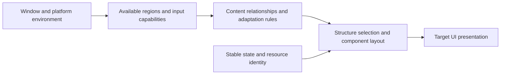

**English** · [简体中文](../zh-CN/Adaptation/README.md)

# Bern UI adaptation guidelines

- Version: v0.1
- Official sources checked on: 2026-10-09, Asia/Shanghai
- Phase: design preparation before implementation, and the basis for acceptance
- Related: [Bern architecture design v0.11](../Design.md)

Bern's adaptation is based on the current window space, content relationships, input capabilities and platform rules. The same business feature can appear as a phone navigation page, a tablet split view, a desktop window or a TV focus interface; commands, data identity and resource ownership stay the same. The device model is only used to choose the capability probes and verification scenarios that are needed; it cannot replace the actual layout conditions.

This directory collects the official guidelines and maps them to Bern backend requirements. The text clearly distinguishes official facts from Bern design decisions; completed platform research does not mean that the backend implementation, device certification or acceptance on real devices has been completed.

## Platform documents

| Scope requested by the user | Adaptation document | Focus |
| --- | --- | --- |
| macOS | [Apple platforms](Apple.md#2-macos-desktop-windows-and-keyboard-workflows) | SwiftUI / AppKit, separate windows, menus and keyboard |
| Linux | [Windows and Linux](WindowsLinux.md) | GTK / GNOME as the default route, KDE as a separate set of guidelines for comparison |
| Windows | [Windows and Linux](WindowsLinux.md) | WinUI 3, logical window size, scaling, touch and high contrast |
| Android | [Android](Android.md) | Current window classes, system edges, back, mixed input and lifecycle |
| iOS and iPhone | [Apple platforms](Apple.md#3-ios--iphone-touch-and-navigation-continuity) | Touch, size classes, safe areas and navigation continuity |
| Apple tvOS and Apple TV | [Apple platforms](Apple.md#5-tvos--apple-tv-remote-focus-first) | Remote focus, viewing from a distance, video controls and TV safe areas |
| HarmonyOS | [HarmonyOS](HarmonyOS.md) | ArkUI target preparation, window changes, folding and device capabilities |
| Android TV and Google TV | [Android](Android.md#8-android-tv--google-tv) | Remote control, directional navigation, playback keys and TV layout |
| iPhone Duo foldable | [Apple platforms](Apple.md#6-iphone-duo-dynamic-adaptation-for-an-announced-device) | Inner and outer screens, posture regions, dynamic multi-scene capability |
| iPad and iPadOS | [Apple platforms](Apple.md#4-ipados--ipad-resizable-windows-and-mixed-input) | Resizable windows, primary and secondary layout, menus, and touch alongside keyboard and mouse |
| Web browsers | [Web design guidelines](Web.md) | Bern's own neutral web style, theme roles and control recipes, page and dialog presentation, the boundary of what the browser hosts |
| Emby and Jellyfin | [Media clients](MediaClients.md) | Official client behavior, brand and protocol boundaries, Bern's media UI contract |

The links above are organized by topic, to avoid maintaining mutually contradictory rules for different devices of the same system. Android foldables and dual screens are also covered in the Android document; iPhone Duo rules cannot stand in for its platform interfaces.

iPhone Duo already has an official Apple product page and development guidance. As of this check, the release date listed on the official site is 2026-10-23, so adaptation can be prepared, but it cannot be described as already tested on a shipping device. [Apple product page](https://www.apple.com/iphone-duo/).

## Official basis and project rules

| Content type | Use | Usage rule |
| --- | --- | --- |
| Official HIG or design guidelines | Interface organization, interaction conventions and accessibility direction | Keep the platform, device and scenario conditions; recommendations cannot be rewritten on our own authority into hard system limits |
| Official APIs and development guides | Available capabilities, lifecycle and version conditions | Check the running OS, the SDK and the actual dependencies together; do not guess the version from the page URL |
| Official product descriptions | Confirming devices and released features | Do not replace API behavior, performance or adaptation acceptance |
| Official client and protocol documentation | Business behavior and interoperability of Emby/Jellyfin | Not treated as general visual guidelines across operating systems |
| Bern mapping and acceptance | Deciding how the framework implements the user's requirements | Explicitly this project's design; cannot be attributed to official platform rules |
| Search summaries only, or dynamic page shells | Discovering sources and entry points for later checking | Not the sole evidence for specific APIs, hard sizes or version requirements |

When a platform's design recommendations disagree with Bern's requirements for commands, themes or icon buttons, record each difference and its acceptance result item by item. Using system components for the appearance does not justify also claiming that all of Bern's contracts are met.

In this round, some Apple HIG body text was verified through Apple's official page data or official video transcripts; some detailed HarmonyOS documents had reading restrictions; the official Android TV safe-area examples contain numeric discrepancies. Each per-platform document keeps its specific boundaries, rather than hiding inconsistencies between sources in one set of general constants.

## Adaptive environment model

The following is design input for Bern's environment protocol; the exact field spelling and serialization form are to be confirmed by the prototype. The environment belongs to a window or a presentation scope, not to a single static device configuration for the whole app.

| Input | Information that must be expressed | Cannot be replaced by |
| --- | --- | --- |
| Content area | The logical width and height available for layout in the current window or virtual window, and its coordinate system | Physical screen resolution |
| Pixel ratio | The ratio from layout units to actual rendered pixels, and its changes | A fixed integer multiple |
| Font environment | System text size, font metrics, language and writing direction | Uniform whole-page scaling |
| Edge constraints | Semantics of system bars, gestures, window decorations, the keyboard and occlusion | A single fixed padding |
| Internal regions | Occlusions, separations, reserved regions and the use of each | Recording only the safe area on the four edges |
| Posture | Known states such as flat and partially folded, and whether the information is available | An `isFoldable` boolean |
| Input capabilities | Touch, fine pointer, keyboard, directional remote, pen, and the current focus context | One input permanently assigned by the operating system |
| Viewing scenario | Target configurations such as close-range desktop/handheld and distant TV | Inferring TV from the window width alone |
| Window capabilities | Whether operations such as creating the required native window, modals and restoration are currently possible | `platform == desktop` |
| Media capabilities | Executor, subtitles and tracks, overlays, picture-in-picture and background capabilities | Everything counted as supported because a `Video` component exists |
| Accessibility | Text enlargement, increased contrast, Reduce Motion and assistive input semantics | A single dark mode boolean |
| Change identity | The owning session/window, instance generation and update version | Global screen events with no owner |

Unknown capabilities must be expressible as unknown or not_available; facts cannot be made up from product names. Pixels, pt, dp, vp and Windows effective pixels belong to the measurement contexts of different platforms, and the backend is responsible for converting between them; values must not be copied directly with the claim that the visual or physical size is the same.

## Layout selection and state preservation

The following order is a Bern design decision, used to produce analyzable, reproducible layout behavior:

1. Confirm that the current host, window and required capabilities are available, and resolve native or virtual presentation.
2. Obtain the content bounds, system constraints and internal available regions, avoiding subtracting the same safe area twice.
3. Determine the input and viewing scenario, and choose the handheld, desktop or TV interaction recipe.
4. Choose a single column, list-detail, primary and secondary regions or a grid according to the content relationships and the actual needs of the text.
5. Within the same structure, compute widths, wrapping, spacing and the maximum content width.
6. Preserve the selected item, drafts, scroll anchor, navigation and player through stable identities, and commit the updates as one batch.

System size, folding and appearance changes update the environment through trusted events. Layout evaluation cannot re-dispatch search, source switching or playback business commands; for example, when a single-column detail expands into list-detail, it still shows the same entity and keeps the same player.

The compact/expanded of the first-version architecture are names of declaration branches, not a promise to enumerate the size classes of every OS. Android's current five width classes, Apple's size classes, Windows' default navigation thresholds and GNOME's content breakpoints are each interpreted by the target's policy. Extending the common semantics requires adding to the IR and to acceptance; platform special cases cannot be buried in unknown expressions.

## Common adaptation contract

### Navigation and feature completeness

The app declares top-level destinations, hierarchy, list-detail and primary-secondary relationships; the backend chooses a sidebar, tab bar, navigation rail, page stack or TV content entry. When a region collapses, a discoverable alternative entry is kept, and the Feature Contract checks the required features.

Hover, right-click, long press and drag cannot be the only implementation of a feature required across targets. When text gets longer or the font gets larger, prefer wrapping, reflowing and scrolling; do not shrink the font to hide a lack of space.

### Input and commands

Mouse clicks, touch, keyboard activation, remote confirmation and assistive technology activation are bound to the same semantic action. A raw gesture preview may update locally; a commit action runs the command once, and canceling does not change committed business state.

Tab order, the directional focus graph and screen reader order are described and verified separately. Virtualized lists restore focus by data key; system focus or window changes the platform has already made are merged as facts, without fabricating commands after the fact.

### Multiple windows and dynamic capabilities

WindowSet registers static window kinds, and open commands create instances. auto chooses native or virtual presentation within the current target and cannot secretly replace the UI backend; when there is no UI host, it cannot launch an interface automatically either.

Native creation capability can change with the device form or system state, so both checking before creation and handling the creation result are required. For example, the multi-scene capability of iPhone Duo must be judged from the actual inner or outer screen environment; see [Apple multi-scene rules](Apple.md#boundaries-of-multiple-scenes-and-multiple-displays).

On narrow screens and TVs, virtual windows by default show the current content plus an actionable switching entry, and keep the state of the other windows. Virtual windows do not simulate spanning displays, global always-on-top or separate taskbar entries. Ordinary close, confirmation of dirty drafts and the last-window policy follow the main design document; a forced termination by the platform cannot be guaranteed to be cancelable.

### Theme and accessibility

Bern controls follow the system by default; when there is no system appearance signal, they use the light fallback specified by the architecture; apps can explicitly choose an appearance such as dark. Videos, covers and photos keep the original colors of the content. System high contrast, text scaling and Reduce Motion are handled independently.

Colors come from the sources set by the main design document's "native first, algorithm as fallback": targets whose UI framework has a complete light and dark mode system use platform colors, materials and standard control styles, and targets that lack such a system (such as the Web) and Bern's self-drawn parts use the Bern theme algorithm. Icon buttons must keep a sufficient hit area, a semantic label and clear focus feedback; TV focus cannot rely on subtle color changes.

### Video and media clients

Video always expresses playback semantics, and the media backend and the UI presentation are accepted separately. Window, layout or fold changes do not secretly duplicate player_id. Compositing of subtitles, control bars, danmaku and virtual windows with native video must be tested for real.

A system's built-in control bar can serve as the standard implementation only if it satisfies the command contract; observing a playback result is not the same as dispatching a command beforehand. Background playback, system media entry points, network permissions and remote playback targets are modeled separately; a single "playback failed" cannot be used to hide the cause.

Emby/Jellyfin serve as real app scenarios. Accounts, media libraries, watch history and the server protocol belong to the app adapter; windows, navigation, theme and the player contract belong to Bern; see [media client adaptation](MediaClients.md).

## Implementation preparation and verification matrix

For each target combination, first produce the support record below before committing to a platform being supported:

| Record dimension | What to record |
| --- | --- |
| Platform combination | OS and version, UI target, SDK/dependency versions, device or simulated environment |
| Size environment | Current logical width and height, scaling, text size, safe areas, internal regions, posture |
| Input environment | Touch/keyboard and mouse/remote/assistive technology, and the focus context |
| Native capabilities | Multiple windows, close checks, combinations of media executor and presentation |
| Scenarios and actions | Initial fixture, command sequence, sequence of environment changes and expected state |
| Evidence | Compile results, actual input results, observed state, performance data and source versions |

Minimum scenario set:

- [ ] Both sides of each platform's key size boundaries, the boundary itself, short windows and long text.
- [ ] Light and dark mode, high contrast, enlarged text, RTL and Reduce Motion.
- [ ] Every input method declared as supported completes the same set of required Features.
- [ ] State and resource identity are preserved during folding, rotation, split screen, moving across displays or window resizing.
- [ ] Closing, restoring and modals of native and virtual windows, stale references, and capability changes during creation.
- [ ] Embedded video, full window, overlays, background restrictions and remote disconnection.
- [ ] The same engine driven by UI, CLI, JSON and MCP, with consistent results and state versions.

The recommended implementation order is Bern's engineering choice: first use the Web to verify environment snapshots, layout continuity and virtual windows, then verify each default desktop target; after that, add mobile/foldable and TV input. Capability prototypes for the platforms can be built in parallel, but one platform passing cannot complete acceptance on behalf of the others.

tvOS already has a buildable target (`swiftui + tvos`, minimum tvOS 18, since 2026-10-20, simulator builds, see the [tvOS implementation notes](../Implementation/tvOS-SwiftUI.md)); real devices and a real remote have not yet been accepted. HarmonyOS is still within the scope of adaptation research; it needs its own target description, toolchain, runtime bridge and capability prototype, and no minimum system version is set before the SDK has been verified.

## Maintaining the sources

Official pages may change with system and SDK updates. When locking versions before implementation, re-verify the APIs, size rules and platform limits that will be used; when updating the documents, also record the affected Bern decisions and acceptance scenarios. Items whose source body text could not be obtained, or whose sources conflict, keep an explicit status; search rankings or community screenshots cannot be used to fill them in as official conclusions.
