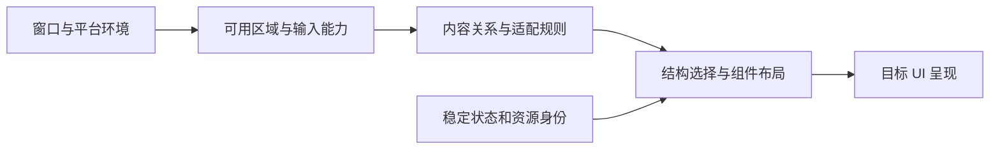

# Bern UI 自适应适配规范

- 版本：v0.1
- 官方资料核查日期：2026-10-09，Asia/Shanghai
- 阶段：实现前的设计准备与验收依据
- 关联：[Bern 架构设计 v0.11](../Design.md)

Bern 的自适应以当前窗口空间、内容关系、输入能力和平台规则为依据。同一业务功能可以呈现为手机导航页、平板分栏、桌面窗口或电视焦点界面；命令、数据身份和资源所有权保持一致。设备型号只用于选择需要的能力探测与验证场景，不能代替实际布局条件。

本目录整理官方指南，并将它们映射为 Bern 后端要求。文中明确区分官方事实与 Bern 设计决策；平台研究完成不代表后端实现、设备认证或真机验收已经完成。

## 平台文档

| 用户要求的范围 | 适配文档 | 重点 |
| --- | --- | --- |
| macOS | [Apple 平台](Apple.md#2-macos桌面窗口与键盘工作流) | SwiftUI / AppKit、独立窗口、菜单与键盘 |
| Linux | [Windows 和 Linux](WindowsLinux.md) | GTK / GNOME 为默认路线，KDE 作为独立规范对照 |
| Windows | [Windows 和 Linux](WindowsLinux.md) | WinUI 3、窗口逻辑尺寸、缩放、触控和高对比 |
| Android | [Android](Android.md) | 当前窗口分类、系统边缘、返回、混合输入与生命周期 |
| iOS 和 iPhone | [Apple 平台](Apple.md#3-ios--iphone触摸与导航连续性) | 触摸、尺寸类别、安全区域与导航连续性 |
| Apple tvOS 和 Apple TV | [Apple 平台](Apple.md#5-tvos--apple-tv遥控焦点优先) | 遥控焦点、远距离观看、视频控制与电视安全区域 |
| HarmonyOS 鸿蒙 | [HarmonyOS](HarmonyOS.md) | ArkUI 目标准备、窗口变化、折叠与设备能力 |
| Android TV 和 Google TV | [Android](Android.md#8-android-tv--google-tv) | 遥控器、方向导航、播放按键与电视布局 |
| iPhone Duo 折叠屏 | [Apple 平台](Apple.md#6-iphone-duo已公布设备的动态适配) | 内外屏、姿态区域、动态多场景能力 |
| iPad 和 iPadOS | [Apple 平台](Apple.md#4-ipados--ipad可调整窗口与混合输入) | 可调整窗口、主辅布局、菜单及触摸键鼠并存 |
| Emby 和 Jellyfin | [媒体客户端](MediaClients.md) | 官方客户端行为、品牌与协议边界、Bern 媒体界面契约 |

上述链接按主题组织，避免为同一个系统的不同设备重复维护互相矛盾的规则。Android 折叠屏和双屏也纳入 Android 文档，不能用 iPhone Duo 规则替代其平台接口。

iPhone Duo 已有 Apple 官方产品和开发指南。截至本次核查，官网列出的上市日期为 2026-10-23，因此可以准备适配，但不能写成已经通过上市设备实测。[Apple 产品页](https://www.apple.com/iphone-duo/)。

## 官方依据与项目规则

| 内容类型 | 用途 | 使用规则 |
| --- | --- | --- |
| 官方 HIG 或设计指南 | 界面组织、交互习惯与可访问性方向 | 保留平台、设备和场景条件；建议不能擅自改写成系统硬限制 |
| 官方 API 与开发指南 | 可用能力、生命周期与版本条件 | 同时核对运行 OS、SDK 和实际依赖，不按页面 URL 猜版本 |
| 官方产品说明 | 确认设备及已发布特性 | 不代替 API 行为、性能或适配验收 |
| 官方客户端与协议说明 | Emby/Jellyfin 的业务行为与互通 | 不当作跨操作系统通用视觉规范 |
| Bern 映射与验收 | 决定框架如何实现用户要求 | 明确属于本项目设计，不能归为平台官方规定 |
| 仅检索摘要或动态页面壳 | 发现来源和后续核对入口 | 不作为具体 API、硬性尺寸或版本要求的唯一证据 |

平台设计推荐与 Bern 的命令、主题或图标按钮要求不一致时，需要逐项记录差异和验收结果。不能因为外观使用系统组件，就同时宣称其满足全部 Bern 契约。

本轮部分 Apple HIG 正文通过 Apple 官方页面数据或官方视频文字稿核验；HarmonyOS 的部分详细文档存在读取限制；Android TV 官方安全区例子有数值差异。各分册保留具体边界，不将来源不一致藏在一组通用常量中。

## 自适应环境模型

以下为 Bern 环境协议的设计输入，具体字段拼写和序列化形式待原型确认。环境属于窗口或呈现作用域，不属于全应用唯一的静态设备配置。

| 输入 | 必须表达的信息 | 不能替代为 |
| --- | --- | --- |
| 内容区域 | 当前窗口或虚拟窗口可布局的逻辑宽高及坐标系 | 物理屏幕分辨率 |
| 像素比例 | 布局单位到实际渲染像素的比例及变化 | 固定整数倍数 |
| 字体环境 | 系统文字级别、字体度量、语言与书写方向 | 整页统一缩放 |
| 边缘约束 | 系统栏、手势、窗口装饰、键盘及遮挡的语义 | 单个固定 padding |
| 内部区域 | 遮挡、分隔、预留区域及各自用途 | 只记录四边安全区 |
| 姿态 | 平展、部分折叠等已知状态及信息是否可用 | `isFoldable` 布尔值 |
| 输入能力 | 触摸、精细指针、键盘、方向遥控、笔及当前焦点上下文 | 由操作系统永久指定一种输入 |
| 观看场景 | 近距离桌面/手持、电视远距离等目标配置 | 单靠窗口宽度推断 TV |
| 窗口能力 | 当前能否创建所需原生窗口、模态和恢复等操作 | `platform == desktop` |
| 媒体能力 | 执行端、字幕与轨道、叠层、画中画及后台能力 | `Video` 组件存在即全部支持 |
| 辅助功能 | 文字放大、提高对比、减少动态效果及辅助输入语义 | 一个深色模式布尔值 |
| 变化身份 | 所属 session/window、实例代次与更新版本 | 无归属的全局屏幕事件 |

未知能力必须能表达 unknown 或 not_available，不能根据产品名称补造事实。像素、pt、dp、vp 与 Windows effective pixels 属于不同平台的度量语境，后端负责转换；不得直接复制数值并宣称视觉或物理尺寸相同。

## 布局选择与状态保持

以下顺序是 Bern 的设计决策，用于生成可分析、可复现的布局行为：

1. 确认当前宿主、窗口和必需能力可用，解析原生或虚拟呈现。
2. 得到内容边界、系统约束和内部可用区域，避免重复扣除同一安全区。
3. 确定输入和观看场景，选择手持、桌面或电视的交互配方。
4. 根据内容关系及文字实际需求选择单栏、列表详情、主辅区域或网格。
5. 在同一结构内计算宽度、换行、间距和内容最大宽度。
6. 通过稳定身份保留选中项、草稿、滚动锚点、导航及播放器，提交同一批次的更新。

系统尺寸、折叠与外观变化通过受信任事件更新环境。布局求值不能重新派发搜索、换源或播放业务命令；例如单栏详情展开成列表详情时，仍查看同一个实体，并保持同一个播放器。

首版架构的 compact/expanded 是声明分支名称，不是对所有 OS 尺寸类别的枚举承诺。Android 的当前五档宽度、Apple 的尺寸类别、Windows 的导航默认阈值及 GNOME 的内容断点分别由目标策略解释。扩展公共语义时必须补充 IR 与验收，不能在未知表达式中埋平台特例。

## 共同适配契约

### 导航与功能完整性

应用声明顶层目的地、层级、列表详情和主辅关系；后端选择侧栏、标签栏、导航轨、页栈或电视内容入口。区域折叠时保留可发现的替代入口，并由 Feature Contract 检查必需功能。

悬停、右键、长按和拖动均不能成为跨目标必需功能的唯一实现。文字变长或字体增大时，优先换行、重排和滚动，不缩小字体掩盖空间不足。

### 输入与命令

鼠标点击、触摸、键盘激活、遥控确认和辅助技术激活绑定同一语义动作。原始手势预览可以在本地更新；提交动作执行一次命令，取消不改变已提交业务状态。

Tab 顺序、方向焦点图和读屏顺序分别描述与验证。虚拟化列表按数据 key 恢复焦点；平台已经完成的系统焦点或窗口变化作为事实归并，不事后伪造命令。

### 多窗口与动态能力

WindowSet 登记静态窗口种类，打开命令创建实例。auto 在当前目标内选择原生或虚拟呈现，不能暗中替换 UI 后端；无 UI 宿主时也不能自动启动界面。

原生创建能力可以随设备形态或系统状态变化，因此创建前检测和创建结果处理都必需。例如 iPhone Duo 的多场景能力需按实际内外屏环境判断，详见 [Apple 多场景规则](Apple.md#多场景与多显示边界)。

窄屏及电视虚拟窗口默认采用当前内容加可操作切换入口，保留其他窗口状态。虚拟窗口不模拟跨显示器、全局置顶或独立任务栏条目。普通关闭、脏草稿确认和最后窗口策略沿用主设计文档；平台强制终止不能保证可取消。

### 主题与无障碍

Bern 控件默认跟随系统，缺少系统外观信号时沿用架构规定的浅色回退；应用可显式选择深色等外观。视频、封面和照片保持内容原色。系统高对比、文字缩放与减少动态效果独立处理。

颜色来源按主设计文档的“原生优先，算法兜底”：UI 框架具备完整深浅色体系的目标使用平台颜色、材料与标准控件样式，缺少该体系的目标（如 Web）和 Bern 自绘部分使用 Bern 主题算法。使用 Bern 配方的 IconButton 无可见容器，原生目标使用平台无边框样式，系统托管位置遵循平台规则；两者都须保留透明热区、语义标签和明确焦点反馈，电视焦点不能依赖细微变色。

### 视频与媒体客户端

Video 始终表达播放语义，媒体后端和 UI 呈现分别验收。窗口、布局或折叠变化不暗中复制 player_id。字幕、控制条、弹幕和虚拟窗口与原生视频的合成必须真实测试。

系统自带控制条只有在满足命令契约时才可作为标准实现；观察播放结果不等于事前派发命令。后台播放、系统媒体入口、网络权限和远程播放目标分别建模，不能用同一个“播放失败”隐藏原因。

Emby/Jellyfin 用作实际应用场景。账号、媒体库、观看历史和服务协议属于应用适配器，窗口、导航、主题和播放器契约属于 Bern；见 [媒体客户端适配](MediaClients.md)。

## 实施准备与验证矩阵

每个目标组合先形成下面的支持记录，再承诺某个平台已受支持：

| 记录维度 | 要记录的内容 |
| --- | --- |
| 平台组合 | OS 与版本、UI 目标、SDK/依赖版本、设备或模拟环境 |
| 尺寸环境 | 当前逻辑宽高、缩放、文字级别、安全区、内部区域、姿态 |
| 输入环境 | 触摸/键鼠/遥控/辅助技术及焦点上下文 |
| 原生能力 | 多窗口、关闭检查、媒体执行端与呈现组合 |
| 场景与动作 | 初始 fixture、命令序列、环境变化序列和预期状态 |
| 证据 | 编译结果、实际输入结果、观察状态、性能数据与来源版本 |

最低场景集：

- [ ] 每个平台的关键尺寸边界两侧、边界本身、矮窗口和长文本。
- [ ] 深浅色、高对比、文字放大、RTL 和减少动态效果。
- [ ] 所有声明支持的输入方式完成同一组必需 Feature。
- [ ] 折叠、旋转、分屏、跨显示器或窗口调整期间保持状态及资源身份。
- [ ] 原生和虚拟窗口关闭、恢复、模态、旧引用及创建期间能力变化。
- [ ] 视频嵌入、全窗口、覆盖层、后台限制和远端断连。
- [ ] 同一引擎由 UI、CLI、JSON、MCP 驱动，结果与状态版本一致。

推荐实施顺序是 Bern 的工程选择：先用 Web 验证环境快照、布局连续性和虚拟窗口，再分别验证默认桌面目标；随后加入移动/折叠与电视输入。可并行做各平台能力原型，但一个平台通过不能替其他平台完成验收。

tvOS 与 HarmonyOS 已进入适配研究范围，仍需要独立目标描述、工具链、运行时桥接和能力原型。本轮不把它们写成已有可构建后端，也不在未核验 SDK 前确定最低系统版本。

## 资料维护

官方页面可能随系统和 SDK 更新而变化。实现前锁定版本时，重新核验将使用的 API、尺寸规则与平台限制；更新文档时同时记录受影响的 Bern 决策和验收场景。来源正文未取得或存在冲突的项目保留明确状态，不能以搜索排名或社区截图补成官方结论。
