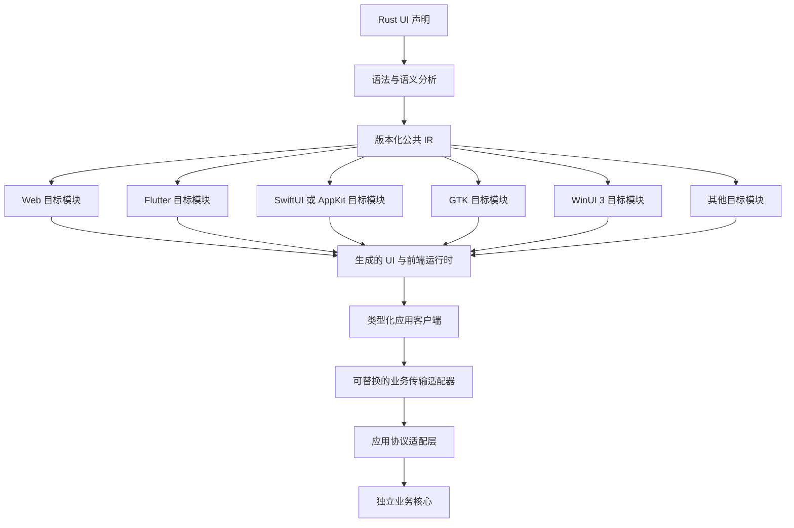
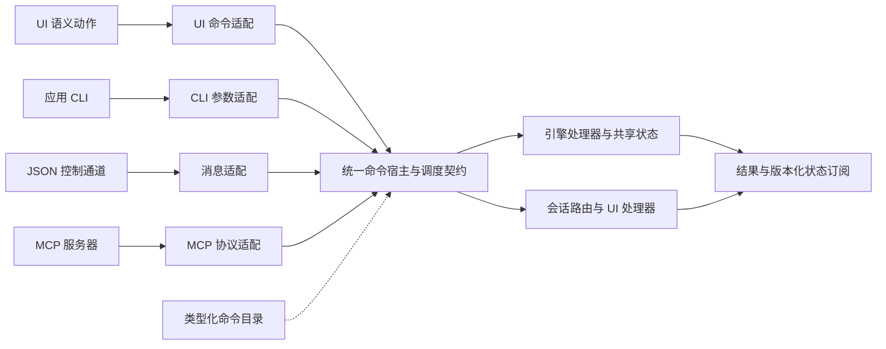
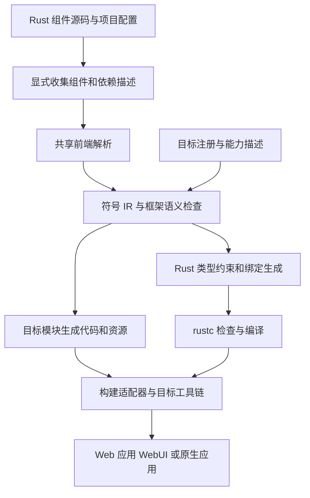

# Bern UI 框架设计文档

- 版本：v0.34
- 状态：架构与语义规范；当前接口、平台支持与待实现目标分别标注
- 更新日期：2026-10-21
- 项目名称：Bern UI
- 仓库：AimesSoft/Bern
- 主要开发语言：Rust
- 首个目标平台：macOS（SwiftUI）

当前已提供 macOS / iOS / tvOS SwiftUI、Android Compose、Windows WinUI 3、Linux GTK 和 Web 后端，以及命令、查询、会话、模块组合、资源、构建与打包工具。近期补齐了 Web 设置与引导、受控控件、搜索面板、播放器坐标布局、共享胶囊控件和图片跨分栏 Hero。各后端的功能覆盖与验证程度不同，以[平台能力表](Reference/Platforms.md)及各平台实现记录为准。

编写界面时使用[组件参考](Reference/UI.md)和[完整属性表](Reference/Component-Properties.md)。本文保留架构决策、语义与后续目标；入口和专题索引见[文档目录](README.md)。

平台官方依据、UI 自适应映射和各设备验收场景见 [UI 自适应适配规范](Adaptation/README.md)。其中新增研究的平台与设备不代表已实现后端；核心架构约束仍以本文为准。

原生 UI 连接机制与实现经验见 [React Native 源码研究](Research/ReactNative.md)，其中区分了运行时渲染、接口代码生成与 Bern 的目标代码生成路线。

Bern 是一个基于 Rust、以命令为中心的模块化应用框架，Bern UI 是其中的声明式跨平台界面层，面向开发者与 AI Agent。框架同时定义命令、查询、状态、会话和入口适配协议。开发者在 Rust 源文件中定义组件，由 Bern 将可分析的 UI 声明编译为各平台的界面实现，复用已有 UI 技术，不自行开发完整的图形渲染引擎。

本版本确立的核心约束是：**可跨平台导出的 UI 组件必须使用受约束、可静态分析的声明；每个可操作入口必须绑定类型化命令。** 标准控件的通用交互由 Bern 自动生成会话命令，业务操作绑定应用已注册命令，缺少绑定或绕过命令的 UI 声明必须编译报错。普通 Rust 用于命令处理器、查询提供器和应用内部实现，不将任意 Rust 代码转译为 Dart、Swift 或 Kotlin。

**前后端分离与模块化是底层架构要求。** 应用的 UI 前端通过类型化协议连接业务核心；编译器通过版本化 IR 和生成器接口接入不同 UI 技术。Flutter、macOS 原生 UI 及后续新目标应作为独立模块扩展，不能要求应用重写业务核心，也不能在核心编译器中不断添加平台特例。

**UI、CLI、JSON 控制通道和 MCP 服务器是同一个应用引擎的不同入口。** 它们共享命令描述、执行规则、状态和结果，不各自实现业务逻辑。Bern 提供通用命令基础设施与适配接口，具体业务处理器由应用提供；使用现有引擎时，由适配层接入同一契约。

**每个 UI 控件从底层支持深浅色模式，颜色默认由目标 UI 框架提供。** 目标 UI 框架自身具备完整的深浅色与语义颜色体系时，例如 SwiftUI、WinUI 3 和 Compose，Bern 直接使用其系统颜色、材质和标准控件样式；只有目标缺少这类体系（例如 Web）或控件由 Bern 自行绘制时，才使用 Bern 的统一色彩算法、语义颜色和控件状态配方。应用默认无需配置颜色、判断深浅色或维护两套样式。这个要求同时约束内置控件、扩展控件和所有 UI 目标。

**原生目标以平台视觉规范为准。** 具备明确设计规范与原生组件库的目标，例如 macOS，生成代码使用平台标准容器、控件和系统样式，外观随 SDK 与系统版本演进。需要明确容器、尺寸或分组时可以使用系统视觉接口；较新接口按系统版本分支，并定义旧系统回退。应用设计稿所要求的按钮容器与功能分组应由声明表达，不能由后端擅自移除。

**多窗口是统一的声明能力。** 同一套 Window 声明与窗口命令在支持的平台使用原生窗口，无法提供所需原生多窗口能力时自动使用应用内虚拟窗口。窗口身份、状态与业务连接不因呈现方式不同而改变。

**Web 提供两种独立构建产物。** Web 应用在浏览器内运行 UI 与 Rust WASM 业务引擎；WebUI 只包含界面、前端运行时和协议客户端，通过 JSON 控制通道连接独立运行的 Bern 引擎。两种构建共用 Web 后端、组件声明与命令协议，业务引擎的运行位置由构建配置明确选择。

本文同时保留已实现语义与明确标注的后续设计。当前组件和属性以 `bern-ir::spec::COMPONENTS` 为准，目标支持以各后端的 `TargetDescriptor` 与能力检查为准；本文中的省略号及伪代码用于解释语义。可构建的完整应用见 `examples/hello`、`examples/showcase`、`examples/planner`、`examples/gallery` 和 `examples/svg-animation`。API 尚处于早期演进阶段，不把待实现条目当作现有接口。

## 项目目标

Bern 名称来自《海猫鸣泣之时》中的 Frederica Bernkastel。Bern 作为独立通用框架开发，不依赖任何具体应用的业务模型或命令实现。

项目目标包括：

- 使用一套 Rust 组件声明表达可移植的 UI 语义，允许不同尺寸和输入方式使用不同布局。
- 分离应用 UI、业务核心与传输实现；让 UI 技术和运行平台可以独立选择。
- 新 UI 目标通过独立生成器、运行时适配与构建集成接入，核心层不依赖具体 UI 框架。
- 默认提供完整的深浅色适配：原生目标使用平台自身的颜色体系，缺少该体系的目标由 Bern 统一推导颜色、控件状态和对比关系，使应用使用者不承担主题适配工作。
- 通过编译期诊断检查组件属性、本地化完整性、功能入口覆盖和平台能力要求。
- 强制 UI 的所有语义操作命令化，使 UI、CLI、JSON 控制通道和 MCP 可以驱动同一引擎实例。
- 从同一份类型化描述派生各入口，提供导航、焦点、异步资源和可复现场景的通用规则。
- 以统一声明支持多个独立窗口，在原生多窗口不可用时自动适配虚拟窗口，保留各窗口的交互状态。
- 保持必要且明确的运行时，负责动态状态、事件和平台桥接。
- 提供稳定、简短且写法一致的 API，让 Agent 能根据诊断完成修改。

初期不追求任意 Rust UI 的自动跨语言转换，也不承诺各平台逐像素一致。现阶段不开发新的独立源文件语言、完整渲染引擎，也不在框架中内置媒体库、账号等应用业务；通用命令描述、调度协议、视频组件与媒体适配接口属于框架职责。Bern 复用已有媒体设施，不自行实现通用音视频解码器。

桌面和移动端不引入 JavaScript 引擎作为 UI 运行时。Web 允许使用必要的 JavaScript 和 Web API 绑定。应用开启运行时插件时带一个执行插件脚本的 JavaScript 引擎，它不参与界面；没有开启插件的应用不链接它。

## 核心决策

| 领域 | 决策 |
| --- | --- |
| 源码组织 | 所有 UI 定义位于 `.rs` 文件，复用 Rust 模块与依赖管理 |
| 声明入口 | 使用 `#[component]` 标记可导出组件，在组件内使用统一的 `ui!` 声明 |
| 静态边界 | 组件结构、表达式、命令引用和功能入口必须可被 Bern 前端识别 |
| 动态行为 | 条件、列表和属性值可以动态变化，以明确的 IR 节点和 Rust 绑定表达 |
| 类型检查 | Bern 检查声明语义，生成 Rust 类型约束，由 `rustc` 检查实际 Rust 类型 |
| 本地化 | 用户可见静态文本与翻译共同声明，使用字符串字面量承载自然语言 |
| 功能覆盖 | 显式 Feature Contract 是依据，各自适应布局必须声明并实现要求的入口 |
| 自动主题 | 原生优先：目标 UI 框架具备深浅色体系时使用其系统颜色与标准样式，默认跟随系统；品牌色可选，映射为平台强调色 |
| 色彩算法 | 共享的 Rust 主题内核为缺少原生体系的目标（如 Web）和 Bern 自绘控件生成并校验配色，这些部分消费同一主题快照 |
| 原生视觉 | 原生目标使用平台标准组件与系统样式；支持显式容器、尺寸、功能分组及按版本回退的系统视觉接口；macOS 规则见后端实现边界 |
| 强制命令化 | 所有可操作入口绑定引擎命令或会话命令，标准交互自动生成，违规声明编译失败 |
| 多入口引擎 | UI、应用 CLI、JSON 通道与 MCP 使用同一命令目录、调度契约和引擎状态 |
| 操作语义 | Command 执行动作，Query 保持只读，Event 通知事实，统一描述但不混淆副作用 |
| 运行时插件 | 应用可选开启；插件按应用定义的权限组使用命令目录，经钩子交回结果；首版运行 JavaScript，不在运行时装入原生代码 |
| 编译入口 | `bern build` 协调组件收集、代码生成、Rust 编译与平台构建 |
| 随包资源 | `Bern.toml` 受限声明随应用发布的文件，构建严格校验并由目标复制进产物；引擎经宿主装配的 `Resources` 按名称解析，不依赖平台布局 |
| 应用分层 | 通用命令宿主路由引擎与 UI 会话命令，业务核心不依赖具体 UI |
| 目标扩展 | 公共 IR 与目标接口对接独立生成器，平台运行时和构建工具各自适配 |
| 目标选择 | UI 技术与运行平台是两个维度，同一平台可选择不同 UI 前端 |
| 桌面默认 | macOS 使用 SwiftUI，Linux 使用 GTK，Windows 使用 WinUI 3；显式配置可选择其他已支持目标 |
| 多窗口 | WindowSet 与 Window 声明窗口，默认原生优先、不可用时自动虚拟呈现，共享身份、命令及生命周期 |
| 视频播放 | 使用专门的 Video 声明，Web 默认映射 video 元素，其他平台通过独立媒体后端与呈现接口接入 |
| 部署方式 | 首版优先本地运行，业务协议不绑定同进程、FFI 或网络传输 |
| 首个后端 | macOS SwiftUI：生成使用标准原生组件的 SwiftUI 代码，业务引擎默认在应用进程内运行 |
| Web 构建 | `app` 生成浏览器内 UI 与 WASM 引擎；`ui` 生成连接独立引擎的 WebUI，分别构建与验收 |

`ui!` 内仍然存在一套声明语法。使用 Rust 宏意味着不增加独立文件格式，不意味着可以省去语法规则、工具支持和学习成本。因此，同一功能应只有一种推荐写法。

## 平台目标与原生语义

平台不与某一种 UI 技术永久绑定。构建目标由“UI 技术、运行平台、构建模式、UI 桥接和业务传输”共同确定，只有经过声明与验证的组合才可用。构建模式决定产物包含哪些运行部分，不是新增一种 UI 技术。

| UI 技术 | 目标运行平台 | 生成产物 | 定位与阶段 |
| --- | --- | --- | --- |
| Web DOM | 浏览器 | Web 应用或 WebUI；共用 HTML、CSS、绑定与前端 WASM，按模式决定是否包含业务引擎 | 第二个正式后端，需 Bern 自定视觉规范与主题算法，两种模式均需验收 |
| SwiftUI | macOS、iOS、tvOS | SwiftUI 视图、Swift 绑定与平台工程集成 | macOS、iOS 与 tvOS 默认；macOS 为首个正式后端，iOS 与 tvOS 目标已构建模拟器应用，真机签名与打包后续实现 |
| GTK | Linux | GTK 控件、Rust 绑定与桌面集成 | Linux 默认；阶段五第一批已实现 |
| WinUI 3 | Windows | WinUI 3 界面（无运行时时回退到系统 XAML）、C++/WinRT 平台宿主与 Rust 桥接 | Windows 默认；阶段五第二批已实现 |
| Jetpack Compose | Android | Kotlin Compose UI、绑定与 Android 工程集成 | Android 默认；第一版已实现 |
| Flutter | Flutter 支持且 Bern 已适配的平台 | Dart Widget、绑定代码与 Flutter 工程集成 | 可选跨平台目标 |
| GPUI | Windows、macOS、Linux | GPUI Rust UI 与原生集成 | 可选桌面目标 |
| AppKit | macOS | AppKit 控件及窗口集成 | 可独立扩展，或辅助 SwiftUI 适配 |

PC 默认采用各平台的原生 UI 技术：`swiftui + macos`、`gtk + linux`、`winui3 + windows`。`swiftui + macos` 是首个正式实现目标：macOS 有明确的设计规范和成熟的原生组件库，最容易达到系统自带应用的视觉水准，并验证完整架构。Web 没有统一的样式规范，需要 Bern 自行定义视觉规范与主题算法，作为第二个正式目标。其他桌面默认映射不代表对应后端已经实现。

项目可以显式选择 `flutter + macos`、`gpui + windows` 等其他受支持组合。GPUI 与 Flutter 主要使用各自的绘制体系，作为可选方案保留。Linux 有多种桌面环境与 UI 工具包，GTK 是 Bern 选择的 Linux 默认技术；支持范围按实际环境验证，不假设所有 Linux 桌面行为一致。

默认映射由目标注册与配置装配层提供，不写入公共 IR 或业务核心。未指定 UI 技术时按目标平台解析默认值；默认后端未实现、未安装或无法满足包含标准替代方案在内的契约时明确报错，不静默切换为 GPUI、Flutter 或 Web。窗口的原生与虚拟自动选择发生在同一已选 UI 后端内，不改变 UI 技术。显式选择始终优先，并接受同样的能力检查。

Flutter 后端复用 Flutter 的引擎与工具链，不代表 Bern 自研渲染引擎。Flutter 自身支持某个平台，也不代表 Bern 的绑定、资源和能力已经适配该平台。所有能力均按具体组合报告。

Bern 统一组件的语义、状态接口、功能契约与主题协议。控件几何、文本度量、输入法行为和部分交互可以遵循平台习惯；深浅色适配必须由后端完成。目标 UI 框架具备深浅色体系时由平台提供配色；Bern 自绘部分及缺少该体系的目标使用统一算法，规则见下文。只有写入组件规范的行为，才属于跨后端一致性承诺。

## 前后端分离与模块边界

### 应用分层与编译器分层

“前端”和“后端”有两组含义，接口与模块命名必须区分：

| 层次 | 前端 | 后端 |
| --- | --- | --- |
| 应用运行 | 用户看到的 Web、Flutter、SwiftUI 等 UI，以及其局部交互 | 提供业务操作与状态的 Application Core |
| UI 编译 | 读取受约束 Rust 声明并建立语义模型的 Compiler Frontend | 把公共 IR 转换为目标 UI 代码的 Target Backend |

因此，增加一个 Flutter 应用前端，对 Bern 编译器而言是增加 Flutter 目标后端。两者通过明确的接口组合，不将业务逻辑放进生成器。



图中的 UI 表示每个目标各自生成的前端，不是把所有 UI 框架同时装入一个应用。图中展示引擎连接路径，状态与事件通过同一协议反向通知前端；局部会话命令按后文的路由规则就地执行，不必经过业务传输。

### 必须保持的依赖方向

- 公共语义、IR、协议和检查规则不依赖 Flutter、SwiftUI、GTK、WinUI 3、GPUI、DOM 或具体操作系统 SDK。
- 编译器核心调用目标扩展接口，目标模块实现该接口；核心层不导入具体目标实现。
- 只有构建宿主或注册入口选择并装配目标模块，业务核心不选择 UI 后端。
- 业务核心不依赖生成的组件、窗口对象、UI 运行时或编译器。现有应用可以由独立适配层实现 Bern 协议，无须改造为 Bern 专用业务框架。
- 通用前端运行时只处理状态绑定、组件身份与事件协议；具体 UI 调度、控件和资源生命周期由目标运行时适配器负责。
- 主题内核属于独立的前端基础模块，不依赖业务核心、网络或某个目标 UI SDK；所有目标通过主题协议使用它。
- 通用媒体契约不依赖 UI SDK 或具体解码器；媒体后端与呈现适配器负责实际播放及视图附着，由装配层选择兼容组合。
- 应用和前端之间不共享可随意修改的内存对象；跨边界通过声明的值、命令和订阅交互。Bern 管理的 UI 会话主动操作也通过会话命令执行；窗口管理器等外部系统已发生的事实通过受信任适配器事件同步。

开发时可以在同一 workspace 中组织这些模块，发布时也可以打包为同一个可执行程序。逻辑分离不要求每个应用部署服务器。

### 前端计算与业务核心

严格 UI 声明只允许类型化状态快照、事件字段、字面量、受限运算和框架已知转换。自定义 Rust 计算通过有描述的 Query 或派生状态提供器输出值，UI 不直接执行无法分析的函数或读写业务核心对象。业务核心可以独立编译、运行并通过无 UI 的测试验证。

受限表达式和类型化绑定可在生成的 Rust 前端绑定模块中执行，Flutter 或 SwiftUI 通过桥接使用它们；这不意味着将任意 Rust 转写成 Dart 或 Swift，也不要求把完整业务核心打入客户端。

昂贵的业务计算通过 Query 或 Command 在业务侧提供。焦点、编辑和导航等操作由前端会话命令执行；命令化不要求网络传输或 JSON 序列化。绘制、布局、动画采样及原始输入采样是运行机制，不需要将每一帧或每个指针坐标发布成业务命令。

### UI 桥接与业务传输

UI 桥接负责 Dart、Swift、JavaScript 等 UI 代码与 Rust 前端绑定模块之间的交互。业务传输负责类型化应用客户端与业务核心之间的交互。两者是独立扩展点：Flutter 可以经 Dart FFI 使用本地前端绑定，同时通过网络连接远程业务核心。

业务接口在概念上提供类型化 `dispatch`、快照查询与状态订阅。协议 schema 独立于传输编码；本地 Rust 调用可以直接传递值，不要求为模块化而强制序列化。

| 业务部署 | 传输适配方式 | 架构要求 |
| --- | --- | --- |
| 同进程 | Rust 直接调用或本地通道 | 不泄漏核心内部对象，允许异步完成 |
| 不同进程 | IPC 适配器 | 定义消息编码、进程断开及资源清理 |
| 远程服务 | 网络适配器 | 定义连接身份、版本协商、重连与状态重同步 |

初期同时验证 Web 应用的浏览器内引擎路径，以及 WebUI 连接独立引擎所需的最小浏览器可访问控制通道。四入口联调优先让 WebUI、CLI、JSON 和 MCP 连接同一个本机引擎宿主。独立 CLI 进程不能靠重新实例化业务核心冒充共享引擎。广泛 IPC 与远程部署方案分别验收，不将最小通道通过视为全部网络环境已经支持。网络重试不能默认重复执行有副作用命令；传输适配器必须明确请求身份、失败与重试语义。

应用协议应独立记录版本，连接时检查命令参数、状态 schema 和服务能力。UI target 与业务协议分别演进，替换 UI 技术不应迫使业务 API 改名或重写。

## 模块化应用

实现进度：命令目录、状态与引擎的组合，模块界面，按目录收集源文件，插槽与页面插槽，可选模块的开关与级联，模块间的命令、事件与状态读取，以及 `bern new --module`，已在 macOS 上用 `examples/planner` 和新建的应用验证。尚未实现：模块资源。模块关闭时它的页面从侧栏消失，选中的页面随之回到侧栏的 `fallback`（见“UI 执行模型”中的导航项规则）；动态导航项现已由 SwiftUI、Compose、Web、GTK 与 WinUI 3 实现，具体验证范围见“允许的动态行为”和各后端记录。

大型应用由多人和多个 Agent 并行开发。状态、命令、界面、翻译与资源需要按功能拆开：每个功能是一个模块，改动一个模块不需要碰其他模块的文件，模块之间只通过声明过的协议交互。

### 模块的组成

一个模块是一个目录，带自己的 `Bern.toml`。它通常有三部分，各是一个 crate：

| 部分 | 内容 | 可以依赖 |
| --- | --- | --- |
| 协议 | `#[bern::protocol(namespace = "…")]`：本模块的值类型、状态、命令、查询与事件 | 所依赖模块的协议 |
| 引擎 | 实现本模块协议的业务逻辑 | 本模块与所依赖模块的协议、不依赖 Bern 的普通库 |
| 界面 | 本模块的组件与页面，可以绑定本模块与所依赖模块的状态和命令 | 本模块与所依赖模块的协议与界面、组件库 |

只有逻辑没有界面的模块，以及只有展示组件、没有状态的组件库，都是允许的形式。

```toml
# modules/downloads/Bern.toml
[module]
id = "downloads"
name = { "zh-Hans" = "下载", "en" = "Downloads" }
depends = ["library"]
optional = true

[module.protocol]
package = "downloads-protocol"
source = "protocol/src/lib.rs"

[module.engine]
package = "downloads-core"
type = "downloads_core::DownloadsEngine"

[module.ui]
package = "downloads-ui"
sources = "ui/src"            # 目录：收集其中全部 .rs 文件

[languages]
supported = ["zh-Hans", "en"]
default = "zh-Hans"

[resources]
paths = ["ui/images"]

[[pages]]
slot = "main"
id = "downloads"
label = { "zh-Hans" = "下载", "en" = "Downloads" }
icon = "arrow.down.circle"
component = "downloads_page"

[contributes]
toolbar = ["downloads_progress"]
settings = ["downloads_settings"]
```

应用的 `Bern.toml` 按顺序登记模块，顺序决定插槽中内容的先后：

```toml
[[modules]]
path = "modules/library"

[[modules]]
path = "modules/downloads"
```

应用自身的 `[protocol]`、`[engine]` 与 `[ui]` 仍然存在，是装配各模块的外壳：窗口、导航框架、插槽与跨模块的流程。

### 命令目录、状态与引擎的组合

- **命令目录**：应用的命令目录由外壳与各模块的协议合并而成。命令 ID 为 `命名空间.命令`，CLI 与 MCP 按模块分组，例如 `app downloads add`。命名空间重复时构建失败。
- **类型名**：值类型、会话草稿与组件的名称在整个应用中唯一，冲突时构建失败并指出两处声明；生成的各语言代码因此使用与源码相同的名称。每个模块的状态合成为一个记录类型，名称为模块 ID 的大驼峰形式加 `State`，例如 `DownloadsState`。
- **状态**：每个模块在应用状态中占一个顶层字段。界面组件以参数接收模块客户端，例如 `downloads: downloads::Client`，绑定写 `downloads.items`。
- **引擎**：应用引擎由外壳引擎与各模块引擎组成。宿主按命名空间把命令交给对应的模块，状态快照由各部分拼成，状态版本仍是一个序列，四种入口的行为不变。
- **调用依赖模块**：每个协议模块生成 `calls::命令名(…)` 与 `current_state()`。模块引擎处理命令时，用前者向所依赖的模块排队发出命令，用后者读取它们的当前状态（关闭的模块读到 `None`）。排队的命令在当前命令完成后依次执行，不嵌套，也不重入。
- **事件**：模块在协议中用 `#[events]` 声明事件，在引擎中用生成的 `emit::事件名(…)` 发出。依赖它的模块用一条普通命令响应，命令标注 `#[on(模块::事件)]`，参数与事件相同；应用外壳也可以响应任何模块的事件。发出事件的命令完成后，宿主按目录顺序执行这些命令，关闭的模块收不到事件。下层模块因此不需要知道上层模块，例如播放模块报告“打开了一个文件”，其他模块各自响应。
- **失败与循环**：原命令失败时，它排出的命令与事件全部丢弃；后续命令失败只写入日志，不改变原命令的结果。一条命令引发的后续命令超过一万条时，其余的作为循环丢弃并写入日志。
- **依赖规则**：依赖必须无环；没有声明的依赖在编译时就无法访问，因为对方的协议 crate 不在依赖中。
- **会话命令**：窗口、导航与焦点等生成的会话命令属于应用会话，不归任何模块。

### 插槽

外壳在界面中声明插槽，模块在清单中声明往哪个插槽放哪些组件，编译器在构建时接好：

```rust
Toolbar {
    Slot(id: toolbar)
}

SplitView {
    Sidebar(selection: draft.page) {
        Section { Pages(slot: main) }
    }
    Detail {
        PageContent(slot: main, selected: draft.page)
    }
}
```

- **普通插槽**：`Slot` 按模块登记顺序依次放入各模块贡献的组件。插槽可以声明传给贡献组件的参数，例如 `Slot(id: player_controls, player: players.main)`；贡献组件按参数名接收这些值，所需的模块客户端与会话草稿由 Bern 注入。
- **应用的贡献**：应用自己的 `Bern.toml` 也可以写 `[contributes]`，把外壳的组件放进插槽，包括模块页面里声明的插槽（例如模块页面在滚动内容顶部留一个 `Slot(id: page_header)`，外壳放进手机的顶栏）。应用的贡献排在各模块之前，不随可选模块开关。贡献组件需要窗口句柄时由 Bern 提供，插槽所在的组件不必有 `windows` 参数。
- **页面插槽**：`Pages` 在导航容器中为每个贡献的页面生成导航项；`PageContent` 显示选中的页面。选择值的类型由插槽生成，其中的取值来自构建时登记的全部页面，所以仍是类型化、可检查的。
- **打开页面**：组件里的动作写 `=> pages.downloads.show()`，切到某个页面插槽中 ID 为 `downloads` 的页面，例如首页上“全部 ›”跳到模块自己的页面。模块不需要知道外壳怎样显示页面：编译器找到选择这个插槽的枚举，再找到持有该枚举的会话字段（外壳的 `Sidebar`、`Tabs` 或 `PageContent` 按它选择），把动作落成对这个字段的赋值，并让组件读取那份会话草稿。没有这样的页面、有两个插槽都有这个 ID、或者持有该枚举的会话字段不是恰好一个时构建失败。它只是会话赋值，各目标都支持。
- **容器规则**：插槽所在的容器只接受它允许的子元素。例如工具栏插槽的贡献组件，根元素必须是工具栏允许的子元素。不符合时构建失败，并指出贡献组件的声明位置。

### 可选模块

声明 `optional = true` 的模块可以在运行时开启与关闭：

- Bern 在应用状态末尾生成字段 `modules`，每个可选模块一个布尔值，外壳写作 `app.modules.downloads`；以及命令 `modules.set_enabled(id, enabled)`。
  - 开启一个模块时，它依赖的模块一起开启；关闭一个模块时，依赖它的模块一起关闭。
  - 命令结果列出实际改变的模块，界面可以据此提示。
  - 一直运行的模块不能依赖可选模块，构建时检查。
- 关闭的模块没有引擎：开启时由它的 `Default` 新建一个，关闭时丢弃。关闭期间它的命令返回 `module_disabled`，状态读出默认值。它在插槽与页面中的贡献由框架包在“是否开启”的条件里，关闭时自动消失，应用不需要到处写条件。外壳直接绑定可选模块的状态时，关闭期间读到默认值；需要隐藏时自己写条件。
- 应用没有保存过选择时，可选模块按清单的 `enabled` 运行，默认开启。外壳引擎实现 `initial_modules` 返回保存的选择，实现 `modules_changed` 在每次变化后保存；存储方式由应用决定。

### 源文件、翻译与资源

- **源文件**：`sources` 可以写目录，收集其中全部 `.rs` 文件并按路径排序，新增文件不需要修改清单；也可以继续逐个列出文件。
- **翻译**：按模块检查。每个模块的语言集合必须覆盖应用声明的语言，缺少时按应用的严格设置报错或回退。
- **资源**：按模块声明，资源名带模块前缀，例如 `downloads/images/empty.png`，不同模块之间不会冲突。

### 工具与测试

- `bern new --module <id>` 生成模块目录（协议、引擎、界面、清单、说明与测试），在应用的 `Bern.toml` 中登记，并把三个 crate 加入 Cargo 工作区。新应用的模板在窗口里留有 `Slot(id: extras)`，新模块默认把自己的页面组件放在那里，生成后立即可见。
- 生成的代码中，模块命令的名字带模块前缀，例如 Swift 的 `downloadsAddOne`，外壳与模块的同名命令不会冲突。
- 模块的引擎测试只需要本模块与所依赖模块的协议，依赖模块可以用测试替身代替，不需要界面，也不需要其他模块。
- 外部入口可以单独列出一个模块的命令，例如 `app downloads --help`。
- 界面 crate 也能直接用 `cargo check` 与 `cargo test` 编译：宏读应用的 `Bern.toml`，给外壳协议的 `Client` 加上 `modules`（每个可选模块一个开关），给标了 `pages = "slot"` 的枚举加上各模块在该插槽登记的页面，名字与构建工具组合出的相同。Rust 里引用另一个文件或 crate 的组件时，要同时引入组件函数和它的属性结构 `<组件>_props`，例如 `use player::{player, player_props};`。

### 验收

- 两个模块各自定义同名命令可以同时存在；同名类型在构建时报出两处声明；
- 关闭可选模块后，它的插槽内容与页面消失，命令返回 `module_disabled`，引擎部分停止；重新开启后恢复；
- 开启与关闭沿依赖级联，结果列出受影响的模块；
- 一个模块的事件由依赖它的模块按依赖顺序处理；
- 新增一个模块只在应用 `Bern.toml` 中加一次登记，不修改其他模块的文件。

## 运行时插件

实现进度：尚未实现，本节为设计。

模块在构建时编入应用；插件是安装之后才装入的模块，由用户或 Agent 在运行时添加、开启与关闭。应用在 `Bern.toml` 中开启插件后，命令目录里的命令、查询、状态、事件与钩子按应用定义的权限组开放给插件，开发者不需要为插件另写一套接口。没有开启插件的应用不链接任何插件运行时，也没有下文生成的 `plugins` 状态与命令。

### 插件与模块的关系

插件沿用模块的规则：

- 开启与关闭同可选模块：开启时新建运行时并执行入口，关闭时先调用插件的停止处理再丢弃运行时。关闭的插件不收事件，也不参与钩子。
- 插件发出的命令排队，在当前命令完成后依次执行，不嵌套，也不重入；失败与循环的处理同模块间的命令。
- 插件响应事件的方式与 `#[on]` 相同，按插件顺序在模块之后执行。

与模块的区别：

- 不经过 `rustc`：参数与结果在调用边界按目录的 schema 校验，不符时返回 `invalid_params`。
- 没有编译进应用的界面：插件只通过设置表单出现在界面上，由应用自己的组件显示。
- 首版不能向命令目录添加命令；插件提供的能力经应用声明的钩子接入。

### 运行时

| 形式 | 阶段 | 说明 |
| --- | --- | --- |
| JavaScript | 首版 | 内嵌 QuickJS，每个插件一个独立运行时；同步执行，没有事件循环，也不能访问网络与文件 |
| WebAssembly | 后续 | 解释执行，在不允许 JIT 的平台同样可用 |
| 动态库 | 不在运行时装入 | 安全上等同应用自身的代码；需要时作为依赖随应用构建并签名，不经插件安装 |

每次调用有时限与内存上限，在 `[plugins]` 中配置；超限时中断这次调用并记录，插件显示错误。WebUI 的引擎宿主与桌面相同；Web 应用在浏览器中运行引擎，它的插件运行时后续实现。

### 开启插件与权限组

```toml
[plugins]
runtimes = ["js"]
api = 1                       # 应用对插件承诺的接口版本，与应用版本号分开

[plugins.permissions."player.control"]
name = { "zh-Hans" = "播放器控制", "en" = "Player control" }
commands = ["player.play", "player.pause", "player.seek"]
state = ["player"]

[plugins.permissions."links.resolve"]
name = { "zh-Hans" = "链接解析", "en" = "Link resolution" }
hooks = ["links.resolve"]
```

- 权限组由应用定义，列出可用的 `commands`、`queries`、`state`、`events` 与 `hooks`，可以写 `模块.*`。组名是任意字符串，不必与命名空间对应。
- 插件在清单中申请权限组，安装时显示给用户。调用未获准的接口由宿主拒绝并返回 `permission_denied`；检查在宿主一侧进行，插件脚本无法绕过。
- 插件自己的存储、设置与日志不需要权限。会话命令（窗口、导航、`ui.activate` 等）首版不开放给插件。
- 应用改了开放给插件的命令名或参数时提高 `api`；插件声明的 `api` 与应用不同时拒绝装入。

### 插件包

```toml
# plugin.toml
[plugin]
id = "example.links"
name = { "zh-Hans" = "链接解析示例", "en" = "Link resolver example" }
version = "1.2.0"
api = 1
entry = "main.js"
priority = 50
permissions = ["links.resolve"]
```

- `id` 由字母、数字、`.`、`_` 与 `-` 组成，在应用内唯一。`priority` 决定插件在事件与钩子中的先后，小的在前，相同时按安装顺序，默认 50。
- 包是一个目录或 `.zip`，安装到应用数据目录的 `plugins/<id>/`。同一 ID 只能装更高的版本；开发时可以重新装入同一版本。

### JavaScript 接口

入口脚本在插件开启时执行一次，通过全局对象 `bern` 注册处理函数、调用应用：

| 接口 | 作用 |
| --- | --- |
| `bern.call(command, params, done?)` | 排队执行引擎命令，立即返回；给了 `done` 时，命令完成后以结果调用它 |
| `bern.query(query, params)` | 执行只读查询并返回结果 |
| `bern.state(field)` | 读取当前状态快照中的字段 |
| `bern.on(event, handler)` | 响应事件，`handler` 收到事件参数 |
| `bern.hook(hook, handler)` | 实现钩子，见下文 |
| `bern.onStop(handler)` | 插件关闭前调用 |
| `bern.storage.get / set / remove / keys` | 插件自己的持久数据，值为 JSON |
| `bern.form(items)` | 设定插件的设置表单，可以随时替换 |
| `bern.settings.get(item)`、`bern.settings.set(item, value)` | 读写表单项的值 |
| `bern.onSetting(handler)` | 表单项的值被改动 |
| `bern.onPress(handler)` | 表单中的按钮被按下；返回 `{ title, text }` 时由宿主显示给用户 |
| `bern.log(text)`、`bern.error(text)` | 写入应用日志，带插件 ID |

值的 JSON 形式与 JSON 控制通道相同，包括 64 位整数的编码。处理函数抛出的异常被记录，不影响其他插件；入口脚本出错时插件标为未载入并显示错误。

### 钩子

事件只通知已发生的事实，响应者不能把结果交回发出方。需要插件交回结果的位置由应用在协议中声明为钩子：

```rust
#[hooks]
pub trait Hooks {
    /// 字幕载入后依次交给插件改写。
    #[chain]
    fn captions_loaded(&self, cues: Vec<Cue>) -> Vec<Cue>;
    /// 第一个认得这个链接的插件接手。
    #[first]
    fn resolve(&self, input: LinkInput) -> Option<LinkStep>;
    /// 收集各插件的屏蔽词。
    #[collect]
    fn blocked_words(&self) -> Vec<String>;
}
```

| 合并方式 | 规则 |
| --- | --- |
| `#[chain]` | 按插件顺序依次调用，每个收到上一个的结果；没有返回值或出错时原样传给下一个 |
| `#[first]` | 按顺序调用，第一个返回非空的插件接手。引擎得到结果和这个插件，可以用 `hooks::resolve_with(plugin, …)` 只问它，进行多轮交互；两轮之间引擎可以等待网络等操作 |
| `#[collect]` | 调用全部插件，按顺序得到各自的结果 |

- 引擎在命令处理器或引擎任务中调用生成的 `hooks::名称(…)`，同步得到合并后的结果。没有开启的插件实现某个钩子时，`chain` 原样返回输入，`first` 返回 `None`，`collect` 返回空列表。
- 钩子执行期间，插件可以读状态、调用查询；它发出的命令排在当前命令之后。
- 钩子出现在命令目录中：CLI 与 MCP 可以列出每个钩子当前由哪些插件实现，但不能调用钩子。首版只有插件实现钩子。

### 设置表单与插件管理

开启插件的应用由 Bern 生成状态字段 `plugins` 与以下命令；它们和其他命令一样出现在 CLI、MCP 与 Agent skill 中：

| 命令 | 作用 |
| --- | --- |
| `plugins.install(path)` | 安装插件包，或交给导入器转换的文件 |
| `plugins.remove(id)` | 关闭并删除插件 |
| `plugins.set_enabled(id, enabled)` | 开启或关闭插件 |
| `plugins.set_setting(id, item, value)` | 修改表单项的值，插件的 `onSetting` 随之调用 |
| `plugins.press(id, item)` | 按下表单中的按钮，结果是插件返回的提示 |

`plugins` 列出每个插件的 ID、名称、版本、作者、是否开启与载入、错误、申请的权限、不支持的部分、表单及各项的值。表单项分开关、文本与按钮三种，每项有 ID、标题与说明；开关与文本有默认值，文本可以有提示文字。

应用用普通组件显示插件列表与表单：`ForEach` 遍历插件与表单项，`match` 表单项的种类，分别放 `Switch`、`TextInput` 与 `Button`。插件界面因此在每个后端都是平台标准控件，不需要新组件，也不在运行时生成界面。

开启的插件、表单的值与插件的存储保存在应用数据目录，按应用的 bundle ID 隔离。插件的远程目录、更新检查与下载由应用实现，最后用 `plugins.install` 安装。

### 应用前后台事件

应用进入后台与回到前台时，Bern 发出标准事件 `app.suspended` 与 `app.resumed`，模块与插件都可以响应。各后端从平台的应用生命周期取得这两个事实；桌面上“后台”指应用的所有窗口都不再处于活动状态。

### 导入器与兼容层

应用可以装上导入器，在安装时把其他格式的插件转换为插件包，用来兼容已有的插件生态：

- 导入器收到被安装的文件，返回清单、入口脚本，以及可选的前置脚本。
- 前置脚本由应用提供，与入口在同一个运行时中先于入口执行，可以使用全部 `bern` 接口。它在 `bern` 之上实现另一套插件接口：定义对方插件期望的全局对象与函数，把对方的回调接到 `bern.on`、`bern.hook` 与 `bern.onPress` 上。
- 原格式中的权限按应用给出的对应关系换成权限组，宿主照常检查。
- 无法支持的声明列入插件状态的“不支持的部分”。其余部分仍可用时插件照常装入；没有任何可用部分时拒绝安装并说明原因。

### 平台与安全

- 插件运行时随应用一起分发和签名，不下载可执行代码；插件脚本由运行时解释执行。部分应用商店限制下载后改变应用功能的代码，是否允许用户从网上安装插件由应用决定。
- 插件不能直接访问文件、网络、进程或系统接口，只能使用应用经权限组开放的命令。需要网络时，由应用提供命令，或在钩子的多轮交互中代为请求。

### 验收

- 开启插件的应用生成 `plugins` 状态与命令，CLI 与 MCP 能安装、开启、关闭插件并修改设置；没有开启插件的应用不链接插件运行时；
- 未获准的命令、查询、状态、事件与钩子被宿主拒绝，插件脚本无法绕过；
- 三种钩子按插件顺序合并，关闭的插件不参与，出错的插件被跳过且不影响其他插件；
- 插件发出的命令在当前命令之后执行，不重入；
- 设置表单在每个后端以标准控件显示，按钮返回的提示显示给用户；
- 应用进入后台与回到前台时，每个后端都发出对应事件；
- 经导入器转换的另一种格式的插件不经修改即可运行，不支持的部分在插件列表中标出。

## UI 目标扩展协议

### 一个目标模块包含的职责

新增 UI 技术不仅需要静态组件映射，还需要可用的运行时与构建集成。一个目标包可以由多个独立模块组成：

| 接口职责 | 输入与输出 |
| --- | --- |
| 目标描述 | 声明目标 ID、版本、支持平台，以及 IR、目标接口、UI 绑定与主题协议版本范围 |
| 能力描述 | 声明组件、属性、事件、可访问性、主题映射、样式覆盖属性与动效用法、原生与虚拟窗口能力、平台服务、视频呈现兼容性及允许的替代实现 |
| 合法性检查 | 对标准 IR 给出支持、显式替代或带源码位置的不支持诊断 |
| 目标转换 | 将公共 IR 转为目标私有表示，保留结构身份和语义 |
| 代码与资源生成 | 输出目标源码、资源、绑定需求清单和源码映射 |
| 运行时适配 | 提供目标语言客户端、UI 调度、主题环境监听、快照应用及实例生命周期实现 |
| 构建适配 | 返回工具链要求、构建步骤、依赖和产物清单，由构建驱动执行 |

公共接口可概括为描述、检查、转换、生成和构建计划；具体 Rust trait 名称与函数签名待原型确认。目标生成器收到的是 IR、schema 和绑定 ID，不需要重新解析 Rust UI 源码或推断业务函数类型。

后端专用转换在目标私有表示中完成。例如 Flutter 可以组织 Widget，SwiftUI 可以选择视图组合，Web 可以生成 DOM 模板。公共 IR 不加入 `BuildContext`、`NSView` 或 CSS 选择器等特定框架对象。

### 注册与版本兼容

首版使用独立 crate 和显式注册表装配目标，目标实现可以与构建宿主一起编译。新增目标允许增加依赖、注册项和项目配置，但在公共语义已能表达需求时，不应修改解析器、公共 IR、核心检查规则或业务核心。

不将 Rust 动态库 ABI 当作稳定插件协议。需要外部进程形式的生成器时，再定义版本化序列化请求与响应；不能直接把内部 trait object 当成第三方二进制插件接口。

公共 IR、目标扩展接口、UI 绑定协议、主题协议和应用协议分别记录版本。目标模块检查自己消费的 IR、UI 绑定和主题等接口；应用客户端、业务适配器和服务检查应用协议。启用视频时，还需检查媒体契约版本及媒体后端与呈现适配器的兼容范围。生成器可以消费命令 schema 来生成类型化绑定，但不因此依赖具体业务传输。初版 API 尚未稳定；不兼容版本应明确失败，不能忽略未知节点后继续生成不完整 UI。

如果新目标需要公共 IR 尚未表达的新语义，应通过独立设计扩展语义并增加验收，而不是把全部目标代码塞进字符串逃生口。平台专用组件可以采用命名空间扩展描述，但仍需属性 schema、能力要求及其他目标的替代或失败规则。

### 能力协商与配置

应用声明所需能力，目标按具体平台组合提供支持矩阵，构建驱动在生成前计算是否满足要求。缺少必需能力时默认失败，只有标准组件契约已定义的替代路径，或应用显式声明的替代路径与豁免可以使用。Window 的默认 auto 策略明确包含原生到虚拟的适配，属于正常契约；它不能替代应用显式要求的系统任务栏、跨显示器等原生能力。

以下配置演示三个桌面平台的默认选择、显式切换 Flutter，以及 Web 的两种构建。配置键仍是草案；桌面省略 `ui` 时使用上述平台默认映射，UI 桥接由目标组合决定，不代表允许任意拼接不兼容模块。Web 目标必须显式声明 `web_mode`，取值为 `app` 或 `ui`，不根据服务地址猜测模式。

```toml
[targets.native_macos]
platform = "macos"       # ui 默认 swiftui

[targets.native_linux]
platform = "linux"       # ui 默认 gtk

[targets.native_windows]
platform = "windows"     # ui 默认 winui3
frontends = ["winui3", "xaml-islands"]   # 默认两个都编译，可只写其一

[targets.flutter_macos]
ui = "flutter"
platform = "macos"
ui_bridge = "dart-ffi"
application_transport = "in-process"

[targets.web_app]
ui = "web"
platform = "browser"
web_mode = "app"
application_transport = "in-process"

[targets.web_ui]
ui = "web"
platform = "browser"
web_mode = "ui"
application_transport = "websocket"
application_codec = "json"
```

Windows 目标的 `frontends` 选择编译哪几套前端：`winui3`、`xaml-islands`，默认两个都编译；列表为空、名称未知或重复，以及用在其他平台上，都在构建时失败。`web_app` 与 `web_ui` 是项目内的目标名称；`web_mode` 才是构建模式。示例中的 `websocket` 是传输，`json` 是编码；WebUI 也可使用另行实现并验收的浏览器兼容传输。连接地址通过运行时连接配置提供，凭据不写入静态构建资源。`app` 必须装配浏览器内引擎适配，`ui` 必须装配独立引擎客户端；不兼容配置在构建时失败。配置拼写与 `bern build --target web_app`、`bern build --target web_ui` 命令形式均为草案。

这些目标可以共享组件声明、功能契约和业务核心。因能力或平台交互需要不同布局时，差异必须在可分析的自适应分支或显式平台扩展中表达。

### 扩展完成的判断标准

新增目标必须使用与已有目标相同的样例验证状态、命令、条件分支、稳定 key 列表、本地化、功能入口、多窗口语义和完整深浅色适配。没有原生多窗口能力的目标必须提供虚拟窗口路径。只实现一种外观模式或要求应用补写颜色，不能通过标准控件的目标验收。

模块化验收还必须检查：在公共语义范围内加入一个独立目标时，解析器与业务核心是否保持不变；删除或禁用某目标后，其他目标是否仍可单独构建。具体框架 SDK 不得成为构建所有目标的全局前置条件。

## 受约束的组件声明

### 组件定义与引用

可移植组件使用显式标记，首版要求组件主体为单个 `ui!` 声明。组件参数必须具有显式类型，组件名称与 Rust 函数名称一致。

```rust
#[component]
fn play_button(player: PlayerHandle) -> impl View {
    ui! {
        Button(
            label: tr! {
                "zh-Hans" => "播放",
                "en" => "Play",
                "ja" => "再生",
            }
        ) => player.toggle()
    }
}

#[component]
fn player_screen(player: PlayerHandle) -> impl View {
    ui! {
        Column(gap: 12, padding: 16) {
            Text(content: player.title)
            play_button(player: player)
        }
    }
}
```

内置组件采用固定名称，自定义组件通过函数名或显式路径引用，不隐式将 `play_button` 改写为 `PlayButton`。引用必须解析到已收集的组件描述；不允许通过猜测函数返回类型判断它是否为可导出组件。

示例中的 `PlayerHandle` 表示前端使用的类型化应用客户端，不是业务核心对象的直接引用。`player.title` 必须是已声明的快照状态绑定；`player.toggle()` 必须解析为已注册命令的类型化引用，在事件发生时派发，不是任意方法调用。应用接口的声明语法另行定稿。

### 允许的动态行为

受约束声明不等于静态页面。Bern 必须支持以下动态行为，并保留它们的结构：

| 行为 | IR 表达 | 运行时责任 |
| --- | --- | --- |
| 属性随状态改变 | 属性绑定与依赖集合 | 重新计算并更新相关属性 |
| 条件显示 | `If` 节点及各分支 | 求值条件并挂载或卸载分支 |
| 动态列表 | `List` 节点及元素模板 | 按稳定 key 创建、更新和移除实例 |
| 自适应布局 | `Adaptive` 节点及选择规则 | 根据环境切换布局 |
| 用户事件 | 类型化语义动作与命令绑定 | 提取事件参数并派发引擎或会话命令 |
| 展示计算 | 受限表达式或显式查询结果绑定 | 求值已知运算或订阅派生值 |
| 长度随状态改变 | 长度属性绑定的数值表达式 | 重新计算长度，按元素的 `animate` 动效过渡 |

导航容器的项同样可以是动态的：`Sidebar`、`Tabs`、`Toolbar` 以及侧边栏中 `Section` 的项可以写在 `if`、`match` 与 `ForEach` 中，各分支与模板只能产生该容器允许的子元素。当前选中项所在的分支消失时，选中回到容器声明的 `fallback` 值；没有声明时回到第一个可见项，并以 `changed_by: System` 的事实报告。项的增删可以使用元素的出现、消失与重排过渡（见“样式覆盖、动效与自绘”）。

实现进度：形式检查按分支与模板中的元素检查这些容器的项；SwiftUI 生成条件、`match` 与列表中的项，`fallback` 与回到第一个可见项，可访问控件的可选项只包含当前可见的项，已在 macOS 上用 `examples/planner` 验证侧栏，并用生成代码的类型检查覆盖 `Tabs` 与 `Toolbar`。尚未实现：`changed_by: System` 的报告，以及 `SidebarItem` 与 `Tab` 的出现、消失过渡（它们目前不接受动效属性）。Web 已实现：侧栏与页签的内容生成为普通的构建函数，`if`、`match` 与 `ForEach` 照常工作，侧栏项与页签挂载时登记、卸载时注销，选中项消失时回到 `fallback` 或第一个可见项；浏览器中用 `examples/planner` 验证关闭“笔记”模块时它的侧栏项消失、选中回到“概览”，重新开启后又出现；页签在媒体类应用的手机外壳中按模块增减（2026-10-21，此前 Web 只生成直接写在 `Tabs` 里的页签）。GTK 与 WinUI 3 已实现（WinUI 3 的侧栏项是 `NavigationView` 的菜单项，页签是 `SelectorBar` 的项，Islands 为按钮组），Linux 虚拟机与 Windows PC 上用 `examples/planner` 验证“归档”项出现与消失、选中回到 `fallback`，“笔记”页经可选模块出现。GTK 的页签此前不读 `fallback`：选中的页签消失后选中停在已卸载的值上、页面空白；2026-10-21 起与侧栏相同地回到 `fallback` 或第一个页签，Linux 虚拟机上用探针应用验证（有 `fallback` 的回到它，没有的回到第一个页签）。GTK 上晚于其他页签挂载的页签此前排在切换器末尾；同日起排在声明的位置，`ForEach` 重排时也跟着重排（单元测试覆盖排序，实机未验证）。

受限表达式可以用 `if 条件 { 值 } else { 值 }` 在两个同类型的值中选一个，`else if` 可以接着写；整数与小数并列时结果是小数。长度属性——容器的 `padding`、`gap`、`width`、`height`，`Grid` 的 `min_width`，`Image` 与 `Canvas` 的尺寸，`Video` 的 `corner`——可以写字面量，也可以绑定数值表达式，例如 `padding: if window.idle { 0 } else { 24 }`、`min_width: draft.card_size`。显示的文字不接受 `if`，两种文字用元素级的 `if` 分别写。实现进度：表达式的 `if` 五个目标都生成；绑定的长度 SwiftUI 与 Compose 已实现（Compose 不接受负的内边距与尺寸，绑定的值与回弹越过零的弹簧都停在零），Web 已实现（长度由页面的弹簧驱动并写进样式，同样不低于零）。GTK 与 WinUI 3 已实现，`animate` 时随弹簧变化，Linux 虚拟机与 Windows PC 上验证画框页静置后边距收为 0、视频圆角 20 收为直角。

标题、进度或条件可以来自受限表达式和类型化查询结果，但不能通过任意函数调用暗中执行业务操作，也不能返回无法分析的组件树。动态列表使用已知元素模板；不能靠运行时回调选择未声明的组件类型。

绑定所需的状态依赖必须来自类型化快照或显式查询描述。Bern 不尝试从任意 Rust 函数内部推导依赖或证明纯性。自定义查询实现须遵守只读契约；改变业务或交互状态必须通过命令，查询执行所需的资源访问由查询提供器管理。

### 首版静态约束

- 可导出组件必须具有显式身份、属性接口和完整的声明体。
- 自定义组件引用必须有对应描述；首版不支持运行时选择任意组件工厂。
- 动态条件的每个结构分支都必须出现在可分析声明中。
- 可更新列表必须提供稳定且在同级列表中唯一的 key，不能默认使用位置代替数据身份。
- 不支持任意递归组件结构；需要递归数据展示时，应先设计专门的可分析机制。
- 首版不支持通过任意宏展开、`include!` 或构建脚本隐式生成待收集组件。
- 组件导出接口只使用已支持的明确类型；不将任意泛型、trait object、闭包或借用跨语言导出。
- 交互处理器只能引用已注册命令，或使用标准控件自动生成的会话命令；不接受任意 `on_click` 闭包、直接字段赋值或平台事件逃生口。
- 展示表达式不得调用未纳入受限表达式规范的 Rust 函数。自定义计算移到有契约的 Query 或派生状态提供器。

受限运算只针对 schema 已知的基础值与记录字段，不能通过自定义运算符或 trait 实现重新引入任意用户代码。生成的 UI 句柄只暴露读取、订阅和命令派发，不向组件提供可写的业务状态引用；修改权限归相应处理器所有。

普通 Rust 函数仍然可用于应用实现，但未声明为 Bern 组件的 `fn ... -> impl View` 不自动获得跨平台导出资格。遇到不可分析结构或命令旁路时必须报错，不静默退化为部分检查。宏只约束其掌握的声明；业务处理器、查询提供器、原生桥接与外部插件属于受信任实现边界，不能据此声称证明整个 Rust 程序不存在副作用。

## 组件与布局语义

下表概述组件语义与实现范围；完整的当前接口以[属性表](Reference/Component-Properties.md)为准。组件语义和默认行为由 Bern 规范定义，IR 保持平台无关，不引入 SwiftUI 类型。

| 组件 | 核心语义 | 说明与实现范围 |
| --- | --- | --- |
| WindowSet 和 Window | 窗口目录、内容、实例策略、原生或虚拟呈现与生命周期 | 基础组件，macOS 使用原生窗口，Web 使用页面宿主与应用内虚拟窗口 |
| SplitView 和 Sidebar | 侧边栏与详情分栏、侧边栏分组和选中项；Sidebar 可带 `id` 供外部入口切换；项可按条件或列表出现，并在选中项消失时执行 fallback | 基础组件 |
| SidebarFooter | 固定在侧边栏底部、列表下方的内容，自上而下排列，例如小播放器、账号与设置入口；列表在它上方滚动；一个侧边栏最多一个 | 媒体类应用；SwiftUI 已实现（安全区内嵌）；Compose 与 Web 已实现（侧栏底部的一栏），Web 浏览器中已验证；GTK 与 WinUI 3 已实现（WinUI 3 为 `NavigationView.PaneFooter`），Linux 虚拟机与 Windows PC 上已验证 |
| Navigation、Destination 和 NavLink | 推入导航与返回，绑定类型化路由；Navigation 可带 `id` 供外部入口返回 | 基础组件 |
| Tabs 和 Tab | 同级页面的页签切换；Tabs 可带 `id` 供外部入口切换。`Tab(display: icon)` 只显示图标（必须写 `icon`），`label` 仍是可访问名称，桌面上也是悬停提示，例如电视标签栏里只是放大镜的搜索页；关键词与 `Label(display:)` 相同 | 基础组件。`display: icon` 为能力 `icon_tabs`，六个目标生成：tvOS 与 iOS 的标签项只放符号图像（`accessibilityLabel` 为 label）；macOS 27 上窗口工具栏里的页签是只显示图标的 `Label`；对话框表单里的经典页签只能画文字，那里显示标题（只放图像或图标式 `Label` 的页签是空白的，macOS 27 实测）；macOS 27 以前未实测工具栏页签，也显示标题；Compose 的 `NavigationBarItem` 不带文字，图标的 `contentDescription` 为 label；Web 的页签按钮只有图标，`aria-label` 与 `title` 为 label；GTK 隐藏 `AdwViewSwitcher` 与底部切换栏按钮里的标题，label 为提示与可访问名称（切换器在页面增减时重建按钮，之后重新隐藏）；WinUI 3 的 `SelectorBarItem` 只设图标，系统 XAML 的切换按钮内容为图标，label 为 UI 自动化名称与提示。tvOS 模拟器、macOS 27、Chromium、Ubuntu 虚拟机（Broadway）、Windows PC 两种前端与 Android 真机上看过；读屏朗读未实测 |
| TabAccessory | 随页签常驻、在每一页上都显示的一条，例如正在播放的小播放器；直接写在 `Tabs` 里，最多一个，用 `shown:` 收起而不是写在 `if` 里。条是系统画的底，里面的图标按钮是条上的符号，不再各带一层玻璃 | 能力 `tab_accessory`。SwiftUI：iOS 26.1 起为标签视图的 `tabViewBottomAccessory`（标签栏上方的系统玻璃条，iPhone 模拟器 iOS 26.5 上已验证），更早的 iOS 与 macOS 在每页底部的安全区内嵌一条材质胶囊；Compose 为导航栏上方的一块抬高表面；GTK 为页面下方滑出的 Adwaita 卡片（`GtkRevealer`）；WinUI 3 为页面下方的卡片；Web 为页面下方的一条。Compose、GTK、WinUI 3 与 Web 未验证 |
| Toolbar | 窗口或页面级操作区；可以放一个 `Search`，直接写在工具栏中，不放在条件或重复里。相邻的项是一组，`Divider` 把它们分成几组：按功能分组，一组的项在平台上共享一块底（Liquid Glass 的同一个胶囊），组与组之间留固定间隔；`Divider` 只能直接写在两项之间，平台建议不超过三组 | 基础组件；工具栏中的搜索框 SwiftUI 已实现。分组：SwiftUI 生成 `ToolbarItemGroup`，macOS 26 与 iOS 26 起组间插 `ToolbarSpacer(.fixed)`；组里的图标按钮交给工具栏绘制，和别的项同组的菜单不显示下拉箭头（带箭头的菜单会自成一块），macOS 上已验证。GTK 与 WinUI 3 在组间画一条竖线，Linux 虚拟机与 Windows PC 上已验证（WinUI 3 两种前端相同）；Web 同样画一条竖线，浏览器中已验证；Compose 在组间留 12dp，Android 上已验证 |
| Column 和 Row | 单轴排列、间距、对齐、约束；`width` 与 `height` 定下尺寸。子元素合起来比它长时从开头排起、越出末端；声明了比它更宽（更高）的子元素保持自己的尺寸、按对齐方式越出（居中时两边均分）；两种越出都不裁剪。`Column` 不写 `align` 时与 `leading` 相同：子元素保持自己的宽度、站在 `align` 指定的位置，按钮、图标按钮、菜单与浮层按钮不被拉宽，内层的 `Column` 与 `Stack` 只与自己的内容同宽，要横跨整列写 `Button(width: fill)`；横向填满的内容（输入框、滑块、分隔线、`Grid`、`Flow`、`List`、有数值的进度条、滚动视图、没写宽度的 `Canvas`、只写 `aspect` 的图片、含 `Spacer` 的行、带底板的 `Stack`）以及装着它们的列与 `Stack` 横跨整列，之后才出现的这类内容让外层随之横跨、离开后外层收回；直接写在窗口里时见“一套窗口声明”。行里领头的文字（没写宽度的 `Text`，或靠前缘的 `Column`）后面紧跟 `Spacer` 时，文字占去 `Spacer` 的位置、在剩下的宽度里换行，后面的控件保持自己的宽度，如系统列表行的标签 | 基础组件；六个目标按同一规则排；领头文字占去 `Spacer` 的位置由 SwiftUI 与 Compose 实现（`bern_ir::leads_row`） |
| Grid | 等宽的列，列宽不小于 `min_width`，放得下几列就排几列，子元素逐行填入；`gap` 默认 8。`masonry` 时为瀑布流：各项按自己的高度排，每一项放进目前最短的一列，适合高度不一的卡片 | 已实现；`masonry` 由 SwiftUI 与 Compose（自定义布局）、Web（一像素高的网格行）实现，GTK 与 WinUI 3 按普通网格排 |
| Stack | 叠放：后写的一层在上面，先接收输入；整体与最大的一层一样大（写了 `width`、`height` 时按它们），较小的层按 `align` 的九个方位之一对齐，默认居中 | 已实现 |
| Accordion | 横向手风琴；`count` 是列数，`selected` 是从 0 开始的展开列，其他列宽 `collapsed_width`，展开列填满余宽；`gap` 与 `height` 定义间距与高度，`corner` 定义每列的裁切圆角。`animate` 逐帧改变列宽，位置由当前列宽累加，内容裁切到各列；减弱动态效果时直接切换 | 六个目标实现（`accordion_layout`） |
| ScaleBox / Positioned | 固定逻辑画布等比适配父容器；图层用逻辑坐标声明位置、尺寸与状态动画 | 六个目标实现（`scaled_scene`）；见[播放器布局](Reference/UI.md#坐标场景与滚动内容) |
| Marquee | 渲染端计时的水平循环内容，支持暂停、相位、透明度和减少动态效果 | 六个目标实现（`scaled_scene`）；不提供逐帧业务回调 |
| ControlGroup | 按功能将控件放入共享胶囊，保留各自的命中区域、菜单和动作 | 六个目标实现（`capsule_controls`）；见[控件容器](Reference/UI.md#控件容器与尺寸) |
| SidebarHeader | 固定在侧栏顶部、列表上方的内容；`role: title` 表示它只给窗口命名（应用图标与名称），标题栏已显示应用名称的 Windows 与 Linux 不显示它 | 六个目标实现（`sidebar_header`） |
| WindowButtons | 伸到标题栏下面的内容里，窗口自己的按钮在前缘占的位置：macOS 是红绿灯，其他目标在那里没有按钮，不占位也不留间距 | 六个目标生成；SwiftUI 在 macOS 上占 84 点 |
| Svg | 按需呈现打包的动画与交互 SVG 文档 | 见[专项接口与依赖](Implementation/Animated-SVG.md) |
| Form 和 Section | 分组表单、行标签、分组标题与说明；Form 可声明所在页面的标题。`Section(style: plain)` 是随表单滚动的标题，行直接在页面上，不取 Form 给分组的行内边距，只用自己的；表单以它开头时从页面顶部开始，这个标题也可以来自插槽、组件或条件，各目标在布局时看第一项，条件变了跟着变 | 基础组件；六个目标按同一规则实现 |
| Label | 图标与标题组合；`display: icon` 只显示图标，保留 `title` 作为可访问名称，图标字号仍由 `style` 决定 | `display: icon` 六个目标实现（`icon_labels`） |
| Spacer 和 Divider | 弹性空白与分隔线 | 基础组件 |
| Text | 本地化或动态文本、文字层级、换行及截断；`color` 用强调色或状态色画文字（与 `emphasis` 二选一）；`mark` 标注底纹；`markdown` 把内容当作行内 Markdown（强调、代码、删除线与链接）按平台样式显示；`style: code` 是平台的等宽字体 | 基础组件；`mark` 见“画布与标注文字”；`markdown` 由 SwiftUI、Compose、Web 与 GTK 实现，WinUI 3 去掉标记只显示文字，整篇文档由应用分块后逐块显示；`code` 五个后端都用各自平台的等宽字体，见[属性表](Reference/Component-Properties.md)；`color` 六个后端实现：SwiftUI 的 `foregroundStyle`（系统的 green、orange、red 与强调色）、libadwaita 的 `accent`/`success`/`warning`/`error` 文字类、WinUI 3 的主题画刷、Compose 的调色板、网页的主题变量 |
| Button | 可访问名称、语义角色、强调程度、启用状态及激活事件；可以带一个子元素作为它显示的内容，见“带内容的按钮与悬停显示”。`pick: draft.file` 让按下先弹出系统的打开面板，选中一个文件后存进这个会话字段（`MediaSource` 或 `Option<MediaSource>`）再执行动作，取消则什么都不做；`files` 写接受的种类：`any`（默认）、`video`、`audio`、`picture`、`folder` 与 `.ass` 这样的扩展名，用空格或逗号分开。`IconButton` 与 `MenuItem` 同样可以写 | 基础组件；带内容见该节的实现进度。`pick` SwiftUI 已实现（`file_pick`）：macOS 是挂在窗口上的打开面板，不接受的文件变灰，已验证；iOS 是文档选择器，选中的文件就地打开并保持可读，iOS 26.5 模拟器已验证。Compose 用系统的文档选择器（`OpenDocument`），按种类过滤并保留读取授权，Android 模拟器上验证了只列出视频或图片、选中后播放或显示。`video` 除系统的影片类型外还收 mkv、webm、flv、rmvb 等系统未必认识的容器。Web 用浏览器的文件选择框（`<input type=file>`），按种类过滤，选中的文件以页面的 `blob:` 地址交给动作；系统的选择框无法在自动化中操作，未实测，用 `ui.set_file` 验证了动作。GTK 用 `GtkFileDialog`，按种类过滤，虚拟机上没有桌面门户，选择未实测；WinUI 3 用 `FileOpenPicker` 与 `FolderPicker`，Windows PC 上验证 Ctrl+O 弹出打开面板 |
| IconButton | 图标激活、点击区域与可访问名称 | 基础组件；原生目标默认使用平台的图标按钮样式 |
| FocusRegion | 编辑区：包着一块内容，里面的输入框正在编辑时，在区域外的第一次按下只结束编辑（不提交、不清空），这次按下不再交给别的控件；区域里的控件与之后的按下照常 | 六个目标生成 |
| TextInput | 文本编辑、输入法与提交事件；在行里占行内剩余的宽度、行窄时让出，在列里横跨整列；`label_hidden: true` 时标签只作可访问名称、不显示；`submit: clear` 提交并执行动作后清空草稿、交出键盘焦点（如发弹幕、发消息的输入框），旁边的发送按钮写 `clears: draft.x` 做同样的事 | 基础组件；`submit: clear` 与按钮的 `clears`（2026-10-21）：六个目标在生成的动作后追加清空草稿，SwiftUI 与 Web 同时交出焦点；macOS 上在一个实际应用的输入框中实测清空 |
| Search | 搜索文本编辑与提交；子元素是在搜索框使用时显示在它下方的结果，例如由 `Query` 驱动的结果列表，结果中的按钮直接打开或执行 | 基础组件；结果 SwiftUI 已实现：macOS 为 `searchSuggestions`；iOS 有结果时由系统列表在页面所在的位置列出，没有结果时居中显示，iOS 26.5 模拟器已验证；Web 的结果是搜索框下方的浮层，有焦点且有文字时显示，选中结果后收起，浏览器中已验证；GTK 与 WinUI 3（`Flyout`，不用 `AutoSuggestBox` 的建议列表）同样是搜索框下方的浮层，Linux 虚拟机与 Windows PC 上验证 Ctrl+K 聚焦、输入后列出匹配项（GTK 点选“Tartan”后打开它并收起结果） |
| Switch | 布尔状态与修改事件；`style: button` 是开着时保持按下的按钮，可带 `icon`，也可以放进 `Toolbar`；`login_item: true` 是系统的登录项（见“状态栏项”） | 基础组件；按钮样式六个目标实现（`toggle_button`）；`login_item` 三个桌面目标实现，其他目标不显示（`login_switch`） |
| SplitButton | 分体开关按钮：一侧是开关，另一侧在浮层中显示它的子元素，例如所开功能的常用设置；开关与 `Switch` 一样二选一：`value:` 绑定 `bool` 草稿，或 `checked:` 显示引擎状态、切换时执行动作（`checked: app.show_danmaku => app.set_show_danmaku(app.show_danmaku)`，动作参数里的这个表达式是新值）；`more_label` 是第二部分的可访问名称；外部入口用 `set_bool` 开关、`activate` 打开浮层 | 媒体类应用；SwiftUI 已实现（`ControlGroup` 与浮层），在 macOS 上验证开关、浮层与其中的控件，浮层跟随 `appearance`；iPhone 上浮层原本会被系统改成整页表单、背景按浅色解析，现在保持为浮层并在所在区域的明暗中绘制，iOS 26.5 模拟器已验证；Web 是开关按钮加弹出浮层的箭头按钮，浏览器中验证浮层与其中的滑块，浮层跟随 `appearance`；GTK 与 WinUI 3（`ToggleSplitButton`）已实现，Linux 虚拟机与 Windows PC 上验证开关与浮层，浮层跟随 `appearance`。`checked:` 与动作（2026-10-21）：六个目标的生成器都改用 `Switch` 的受控写法，GTK 与 WinUI 3 的运行时改收 `Model`；编译器测试、各后端生成测试（gallery 的「说明」改为引擎状态）、GTK 运行时在 macOS 上类型检查、SwiftUI 在 macOS 上的一个实际应用中实测；GTK、WinUI 3 尚未在实机上运行 |
| Inspector | 侧面板：`presented` 为真时显示在它所在容器的尾侧，容器的其余内容让出位置；直接写在容器中，不放在条件或重复里，一个容器最多一个 | 媒体类应用；SwiftUI 已实现（`.inspector`）；Web 是详情栏尾部滑入的面板，推开内容，窄窗口时是底部弹层，浏览器中验证宽窗口的推开与关闭；GTK（`AdwOverlaySplitView`）与 WinUI 3（右侧窗格的 `SplitView`）已实现，Linux 虚拟机与 Windows PC 上验证详情面板推开海报墙 |
| Drop | 拖放区：它的内容接受拖到上面的文件，`files` 同 `pick`；拿着可接受的文件停在上面时 `over` 绑定的会话字段为真，其他文件被拒绝且不触发；松手后文件存进 `value` 再执行动作。只接一个文件。`opens: true` 让它也接收系统交给应用的文件：访达里的“打开方式”、拖到程序坞图标、iOS 的“用…打开”；应用为这些种类登记为可选的打开方式（不抢默认），屏幕上没有这样的拖放区时主窗口回来、文件等它出现 | 媒体类应用；SwiftUI 已实现：macOS 上从访达拖入视频时 `over` 变真、松手后播放，拖入 txt 被拒绝，已验证；`opens: true` 在 macOS 上验证了系统把应用列为 mp4 与 mkv 的打开方式（txt、png 不列），运行中与未运行时用它打开文件都交给拖放区并开始播放，拖放区不在屏幕上时文件等到它出现；iOS 26.5 模拟器验证了“用…打开”，从“文件”拖入未验证。Compose 已实现（`dragAndDropTarget`，`opens: true` 在清单里登记 `VIEW` 与 `SEND` 意图），Android 模拟器上验证：分屏时从“文件”长按拖入视频，经过时 `over` 变真、松手后播放；其他应用用 `VIEW` 意图交来的视频交给拖放区播放。Web 已实现：拿着可接受的文件经过时 `over` 变真，松手后以页面的 `blob:` 地址交给动作；浏览器中用页面里构造的真实视频文件模拟拖入，描边出现、画框晃一下，松手后播放，描边淡出；`opens: true` 只在页面作为应用安装后经浏览器的 `launchQueue` 收到文件，未验证。GTK（`GtkDropTarget`，`opens: true` 在桌面文件中登记 `MimeType` 与 `%U`）与 WinUI 3（`StorageItems` 拖放，不登记文件关联）已实现，真实拖放与系统交来的文件都未验证（Broadway 不支持从系统拖入文件），用 `ui.set_file` 验证了动作 |
| PopoverButton | 浮层按钮：按下弹出一个浮层，里面放任意内容（滑块、开关、文字），例如音量键；`label` 是可访问名称，有 `icon` 时只显示图标；`presented` 可以绑定会话的 `bool` 字段；或用 `open: app.panel => app.set_panel(app.panel)` 跟随引擎状态，动作中相同表达式替换为新的开关值，点击外部或 Escape 关闭也提交 `false`；两种写法互斥；外部入口用 `ui.activate` 打开；内容里的控件随浮层挂载 | 媒体类应用；Web 已实现（弹出层），浏览器中验证画框页的音量浮层：关闭时只有按钮，`ui.activate` 打开后其中的滑块才出现在 `ui.inspect` 里，关闭后随之卸载；macOS 与 iOS 已实现（系统浮层，iPhone 上也保持气泡而不是底部面板），在 macOS 与 iPhone 17 Pro 模拟器上同样验证；Compose 已实现（Material 的 `DropdownMenu` 浮层；只有文字时是色调按钮），Android 模拟器上验证同样只在打开时挂载滑块，`presented` 的两个方向与 `shortcut` 在临时应用中验证；GTK 与 WinUI 3（`Flyout`）已实现，Linux 虚拟机上验证 `ui.activate` 打开后滑块出现在 `ui.inspect`，Windows PC 上验证打开时挂载、关闭后卸载 |
| Toast | 轻提示：出现或 `key`（没写时是内容）变化时浮现，`duration` 秒后（默认 3）自己隐藏；放在哪里就显示在哪里，通常叠放在页面底部 | 媒体类应用；SwiftUI 已实现；Web 在窗口底部居中弹出、按时下沉淡出，浏览器中已验证；GTK（`AdwToast`）与 WinUI 3（带 `ThemeShadow` 的胶囊）已实现，Linux 虚拟机与 Windows PC 上验证收藏后的轻提示 |
| Slider | 范围值、连续变化和提交事件 | 基础组件 |
| Picker | 从有限选项中单选，按场景呈现为菜单、分段控件、单选列表或一排标签（`style: chips`，每个选项一枚系统的开关按钮或 chip；直接放在 `Flow` 里且不显示标签时，每枚都是 Flow 的子项） | 基础组件；`chips` 六个目标都已实现（2026-10-20）。菜单不取应用的强调色：macOS 是系统自己的弹出按钮，值与箭头用文字颜色；iOS 表单行里的值放在填充胶囊中，用正文色 |
| ScrollView、List 和 ForEach | 滚动容器、有身份的列表及任意容器内的键控重复；`ScrollView` 的 `snap` 与 `position` 见“联动” | 基础组件，虚拟化后续；`snap`、`position` SwiftUI、Compose、Web、GTK 与 WinUI 3 已实现，见“联动”；iOS 上横向滚动视图不裁切内容与阴影（`.scrollClipDisabled()`） |
| PreviewList | 有界的竖向预览：只排能完整放下的行，没放下的项收成一个 +N 标记，`item_height` 是每行高度、`more_height` 是标记的高度；不滚动 | 六个目标生成 |
| Pinch 和 Swipe | 把双指缩放或拖动绑定到一个会话数值，见“联动” | 媒体类应用；SwiftUI、Compose、Web、GTK 与 WinUI 3 已实现，见“联动” |
| Image | 随包的 PNG 或 JPEG 资源，或引擎状态中的 `MediaSource`（本地文件或 http(s) 地址，运行时读取，可以是 `Option`，为空时不显示）；`width`、`height`、`aspect` 至少写一个；只写宽或高时另一边按图片比例，仅写 aspect 时随父容器宽度保持该比例；`fit` 为 `contain`（默认）、`cover` 或 `fill`；`label` 是替代文本，不写为装饰图片；照片按 EXIF 方向转正。HDR 图片（PQ 或 HLG 的 PNG、带增益图的 JPEG）在显示器能显示 HDR 时按高动态范围显示，SDR 白保持在系统的 SDR 亮度，高光按显示器峰值做色调映射；不能显示 HDR 时，带增益图的 JPEG 显示作者给的 SDR 图，PQ 与 HLG 做色调映射 | 已实现；`MediaSource` 图片 SwiftUI、Compose、Web、GTK 与 WinUI 3 已实现（`runtime_images`），只显示 SDR；WinUI 3 的 http(s) 图片未验证。HDR 在 macOS 与 Web（Chrome）实测；Windows 自绘，只在 SDR 显示器上实测；Linux 的 HDR 输出要 GTK 4.16 起并由用户打开 GTK 的色彩管理，未实测；iOS 模拟器显示 SDR 版本，真机未实测 |
| Progress | 有 `value` 时是进度条，进度为 `value / total`（`total` 默认 1，超出范围按边界显示）；没有 `value` 时是不确定进度；`label` 同时是可访问名称 | 已实现 |
| Menu 和 MenuItem | 收纳操作入口的菜单；每个菜单项绑定命令，可绑定功能 | 已实现 |
| Adaptive 和 Layout | 按可用宽度在 `compact`、`medium`、`expanded`、`large` 四档布局之间选择，保留状态 | 已实现 |
| LanguagePicker | 运行时切换界面语言 | 已实现 |
| Rail | 按比例摆放：沿 `axis` 把子元素放在 `at` 比例处，或铺在 `from` 到 `to` 之间，比例可以绑定状态，见“按比例摆放” | 媒体类应用；实现进度见该节 |
| Canvas | 不可交互的绘图区：形状、来自状态的数值序列与平铺图案，颜色只用语义角色 | SwiftUI、Compose、Web、GTK 与 WinUI 3 已实现，见“画布与标注文字” |
| Dialog | 应用内对话框、焦点及关闭行为 | 用 `Window(role: dialog)` 表达，并非独立 Dialog 组件；SwiftUI、Compose、Web、GTK 与 WinUI 3 已实现，见“声明式多窗口” |
| Video | 媒体源、受管理播放器、播放命令、状态与标准控件；`corner` 把画面裁成圆角 | 早期验证 macOS 原生媒体适配及 Web video 映射。HDR 视频在 macOS 实测；Windows 由媒体引擎输出，只在 SDR 显示器上实测；Linux、Web 与 iOS 未实测 |

组件规范必须写清默认行为，避免由首个后端反向定义标准：

- 尺寸使用逻辑单位，后端负责缩放换算；布局区分固定、内容适配和可用空间分配。
- 明确最小和最大尺寸、溢出、滚动、对齐、换行与遮挡语义。
- 文本编辑必须覆盖输入法组合过程、选择、提交和撤销边界，不能仅用字符串替换模拟所有编辑行为。
- 可交互组件必须具备语义角色、可访问名称、禁用状态和基本键盘操作。
- 颜色通过语义角色与控件主题配方表达；字体、间距等样式使用平台无关属性，不把 CSS 属性当作 IR 的标准属性。
- 每个控件必须声明适用的交互状态、颜色角色与前景背景关系，深浅色适配不能留给应用逐个补齐。
- 平台专用扩展必须声明适用后端、能力要求及其他后端的处理方式。

TV 的方向键焦点、触摸手势和鼠标悬停作为独立交互能力规划，不假设同一布局天然适合所有输入方式。

## 自动深浅色与主题算法

### 原生优先，算法兜底

颜色来源由目标能力决定。目标在能力描述中声明自己属于哪种情况，应用代码不随之改变：

| 目标情况 | 颜色来源 | 示例 |
| --- | --- | --- |
| UI 框架具备完整的深浅色、语义颜色与标准控件样式 | 框架自身的系统颜色、材质与标准控件样式；默认不覆盖系统托管表面，应用声明的样式覆盖除外 | SwiftUI、AppKit、WinUI 3、Compose、Flutter，以及已验证桌面主题下的 GTK |
| UI 框架缺少统一的深浅色体系或样式规范 | Bern 主题内核生成的语义颜色与控件配方 | Web、GPUI |
| 任意目标上由 Bern 自行绘制的控件或表面 | Bern 主题内核，并与相邻的系统表面协调 | 自绘图形、媒体覆盖层 |

应用声明品牌色时，原生目标将其映射为平台强调色接口，例如 SwiftUI 的 tint 或 AccentColor、WinUI 3 的强调色资源；未声明时使用用户在系统中选择的强调色。算法目标以品牌种子生成配色。两种情况下，应用都不编写深浅色分支。

### 零配置的控件契约

应用直接使用标准组件即可获得完整主题适配，不需要传入 `is_dark`、手写 `light_color` 和 `dark_color`，也不需要在每个组件中读取系统外观。未提供主题配置时，原生目标使用系统配色与系统强调色，算法目标使用 Bern 内置品牌种子和中性色，均默认跟随系统。

主题模式为 `system`、`light` 和 `dark`。显式应用或窗口设置决定使用哪个模式；`system` 由目标适配器读取所属窗口的系统环境。无法检测时统一采用浅色，检测恢复后正常更新。提高对比度、强制系统颜色和减少动态效果属于独立环境偏好，不能只压缩成一个深色布尔值。

应用可以只提供一个品牌色：原生目标将其映射为平台强调色，算法目标由 Bern 自动生成各模式与状态所需颜色。自定义品牌是可选项；普通应用无需知道调色算法和后端样式细节。用户可主动选择外观模式，但无需参与逐控件调色。

`brand_seed` 在 SwiftUI 与 Compose 上与 `style!` 的 `accents` 里只写一个颜色时相同：浅色、深色各取 `bern_theme::native_accent` 调到可读的颜色（`bern_target_api::style::brand_accent`），作为系统控件的着色并替换 `accent` 角色；GTK 与 WinUI 3 把它交给系统的强调色资源，Web 用它做 Bern 配色的种子。`WindowSet(accent:)` 在运行时选强调色时，选中的那个优先。

```toml
# 整段均可省略，默认跟随系统；原生目标使用系统配色，算法目标使用 Bern 内置配色。
[theme]
mode = "system"
# brand_seed = "#6750A4"  # 可选，仅为一个品牌输入示例。
```

### 共享主题内核与控件配方

本节至“主题快照与运行时切换”描述的主题内核、语义颜色和控件配方，适用于上表的后两种情况；原生目标的标准控件不经过 Bern 配方求解。

主题能力由独立的 `bern-theme` 模块承担，包含确定性的配色算法、语义颜色 schema、控件配方求解与对比检查。纯计算部分不访问平台 API；平台适配器只负责提供环境、输出目标颜色与应用快照。

一套共享算法生成调色结果，每类控件具有自己的状态配方。配方描述角色和规则，不是两套手工颜色表。所有内置控件都必须具备配方，组合控件默认继承子控件能力，新增控件也遵循同一扩展协议。

```text
ThemeSnapshot = generate(seed, resolved_mode, contrast_policy, algorithm_version)
ControlStyle  = resolve(recipe, ThemeSnapshot, surface_context, interaction_state)
```

状态求解可以预生成受支持组合，目标运行时只需按状态选取；依赖实际背景的部分由本地主题内核求解。不得让 Web、Flutter、SwiftUI 各自复制并修改一套颜色算法。

### 语义颜色与表面关系

组件引用有意义的颜色角色，由算法决定最终值：

| 角色组 | 用途 |
| --- | --- |
| surface.canvas、surface.panel、surface.raised | 页面、内容区域与浮层的层级 |
| text.primary、text.secondary、text.placeholder | 正文、次要说明及可读的输入提示 |
| icon.primary、icon.secondary | 操作图标与辅助图标 |
| accent、on_accent | 强调背景及其上文字和图标的配对 |
| status.success、status.warning、status.error | 业务状态及对应的背景和前景配对 |
| control.border、control.track、control.thumb | 必要控件边界、滑轨与滑块 |
| focus.indicator、selection.background、selection.foreground | 焦点与选中反馈 |
| fill.subtle、fill.strong | 不带强调的中性底色，例如悬停与按下时的底色；原生目标映射到系统的填充色 |
| disabled.foreground、disabled.surface | 禁用状态专用颜色 |

颜色角色必须声明使用关系。例如 `on_accent` 只保证与其声明的强调表面配对，不能认为它适用于所有背景。表面上下文由布局和主题作用域传递，包括背景角色、透明度及已知叠层。

错误、警告、选中等信息不能只靠颜色区分，应保留文字、图标、形状或可访问状态。主题算法只负责颜色部分，不替代组件的语义设计。

### Bern 色彩算法的参考流程

算法暂称 Bern Theme Algorithm v1。以下是必须实现的求解流程；具体色阶参数、色度上限与搜索精度需通过原型和视觉评估确定，不在草案中声称已经获得最佳参数。

1. **规范输入。** 读取内置或应用提供的品牌种子、解析后的模式与对比策略。中性色和状态色使用框架默认种子，目标平台不能擅自换成另一套品牌调色算法。
2. **生成候选色。** 将种子转换到 OKLCH，在可感知的明度、色度和色相空间中推导表面层级、文字与语义色。浅色与深色分别分配色阶，深色模式不使用 RGB 反色或单纯明度取反。
3. **映射可用色域。** 首版统一输出明确编码的 sRGB 颜色。候选色超出色域时优先降低色度，尽量保留色相；映射后重新计算实际显示参数，不假定 OKLCH 明度等于最终可读性。
4. **解算前景背景配对。** 根据控件配方和表面上下文，取得实际用于显示的颜色。对受支持的透明叠层，按目标声明的混合规则先合成，再检查最终 sRGB 颜色的相对亮度。首版优先使用不透明的关键文字与稳定背景，减少无法推断的组合。
5. **校正对比。** 在受支持范围内搜索前景或背景的明度与色度，优先满足阅读和操作辨识要求，再尽量接近品牌种子。每次色域映射或状态调整后重新检查；无法满足时使用已验证的中性前景背景配对，并输出可诊断的回退信息。
6. **展开状态。** 根据各控件配方生成悬停、按下、焦点、选中、禁用和错误等适用状态及组合，对需要辨识的元素继续检查。不能用统一降低透明度代替禁用状态设计。
7. **输出确定结果。** 固定输入与算法版本应生成相同 token 和配方结果。输出主题快照、颜色编码及受控配对的校验信息，供各后端消费和测试。

对比度采用最终颜色的相对亮度计算：`(Y较亮 + 0.05) / (Y较暗 + 0.05)`，其中 Y 来自正确线性化的 sRGB。初始设计基线为：可用的普通文本至少 4.5:1，辨识操作所必需的非文字图形、边界和焦点反馈与相关相邻颜色至少 3:1。次要文本和占位文字不能因“弱化”而自动免检；装饰元素和不可用控件另有明确分类，不套用同一个阈值。强调色填充的控件（突出按钮、选中的导航项）上的标题与图标按图形对比度检查，与各平台系统强调色按钮上的白色标题一致，使强调色可以就是用户选的颜色；高对比度策略下为 4.5:1。

可读性优先于品牌色的数值完全不变。品牌图案和照片等原始内容不参与该颜色搜索；按钮的强调色可以是品牌种子的可读变体。

颜色求解与回退只能调整配方允许的颜色槽或已声明可调的承载表面，不能改变外观契约，例如给没有底板的控件自动加上底板。标准控件通过内置安全配方覆盖支持场景；仍不可解的扩展配方应给出诊断，由控件或后端作者修正，不能以错误颜色静默通过。

### 控件状态与自动适配边界

每个控件配方列出支持的状态、组合规则和冲突处理，例如选中并悬停、错误且聚焦。禁用状态阻止相应操作，但不能丢掉必要的选择或错误语义。键盘焦点反馈必须独立保留，不能被普通悬停样式覆盖。

图片、视频、封面和品牌图案默认保留原始颜色，不自动反色或施加全局滤镜。单色语义图标参与主题着色；完整彩色资源作为内容处理。`Image(rendering: template)` 明确把图片的透明度作为单色图案，使用所在位置的文字前景色，随明暗外观变化；适用于已留出透明镂空的品牌标志，不是对彩色照片做灰度处理。省略或写 `rendering: original` 保留原色。SwiftUI 支持此能力（`image_template`），其他目标未实现时构建报错。文字或控件覆盖动态媒体时，由组件提供声明过的稳定承载表面或整体遮罩，不要求应用为每一帧选择文字颜色。使用半透明遮罩时，需要校验允许背景范围中的最坏情况；不能只取一帧的平均颜色就认为后续均可读。

Image、Video 等组件的外壳、加载与错误提示及叠加操作仍参与自动主题；保留的是内容像素，不是免除整个组件的主题要求。

无法得知背景的任意透明叠层、外部嵌入内容和自定义像素绘制，不能仅凭 token 校验就声称对比度已证明。标准控件的实现必须建立可验证的背景条件；扩展组件须声明边界并完成对应验证，不能静默把责任转回应用。

### 自定义控件与颜色类型

主题协议区分语义颜色、调色种子和内容固定颜色。常规控件样式接受语义颜色引用；应用只指定“主要操作”“危险操作”等角色即可。自定义控件作者注册配方及颜色关系，不要求每个应用分别适配明暗两套颜色。

编译期检查可识别的控件声明：颜色角色存在、配方完整、适用状态有规则、前景背景配对合法且目标支持映射。直接把固定颜色写入受主题管理的标准样式槽应产生诊断；样式覆盖中的固定颜色须同时给出浅色与深色两个值并通过对比检查。用于原始素材或明确品牌图形的固定色需要显式内容类型，不能借此绕过标准控件要求。

任意自绘代码不能被静态证明为正确适配。此类控件必须消费主题快照、声明受支持模式和完成目标验证，才能作为符合 Bern 主题契约的组件发布。

### 原生控件与后端映射

原生目标的标准控件、窗口、菜单与材质由系统托管，通过系统外观、语义颜色和受支持的 tint 接口适配；Bern 默认不在系统托管表面上叠加自定义背景色，应用声明的样式覆盖除外，覆盖的颜色同样经过主题内核检查。Bern 自绘部分与算法目标使用同一算法与快照。两条路径都由后端完成，应用不需要补写颜色。

目标组件描述须区分 Bern 管理与系统托管的部分。前者验证 token 和配方，后者验证系统深浅色、高对比行为及相邻 Bern 表面的协调，不承诺系统内部每个像素等于 Bern 色值。标准控件不能因系统托管而缺少深色适配；后端必须提供符合约定的实现或报告不支持。

| 目标 | 主题适配责任 |
| --- | --- |
| Web | 使用 Bern 主题快照映射语义 token 与状态样式，监听系统外观和强制颜色偏好，区分 Bern 样式与浏览器托管控件 |
| Flutter | 使用框架自身的深浅色主题体系并同时配置两种模式，品牌色作为其配色输入；Bern 自绘部分消费 Bern 快照 |
| SwiftUI 和 AppKit | 使用系统语义颜色、材质与标准控件样式，品牌色映射为 tint 或 AccentColor；默认不覆盖窗口、侧边栏、表单等系统表面的背景 |
| GTK | 使用 GTK 与已支持桌面主题的深浅色样式；所选环境无法提供完整深浅色时，按能力描述改用 Bern 配色并验证系统托管部分 |
| WinUI 3 | 使用 WinUI 主题资源、平台外观和高对比语义，品牌色映射为强调色资源 |
| GPUI | 没有统一的平台配色体系，使用 Bern token 和配方绘制，接入系统外观与对比偏好 |
| Compose | 使用 Material 深浅色配色，可接入平台动态取色，品牌色作为配色输入 |

操作系统的强制颜色或必要辅助功能策略优先于品牌精确配色；平台托管的可访问性行为不能被自定义色值覆盖失效。高对比支持和未知背景的处理应按能力报告，并通过实际平台验收。

### 主题快照与运行时切换

原生目标的系统颜色随外观变化由平台自动更新，不经过 Bern 主题快照；本节规则适用于 Bern 配色部分。

主题快照包含 schema 版本、算法版本、解析后的外观与对比策略、语义 token、配方兼容信息及确定的颜色编码。系统和窗口环境由 UI 适配器上报，主题内核在本地计算或选择缓存快照；不等待业务服务器，不把系统外观变化当作业务命令。

运行时按窗口或主题作用域传递单调更新版本，在同一更新批次提交 token 和控件状态结果，避免一部分控件已变色、另一部分仍使用旧主题。主题切换不重建业务状态，也不丢失焦点、输入法组合、编辑内容和列表身份。

首帧应在可行时使用已解析的外观或预生成快照，避免先显示错误模式。未能预知系统模式时使用确定的回退并及时更新。模式切换默认可直接提交，不要求动画；若实现过渡，仍需满足对比条件并尊重减少动态效果。

应用也可以让用户在运行时选择强调色与明暗。`style!` 的 `accents` 块声明可选的强调色，`WindowSet` 用 `accent` 绑定一个枚举，枚举的每个值对应一个同名的强调色（不分大小写，忽略下划线），用 `appearance` 绑定一个由 `System`、`Light`、`Dark` 组成的枚举。这两个值通常是引擎状态，因为它们是用户的偏好，随设置保存。

```rust
style! {
    accents {
        crimson: "#FF2E55",
        neon: "#07FF94",
        mint: color(light: "#00A75F", dark: "#07FF94"),
    }
}

WindowSet(handle: AppWindows, primary: main, accent: app.accent, appearance: app.appearance) { … }
```

只写一个颜色时，编译器为浅色、深色各算一次实际使用的颜色（`bern_theme::native_accent`）。原生控件拿强调色着色，并在它的填充上放白字或近黑字（亮度高于 0.4 用近黑字，各原生目标一致）。所以这个颜色要和该模式的各层表面达到 3:1，上面的字也要达到 3:1。达到时原样使用；达不到时保持色相，只调明度，调到刚好达到为止。上例中绯红两种模式都原样使用；荧绿在浅色模式下加深为 `#00A75F` 配白字，深色模式原样使用，配近黑字。`color(light:, dark:)` 按写的值使用，不再调整。

所选的强调色作为系统控件的着色，并替换 `accent` 角色，Bern 自绘的部分（标注、图案、填充）随之变化；所选的明暗作用于所有窗口，`System` 跟随系统。编译时检查枚举的每个值都有对应的强调色。实现进度：SwiftUI 已实现，在 macOS 上用 `examples/gallery` 验证三种强调色与浅色、深色的切换；系统绘制的侧栏选中高亮仍是系统强调色。Web 已实现：构建时为每个强调色各生成浅色、深色及更高对比的主题变量，运行时在根元素上切换 `data-bern-accent` 与 `data-bern-appearance`，画布随之重绘；浏览器中验证了绯红、群青与浅色、深色的切换。GTK 已实现：强调色以 `@define-color` 写入一份更高优先级的样式表，明暗由 `AdwStyleManager` 设置；WinUI 3 已实现：直接改主题字典中的强调色画刷并更新 `SystemAccentColor` 各档，明暗设在窗口根的 `RequestedTheme`；Linux 虚拟机与 Windows PC 上验证 gallery 由绯红换群青、浅色换深色，画布随之重绘（WinUI 3 两种前端都验证）。

算法版本变化可能影响外观，需要受控升级和视觉回归。编译期可以验证配方并预生成已知模式的快照，但 `system` 和运行时品牌输入不能在构建时永久解析成一个模式。

### 主题验收

每个标准控件和目标组合必须覆盖浅色、深色、跟随系统切换，以及所有适用状态与关键组合。验证包括多种品牌种子、嵌套表面、菜单和对话框、错误与焦点同时存在、禁用状态及媒体上方控件。

主题内核的测试检查色域、结果确定性、回退路径和已知配对的对比度；目标测试检查实际控件输出和快照应用。原生系统托管部分使用平台交互与外观测试，不依赖计算 token 推断系统实际绘制结果；原生目标在没有样式覆盖时还须与同一系统版本的系统自带应用对照。

“应用未编写任何深浅色分支仍能正确使用所有标准控件”是默认主题的验收条件。自动颜色校验覆盖受控配对，完整界面仍需验证真实层叠、文字与交互可用性。

## 样式覆盖、动效与自绘

实现进度：`style!` 的解析、校验与 IR，各目标的样式能力检查，以及 SwiftUI 上 `Button`、`IconButton`、`SidebarItem` 的样式覆盖与状态变换动效，已在 macOS 上用 `examples/planner` 验证；Web 已实现：基础外观写成样式，悬停、按下、焦点、禁用与选中的外观按顺序合并，颜色用短暂的 CSS 过渡，缩放、位移与透明度用状态的弹簧、回到普通状态用 `settle`；浏览器中用 `examples/planner` 验证侧栏项悬停放大到 1.03 并出现底色、按下 0.96、离开回 1，主要按钮的强调色底、10 圆角与大尺寸。GTK 已实现：每个样式写成一张样式表，状态取自 GTK 自己的状态标志，同优先级下后写的胜出，正是状态的合并顺序；WinUI 3 已实现：颜色与边框写成控件自己的轻量样式资源，状态由控件模板的视觉状态切换，阴影由 Direct2D 画成位图垫在按钮下；两者的缩放、位移与透明度都用弹簧。Linux 虚拟机与 Windows PC 上用 `examples/planner` 与 `gallery` 验证侧栏项悬停放大到 1.03 与选中填色、卡片悬停放大并投影。WinUI 3 不支持选中侧栏项的 `indicator`（`NavigationView` 只画前缘的指示条），检查时报错。状态变换不能打断系统侧栏自己的选中动画：WinUI 3 的 `NavigationView` 只在新旧两条指示条横向对齐时把指示条从旧项滑到新项，否则两条同时各自缩放，看上去断成两段；所以那里侧栏项的缩放以指示条所在的竖线为原点，选中改变的那一刻各项暂时回到无变换，Windows PC 上逐帧验证。其他目标的系统侧栏没有在项之间移动的指示条（SwiftUI 与 GTK 是选中底色，Compose 是 `NavigationDrawerItem` 的整行胶囊，Web 是强调色填充），样式画的 `indicator` 随选中逐行出现与消失。SwiftUI 侧栏项一旦有样式，就由 Bern 绘制选中、悬停与按下，列表不再保留系统的选中；这种侧栏获得焦点后，上下方向键按当前可见条目的顺序切换选中；隐藏的条件项和关闭模块的页面不参与导航。中性底色上的图标仍跟随应用强调色，显式前景色或有色选中填充保持原来的对比配色。结构过渡（`appear`、`disappear`、`reflow`）、共享元素（`hero`）、窗口的 `chrome`、`immersive` 与 `idle_after`、`Canvas` 与标注文字也已在 SwiftUI 上实现，并在 macOS 上验证：过渡与共享元素用逐帧截图确认在移动，沉浸窗口静置后隐藏标题栏、点击后恢复。悬停与按下的弹簧手感未验证。Web 也已实现：弹簧由页面自己的逐帧积分驱动，可打断并保留速度；一个元素的变换分成几层（样式状态、出现与消失、共享元素、让位、晃一下、滚动联动）各自驱动后合成；共享元素在旧元素卸载时记下它的位置并留一份副本，新元素从那里长出、副本同时淡出；消失的元素等过渡播完才离开页面；`window.idle` 由窗口内的指针、触摸、滚轮与按键重新计时，沉浸时隐藏页头并在静置时隐藏指针。浏览器中逐帧采样确认 planner 的标题在两种字号间放大并交叉淡化、新标签从 0.4 倍弹出，拖放描边淡出后移除，沉浸窗口静置 3 秒后隐藏页头、移动指针后恢复。GTK 与 WinUI 3 也已实现全部动效用法与窗口外观，做法与验证见下面各节和它们的实现记录。尚未实现：其余控件的样式覆盖。各平台映射是依据平台文档的预期，实现时逐项实测，做不到的如实报告。

### 默认外观与覆盖层次

标准控件默认使用目标平台的原生外观与交互反馈。这是 Bern 的默认值，不是对应用的限制：Bern 是 UI 引擎，不规定应用的设计。应用需要在各平台上呈现同一套设计时，显式声明样式覆盖。覆盖分四层，越往后越自由，各平台的一致性也越多由应用自己负责：

| 层次 | 内容 | 例子 |
| --- | --- | --- |
| 系统默认 | 不写样式，使用平台控件的外观与反馈 | 各平台侧栏选中项各自的样子 |
| 样式意图 | Bern 定义的有限选项，各目标映射到最接近的原生实现 | 侧栏选中项为 `indicator` 或 `fill`，悬停为 `none`、`highlight` 或 `scale` |
| 参数 | 颜色角色、圆角、内边距、边框、尺寸档、指示条尺寸、变换与动效 | 选中填充 `accent`、圆角 8、悬停放大 1.03 |
| 自绘 | 应用用 Bern 组件与 `Canvas` 组合出外观，交互仍由标准控件与命令提供 | 带数据曲线的进度条 |

覆盖只改外观与动效，不改控件的语义角色、命令绑定、可访问名称与键盘操作。焦点反馈可以改样式，但不能去掉；触屏下的点击区域不小于 44 个逻辑单位。

### 样式声明

应用在界面 crate 中用 `style!` 声明全应用的样式，编译器像收集组件一样收集它，一个应用最多一份。样式按组件种类声明，全应用一致；需要例外的实例用命名变体。

```rust
style! {
    motion {
        jelly: spring(period: 0.42, damping: 0.42),
    }

    SidebarItem {
        corner: 8,
        hover: scale(1.03, snappy),
        pressed: scale(0.94, press),
        settle: jelly,
        selected: fill(accent),
    }

    IconButton {
        hover: background(fill.subtle) + scale(1.08, snappy),
        pressed: scale(0.84, press),
        settle: jelly,
    }

    Button.hero {
        size: large,
        pressed: scale(x: 0.97, y: 0.90, press),
        settle: jelly,
    }

    #[target(macos)]
    SidebarItem {
        selected: system,
    }
}
```

- **选择器**：组件种类（`SidebarItem`），或种类加命名变体（`Button.hero`，实例写 `variant: hero` 选用；`style` 已是 `Text`、`Picker` 等组件的属性，不复用）。不按位置、层级或运行时条件选择；实例写在组件里或直接写在 `Window` 的正文里都一样。
- **状态**：`hover`、`pressed`、`selected`、`focus`、`disabled`，与控件配方的状态相同；组合按配方规则合并，焦点反馈独立保留。写在状态中的变换用所带的动效进入该状态；`settle` 是回到普通状态时使用的动效。
- **属性**：只接受 Bern 定义的集合。外观有 `background`、`foreground`、`border`（`border: 角色`，或 `border: border(角色, width: 0.5)` 指定线宽，默认 1）、`corner`、`padding`、`size`（`small`、`regular`、`large`、`extra_large`，映射到平台的控件尺寸）；选中有 `fill(角色)` 与 `indicator(角色, edge, width)`；变换有 `scale`、`offset`、`opacity`；阴影 `shadow(半径, y: 下移, opacity: 不透明度)` 像控件浮起，`y` 默认为半径的三分之一，不透明度默认 0.2，静止时写 `shadow: 4`；`system` 表示该项使用平台默认，`none` 表示该状态没有任何反馈。各组件可用的属性与状态写在组件规范中。
- **颜色**：只写语义角色，例如 `accent`、`fill.subtle`、`text.primary`。前景自动与背景配对，`fill(accent)` 上的文字与图标使用 `on_accent`，由主题内核按模式与对比策略求解并检查，运行时改变品牌色时随之更新。确需固定颜色时写 `color(light: "#…", dark: "#…")`，两种模式都要给出并通过对比检查，否则构建失败。
- **确定性**：样式在构建时确定。运行时只有交互状态与主题快照会改变结果，不能用状态绑定切换样式。
- **目标例外**：`#[target(...)]` 块在指定目标上覆盖同名声明，用于平台差异或在某个目标上退回系统默认。
- **具名圆角**：各平台的设计语言圆角不同（例如卡片在苹果上 22、Fluent 上 8），应用在 `corner` 块里给圆角起名，`#[target(...)]` 的 `corner` 块给这些平台另定取值，样式规则与元素都写名字：

  ```rust
  style! {
      corner { card: 22, poster: 10 }
      #[target(windows)]
      corner { card: 8, poster: 6 }

      Button.stage { corner: card }
  }

  Image(source: show.poster, width: 220, height: 330, corner: poster)
  Image(source: app.still, corner: if shown { card } else { 0 }, animate: hero)
  ```

  名字先要在不带 `#[target]` 的块里给出所有平台的取值，目标块只能覆盖已有的名字；同一个名字在所有平台的块里只能出现一次，平台块无论写在前后都覆盖它。凡是 `corner` 属性（`Image`、`Video`、`Shape`、`Accordion` 与样式规则）都可以写名字，绑定的 `corner` 表达式里也可以；在 `corner` 里，`style!` 声明过的名字先于同名的变量。名字在构建时换成该目标平台的数值，各目标拿到的仍是数字：`bern build` 对每个目标先求值再检查与生成，样式规则展开为全平台的取值加上取值不同的平台各一条只含圆角的目标规则。实现进度：编译器与 `bern` 命令行实现，六个目标的生成器都只看到数字，不需要各自实现；Windows 实体机上验证，见 WinUI 3 实现记录。

样式覆盖同样适用于系统托管的控件：原生目标通过平台提供的样式接口实现，例如 SwiftUI 的修饰符与样式协议、WinUI 3 的轻量样式资源与模板、GTK 的样式表；Web 直接改变 Bern 配方。各平台实现同一项覆盖的代价差别很大，例如系统绘制的侧栏选中高亮，在一些平台上需要换掉系统的选中呈现并自行维护选中与键盘导航。

### 带内容的按钮与悬停显示

海报、卡片、列表行这类“点了就打开”的东西，显示的是图片与文字，而不是按钮标题。`Button` 可以带一个子元素作为它显示的内容，`label` 仍是必写的可访问名称，`icon` 与 `prominence` 不能再写；多个元素放进 `Column`、`Row` 或 `Stack`。内容里不能有其他控件，经过组件也一样，否则一次按下有两种含义，构建失败；需要第二个操作时，把它放在按钮旁边，例如叠放在同一个 `Stack` 中。没有控制条的视频（`Video(controls: none)`）只显示画面、不接收输入，与 `Image` 一样可以作为按钮的内容，例如按下就暂停的播放器画框。

`style!` 的 `text` 块给文本样式定字重与字号，例如 `body: font(size: 13, weight: regular)`。设计稿给电视另一套字号时写 `tv:`，例如 `body: font(size: 13, tv: 16)`、`caption: font(tv: 14)`（只给电视定字号）：电视在远处看，tvOS 构建时就取电视的字号，Android 与 Web 在运行时判断为电视时取它（Web 在文档上加 `bern-television` 类），macOS、iOS、Windows、Linux 不受影响。tvOS 上按设计尺寸画的场景（`ScaleBox`）里，没有指定字体的系统文字取应用正文的电视字号，不取 tvOS 自己的 29 点。

`shape: capsule` 的带内容按钮是平台自己的胶囊按钮包着内容。内容里的文字写 `style: control` 时取平台按钮标题的字体，与同一界面里其他按钮的标题一致：macOS 与 iOS 不另设字体，用控件所在环境的字体（macOS 13 点，iOS 17 点）；WinUI 3 继承按钮的字号（14）与字重；GTK 继承按钮标题的字体；Compose 用 Material 按钮的 `labelLarge`（14 sp，中等字重）；Web 继承按钮的字体。`control` 只表示平台的控件字体，`style!` 的 `text` 块不能给它另定字号或字重；写了 `font_size` 时只换字号。

```rust
Stack(align: top_trailing) {
    Button(id: open, label: item.name, variant: card) {
        Canvas(height: 120, label: item.name) { Pattern(name: gingham) }
    } => app.open(item.id)
    IconButton(id: favorite, icon: "star", label: tr! { "zh-Hans" => "收藏", "en" => "Favorite" }, reveal: hover) => app.favorite(item.id)
}
```

- 带内容的按钮没有平台的按钮外框，内容按原样显示；样式覆盖对它同样有效，`corner` 同时把内容裁成圆角，`shadow` 沿裁切后的形状投下。没有样式时，按下时内容变暗。
- 写了 `shape: capsule` 的带内容按钮是平台自己的胶囊按钮包着这份内容，外框、高度（`height`）与 `prominence: prominent` 的强调色都和只有标题的胶囊按钮相同，例如带键位提示的「继续上次 [空格]」。SwiftUI 用系统胶囊控件（26 起为液态玻璃），GTK 保留按钮本来的外框，WinUI 3 用默认或强调按钮样式，Compose 用 `FilledTonalButton` 或 `Button`，Web 用标准按钮类。
- `reveal: hover` 可以写在任何元素上：指针在它所在的容器上时显示，离开时隐藏，切换使用 `snappy` 动效。元素获得键盘焦点时也显示，辅助技术始终能读到它；没有指针的设备上它一直显示。悬停显示只是捷径，不能是某个操作唯一的入口。
- 预期实现：SwiftUI 用不带外框的 `ButtonStyle`、`.clipShape` 与 `.shadow`，悬停用 `.onHover` 与环境值传给内容；Compose 用 `Modifier.clickable` 与 `hoverable`；WinUI 3 用内容为任意元素的 `Button` 与轻量样式；GTK 用带子控件的 `.flat` 按钮与 `GtkEventControllerMotion`；Web 用内容为任意元素的 `<button>` 与 `:hover`、`:focus-within`。

实现进度：SwiftUI 已实现，用 `examples/gallery` 在 macOS 上验证：悬停时卡片放大并投下阴影、星标出现，圆角裁住内容，卡片与星标都能经命令行按行的 key 触发。按下的弹簧手感、键盘焦点显示星标与 iOS 未实测。Compose 已实现（`clickable` 与 `hoverable`，阴影用 `shadow`），Android 模拟器上验证了卡片与星标的点按；触屏没有悬停，`reveal` 的内容一直显示。Web 已实现：带内容的按钮是没有外框的 `<button>`，`reveal` 的内容在所在容器悬停或获得焦点时显示，没有指针的设备上一直显示；浏览器中验证卡片悬停放大到 1.03 并投下阴影、星标出现，点星标收藏并弹出轻提示，点卡片打开图案。GTK 与 WinUI 3 已实现（WinUI 3 的圆角用 Composition 的圆角几何裁剪，`reveal` 在指针位于容器上或获得焦点时淡入），Linux 虚拟机与 Windows PC 上验证卡片悬停放大、投下阴影、星标出现。

### 动效

动效用弹簧描述：周期 T（无阻尼振荡周期，秒）与阻尼比 ζ。换算到刚度与阻尼时质量取 1：刚度 = (2π / T)²，阻尼 = 4πζ / T。Bern 内置以下 token，应用可以在 `style!` 的 `motion` 中改变取值或增加新的 token：

| Token | T | ζ | 手感 |
| --- | --- | --- | --- |
| `press` | 0.12 | 1.00 | 立即，没有回弹 |
| `snappy` | 0.22 | 0.85 | 干脆 |
| `smooth` | 0.45 | 1.00 | 平滑，没有回弹 |
| `bouncy` | 0.50 | 0.62 | 轻微回弹 |
| `jelly` | 0.42 | 0.42 | 明显回弹 |
| `hero` | 0.48 | 0.86 | 几乎不回弹，用于共享元素 |

动效有以下几种用法，不开放时间轴，也不开放逐帧回调：

1. **状态变换**：在样式中为状态声明缩放、位移与透明度，作用在控件的外层容器上，不改变控件本身的绘制，也不影响相邻元素的布局。
2. **结构过渡**：任何元素可以声明 `appear` 与 `disappear`，在它因 `if`、`match` 或 `ForEach` 的变化而挂载或卸载时播放；首次显示不播放。过渡只有 `fade`、`pop`、`slide` 与 `grow` 几种，各带一个动效 token，写在最后，省略时为 `smooth`。容器可以声明 `reflow: 动效`，让相邻元素平滑让位。

   过渡的参数可以按名称写，也可以按位置写，两种写法含义相同：

   | 过渡 | 按名称 | 按位置 | 省略时 |
   | --- | --- | --- | --- |
   | `pop` | `pop(from: 0.8, bouncy)` | `pop(0.8, bouncy)` | 从 0.8 倍放大 |
   | `slide` | `slide(edge: bottom, distance: 12, smooth)` | `slide(bottom, 12, smooth)` | 从底边滑入 16 点 |
   | `grow` | `grow(edge: trailing, jelly)` | `grow(trailing, jelly)` | 固定底边 |

   边只有 `leading`、`trailing`、`top`、`bottom` 四个，`left`、`right` 等其他名称构建报错。按位置写时，边是动效 token 之前的名称；只写一个名称时，它是边名就作边（`slide(leading)`），否则作 token（`slide(jelly)`），两者都不是则构建报错。`slide` 的距离是一个不小于 0 的数，单位为点；`grow` 没有距离。`slide` 与 `grow` 的同一参数写两次、多出名称或数字，同样构建报错，不会悄悄换成默认值。在 macOS 窗口放慢 10 倍逐帧截取，一个真实应用以 `slide(trailing, 24, hero)` 出现的面板从右侧水平移入，没有竖直位移；以位置写法声明的换页过渡生成的位移也分别是声明的 12 点与 8 点，不再统一为 16 点。

   SwiftUI 的 `match` 与 `if` 一样，在分支直接子元素声明过渡时，为判别值变化建立动画事务；未声明过渡的 `match` 保持原来的行为。已用动态导航回归覆盖生成代码及 Swift 类型检查，并在一个真实应用的设置页慢放确认普通分类、相同组件的不同分支和独立布局之间的淡入与位移；修改当前页内的偏好不会重播入场。

   ```rust
   ForEach(items: app.sections, key: id, reflow: smooth) |section| {
       Text(content: section.title, appear: pop(from: 0.4, jelly))
   }
   ```

   `grow(edge: bottom, bouncy)` 是固定某一边、沿垂直于该边的方向从零伸展到完整尺寸的过渡，不淡入，也不缩放另一轴。`appear_delay: 秒` 必须配合 `appear`，延迟非负，和 `stagger` 的轮次延迟相加；每次挂载（包括首次加载）在首帧布局就绪后开始计时，卸载取消等待，普通状态更新不重播。系统减少动态效果时立即显示，不等待、不伸展。SwiftUI 与 Web 已实现（`edge_grow`、`delayed_appear`），其他目标用到时构建报错。

   容器可以声明 `stagger: 秒`，让子元素错峰出现：这个容器本身出现时，或一次更新给它加入了几个子元素时，带 `appear` 的直接子元素依次播放各自的过渡，每个比前一个晚 `stagger` 秒。与平常不同，容器出现时它的这些子元素也播放 `appear`，这正是错峰的用途；首次显示默认不播放，显式写 `appear_delay` 时等待首帧布局完成再播放，系统减少动态效果时不错峰。`stagger` 写在 `Column`、`Row`、`Grid`、`Stack`、`ForEach` 与 `List` 上，取 0 到 1 秒；`ForEach` 的子元素是它的各行。实现进度：Web 已实现，在浏览器中用 `examples/gallery` 的海报墙（`ForEach(stagger: 0.04)`，卡片 `appear: rise`）逐帧确认切到“图案”页时 6 张卡片依次在约 0、47、97、130、164、214 毫秒开始升起；macOS 与 iOS 已实现，同一次更新中出现的子元素按阅读顺序（自上而下，同一行内按书写方向）排队，不依赖系统报告出现的先后（懒加载网格报告的先后不固定），在 macOS 窗口与 iPhone 17 Pro 模拟器上放慢 10 倍逐帧确认卡片从 Gingham 到 Windowpane 依次升起；Compose、GTK 与 WinUI 3 已实现，轮次在组合或构建各行时按书写与条目顺序分配：Android 模拟器上把动画倍率调为 100 逐张截图、Windows PC 上逐帧截取，6 张卡片同样依次升起；Linux 虚拟机上由动效日志量出 6 张卡片在约 3、44、84、123、164、204 毫秒开始。一次更新加入几个子元素的情形在 Compose 上未验证。

   ```rust
   Column(gap: 12, stagger: 0.03) {
       Text(content: app.title, style: title, appear: fade)
       Text(content: app.summary, appear: fade)
       Row(gap: 8, appear: fade) { /* … */ }
   }
   ```

3. **共享元素**：两个元素声明相同的静态 `hero` 名称，并可用 `hero_key` 绑定记录身份，例如 `hero: poster, hero_key: item.id`。在同一窗口中，一次更新让带某个键的元素出现、而更新前另一个带同一键的元素可见时，后端让新元素从旧元素的位置与尺寸以 `hero` 动效展开，内容交叉淡化；返回时反向。同一时刻同一窗口中最多一个可见元素带某个键，跨窗口不配对。macOS 的 `Image` 使用窗口级像素覆盖层，Web 图片使用视口级副本并等待 ScaleBox 首次有效布局；两者已验证跨分栏的图片展开、缩小和恢复。iOS 及 macOS 其他视图仍沿用匹配几何，不能由图片验证推断视频画面的连续传递已经完成。
4. **长度变化**：元素声明 `animate: 动效` 后，它绑定的长度变化时用这个动效过渡，例如画面在铺满与退后之间：`Column(padding: if window.idle { 0 } else { 40 }, animate: hero)`。`Video` 的 `corner` 同样过渡，画面图层的圆角由平台的图层动画驱动。

另有两个与动效无关的通用属性：`appearance: dark` 或 `light` 让元素及其中的一切固定使用深色或浅色外观，不随窗口切换，例如始终是深色的播放层；`reveal: hover` 见“带内容的按钮与悬停显示”。实现进度：`animate`、`appearance` 与 `Video` 的圆角 SwiftUI 已实现，在 macOS 上用 `examples/gallery` 验证：画框静置后铺满、移动指针后退后，圆角裁在画面上，画框区域在浅色窗口中保持深色；过渡的中间帧未逐帧确认。从其中弹出的浮层跟随 `appearance`，已验证。AppKit 按窗口的外观画菜单，从这样的部分弹出的菜单原先是浅色的；现在部分的背后放一个不接收点按的标记视图，菜单开始跟踪时取指针下最内层部分的外观设给这个菜单，macOS 上验证浅色窗口里画框中的菜单是深色、菜单项照常生效。iOS 上 UIKit 按菜单所出自的控件的外观画菜单，而 SwiftUI 的菜单按钮（iOS 26 上是一个 UIKit 按钮）不随部分的外观，所以同样的菜单原先也是浅色；现在标记视图在窗口上旁观触摸，触摸在部分里的菜单控件上开始时，把最内层部分的外观设给这个控件，菜单弹出时照这个外观画。iOS 26.5 模拟器验证：浅色窗口里画框中的菜单是深色，录屏逐帧看展开动画从第一帧起就是深色，选「大」后字号为 18；临时把画框改成 `light`、窗口设为深色时，菜单是浅色；部分以外的工具栏菜单仍跟随窗口。没有触摸过、从键盘或 VoiceOver 打开的菜单，按实现仍是窗口的外观，未实测。iOS 上应用选择的明暗（`WindowSet(appearance:)`）原先被场景根上的快照设置覆盖而不生效，已修正，iOS 26.5 模拟器验证了切换深色与跟随系统。Compose 已实现，Android 模拟器上验证：画框区域在浅色窗口中保持深色，从其中弹出的分体按钮浮层与菜单也是深色；静置三秒后画框铺满、圆角收为直角，触摸后退回并恢复圆角（圆角的视频用 `TextureView` 才能被裁住）；切换深色时状态栏图标随之变色。Web 已实现：部分换用另一套主题变量，其中弹出的浮层与菜单在页面结构上仍在这部分里，随之是深色；浏览器中验证浅色窗口里画框保持深色，分体按钮的浮层与“字号”菜单都是深色，画框静置 3 秒后铺满、圆角收为直角、按钮隐藏。GTK 已实现：把 libadwaita 的样式规则限定在部分之下、换用另一种外观的命名颜色；WinUI 3 已实现：部分的 `RequestedTheme`，浮层另设同样的主题；Linux 虚拟机与 Windows PC 上验证画框页在浅色窗口中为深色，其中分体按钮的浮层也是深色。

各目标的预期实现：

| 目标 | 弹簧与变换 | 共享元素 |
| --- | --- | --- |
| SwiftUI | `.spring(response: T, dampingFraction: ζ)`，可打断并保留速度 | 同一视图层级用 `matchedGeometryEffect`；导航推入在 iOS 18 起用 `navigationTransition(.zoom)` |
| WinUI 3 | 运行时自己的弹簧，每帧在 `CompositionTarget.Rendering` 中推进并保留速度，写到 `Translation`、`Scale`、`Opacity` | 离开的元素移到窗口覆盖层，新元素从旧位置与尺寸展开、旧元素同时淡出（`ConnectedAnimationService` 要求导航时成对准备，不用它） |
| GTK | libadwaita 的 `AdwSpringAnimation`；任意控件的变换在分配时应用 | 没有原生方案：离开的元素留一张画面在窗口上方的层里，新元素从旧位置与尺寸展开、旧画面随之移动并淡出（视频与画布不留画面） |
| Web | 页面自己的逐帧弹簧积分（`requestAnimationFrame`），打断时保留当前值与速度 | 新元素从旧元素的位置与尺寸长出（FLIP），旧元素的副本同时淡出 |

- **打断**：弹簧接受新的目标值，从当前位置继续；平台能保留速度时保留速度。
- **减少动态效果**：系统开启时，状态变换不再执行，结构过渡与共享元素改为 150 毫秒的淡入淡出。开发与测试可用 `BERN_MOTION=reduce` 强制这一设置，使截图与场景回放确定；SwiftUI 目标还可用 `BERN_MOTION=slow` 把弹簧与错峰放慢 10 倍，便于逐帧截图检查动效。
- **事实与语义树**：状态、窗口事实与 `ui.inspect` 报告更新后的目标状态，不报告动画中间值；命令不等待动画结束。
- **做不到的映射**：目标在能力描述中声明支持的动效用法；不支持时按表中的退回方式呈现并在构建诊断中列出。

#### 联动

随滚动位置或手势连续变化的效果不用弹簧，也不开放逐帧回调：界面只声明对应关系，由平台的渲染系统逐帧计算。

- **随滚动变化**：元素写 `scroll_scale: 1.12` 时，在它所在滚动区的中心放大到 1.12 倍，离中心越远越接近原大，到边缘为 1；`scroll_opacity: 0.6` 让它在边缘时为 0.6、在中心时完全不透明。两者可以同时写，只改变绘制、不改变布局；不在滚动区里的元素不受影响。减少动态效果时不再变化。
- **滚动对齐**：`ScrollView(snap: start | center)` 让滚动停下时有一项对齐到开头或正中；`center` 时首尾两项也能停到正中。
- **滚动位置**：`ScrollView(position: draft.x)` 绑定一个与列表 key 同类型的会话字段（`i64` 或 `String`），表示停在锚点（`snap: center` 时为正中，否则为开头）的那一项。用户滚动时字段跟着变；字段被设成另一项的 key 时（例如 `=> draft.x.set(item.id)`）以 `smooth` 滚过去。剧集胶片的“下一集停在正中”、拼音索引的“点字母滚过去”都这样写：

```rust
ScrollView(axis: horizontal, snap: center, position: draft.episode) {
    Row(gap: 30) {
        ForEach(items: app.episodes, key: id) |episode| {
            Column(width: 240, scroll_scale: 1.12) {
                episode_cell(episode: episode)
            }
        }
    }
}
```

- **晃一下**：任何元素写 `nudge: 条件`，条件变真时它稍稍放大、再以 `jelly` 弹簧弹回，例如拖入文件时画框晃一下：`Stack(nudge: draft.dragging)`。`ScrollView(position:, arrival: nudge)` 让设置 `position` 滚到的那一项在停稳后晃一下，例如点拼音索引后那张海报；用户自己滚动不会触发。减少动态效果时不晃。
- **转动**：任何元素写 `spin: 条件`，条件成立时它绕自己的中心匀速转动，`spin_period` 秒一圈（默认 1），负数逆时针；条件不成立时停在当时的角度，再成立时从那里接着转，减少动态效果时不转。转动不影响布局，只是画面。例如接收服务就绪时转动的标志：`Image(source: "logo.png", width: 200, height: 200, spin: app.ready, spin_period: 15)`。只为转一张图不必用 `Svg`：`Svg` 需要文档引擎（各平台的网页视图），位图加 `spin` 由系统的合成器转动。SwiftUI 用 `TimelineView` 与 `rotationEffect`，Compose 用逐帧时钟写 `graphicsLayer` 的 `rotationZ`，WinUI 3 每帧写包装层的 `Rotation`，GTK 在帧时钟里给 `MotionBox` 的变换加上旋转，Web 用 CSS 的 `rotate` 属性动画（与其他动效的 `transform` 互不覆盖）。
- **重复反馈**（SwiftUI）：`nudge_key: app.revision` 在键每次变化时播放一次反馈，首次挂载不播放；可配 `nudge_scale: 0.95`，先收缩、90 ms 后用 `jelly` 弹回。用于重复点选同一预设等不会改变选中值的操作；新事件取消上次等待，减少动态效果时保持静止。其他后端暂不播放并给出能力警告。
- **手势绑定到值**：`Pinch` 与 `Swipe` 是包住内容的手势区。`Pinch(value:, min:, max:)` 用双指缩放的倍数乘到值上；`Swipe(value:, min:, max:, axis:, distance:)` 把拖动的距离换算成值的变化，向上或向右增大，`distance` 点（默认 300）走完整个范围。动作在手指离开时执行，与 `Slider` 一样；外部入口用 `ui.set_number`，辅助技术按十分之一范围调节。手势不能是唯一的入口：同一个值应另有滑块、按钮或菜单。

各目标的预期实现：SwiftUI 的 `scrollTransition`、`scrollTargetBehavior`、`MagnifyGesture` 与 `DragGesture`；Compose 的 `graphicsLayer` 按每格的位置与滚动量计算、自己的 `FlingBehavior` 与多指指针事件的 `calculateZoom`；WinUI 3 的合成表达式动画（`ExpressionAnimation` 读 `ScrollViewer` 的位移）、`SnapPointsType` 与操作事件；GTK 在帧时钟中读取调整量，`GtkGestureZoom` 与 `GtkGestureDrag`；Web 的滚动驱动动画（`animation-timeline: view()`）、`scroll-snap` 与指针事件。

实现进度：SwiftUI 已实现，用 `examples/gallery` 的“胶片”页验证。macOS：正中一格放大、两侧变小变淡；滚轮滚动后停在某一格正中，字段随之更新；按钮设置字段后滚到第一格或最后一格并停在正中；鼠标上下拖动改变值；`ui.set_number` 驱动 `Pinch` 改变海报墙的列数；按钮滚到第一格后，录屏逐帧确认那一格停稳后放大再弹回；从访达拖入视频时画框放大再弹回（逐帧量出回弹越过原位）。iOS 26.5 模拟器：手指快滑与慢拖都停在某一格正中，包括按钮滚动之后的第一次手势；双指捏合与张开把海报墙的卡片尺寸压到下限、撑到上限；手指上拖 90 点使值增加 0.3。iOS 18.6 模拟器：初始位置与按钮滚动都停在正中，手指操作未实测；macOS 触控板的双指缩放未实测。Compose 已实现：放大与变淡在 `graphicsLayer` 中按每格离视口中心的距离计算，停靠用自己的 `FlingBehavior`（按惯性算出落点后取最近的一格），每格的位置按它在滚动内容中的坐标记录，不随滚动变化；Android 模拟器上验证：初始位置停在设定的一格正中，手指快滑前进一格、短拖弹回原格，按钮滚到首尾，上下拖动改变值，双指张开把海报墙的卡片撑到上限、捏合缩小（经模拟器的 gRPC 触摸接口发送两指触摸）。Web 已实现：停靠用 CSS 的 `scroll-snap`，滚动停下后字段跟随停在锚点的一格，设置字段时平滑滚过去、到达后晃一下，首尾两格靠滚动视图两侧按最大一格留出的空白也能停到正中；放大与变淡在每次滚动的下一帧按离视口中心的距离计算；捏合接受两指触摸与触控板（浏览器报告为带 Control 的滚轮），`Swipe` 用指针拖动。浏览器中验证：初始位置停在设定的一格正中，滚轮滚动后吸附到某一格且字段随之更新，按钮滚到首尾并晃一下，上拖使值增加，带 Control 的滚轮把卡片撑到上限。GTK 已实现：滚动停下 160 毫秒后取最近的一项对齐到锚点，走过 24 点以上时取运动方向上的下一项；Linux 虚拟机上验证初始停在指定一格正中、正中一格放大到 1.12、按钮滚到末尾并停在正中，`ui.set_number` 设置 `Swipe` 与 `Pinch`，触摸板捏合与触摸拖动未验证。WinUI 3 已实现：在 `ViewChanged` 停下后以动画对齐最近一项，滚动联动是 `ExpressionAnimation`，捏合是触摸的 `ManipulationDelta` 与带 Ctrl 的滚轮；Windows PC 上验证初始停在正中、首尾居中、滚轮后吸附并写回字段，上拖使值由 0.5 变为 0.767，带 Ctrl 的滚轮放大卡片，触摸与触控板手势未验证。

停靠的规则由 Bern 自己实现（自定义 `ScrollTargetBehavior`）：各项上报自己在内容中的位置，滚动停下时取离预计停点最近的一项对齐到锚点，所以快滑仍会走过几格，iOS 17 与 macOS 14 起都可用。平台自带的 `viewAligned(anchor: .center)` 只在 26 起有，并且在 iOS 上被程序滚动过之后的下一次手势会停偏，因此不用。平台的滚动位置在用户滚动时只会清空、不报告停在哪一项，Bern 由各项上报自己相对视口的位置，取离锚点最近的一项写回字段；一次设置位置引起的滚动停稳（约 150 毫秒不动）后，平台的位置绑定随即放开，以免影响用户接下来的手势。其他目标对 `snap`、`position` 构建失败，对 `scroll_scale`、`scroll_opacity` 给出警告并保持原样，`Pinch` 与 `Swipe` 不在其能力描述中。

### 画布与标注文字

`Canvas` 是不可交互的绘图区，用于数据图形、装饰图案和组件外观的自绘部分。它的子元素只能是绘图元素：

- `Shape`：矩形、圆角矩形、胶囊与椭圆，指定位置、尺寸、填充与描边；`dash` 把描边画成虚线，每段长 `dash`、间隔 `dash_gap`（省略时与 `dash` 等长），例如空画框里的虚线内框；
- `Series`：来自状态的一列数值，按 `area` 或 `line` 铺满画布宽度，`max` 可声明或按数据取最大值；
- `Pattern`：由条带序列定义的平铺图案。每条带有颜色角色、宽度与不透明度，序列同时用于横纵两个方向即成格纹，`twill: true` 叠加 45° 斜纹。

`Shape(fill_from: 图片)` 用一张图片的平均颜色填充，图片可以是随包资源或引擎状态中的 `MediaSource`；`fade: up | down | left | right` 让填充向该方向渐隐为透明。海报详情页的头部取海报的颜色铺满、向下融进页面，就是这样写的：

```rust
Stack(align: bottom_leading) {
    Canvas(height: 180, label: tr! { "zh-Hans" => "海报的颜色", "en" => "The poster's color" }) {
        Shape(kind: rect, fill_from: app.poster, fade: down)
    }
    Image(source: app.poster, height: 150, label: tr! { "zh-Hans" => "海报", "en" => "Poster" })
}
```

平均颜色是装饰：图片未读到时用 `fill`（不写为默认的填充角色）代替，读到后重绘；叠在上面的文字仍用自身的表面配对，不按取到的颜色换色。

坐标与尺寸以画布的点为单位，原点在左上角。`Shape` 不写尺寸时延伸到画布边缘；`Canvas` 不写 `width` 或 `height` 时在该方向上填满可用空间。两个方向都不写尺寸的 `Canvas` 直接作为 `Stack` 的一层时，是其他层的底板：取其他层给 `Stack` 的尺寸（`Stack` 写了尺寸时取它的尺寸），不让 `Stack` 变大，也不让它沿所在行或列的方向撑开；`Stack` 没写宽度、放在列（或网格单元格）里时，像列里的块一样横向填满，底板随之铺满这一宽度；`Stack` 里只有底板时照常填满。例如侧栏选中项的底色只有那一行高，设置页里横幅的底图与正文同宽。绘图元素按书写顺序绘制，后写的在上面；画布只直接包含绘图元素，不写条件，需要时把整个画布放进条件。

图案在 `style!` 的 `pattern` 块中声明，由画布中的 `Pattern(name:)` 引用。`band(颜色, 宽度, 不透明度)` 是一条色带，`gap(宽度)` 是一段空隙，至少要有一条有宽度的色带：

```rust
style! {
    pattern {
        gingham: check(band(accent, 6, 0.22), gap(6), band(accent, 1, 0.4), gap(5), twill: true),
    }
}
```

```rust
Stack {
    Canvas(height: 24, label: tr! { "zh-Hans" => "弹幕密度", "en" => "Comment density" }) {
        Series(values: app.density, kind: area, fill: accent, opacity: 0.3)
    }
    Slider(id: position, label: tr! { "zh-Hans" => "进度", "en" => "Position" }, value: draft.position, min: 0, max: app.duration) => app.seek(draft.position)
}
```

- 画布的颜色只用语义角色，由主题内核随模式求解；画布属于 Bern 自绘，适用自绘部分的主题规则。图案与数据图形是装饰或展示，不能承载唯一的操作入口；表达信息时须提供 `label`。
- 交互由叠放在上面的标准控件提供，例如上例中的 `Slider`，所以命令、键盘与可访问性不受影响。
- 预期实现：SwiftUI 的 `Canvas` 与 `Shape`，WinUI 3 的 XAML 形状与平铺画刷，GTK 的 `GtkSnapshot`，Web 的 SVG 或 `<canvas>`。图案按主题生成平铺图并缓存，不随包携带位图。
- 实现进度：SwiftUI 已实现，画布读取的状态在视图更新时取值，状态变化即重绘；`fill_from` 的图片在后台读取并缩成 1×1 像素取平均色，与 `Image` 共用缓存（`picture_fills`），macOS 上已验证；Compose 缩成 32×32 后取全图平均（单个像素只采到中间），Android 模拟器上验证了从系统选择器换海报后头部取到它的颜色；图案目前每次绘制时直接画出条带，没有缓存平铺图。有 `label` 的画布是一个带名称的图像，没有的对辅助技术隐藏。Web 已实现：画布是 2D `<canvas>`，按设备像素比绘制，状态、尺寸或颜色变化时重绘，`fill_from` 的图片缩成 32×32 后取平均色（跨域且没有 CORS 的图片读不到颜色，用 `fill`），浏览器中验证了 planner 的格纹、面积与折线，gallery 的海报墙、胶片与取色铺底。GTK 已实现（`GtkDrawingArea`，`fill_from` 在后台读取后缩到 32×32 取平均色）；WinUI 3 已实现（Direct2D 画进 WIC 位图交给 `Image`，两种前端同一套代码）；Linux 虚拟机与 Windows PC 上验证 planner 的格纹、面积与折线、胶囊，gallery 卡片的图案与详情的取色渐隐。

`Text` 可以声明标注 `mark: 角色`：在每一行文字下方画一条胶囊形底纹，文字颜色不变。底纹默认覆盖行高的 74% 至 98%，右端比文字多出 0.4 个字宽且不占排版空间；按设计这些参数可在 `style!` 的 `Text` 中覆盖，这一点尚未实现。底纹颜色是纯色角色，因为文字颜色不变，可读性由文字自身的配对保证。预期实现：SwiftUI 在 macOS 15 与 iOS 18 起用 `TextRenderer` 取得行的位置，更早的系统退回下划线；Web 用行内元素的背景与 `box-decoration-break: clone`；GTK 用 Pango 的行范围在自绘中绘制；WinUI 3 的做法待验证。

实现进度：SwiftUI 已按上述默认参数实现，macOS 上已验证；在 `style!` 中覆盖底纹参数尚未实现。Web 已实现：每行的位置由文字的行框（`Range.getClientRects`）取得，底纹画在文字后面，文字换行或字体载入后重画，浏览器中已验证。GTK 与 WinUI 3 已按默认参数实现（WinUI 3 由 `TextPointer` 取每行的矩形），Linux 虚拟机与 Windows PC 上验证 planner 的“最近的进度”。


### 按比例摆放

时间轴上按播出时间摆放的海报、进度条上的章节刻度与名称、弹幕高峰点、下载行按进度涨满的底色、按钮里的安装进度，都需要把元素放在一段长度的某个比例上，比例来自状态。`Rail` 是这样的一条轨道：沿 `axis`（默认横向）铺满它得到的长度，每个子元素写 `at: 比例` 放在那一点上，或写 `from: 比例, to: 比例` 铺在两点之间；比例是 0 到 1 的数，可以绑定状态，越界时夹到两端。

```rust
Stack(align: center) {
    Slider(id: position, label: tr! { "zh-Hans" => "进度", "en" => "Position" }, value: draft.position, min: 0, max: 1)
    Rail {
        ForEach(items: app.chapters, key: id) |chapter| {
            Canvas(width: 2, height: 10, at: chapter.start) { Shape(kind: capsule, fill: text.secondary) }
        }
    }
}

Stack(align: leading) {
    Rail { Canvas(from: 0, to: row.progress) { Shape(kind: rect, fill: fill.subtle) } }
    Row(gap: 8, padding: 12) { Text(content: row.name) }
}
```

- 写 `at` 的子元素按自己的大小，默认以中心对准那一点；`Rail(anchor: start)` 或 `end` 让子元素的起点或终点对准它。写 `from` 与 `to` 的子元素沿轴从一点铺到另一点，没写交叉方向尺寸时铺满轨道的厚度。子元素必须写其中一种。
- 轨道沿轴占满它得到的长度；交叉方向的厚度是最厚的子元素，或由父容器拉伸。在 `Stack` 中轨道是其他层的背板，不撑大 `Stack`：`Stack` 的大小由其他层决定，轨道沿轴取这个长度。子元素都没写交叉方向的尺寸时轨道铺满这个大小，例如面板里按数值涨满的底色与面板一样高；否则轨道按子元素的厚度、按 `Stack` 的对齐摆放，例如带内容的按钮里图片底边的进度条与图片同宽，不随按钮所在的侧栏变宽。横向与竖向轨道相同。子元素可以超出轨道，不裁切；轨道本身不接收点按，叠在滑块上时滑块照常可拖。
- 子元素变化时不重排兄弟元素：互相重叠由布局声明者避免，例如章节名用 `anchor: start` 并控制字数。`at`、`from`、`to` 绑定的状态变化时，元素随 `animate` 的弹簧移动；没有 `animate` 时直接移到新位置。
- 目标在能力描述中列出 `rails` 才能构建 `Rail`；不支持的目标构建失败。
- 实现进度：Web 已实现，横向轨道的子元素共用一格网格、按比例的起始边距定位，竖向轨道用绝对定位；在浏览器中用 `examples/gallery` 的胶片页验证一条时间轴（底线、6 个按引擎给出的比例摆放的刻度、`anchor: start` 的名字、绑定 `draft.level` 的“现在”竖线）与按数值涨满的底色，拖动时竖线随 `animate: smooth` 从 50% 平滑移到 80%。macOS 与 iOS 已实现（自定义布局；含轨道的 `Stack` 改用让轨道铺满其他层大小的布局），在 macOS 窗口与 iPhone 17 Pro 模拟器上验证同一条时间轴，`ui.set-number` 把数值改为 0.9 与 0.8 后竖线与底色移到对应比例，底色与面板等高。Compose 已实现（自定义布局，子元素以 `layoutId` 带上比例；`Stack` 中的轨道用 `matchParentSize()`），Android 模拟器上验证同一条时间轴，level 从 0.5 改为 0.8 后竖线平滑移动、底色铺满 120 dp 高的面板，竖向轨道与 `anchor: end` 也已验证。GTK 与 WinUI 3 已实现，轨道只沿轴扩展，在 `Stack` 中铺满其他层给出的尺寸；Linux 虚拟机与 Windows PC 上验证时间轴与竖线随数值移动，窗口有多余高度时底色仍与 120 点的面板等高。WinUI 3 的轨道原先在测量时把得到的长度报为自己要的长度，`Stack` 放在不拉伸它的带内容按钮里时，按钮可得的宽度就成了 `Stack` 的宽度，图片底边的进度条比图片宽；竖向轨道原先两向都铺满，在 `Stack` 中把它撑满。2026-10-20 改为轨道沿轴不要长度、竖向轨道只沿轴铺满：Windows PC 上 296 宽的列里，208 宽图片底边的进度条与图片同宽，竖向轨道与旁边 120 高的条同高；macOS 窗口、浏览器、Linux 虚拟机（GTK）与 Android 手机（Compose）中同一结构本来就是这样。比例来自引擎：Bern 的表达式没有算术，例子里每一格的位置由引擎算好放进状态。
### 能力声明与构建检查

每个目标在能力描述中列出：各组件支持覆盖的属性与状态、支持的动效用法及退回方式、`Canvas` 的绘图元素与 `Text` 标注，以及它能构建的其他 IR 功能（`features`，例如 `button_content`、`reveal`），新增的能力都按名称登记在这份清单里。构建时逐项比对：

- 应用声明的覆盖在某个目标上无法实现时构建失败，并指出声明位置与目标；
- 应用确认接受该目标的系统默认时，在 `style!` 中用 `#[target(...)]` 写 `system`，或用 `#[exempt(目标, "原因")]` 标注该声明块；
- 不允许目标静默忽略覆盖。

### 验收

- 声明了覆盖的控件在各目标的浅色、深色与提高对比下截图，覆盖的颜色通过主题内核的配对检查；
- 状态变换与过渡在每个目标上实测打断（动画中途改变目标）与减少动态效果；
- 共享元素在支持的目标上实测导航推入与返回，在退回的目标上确认为交叉淡化；
- 去掉 `style!` 后，界面恢复为各平台的系统默认外观。

## 本地化

### 同位置声明与文本类型

用户可见的静态文本及其翻译必须在同一逻辑声明中维护。默认写在组件附近；重复使用的文案可以抽取为有明确身份的本地化声明，但所有语言仍保存在一起。

采用字符串字面量承载自然语言，保留空白、标点和转义，避免将任意自然语言直接作为 Rust token 解析：

```rust
tr! {
    "zh-Hans" => "已播放 {count} 集",
    "en" => "{count} episodes watched",
    "ja" => "{count} 話を視聴済み",
}
```

语言标识使用标准语言标签，例如 `zh-Hans`、`zh-Hant`、`en`、`ja`。区域差异可以使用更具体的标签。首版要求配置与声明中的标签精确匹配，不依赖隐式回退猜测。

类型系统应区分本地化文本、运行时文本以及普通字符串。窗口标题、按钮标签、提示、错误信息、菜单项和可访问名称等展示属性必须接受合适的展示文本类型；路径、命令 ID、资源标识等内部字符串不受翻译规则约束。

运行时文本适用于媒体标题、用户输入等数据，不能作为静态文案绕过翻译的常规通道。编译器不追踪任意应用函数返回的字符串来源，而是要求来源声明自己：协议与 UI 类型的文本字段、组件的文本参数写 `#[content]` 才是内容（标题、文件名、用户写的笔记），只有内容能直接显示或作为 `tr!` 参数，否则报 B105；会话字段是用户输入，算作内容。引擎因此不拼句子：它给出数字、`CalendarDate` 与枚举，界面用 `tr!` 或带标签的枚举（标签可显示变体字段）写成读者的语言。引擎要知道今天是哪天、现在几点时调用 `bern::date::now()`：它给出 UTC 秒数和当时本地时区比 UTC 快的秒数，原生目标取系统时钟与时区，浏览器取页面的 `Date.now()` 与时区偏移（2026-10-21）。

### 项目配置与完整性检查

项目配置参考如下，配置文件暂定为 `Bern.toml`：

```toml
[languages]
supported = ["zh-Hans", "en", "ja"]
default = "zh-Hans"
strict = true
```

严格模式检查：

- 每条本地化声明包含所有必需语言，默认语言也在支持列表中。
- 语言标签没有重复或拼写错误；外部组件附带的额外语言可以保留，不算遗漏。
- 直接写入展示属性的静态文本没有绕过本地化声明。
- 插值变量已声明，各语言引用一致的参数集合，参数类型与用法相符（复数与时长是数字，日期是 `CalendarDate`），每种语言写出它用到的复数类别。
- 显示的运行时文本与 `tr!` 的文本参数来自 `#[content]` 字段或参数。
- 引用的共享文本存在，生成资源 ID 无冲突且可追溯到源码。

示例诊断：

```text
error[B102]: Missing translation
Component: player_screen
Property: Button.label
Missing language: ja
Required languages: zh-Hans, en, ja
```

诊断各有编号，负面用例能互相区分：

| 编号 | 问题 |
| --- | --- |
| B101 | 语言标签重复，或不在 `[languages].supported` 中（拼写错误） |
| B102 | 缺少必需语言的翻译 |
| B103 | 展示属性直接写字面量，绕过本地化声明 |
| B104 | 插值不合法：占位符没有对应参数、参数未被任何翻译使用、各语言的占位符集合不一致、占位符写法错误、缺少语言所需的复数分支，或参数类型与用法不符 |
| B105 | 显示的文本不是内容：未标 `#[content]` 的文本字段或参数被直接显示或作为 `tr!` 参数，或 `tr!` 参数写了字面量 |

### 消息格式

`tr!` 与枚举标签共用 ICU MessageFormat 的一个子集，由 `bern-protocol` 解析与检查，各后端按同一语义在运行时随当前语言写出：

- `{name}`：文本原样，数字按 Bern 的写法，枚举写它的标签。
- `{n, plural, =0 {…} one {# 项} other {# 项}}`：按数字在该语言中的复数类别选分支，`=N` 精确匹配优先，`#` 是这个数。中文、日文、韩文、越南文、泰文、印尼文、马来文只有 `other`，其余语言区分 `one` 与 `other`。
- `{d, date, 模式}`：`CalendarDate` 按 `y`、`yy`、`M`、`MM`、`MMM`、`MMMM`、`d`、`dd`、`EEE`、`EEEE` 写出，月名与星期名是框架文本。
- `{t, duration, 模式}`：秒数按 `h`、`m`、`s`（双写补零）写出，写出的最大单位容纳更大的部分。
- `{{`、`}}` 是字面括号；复数分支里 `}` 总是结束分支。

数字的本地写法（千分位、小数点）、货币、相对时间与 RTL 仍需明确的格式化及布局规则，后续独立扩展。翻译语义质量不属于完整性检查的保证。

### 运行时切换语言

显示语言属于 UI 会话：macOS 应用的界面是一个会话，每个 Web 页面各是一个会话。会话启动时按系统或浏览器的语言偏好在支持列表中选出语言，之后可以在运行中切换：

- `LanguagePicker(id: …, label: …)` 组件列出支持的语言，每项用该语言自己的名称显示（如“简体中文”“English”“日本語”），选择即切换。
- 会话命令 `ui.set_language`（参数为语言标签）供 CLI、JSON 与 MCP 使用，与组件走同一条切换路径；`ui.language` 返回当前语言。不在支持列表中的标签返回 `unsupported_language`。

切换时所有本地化文本（含窗口标题、标签、提示与框架自身文案）在同一次更新中重新计算。引擎状态、会话草稿、导航路径、打开的窗口与播放器都不受影响，不重建窗口。平台托管的系统文案（例如 macOS 菜单栏中由系统提供的项目）随系统语言，不在切换范围内，须在后端文档中说明。

### 平台资源生成

核心编译器验证本地化声明并保留统一描述，由各目标模块生成 Web、SwiftUI、GTK、WinUI 3、Flutter、GPUI 或 Compose 所需的数据与资源。生成文件是构建产物，不是翻译权威来源。跨平台格式化应保持相同语义，不把某个平台的占位符格式直接推广为统一规则。

依赖组件的文本也必须纳入应用的语言检查。依赖应附带结构化翻译描述；缺少应用所需语言时，严格构建失败。依赖翻译补充与覆盖机制在跨 crate 支持阶段定稿，不能默默回退后宣称检查通过。

## 自适应布局与功能契约

### 布局选择

布局选择依据窗口可用尺寸、输入方式和设备能力，不能只按操作系统分类。首版优先提供 `compact` 与 `expanded` 两种尺寸布局；电视用 `Layout(size: tv)`（见下），其他交互模式后续扩展。

选择规则必须确定、可测试，并保证任意受支持环境都有匹配分支。断点、优先级和兜底规则由项目明确配置。跨尺寸与输入模式的组合应显式枚举，不能声称检查了未声明的所有组合。

切换布局保留应用状态。局部编辑内容、焦点、滚动位置等是否跨分支保留，必须通过稳定身份及迁移规则定义；不按组件在树中的位置自动推断为同一实例。

声明方式：

```toml
[layouts]
compact_below = 600     # 逻辑单位
medium_below = 1024     # 可选：没有时没有 medium 档
expanded_below = 1440   # 可选：没有时没有 large 档
```

```rust
Adaptive(id: clip_choice) {
    Layout(size: expanded) { /* 宽布局 */ }
    Layout(size: compact) { /* 窄布局 */ }
}
```

- 尺寸档有四个：小于 `compact_below` 为 `compact`，小于 `medium_below` 为 `medium`，小于 `expanded_below` 为 `expanded`，其余为 `large`；没写的断点让对应的档不存在，宽度落入上一档。任何宽度都恰好落入一个尺寸，规则确定、可测试。输入方式后续扩展，不声称检查了它们。
- `Adaptive` 的选择依据是它所在位置的可用宽度。它只能包含 `Layout`，`compact` 与 `expanded` 各一个是必需的，`medium` 与 `large` 可选；某一档没有自己的 `Layout` 时用更大一档的，没有更大的就用更小一档的，因此只写 `compact` 与 `expanded` 的应用行为不变。缺少必需的、重复，或写了配置中不存在的档，报 B401。使用 `Adaptive` 而没有配置 `[layouts]` 报 B402。
- 表达式可以读窗口宽度所在的档：`window.compact`、`window.medium`、`window.expanded`、`window.large`，恰有一个为真，例如页边距 `padding: if window.large { 48 } else if window.expanded { 32 } else if window.medium { 24 } else { 16 }`。它们按窗口宽度和同一组断点计算，需要 `[layouts]`。目标在能力描述中列出 `size_classes` 才支持 `medium`、`large` 与这些窗口字段；不支持的目标构建失败。实现进度：Web 已实现，浏览器中把视口设为 1024、800、1100 宽验证：海报墙页边距随窗口档位为 32、24、32；胶片页的 `Adaptive` 在可用宽度约 560 时为 `compact`（图标按钮），约 860 时为 `medium`（文字按钮）。macOS 与 iOS 已实现：macOS 窗口宽 880、1200 与 1440 以上时海报墙页边距为 24、32、48；胶片页的 `Adaptive` 在窗口宽 600、1100、1470 时为 `compact`、`medium`、`expanded`；iPhone 17 Pro 竖屏为 `compact`。Compose 已实现，Android 模拟器上把窗口设为 448、896、1344、1493 dp 宽：海报墙页边距为 16、24、32、约 48，胶片页的 `Adaptive` 依次为 `compact`、`medium`、`expanded`。GTK 已实现，窗口内容顶部一个高 0 的探针测量宽度，Linux 虚拟机上中号窗口时胶片页为 `medium`；WinUI 3 已实现，Windows PC 上验证海报墙页边距随档位变化、胶片页在 `compact`、`medium`、`expanded` 之间切换。功能契约的覆盖仍按 `compact` 与 `expanded` 检查。
- `window.keyboard`：连着实体键盘。macOS、Linux、Windows 总是成立；iOS 与 tvOS 跟随 GameController 报告的键盘连接与断开；Android 读当前配置里的硬键盘（全键盘且未收起），插拔时随配置变化更新；浏览器不报告键盘，主指针不是粗指针（触屏）时成立，按下一个有名字的实体键后成立（屏幕键盘的按键没有名字）。用来在没有键盘时藏起只对键盘有用的内容，例如快捷键设置。
- `window.short`：窗口高度低于 `compact_below` 断点，例如手机横过来时（iPhone 横屏高 390），与宽度档位无关，需要 `[layouts]`。能力 `window_short`：SwiftUI 与 Web 已实现，其他目标构建失败。窗口的 `landscape` 是另一回事：手机上条件成立时请求横屏、不成立时回到竖屏（能力 `window_landscape`：iOS、Android 与 Web 实现，Web 只在浏览器允许锁定方向时生效，多为手机浏览器全屏或作为已安装的应用运行时；电视总是横屏、桌面窗口没有方向，tvOS、macOS、Linux、Windows 视为不适用，同样声明这项能力而不警告；未声明的目标给出警告并保持设备方向）。
- **量到宽度之前**：窗口和 `Adaptive` 第一次构建时还没有量到宽度，这时也按将得到的宽度选择，不先按最宽的档构建、量到后再换掉——白做的构建会带出入场动画、控件登记、播放器绑定等副作用。窗口在首次布局前按打开时将得到的尺寸计算 `window.compact` 等档位与 `window.short`：iOS 取场景的尺寸，能开独立窗口时（iPad）取屏幕的尺寸；Android 取屏幕的宽度或对话框声明的宽度；Web 的主窗口取页面的尺寸，对话框与浮动窗口取声明的尺寸（浮动窗口有位置记录时取记录）并以页面为限；GTK 取声明的尺寸并以最大的显示器为限；Windows 取打开时设定的尺寸，对话框取声明的宽度（未声明时最多 548）并以所在窗口为限。`Adaptive` 在量到自己的可用宽度之前按所在窗口的宽度选择，它的可用宽度不会比窗口更宽。因此手机上新挂的子树——应用启动时的，或条件切换时新建的 `Adaptive`——只构建手机布局，`Modal(cover: compact)` 一开始就铺满；iOS 与 Web 的估计不小于实际尺寸，宽窗口也不会先构建窄布局。macOS 在首次布局前不知道窗口尺寸（SwiftUI 可能恢复上次的窗口大小），窗口字段仍从最宽的档开始；窗口量到宽度后再插入的 `Adaptive` 按窗口宽度选择。Compose 的 `Adaptive` 在布局阶段按实际约束组合，本来就不会先构建别的布局。测试：SwiftUI 在屏幕外窗口里统计各布局的构建次数，Web 在 DOM 夹具里检查 `Adaptive` 的首次构建与窗口的估计尺寸，GTK 检查打开尺寸的计算。实测（2026-10-20）：iPhone 17 模拟器与浏览器 375 宽的视口上，启动时与插入时的 `Adaptive` 都只构建 `compact`，盖满式模态一开始就铺满，1280 宽的视口只构建 `expanded`；Linux 虚拟机（GTK，经 Broadway）上声明 900 宽的窗口打开即为 `medium`，切到胶片页时新挂的 `Adaptive` 只构建一次 `medium`，对话框按声明的 360 打开即为 `compact`；Windows PC（WinUI 3）上声明 400 与 900 宽的窗口打开即为 `compact` 与 `medium`，启动时与插入时的 `Adaptive` 各只构建一次，窄窗口里盖满式模态一开始就铺满。两种情况仍会多构建一次：`Adaptive` 所在位置比窗口窄一档时（例如旁边有侧栏），先按窗口宽构建大一档的布局，量到后再换（GTK 上实测）；GTK 窗口的内容最小宽度大于显示器时，窗口比估计宽，先按窄一档构建（Broadway 上实测）。
- **电视**：`Layout(size: tv)` 是电视上的布局，可选、最多一个，不受尺寸档的必需与回退规则约束：在电视上，有它的 `Adaptive` 只显示它；不是电视时它不被选中，其余布局照常按宽度选择。表达式可读 `window.tv`，电视上为真，不需要 `[layouts]`。电视的窗口永远是整个屏幕（1920 × 1080 点），所以只运行在电视上的目标（tvOS）构建时就知道这些条件：只保留 `tv` 布局，`window.tv`、尺寸档与 `window.short` 按屏幕求值，已知为假的分支与只被它们放置的组件不生成，能力检查只看电视显示的部分，手机布局里的选文件不会让 tvOS 构建失败。其他目标在运行时判断：Android 按系统的电视模式或 leanback 特性，Web 按电视浏览器的用户代理，macOS、iOS、Windows、Linux 恒为假。实现进度：tvOS 在模拟器上实测；Android 与 Web 的判断未在电视设备上验证。
- 状态保留规则：引擎状态与会话草稿不在视图树中，切换布局不受影响；控件身份是“组件 + 控件 `id`”，两个布局中 `id` 相同的控件是同一控件，切换后焦点迁移到它（目标支持焦点迁移时）；滚动位置与未提交的局部编辑首版不迁移。
- 带 `id` 的 `Adaptive` 出现在 `ui.inspect` 中，值为当前尺寸，外部入口可以确认布局切换。

### Feature 与 Command

Feature 表示用户能完成的一项功能，Command 表示执行某个引擎或会话动作的请求。Feature 可以由一个命令实现，也可以由多个交互步骤组成。

例如，`subtitle` 功能可以先打开选择菜单，再发送具体的字幕选择命令。只要这条入口关系有声明且能被追踪，就不要求桌面和手机出现相同按钮。

Feature Contract 必须显式声明功能标识、适用范围和实现绑定。以下表格表达一个播放器契约：

| Feature | 行为 | expanded 入口 | compact 入口 |
| --- | --- | --- | --- |
| play | 切换播放状态 | 工具栏按钮 | 播放按钮 |
| seek | 按给定位置跳转 | 进度滑块 | 进度滑块 |
| subtitle | 选择字幕轨道 | 字幕菜单 | 更多菜单中的字幕项 |
| fullscreen | 切换全屏 | 工具栏按钮 | 更多菜单中的全屏项 |

契约到命令、入口到 Feature 的绑定都需要显式表达，不能根据按钮文案或命令名称猜测。首版语法：

```rust
/// 媒体页能完成的功能。
#[bern::features]
pub enum MediaFeature {
    /// 选择要播放的片段。
    #[commands(feature)]
    Clip,
    /// 切换全屏。
    #[commands(toggle_fullscreen)]
    #[layouts(expanded)]
    #[exempt(browser, "浏览器全屏需要用户手势，无法由命令触发")]
    Fullscreen,
}

#[component(features = MediaFeature)]
pub fn media_page(app: showcase::Client) -> impl View {
    ui! {
        Adaptive(id: clip_choice) {
            Layout(size: expanded) {
                Row { Button(id: bars, label: …, feature: MediaFeature::Clip) => app.feature(Clip::Bars) }
            }
            Layout(size: compact) {
                Menu(id: clip_menu, label: …) {
                    MenuItem(id: bars, label: …, feature: MediaFeature::Clip) => app.feature(Clip::Bars)
                }
            }
        }
    }
}
```

- `#[bern::features]` 声明一个契约的功能集合，变体即功能标识，引用经 `rustc` 类型检查。
- `#[commands(…)]` 列出实现该功能的命令：协议中的命令名，或 `media.<操作>` 标准媒体命令。绑定到该功能的入口只能运行这些命令。
- `#[layouts(…)]` 限定功能适用的尺寸，省略时适用于所有尺寸。
- `#[guaranteed("理由")]` 对无法静态证明的条件入口给出人工保证；`#[exempt(平台, "理由")]` 声明能力豁免，平台名与 `[targets.*].platform` 一致（如 `macos`、`browser`）。
- `#[component(features = X)]` 把组件确立为契约范围；范围内运行业务命令的入口用 `feature: X::变体` 绑定功能。可以带 `feature` 的元素是有业务动作的 Button、IconButton、MenuItem、TextInput、Search 与 Slider。
- 不同入口形式由组件表达：同一功能在宽布局可以是按钮，在窄布局可以是 `Menu` 中的 `MenuItem`。

### 覆盖检查规则

显式契约是必需功能集合的唯一依据，不能仅根据桌面布局反推其他布局应具备的功能。在契约管理的范围内，用户可触发的业务操作必须绑定已登记 Feature；打开菜单、焦点移动等会话操作可以不登记业务 Feature，但仍必须绑定会话命令。不需要 Feature 不等于可以绕过 Command。

新增截图功能时，应先将 `screenshot` 加入契约，再为每个适用布局提供入口。只添加未登记的业务入口也应产生诊断，避免通过直接绑定命令绕过契约。

检查以一个已注册的屏幕或功能范围为单位，递归合并组件描述和已声明的菜单、对话框、导航目标关系。外部组件必须提供能够组合的功能入口描述，不能只提供一个无法追溯的“已覆盖”布尔值。

条件入口需要附带条件信息。依赖运行时查询结果或无法静态证明条件的入口不能自动视为无条件覆盖；必要时要求显式声明适用条件、能力关系或人工保证，并在报告中单列未被静态证明的部分。首版只对框架理解的条件规则作证明。

无法证明的必需 Feature 默认按未覆盖处理并阻止构建。项目只有显式接受人工保证才能放行相关项，报告仍须标为未证明，不能计入严格的静态覆盖成功。

平台缺少能力时，契约可以声明替代入口或有理由的能力豁免。豁免必须出现在构建报告中；缺失、替代和豁免是不同结果，不能都显示为普通覆盖成功。

```text
error[B201]: Feature missing in adaptive layout
Contract: Player
Feature: screenshot
expanded: covered
compact: missing
```

静态检查证明的是：在已声明的结构、适用条件和能力范围内，存在关联到功能的入口。它不能证明入口没有被遮挡、焦点可到达、权限总是满足或操作必然成功。这些行为仍需 UI 测试和应用级测试验证。

首版的检查规则：

- **范围**：从契约组件出发，递归进入它渲染的子组件、`Menu`、`Tabs` 的各页、`Navigation` 的目标页与 `Adaptive` 的各布局。子组件若有自己的契约，属于该契约的入口由子契约检查。
- **尺寸**：`Adaptive` 的某个 `Layout` 中的入口只覆盖该尺寸；不在任何 `Adaptive` 中的入口覆盖所有尺寸。
- **条件**：位于 `if`、`if let`、`match` 分支中的入口是条件入口。框架能证明的只有一种情形：同一功能在该条件的每个分支中都有入口（`if` 带 `else`、`if let` 带 `else`、`match` 覆盖全部变体），此时视为无条件覆盖。
- **业务入口**：契约范围内运行引擎命令或标准媒体命令的入口都必须绑定功能。窗口、导航、会话草稿等会话操作不需要功能，但仍须绑定会话命令。

每个功能在每个适用尺寸上得到一个结果。`bern check` 与 `bern build` 为每个目标输出完整报告，构建还把它写入产物目录的 `features.json`：

| 结果 | 含义 | 诊断 |
| --- | --- | --- |
| 已覆盖 | 存在无条件入口 | — |
| 人工保证 | 只有条件入口，功能声明了 `#[guaranteed]`；报告中单列为未证明 | 警告 B206 |
| 豁免 | 没有入口，当前目标平台在 `#[exempt]` 中 | 提示 B205 |
| 缺失 | 没有入口且未豁免 | 错误 B201 |
| 未证明 | 只有条件入口且没有人工保证 | 错误 B203 |

此外，契约范围内未绑定功能的业务入口报 B202；入口运行的命令不在其功能的 `#[commands]` 中报 B204；`feature:` 引用不属于所在契约，或出现在任何契约范围之外，也报 B204。

## 强制命令化与多入口引擎

### 命令是所有可操作入口的基础

Bern 将“每个操作都是一个命令”落实为严格的声明与运行协议。Bern 提供的播放、搜索、修改设置、编辑草稿、开关窗口、打开菜单、导航和移动焦点等语义操作，都必须有类型化命令。纯展示组件没有操作时不需要虚构命令；原始输入采样、绘制与布局属于框架执行机制。

命令约束覆盖 Bern 拥有的交互入口与主动请求。操作系统窗口管理器、宿主终止等外部系统产生的不可拦截变化是事实事件，只能由受信任适配器同步观察结果；不能事后伪造命令，也不能承诺框架控制整个操作系统。这个边界不允许应用以“平台事件”为由添加任意回调或直接修改业务状态。

Query 保持只读，Event 表示已发生的事实。它们与 Command 使用统一目录和类型描述，可以由相同入口访问，但不能因入口叫作命令行就把查询标记为写操作。引擎接收计时器、解码器等内部事件更新状态也不要求伪造一次 UI 点击；这些来源由引擎自身管理。

| 类别 | 作用域与责任 | 示例 |
| --- | --- | --- |
| Engine Command | 改变应用引擎状态，不依赖界面存在 | 播放、定位、修改播放设置 |
| Session Command | 操作明确的 UI 会话或窗口，由会话处理器执行 | 开关窗口、编辑草稿、导航、打开菜单、焦点移动 |
| Query | 读取引擎或会话的状态，声明结果类型及订阅能力 | 播放状态、当前路由、控件可用性 |
| Event | 通知事实和状态版本，不作为外部写入状态的旁路 | 播放位置变化、路由已改变 |

引擎命令与会话命令共用描述格式和调用规则，处理器分别注册。通用命令宿主负责路由；会话处理器在前端执行，业务核心不持有窗口对象。高频编辑和焦点命令可以在本地执行，不要求绕行远程业务服务器。

### 自动生成与编译失败规则

标准控件能够确定语义的操作由 Bern 自动适配为会话命令，例如编辑字段、展开菜单、关闭弹窗和维护焦点。自动生成的是类型化命令描述与绑定，可以被查询和驱动，不是偷偷保留无描述的事件回调。

自动动作使用稳定的动作描述与明确的实例目标；列表实例通过数据 key 和实例版本定位。具体参数与有效目标可以从会话目录查询，不依赖屏幕坐标、翻译文案或某个 UI 框架的内部对象地址。

业务意图必须显式绑定已注册命令。框架不能根据“播放”按钮文案推断要调用哪个播放器，也不能把任意闭包自动包装后宣称业务接口已经完整。

| UI 声明 | 编译结果 |
| --- | --- |
| 标准 TextInput 编辑有明确类型的会话草稿字段 | 自动生成编辑命令并绑定字段 |
| Menu 展开、Dialog 关闭等标准交互 | 自动生成或引用对应会话命令 |
| Window 打开、请求关闭、激活等窗口操作 | 自动生成类型化窗口命令，原生与虚拟呈现共用 |
| Slider 预览本地拖动值，再显式绑定提交命令 | 分别使用会话命令和业务命令 |
| Button 指向已注册命令，参数来源可检查 | 生成类型化绑定 |
| Button 没有行为，或引用未知命令 | 编译失败，要求有效绑定 |
| 修改只读业务快照，却没有绑定业务命令 | 编译失败，不猜测反向写入方式 |
| 任意 on_click 闭包、直接状态赋值、未知函数调用 | 编译失败，要求移入已注册处理器或查询 |
| 第三方交互组件缺少命令描述 | 不能作为合规组件导出 |

```text
error[B301]: UI action must bind a registered command
Component: player_screen
Action: Button.activate
Found: arbitrary callback
Required: engine command or session command
```

该约束是 Bern 组件模型的默认要求，不提供通过关闭检查把任意回调混入标准组件的模式。预览使用明确的模拟命令处理器，不能把预览占位处理器当作真实业务实现交付。

Bern 检查自己控制的声明与绑定，`rustc` 检查实际类型。查询实现的只读性、原生适配器的忠实性及任意 Rust 处理器内部逻辑还需实现审查和测试；不能声称宏证明了整个程序的所有副作用。

### 一个命令目录驱动所有入口

命令描述是 Rust 客户端、应用 CLI、JSON schema、MCP 工具映射、帮助信息和随应用附带的 Agent skill 的共同来源。通道只解析、编码、提供调用上下文并转发，不复制业务逻辑。

每个描述至少包含：稳定命令 ID、目录版本、参数与结果 schema、结构化错误、引擎或会话作用域、所需能力，以及可取消性、并发和重试策略。查询与事件描述复用类型体系并保留各自类别。

构建目录定义稳定的操作与类型，运行时会话目录枚举当前有效实例及其动作目标。实例发现不允许悄悄改变已编译的业务 schema；目录版本变化需要重新匹配兼容性。

外部名称需要显式、稳定且无冲突的映射。例如命令 ID `player.seek` 可以映射到 CLI 的 `player seek` 和 MCP 工具 `player_seek`，但不能只用不可逆的字符串替换处理所有名称。描述冲突或 schema 不兼容必须诊断。



统一宿主表示共同路由与执行规则，不强制所有调用经过一个远程进程。会话处理器可以就地执行；向引擎派发的调用仍必须连接指定的同一实例。

### 四种入口的职责

| 入口 | 责任 |
| --- | --- |
| UI | 将鼠标、触摸、键盘、遥控器等输入转成控件语义动作，绑定参数并派发命令 |
| 应用 CLI | 从目录派生子命令、参数、帮助与结果格式，连接指定引擎，提供明确退出状态 |
| JSON 控制通道 | 接收结构化请求并返回结果或状态消息，具体承载方式由适配器实现 |
| MCP 服务器 | 按命令目录映射工具及查询能力，遵循 MCP 协议，再调用相同调度接口 |

应用 CLI 与 `bern build` 是两个概念：前者控制生成的应用，后者构建应用。命令适配模块不得混入 UI 生成器，也不能要求无 UI 引擎安装 Flutter 或 Xcode。

JSON 是编码，不等于传输，也不等于 MCP。JSON 控制消息可以经本地通道或网络承载；MCP 服务器有独立协议适配，不把自定义 JSON 信封冒充 MCP 报文。生成入口能力不自动启动网络监听，应用宿主决定装配哪些通道。

### 随应用附带的 Agent skill

应用监听控制通道（目标声明 `channels = ["ipc"]`）时，构建在 `bin/` 旁写出 `skills/<程序>/SKILL.md`（macOS 另在应用包的 `Contents/Resources/skills` 里写一份，程序在 `Contents/Helpers`），让 Agent 通过应用 CLI 与 MCP 服务器使用应用。它与 CLI 帮助、MCP 工具列表出自同一份命令目录，列出本次构建的全部内容：

- 状态字段及其类型与说明；
- 每条引擎命令与查询：CLI 写法、参数（类型、可否省略、说明）、结果类型、错误码、重复执行是否得到相同状态、MCP 工具名，以及自动触发它的事件；
- 应用声明播放器时，播放器与媒体命令；
- 驱动界面的会话命令、窗口种类 id、界面语言与控件身份的写法；
- 参数和结果用到的记录与枚举的 JSON 形式。

文件以 skill 的 front matter 开头：`name` 为程序名，`description` 写应用各语言的名称、用途和命令列表，不超过 1024 个字符。正文说明程序相对 skill 文件的位置与安装后的位置、调用写法、退出状态和 MCP 的注册方式；同组命令共有的错误码只在组首说明一次。需要额外步骤才能连上的目标另有说明：iOS 与 tvOS 模拟器中的应用要以 `BERN_IPC_DIR` 启动，Android 要用 `adb forward` 转发控制通道，WebUI 要先启动引擎宿主。整个文件夹可以原样复制到 Agent 的 skills 目录。

不监听控制通道的目标不写 skill，并删除之前构建留下的；Web `app` 构建没有 CLI，也没有 skill。安装包同样附带：macOS 放在应用的 `Contents/Resources/skills`，随应用一起签名；Windows 的安装程序与 `.zip`、Linux 的 `.deb`（`/opt/<bundle_id>/skills`）与 `.tar.gz`、WebUI 的压缩包都放在 `bin/` 旁。Android 的 APK 与 AAB 不含 CLI，也不含 skill。

同一个跳转操作的入口映射示意如下：

| 入口 | 请求 |
| --- | --- |
| UI | 进度滑块提交 90000 毫秒，绑定 `player.seek` |
| 应用 CLI | `my-app --engine engine-main player seek --position-ms 90000` |
| JSON | 下方控制消息 |
| MCP | 调用映射后的 `player_seek` 工具，参数指向相同引擎与位置 |

```json
{
  "schema_version": 1,
  "request_id": "req-42",
  "engine_id": "engine-main",
  "command": "player.seek",
  "params": { "position_ms": 90000 }
}
```

该 JSON 是控制协议草案。数值、可选值与错误的编码遵循统一 schema，不让各入口自行猜测 Rust 类型。MCP 等通道可以通过已绑定的连接上下文确定引擎，关键是不能悄悄选取不同实例。

### 同一引擎与会话身份

运行中的引擎具有可识别的 `engine_id`，UI 会话和窗口具有自己的稳定身份。CLI 默认连接明确指定或可唯一发现的现有引擎；存在歧义应要求指定，未运行应返回明确错误。启动新实例必须是显式行为，不能每调用一次 CLI 都重新创建一份应用状态。

引擎命令不以 UI 存在为通用前提，可以在无界面宿主中调用；需要媒体执行端或设备的操作仍按能力检查，不能保证缺少设备时也执行成功。会话命令需要指定 `session_id`，必要时还要指定窗口与控件身份。已知命令缺少可用会话时返回 `requires_ui_session`，目标已经销毁时返回相应失效错误。窗口打开命令可以在已有可用会话内显式创建窗口；不能为了执行其他命令偷偷启动 UI 或假装命令成功。

各入口读取同一引擎的状态快照、版本和事件；UI 会话状态单独注明归属。订阅断开后通过快照与版本恢复，不能把命令响应当成所有状态变化的唯一来源。

### 命令验证与执行结果

每个入口都经过统一的参数、调用权限、作用域、能力和业务前置条件检查。身份与权限来自宿主验证的调用上下文，不由命令参数自行声明。UI 禁用态不是业务权限，执行时仍需重新检查条件；引擎命令可以在界面未显示时被 CLI 调用。`ui.activate` 这类会话命令则必须检查控件存在、可见、启用和可操作状态，不能直接跳过 UI 路径调用业务处理器。

生成的 Rust 调用引用类型化客户端，由 `rustc` 验证实际参数类型；适配器到处理器的映射也需验型。动态外部输入在接收边界校验。远程客户端编译只能验证约定 schema，服务端版本和实现需独立验证。

命令结果区分已接受、执行中、成功、失败和取消。耗时操作可返回操作句柄，随后查询进度或等待完成；收到请求不等于业务操作已完成。应用 CLI 默认等待最终结果再给出相应退出状态，显式后台模式可以返回句柄，但输出必须标明仅已接受。

`request_id` 用于关联调用，幂等键用于约定范围内的去重，二者不自动等价。命令描述应规定同一资源上的排队、拒绝或合并策略；取消请求不意味着已经回滚已发生的副作用。外部连接关闭也不默认取消应用级业务操作。

高频滑块更新可以采用“预览会话命令加提交引擎命令”，或在命令明确允许时合并待执行值。不能把所有命令都按只保留最新处理，尤其不能丢掉必须逐次执行的业务操作。

## 状态与异步资源

### 响应式状态与生命周期

应用状态通过只读快照或订阅提供给 UI。运行时记录依赖关系，仅更新受影响的绑定。多属性状态更新需要批次或版本边界，避免一次业务变化让界面短暂读到互相矛盾的状态。

界面自己的状态写在会话草稿中（`#[bern::session]`），例如面板是否打开、流程走到第几步、选中哪一项。控件可以直接改草稿：开关、选择器、输入框改它们绑定的字段；按钮通过会话动作改，写作 `=> draft.panel.set(true)` 或 `=> draft.panel.toggle()`（只用于 `bool`）；小数字段可以写整数，例如 `=> draft.size.set(12)`。文字字段还有 `=> draft.query.push_str("A")`（在后面接上文字）与 `=> draft.query.pop()`（删去最后一个字符，按字符而不是字节或 UTF-16 单元），用于屏幕键盘一类的按键；名字取自 Rust 的 `String`，六个目标都实现（Web 运行时测试之外，SwiftUI 在 tvOS 与 macOS 上类型检查，GTK 与 WinUI 3 在各自系统上编译）。会话动作只改这个会话的草稿，不进入业务引擎，也不是业务命令，所以不属于任何功能；它们和其他动作一样经 `ui.activate` 由外部入口触发。实现进度：SwiftUI、Compose 与 Web 已实现，Web 上验证了菜单项把字号设为 18；GTK 与 WinUI 3 已实现，Windows PC 上验证菜单项把字号设为 18、分体按钮的浮层显示 18，GTK 上未单独验证。

最小运行时必须处理：

- 应用状态、组件局部状态及派生状态的归属。
- 组件挂载、更新、卸载和订阅释放。
- 逻辑窗口目录、实例生命周期、原生或虚拟呈现及各窗口的状态作用域。
- 动态列表的身份与局部状态保留。
- 事件派发、异步完成和错误呈现。
- 更新批处理，以及各平台 UI 线程的调度。
- 本地主题环境变化、快照版本与统一提交，保持组件实例和交互状态。

不要求首版引入通用虚拟 DOM。静态节点可以直接生成创建和更新逻辑；条件与列表使用明确的结构更新机制。是否需要更通用的树协调，应由原型需求决定。

### 异步查询与展示状态

查询资源需要统一表达首次加载、已有数据、刷新与失败，避免应用为每个控件重复拼接布尔标志。空结果属于一次成功查询的内容语义，由声明的空状态规则决定如何展示；不能把空列表等同于请求失败。

刷新时可以保留上一份成功数据，同时记录刷新进度或错误。每个查询订阅使用独立的参数版本与请求身份，默认仅接受当前参数对应的结果。例如连续输入两次搜索，较早请求的慢响应不能覆盖新结果。资源提供器应支持取消不再需要的查询；无法立即取消时也必须丢弃失效结果。

这一“只接受当前结果”的策略适用于查询与展示资源，不自动推广到引擎命令。重试业务命令必须遵守其幂等和执行策略。

### 引擎在别处做的工作

命令在引擎线程上依次执行，所以耗时的工作（网络请求、扫描文件夹、计算校验）不在命令里等待：命令把工作交给别的线程后立即返回，工作做完时那个线程唤醒引擎，引擎在自己的线程上把结果收进状态，宿主随后像命令执行后一样发布状态（2026-10-21）。

- 引擎在执行命令、查询或唤醒时，用 `bern::wake::waker()` 取得自己的 `Waker`，交给做工作的线程；那个线程完成后调用 `waker.wake()`，引擎停止后它返回 `false`。
- 宿主随后在引擎线程上调用引擎的 `wake`（协议宏生成的 `Engine` 特征里有默认的空实现），之后发布状态；由模块组成的应用依次唤醒外壳与每个开着的模块，它们发出的调用与事件像命令之后一样执行。
- 引擎排队等待期间到达的多次唤醒合并成一次：`wake` 收进所有已就绪的结果，而不是一次唤醒对应一个结果。
- 宿主启动时先唤醒每个引擎一次，引擎可以在这里开始从一开始就需要的工作，例如读取缓存后刷新网络数据。
- `Waker` 不会让已经没有宿主的引擎线程继续存在；在 WebAssembly 上没有线程，唤醒在调用方的线程上排队执行。

### 所有权与释放规则

每份状态、订阅和长期资源都必须有明确所有者：组件、页面、窗口、UI 会话或应用引擎。标准控件的临时编辑状态由框架自动选择合理作用域；应用级资源通过显式描述声明，不根据当前是否可见推断寿命。

| 所有者示例 | 销毁时的处理 |
| --- | --- |
| 搜索页面的查询订阅 | 解除订阅，取消或丢弃页面不再需要的结果 |
| 组件临时预览值 | 组件卸载后释放，不写回已销毁实例 |
| 导航栈中保留的页面状态 | 按路由恢复策略保留，直到页面退出对应作用域 |
| 窗口级草稿、导航与任务 | 窗口关闭确认完成后按策略释放；仅隐藏、最小化或切换虚拟窗口不销毁 |
| 应用级播放器 | 离开某个页面只解除其观察关系，不自动停止播放 |

资源释放通过所属作用域的生命周期规则执行。Bern 管理的关闭、退出和停止通过相应命令进入这些规则；系统强制销毁等事实由适配器同步并执行清理，内部清理不需要伪造额外用户操作。清理应处理订阅、任务、缓存引用和跨语言 handle，避免资源仍引用已经销毁的 UI 实例。

## 交互语义与类型化导航

### 输入归一化与焦点作用域

目标适配器将鼠标、触摸、键盘、遥控器及可访问动作转换为激活、编辑、选择、提交、返回等语义动作，再派发对应命令。控件不自行维护另一套鼠标专用业务回调。平台按键、输入法与手势的原生规则由适配器保留。

适配器必须区分输入请求和已执行结果的写回。会话命令或状态订阅更新原生控件后产生的变化回调，不能再次派发同一动作。使用明确的更新来源、应用版本或目标框架的写回保护来防止回环；不能按时间窗口或值相等粗略吞掉真实用户输入。命令到控件再到平台回调的路径需要专门测试，防止双执行与无限循环。

Bern 发起的焦点操作由标准会话命令与焦点管理器执行，必须声明作用域；操作系统实际激活与失焦通过事件同步，不假设焦点请求必然成功。默认规则包括：

- 模态弹窗打开后把焦点交给其有效入口，防止导航到被遮挡的下层控件；关闭后尝试恢复触发控件。
- 当前焦点控件被移除时，按声明顺序选择同作用域的有效目标；没有有效目标则退回作用域入口，不保留悬空引用。
- 列表以数据 key 标识项，重排后不把焦点错误交给同位置的另一条数据。
- 自适应切换通过明确的逻辑身份映射恢复焦点；无法映射时使用新布局的默认入口。
- 输入法组合与文本选择属于编辑会话，不能把中间组合状态误当成最终提交命令。

平台存在多个输入方式时，尺寸布局与输入模式分别描述。TV 的方向导航需要独立验证，不能仅扩大桌面按钮后宣称适配完成。

`ui.set_file` 把一个 `file://` 或 http(s) 地址交给带 `pick` 的按钮或 `Drop`，如同用户选中或拖入了它，随后执行动作；种类不符时答复 `unsupported_file`，地址不合法时答复 `invalid_url`。外部入口与测试用它代替系统面板和拖放。实现进度：SwiftUI 已实现并在 macOS 上验证；Compose 已实现；Web 已实现并在浏览器中验证：不是地址时答复 `invalid_url`，不是视频时答复 `unsupported_file`，页面能访问的视频地址交给“打开视频”后开始播放；GTK 与 WinUI 3 已实现，Linux 虚拟机与 Windows PC 上验证 `invalid_url`、`unsupported_file` 与视频地址交给拖放区后播放。

`ui.focus` 是给控件键盘焦点的标准会话命令，外部入口用它聚焦搜索框，搜索框的结果随之出现。实现进度：SwiftUI 的搜索框支持，需要 macOS 15 或 iOS 18（`searchFocused`），已在 macOS 上验证结果出现并可经 `ui.activate` 打开；Web 的搜索框同样支持，浏览器中验证聚焦后输入即出现结果下拉，点结果打开图案。GTK 与 WinUI 3 的搜索框也支持，未单独验证。其他控件与其他目标对它答复 `target_unavailable` 或 `unknown_command`。

### 快捷键

按钮、图标按钮、菜单项、开关与搜索框可以声明 `shortcut`：修饰键 `cmd`、`ctrl`、`alt`、`shift` 加一个键，用 `+` 连接，例如 `"cmd+k"`、`"cmd+shift+p"`、`"space"`、`"escape"`。`cmd` 是主修饰键：苹果系统上是 Command，其他系统上是 Control。键是一个可打印字符，或 `space`、`escape`、`return`、`tab`、`delete`、方向键 `up`、`down`、`left`、`right`、`home`、`end`、`pageup`、`pagedown`；写法不分大小写，编译时规范化并检查。快捷键做的事与点击该控件相同：按钮执行它的动作，开关切换，搜索框获得焦点。控件被禁用或不在界面上时，它的快捷键不起作用。

预期实现：SwiftUI 的 `keyboardShortcut`（菜单项同时显示按键）；Compose 在活动的 `dispatchKeyEvent` 中先查快捷键（Compose 只把按键交给有焦点的控件及其上层，没有控件获得焦点时根上的 `onPreviewKeyEvent` 收不到），`cmd` 在这里是 Ctrl；WinUI 3 的 `KeyboardAccelerator`；GTK 的 `GtkShortcutController`；Web 在页面上监听按键。实现进度：SwiftUI 已实现，macOS 上向前台的 `examples/gallery` 发送键盘事件验证：⌘O 弹出打开面板，⌘⌥I 开关详情面板，⌘K 聚焦搜索框，接着键入即出现结果下拉；Compose 已实现，Android 模拟器上用外接键盘的组合键验证 Ctrl+O 打开系统选择器、Ctrl+Alt+I 开关详情面板；只有当前屏幕上的控件登记快捷键，手机上停在侧栏时页面工具栏的快捷键不生效。Web 已实现：页面上监听按键，`cmd` 在苹果系统上是 ⌘、其他系统是 Ctrl，没有修饰键的快捷键不在输入文字时触发；浏览器中验证 ⌘⌥I 开关详情、⌘K 聚焦搜索框（⌘O 会弹出系统的文件对话框，没有在自动化中触发）。GTK 已实现：每个窗口一个捕获阶段的按键控制器，`cmd` 与 `ctrl` 都是 Control，Linux 虚拟机上验证 Ctrl+K 聚焦搜索框、Ctrl+Alt+I 开关详情；WinUI 3 已实现：窗口根元素上的 `KeyboardAccelerator`，Windows PC 上以真实按键验证 Ctrl+O 弹出打开面板、Ctrl+Alt+I 开关详情、Ctrl+K 聚焦搜索框，Islands 前端未验证。两者都不在编辑文字时触发没有 Ctrl 或 Alt 的快捷键。

没有对应控件的快捷键用 `Shortcut`：

```rust
if app.details_open {
    Shortcut(key: "escape") => app.close_details()
}
Shortcut(key: "space", enabled: app.has_video) => app.toggle_pause()
```

它没有外观，在界面上且启用（`enabled` 可绑定，默认 true）时，按键执行动作，用于“Esc 关闭详情”“空格暂停”这类属于页面而不属于某个按钮的操作；键的写法与 `shortcut` 相同。六个目标都生成：SwiftUI 的隐藏按钮加 `keyboardShortcut`，Web 的页面按键监听，Compose 的活动快捷键表，GTK 的捕获阶段按键控制器，WinUI 3 的 `KeyboardAccelerator`。

电视没有键盘，`Shortcut` 与控件的 `shortcut` 对应 Siri Remote 的按键：`escape` 是返回（菜单）键，`space` 是播放/暂停键，方向键是触控板的方向，只在焦点无处可移时到达快捷键（否则移动焦点）；带修饰键的组合在电视上没有对应按键。Android TV 同样如此：遥控器的返回键对应 `escape`、播放/暂停键对应 `space`，方向键先移动焦点，焦点移不动时才交给快捷键。同一个键有多个启用的快捷键时，最后显示的那个生效，停用的把键让给之前显示的（tvOS、Web、Compose、GTK 如此；macOS、iOS 与 WinUI 3 上同键的先后由系统决定，未验证）；没有返回键的快捷键时，返回交给系统（关闭全屏页、回到主屏幕）。实现进度：tvOS 模拟器上实测方向键；Web 运行时测试覆盖停用让键；返回与播放/暂停、Android TV、其他目标的 `Shortcut` 按键未实测。

#### 跟随状态的快捷键与改键

快捷键也可以跟随状态：`shortcut:` 与 `Shortcut(key:)` 除了字面量，还可以写一段文本绑定，例如 `shortcut: app.keys.open`。文本的写法与字面量相同（`cmd+o`、`space`），运行时每次变化都按同样的规则读取；空文本或读不成快捷键的文本表示没有快捷键，控件照常可用，只是没有按键。字面量仍在编译时检查。引擎保存用户选的键之前用 `bern::shortcut::parse_shortcut` 规范化，判断两段键在某个系统上是不是同一组按键用 `bern::shortcut::same_keys`（苹果系统以外 `cmd` 与 `ctrl` 都是 Control）。目标能力 `bound_shortcuts`。

```rust
Button(id: open, label: tr! { "zh-Hans" => "打开", "en" => "Open" }, pick: draft.file, files: "video", shortcut: app.keys.open) => app.open(draft.file)
Shortcut(key: app.keys.back) => app.close_details()
ShortcutInput(id: open_key, label: tr! { "zh-Hans" => "打开文件", "en" => "Open File" }, current: app.keys.open) => app.set_open_key(app.keys.open)
```

`ShortcutInput` 让用户按下新的组合键来改键：它是一个系统按钮，按平台的写法显示 `current`（苹果系统上 `⇧⌘O`，其他系统 `Ctrl+Shift+O`，空格键按界面语言写出），没有快捷键时显示 `empty`（默认“无”）。按下按钮后显示 `prompt`（默认“按下快捷键…”）并等待下一次按键：带修饰键的组合按 Bern 的写法交给动作（动作参数中与 `current` 相同的表达式换成新值，与受控控件一样），只按修饰键继续等待，Esc 保持原样，单独按 Delete（退格）清空；再按一次按钮或点到别处也停止等待。等待期间按键不触发任何快捷键与菜单项。外部入口用 `ui.edit` 直接设定（`cmd+shift+o`，空文本清空）。`current` 必须是状态，不能是字面量；冲突、保存与恢复默认由应用的引擎决定。目标能力 `shortcut_input`。

实现：SwiftUI 用 `KeyboardShortcut?` 与可选的遥控按键（tvOS），`ShortcutInput` 在 macOS 上用应用内的按键监视器、在 iOS 上用硬件键盘的 `onKeyPress`，tvOS 只显示快捷键；Web 在每次按键时读取文本，`ShortcutInput` 在捕获阶段取键；Compose 在活动的快捷键表里登记当前文本，`ShortcutInput` 经活动的 `dispatchKeyEvent` 取键（返回键等同 Esc）；GTK 在每次按键时读取文本，`ShortcutInput` 经窗口的捕获阶段按键控制器取键；WinUI 3 随文本重建 `KeyboardAccelerator`，`ShortcutInput` 在按钮的 `PreviewKeyDown` 取键并在等待时停用加速键。实现进度（2026-10-24）：macOS 上用 `examples/gallery` 实测——改键后旧键失效、新键生效，`ShortcutInput` 录下 ⌃⌘F、Esc 保持、Delete 清空；SwiftUI 测试按 macOS、iOS、tvOS 的 SDK 类型检查；Web 运行时测试覆盖跟随状态的键、录制、Esc、Delete 与 `ui.edit`；GTK 运行时的单元测试覆盖按键的写法与每次读取；Compose 随 `examples/gallery` 的 Android 构建编译，未在设备上运行；WinUI 3 只经过生成器测试，C++ 未编译。

### 菜单栏

应用的菜单写在 `WindowSet` 里的 `MenuBar` 中：每个 `CommandMenu` 是菜单栏上的一个菜单，或用 `role` 把其中的项加进系统的同名菜单（`app` 应用菜单、`file`、`edit`、`view`、`window`、`help`）；`CommandMenu` 里再放 `CommandMenu` 是在该项旁展开的子菜单；`Divider` 分隔各组。系统菜单里有两项由系统提供：应用菜单的“关于”项打开系统的标准关于面板，帮助菜单的帮助项打开应用的帮助手册（没有手册时只提示没有帮助）。`role: about` 的项代替前者，`role: help` 的项代替后者，应用借此打开自己的关于与帮助界面；不写这两个角色时系统的项保持原样。`CommandItem` 是一个命令：`label`、绑定的动作、可选的 `shortcut`（字面量或跟随状态）、可绑定的 `enabled`（为假时变灰）与 `checked`（为真时打勾），`pick` 与 `files` 与按钮一样先选文件。菜单里可以写 `if`、`match` 与 `ForEach`。

```rust
WindowSet(handle: AppWindows, primary: main) {
    Window(id: main, title: tr! { "zh-Hans" => "主窗口", "en" => "Main" }, initial: open) { page(app: app) }
    MenuBar {
        CommandMenu(role: about) {
            CommandItem(id: about, label: tr! { "zh-Hans" => "关于播放器", "en" => "About Player" }) => app.show_about(true)
        }
        CommandMenu(role: file) {
            CommandItem(id: open, label: tr! { "zh-Hans" => "打开…", "en" => "Open…" }, shortcut: app.keys.open, pick: draft.file, files: "video") => app.open(draft.file)
        }
        CommandMenu(label: tr! { "zh-Hans" => "播放", "en" => "Playback" }) {
            CommandItem(id: play, label: tr! { "zh-Hans" => "播放 / 暂停", "en" => "Play / Pause" }, shortcut: "space", enabled: app.has_video) => app.toggle_pause()
            Divider
            CommandMenu(label: tr! { "zh-Hans" => "倍速", "en" => "Speed" }) {
                CommandItem(id: double, label: tr! { "zh-Hans" => "2×", "en" => "2×" }, checked: app.speed == Speed::Double) => app.set_speed(Speed::Double)
            }
        }
    }
}
```

菜单栏属于应用而不属于某个窗口：菜单项从任何窗口都能执行，它们读写的草稿是主窗口（`primary`）的，根组件用 `#[session]` 参数声明，主窗口因此拥有这些草稿；主窗口关闭时菜单项读写一份新的草稿。外部入口把菜单项列为 `menu_bar.<id>`（角色 `menu_item`），`ui.activate` 与在菜单里选择它相同。

只有系统菜单栏属于应用的平台显示 `MenuBar`：macOS。表达式可以读 `window.menu_bar`，它在构建每个平台时就已知（macOS 为真，其他为假），用来只在 Mac 上显示只有菜单才有的设置，例如这些菜单项的快捷键。iOS、tvOS、Android、Linux、Windows 与网页没有应用菜单栏，目标能力 `menu_bar` 在那里“不适用”：接受声明，什么也不生成，不警告；菜单项的命令应当另有界面入口。“关于”与帮助也是如此：Windows 与 Linux 没有系统规定的关于项与帮助项（GNOME 应用自己的主菜单里放“关于”，Windows 应用各自放在帮助菜单、设置或标题栏的按钮里），`role: about` 与 `role: help` 在那里同样不生成任何东西，应用把打开关于与帮助的命令放进自己的界面，例如设置里的“关于”页，与 macOS 的菜单项执行同一个命令。

预期实现：SwiftUI 的 `.commands`：自己的菜单是 `CommandMenu`，系统菜单是 `CommandGroup`（`app` 在设置项之后、`about` 替换关于项 `.appInfo`、`file` 替换新建文档项、`edit` 在剪贴板项之后、`view` 在工具栏项之前、`window` 在窗口排列项之后、`help` 替换帮助项），每个菜单的项是一个视图，因此启用、勾选与快捷键随状态更新。实现进度（2026-10-24）：macOS 已实现，用 `examples/gallery` 与一个实际应用实测：菜单出现在菜单栏，系统菜单的项在对应位置，子菜单展开，`ui.activate` 与真实点击菜单项都执行命令，草稿与引擎状态变化后勾选和启用随之更新（读菜单的辅助功能属性验证）。`role: about`（2026-10-30）：macOS 已实现，见 macOS 实现记录。

### 状态栏项

应用可以在 `WindowSet` 里声明一个 `StatusItem`：应用在系统状态区域的一项，常说的托盘图标。有了它，关闭最后一个窗口时应用不退出，而是留在那里，从它的菜单再打开窗口或退出。

```rust
WindowSet(handle: AppWindows, primary: main) {
    Window(id: main, title: tr! { "zh-Hans" => "显示器调节", "en" => "Monitor Dial" }, initial: open) { monitor_list(app: app) }
    StatusItem(icon: "sun.max.fill", label: tr! { "zh-Hans" => "显示器调节", "en" => "Monitor Dial" }, login_item: true) {
        ForEach(items: app.monitors, key: id) |monitor| {
            CommandMenu(label: tr! { "zh-Hans" => "{name} 亮度", "en" => "{name} Brightness"; name: monitor.name }) {
                CommandItem(id: dim, label: tr! { "zh-Hans" => "10%", "en" => "10%" }, checked: monitor.brightness == 10) => app.set_brightness(monitor.id, 10)
            }
        }
    }
}
```

- `label` 是它的提示文字与可访问名称，可以带状态参数；`icon` 是 Bern 图标名，只在 macOS 用：菜单栏里的状态项按系统规定是单色的模板图标，由系统按菜单栏的明暗着色。Windows 的通知区域与 Linux 的状态区显示应用图标（`[app.icon]`，没有时是 Bern 的标志），与其他程序一样是彩色的。
- 也可以写 `image: "art/tray.svg"`（与 `icon` 二选一）：`[resources]` 里的一张单色 SVG，只取它的形状，颜色不论；镂空的图标就是在形状里挖掉的部分。三个桌面平台都显示它，像系统自己的状态图标一样随所在栏的明暗是白色或黑色：macOS 是模板图片，由菜单栏着色；Windows 在浅色任务栏上是黑色、深色任务栏上是白色，系统切换明暗时随之换；Linux 在 GNOME 的顶栏（总是深色）与深色配色上是白色，浅色配色上是黑色，跟随设置门户的 `color-scheme`。图片在构建时由 Bern 画成各平台要的尺寸，应用里不带 SVG 渲染器。
- 菜单由 Bern 组成：第一项打开主窗口（“打开“主窗口标题””），然后是声明里的 `CommandItem`、`CommandMenu`（子菜单）与 `Divider`，最后一项退出应用；分隔线只出现在两项之间。菜单项可以写在 `if`、`if let`、`match` 与 `ForEach` 里，跟随引擎状态增减、勾选与变灰。
- 在 Windows 与 Linux 上，单击图标打开主窗口（已打开时把它带到前面），右键打开菜单；macOS 上点按图标打开菜单。
- 状态项不属于任何窗口：它可能在没有窗口时打开，所以菜单只读引擎状态、执行命令与窗口动作，不读写草稿，不读 `window.compact` 这类窗口自己的字段（构建期就知道的 `window.menu_bar` 等除外），菜单项不带 `pick` 与 `shortcut`，这些都在编译时报错。命令失败时显示在打开着的主窗口里。
- 退出不经过窗口的关闭检查，与 macOS 的 Cmd-Q、Linux 的 Ctrl+Q 相同。
- `login_item: true` 在“退出”前加一项“登录时启动”：勾选时系统在用户登录时启动应用，这样启动的应用不打开窗口，只有状态项，要用时再从它打开；取消勾选就不再启动。开关只由用户在菜单里打开，应用不自行登记，这是各平台对登录项的要求。设置就是系统里的登录项本身，应用不另存：在系统设置或任务管理器里关掉的，菜单里也显示为未勾选；登记的是另一份副本（例如开发构建）时同样算未勾选，勾选后改为当前这一份。
- 设置窗口里的开关写 `Switch(id:, label:, login_item: true)`：它就是这个登录项，与菜单里的“登录时启动”读写同一处，两处互相跟随；不写 `value`、`checked` 与动作，同样只在用户拨动时登记。没有登录项的手机、电视与网页不显示它（目标能力 `login_switch` 不适用）。
- 手机、电视与网页没有给应用的状态区域：目标能力 `status_item` 在 iOS、tvOS、Android 与网页上“不适用”，接受声明、不生成任何东西、不警告，应用照常随平台的规则结束。

各平台的实现：macOS 是 SwiftUI 的 `MenuBarExtra`，`icon` 是 SF Symbol，`image` 是包里 18 点的模板图片（`BernStatusIcon.png` 与 `@2x`）；没有窗口打开时应用切到 `accessory` 激活策略，Dock 里的图标随之收起，再打开窗口时回到 `regular`，与菜单栏应用的习惯一致。Windows 是 `Shell_NotifyIcon` 放进通知区域的图标（版本 4 的回调；`image` 画成黑白两个 `.ico`，编为图标资源 2 与 3，按 `SystemUsesLightTheme` 选用，收到 `ImmersiveColorSet` 的设置变更时换），由一个隐藏窗口接收它的消息，菜单是系统的弹出菜单（`TrackPopupMenuEx`），在打开时按当时的状态建立；系统处于深色模式时菜单也是深色的（经 uxtheme 的 `SetPreferredAppMode`），资源管理器重启后图标重新加入。Linux 没有 GTK 控件可用：应用在会话总线上提供 StatusNotifierItem 与 `com.canonical.dbusmenu` 菜单，向 `org.kde.StatusNotifierWatcher` 登记，图标是应用图标或 `image` 按几种尺寸给出的 ARGB 像素；KDE Plasma 自己显示这些项，GNOME 经 AppIndicator 扩展（Ubuntu 默认带有）显示；菜单随它读的状态重建，打开前（`AboutToShow`）也重建一次；Wayland 上单击时用状态区给的激活令牌把窗口带到前面。macOS 上外部入口把菜单项列为 `status_item.<id>`（角色 `menu_item`），Windows 与 Linux 的菜单在打开时才建立，外部入口不列出它们，菜单项的命令照常是各自的工具。

“登录时启动”的登录项：Windows 是当前用户 `Run` 键下以 `bundle_id` 命名的值，命令是程序的完整路径加 `--at-login`，任务管理器的“启动应用”里关掉的（`StartupApproved` 里第一个字节为奇数）算未勾选，勾选时把它清掉；卸载程序删去这个值。Linux 是 XDG 自启的桌面文件 `~/.config/autostart/<bundle_id>.desktop`，`Exec` 同样带 `--at-login`，`TryExec` 指向程序，程序删去后会话不再启动它；`Hidden=true` 或 GNOME 的 `X-GNOME-Autostart-enabled=false` 算未勾选，取消勾选时删去文件。macOS 是 `SMAppService.mainApp`：勾选时 `register`，取消时 `unregister`，用户在系统设置里关掉的（`requiresApproval`）由这一项打开系统设置的登录项页。带 `--at-login` 启动时不打开初始窗口；已有实例在运行时，这次启动直接结束，不把那个实例带到前面。macOS 的登录项不能带参数，应用在 `applicationDidFinishLaunching` 里看打开应用的 Apple 事件是否标着 `keyAELaunchedAsLogInItem`，是就关闭这次启动打开的窗口、不显示 Dock 图标，直到用户从菜单或 Finder 再打开。

实现进度（2026-10-28）：三个桌面目标已实现。Windows 实体机上用一个实际应用实测：关闭最后一个窗口后应用留在通知区域，单击图标重新打开主窗口，右键菜单的各项与 `ForEach` 生成的子菜单正确，子菜单的项执行命令，“退出”结束应用并移除图标；深色模式下的菜单与资源管理器重启后重新加入图标未验证。Linux 在虚拟机上以测试用的 StatusNotifierWatcher 经 D-Bus 验证登记、属性、菜单、单击、菜单项与退出，KDE 与 GNOME 的真实状态区未看。macOS 只构建与类型检查，未运行。见各平台的实现记录。

“登录时启动”（2026-10-29）：三个桌面目标已实现。Windows 实体机上用 release 安装版实测：按登录时的命令启动后只有通知区域图标、没有窗口；菜单勾选写入 `Run` 值、取消删去；任务管理器的禁用记录显示为未勾选，重新勾选后清除；运行中再次启动直接结束；卸载删去 `Run` 值。Linux 在虚拟机上以测试用的 watcher 验证勾选写出自启文件、被关掉时显示为未勾选、按 `Exec` 启动没有窗口、重复启动直接结束、单击图标打开主窗口、取消删去文件。真实的注销再登录、Windows 上隐藏启动后从图标打开窗口未验证；macOS 只有生成测试与类型检查。

`Button` 与 `IconButton` 可写 `default_focus: true`：界面出现时焦点从它开始。电视上焦点就是遥控器操作的位置，每个界面应给出起始焦点，例如引导的“继续”、播放器的暂停。tvOS 上它是所在焦点区域的首选焦点（`prefersDefaultFocus`），标签页的每页各是一个焦点区域；其他平台上是键盘焦点：SwiftUI 的 `FocusState`，Web 的 `focus()`，Compose 的 `FocusRequester`，GTK 与 WinUI 3 在控件显示后请求焦点。实现进度：tvOS 模拟器实测；其他目标未实测。

### 表格

`Table` 把记录列表排成列：每项一行，`key` 是行的身份，行随状态增删与换序时保留各自的控件与状态。`TableColumn` 有表头 `title`，可给 `width`，子节点是每行这一格的内容，用表格的行变量写；不写 `width` 的列分去其余的宽度。格子里可以写 `if`、`match` 与任意内容，随行的值更新。

```rust
Table(id: servers, label: tr! { "zh-Hans" => "服务器", "en" => "Servers" }, items: app.servers, key: id, selection: draft.selected) |server| {
    TableColumn(title: tr! { "zh-Hans" => "别名", "en" => "Name" }, width: 260, sorted: app.sort == SortKey::Name, descending: app.descending) {
        Text(content: server.name, lines: 1)
    } => app.sort_by(SortKey::Name)
    TableMenu {
        MenuItem(id: copy_links, label: tr! { "zh-Hans" => "复制分享链接", "en" => "Copy Share Links" }) => app.copy_links(draft.selected)
    }
} => app.use_chosen(draft.selected)
```

- 选择：`selection` 是 `Vec<String>` 或 `Vec<i64>` 草稿，按行的顺序存选中行的键。桌面上单击只选一行，Shift 连选，平台的切换键（macOS 的 Command，Windows 与 Linux 的 Ctrl）加选或减选，与各平台的列表相同。外部入口用 `ui select` 给出逗号分隔的键来选行，其中有不存在的键时失败。
- 主操作：表格的动作在双击或按 Enter 时对选中行运行。触屏上点一行就只选它并运行；没有动作时点一行把它加入或移出选择。
- 排序：点表头运行该列的动作，由引擎换顺序；`sorted` 与 `descending` 只决定表头上哪一列显示排序标记、朝哪个方向。行的顺序始终是 `items` 的顺序，Bern 不在界面里排序，所以排序可以按界面看不见的规则（比如没测过的行总在最后）。
- 行菜单：`TableMenu` 里的 `MenuItem` 与 `Divider` 在右键（键盘的菜单键或 Shift+F10）或长按一行时打开。那一行不在选中行里时先只选中它，所以菜单项读 `selection` 就是要处理的行，与 Finder、资源管理器的习惯相同。菜单项与 `Menu` 的一样各自是外部入口的控件，菜单关着也能操作。

各平台：macOS 与 iOS 是 SwiftUI 的 `Table`，表头的排序标记由 `sortOrder` 绑定显示，行菜单与主操作是 `contextMenu(forSelectionType:primaryAction:)`；紧凑宽度的 iPhone 上系统只显示第一列。tvOS 没有表格，是一列行按钮，各列的格子横排，按下运行主操作，长按出行菜单。GTK 是 `GtkColumnView` 与 `GtkMultiSelection`，表头的排序标记由 `GtkColumnViewSorter` 显示，行菜单是 `GtkPopoverMenu`；每个格子放在一个边界盒里，Bern 的伸缩规则不越过它进入 ColumnView 自己的部件（越过时 GTK 在行回收时断言失败）。WinUI 3 没有系统表格（DataGrid 在社区工具包里，不随 Windows App SDK 提供）：行是 `ListView`（`Extended` 选择），上面一排表头按钮，列宽在表头与各行之间共用，表头对齐到行里格子的位置；行菜单是 `MenuFlyout`。网页是 `<table>`，表头是按钮，`aria-sort` 标出排序，方向键在行间移动。Android 也没有表格控件，按 Material 数据表的样子做：表头一行，每行前有勾选框，表头的勾选框全选或全不选，选中的行用 `secondaryContainer` 着色，长按出 `DropdownMenu`。

实现进度（2026-10-29）：七个目标已实现。Linux 虚拟机上用一个实际应用（GTK，Broadway）实测：反复增删与换序行的压力测试、选择、右键先选中再出菜单、菜单项、点表头换排序、经外部入口的主操作；网页在浏览器里实测单击与 Shift 选择、行菜单、排序与双击。macOS、iOS 与 Android 只构建，WinUI 3 只经 MSVC 编译，都未运行。

### 剪贴板

控件读剪贴板、引擎写剪贴板，各走一条路：

- `Button`、`IconButton`、`MenuItem` 与 `CommandItem` 的 `paste: draft.text`：按下时先把剪贴板里的文字放进该草稿，再运行动作；剪贴板里没有文字时草稿与动作都不动。与 `pick` 二选一。读剪贴板要用户按下，这也是 iOS 与浏览器的要求（iOS 第一次会问用户，浏览器会请求许可）。
- 引擎的 `bern::platform::copy_text(text)`：把文字放上剪贴板，任何线程都可以调用，由界面线程完成；宿主在启动引擎前经 `bern_platform_install` 接上（Android 早已经 JNI 提供）。macOS 是 `NSPasteboard`，iOS 是 `UIPasteboard`，Windows 是 `Clipboard.SetContent` 加 `Flush`（应用退出后文字仍在），GTK 是 `GdkClipboard`，网页是 `navigator.clipboard.writeText`。tvOS 没有剪贴板：`paste` 不可用（能力检查报告），`copy_text` 返回失败。

实现进度（2026-10-29）：Linux 虚拟机上实测从应用复制分享链接、再用 `paste` 读回，内容一字不差；网页在浏览器里只验证到调用剪贴板接口（浏览器拒绝了自动化读取，读的结果用替身代替）。其他目标未运行。

### 跟随值的动作

`Watch(value: draft.selected) => app.inspect(draft.selected)` 在挂载时运行一次动作，之后值每变一次运行一次，相等的新值不算变化。它让引擎知道只在界面里的状态：表格选中的行（检查器据此显示那一行）、侧栏选中的页面（引擎据此只列出那一组的服务器）、搜索框的文字。值是布尔、数值、文本、枚举，或它们的可选值与列表；记录不行，因为各平台比较记录的方式不一。动作可以是命令、会话动作或窗口动作。写在 `if` 里时它随条件挂载，条件成立的那一刻运行一次，例如某个状态出现时切到另一页。

各平台：SwiftUI 是 `onChange(of:initial:)`；GTK、WinUI 3 与网页是记着上一次值的 effect，动作在不追踪依赖的范围里运行，所以动作读到的状态不会让它再运行；Compose 是 `LaunchedEffect(value)`。

实现进度（2026-10-29）：七个目标实现（`watch`）。Linux 虚拟机上一个实际应用实测侧栏换页、表格选中行与搜索框经它到达引擎；网页运行时测试覆盖首次运行、变化、相等的值与卸载；SwiftUI 按 macOS、iOS、tvOS 的 SDK 类型检查；WinUI 3 经 MSVC 编译了用到它的实际应用；Compose 只有生成器测试。

### 路由与返回行为

路由目录声明稳定身份、类型化参数、目的地和状态保留规则。`ui.navigate`、`ui.back` 等会话命令引用该目录；传输中可以使用路由 ID，但不能用任意字符串路径替代参数类型检查。

同一个“查看视频详情”意图可以在手机进入新页面，在桌面更新详情区域。布局负责映射展示方式，业务命令不硬编码页面栈或窗口对象。需要先执行业务操作再导航的流程，应显式组合命令并处理结果，不能让后台业务处理器偷偷打开界面。

返回操作默认优先交给当前窗口最内层可关闭的浮层，再交给该窗口导航栈；仍无法处理时，非主虚拟窗口请求关闭并经过统一关闭检查，主窗口则通知宿主。被模态关系阻挡的窗口不得响应返回。具体容器可以声明规则，但不能让浏览器返回、系统返回和键盘返回各自产生互相矛盾的状态。

滚动位置、搜索条件、编辑草稿和焦点分别声明保留策略，使用页面身份与数据 key 恢复。数据或目标已失效时采用明确回退，不强行恢复到另一项。跨进程或应用重启的恢复使用有版本的可序列化状态，不保存活跃任务或平台对象。

## 声明式多窗口与虚拟窗口

### 一套窗口声明

Window 表达具有独立身份和交互状态的逻辑窗口。WindowSet 在会话根登记窗口声明，由窗口管理器创建实例；它不是普通的行列布局容器。应用使用同一份声明，不需要为 Web 或手机重写一套弹窗界面。

```rust
#[component]
fn application(windows: WindowManagerHandle) -> impl View {
    ui! {
        WindowSet(primary: main) {
            Window(
                id: main,
                title: tr! {
                    "zh-Hans" => "主窗口",
                    "en" => "Main",
                    "ja" => "メイン",
                },
                initial: open,
                presentation: auto
            ) {
                Button(
                    label: tr! {
                        "zh-Hans" => "打开设置",
                        "en" => "Open settings",
                        "ja" => "設定を開く",
                    }
                ) => windows.settings.open()
            }

            Window(
                id: settings,
                title: tr! {
                    "zh-Hans" => "设置",
                    "en" => "Settings",
                    "ja" => "設定",
                },
                initial: closed
            ) {
                settings_screen()
            }
        }
    }
}
```

示例中的 `settings_screen` 是已登记的普通 Bern 组件。`WindowManagerHandle` 是类型化会话客户端，`windows.settings.open()` 由窗口目录生成，是命令引用。`id` 定义静态窗口种类，不是平台句柄；每个会话根 WindowSet 的 primary 必须引用唯一的单实例主窗口，不能指向按 key 创建多个实例的种类，也不通过名称或打开顺序猜测。主窗口角色与初始状态分别声明，允许多个窗口初始打开。`presentation: auto` 为默认值；初始状态默认为 closed，示例显式打开主窗口。

窗口正文也可以不经组件直接写元素，编译器像检查组件正文一样检查它们：引用的随包资源必须在 `[resources]` 中声明；它们读写的会话草稿与窗口所放组件的 `#[session]` 一样，归这个窗口的每个实例所有；窗口和组件都不能放置根组件。窗口自己的关闭检查与 `immersive`、`idle_enabled`、`landscape` 表达式只能读这个窗口拥有的会话草稿，即所放组件的 `#[session]` 与正文直接读写的那些；运行时只为窗口实例建它拥有的会话，读别的草稿在编译时报错。

窗口正文占窗口的内容区：桌面窗口的标题栏与工具栏之下，手机上顶栏之下、安全区之内。比内容区小的正文从内容区的左上角（前缘与顶部）排起，不居中。直接写在窗口里、没写宽度的 `Column` 与内容区同宽，子元素按它的 `align`（默认 `leading`）横向摆放：`Window { Column(gap: 12, padding: 24) { Text …; Button … } }` 的标题与按钮从左上角排起，按钮保持自己的宽度；`Column(align: center)` 让它们在窗口里水平居中。直接写在窗口里、没写尺寸的 `Stack` 铺满内容区，较小的层按它的 `align` 对齐（默认居中）。经过条件或组件写在窗口里的正文一样。六个目标按此实现（2026-10-21），在 macOS、iOS 与 tvOS 模拟器、Android 手机、Windows PC、Linux 虚拟机与 Chromium 上看过；改前各平台分别是居中、水平居中靠顶、靠左上与横向铺满，见各实现记录。

窗口声明只登记内容、参数与策略，不在每次求值或重绘时创建窗口。`initial: open` 在会话初始化时生成一次打开命令，窗口关闭后不会因重绘重新打开。窗口目录的条件必须能在构建配置中确定；运行时条件影响可用性，不动态创造未知窗口种类，也不因按钮或页面卸载而撤销已打开窗口。

默认每个窗口种类在一个会话中只有一个存活实例；再次 open 返回已有实例并请求激活，不清空草稿。多文档场景可以声明类型化参数与稳定 key，同一 key 定位同一实例，不同 key 创建不同实例。打开命令不隐式改写已有实例参数；参数不一致时返回冲突，更新内容需另有明确命令。多实例的具体属性拼写待原型验证，禁止用任意运行时组件工厂代替可分析的声明。

### 原生优先，自动虚拟呈现

auto 根据所选 UI 后端、平台和当前宿主能力决定呈现方式：

| 环境 | 默认窗口实现 |
| --- | --- |
| 支持所需原生窗口能力的桌面目标 | 各自的系统窗口，共享同一个 Bern 引擎与会话 |
| Web 浏览器 | 页面宿主中的虚拟呈现：主窗口就是页面本身，次级窗口按角色呈现为对话框或侧边面板；不依赖弹出窗口权限 |
| 不支持原生多窗口的移动端或受限宿主 | 单个宿主表面中的虚拟窗口 |
| 支持多场景或多窗口的移动端环境 | 按已验证的原生能力选择，否则使用虚拟窗口 |

虚拟窗口是应用内的窗口呈现，使用目标 UI 技术的布局、控件和层叠能力，不要求 Bern 自研渲染引擎。虚拟呈现的形式遵循宿主自己的设计习惯，而不是模仿桌面操作系统的窗口：在网页中，主窗口就是页面本身，没有标题栏和窗口按钮；次级窗口按角色呈现，设置窗口默认为居中的对话框，其他窗口默认为对话框，宿主可按窗口声明的尺寸与角色选择侧边面板；窄屏时对话框与面板占满可用区域。隐藏的实例保留导航栈、编辑草稿和窗口级资源；全屏展示一个实例不等于关闭其他实例。

可拖动、可调整大小的浮动窗口与窗口切换条不是网页的默认呈现，而是应用显式选择的形式（`presentation: floating`），适合编辑器、监控台等确实需要并排多个窗口的应用；不支持的目标在构建时报错。

自动适配属于 Window 的标准契约，不需要应用额外声明一遍 fallback。应用可显式选择 virtual 以获得固定的应用内呈现，选择 floating 以获得可拖动、可调整大小的浮动窗口，或声明 native_required 表示确实依赖原生窗口；floating 与 native_required 在不支持时明确失败。UI 后端本身缺失或初始化失败不由窗口回退掩盖，未实现虚拟窗口也不能被报告为已满足多窗口契约。

能力检查覆盖创建前的实际环境。原生能力确实不可用且虚拟呈现可满足要求时，auto 选择虚拟实现；资源不足、配置错误等执行失败不能一律当成能力不足。创建过程中若需回退，必须先确认并清理部分创建的原生对象，避免同一请求产生两个窗口。首版不承诺已打开窗口在原生与虚拟之间任意热迁移；尺寸变化下的虚拟布局切换必须保持逻辑实例。

虚拟窗口不能模拟跨显示器摆放、系统任务栏独立条目、相对其他应用置顶等系统级能力。窗口描述区分通用操作与原生专属要求；通用的最大化仅表示占满所属呈现区域，不能冒充操作系统全屏。几何使用逻辑单位并注明宿主坐标或屏幕坐标空间；移动和尺寸请求允许由窗口管理器调整，返回实际结果。原生仅有的必需能力无法满足时仍需报错。

虚拟窗口必须依附有效 UI 宿主；无界面引擎没有窗口宿主时返回 `requires_ui_session`，不能因为存在虚拟实现就自行启动 UI。宿主是承载窗口的应用表面，主窗口是启动时显示的逻辑实例，两者的生命周期不默认等同。Web 不把 `window.open()` 视为可靠的标准多窗口实现；独立浏览器窗口只能作为另行验证的扩展能力。

### 对话框窗口

`role: dialog` 的窗口是叠在主窗口上的模态窗口，例如首次启动的引导：它有窗口的一切——身份、草稿、关闭检查与保存、打开与关闭命令——只是呈现为主窗口上的表单（sheet），打开时主窗口不能操作。在对话框里再打开对话框，新的叠在上面；关闭一个对话框，它上面的也一起关闭。声明的 `width` 与 `height` 是它至少的尺寸。

预期实现：macOS 与 iOS 用 `.sheet`，iPad 上也是表单而不是独立场景；Compose 用居中的 `Dialog`，宽高按声明；GTK 用模态的临时窗口；WinUI 3 用 `ContentDialog`；Web 与其他次级窗口一样用对话框。实现进度：SwiftUI 已实现，在 macOS 上用 `examples/gallery` 验证：按钮与 `window open`、`window close` 都能打开与关闭，声明的尺寸生效；iPhone 上是按声明高度（加标题栏）从底部弹出的表单，iOS 26.5 模拟器已验证。Compose 已实现，Android 模拟器上验证了从侧栏底部打开、按“好”关闭。Web 已实现，浏览器中验证对话框以声明的宽度显示在主窗口的遮罩上，按“好”关闭。GTK 已实现（主窗口的模态临时窗口，Esc 关闭），Linux 虚拟机上验证关于窗口以模态对话框打开、按“好”关闭，GNOME 中附着在主窗口上未验证（Broadway 没有窗口管理器）；WinUI 3 已实现（主窗口上的 `ContentDialog`，声明的宽度在对话框允许的范围内生效），Windows PC 上验证按钮与 `window open`、`window close` 打开与关闭（两种前端）。

### 窗口外框、沉浸与覆盖层

窗口外框与空闲检测已有后端实现，以下分别说明语义与验证范围。macOS / Web 的全窗口播放器覆盖层已在真实应用中验证；图片 Hero 与 Video 画面传递的状态分开记录。

```rust
Window(id: main, title: tr! { "zh-Hans" => "主窗口", "en" => "Main" }, chrome: unified, idle_after: 3, immersive: draft.playing && window.idle) {
    Stack {
        SplitView { /* 侧边栏与详情 */ }
        if draft.playing {
            player_layer(player: app.player)
        }
    }
}
```

- **`chrome`**：`standard` 是平台默认的标题栏；`unified` 让内容延伸到标题栏下，标题栏透明，侧边栏到达窗口顶边，后端为系统窗口控件预留位置并保留拖动区域。预期实现：macOS 的全尺寸内容与透明标题栏，WinUI 3 的 `ExtendsContentIntoTitleBar`（窗口已使用 Mica 背景），GTK 的 `AdwToolbarView` 平铺顶栏。网页与 iPhone 没有窗口标题栏，不受影响。实现进度：WinUI 3 的内容本来就延伸到标题栏，标题栏照常在应用图标旁显示窗口标题（Fluent 窗口如此），Islands 保留系统标题栏；GTK 用平铺顶栏去掉分隔阴影，内容不延伸到标题栏下；Android 手机没有窗口标题栏，`unified` 时只有窗口标题可显示的顶栏不出现，内容给出标题、返回或工具时照常显示。
- **`under_bars`**：`Stack(under_bars: true)` 显示期间铺满整个窗口直到边缘：桌面窗口里越过标题栏与工具栏（它们浮在这一层上方，标题栏不显示标题文字），手机上越过状态栏与主屏幕指示条。用于按窗口坐标画的场景，例如与沉浸播放器同一坐标系的空画框，打开播放器时两者的画框完全重合。实现：SwiftUI 在 macOS 上忽略顶部安全区、在 iOS 上忽略全部容器安全区；Web 让应用栏与页头浮在内容上方；GTK 打开窗口 `AdwToolbarView` 的 `extend-content-to-top-edge`；WinUI 3 让内容跨过标题栏行与页头行，标题栏与页头留在上层，页头仍在标题栏下方，后缘让出标题按钮的宽度再加 12；Compose 让这一层按 `Scaffold` 的内边距向外扩，并在显示期间把顶栏改为透明。
- **`immersive`**：布尔绑定。为真时窗口隐藏标题栏与工具栏，触屏平台同时隐藏状态栏与主屏幕指示条，指针停止移动后隐藏、移动时重新出现；为假时恢复。它不是全屏，窗口尺寸不变，全屏仍是窗口命令。预期实现：macOS 的工具栏可见性与 `NSCursor.setHiddenUntilMouseMoves`，GTK 的 `AdwToolbarView:reveal-top-bars` 与空指针，iOS 的 `statusBarHidden` 与 `persistentSystemOverlays`，Web 的 `cursor: none`；WinUI 3 收起标题栏并去掉系统标题栏与标题按钮、静置时隐藏指针（Islands 去掉 `WS_CAPTION`）。实现进度：GTK 与 WinUI 3 已实现，Linux 虚拟机与 Windows PC 上验证 planner 的专注模式静置 3 秒后标题栏隐藏；WinUI 3 移动指针后恢复，Islands 的恢复未验证。
- **`idle_after` 与 `window.idle`**：声明 `idle_after` 秒数后，窗口提供只读的会话状态 `window.idle`：指针、键盘与触摸在这段时间内都没有输入时为真，一有输入立即变为假。控制层的淡出与 `immersive` 都可以绑定它，应用不需要自己计时。它是 UI 会话状态，不进入业务引擎。`idle_enabled` 默认 true，可绑定布尔状态；false 暂停检测并清除闲置状态，恢复后重新计时。该开关目前由 SwiftUI 与 Web 消费，其他后端尚未接入，不能依赖它停用计时。macOS 编辑文字、打开菜单或子窗口时会保留控制层。任何元素可以声明 `idle_area: 秒数`（静置区，例如播放器的画面）：页面上有静置区时，鼠标只在静置区上停住这么多秒才进入静置，停在别处或移出窗口时保持醒着；触屏、遥控器与键盘仍按 `idle_after`。实现进度（2026-10-24）：macOS（`onContinuousHover` 记录指针所在的静置区）、Web（只认鼠标的指针事件，到时按指针位置重新命中）、Compose（静置区的悬停进出，只认鼠标）、GTK 与 WinUI 3（记下鼠标在窗口里的位置，开始计时与到时分别按 GTK 的拾取、XAML 的命中测试找出它所在的静置区）已实现，macOS 上用一个实际应用的播放画面实测，Compose、GTK、WinUI 3 只经过编译与生成器测试；iOS、tvOS 没有鼠标，不受影响。
- **覆盖层**：窗口内容可以是 `Stack`，在导航容器之上叠放其他层，例如全窗口的播放层或固定在侧边栏底部的小播放器。macOS 与 Web 已验证在导航容器之上叠放播放器及切换侧栏迷你播放器。最上层先处理返回，规则同“路由与返回行为”。播放器与视图分离：两个位置可附着同一个播放器；不支持多视图的媒体后端由最新附着的视图显示画面。跨分栏动画当前验收的是 `Image`；`Video` 的连续画面转移仍需媒体后端专项实现与验证。

### 身份、状态与统一命令

运行时区分静态 `window_kind`、逻辑 `window_id` 和实例代次。命令按 `engine_id`、`session_id`、`window_id` 及代次定位实例；同一种窗口关闭后重新打开，旧引用必须失效。原生句柄、DOM 节点和虚拟面板对象仅由适配器管理。

窗口管理器自动提供打开、请求关闭、激活、最小化、恢复、最大化及设置位置尺寸等类型化会话命令，并通过查询返回实际呈现方式、生命周期、可见性、几何、焦点、模态关系和可用动作。打开以窗口种类、参数和可选 key 为目标，其余动作定位实例。命令目录的 schema 稳定，可用能力及不可操作原因随实例更新：例如网页中呈现为页面或对话框的窗口没有最小化、最大化、移动与调整尺寸，`window.list` 如实列出可用动作，执行这些命令返回 `target_unavailable`，不伪装成功。

UI 控件、Bern 快捷键、虚拟标题栏及 CLI、JSON、MCP 都调用同一命令。创建过程区分已接受与已打开；重复或并发 open 按单实例或 key 策略合并，不额外创建窗口。激活可能被操作系统拒绝，设置位置可能被调整，不能仅凭请求已发送便宣布完成。

能够在执行前可靠拦截的原生关闭请求转换为同一请求关闭命令。操作系统已经完成的聚焦、拖动、缩放、最小化或强制销毁，以带来源和实例版本的事实事件同步；不再派发一次同名命令形成回环。外部控制入口不能直接注入这种适配器事件，窗口事件也不能成为直接修改业务状态的通道。虚拟窗口的拖动和缩放由标准会话命令管理，可合并高频预览，实际布局采样无需逐帧发布命令。

### 关闭、焦点与资源归属

关闭协议在原生和虚拟呈现下保持一致：请求关闭后执行已声明的关闭检查，返回已关闭、拒绝或 `confirmation_required`。确认需要用户选择时，UI 展示标准对话框；CLI、JSON 和 MCP 可提交同一类型化确认决策，不必等待无人操作的弹窗。确认上下文绑定窗口代次与相关草稿版本，旧确认不能丢弃后来新增的修改；重复关闭请求合并，不重复弹框。

保存或丢弃业务数据由相应引擎命令处理，保存失败不完成关闭。原生后端必须能暂缓普通关闭以执行声明的检查；无法做到时按能力选择满足契约的虚拟呈现，或在 native_required 下失败。操作系统强制终止、浏览器页面卸载或崩溃可能无法阻止，只能按可用能力清理与保存恢复信息，不能承诺所有宿主关闭都能被确认框拦住。

每个窗口拥有自己的导航、焦点作用域和编辑会话。模态默认只阻挡所属窗口，阻挡整个 Bern 会话需显式声明；模态关系是逻辑关系，不依赖原生父子句柄。即使通过 CLI 或 MCP 发出 UI 激活命令，也必须检查目标窗口是否被模态阻挡。关闭后优先恢复仍有效的打开者焦点，失效则选择可用窗口。系统实际焦点始终以观察结果为准。

普通窗口默认由会话持有，关闭打开它的窗口不自动级联关闭；声明为从属模态窗口的实例跟随所有者关闭协议处理，子窗口拒绝关闭时不能先释放所有者。关闭最后一个逻辑窗口采用明确的宿主策略，默认 keep_running 保留引擎和会话，允许后续打开；可配置 request_quit 进入应用退出命令。各平台的默认按平台习惯：macOS 与 Linux 保留运行，Windows 随最后一个窗口退出；声明了 `StatusItem` 时三者都保留运行，从状态项再打开窗口或退出（见“状态栏项”）。虚拟宿主保留重新打开窗口的入口，主窗口关闭不等于直接关闭浏览器页面。宿主或进程被外部销毁后的状态另按会话断连规则处理。

关闭窗口释放其订阅和窗口级资源，并解除 Video 呈现附着。应用级播放器和任务按自身所有者继续存活；多个窗口共享一个 player_id 时检查媒体后端的多视图能力，不支持时显式转移附着或返回不支持，不能暗中复制播放器。切换虚拟窗口导致视图暂时不显示时，也不能把不可用的后台播放能力伪装为持续播放。

虚拟呈现的对话框、面板、浮动窗口的标题栏与切换器、加载与关闭确认使用统一深浅色主题和可访问性语义。对话框与面板提供标题和关闭按钮，Esc 等同关闭请求，仍经过关闭协议。浮动窗口的最小化实例必须有可发现的恢复入口；窗口切换、拖动和缩放提供键盘或命令等价操作。标题栏与对话框的图标按钮保留足够的点击区域、可访问名称与焦点反馈。原生系统装饰遵循已声明的系统托管主题边界。

## Agent 检查与可复现场景

### 可查询的运行时语义树

开发模式提供独立的检查接口，使 Agent 和测试工具可以读取：控件稳定身份、角色、可访问名称、状态、所属窗口与作用域、窗口的实际呈现方式、当前布局、主题、命令与 Feature 绑定，以及可用的源码位置。

控件不可操作时应提供机器可读原因，例如未挂载、隐藏、禁用、被模态作用域阻挡或能力不可用。语义树快照带版本，列表节点身份包含稳定数据 key；遇到过时引用应明确失败，不能误操作后来占据同位置的另一个控件。重复项中的控件在目标名后依次加上每一层重复的 key，由外到内，经过组件也一样，例如 `card.open[3]` 是第 3 项卡片中的 `open`。实现进度：SwiftUI 在运行时由每一层重复把 key 交给其中的控件，已在 macOS 上验证；其他目标目前只在同一个组件内加上最内层的 key。

控件只在挂载期间出现在语义树里：随控件出现而登记、随它消失而注销，两者都同步进行。只挂载了一瞬的控件不留下登记，例如量出宽度之前先显示的宽屏布局、手机上先排成浮动面板再改为铺满的模态；否则同一目标会列出多份，`ui.activate` 报 `target_ambiguous`。Compose、Web、GTK 与 WinUI 3 在构建控件时登记、在清理时注销；SwiftUI（macOS、iOS、tvOS 共用）在 `onAppear` 登记、`onDisappear` 注销，不放进可能在控件消失后才开始的任务里。iPhone 17 模拟器（iOS 26.1）上验证，见 iOS 实现记录。

源码检查、详细布局诊断和测试驱动属于可选开发模块，不成为业务核心的必要依赖。生产会话仍保留命令调用所需的目标身份与动作描述；关闭开发检查器不能移除正常的命令可驱动性。

### 引擎测试与 UI 测试

引擎测试直接调用命令，检查四入口在同一初始状态和受控环境下产生等价业务结果。另行验证各入口连接同一运行实例时能观察到连续、一致的状态版本。

UI 测试按稳定控件身份调用 `ui.activate`、编辑和焦点等会话动作，经目标适配器进入真实控件的事件绑定流程，再派发业务命令。不能为了让测试通过，绕过禁用状态直接调用控件所绑定的引擎命令。纯业务调用成功不证明 UI 入口可操作。

语义测试可以跨后端复用；命中区域、遮挡、实际按键、输入法和原生焦点仍需对应后端的真实输入测试。MCP 或 CLI 可以调用引擎命令，也可以针对明确会话驱动 UI 测试命令，两者的验证结论必须区分。

### 可复现的页面场景

组件或页面可以声明加载中、空结果、失败、长文本、深色窄窗口等命名场景。场景包含模拟数据、环境参数和操作步骤，可以用于预览、示例与回归测试，不再另外维护一套展示逻辑。

场景运行器创建隔离的测试引擎与会话，允许注入时钟、资源提供器及异步完成顺序。初始状态由 fixture 初始化，运行中的用户操作仍走命令路径。重现竞态时可以故意交换搜索结果顺序、断开订阅或在操作完成前卸载页面。

命令记录可包含请求、结果与状态版本以辅助定位，但外部资源与异步环境也影响结果，不能只重放命令名称就宣称完整可复现。场景应记录或模拟必要环境，各后端验收共同的交互语义，不要求像素完全一致。

## 调试与性能追踪

界面卡顿时要能看出卡在哪一步。应用代码不在界面线程上运行，界面线程上只有框架生成的代码和系统 UI 框架，所以框架在自己的各个环节打点，就能把一次操作的耗时分得很完整。追踪是框架的一部分，release 构建也包含，默认关闭；开关、规则与输出格式见[性能追踪参考](Reference/Tracing.md)。

### 分段

一次操作从控件开始，经过这些段，最后在某一帧上屏：

1. 前端编码参数并派发命令（界面线程）。
2. 在引擎队列中等待（引擎线程）。
3. 执行命令；查询单独统计从开始到答复的时间。组合引擎中模块发出的命令列在发出它的命令里。
4. 快照、逐字段比较与编码：哪些字段变了、各多少字节、列表多少项。改动大列表中的一项会使整个列表重新快照、比较和发送，这一段把它标出来。
5. 回调触发后，等到界面线程开始处理：直接反映界面线程有多忙。
6. 界面线程逐字段解码并写入。

交互链路把这些段连起来：从控件的动作开始，到它发出的命令的结果都写入后的第一帧上屏。长帧检测在帧间隔超过阈值时列出这一帧里 Bern 自己的段，其余记为 Bern 之外的时间（生成视图的重算与系统的布局绘制），并列出同期引擎在做什么。

### 记录与关联

每个打点先读一个分类掩码，关闭时这是全部开销。打开时，打点读平台的单调时钟，把定长记录写入本线程的环形缓冲；界面线程上不做同步 IO。后台线程读取各线程的缓冲，按命令 token、引擎任务序号和状态修订号把不同线程的记录对上，再输出三种结果：终端汇总、Perfetto 可读的时间线文件和 `trace.report`。共用部分在 `bern-command`（引擎一侧与汇总）和 `bern-ffi`（桥接一侧与 C 接口），前端只补界面线程的时间点。

`trace.start`、`trace.stop`、`trace.report` 是会话命令，CLI 与 MCP 自动获得；运行时自己回答，不经前端。AI 可以先用 `ui.activate` 把界面操作一遍，再读 `trace.report` 里每条命令的 p50、p95、最大值、最慢的交互与长帧。

### 实现进度与后续

已实现：规则与过滤、记录与汇总、时间线、会话命令、`bern run --trace`、引擎与桥接两侧的分段，以及应用代码的 `bern::trace::span!`，在 Rust 测试中验证。各前端的界面线程打点（派发、切换、写入、控件动作、帧节拍）尚未接入。

后续：在生成的组件入口统计视图重算的次数与耗时（分类 `view` 已预留）；所有打点经统一入口，以便同时发出系统 profiler 标记（`os_signpost`、`android.os.Trace`、Windows TraceLogging、浏览器的 `performance.mark`）。系统标记必须在打点当场发出，不能交给后台线程。

## UI 中间表示

Bern IR 表达跨平台语义，不以 DOM、CSS、GPUI 元素、Flutter Widget、SwiftUI 类型、GTK 对象或 WinUI 3 控件作为标准节点。核心检查完成后，同一份公共 IR 可供不同目标模块消费；目标专用优化不应反向改变应用的公共语义。

| IR 内容 | 需要保留的信息 |
| --- | --- |
| Component | 稳定身份、属性接口、源码位置、子结构 |
| ComponentRef | 被引用组件身份、参数及依赖版本 |
| Element | 标准组件种类、静态属性及布局约束 |
| Binding | 受限表达式或查询绑定身份、声明类型及状态依赖 |
| If | 条件绑定与全部结构分支 |
| List | 数据绑定、稳定 key、元素模板及作用域 |
| Adaptive | 环境条件、分支优先级与兜底 |
| WindowSet 和 Window | 窗口种类、参数与实例策略、内容引用、初始打开、呈现策略、关闭检查及能力要求 |
| CommandBinding | 语义动作、类型化命令引用、参数映射及引擎或会话目标 |
| Route | 类型化路由引用、目的地及状态保留策略 |
| FocusScope | 焦点作用域、稳定身份与恢复规则 |
| Video | 媒体源或播放器引用、实例归属、播放命令、状态绑定、呈现策略与覆盖层要求 |
| Resource | 随包资源的名称与声明位置；不含文件内容与平台路径 |
| LocalizedText | 语言值、插值参数、文本身份 |
| ThemeRef | 语义颜色角色、控件配方、表面与主题作用域、内容色边界 |
| Style | 样式覆盖表：组件种类与命名变体、状态、属性、目标例外与豁免 |
| Motion | 动效 token，元素的出现、消失与重排过渡，共享元素键 |
| Canvas | 绘图元素、数据绑定、图案条带与可访问名称 |
| Feature | 契约、入口关系、适用条件及豁免 |
| Capability | 后端能力要求、替代实现或失败规则 |
| Accessibility | 语义角色、名称、状态与必要交互信息 |

IR 中的运行时计算使用受限表达式或类型化查询绑定，不包含供目标后端随意执行的 Rust AST。可操作入口只能关联到 CommandBinding，不保留任意回调作为绕过命令的逃生口。平台事实从受信任适配器的类型化事件接口进入，不是 UI 声明中的写状态回调。结构分析不能执行应用代码来发现界面。

IR 和组件描述需要版本号，应用协议、目标扩展接口及主题协议分别版本化。生成产物应记录 UI 技术、平台、构建模式、引擎部署方式、传输与编码、目标模块与主题算法版本、配置摘要和依赖版本；启用视频时也记录媒体契约、媒体后端与呈现适配器版本，以识别过时或不兼容的描述。源码映射应贯穿检查与生成流程，让错误返回到开发者编写的声明位置。

## 编译器与构建集成

### 职责划分

Rust 过程宏只能处理传给它的 token，不会自动获得任意函数体、跨 crate 的完整程序信息或 Rust 类型推导结果。Bern 必须区分语法解析、元数据收集和实际语言编译。

| 层 | 责任 |
| --- | --- |
| 共享前端 | 解析受约束组件声明与表达式，建立结构和符号引用 |
| 过程宏 | 在 Rust 作用域内展开组件及绑定代码，生成类型检查所需约束 |
| 元数据收集器 | 按明确输入收集组件与依赖描述，不依赖宏执行顺序 |
| 语义检查与 IR | 验证命令化约束、表达式、声明、本地化、主题配方、功能契约和能力 |
| 命令描述与适配生成 | 从统一目录生成类型化客户端、应用 CLI、JSON 与 MCP 映射 |
| 主题内核 | 生成与校验语义配色，解算控件配方，供构建期和前端运行时共用 |
| 目标后端接口 | 向独立模块提供 IR、能力检查、生成及构建计划协议 |
| 目标模块 | 实现具体 UI 技术的结构、资源、绑定与运行时适配 |
| 构建驱动 | 装配已注册目标，管理输入、配置、生成目录与工具链调用 |
| 目标编译器 | Rust、Dart、Swift、Kotlin 及目标所选的 C++ 或 C# 等工具链检查并构建产物 |

### 参考构建流程



`bern build` 的参考执行顺序如下：

1. 读取项目配置、UI 技术与平台组合、构建模式及 Cargo 依赖信息，确定 features、条件配置及使用的目标模块；校验并展开声明的随包资源。
2. 从显式登记的组件模块和依赖描述收集输入，验证描述版本及配置是否匹配。
3. 使用与过程宏共用的解析库建立符号 IR，解析受限表达式、查询结果与类型化命令引用。
4. 核心检查命令覆盖、参数来源、表达式、组件属性、本地化、主题配方及 Feature Contract；通过目标能力描述与检查接口验证所选组合。
5. 从命令目录生成所选入口的客户端与适配代码，再调用目标生成器输出 UI 源码、资源及绑定需求；可预生成已知主题输入的深浅色快照。生成 Rust 胶水时保留合法引用的作用域与卫生性。
6. 调用 `rustc` 验证生成约束及实际类型，编译前端绑定库，以及当前模式需要的业务库。Web 应用将其业务核心编译为浏览器可用的 WASM；WebUI 依据版本化协议描述编译客户端，不将独立引擎处理器和服务端依赖链接进前端。独立引擎拥有自己的类型检查、构建和部署产物。
7. 根据目标模块的构建计划复制随包资源、调用需要的工具链并打包。只有全部必要步骤成功才算构建成功。

具体步骤可以为工具链依赖进行分阶段调整，但不能把符号检查成功当作 Rust 类型检查已经通过。

### 元数据收集的首版边界

参考方案采用显式模块清单与源码收集。首版只覆盖登记过、符合受限声明规则的组件来源，不实现整个 Rust 编译器的宏展开与名称解析。

可移植组件引用采用可解析的显式路径；别名、重导出及条件模块的支持范围必须在前端规则中列出。无法可靠解析时直接诊断，不能依靠字符串匹配猜测目标。

跨 crate 组件需要随依赖提供版本化描述，包含组件身份、属性 schema、结构引用、命令与查询引用、会话动作、主题配方、功能入口条件、本地化内容、能力要求和绑定接口。描述由同一源码生成，并与依赖版本和构建配置关联；具体生成、分发与缓存机制须在原型阶段验证。

`cfg`、Cargo features、目标平台和依赖描述必须一致。对于尚未支持的条件组合，应明确失败，不能合并所有平台分支后给出错误的覆盖结论。初期可以限制为同一 workspace 内的组件，跨 crate 验证通过后再开放第三方组件包。

构建脚本或额外编译参数也可能引入自定义 `cfg`。收集器无法可靠获取并匹配这些条件时，首版必须拒绝受影响的组件声明，不能默认条件不存在。

不依赖过程宏向共享文件追加数据，不依赖宏的执行顺序，不以全局可变状态收集整个应用。避免把偶然可用的编译过程行为作为协议。

### 随包资源

应用可以声明随构建产物发布的文件，例如示例媒体、初始数据和模板。资源与组件一样使用受限、可分析的声明，写在项目配置中：

```toml
[resources]
paths = ["media/aurora.mp4", "media/tides.mp4", "data"]
```

`paths` 的每一项是相对 `Bern.toml` 所在目录的文件或目录。资源名称就是文件相对该目录、以 `/` 分隔的路径，例如 `media/aurora.mp4`；目录发布其下的全部文件，名称为各文件的相对路径，以 `.` 开头的隐藏项不发布。名称的每一段只能使用 ASCII 字母、数字、`-`、`_` 和 `.`，不能以 `.` 开头；绝对路径、`..`、反斜杠和离开项目目录的路径都不合法。首版只有应用清单可以声明资源，组件库不能。

构建驱动在生成前校验资源。以下情况都是指向 `Bern.toml` 对应条目的构建错误，不跳过后继续构建：

- 条目不存在，或者既不是普通文件也不是目录，例如符号链接。
- 名称不合法，或目录中没有可发布的文件。
- 同一文件被列出两次（包括已由所列目录包含的文件），或两个名称只有大小写不同。

编译器把展开后的资源清单（名称与声明位置）写入 IR，文件内容与构建机路径不进入 IR。目标模块决定资源在产物中的位置，检查名称与自身布局的冲突并报告到声明位置，在构建计划中复制资源；从清单删除的资源不得残留在产物中。

引擎按名称引用资源，不了解平台布局：

```rust
let resources = Resources::host();
let clip = MediaSource::resource(&resources, "media/aurora.mp4")?;
let seed = std::fs::read(resources.path("data/seed.json")?)?;
```

`Resources` 由引擎宿主在构造引擎之前装配，包含产物中资源的位置与构建时声明的名称目录。解析失败返回结构化错误，不回退到源码目录：名称不合法为 `invalid_resource_name`，未声明为 `undeclared_resource`（即使同名文件恰好存在），产物中缺少为 `resource_missing`，宿主没有装配资源为 `resources_unavailable`。引擎不读取 `CARGO_MANIFEST_DIR` 等构建期路径，也不自行拼接平台路径。

解析结果是宿主所在部署可以访问的位置：同进程原生应用得到产物内的文件路径与文件 URL。引擎与媒体执行端不在同一位置时，例如 WebUI 连接的独立引擎，宿主必须提供执行端能够访问的地址，具体方式在相应目标实现时定义。测试与无界面工具可以像注入时钟一样显式传入指向项目源码的 `Resources`；这种装配只用于开发，不进入发布产物。

### 应用图标

应用可以在 `[app]` 中声明自己的图标：

```toml
[app]
icon = "art/icon.png"
```

`icon` 是相对 `Bern.toml` 的方形 PNG，边长为 256、512 或 1024 像素（建议 1024），路径规则与随包资源相同。不存在、经过符号链接、不是 PNG、不是方形或尺寸不符都是指向该条目的构建错误。IR 只记录相对路径，目标模块在生成时读取文件。

各平台也可以有自己的图标。设计工具通常按平台导出原生格式，写成表即可原样使用：

```toml
[app.icon]
default = "art/icon.png"                    # 没有单独声明的平台都用它，可省略
macos = "art/macos/App.icns"                # .icns、Icon Composer 的 .icon 文件夹，或方形 PNG
ios = "art/ios/AppIcon.appiconset"          # .appiconset 文件夹（可含深色、着色版）、.icon 文件夹，或方形 PNG
tvos = "art/tvos/App.brandassets"           # .brandassets 文件夹（分层图标与顶部货架图），或方形 PNG
windows = "art/windows/app.ico"             # .ico，或方形 PNG
linux = "art/linux/hicolor"                 # 按 hicolor 排布的图标主题文件夹，或方形 PNG
android = "art/android/res"                 # 含 mipmap-*/ic_launcher 的 res 文件夹，或方形 PNG
browser = "art/web"                         # 页面图标文件夹、SVG，或方形 PNG
```

键是 `[targets]` 中的平台名，另有 `default`。每一项都可以是方形 PNG（规则同上）；原生格式在配置阶段按平台检查，问题都是指向 `icon` 条目的构建错误：

| 平台 | 原生格式 | 检查 | 生成 |
| --- | --- | --- | --- |
| `macos` | `.icns` 文件 | 文件头与各项长度 | 原样作为 `AppIcon.icns` |
| `ios` | `.appiconset` 文件夹 | `Contents.json` 可解析，列出的图片都在文件夹顶层 | 文件夹内容原样放进资源目录的 `AppIcon.appiconset`，由 `actool` 编译；深色与着色版随之生效 |
| `macos`、`ios` | Icon Composer 的 `.icon` 文件夹 | `icon.json` 可解析，有 `groups`，各层引用的图片（含按外观替换的）都在 `Assets` 里 | 文件夹内容以 `AppIcon.icon` 放在应用包旁，由 `actool` 编译进 `Assets.car`：macOS 26、iOS 26 起显示液态玻璃图标，深色、清透与着色外观随之生效；更早的系统用 `actool` 从它画出的平面图。macOS 另得到 `AppIcon.icns`，`Info.plist` 加 `CFBundleIconName` |
| `tvos` | `.brandassets` 文件夹 | `Contents.json` 列出的图像栈与图像集都在；图像栈 2 至 5 层，每层的图片都在；有 400 × 240 的主应用图标 | 文件夹内容原样放进资源目录的 `App Icon & Top Shelf Image.brandassets`，由 `actool` 编译；方形 PNG 则生成分层图标与顶部货架图（见下表） |
| `windows` | `.ico` 文件 | 文件头与各图片位置 | 原样作为 `app.ico`；其中的 PNG 与位图项都可用 |
| `linux` | 图标主题文件夹 | 只含 `<尺寸>/apps/<名称>.png`（尺寸目录如 `48x48`、`48x48@2`，PNG 尺寸须与目录相符）、`scalable/apps/<名称>.svg`、`symbolic/apps/<名称>-symbolic.svg`，同一个名称，至少一个 PNG | 名称换成 `bundle_id`；最大的 PNG 放在可执行文件旁供运行时使用，全部图标放在 `icons/hicolor` 下，`.deb` 装进 `/usr/share/icons/hicolor` |
| `android` | `res` 文件夹 | 只含 `mipmap*`、`drawable*`、`values*` 资源目录，有 `mipmap*/ic_launcher`，不含 Bern 自己写的 `strings.xml`、`themes.xml` | 原样并入应用的 `res`：自适应图标、主题图标（单色层）随之生效；有 `ic_launcher_round` 时清单加 `android:roundIcon` |
| `browser` | 页面图标文件夹或 SVG | 文件夹只在顶层放 `.svg`、`.ico`、`.png` 与 `.webmanifest`（或 `manifest.json`），文件名可作 URL，至少一张图 | 文件夹复制到 `icons/`，按种类生成 `<link>`：`.ico`、SVG、`apple-touch-icon*.png` 与清单，没有 SVG 和 `.ico` 时链接非 maskable 的 PNG；单个 SVG 是 `favicon.svg` |

没有声明时，所有目标使用 Bern 的标志，应用启动后在系统各处显示的就是它。标志按各平台的显示方式随目标模块分发，并预先渲染成各平台需要的尺寸：

| 目标 | 图标 | 显示位置 |
| --- | --- | --- |
| macOS | `Contents/Resources/AppIcon.icns`（`CFBundleIconFile`），标志铺满方形画布，由系统裁成圆角方形 | 程序坞、访达、切换器 |
| iOS | 资源目录中的 `AppIcon.appiconset`（1024 像素），由系统裁成圆角方形 | 主屏幕、设置、切换器 |
| tvOS | 资源目录中的 `App Icon & Top Shelf Image.brandassets`：两层的主屏幕图标（400 × 240，背景层是标志的主色，前景层是标志）、App Store 图标（1280 × 768）与顶部货架图（1920 × 720、2320 × 720）；声明的方形 PNG 同样这样生成 | 主屏幕、顶部货架 |
| Windows | `app.ico` 编入可执行文件的图标资源；运行时设为每个窗口的大小图标，WinUI 3 标题栏也显示它 | 资源管理器、任务栏、Alt+Tab、标题栏 |
| Linux | 可执行文件旁的 `icons/<bundle_id>.png`，加入图标主题的搜索路径并设为窗口的默认图标；生成的 `.desktop` 文件指向它 | 窗口与桌面项。GNOME 在 Wayland 下从已安装的 `.desktop` 文件取程序坞图标 |
| Android | `mipmap-xxxhdpi/ic_launcher.png` | 启动器 |
| Web | `favicon.svg`、`icon.png` 与 `apple-touch-icon.png` | 浏览器标签页与主屏幕 |

圆形标志以透明背景用于 Windows、Linux、Android 与 Web；macOS 会把非圆角方形的图标放进灰色底板，因此使用同一画面铺满方形的版本。声明的 PNG 按原样使用，不缩放；macOS 上应提供铺满方形的画面，或按苹果模板画好底板的图标（824 方块、圆角 185.4 的连续圆角矩形；底板形状不符时 macOS 26 起会把图标放进灰色底板）。需要各平台各自的形状（圆角底板、自适应分层、单色主题图标）时用上表的原生格式；要 macOS 26、iOS 26 的液态玻璃图标时声明 Icon Composer 的 `.icon`，两个平台可以指向同一个文件夹。

#### 运行时切换的图标

应用可以让用户在几个图标之间切换（比如设置里的「应用图标」）。备用图标在 `[app.alternate_icons.<名称>]` 下声明，写法与 `[app.icon]` 相同，名称用小写字母、数字与 `_`，以字母开头，不能叫 `default`：

```toml
[app.alternate_icons.skin]
default = "art/skin/icon.png"               # 没有单独声明的平台都用它
macos = "art/skin/App.icon"                 # 平台各自的格式，规则同 [app.icon]
ios = "art/skin/App.icon"
```

根组件的 `WindowSet(icon:)` 绑定一个枚举：`Default` 变体是 `[app.icon]`，其余每个变体指一个备用图标，`DarkSkin` 指 `dark_skin`；变体指向未声明的备用图标是构建错误。值变化时各目标这样切换：

| 目标 | 切换 | 打包 |
| --- | --- | --- |
| iOS | `setAlternateIconName`，系统弹出确认 | `.icon`、`.appiconset` 或 1024 像素 PNG，以 `AppIcon-<名称>` 编进 `Assets.car`（`--alternate-app-icon`），`Info.plist` 列在 `CFBundleAlternateIcons` |
| macOS | 应用运行时程序坞显示该图标（`applicationIconImage`）；关闭后访达与程序坞仍是应用包自带的图标，改它会改动已签名的应用包 | `.icon` 编进 `Assets.car`，`.icns` 或 PNG 放进 `Contents/Resources`，都名为 `AppIcon-<名称>` |
| Android | 每个图标是主活动的一个 `activity-alias`；应用离开屏幕（界面停止）时才启用选中的、停用其余的，因为停用启动它的那个入口会把应用关掉；启动器稍后刷新，开着主题图标时显示的是各图标的单色层 | `res` 文件夹里的 `ic_launcher*` 改名为 `ic_launcher_<名称>*` 并入，PNG 放进 `mipmap-xxxhdpi` |
| Windows | 每个窗口的标题栏、任务栏按钮与 Alt+Tab 换成该图标；可执行文件与快捷方式的图标不变 | `.ico`（PNG 打包成 `.ico`）放在可执行文件旁，名为 `app-<名称>.ico` |
| Linux | 窗口的图标名换成 `<bundle_id>-<名称>`；GNOME 在 Wayland 下的程序坞取 `.desktop` 里的图标，不跟着变 | 图标主题里最大的 PNG 或声明的 PNG，放进可执行文件旁的 `icons/` |
| Web | 页面的图标链接换成该图标的；网页应用清单不变 | 页面图标文件夹、SVG 或 PNG 复制到 `icons-<名称>/`，链接放在页面的 `<template id="bern-icon-<名称>">` 里 |

tvOS 暂不支持备用图标：绑定了 `icon` 的应用在电视上保持主图标。

### 构建产物与增量更新

生成产物建议写入 `target/bern/<target>/`，其中 target 是配置中的独立目标身份，与手写源码分开。示例的两种 Web 构建分别写入 `target/bern/web_app/` 与 `target/bern/web_ui/`，不得复用一个目录导致引擎文件残留。缓存必须考虑源文件、项目配置、依赖描述、协议版本、主题算法与配方版本、目标模块与工具版本，以及 UI 技术、平台、构建模式、引擎部署方式、传输与编码的变化。

初期优先保证全量构建正确和可重复；增量编译、开发服务器及热更新在闭环验证后增加。默认构建不执行应用业务代码，不访问真实用户状态以决定生成结构。

与应用无关、编译代价又高的部分由目标模块缓存，并按其全部输入判断是否失效。Windows 目标把 C++/WinRT 头文件与运行时放进按配置保存的预编译头，以运行时与编译选项的指纹、编译器版本、SDK 版本和路径为键；应用的改动只重新编译生成的源码。

### 构建工具命令

`bern` 是构建工具，与构建生成的应用 CLI 是两个程序：

| 命令 | 作用 |
| --- | --- |
| `bern new <路径>` | 在空目录中创建应用 |
| `bern run` | 构建一个目标并启动它 |
| `bern build` | 构建目标 |
| `bern package` | 按 release 构建，并生成供安装与分发的包 |
| `bern check` | 只做声明、本地化与功能覆盖检查，不生成、不调用工具链 |
| `bern doctor` | 检查本机构建各目标需要的工具，给出缺少时的安装方法 |
| `bern ir` | 输出编译得到的 IR |

`bern new` 生成独立的 Cargo 工作区：`Bern.toml`、根 `Cargo.toml`、与 Bern 一致的 `rust-toolchain.toml`、`.gitignore`，以及协议、引擎、界面三个 crate。起始应用是一个带计数的窗口：状态一个字段，两条命令，界面上两个按钮，引擎附带单元测试。名称取目录名，`-` 与 `_` 都可以，应用 id 为小写下划线形式；`--bundle-id` 默认 `com.example.<名称>`；`--languages` 默认 `en,zh-Hans`，第一个为默认语言，模板只带 `en`、`zh-Hans`、`zh-Hant`、`ja` 四种文案，其他语言在创建后自行补充。`Bern.toml` 声明全部四个目标，桌面目标开启 `channels = ["ipc"]`，并注明删去即不监听任何通道。新项目必须直接通过全部编译检查，由测试保证。

新项目的 `bern` 依赖默认指向构建当前 `bern` 的检出目录；该目录不存在或位于 Cargo 的 Git 缓存时改用公开仓库，也可以用 `--bern-path` 指定检出目录。

生成的胶水 crate 不假定项目位于 Bern 仓库内。构建驱动经 `cargo metadata --no-deps` 读出引擎包 `bern` 依赖的来源，胶水按同一来源引用每个 Bern crate：检出目录时取同一 `crates` 目录下的 crate，Git 仓库时使用同一地址与 `branch`、`tag` 或 `rev`，crates.io 时使用同一版本要求。来源必须完全相同，否则应用与胶水会得到两份 Bern crate、类型互不兼容。项目的 Cargo 配置用 `[patch]` 把 `bern` 换成本地检出目录时（例如声明公开仓库的固定版本、开发时改用旁边的检出），构建驱动再经离线的 `cargo metadata` 读出 Cargo 实际解析到的 `bern`，胶水改从这个检出目录取每个 Bern crate，配置里只需替换 `bern` 一个 crate；离线解析不了时仍按声明的来源。

未指定 `--target` 时，`bern build` 构建本机能构建的全部目标：目标模块声明可构建的操作系统（SwiftUI 为 macOS，WinUI 3 为 Windows，GTK 为 Linux，Web 不限），其他系统的目标以及本机缺少工具的目标被跳过，并说明原因与安装方法。指定目标时，不在本机系统或缺少工具都直接失败，不进入工具链。`bern check` 始终检查全部目标。

浏览器 app 可用 `bern run --target web_app --port 4173` 固定开发 origin，使刷新与重启继续读同一份 localStorage。`--port` 仅用于浏览器 app，范围 1–65535，省略时选择空闲端口；目标名以项目清单为准。

`bern run --trace <规则>` 让启动的应用带上性能追踪，规则与 `BERN_TRACE` 相同，写错时在构建前报错：桌面程序与 WebUI 引擎宿主得到环境变量 `BERN_TRACE`，模拟器经 `SIMCTL_CHILD_BERN_TRACE`，Android 经启动意图的 `bern.trace`，浏览器 app 经地址的 `#bern-trace=`。规则与输出见[性能追踪参考](Reference/Tracing.md)。

`bern run` 默认选择本机系统的桌面目标，没有时选择任何系统都能构建的目标。构建后按目标模块给出的方式启动：桌面目标直接运行可执行文件并等待它退出；Web `app` 构建在 127.0.0.1 上提供页面（与 WebUI 宿主相同的 `Host` 校验，不带 WebSocket 通道）并打开浏览器；WebUI 构建运行引擎宿主，打开它打印的地址。

`bern doctor` 检查 Rust 版本（1.99 起）、macOS SDK 26 与 Swift 编译器、带 C++ 工具的 Visual Studio 与含 `cppwinrt.exe` 的 Windows SDK 以及 MSVC 版 Rust、GTK 4.14 与 libadwaita 1.5 的开发包、`wasm32-unknown-unknown` 目标。在项目内运行时还列出 Bern 的来源与每个目标在本机能否构建；本机能构建的已声明目标缺少工具时以失败退出。

release 构建的生成 crate 统一以 `lto = true`、`codegen-units = 1`、`strip = true` 编译（`bern_target_api::glue::RELEASE_PROFILE`；引擎捕获 panic 的地方保持 `panic = "unwind"`）：macOS arm64 上 planner 的应用 CLI 与 MCP 服务器从 1.50 MB 降到 0.91 MB，WebUI 引擎宿主从 2.50 MB 降到 1.35 MB，页面模块从 685 KB 降到 518 KB，宿主的 release 构建约慢一倍。

`bern package` 按 release 构建本机能构建的目标，再由目标模块生成安装包，统一写入 `target/bern/dist/`：

| 目标 | 包 | 说明 |
| --- | --- | --- |
| macOS | `<产品>-<版本>-macos-<架构>.dmg` | 应用与指向“应用程序”的链接；应用 CLI 与 MCP 服务器放在 `Contents/Helpers`，Agent skill 放在 `Contents/Resources/skills` |
| Windows | `…-windows-<架构>-setup.exe` 与 `.zip` | 安装程序由 Bern 生成并用同一套 MSVC 编译：按当前用户安装到 `%LOCALAPPDATA%\Programs`，不需要管理员权限，创建开始菜单快捷方式与“应用和功能”中的卸载项，`/S` 静默安装与卸载；应用运行时拒绝覆盖或卸载。`.zip` 为免安装版本。两者都带 `bin\` 中的 CLI 与 MCP 服务器和 `skills\` 中的 Agent skill |
| Linux | `<程序>_<版本>_<架构>.deb` 与 `.tar.gz` | `.deb` 安装到 `/opt/<bundle_id>`，附带菜单项、图标主题中的图标与 `/usr/bin` 启动器，依赖声明 GTK 4.14 与 libadwaita 1.5，使用媒体时另加 GStreamer；系统没有 `dpkg-deb` 时只生成 `.tar.gz`。两者都带 `bin/` 中的 CLI 与 MCP 服务器和 `skills/` 中的 Agent skill |
| Android | `<应用>-<版本>-android.apk` 与 `.aab` | APK 直接安装，App Bundle 用于上架；Gradle 从 `BERN_ANDROID_KEYSTORE`、`BERN_ANDROID_KEYSTORE_PASSWORD`、`BERN_ANDROID_KEY_ALIAS`（可选 `BERN_ANDROID_KEY_PASSWORD`）读取发布密钥，没有设置时用调试密钥签名并提示不能上架 |
| Web | `<程序>-<版本>-web.zip`，WebUI 为 `…-webui-<系统>-<架构>` | 只含服务器需要的文件；WebUI 另含引擎宿主及其 CLI、MCP 服务器与 Agent skill |

签名所需的证书只留在构建的机器或 CI 服务中，经环境变量提供，不写入 `Bern.toml`：`BERN_MACOS_SIGNING_IDENTITY` 以强化运行时与安全时间戳签名应用、工具与磁盘映像，`BERN_MACOS_NOTARY_PROFILE` 再提交公证并装订；`BERN_WINDOWS_CERTIFICATE`（证书库中的指纹或 `.pfx`，密码取自 `BERN_WINDOWS_CERTIFICATE_PASSWORD`）以 `signtool` 签名应用、工具与安装程序并加 RFC 3161 时间戳。没有配置时仍生成包，并说明未签名的后果。`[app].publisher` 是可选的发布者名称，显示在安装程序、卸载项与 Debian 包中。

直接写在 `Window` 中的控件以窗口 id 作为组件名，目标形如 `main.add_one`；写在组件中的控件仍为 `组件名.控件 id`。四个目标一致。

## 跨语言绑定

Web、Flutter、SwiftUI、GTK、WinUI 3 和 Compose 使用统一定义的 UI 绑定 schema，具体传递方式各自适配。采用 Rust 绑定的目标可以直接使用本地类型化接口，跨语言目标使用相应桥接，不强制所有后端经过 FFI。UI 绑定管理展示值、原生事件到命令的映射和前端实例；统一命令协议定义引擎与会话调用，业务引擎仍不需要理解平台控件。两者不能因同样使用 FFI 或消息传递就混为一个接口。

首版跨边界数据仅支持明确 schema 的布尔、数值、字符串、枚举、可选值、记录和必要的列表。Rust 数值范围、字符串编码、可选值和错误必须具有确定映射；例如不能把所有 64 位整数未经处理地映射为 JavaScript Number。

Rust 借用引用、泛型实例、任意闭包、trait object 和平台对象不直接跨语言传递。需要共享长期对象时使用有生命周期规则的 handle，释放订阅和对象时必须可验证。

应用的值类型（协议与 UI 中 `#[value]` 的枚举和记录）可以与平台框架的类型同名，例如 `Layout`、`View`、`Text`、`Color`、`Modifier`、`List`、`Error`。生成代码与框架、Bern 运行时同在一个模块里，目标必须保证应用类型既不遮住框架类型，也不被框架类型遮住；不能要求应用改名，`bern check` 也不因此报错。在生成代码中把值类型声明为本语言类型的目标（SwiftUI 的 Swift、Compose 的 Kotlin）一律写成 `App_` 加声明的名字（`App_Layout`），框架与 Bern 运行时（`Bern…`）都没有以 `App_` 开头的类型；Kotlin 把带字段的变体写成枚举类内部的类，变体名会遮住同名的 Kotlin 类型，这些类里的 Kotlin 标准类型写全名（`kotlin.String`、`kotlin.collections.List`）。按名字向运行时描述类型的目标不产生类型名：WinUI 3 的 C++ 与 GTK 的 Rust 以字符串描述，Web 的 JavaScript 把编解码、变体名和标签存为 `T`、`N`、`L` 对象的属性。字符串表的键、外部入口与错误信息仍用声明的名字。示例 `examples/framework-names` 的类型与六个平台的常见框架类型同名，每个后端的生成器测试生成它，并在装有相应工具链时编译或解析（Kotlin 需设 `BERN_TEST_KOTLIN=1`）。

组件与会话的名字同样由应用决定，生成名也不能与框架和运行时的名字相撞。由声明的名字加后缀得出的名字会撞：组件名转成大驼峰加 `View`，`empty`、`any`、`scroll`、`content_unavailable` 成了 SwiftUI 的 `EmptyView`、`AnyView`、`ScrollView`、`ContentUnavailableView`，`bern_player` 成了运行时的 `BernPlayerView`；会话名加 `Session`，`URL` 成了 Foundation 的 `URLSession`；视图里读会话的变量是 `bern` 加会话名，`Window`、`Engine` 成了视图自己的 `bernWindow`、`bernEngine`。Swift 与 Kotlin 的生成代码因此把会话类写成 `App_` 加声明的名字（`App_URL`；Bern 的类型名在一个应用内唯一，会话与值类型共用这个前缀），组件写成 `AppView_` 加声明的名字（`AppView_empty`、`AppView_content_unavailable`），视图读会话的变量写成 `session_` 加声明的名字（`session_Window`），三者统一由 `bern_target_api::names` 给出。框架与 Bern 运行时没有以这些前缀开头的名字，参数与绑定的生成名不含下划线，前缀之后原样保留声明的名字，所以不同的组件、会话仍然得到不同的名字。WinUI 3 的 C++、GTK 的 Rust 与 Web 的 JavaScript 已经把组件写成 `c_` 加声明的名字的函数，以名字字符串和序号描述会话，运行时没有以 `c_` 开头的函数，无需改动。示例 `examples/framework-names` 含这些名字的组件与会话，各后端的 `tests/framework_names.rs` 核对生成的写法。

两组协议分别定义自己的身份、版本与生命周期：

| 协议 | 需要定义的内容 |
| --- | --- |
| UI 绑定 | 展示值与更新批次、主题快照引用及版本、属性与事件绑定 ID、窗口与 UI 实例身份及代次、列表 key、局部订阅、线程调度与实例释放 |
| 应用协议 | 引擎与会话作用域、类型化命令与查询、请求 ID、参数与结果、结构化错误、所属状态版本与订阅 |

Bern 管理的可操作 UI 事件必须经已声明绑定转为引擎或会话命令，但原始事件与命令请求不默认共用身份或生命周期。外部平台已发生的事实经适配器事件归并，不伪造主动请求。通用会话路由可以识别会话、窗口与控件目标，业务处理器不需要接收 Widget 对象或视图身份；UI 生成器也不需要知道业务网络消息的具体编码。组件卸载应解除其展示订阅；已经发出的业务请求按独立命令策略处理。

跨边界调用不假设同步、零开销或天然有序。高频进度变化需要批处理或合并策略；不同请求的过时结果不能错误覆盖较新的状态。采用 IPC 或网络业务传输时，这些身份与版本规则仍应保留，前端不能持有服务端进程内句柄。

## 后端实现边界

### macOS 默认 SwiftUI

macOS 是首个正式后端。SwiftUI 目标生成 Swift 视图、状态适配与事件绑定；窗口、菜单和必要的桌面集成可以通过 AppKit 补充。独立 AppKit 生成器可以作为另一个目标实现同一扩展接口。

SwiftUI 和 AppKit 都通过应用客户端连接业务核心，不直接持有任意 Rust 对象。目标模块负责 Swift 与 Rust 桥接、主线程调度、窗口和订阅释放，以及 Xcode 或相应工具链的工程集成。

macOS 目标以系统自带应用的视觉水准为验收参照，遵守以下规则：

- 生成代码使用 SwiftUI 标准场景、容器与控件，例如 `WindowGroup`、`Settings`、`NavigationSplitView`、`NavigationStack`、`Form`、`List`、`Toggle`、`Slider`、`TextField` 和工具栏，并采用系统提供的样式。
- 默认不在窗口、侧边栏、表单等系统托管表面上设置自定义背景色，应用声明的样式覆盖除外；文字层级使用系统字体样式，颜色使用系统语义颜色。
- 标准组件的外观由构建 SDK 与运行系统共同决定：新系统自动呈现新设计，旧系统保持原有外观。显式声明的胶囊与控件分组在 macOS / iOS 26 起使用系统 `glassEffect`，较旧系统回退到系统材质胶囊。其他较新接口同样按系统版本分支使用，在较旧系统上的行为与限制须写明。
- 构建使用已安装的最新正式版 SDK。使用旧 SDK 构建的应用，在新系统上可能保持旧外观。
- 首版最低部署版本为 macOS 14。该版本提供状态桥接使用的 Observation，以及 Inspector、ContentUnavailableView、SettingsLink 等标准组件；提高最低版本须单独评估收益与放弃的设备范围。

默认构建将业务引擎、会话运行时与生成的 Rust 绑定编译为静态库并链接进应用，Swift 与 Rust 在同一进程内通过类型化接口通信：不启动辅助进程，不监听网络端口，本地调用也不经过 JSON 字符串。应用 CLI、JSON 或 MCP 入口需要连接该引擎时，由应用宿主显式装配本地 IPC 通道，例如 Unix domain socket，并遵守前文的引擎身份、权限、断线与重同步规则。

生成器按项目语言配置输出各语言的 `.lproj` 字符串资源，并在 Info.plist 中声明支持的语言与开发区域；界面语言跟随系统或用户为该应用单独选择的语言。

SwiftUI 同时支持 iOS 与 macOS，不意味着窗口、导航、菜单和生命周期逻辑可以不加区分地复用；能力描述及验证仍按平台组合执行。

### Web 应用与 WebUI

Web 后端生成 HTML 和 CSS，以及必要的 DOM 创建、事件监听和属性更新绑定。它提供两个明确的构建模式，共用组件语义、主题、命令绑定、虚拟窗口和 Video 实现。

| 维度 | Web 应用 `app` | WebUI `ui` |
| --- | --- | --- |
| 浏览器内包含 | UI、前端运行时、协议客户端和 Rust WASM 业务引擎 | UI、前端运行时与独立引擎的协议客户端 |
| 权威业务状态 | 当前浏览器引擎实例 | 连接的独立 Bern 引擎实例 |
| 引擎命令执行 | 通过类型化本地适配调用浏览器内引擎 | 通过 JSON 控制通道请求独立引擎执行 |
| 前端 WASM | 承担 UI 绑定、主题计算等前端职责，并包含可用的引擎实现 | 可继续承担 UI 绑定、主题计算和受限展示计算，不包含业务引擎实现 |
| 部署产物 | 静态 Web 资源与包含引擎的 WASM 产物 | 可独立部署或由引擎宿主提供的静态 UI 资源；引擎单独构建部署 |
| 关闭页面 | 浏览器内引擎的生命周期按其宿主策略结束或保留，持久化另行声明 | 解除或失效该 UI 会话及浏览器执行端，不默认终止独立引擎 |

Web 应用不要求额外运行 Bern 引擎服务，但这不代表所有功能都离线可用；媒体地址、外部服务、存储和浏览器权限仍按能力处理。引擎依赖不能编译为 WASM 或能力无法满足时，构建应给出定位明确的诊断，不自动切为 WebUI。每个浏览器引擎实例有独立身份，不能假定多个标签页天然共享同一份状态。

WebUI 中“不包含业务引擎”不等于“没有本地状态或不允许 WASM”。导航、编辑草稿、焦点和虚拟窗口仍由已登记的前端 Session Command 管理；主题与展示计算不必为每次交互请求服务器。业务查询与 Engine Command 通过独立引擎客户端完成，不能在 UI 中复制服务端处理器或维护第二份权威业务状态。构建客户端仅需相容的协议描述，不要求服务端依赖也能编译为 WASM。

WebUI 的 JSON 控制通道必须使用浏览器可访问的传输，示例采用 WebSocket；HTTP 请求与事件流等替代方案另行声明和验收，浏览器不能直接连接普通进程 stdin 或 Unix socket。JSON 编码继续遵守统一命令、查询、事件和错误 schema，不新增一套只供 WebUI 使用的业务 API。

连接建立时核对协议兼容性、宿主验证的身份与权限、`engine_id` 和能力，再建立 UI 会话与状态订阅。允许多个 WebUI 会话连接同一引擎，分别保留自己的窗口和草稿。外部 CLI、JSON 与 MCP 若要驱动某个浏览器会话，必须由宿主路由到已注册的 `session_id`；不能只完成引擎命令转发就宣称已支持全部 UI 会话操作。

断线时保留允许保留的前端会话状态，并标记远端状态可能过期；依赖引擎的操作报告不可用或结果待确认，不静默缓存后重放有副作用命令。重连通过快照和版本恢复订阅；已发出请求按请求身份与执行结果对账。若会话已经失效，则显式建立新会话，旧窗口和控件引用不能继续使用。部署在同源或跨域环境时，连接配置、来源校验与访问控制由宿主和传输适配器落实，静态资源中的引擎地址不代表调用权限。

两种构建的标准 Video 节点都默认生成 HTML `<video>` 并绑定媒体协议，不经过 Canvas 逐帧复制或要求应用上传纹理。WebUI 连接独立引擎不意味着视频必须在服务端播放：浏览器播放器作为媒体执行端登记，命令路由到实际持有该播放器的执行端，结果与事件归并到引擎中的唯一播放器状态。控制通道不承担视频字节传输；媒体源、用户激活限制和控制条遵循下文的视频契约。

用户在页面里选到或拖入的文件以页面的 `blob:` 地址交给动作，地址里没有文件名，也只在这个页面里有效：页面的播放器与图片能读。引擎在页面中时经 `MediaSource::file_name()` 与 `open()` 读取它的名字与内容，见“引擎读取交来的文件”；WebUI 中原生运行的引擎读不到页面的文件。

WindowSet 使用一个页面宿主，Window 默认按网页习惯虚拟呈现：主窗口就是页面，次级窗口呈现为对话框或侧边面板（设置窗口默认为对话框），声明 `presentation: floating` 的窗口呈现为可拖动、可调整大小的浮动窗口。后端处理层叠、焦点、模态及窄屏呈现，窗口实例不依赖浏览器弹窗。原生视频覆盖层与虚拟呈现的层叠需要共同验证。

AOT 生成的是结构模板、静态资源和更新代码，不要求构建时知道动态列表的数据，也不保证所有节点都能写成最终静态 HTML。初始静态标记与运行时创建节点的具体分工由原型决定。

允许使用 JavaScript 作为 Web API 桥接，不给桥接大小作未经测量的承诺。正确的输入法、可访问性、事件清理和动态更新优先于单纯压缩桥接行数。

Web 是第二个正式后端，承担两种正式构建、浏览器预览和自动化 UI 测试。Web 没有统一的平台样式规范，后端需要基于 Bern 主题算法定义自己的视觉规范与控件样式，并在实现前单独成文。这套规范是 Bern 自有的中性网页风格：提炼各家网页设计系统共有的做法（页面即应用、顶部应用栏、对话框与侧边面板、标签在输入框上方、浅色底的选中态等），不复制 Material、Fluent 或任何一家公司的视觉语言，也不模仿桌面操作系统的窗口与控件外观。两种模式都必须通过强制命令化、自动主题、自适应、多窗口和媒体相关验收。IR 的标准语义必须独立于 DOM。文件系统、原生解码器和操作系统能力需要 Web 替代实现或明确的不支持诊断。PWA、离线缓存、SSR 或嵌入其他宿主是另外的能力，不由 `app` 或 `ui` 名称自动承诺。

### GPUI 可选桌面目标

GPUI 目标模块作为显式选择的可选后端生成 Rust UI 代码，不再承担 PC 默认路线。它仍使用统一应用客户端获取状态和执行命令。窗口、字体、输入法、可访问性、焦点和视频表面集成需分别验证，不能只根据一个平台的成功推定全部桌面平台已支持。

### Flutter

Flutter 目标模块生成 Dart Widget、属性与事件绑定、本地化数据以及所需工程配置。Flutter 管理布局、绘制和目标侧控件生命周期；Bern 的 Rust 前端绑定模块处理保留在 Rust 中的表达式与协议客户端。

原生 Flutter 构建可通过 Dart FFI 连接 Rust；Flutter Web 需要单独验证 WASM 与 JavaScript 互操作方案，不能直接复用原生 FFI 假设。生成器必须明确状态通知、Dart isolate 调度、订阅释放及稳定 key 的映射。

是否使用某个现成的 Dart 与 Rust 绑定工具是适配器内部选择，不应改变组件声明或业务协议。Flutter 框架与 Dart 运行时是该目标的依赖，由目标构建适配器管理。

### Linux 默认 GTK

Linux 默认通过 GTK 目标生成控件结构、状态绑定和命令适配。目标采用 Rust 的 GTK 绑定（gtk4-rs），生成的 Rust 代码调用独立的 GTK 运行时 crate，引擎与会话运行时在同一进程内经同一进程内接口连接；GTK 4、libadwaita 与绑定版本写入目标支持矩阵和构建清单。

后端负责主循环调度、对象与订阅释放、输入法、焦点、可访问性、窗口及视频表面集成。系统外观检测、显示环境和发行依赖按实际目标验证，不从“使用 GTK”推定所有 Linux 桌面已经兼容。

`gtk + linux` 目标显式采用 libadwaita：它提供 GNOME HIG 的标准容器与行、自适应分栏、对话框，以及跟随系统深浅色与强调色的样式管理器，是 GNOME 平台视觉规范的原生实现。这一依赖由目标描述与构建清单声明（首版最低 GTK 4.14、libadwaita 1.5，即 Ubuntu 24.04 的版本），控件仍经 Bern 的命令契约，颜色全部来自 libadwaita；不提供 libadwaita 的环境或其他 Linux UI 路线须作为另外的目标声明，不由 GTK 目标静默改变依赖。GTK 运行时不属于 Bern 工作区的默认构建，只在生成的 Linux 应用中编译，GTK 不成为构建其他目标的前置条件。

GTK 4 不提供窗口位置的读取与设置，Wayland 合成器也不报告窗口已最小化：目标如实报告这些动作不可用或结果未知，不把请求发出当作已完成。

### Windows 默认 WinUI 3

Windows 默认通过 WinUI 3 目标生成界面、平台宿主和 Rust 绑定。宿主采用 C++/WinRT：生成的 C++ 代码调用随目标模块分发的 C++ 运行时，界面全部以代码构建，不生成 XAML 页面；业务逻辑和命令目录继续保留在独立 Rust 引擎中，引擎、会话运行时与 C 接口编译为静态库链入同一个可执行文件，运行时直接调用与 SwiftUI 目标相同的进程内接口。C++ 运行时不属于 Bern 工作区的构建，MSVC 与 Windows SDK 不成为构建其他目标的前置条件。

应用只使用系统已有的组件：同一个可执行文件默认包含两套前端，启动时选择。系统有 Windows App Runtime 2（任何 2.x，其他程序安装的或 Windows 11 自带的）时使用 WinUI 3（Windows 11 外观）；没有时不提示安装，而是回退到每台 Windows 10 与 11 都有的系统 XAML，经 XAML Islands 承载（Windows 10 外观）。目标也可以用 `frontends` 只编译其中一套：只有系统 XAML 时不查找运行时、不随附引导程序；只有 WinUI 3 时，没有运行时的系统上按界面语言提示，并可在浏览器中打开最新运行时的安装程序。两套前端共用一份运行时源码与一份生成代码，按 XAML 命名空间各编译一次；窗口事实与命令在两者中都经 Win32 取得。应用不随附 .NET、Windows App SDK 或 VC++ 运行库，C 运行库静态链接。

后端负责 UI 线程调度、平台对象生命周期、事件与命令的双向映射、主题资源、焦点、输入法、可访问性及窗口集成。状态写回必须遵守防止原生回调重复派发的统一规则。应用按 Windows 惯例单实例运行，再次启动显示主窗口，最后一个窗口关闭后退出；品牌色映射为 `SystemAccentColor` 及其各档浅色与深色资源。

Windows App SDK、所需 Windows SDK、最低系统版本、构建环境和部署方式由目标描述明确声明：按最新的 Windows App SDK 编写（目前 2.5.1，其头文件与元数据只用于构建），只使用每个 2.x 都有的接口，运行时接受任何 2.x：先用引导程序找其他程序安装的，再经系统的动态依赖接口找 Windows 11 自带的副本（`Microsoft.WindowsAppRuntime.CBS.2`，这时由应用把 WinUI 指向这份运行时的资源索引）；C++/WinRT 头文件由 Windows SDK 的 `cppwinrt` 生成，最低 Windows 10 2004（10.0.19041），应用不打包。WinUI 3 与回退前端的支持范围需要实际构建与运行验证，不能把“Windows 原生”当作支持所有 Windows 环境的保证。

### Android 与 iOS

Android 的 Compose 路线生成 Kotlin UI，iOS 的 SwiftUI 路线生成 Swift UI。Flutter 也可以作为独立选择。各路线都通过相同应用协议连接业务，目标模块分别负责 UI 框架与语言桥接。

移动端适配必须处理前后台生命周期、屏幕旋转、平台导航、键盘、安全区域与资源释放。原生多窗口或多场景能力按实际环境检测；不可用时提供保留各窗口状态的虚拟窗口及窄屏切换。具体 FFI 工具、工程模板及打包流程在验证后确定。

**`compose + android` 的实现。** 目标模块 `bern-backend-compose` 从 IR 生成 Kotlin 与 Jetpack Compose（Material 3），放进它生成的 Gradle 工程：

- 引擎、会话运行时与桥接用 NDK 编译成 `libbern_app.so`，在应用进程内运行；Kotlin 运行时通过 JNI 调用它，引擎的回调在 Rust 线程上进入 Kotlin 后转到主线程。值的二进制布局与 C ABI 相同。
- 一个 Activity 承载所有窗口：主窗口铺满屏幕，其他窗口叠在上面，系统返回关闭最上面的窗口。Activity 自己处理旋转等配置变化，窗口与草稿不因此重建。顶栏显示窗口或页面的标题、返回与工具栏操作。
- 侧边栏分栏在宽度不小于 600dp 时并排显示，较窄时先显示列表、选中后进入目标页，系统返回回到列表。标签页显示为底部导航栏。
- 颜色来自 Material 3 配色，Android 12 起跟随壁纸的动态取色，深浅色跟随系统。界面语言从系统语言中选应用支持的，字符串表放在 APK 的 assets 中，运行时切换语言不重建界面。
- 控制通道监听抽象套接字；`bern run` 安装并启动应用后用 `adb forward` 把它接到这台电脑的应用目录，构建同时生成在这台电脑上运行的命令行与 MCP 服务，所以 `ui.inspect` 等外部入口与桌面相同。
- 工具链：Android SDK 与 NDK、Gradle 9.4 以上、JDK 17 以上。生成的工程使用 Android Gradle 插件 9.3、Compose BOM 2026.09，compileSdk 37、targetSdk 36、minSdk 26（Android 8.0），只构建 arm64-v8a。首次构建由 Gradle 下载插件与库。

- 视频：Media3 的 ExoPlayer 是媒体执行端，`Video` 用不带自身控件的 `PlayerView` 显示画面，控制条由 Material 组件组成，所有播放变化都经 Bern 媒体命令。一个播放器同一时刻只在一个视图中显示；后台继续播放需要媒体服务，应用目前不声明，所以能力描述中声明不支持后台播放。
- `bern package` 在 `target/bern/dist/` 生成发布版 APK（直接安装）与 Android App Bundle（上架商店）。Gradle 从 `BERN_ANDROID_KEYSTORE`、`BERN_ANDROID_KEYSTORE_PASSWORD`、`BERN_ANDROID_KEY_ALIAS` 读取发布密钥，密码不写进任何文件；没有这些变量时用调试密钥签名，并提示不能上架。
- `chrome` 对手机不起作用，手机窗口没有标题栏；`immersive` 为真时隐藏顶栏与系统状态栏、导航栏，从屏幕边缘滑动可暂时显示系统栏；iOS 上窗口内容同时铺满整个屏幕、伸到安全区下（刘海、圆角与主屏幕指示条的区域），像视频播放器那样，由应用自己避开这些区域；`idle_after` 由触摸、指针与按键重新计时。iOS 上触摸由挂在窗口上、只观察不参与识别的 UIKit 手势识别器察觉：原先用 SwiftUI 的拖动手势察觉，会让导航栏的返回与工具栏按钮点不动，已在 iOS 26.5 模拟器上修正并验证。

实现进度：已在小米 MIX 2S（LineageOS，Android 15）上运行 `examples/hello`、`examples/planner` 与 `examples/showcase`。验证了模块、侧栏与条件出现的项、开关、按钮、样式覆盖、`Canvas` 与图案、文字标注、控制通道，showcase 的各页（文字、按钮、开关与滑块、输入框、图片与布局、`Query` 查询列表、视频播放）与设置窗口；列表中后加入的项的弹出过渡与共享元素（标题在两种字号间放大）用录屏逐帧确认；沉浸模式静置后隐藏顶栏与系统栏、触摸后恢复；设置窗口叠在详情页上时，返回先关闭设置窗口。条件分支的切换用 `AnimatedContent`，新旧分支占同一位置；共享元素按自身尺寸布局后缩放到移动的边界，文字在过渡中不重新换行。HDR 图片在这台手机上按 SDR 显示，HDR 显示未验证。

v0.29 的能力在 Compose 上全部实现，能力描述列出全部 `features` 与 `scroll_scale`、`scroll_opacity`、`nudge` 等动效属性；`examples/gallery` 在 Android 模拟器（Android 15）上逐项验证，各项结果写在对应小节。手指与多指操作经模拟器的 gRPC 触摸接口发送，`input` 命令只能模拟单指。实测中修了四个问题：胶片初始定位后，各格的位置按定位前的窗口坐标与定位后的滚动量合算，跟随把字段写回了第二格，改为按滚动内容中的坐标记录；绑定的内边距随弹簧收到零时越过零，Compose 拒绝负值而崩溃；没有控件获得焦点时快捷键收不到按键；取色只采到图片中间的一个像素。

Android 交给应用的文件（选择器、拖放、“用…打开”）是 `content://` 地址，地址里没有文件名，也不是路径。引擎经 `MediaSource::file_name()` 与 `open()` 读取它的名字与内容：宿主经内容解析器取显示名、打开文档并交出文件描述符，见“引擎读取交来的文件”。

iOS 目标（`swiftui + ios`）已确定以下做法：

- 与 macOS 共用 SwiftUI 生成器、运行时与 C ABI，引擎以静态库链入应用进程；窗口、场景与生命周期在平台各自的运行时文件中实现，生成器只在场景、窗口尺寸与少数控件样式上区分平台。最低 iOS 17，与 macOS 14 同一代。
- 同一个应用包，窗口的呈现方式在启动时按设备决定并告诉引擎。iPhone 只有一个场景，窗口都是虚拟窗口，形式遵循 iOS 习惯：主窗口铺满场景，其他窗口是按打开顺序叠放的 sheet，带标题与经关闭协议关闭的“完成”按钮；关闭检查需要确认时不能下滑关闭。被盖住的窗口不能单独激活或关闭，如实报告为不可用。
- iPad 支持多个窗口（应用声明多场景），除设置外每种窗口是原生窗口：一个以窗口种类为值的 `WindowGroup`，再次打开时把已有窗口调到前面，保持每种窗口一个实例；声明的默认尺寸与最小尺寸用于可调整大小的 iPad 窗口。iPadOS 没有设置场景，设置窗口仍是主窗口上的 sheet，⌘, 打开。最小化、移动与调整尺寸没有公开接口，报告为不可用。窗口化模式下几个窗口的场景可以同时活动，焦点按窗口是否显示为活动（`appearsActive`）报告。
- 前后台变化作为窗口事实报告（进入后台为隐藏、失去焦点）；媒体只报告 AVFoundation 的实际状态。
- 先构建模拟器应用。模拟器中的应用经 IPC 通道接受 Mac 上的 CLI、JSON 与 MCP 入口：`bern run` 把 Mac 的目录经 `BERN_IPC_DIR` 交给应用，iOS 上只有设置了该目录时通道才监听。真机的签名、描述文件、安装与打包后续实现。

tvOS 目标（`swiftui + tvos`）已确定以下做法：

- 与 iOS 共用 SwiftUI 生成器、UIKit 运行时与 C ABI，平台差异用 `#if os(tvOS)` 区分。最低 tvOS 18，引擎用 rustup 预编译标准库的 `aarch64-apple-tvos-sim` 目标（不需要 nightly 的 `-Zbuild-std`）。
- 一个铺满屏幕的场景，窗口都是虚拟窗口：主窗口铺满，其他窗口（含设置）以全屏页打开，返回键关闭。控件全部是 tvOS 系统控件与系统焦点效果；tvOS 没有的控件按系统做法替换：滑块是可聚焦、按方向步进的轨道，浮层按钮的内容以 sheet 显示，没有选文件、拖放与悬停。
- 只构建电视显示的部分：`Layout(size: tv)` 与已知的窗口条件在构建时裁剪（见“自适应布局”）；`Shortcut` 与 `shortcut` 是遥控按键，`default_focus` 是首选焦点。
- 图标为分层的 brand assets（`[app.icon].tvos`）。模拟器构建与 `bern run --target tvos`，CLI、JSON 与 MCP 经 IPC 连到模拟器里的应用。`Svg` 依赖 WebKit，tvOS 没有，不可用。详见 [tvOS 实现记录](Implementation/tvOS-SwiftUI.md)。

## 声明式视频与可扩展媒体后端

### 专门的视频语义

应用通过 Video 声明“播放什么、如何呈现以及使用哪些控制”，不负责取帧、管理纹理、绘制 Canvas 或传递原生窗口句柄。`VideoSurface` 不再是应用层的推荐组件；具体表面类型仅属于媒体后端与 UI 适配器的实现细节。

最简写法由框架创建受管理的播放器实例并绑定标准命令：

```rust
ui! {
    Video(
        source: media.current,
        controls: standard,
        fit: contain
    )
}
```

`media.current` 是类型化 MediaSource 值或快照字段，普通 URL、受支持的本地资源及媒体清单都通过该类型表达；随包资源由引擎经宿主按名称解析为执行端可访问的位置，见“随包资源”。资源定位符不是用户可见文案，不需要本地化。`controls: standard` 是默认值，生成符合主题、可访问性和命令契约的标准控制条，应用无需逐个连接播放、暂停和进度条。

需要跨页面持续播放、由 CLI 打开媒体或复用已有引擎播放器时，仍使用同一个 Video 节点，绑定已有实例：

```rust
ui! {
    Video(player: player, controls: standard, fit: contain)
}
```

`source` 与 `player` 是互斥的创建与附着方式，必须选择其一。source 方式由声明生成具有稳定身份和明确作用域的播放器描述，初始及后续源版本变化通过框架生成的加载命令处理，不在每次布局或重绘时重新打开媒体。player 方式仅附着到已有实例，媒体源由该实例的命令更新，避免多个视图竞争写入同一个源。

source 方式的源由声明绑定统一决定。CLI 等外部入口需要换源时，应调用源所有者的命令来更新绑定值，或使用 player 方式；不能独立改写受控播放器的源后，又被下一次绑定更新覆盖。媒体适配器应拒绝与源绑定冲突的直接换源请求，播放、暂停等其他命令仍使用同一播放器。

`fit`、海报、预加载策略、循环、初始静音和覆盖层等是专门的媒体属性，具体名称与支持范围待原型确认。声明请求改变播放行为时，同样生成已声明的命令；后端实际状态的观察结果通过事件同步，不伪装为新的用户命令。视频不提供绕过命令的任意平台回调。

### 播放器与视图分离

播放器实例由组件、页面或应用级作用域持有，视图只建立呈现附着。source 简写默认跟随所属组件作用域；持续播放应使用显式持有的播放器。跨自适应布局复用同一个实例时，切换视图不意味着重新加载源或自动停止播放。

每个播放器具有稳定 `player_id`。打开媒体、播放、暂停、跳转、音量、静音、倍速和轨道选择使用标准类型化命令；全屏和画中画等呈现操作还需要有效的视图或会话目标。命令 schema 来自构建目录，各实例按能力报告命令是否可用及原因；运行时能力变化不偷偷改写命令 schema，缺失能力应返回明确结果。

命令名称可以由框架媒体命名空间提供，应用也可将已有 `player.*` 命令显式映射到同一播放器。别名或适配不创建第二个执行实例。UI、CLI、JSON 和 MCP 必须定位同一个 `player_id` 及其执行端，不因为入口不同另开一份播放器。

视图卸载只解除附着和对应订阅；是否释放播放器由所有者决定。如果后端无法在无视图时继续播放，应明确报告这项能力，并按声明的暂停或释放策略处理，不能假装播放仍在继续。多个视图或投屏能否同时附着由后端声明，不默认保证。

### Web 默认 HTML video

Web 默认媒体适配器直接管理 HTMLMediaElement，使用 `<video>` 加载和呈现资源。它负责媒体属性、播放请求、事件订阅与清理，应用只提供声明和媒体源。

播放器状态至少区分加载、就绪、播放、暂停、缓冲、结束与失败，并分别表达播放位置、可用时长及轨道信息。直播或尚未获得元数据时不能把未知时长伪装为零时长文件，也不能假定任意位置都可跳转。

播放命令被接受不等于已经播放。Web 适配器依据 `play()` 的完成或失败及媒体事件更新实际状态；后端观察结果经媒体协议归并为同一播放器状态，再向所有入口发布。UI 本地不能维护另一份独立的“正在播放”事实。

每次换源具有新的源版本或加载身份，旧源的延迟事件不得覆盖新源。命令请求、执行结果和媒体事件区分来源，收到 `pause`、`timeupdate` 等事实通知不能再次派发同一命令形成回环。

浏览器原生 `controls` 往往先改变媒体状态再通知脚本，无法普遍在副作用发生前拦截。为满足强制命令化，Web Video 默认关闭该原生控制条，使用 Bern 自动生成的标准控件驱动 `<video>`。事后记录一条命令不算满足强制命令化；不能可靠遵守契约的控制方案不作为标准合规配置。

自动播放、带声音播放、全屏与画中画可能需要真实用户激活。浏览器适配器应在允许时保留真实手势调用路径，通过同一套本地校验与命令分发执行受限 API；无法跨越异步或远程边界保留的资格必须明确返回 `user_activation_required` 等结果。不能为保留手势跳过必要的执行检查，也不能承诺 CLI 或 MCP 能绕过浏览器策略。

资源 URL、跨域策略、媒体格式、流式协议和 DRM 按浏览器能力检查。默认方案不为了统一其他平台而强制改用 Canvas、WebGL 或某个 WASM 解码器；这些可以作为另行声明能力的可选媒体实现。

### 媒体接口独立于 UI 后端

UI 后端决定生成 SwiftUI、GTK、WinUI 3、Flutter 或 Web 控件。媒体后端决定加载、解码、播放和报告媒体状态。两类扩展各自版本化，通过呈现适配接口组合，新增播放器不要求重写整个 UI 生成器。

| 接口职责 | 需要表达的内容 |
| --- | --- |
| MediaSource | 源身份、位置或资源引用、必要选项及版本；平台文件句柄通过受管理引用表达 |
| MediaBackend | 创建和释放播放器、执行已声明媒体命令、提供状态与错误事件 |
| MediaCapabilities | 格式、轨道、跳转、倍速、硬件解码、受保护媒体及无视图运行等能力 |
| VideoPresenter | 将指定播放器附着到目标视图，处理尺寸、缩放、可见性和解除附着 |
| PresentationCapabilities | 全屏、画中画、覆盖层、输入命中及多视图附着能力 |

这些是接口职责，具体 trait 名称待验证。跨语言协议只传递有规则的媒体引用、命令和状态，不暴露裸指针或要求应用持有 GPU 纹理。后端内部可以使用原生媒体视图、平台表面或纹理，但由适配器管理。

macOS、Linux 和 Windows 可以分别接入其平台媒体设施，也可以由应用通过接口选择其他播放内核。Flutter 等 UI 目标同样能提供自己的呈现适配；媒体内核不因桌面默认使用 SwiftUI、GTK、WinUI 3 就被硬编码进公共 IR。

并非任意媒体内核都能直接嵌入任意 UI 框架。目标支持矩阵必须校验“UI 技术、平台、媒体后端、呈现适配器”的组合。版本或挂载能力不匹配时明确失败，不把纹理或窗口句柄交回应用自行补救。

### 媒体执行端与能力边界

浏览器的真实播放发生在浏览器执行端。使用独立引擎宿主时，媒体代理必须将命令路由到持有该播放器的执行端，并把实际结果和事件归并到唯一播放器状态；不能在服务端声明已播放、浏览器却没有执行。

控制协议只负责命令与状态，媒体数据由执行端按 MediaSource 获取；共享引擎不意味着首版需要实现远程视频传输或转码服务。

执行端断开时应发布不可用或断开状态，后续请求返回明确结果。引擎可以继续无界面运行，但需要有效媒体执行端的播放或呈现能力不能凭空存在。浏览器端状态回报只是适配器协议，不允许任意 UI 控件直接写业务快照。

能力检查区分构建时支持与运行时可用。硬件解码、字幕、受保护媒体、系统权限和浏览器限制分别描述，不能因为存在 Video 节点就认为全部可用。默认控制条根据能力组合可用动作；项目要求的必需 Feature 仍按原有规则检查，不能静默隐藏后声称已覆盖。

视频内容像素保持原始颜色，控制条、加载状态和错误提示使用统一主题。弹幕、字幕和自定义工具栏通过声明的覆盖层组合，必须验证原生视频表面上的层叠和命中能力，不假设所有平台都与 DOM 一样。

### 应用自带的媒体内核

应用可以用自己的播放内核代替平台的媒体设施，例如一个用 Rust 写成、自己解码并渲染的内核。引擎在创建时登记实现了 `MediaKernel` 的内核；前端启动时报告它的视频视图能创建哪些原生表面，内核能画进其中一种时，内核成为所有播放器的执行端，前端不再挂接自己的媒体设施。应用的声明不变：仍是 `Video(player: …)` 或 `Video(source: …)`。

```rust
// 引擎创建时，在支持的平台上
let kernel = Arc::new(MyKernel::start());
bern::media::kernel::install(kernel.clone());
```

| 接口 | 内容 |
| --- | --- |
| `MediaKernel: MediaExecutor` | `capabilities`、能画进的表面种类 `surfaces`；`attached(hub)` 与 `detached`；`attach_surface(view, player, surface)`、`resize_surface`、`detach_surface`；每帧的 `frame(view, timing)` |
| `KernelHub` | 内核眼中的媒体中心：`complete` 完成请求，`observe` 报告带源版本的事实，`dispatch` 代它的应用发标准媒体命令 |
| `VideoSurface` | 表面句柄（`SurfaceHandle`：Apple 上是 `CAMetalLayer` 的地址，Windows 上是 `SwapChainPanel` 的 `ISwapChainPanelNative`，GTK 上是帧接收器 `FrameSink` 的登记）、物理像素尺寸与像素比（`SurfaceSize`，含外层 `ScaleBox` 的放大）、声明的 `fit` |
| `FrameTiming` | 帧时钟触发的时刻与这一帧上屏的时刻，宿主单调时钟（Apple 上是 `CACurrentMediaTime`，Windows 上是性能计数器，GTK 上是 `g_get_monotonic_time`）的秒数 |
| `FrameSink` | 自己合成画面的视图（GTK）给内核的接收器：内核按表面的物理像素渲染整幅画面（RGBA、不透明，`VideoFrame`），交给 `present`；每幅取代上一幅，视图按自己的节奏显示最新的一幅，内核从不等它。`register_frame_sink` 与 `unregister_frame_sink` 由视图调用，内核用 `frame_sink(handle)` 取得接收器 |

- 标准媒体命令照常经媒体中心校验、带源版本路由给内核，内核经 `KernelHub` 完成请求、报告事实，事实不产生命令。应用自己的命令要打开、播放、暂停、跳转或调音量时，内核也经 `KernelHub::dispatch` 发标准命令，与 CLI、MCP 一样校验并计入源版本，所以各入口看到的仍是同一个播放器。标准命令以外的能力（字幕轨、弹幕、超分辨率等）由应用的引擎直接调用内核，不进入媒体契约。
- 表面由视图持有，应用代码不接触：视图创建内核要求的原生表面而不是平台的播放器视图，把它交给内核（`attach_surface`），尺寸或像素比变化时 `resize_surface`，视图卸载前 `detach_surface`，返回后内核不再使用该表面。跨语言的命令与状态协议里没有表面句柄。
- 帧时钟：每个表面一个显示同步的帧回调，运行在专门的线程上，不受主线程布局与动画影响；内核应合并来不及处理的帧，`frame` 只登记、不在调用线程上绘制。GTK 只有界面线程上的帧时钟，帧回调在界面线程上，所以 `frame` 更要立刻返回。
- GTK 把整个窗口画进一个表面，视图没有自己的原生表面可交，于是给内核一个帧接收器：内核画好的画面经它交回视图，视图把最新的一幅作为纹理显示，由 GTK 与周围、上面的内容（控制条、圆角、过渡）一起合成。每幅画面都要从显卡读回再上传，内核在画面不变时（例如暂停后）应停止渲染。
- 能力 `multi_view: false` 时，一个播放器画在最后附着的视图里；那个视图卸载后回到仍附着的上一个视图。例如播放层缩进侧栏的迷你播放器时，画面跟到迷你播放器里继续播放。
- 没有登记内核，或内核不支持前端提供的任何表面种类时，前端照常挂接平台媒体设施。所以一个只在部分平台上有的内核（例如没有 Web 版的内核）不影响其他目标。
- 实现进度：`bern-media` 的 `kernel` 模块、C ABI（`bern_media_kernel_attach`、`bern_media_surface_attach`、`_resize`、`_detach`、`_frame`）；SwiftUI 的视频视图在内核模式下创建以 `CAMetalLayer` 为图层的视图，帧时钟是视图所在屏幕的 `CADisplayLink`（macOS 14 起由视图给出，跟随窗口换屏），在名为 “Bern media frames” 的线程上运行。macOS 上用一个实际应用自带的播放内核实测（2026-10-21）：播放 HEVC 的 mkv，画面、ASS 字幕、音频、暂停、跳转、倍速、换字幕轨、播完与重播都经内核；画框铺满、退后与推开时圆角与尺寸跟随；播放层缩进侧栏后画面转到迷你播放器继续播放，展开时转回；窗口缩成手机横屏布局时转到另一个视图；`media.pause` 等命令行命令作用于同一个播放器。iOS、tvOS 生成同样的视图（`UIView` 的图层类为 `CAMetalLayer`，`CADisplayLink`），未实测。WinUI 3（2026-10-25）：视频视图在内核模式下给出 `SwapChainPanel`，内核用为合成创建的交换链绘制，任意线程经 `ISwapChainPanelNative::SetSwapChain` 交来，视图在界面线程上放进面板；面板的像素与画框的物理像素一一对应，`fit` 由内核自己画（含留边）；帧时钟是名为 “Bern media frames” 的线程，每次主显示器垂直空白（`IDXGIOutput::WaitForVBlank`）给每个表面一帧。Windows 11 实体机上用同一个实际应用的内核实测：播放 HEVC 10 位的 mkv，画面与两条 ASS 字幕、硬件解码、暂停、跳转都经内核。GTK（2026-10-27）：视频视图在内核模式下给出帧接收器（`FrameSink`），内核按视图的物理像素渲染、交回画面，视图在界面线程上把最新的一幅做成 `GdkMemoryTexture` 画满自身；帧时钟是视图的 GTK 帧时钟（`add_tick_callback`），每帧先跟随视图的尺寸与像素比（`GdkSurface::scale`），再以下一次上屏之后一帧为目标调用 `bern_media_surface_frame`（画面经接收器交回后要到下一帧才上屏）。Steam Deck 实体机（SteamOS 3.8，KDE Plasma 的 Wayland 会话，AMD 显卡）上用同一个实际应用的内核实测：播放 HEVC 的 mkv，画面、ASS 字幕、音频、暂停、暂停中跳转、继续播放、全屏、缩进迷你播放器与展开回播放层都经内核；60 Hz 屏幕上每秒交回并显示约 60 幅；圆角在迷你播放器上照常裁剪。Compose 与 Web 尚未提供内核表面，内核不会被挂接。

### 引擎读取交来的文件

用户选中、拖入或用应用打开的文件以 `MediaSource` 交给引擎。播放器与图片按地址读取它；引擎自己也常要读：按文件名与开头的内容认出作品、计算校验值、交给应用自带的解码内核。地址的写法因平台而异：macOS、iOS、Linux 与 Windows 交 `file://` 地址；Android 交 `content://` 文档地址，它没有文件名，也不是路径；网页交页面的 `blob:` 地址。引擎不分辨这些写法，统一经 `MediaSource` 读取：

```rust
let name = source.file_name();   // Option<String>
let mut file = source.open()?;    // Read + Seek，file.len() 是字节数
```

- `file_name()`：`file://` 取路径的最后一段，http(s) 取地址路径的最后一段，都做百分号解码；`content://` 取系统为这份文档显示的名字（`OpenableColumns.DISPLAY_NAME`）；`blob:` 取用户交给页面的文件的名字。没有名字时为 `None`。
- `open()`：`file://` 直接打开本地文件；`content://` 由 Android 宿主经内容解析器打开，把文件描述符交给引擎持有，引擎当普通文件读取，可以跳转；`blob:` 由页面读取它记住的那个文件，每次读一段。http(s) 地址答复 `unreadable_source`，引擎用自己的网络客户端获取；文件已不存在或读取授权已失去时答复 `source_unavailable`；不是地址时答复 `invalid_url`。
- 读取在调用的线程上同步进行。原生目标的命令在引擎线程上执行，读开头几 MB 与读本地文件的成本相同；长时间的读取交给引擎自己的线程，`SourceFile` 可以移到其他线程。Web 的引擎与页面在同一线程，页面用同步请求读取文件的一段，读取期间页面不响应，适合读开头与计算校验，不适合把大文件整份读入。
- 本地文件与地址解析在引擎一侧完成（`bern-command` 的 `files` 模块）；只有宿主能解析的地址，由宿主在引擎启动时为这个协议登记打开方式，Android 登记 `content`；Web 由页面提供文件名、大小与按段读取三个导入。应用代码在各目标上相同。
- 限制：Android 上经管道提供内容的文档提供方（例如部分网盘）给出的描述符不能跳转，长度为 0；WebUI 构建的引擎在独立的引擎宿主中，读不到页面的文件，`blob:` 地址答复 `unreadable_source`，把文件交给引擎宿主需要另行设计；iOS 与 macOS 选择器交来的文件在应用运行期间可读，应用重启后的长期访问（安全作用域书签）尚未实现，未验证。Android 的选择器保留读取授权，重启后仍可读。
- 实现进度：`examples/gallery` 的引擎在播放时用 `file_name()` 与 `open()` 写出提示，例如“▶ 海浪 Tides #2.mp4 · MP4 · 49 KB”，其中的格式由文件开头的字节认出，大小来自打开的文件。Android 模拟器上用“打开方式”把媒体库中的视频（`content://media/external/video/media/29`）交给应用，引擎得到系统显示的中文文件名、认出 MP4、读出大小；不存在的文档只显示地址。Web（引擎在页面中的构建）在浏览器中把页面构造的真实视频文件拖入画框，得到同样的提示，控制台没有报错。macOS 上经 `ui.set_file` 交给本地文件，结果相同。iOS、Linux 与 Windows 交的是 `file://` 地址，走同一段代码，未单独验证。

## 工程组织

Bern 在一个 Rust workspace 中开发，不为编译器另外创建仓库。建议按职责拆分，初期可以合并小型 crate：

| 模块或 crate | 责任 |
| --- | --- |
| bern | 面向应用的公共接口与类型 |
| bern-macros | 组件、UI 和相关声明宏 |
| bern-syntax | 共享语法解析与源码位置 |
| bern-ir | IR、组件描述与版本协议 |
| bern-protocol | 独立于 UI 框架的命令、查询、状态、会话身份与订阅 schema |
| bern-command | 通用命令目录、调度契约、调用上下文与结果生命周期，以及宿主向引擎提供的随包资源定位 |
| bern-adapter-cli | 从目录生成应用命令行入口并连接指定引擎 |
| bern-adapter-json | JSON 控制消息编码、校验与结果映射 |
| bern-adapter-mcp | MCP 工具及查询适配，复用统一目录和调度接口 |
| bern-target-api | 公共目标描述、能力、生成器及构建适配接口 |
| bern-theme | 纯 Rust 色彩算法、语义颜色与配方 schema、对比检查及主题快照 |
| bern-media | MediaSource、播放器身份、标准媒体命令与状态、执行端路由及媒体能力契约，不依赖具体 UI SDK |
| bern-image | 为不能自行显示 HDR 图片的目标解码 PQ、HLG 的 PNG 与带增益图的 JPEG（ISO 21496-1、Ultra HDR），输出以 SDR 白为 1.0 的线性光，并提供转为 SDR 的色调映射 |
| bern-media-backend-* | Web HTMLMediaElement、平台媒体设施或第三方播放内核的执行适配 |
| bern-video-presenter-* | 兼容的媒体后端与 UI 目标之间的视频附着、布局、覆盖层及呈现能力适配 |
| bern-compiler | 语义检查、结构分析及通过公共接口协调生成，不依赖具体目标 |
| bern-runtime | 前端绑定、会话命令、实例生命周期、焦点与类型化导航，不引入目标 UI SDK |
| bern-window | 窗口目录、实例与关闭协议、呈现选择、焦点及模态协调；通过目标适配器接入原生窗口或虚拟宿主 |
| bern-transport-* | 同进程、本地控制通道及后续通用 IPC、远程传输适配 |
| bern-backend-web | 共用 Web 生成器与前端运行时，按 app/ui 模式装配引擎或客户端并输出独立构建产物 |
| bern-backend-flutter | Flutter 生成器、Dart 适配与 Flutter 构建计划 |
| bern-backend-swiftui | SwiftUI 生成器及按 macOS、iOS 区分的适配 |
| bern-backend-gtk | Linux 默认 GTK 生成器、运行时与桌面构建适配 |
| bern-backend-winui3 | Windows 默认 WinUI 3 生成器、宿主、Rust 桥接与构建适配 |
| 其他 bern-backend-* | GPUI、AppKit、Compose 或第三方 UI 目标 |
| bern-cli | 构建工具、平台默认映射与目标注册装配，不与生成应用的 CLI 混用 |
| bern-devtools | 语义树检查、场景预览与跨目标测试驱动 |
| examples | 无业务耦合的功能验证应用 |

这些是职责边界，不要求一次创建全部 crate。后端包中的代码生成器和目标运行时可以再分包，避免把构建期依赖打入应用。未启用的目标不得把 Flutter、Xcode 等工具链变成全局构建要求。

主题配方 schema 和算法内核不依赖具体控件实现或 UI SDK。标准控件随描述提供配方，扩展控件按同一 schema 注册；目标适配器负责映射，不能各自成为独立的主题权威来源。

本地化与 Feature 分析属于编译器能力；通用媒体命令、视频组件及适配接口属于可选媒体模块。具体应用的媒体库、账号、播放历史等业务，以及应用的文件管理规则，不进入框架核心。应用业务 crate 与协议适配 crate 分开，业务测试不需要创建窗口或加载生成器。组件接口与协议应能被其他 Rust 应用独立使用。

## 分阶段实施与验收

### 阶段一 编译边界验证

验证受限声明确实可以同时用于源码分析和 Rust 展开：

- 定义组件、显式属性、组件引用及清晰的错误位置。
- 让两个模块中的组件能够组合，未知引用和非法结构明确报错。
- 验证受限表达式与合法引用的生成，由 `rustc` 检查实际类型；未知函数、直接赋值和任意回调必须编译失败。
- 建立带版本的描述原型，并用一个独立依赖 crate 验证引用与配置匹配。
- 建立公共目标接口，用独立测试目标消费同一 IR，验证注册新目标无需改动解析器。
- 将示例业务核心与 UI 客户端分离，让命令和状态可以在无 UI 环境下运行。
- 注册同一命令目录并生成各入口描述，验证重复标识、未知命令和参数不匹配无法通过检查。
- 验证标准控件自动生成会话命令，业务动作缺失绑定则编译失败。
- 检查窗口目录的重复 ID、无效主窗口或命令引用、参数与 key 类型、呈现能力要求；重复求值不生成额外打开操作。
- 定义本地化文本、运行时文本与普通字符串的类型区分及项目语言配置；严格模式下缺少语言、展示属性直接写入字面量和插值参数不一致能被诊断。
- 在目标能力描述中声明颜色来源（平台原生或 Bern 配色），应用声明不因目标不同而改变。

此阶段先解决结构和类型责任的边界，不以大量静态组件数量作为完成标准。

### 阶段二 macOS SwiftUI 与四入口闭环

构建一个独立的控件展示示例。主窗口采用侧边栏与详情结构，包含标题与文字层级、按钮、开关、滑块、输入框、侧边栏搜索、列表到详情的推入导航以及工具栏分段选择器；设置窗口使用页签。业务核心只需最小模拟实现，例如记录最近一次按钮操作，用于验证命令从界面到引擎再回到界面的完整路径。示例至少声明两种语言。

示例生成 macOS 应用，业务引擎与会话运行时在应用进程内运行。界面闭环通过后，由应用宿主显式装配本地 IPC 通道，提供最小应用 CLI、JSON 控制通道和 MCP 适配，共同连接这个运行中的引擎实例；不得为外部入口另起一份引擎冒充共享状态。

macOS 首先单独验证：

- 未装配外部入口时，应用不启动辅助进程，也没有网络或 IPC 监听；本地调用不经过 JSON 字符串。
- 生成代码只使用标准 SwiftUI 场景、容器、控件与系统样式，未声明样式覆盖时系统托管表面没有自定义颜色。
- 浅色与深色下分别截图，与同一系统版本的系统自带应用（例如“系统设置”）对照间距、字体层级与控件样式。
- 切换应用语言后界面文本按声明更新；严格模式的本地化负面用例编译失败。
- 版本不兼容、断开外部入口及请求结果未知具有明确结果，不重复执行副作用命令。

验收必须覆盖：

- 状态变化只更新相关展示，批次内数据一致。
- 滑块产生带参数命令，异步结果及错误正确返回。
- 四入口驱动同一实例并观察共享状态；引擎无 UI 时仍可运行，缺少会话的 UI 命令返回明确错误。
- 标准编辑和展开动作由会话命令驱动，CLI 或 MCP 可针对已存在的会话调用相同动作。
- 已接受与完成结果能够区分，重复请求、取消与失效会话遵守已声明策略。
- 会话命令更新原生控件后不会由回调再次触发同一动作，真实输入与结果写回能被区分。
- 条件分支能够挂载和卸载，订阅及时清理。
- 列表插入、删除和重排后，按 key 保留正确实例状态。
- 基本键盘交互、输入法编辑和语义标签可以使用。
- 应用不编写任何深浅色分支，所有已实现控件及其状态跟随系统深浅色与强调色切换。
- 外观切换保持输入、焦点与列表身份。
- 用“搜索列表 → 详情 → 返回”验证类型化导航与状态恢复；加入视频后扩展为“搜索列表 → 详情 → 播放 → 返回”，验证资源归属。
- 提供可控时钟和异步顺序的最小场景，验证旧搜索结果不会覆盖新结果，返回列表不会错误销毁应用级播放资源。

在同一应用中加入主窗口与设置窗口，验证 WindowSet 声明使用原生窗口、四入口打开/关闭/激活、重复打开复用及独立草稿和导航状态。覆盖最小化后恢复、模态阻挡、关闭取消、外部入口确认、草稿变化后旧确认失效、关闭再打开后的旧引用与延迟事件被拒绝。最后一个逻辑窗口关闭后按宿主策略保留可重新打开的入口，不意外退出引擎。

上述模拟闭环通过后，用受控测试媒体增加真实 macOS Video 验证，媒体后端与控制条遵循视频契约，不能用模拟播放状态代替媒体后端验收：

- 播放、暂停、跳转、静音和音量等已支持操作全部经过命令。
- UI、CLI、JSON 与 MCP 操作同一个 `player_id`，各入口观察的状态与实际播放一致。
- 验证播放失败、未知时长及不可跳转资源，区分已接受、实际执行与失败。
- 换源后忽略旧源结果，播放事件不会再次派发命令；命令与事件顺序可控的测试覆盖重复执行风险。
- source 简写不会因重绘反复加载，外部换源不会与绑定争夺写入权；共享播放器的视图卸载、重新附着与所有者销毁遵守生命周期策略。
- 执行端断开明确报告不可用，不能继续显示已确认的正在播放状态；控制条随深浅色变化而视频内容保持原色。

### 阶段三 Web 双构建

Web 实现前先单独定义 Web 视觉规范，并完成 Bern 主题内核：定义主题角色、控件配方和快照协议，验证共享算法在纯 Rust 环境下可确定地生成两种模式，并通过受控配对和品牌种子变化的验证。

阶段二的示例必须分别生成 Web 应用与 WebUI。先验证 `app` 在浏览器内运行 WASM 引擎，再用 `ui` 连接独立本机 Rust 引擎完成四入口联调；浏览器通过受支持的本地服务连接方式访问该实例，CLI 与其他适配器连接相同宿主。浏览器 WASM 不能直接充当普通本地监听服务；`app` 若要接受外部 CLI、JSON 或 MCP 控制，必须另有明确中继指向该浏览器引擎实例，中继的连通与生命周期也要验收。无论使用哪种部署，都只保留一个权威引擎状态源，不在浏览器与本地服务各启动一份引擎冒充共享状态。

两种构建分别验证：

- 同一组件声明与命令 schema 可生成两个独立目录；模式变化使不兼容缓存失效，不残留另一模式的引擎或连接产物。
- `app` 在没有独立 Bern 引擎服务时可完成示例业务；不支持 WASM 的业务依赖明确失败。
- `ui` 产物不包含业务处理器与服务端实现依赖；前端 WASM、主题和 Session Command 正常工作。
- WebUI 连接同一 `engine_id` 的多个会话共享业务状态，窗口与草稿互不串用；CLI/MCP 能正确路由到指定会话。
- 版本不兼容、权限不足、断线、请求结果未知及重连重同步具有明确结果，不重复执行副作用命令。
- 阶段二的通用验收项在 Web 上重新执行；主题切换另需验证颜色算法的受控配对。
- 主窗口呈现为页面、设置窗口呈现为对话框，补充宽窄屏切换；`presentation: floating` 的浮动窗口另行验证拖动、调整尺寸、最小化与恢复入口。
- Video 生成实际 `<video>`，并验证 `play()` 拒绝与用户激活不足等浏览器限制。

### 阶段四 本地化与功能契约

加入 `compact` 与 `expanded` 布局，以及按钮、菜单等不同入口形式。

通过负面用例验证：缺少语言、非法插值、漏掉必需 Feature、未登记业务入口、无法证明的条件入口与能力豁免能被区分。测试运行时切换语言和布局，不丢失应共享的业务状态。

验收内容：

- 编译器对 B101–B104、B201–B206、B401–B402 各有负面用例，诊断编号与位置互不混淆；豁免与人工保证在报告中与“已覆盖”分开。
- 示例应用声明一个功能契约，同一功能在宽布局为按钮、在窄布局为菜单项，`bern check` 输出完整的覆盖报告。
- macOS 与 Web 都实现 `Adaptive`、`Menu`、`MenuItem` 与 `LanguagePicker`；改变窗口宽度时布局切换，外部入口可以看到当前尺寸，会话草稿与引擎状态不变，同 `id` 的控件在两种布局中保持同一目标。
- 运行中经 `LanguagePicker` 与 `ui.set_language` 切换语言，界面文本全部更新，草稿、导航与窗口保持不变。

### 阶段五 扩展性与其他原生前端验证

在扩展大量组件之前，分批完成 `gtk + linux` 和 `winui3 + windows` 两个默认桌面组合的最小示例，并用显式选择的 `flutter + macos` 验证后端可替换性。第一批 `gtk + linux` 已完成，见 [Linux GTK 实现记录](Implementation/Linux-GTK.md)；第二批 `winui3 + windows` 已完成，见 [Windows WinUI 3 实现记录](Implementation/Windows-WinUI3.md)。它们使用同一业务核心、应用协议和公共 IR，验证目标扩展不依赖重写解析器，也不要求把业务改写为 UI 宿主语言。

验收内容包括生成代码可构建、状态可订阅、带参数命令与错误可返回、列表身份正确、订阅可释放、同一主题快照能正确映射深浅色，以及目标禁用后其他构建仍独立可用。系统托管控件按其主题能力单独验证。需要新增公共语义的部分应单列说明，不能用复制整套编译器的方式通过验收。

各默认桌面目标分别在所需工具链和实际平台环境中验收，不能用 macOS 成功代替 Linux 或 Windows 验证。还须测试省略 UI 技术时的默认解析、显式目标覆盖，以及默认目标不可用时明确失败而不静默替换。

用同一 WindowSet 验证原生多窗口与显式 virtual 呈现，并用受控能力环境验证 auto 回退、native_required 失败以及部分创建对象的清理。原生标题栏关闭、系统焦点与尺寸调整需真实平台测试；请求结果与已发生事件不能重复派发。验证关闭一个窗口不影响另一个窗口的状态或复制业务引擎，以及窗口级与应用级媒体资源的释放差异。窄屏与移动端另验窗口切换、返回和安全区域，不将桌面浮窗测试视为已经通过。

GPUI、Compose 和更多平台组合在同一接口上继续扩展；桌面试验不能替代移动端生命周期验证。业务传输使用替身验证异步和断连行为；阶段二最小本地控制通道以外的 IPC 与远程网络扩展另外验收。

并行验证 Video 的原生呈现适配，包括播放器与视图分别释放、布局切换、字幕与控制条覆盖、输入命中及全屏能力。至少在一个已验证的 UI 目标上替换媒体后端，检查应用声明与命令 schema 无需改变；不兼容组合必须明确失败。试验结果用于修正组件契约，不立即宣称所有原生平台可用。

### 阶段六 工程化与组件库

在前述闭环稳定后，扩展组件库与主题定制能力，完善资源管理、平台打包、增量构建和开发工具。基础深浅色能力必须随第一批控件交付，不能推迟到此阶段。性能结论应基于启动、状态更新、列表交互、内存与跨边界开销的测量。

## 验证策略

验证直接对应框架承诺：

| 范围 | 验证重点 |
| --- | --- |
| 前端与编译诊断 | 无效组件、属性、引用、本地化和 Feature 用例应按预期失败 |
| 强制命令化 | 无绑定操作、任意回调、直接写状态、未知表达式与无描述扩展组件必须失败 |
| 多入口引擎 | 四入口共用处理器与同一实例，目录一致，结果及状态版本可对应 |
| Rust 类型约束 | 错误命令参数、错误状态类型和不支持的导出类型不能通过编译 |
| 构建与元数据 | 配置变化使旧描述失效，跨 crate 引用与目标条件一致 |
| 运行时 | 生命周期、订阅释放、异步结果顺序和列表身份 |
| 交互与导航 | 焦点作用域、模态返回顺序、路由参数和状态恢复 |
| 多窗口 | 声明与实例分离、原生/虚拟自动选择、单实例与 key、关闭确认、焦点模态、窄屏状态保留及最后窗口策略 |
| 窗口平台边界 | 四入口目标一致、原生请求与事实事件区分、旧实例拒绝、能力不足和创建失败、无宿主错误及虚拟能力限制 |
| Agent 与场景 | 稳定目标身份、不可操作原因、真实 UI 绑定路径及可控异步复现 |
| Web 双构建 | app 包含浏览器内引擎，ui 只包含前端及客户端；产物与缓存隔离，配置冲突及 WASM 能力缺失明确失败 |
| WebUI 连接 | 协议与身份校验、唯一引擎、多会话路由、断线结果、重连重同步及不重复执行副作用命令 |
| Web 交互 | 两种模式的真实输入、焦点、菜单入口、自适应切换和文本编辑 |
| 视频与媒体命令 | HTML video 实际播放、标准控件命令覆盖、四入口同一播放器、请求与实际状态区分、换源与事件回环 |
| 媒体能力与呈现 | 用户激活、执行端断开、独立生命周期、后端替换、覆盖层与 UI/媒体组合兼容性 |
| 原生绑定 | 数据映射、线程调度、对象释放和平台生命周期 |
| 模块边界 | 核心不依赖 UI SDK，业务可无 UI 测试，目标可单独启用和移除 |
| 主题算法 | 色域、确定性、品牌色回退、最终合成色对比度与配方完整性 |
| 控件主题 | 深浅色与状态组合、系统切换、无配置使用、自定义控件及图标按钮无容器 |
| 目标扩展 | 同一 IR 能供独立生成器消费，默认与显式选择一致，缺失能力和不兼容版本明确失败 |
| 业务传输 | 更换本地或异步适配器不改变命令 schema，失败与状态重同步行为明确 |
| 契约一致性 | 多后端保留组件语义和功能入口要求，允许已声明的外观差异 |

静态检查与 UI 测试各自报告所能证明的内容，不用截图相似度替代功能验证，也不用功能摘要替代实际可操作性测试。

## 待原型确认的问题

以下机制尚未定稿，不能被当作已实现能力：

1. 显式组件清单的配置形式，以及模块路径、别名与重导出的支持范围。
2. 过程宏与构建器生成绑定身份的方式，如何保持 Rust 作用域、卫生性与稳定源码映射。
3. 跨 crate 描述的生成和分发，以及 Cargo features、`cfg` 和目标配置的一致性检查。
4. 类型化状态、命令、展示文本与跨语言 schema 的具体 Rust API。
5. Feature 条件覆盖的首版可证明范围，以及显式人工保证如何呈现。
6. 布局切换时的局部状态、焦点和编辑会话保留机制。
7. Web、Dart、Swift、GTK、WinUI 3 和 Kotlin 的绑定实现，以及 Video 原生呈现集成。
8. 目标注册、能力描述、生成器和构建适配接口的最小集合与兼容策略。
9. 应用协议与 UI 绑定的具体分包，以及本地、IPC、网络传输的生命周期规则。
10. Bern 色阶参数、对比求解策略、控件配方 schema 及原生系统托管主题能力的验证范围。
11. 受限表达式的精确集合、自动会话命令命名及命令目录跨入口映射规则。
12. 同一引擎的发现与连接、会话路由、长任务结果和幂等策略的最小协议。
13. 路由与焦点恢复、异步资源所有权及可复现场景的首版 API。
14. GTK 版本与显示环境矩阵、WinUI 3 宿主语言与工具链，以及三个默认桌面后端的打包和系统版本范围。
15. Video 的 source/player API、媒体契约与呈现接口、各平台默认媒体后端及组合支持矩阵。
16. 浏览器媒体执行端与共享引擎的命令路由、真实用户激活路径、标准控制条及状态归并的最小实现。
17. WindowSet、Window、多实例 key 与参数的精确语法，类型化窗口客户端及关闭确认协议。
18. 各目标的原生窗口能力与虚拟宿主接口、窄屏切换规则、最后窗口策略，以及跨窗口媒体附着与资源恢复的验证范围。
19. Web 双构建的配置与产物清单、WebUI 浏览器传输和会话注册、运行时连接配置，以及浏览器内引擎的外部控制中继与持久化策略。
20. 样式属性的完整集合、各组件可覆盖的属性与状态，以及系统绘制选中态等覆盖在各平台的实现代价。
21. 动画期间的命中与焦点规则；Web、GTK 与 WinUI 3 的弹簧都可打断并保留速度，共享元素在 GTK 与 WinUI 3 上用留下的画面替代，手感仍需在真实桌面会话中确认。
22. `Canvas` 绘图元素与图案描述的最终形式；沉浸模式在 Islands 前端移动指针后的恢复。
23. 模块事件的派发顺序与失败处理、插槽贡献组件的参数注入规则、页面插槽选择值的生成方式，以及可选模块开启状态的保存入口。

原型应优先回答这些问题，再固定公开 API。受约束组件、强制命令化、统一引擎多入口、应用前后端分离、可替换目标模块、默认自动主题与原生或虚拟多窗口是架构基础，具体工具与语法可以在验证后调整。

## 版本记录

以下保留各版本当时的设计和实现范围；历史条目的“尚未实现”不是当前状态，当前支持情况见[平台能力表](Reference/Platforms.md)。

| 版本 | 主要内容 |
| --- | --- |
| v0.40 | 跟随状态的快捷键：`shortcut:` 与 `Shortcut(key:)` 可绑定文本，六个目标运行时读取；`ShortcutInput` 按下新的组合键改键；`MenuBar`、`CommandMenu`、`CommandItem`：应用的菜单栏菜单、系统菜单里的项与子菜单，项有动作、快捷键、可绑定的启用与勾选，macOS 实现，其他目标不适用；`window.menu_bar`；引擎侧的 `bern::shortcut` |
| v0.39 | 现在与本地时区（`bern::date::now()`，浏览器取页面的时钟）；引擎在别处做的工作：命令把耗时工作交给别的线程，完成后用 `bern::wake::Waker` 唤醒引擎收进结果；应用的数据与缓存文件夹（`bern::storage::data_dir / cache_dir`，按各平台规范）；系统凭据库中的机密（`bern::secrets`） |
| v0.38 | 输入框 `submit: clear` 与按钮 `clears: draft.x`：发送后清空草稿并交出焦点 |
| v0.37 | 静置区 `idle_area: 秒数`：页面上有静置区时，鼠标只在其上停住才让窗口静置 |
| v0.36 | `SplitButton` 与 `Switch` 一样可以用 `checked:` 显示引擎状态、切换时执行动作 |
| v0.35 | 应用自带的媒体内核：引擎登记 `MediaKernel`，前端的视频视图给它原生表面（Apple 上是 `CAMetalLayer`）与显示同步的帧时钟，标准媒体命令照常经媒体中心路由给它；没有控制条的 `Video` 可以作为按钮的内容；Apple 目标把引擎依赖需要的系统框架与库（rustc 的 `native-static-libs`）交给 swiftc 链接 |
| v0.34 | `style!` 按平台给出长度（`gap`、`padding_x`、`padding_y`、`width` 与 `fit`、`height`、`font_size`、`row_height`），构建每个目标前替换元素写下的长度；`shape: chip`；`Positioned(bleed:)` 在 GTK 与 WinUI 3 补齐；不写 `align` 的 `Column` 在 GTK 与 WinUI 3 也是前缘列；与框架类型同名的值类型、组件与会话在各目标都能编译；监听控制通道的构建在 `bin/` 旁附带列出命令的 Agent skill；release 构建的生成 crate 以 LTO、单一代码生成单元编译并剥离符号；WebUI 安装包只带本应用的程序；框架级性能追踪（`BERN_TRACE`、会话命令 `trace.*`、`bern run --trace` 与 `bern::trace::span!`），先接入引擎与桥接一侧 |
| v0.33 | `swiftui + tvos`：Apple TV 模拟器构建与 `bern run --target tvos`，一个场景中的虚拟窗口、系统焦点与遥控器；电视布局 `Layout(size: tv)` 与 `window.tv`，只运行在电视上的目标在构建时裁剪电视不显示的部分；没有控件的快捷键 `Shortcut`，电视上对应遥控按键；按钮的起始焦点 `default_focus`；`[app.icon].tvos` 接受 `.brandassets`，未声明时由图标生成分层图标与顶部货架图；文本样式的电视字号 `font(tv:)`；文字会话动作 `push_str` 与 `pop`；`Search(suggest: true)` 未输入时就列出结果；以上 Bern 新能力六个目标都生成；tvOS 上按设计尺寸画的场景里控件按设计尺寸画（开关、分段、滑块、菜单行、分组标题、正文字号），自绘按钮按设计稿的电视焦点（行变白、图片抬起、按钮变白放大）；`Sidebar(width:)` 在保持系统侧栏宽度的目标上改为警告；只显示图标的页签 `Tab(display: icon)`（电视标签栏里的搜索只是放大镜） |
| v0.32 | 文档与当前接口同步：新增组件与属性参考、目标能力矩阵；播放器坐标场景与滚动内容、共享胶囊和受控滑块、空闲检测开关、图片跨分栏 Hero；同步 Web 搜索、引导、布局与存储支持。历史验证记录保留各自的范围，后续设计单独标注；`[app.icon]` 让各平台使用自己的图标（方形 PNG 或平台原生格式：`.icns`、`.appiconset`、`.ico`、hicolor 图标主题、Android `res`、页面图标文件夹）；`SidebarHeader(role: title)` 在标题栏已显示应用图标与标题的 Windows 上不显示 |
| v0.2 | 提出 Rust 宏 UI、多语言、自适应功能契约和多后端编译目标 |
| v0.3 | 明确受约束的可导出组件，补充动态 IR、编译职责、状态与跨语言绑定、本地化类型、条件覆盖及分阶段验收 |
| v0.4 | 将应用前后端分离、目标扩展协议及 UI 技术与平台独立选择确立为架构要求，增加 Flutter 与 macOS 原生 UI 路线及模块化验收 |
| v0.5 | 将所有控件的自动深浅色适配确立为底层契约，增加共享色彩算法、语义角色、控件状态配方、主题快照及跨目标验收 |
| v0.6 | 明确 Bern 的命令驱动应用框架定位，强制 UI 操作命令化并自动生成标准会话动作，增加四入口共享引擎、受限表达式、导航焦点、异步所有权及 Agent 可复现场景 |
| v0.7 | 将 PC 默认后端改为 macOS SwiftUI、Linux GTK、Windows WinUI 3，保留 GPUI 与 Flutter 可选，并同步主题、构建、模块及验收规则 |
| v0.8 | 引入专门的 Video 声明、受管理播放器及独立媒体与呈现接口；Web 默认使用 HTML video 与命令化标准控件，补充真实播放状态、执行端能力及跨入口验证 |
| v0.9 | 增加 WindowSet 与 Window 多窗口声明，原生不可用时自动虚拟呈现，统一身份、命令、关闭确认、焦点模态、窄屏状态和资源生命周期，明确操作系统事实事件边界 |
| v0.10 | 明确 Web 应用与 WebUI 两种构建，区分浏览器内 WASM 引擎与独立引擎客户端，补充配置、产物隔离、会话与媒体路由、断线重连及双模式验收 |
| v0.11 | 首个正式后端改为 macOS SwiftUI，Web 顺延为第二个；主题改为原生优先、算法兜底；macOS 使用标准组件与系统样式、不单独调用新系统视觉接口，最低 macOS 14，引擎默认同进程运行；扩充初期组件并重排实施阶段 |
| v0.12 | 增加随包资源：`Bern.toml` 的受限声明与严格构建校验、IR 资源清单、目标复制，以及引擎经宿主装配的 `Resources` 按名称解析 |
| v0.13 | 虚拟呈现遵循宿主的设计习惯：网页中主窗口即页面，次级窗口为对话框或侧边面板，浮动窗口改为显式选择的 `presentation: floating`；不提供的窗口动作如实报告为不可用；Web 视觉规范定为 Bern 自有的中性网页风格 |
| v0.14 | 确定阶段四的声明方式：`[layouts]` 断点与 `Adaptive`/`Layout`、`Menu`/`MenuItem`、`#[bern::features]` 功能契约与覆盖检查（B201–B206）、本地化诊断编号（B101–B104）、按 UI 会话的运行时语言切换（`LanguagePicker` 与 `ui.set_language`） |
| v0.15 | 阶段五第一批：`gtk + linux` 目标采用 gtk4-rs 与显式声明的 libadwaita（最低 GTK 4.14、libadwaita 1.5），运行时 crate 不进入工作区默认构建；如实报告 GTK 4 与 Wayland 下不可用或无法确认的窗口动作 |
| v0.16 | 阶段五第二批：`winui3 + windows` 目标以 C#/.NET 为宿主，代码构建界面、经 P/Invoke 调用 `bern_app.dll` 中的同一进程内接口；声明 Windows App SDK 1.8、.NET 10 与最低 Windows 版本；单实例并在最后一个窗口关闭后退出；本地控制通道与资源文件 URL 支持 Windows |
| v0.17 | `winui3 + windows` 宿主改为 C++/WinRT：一个可执行文件含 WinUI 3 与系统 XAML（XAML Islands）两套前端，启动时按系统是否有 Windows App Runtime 自动选择；引擎以静态库链入，C 运行库静态链接，不需要 .NET，不随附 Windows App SDK |
| v0.18 | 增加应用图标：`[app].icon` 声明方形 PNG 并严格校验；未声明时各目标使用 Bern 标志，分别生成 macOS 的 `.icns`、Windows 的图标资源、Linux 的图标主题条目与 Web 的页面图标 |
| v0.19 | 增加构建工具命令 `bern new`、`bern run` 与 `bern doctor`；生成的胶水按项目自身 `bern` 依赖的来源引用 Bern crate，项目不再需要位于 Bern 仓库内；未指定目标时按本机系统与工具选择目标；直接写在窗口中的控件以窗口 id 命名；Windows 目标以预编译头做增量构建，改用 Windows App SDK 2.x 并接受任何 2.x 运行时（包括 Windows 11 自带的），可用 `frontends` 只编译 WinUI 3 或系统 XAML；增加 `bern package` 与 `[app].publisher`，生成 macOS 磁盘映像、Windows 安装程序、Debian 包与 Web 压缩包，签名经环境变量配置 |
| v0.20 | 组件库第一批：`Image`（随包 PNG 与 JPEG，编译器检查资源已声明，包括组件库中的引用）、`Progress`（确定与不确定进度，数值为受限表达式）、`Grid`（不小于 `min_width` 的等宽自适应列）与 `Stack`（叠放与九方位对齐）；IR 版本 6 |
| v0.21 | HDR 图片：`Image` 在能显示 HDR 的显示器上按高动态范围显示 PQ、HLG 的 PNG 与带增益图的 JPEG，不能时显示 SDR 版本；新增 `bern-image` 在 Rust 中解码，Windows 两种前端以 `SwapChainPanel` 与 Direct2D 自绘，GTK 4.16 起交给 GTK 合成、更早的 GTK 显示 SDR 版本 |
| v0.22 | Windows 的 `Video` 改用 Media Foundation 媒体引擎：每个源一个引擎，以无窗口交换链模式绘制，两种前端用 `SwapChainPanel` 显示，HDR 视频由引擎输出（HDR 显示器未实测）；一个播放器同一时间只在最新附着的视图中显示画面 |
| v0.23 | `swiftui + ios`：与 macOS 共用生成器与运行时，平台部分分为 AppKit 与 UIKit 两个运行时文件；一个场景中的虚拟窗口（主窗口铺满、其他窗口为 sheet）；模拟器构建与 `bern run` 安装启动，`BERN_IPC_DIR` 让 Mac 上的 CLI 与 MCP 连到模拟器中的应用；最低 iOS 17 |
| v0.31 | 引擎读取交来的文件：`MediaSource::file_name()` 与 `open()` 统一读取本地文件、Android 的 `content://` 文档与网页的 `blob:` 文件，宿主为只有它能解析的协议登记打开方式 |
| v0.30 | 设计稿可行性审阅后补的四项：容器的 `stagger` 让子元素错峰出现；`Rail` 把子元素放在状态给出的比例处或铺在两点之间；`PopoverButton` 弹出放任意内容的浮层；尺寸档扩展为 `compact`、`medium`、`expanded`、`large` 四档，表达式可读 `window.compact` 等窗口档位 |
| v0.29 | 媒体类应用需要的能力（逐项进行中）：带内容的按钮与 `reveal: hover`，样式的 `shadow`；侧边栏底部区域 `SidebarFooter`，工具栏中的 `Search` 与搜索结果；会话动作（`draft.x.set(…)`、`toggle()`），侧面板 `Inspector`，轻提示 `Toast`，`Switch(style: button)`，对话框窗口 `role: dialog`；表达式的 `if`，绑定状态的长度与 `animate`，容器尺寸，`Video` 的圆角，`appearance`；快捷键 `shortcut` 与会话命令 `ui.focus`；运行时选择的强调色与明暗（`accents`、`WindowSet(accent:, appearance:)`）；分体开关按钮 `SplitButton`；引擎给出的图片 `Image(source: app.x)`，形状取图片的平均色 `Shape(fill_from:)` 并向一侧渐隐 `fade`；按钮的 `pick` 与 `files` 弹出打开面板，拖放区 `Drop`，会话命令 `ui.set_file`；工具栏用 `Divider` 分组；联动：`scroll_scale`、`scroll_opacity`，`ScrollView(snap:, position:, arrival:)`，`nudge`，手势区 `Pinch` 与 `Swipe`；`Drop(opens: true)` 接收系统交给应用的文件并登记文档类型；目标能力描述增加 `features` 清单；重复项中的控件身份带上每一层的 key，经过组件也一样；新增示例 `examples/gallery`；以上能力 SwiftUI、Compose 与 Web 都已实现，Web 同时补上了样式覆盖、`Canvas` 与标注、结构过渡与共享元素、可增减的侧栏项与窗口静置 |
| v0.28 | `compose + android` 第一版：生成 Kotlin、Compose 与 Gradle 工程，引擎经 NDK 编译后通过 JNI 在进程内运行；控制通道经 `adb forward` 接入；样式覆盖、`Canvas`、文字标注、条件出现的导航项，出现、消失、重排与共享元素动效，`Query`，基于 Media3 的 `Video`，沉浸与空闲，`bern package` 生成 APK 与 AAB；`bern run` 安装到连接的设备；框架自带文字与样式规则合并移入共享的目标接口 |
| v0.27 | 实现 v0.25 与 v0.26 的 SwiftUI 部分并在 macOS 上验证：模块组合、插槽与可选模块，`style!` 的覆盖与动效 token，结构过渡、共享元素与窗口沉浸，`Canvas` 与图案（`style!` 中的 `pattern` 块，新增 `gap`），`Text` 标注，导航容器中按条件与列表出现的项及 `fallback`；目标能力描述增加标注与动态导航项，做不到的构建时报错或警告 |
| v0.26 | 模块化应用的设计：应用由外壳与多个模块组成，每个模块有自己的协议、引擎、界面、翻译与资源；命令目录与状态按命名空间合并，模块间通过依赖模块的命令与事件交互；插槽与页面插槽让模块向外壳贡献界面；可选模块可在运行时开关并沿依赖级联；`sources` 可以写目录；`bern new --module` |
| v0.25 | 样式覆盖、动效与自绘的设计（尚未实现）：标准控件默认原生外观，应用用 `style!` 声明全应用的样式覆盖与动效 token，颜色只用语义角色并由主题内核检查，目标做不到的覆盖在构建时报出；元素可声明出现、消失、重排过渡与共享元素；导航容器的项可按条件出现；窗口增加 `chrome`、`immersive` 与 `idle_after`；`Canvas` 与 `Text` 标注；新增 `fill.subtle`、`fill.strong` 角色。删除图标按钮不画容器、不覆盖系统托管表面等外观限制；功能所需的较新系统接口可以按版本分支使用 |
| v0.24 | iPad：同一个 iOS 应用包在 iPad 上使用原生多窗口（每种窗口一个 `WindowGroup`，以窗口种类为值保持单实例），设置仍为 sheet 并以 ⌘, 打开；呈现方式在启动时按设备决定并报告给引擎；声明的默认与最小尺寸用于可调整的 iPad 窗口；焦点按窗口是否显示为活动报告；IPC 客户端的握手有超时，被系统挂起的应用报告为不应答 |


### 搜索面板（2026-10-14）

`Toolbar` 中的 `Search(style: palette)` 是命令面板：点击搜索入口或快捷键后，从入口展开至内容区上方，遮罩覆盖窗口，自动聚焦输入；Esc、点击外部及激活结果都关闭。`panel_prompt` 是展开时的提示，`width`/`height` 是面板的理想宽度与最大高度（默认 640/480），随窗口缩小并随结果高度收缩。普通 `Search` 保留原生建议列表。

页面里的 `Search` 平时在使用中（获得焦点或有文字）才列出结果。写 `suggest: true` 时还没输入就列出，例如没有键盘、用遥控器的屏幕键盘输入首字母的电视搜索页：SwiftUI 与 Web 在获得焦点时列出，电视上一直列出，Compose 工具栏的搜索页本来打开就列出，GTK 与 WinUI 3 在获得焦点时弹出结果。

`SearchItem` 是搜索结果的按钮，`id`、`label`、动作必需，`icon`、`detail`、`hint` 可选。行高 42；子元素可替换默认行，例如 70×105 海报。`navigation: false` 的海报仍可点击和 Tab 聚焦，不参加上下方向键选择。结果按声明顺序导航，Enter 激活，查询改变后重新选第一行；支持 `pick`/`files`。面板按窗口独立保存状态，关闭后结果卸载、焦点归还搜索入口；减少动态效果时不做几何变换。

七个目标都声明了 `search_palette`（见[平台能力表](Reference/Platforms.md)）。macOS 使用原生视图，Web 使用带键盘导航与焦点恢复的 dialog。

### 自适应海报（2026-10-14）

`Button(shape: capsule, height: 32)` 和 `Menu(shape: capsule, height: 32)` 声明同高胶囊控件；`Picker`、`Switch` 和 `SplitButton` 也接受 `shape` / `height`。相关操作用 `ControlGroup(height: 40)` 共享一个胶囊，子控件保留独立交互。SwiftUI 在 macOS / iOS 26 使用系统交互式 Liquid Glass；菜单保留系统弹出与键盘交互，移除旧式菜单按钮的矩形底板后再应用玻璃。旧系统使用系统材质胶囊。省略形状保持原有控件。Web 已提供同一声明的胶囊和控件分组，使用 Web 自身样式；其余目标通过 `capsule_controls` 能力检查拒绝尚未实现的用法。

`Image(aspect: 0.6666666667, fit: cover)` 按父容器提供的宽度保持 2:3 比例，无需固定宽高；裁切在该比例内，加载前后布局不跳动。`Grid(row_gap:)` 可将行距与列距分别设置；省略时仍使用 `gap`。SwiftUI 与 Web 支持，其他后端通过 `adaptive_images` 能力检查明确报错。

`Stack` 中的 `Rail` 即使由条件分支或 `ForEach` 生成，也只覆盖其他层给出的区域，不参与撑大叠层尺寸。网格同一行的条目顶部对齐，标题换行不移动海报。`Slider(label_hidden: true)` 隐藏可见标签并保留可访问名称；`Text(font_size:)` 可细调索引字号，多行上限文字保留换行高度。查询参数变化时保留上一份结果及视图身份，避免筛选时整页重新入场；订阅所属窗口代次变化后清除旧结果。


### 引擎驱动的设置控件（2026-10-14）

`Switch(checked: app.enabled) => app.set_enabled(app.enabled)` 与
`Picker(selected: app.appearance) => app.set_appearance(app.appearance)`，以及
`Slider(current: app.volume, min: 0, max: 1) => app.set_volume(app.volume)`
读取引擎快照（此处省略各控件必填的 id 和 label）；动作参数中与 `checked` / `selected` / `current` **完全相同的表达式**代表用户刚选择的新值。只替换完整的参数表达式，不替换字符串或其他字段。控件不直接修改引擎快照。原有 `value: draft.field` 继续用于会话草稿，可选动作在写入后执行。

`TextInput(current: app.name) => app.rename(app.name)` 同样读引擎快照（2026-10-29）：每次编辑都运行动作，动作参数里与 `current` 相同的表达式是改后的整段文字。字段有焦点时，用户的文字留在框里，引擎的回应不替换它，否则一来一回的延迟会挪走光标、吞掉刚打的字；焦点离开后显示引擎的文字。七个目标都这样实现（SwiftUI、Compose 在视图里留一份正在编辑的文字，GTK、WinUI 3、网页在有焦点时不写入控件）。

两个来源必须且只能写一个；引擎来源必须声明提交动作，`selected` 必须是所有变体都有标签的枚举。`label_hidden: true` 隐藏可见标签，保留可访问名称。SwiftUI 的鼠标、键盘与 `ui.set-bool` / `ui.select` 使用同一个 setter。Web 同样支持受控控件；Slider 拖动时显示本地预览，拖动结束提交。其余目标通过 `controlled_values` 能力检查拒绝尚未实现的用法。

容器可写 `reduce_motion: app.preferences.reduce_motion`。SwiftUI 将应用偏好与系统辅助功能合并；应用关闭此选项不会抵消系统的减少动态效果。共享的 `BernReducedMotion` 属性包装器让按钮、转场、共享元素、滚动和搜索面板读取同一偏好。

外壳引擎可调用 `bern::modules::set_enabled(id, enabled)`，命令结束后由 Composite 排队执行。依赖、引擎释放和 `modules_changed` 仍归 Composite 管理；应用用回调更新预览，不自行复制依赖算法。


### 设置页布局表面（2026-10-15）

`Sidebar(width: 220)` 声明固定列宽；SwiftUI 同时设置分栏最小/理想/最大宽度以及内容框宽度，避免系统按照搜索与列表的最小固有宽度压缩侧栏。省略时仍使用可调整的 180–320 pt 默认列宽。WinUI 3 与 Islands 的 `NavigationView` 窗格本身不能拖宽，Bern 在展开的窗格边缘放一条看不见、带系统左右调整光标的拖动条：省略 `width` 时从系统默认的 320 起，可拖到 180–480（最窄与 macOS 相同，最宽是 320 的一倍半，与 macOS 理想 210、最宽 320 的比例相近）；声明 `width` 时固定、没有拖动条。侧栏的开关按钮由各平台自己的分栏给出：macOS 是工具栏中的系统按钮，侧栏整个隐藏；WinUI 3 是标题栏 `TitleBar` 的窗格开关（应用图标左侧），Islands 是窗格顶部的按钮，侧栏收成 `NavigationView` 的图标栏，页眉与页脚随之隐藏、展开时恢复。Web 的开关是详情页头最前端的图标按钮，侧栏连同页眉、搜索框与页脚整个滑出隐藏，与 macOS 相同，也是 Web 设计稿所用 Window Splitter 模式收起主窗格的方式（Web 的侧栏项可以没有图标，图标栏放不下分组与搜索）；省略 `width` 时侧栏边缘有一条 Window Splitter 拖动条，从 240 起，指针拖动或方向键调整到 200–320（Web 设计稿的范围）；声明 `width` 时固定、没有拖动条。窄窗口中侧栏是第一页，Web 不显示开关与拖动条。tvOS 的侧边栏是系统宽度的浮动面板，`width` 不起作用，检查给出警告，侧栏照常显示；没有列出 `sidebar_width` 的其他目标同样给出警告。

`style!` 中的 `Stack.<variant>` 可配置背景、前景色和圆角。前景色传给原生子控件；圆角表面也裁切子层，格纹与图片不会越过边缘。SwiftUI 与 Web 已实现，其他目标按自身样式能力检查处理。


### 同窗口引导与后台状态（2026-10-15）

`Modal(width: 960, height: 600)` 在窗口根部呈现居中遮罩，尺寸不超过窗口减去 32 pt，不被背景内容的固有宽度撑大；与主界面共享元素命名空间，并将入场、退场和减少动画偏好应用到实际面板。小窗口避开 macOS 顶部工具栏。调用方通过 `Stack(enabled: false)` 禁用背景子树（点击、键盘及无障碍），正文可用 `ScrollView`，页脚放在滚动区域外。不写 `height` 时（2026-10-25 起）面板与内容一样高：按面板的宽度量内容要的高度，其中竖向 `ScrollView` 报告它滚动的内容的高度、`Spacer` 不占高度；超过窗口减 32 pt 时停在那里，由 `ScrollView` 滚动。此前缺省高度是 600，应用只能按内容估算高度写死，内容随状态变化（多一行提示、换一种账号）就要跟着改数，手机上的短对话框不是留下大片空白就是用 `cover: compact` 铺满屏幕。六个目标一致：SwiftUI 用一个 `Layout` 在不限高的提议下量卡片的理想高度；Compose 量内容的固有高度（说不出固有高度的内容，如惰性列表，取窗口允许的高度）；Web 的 `<dialog>` 不设高度，由 flex 布局收缩；GTK 按卡片宽度量自然高度，其中的滚动视图传递内容的自然高度；WinUI 的内容面板先按不限高量一次，放得下就用这个高度。写了 `height` 的面板不变。iOS 上卡片留在安全区内，不顶到状态栏和灵动岛、不压住底部横条与键盘，遮罩仍铺满整屏（2026-10-25）。`Flow(gap: 8)` 按固有尺寸从左到右换行，每行的子项竖直居中；`Spacer` 换行时不占宽度，排好后占满所在行余下的宽度（与 CSS 的 `flex-wrap` 加 `flex: 1` 相同），六个目标一致（2026-10-20）。

`Timer(interval: 0.5, enabled: app.running) => app.tick()` 在启用且挂载期间定时提交命令，卸载和禁用取消任务，不是逐帧绘制 API。可通过模块贡献插入后台插槽，跨页面保持运行。`Picker` 可显式包含 `PickerOption(value:, label:)`，标签可插入状态计数。以上由 SwiftUI 与 Web 的 `modal_flow_timer` 能力提供，其他目标明确拒绝。

`SidebarItem(badge: app.count)` 显示正数计数；模块页面清单的 `badge = "active_count"` 自动绑定到该模块的数字状态字段。SwiftUI 与 Web 通过 `page_badges` 提供，其余目标明确拒绝。

`bern::storage::Store::host()` 读取 / 写入按应用 bundle ID 隔离的小文件，key 限简单文件名；写入使用同目录临时文件、同步与替换。FFI 宿主在构造引擎前安装存储，macOS/iOS 使用 Application Support，Windows 使用 APPDATA，Linux 使用 XDG_CONFIG_HOME / ~/.config；Web app 使用按 bundle ID 隔离的同源 localStorage，受浏览器权限和容量限制；WebUI 使用其原生引擎宿主的文件存储。其他未接入的宿主暂不持久化。未安装宿主的引擎可用于纯内存测试，`Store::directory` 可指定测试目录。

存储装好之后，应用还知道自己的两个文件夹（2026-10-21）：`bern::storage::data_dir()` 放不是设置的自有数据，例如数据库；`bern::storage::cache_dir()` 放随时可以重新取回的文件，系统或用户可能随时清空它。两者都已按应用身份命名，取用时不存在就建好。macOS 与 iOS 分别是 Application Support 和 Caches；Windows 都在 LOCALAPPDATA，缓存另有 `Cache` 子文件夹（小值仍在会随账户漫游的 APPDATA）；Linux 按 XDG 基础目录规范分别是 `XDG_DATA_HOME`（默认 `~/.local/share`）与 `XDG_CACHE_HOME`（默认 `~/.cache`），只认绝对路径；tvOS 只能写缓存，两者都在 Caches 里，空间紧张时系统会清掉；Android 没有主目录，宿主把应用私有的 files 文件夹交给 Bern（资源已经放在那里），数据在其中，缓存在旁边的 cache 文件夹，小值也随之持久化。浏览器里两者都是 `None`。

引擎读用户选的本地文件或文件夹时，`bern::files::file_path` 把 `file:` 地址换成本机路径（百分号解码，Windows 上换成盘符路径或共享路径），`bern::files::name` 取地址里用户认得的文件名；反过来 `MediaSource::file(路径)` 得到规范的 `file:` 地址。例如媒体类应用扫描用户添加的文件夹，找到的视频按地址记下，再交给播放器。

用户的机密，例如登录后拿到的令牌，交给 `bern::secrets::read / write / delete`，存进系统的凭据库：macOS 与 iOS 的钥匙串、Windows 的凭据管理器、Linux 的 Secret Service（构建需要 dbus 的开发文件）。每条机密按应用身份加一个简单名字保存，不进应用的任何文件，备份或同步那些文件不会带出机密。未安装宿主的引擎把机密留在本进程的内存里；tvOS、Android 与浏览器暂时没有可用的凭据库，读取得到空，写入返回 `secrets_unavailable`。实现进度：macOS 上单元测试与读写验证；Windows 通过类型检查；Linux 未验证。
