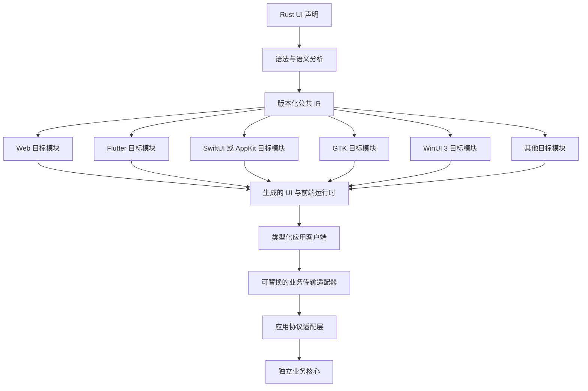
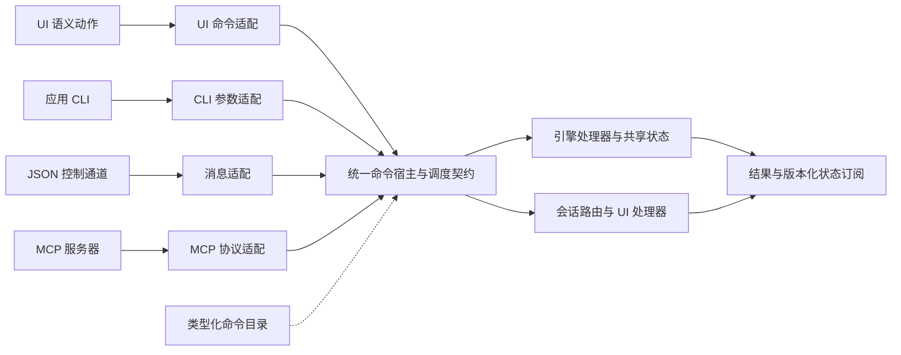
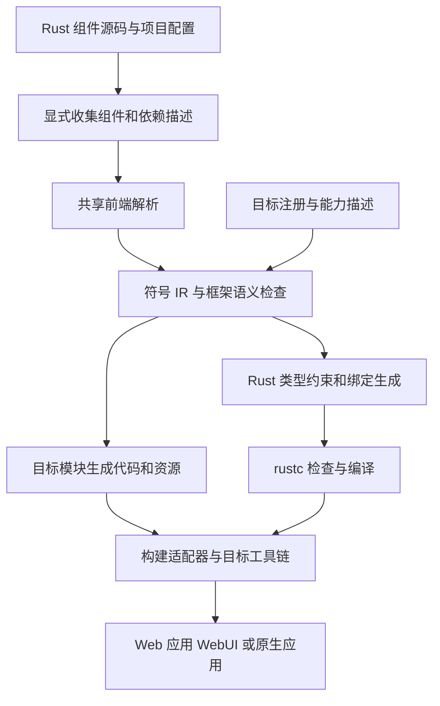

# Bern UI 框架设计文档

- 版本：v0.20
- 状态：架构设计草案
- 更新日期：2026-10-11
- 项目名称：Bern UI
- 计划仓库名称：bern-ui
- 主要开发语言：Rust
- 首个目标平台：macOS（SwiftUI）
- 主要验证应用：NipaPlay 3.0

当前实现进度见 [macOS SwiftUI 实现记录](Implementation/macOS-SwiftUI.md)、[Web 实现记录](Implementation/Web.md)、[Linux GTK 实现记录](Implementation/Linux-GTK.md) 与 [Windows WinUI 3 实现记录](Implementation/Windows-WinUI3.md)：已完成阶段一与阶段二的 macOS 主干，包括 Video、窗口关闭协议、窗口最小化与恢复、最小异步查询场景和随包资源；阶段三已完成 Web 视觉规范、Bern 主题内核、Web `app` 构建与 WebUI 构建（独立引擎宿主、WebSocket 通道与四入口联调）；阶段四已完成 `compact`/`expanded` 自适应布局、菜单入口、功能契约与覆盖检查、本地化诊断编号与运行时语言切换（macOS 与 Web）；阶段五已完成第一批 `gtk + linux`（GTK 4 与 libadwaita，展示应用与四入口在 Ubuntu 上验证）与第二批 `winui3 + windows`（C++/WinRT 宿主，系统有 Windows App Runtime 时用 WinUI 3、没有时回退到系统 XAML，展示应用与四入口在 Windows 11 上按两种前端验证）；阶段六先行提供了开发工具 `bern new`、`bern run` 与 `bern doctor`，项目可以独立于 Bern 仓库构建，并补上组件库第一批 `Image`、`Progress`、`Grid` 与 `Stack`；其余能力仍为设计目标。

平台官方依据、UI 自适应映射和各设备验收场景见 [UI 自适应适配规范](Adaptation/README.md)。其中新增研究的平台与设备不代表已实现后端；核心架构约束仍以本文为准。

原生 UI 连接机制与实现经验见 [React Native 源码研究](Research/ReactNative.md)，其中区分了运行时渲染、接口代码生成与 Bern 的目标代码生成路线。

Bern 是一个基于 Rust、以命令为中心的模块化应用框架，Bern UI 是其中的声明式跨平台界面层，面向开发者与 AI Agent。框架同时定义命令、查询、状态、会话和入口适配协议。开发者在 Rust 源文件中定义组件，由 Bern 将可分析的 UI 声明编译为各平台的界面实现，复用已有 UI 技术，不自行开发完整的图形渲染引擎。

本版本确立的核心约束是：**可跨平台导出的 UI 组件必须使用受约束、可静态分析的声明；每个可操作入口必须绑定类型化命令。** 标准控件的通用交互由 Bern 自动生成会话命令，业务操作绑定应用已注册命令，缺少绑定或绕过命令的 UI 声明必须编译报错。普通 Rust 用于命令处理器、查询提供器和应用内部实现，不将任意 Rust 代码转译为 Dart、Swift 或 Kotlin。

**前后端分离与模块化是底层架构要求。** 应用的 UI 前端通过类型化协议连接业务核心；编译器通过版本化 IR 和生成器接口接入不同 UI 技术。Flutter、macOS 原生 UI 及后续新目标应作为独立模块扩展，不能要求应用重写业务核心，也不能在核心编译器中不断添加平台特例。

**UI、CLI、JSON 控制通道和 MCP 服务器是同一个应用引擎的不同入口。** 它们共享命令描述、执行规则、状态和结果，不各自实现业务逻辑。Bern 提供通用命令基础设施与适配接口，具体业务处理器由应用提供；使用现有引擎时，由适配层接入同一契约。

**每个 UI 控件从底层支持深浅色模式，颜色默认由目标 UI 框架提供。** 目标 UI 框架自身具备完整的深浅色与语义颜色体系时，例如 SwiftUI、WinUI 3 和 Compose，Bern 直接使用其系统颜色、材质和标准控件样式；只有目标缺少这类体系（例如 Web）或控件由 Bern 自行绘制时，才使用 Bern 的统一色彩算法、语义颜色和控件状态配方。应用默认无需配置颜色、判断深浅色或维护两套样式。这个要求同时约束内置控件、扩展控件和所有 UI 目标。

**原生目标以平台视觉规范为准。** 具备明确设计规范与原生组件库的目标，例如 macOS，生成代码使用平台标准容器、控件和系统样式，外观随 SDK 与系统版本自动演进，不为追求新外观而单独调用新系统专有的视觉接口。

**多窗口是统一的声明能力。** 同一套 Window 声明与窗口命令在支持的平台使用原生窗口，无法提供所需原生多窗口能力时自动使用应用内虚拟窗口。窗口身份、状态与业务连接不因呈现方式不同而改变。

**Web 提供两种独立构建产物。** Web 应用在浏览器内运行 UI 与 Rust WASM 业务引擎；WebUI 只包含界面、前端运行时和协议客户端，通过 JSON 控制通道连接独立运行的 Bern 引擎。两种构建共用 Web 后端、组件声明与命令协议，业务引擎的运行位置由构建配置明确选择。

本文规定目标行为和架构边界，不表示相关功能已经实现。所有 API、宏语法、配置键和 crate 名称均为设计草案；示例用于说明语义，不是当前可编译的使用教程。元数据提取与跨语言绑定采用下文的参考方案，在原型验证后定稿。

## 项目目标

Bern 名称来自《海猫鸣泣之时》中的 Frederica Bernkastel，与 NipaPlay、Erika 的命名体系保持一致。Bern 作为独立通用框架开发，不依赖这两个应用的业务模型或命令实现。

项目目标包括：

- 使用一套 Rust 组件声明表达可移植的 UI 语义，允许不同尺寸和输入方式使用不同布局。
- 分离应用 UI、业务核心与传输实现；让 UI 技术和运行平台可以独立选择。
- 新 UI 目标通过独立生成器、运行时适配与构建集成接入，核心层不依赖具体 UI 框架。
- 默认提供完整的深浅色适配：原生目标使用平台自身的颜色体系，缺少该体系的目标由 Bern 统一推导颜色、控件状态和对比关系，使应用使用者不承担主题适配工作。
- 通过编译期诊断检查组件属性、本地化完整性、功能入口覆盖和平台能力要求。
- 强制 UI 的所有语义操作命令化，使 UI、CLI、JSON 控制通道和 MCP 可以驱动同一引擎实例。
- 从同一份类型化描述派生各入口，提供导航、焦点、异步资源和可复现场景的通用规则。
- 以统一声明支持多个独立窗口，在原生多窗口不可用时自动适配虚拟窗口，保留各窗口的交互状态。
- 保持必要且明确的运行时，负责动态状态、事件和平台桥接。
- 提供稳定、简短且写法一致的 API，让 Agent 能根据诊断完成修改。

初期不追求任意 Rust UI 的自动跨语言转换，也不承诺各平台逐像素一致。现阶段不开发新的独立源文件语言、完整渲染引擎，也不在框架中内置媒体库、账号等应用业务；通用命令描述、调度协议、视频组件与媒体适配接口属于框架职责。Bern 复用已有媒体设施，不自行实现通用音视频解码器。

桌面和移动端不引入 JavaScript 引擎作为 UI 运行时。Web 允许使用必要的 JavaScript 和 Web API 绑定。

## 核心决策

| 领域 | 决策 |
| --- | --- |
| 源码组织 | 所有 UI 定义位于 `.rs` 文件，复用 Rust 模块与依赖管理 |
| 声明入口 | 使用 `#[component]` 标记可导出组件，在组件内使用统一的 `ui!` 声明 |
| 静态边界 | 组件结构、表达式、命令引用和功能入口必须可被 Bern 前端识别 |
| 动态行为 | 条件、列表和属性值可以动态变化，以明确的 IR 节点和 Rust 绑定表达 |
| 类型检查 | Bern 检查声明语义，生成 Rust 类型约束，由 `rustc` 检查实际 Rust 类型 |
| 本地化 | 用户可见静态文本与翻译共同声明，使用字符串字面量承载自然语言 |
| 功能覆盖 | 显式 Feature Contract 是依据，各自适应布局必须声明并实现要求的入口 |
| 自动主题 | 原生优先：目标 UI 框架具备深浅色体系时使用其系统颜色与标准样式，默认跟随系统；品牌色可选，映射为平台强调色 |
| 色彩算法 | 共享的 Rust 主题内核为缺少原生体系的目标（如 Web）和 Bern 自绘控件生成并校验配色，这些部分消费同一主题快照 |
| 原生视觉 | 原生目标使用平台标准组件与系统样式，不单独调用新系统专有的视觉接口；macOS 规则见后端实现边界 |
| 强制命令化 | 所有可操作入口绑定引擎命令或会话命令，标准交互自动生成，违规声明编译失败 |
| 多入口引擎 | UI、应用 CLI、JSON 通道与 MCP 使用同一命令目录、调度契约和引擎状态 |
| 操作语义 | Command 执行动作，Query 保持只读，Event 通知事实，统一描述但不混淆副作用 |
| 编译入口 | `bern build` 协调组件收集、代码生成、Rust 编译与平台构建 |
| 随包资源 | `Bern.toml` 受限声明随应用发布的文件，构建严格校验并由目标复制进产物；引擎经宿主装配的 `Resources` 按名称解析，不依赖平台布局 |
| 应用分层 | 通用命令宿主路由引擎与 UI 会话命令，业务核心不依赖具体 UI |
| 目标扩展 | 公共 IR 与目标接口对接独立生成器，平台运行时和构建工具各自适配 |
| 目标选择 | UI 技术与运行平台是两个维度，同一平台可选择不同 UI 前端 |
| 桌面默认 | macOS 使用 SwiftUI，Linux 使用 GTK，Windows 使用 WinUI 3；显式配置可选择其他已支持目标 |
| 多窗口 | WindowSet 与 Window 声明窗口，默认原生优先、不可用时自动虚拟呈现，共享身份、命令及生命周期 |
| 视频播放 | 使用专门的 Video 声明，Web 默认映射 video 元素，其他平台通过独立媒体后端与呈现接口接入 |
| 部署方式 | 首版优先本地运行，业务协议不绑定同进程、FFI 或网络传输 |
| 首个后端 | macOS SwiftUI：生成使用标准原生组件的 SwiftUI 代码，业务引擎默认在应用进程内运行 |
| Web 构建 | `app` 生成浏览器内 UI 与 WASM 引擎；`ui` 生成连接独立引擎的 WebUI，分别构建与验收 |

`ui!` 内仍然存在一套声明语法。使用 Rust 宏意味着不增加独立文件格式，不意味着可以省去语法规则、工具支持和学习成本。因此，同一功能应只有一种推荐写法。

## 平台目标与原生语义

平台不与某一种 UI 技术永久绑定。构建目标由“UI 技术、运行平台、构建模式、UI 桥接和业务传输”共同确定，只有经过声明与验证的组合才可用。构建模式决定产物包含哪些运行部分，不是新增一种 UI 技术。

| UI 技术 | 目标运行平台 | 生成产物 | 定位与阶段 |
| --- | --- | --- | --- |
| Web DOM | 浏览器 | Web 应用或 WebUI；共用 HTML、CSS、绑定与前端 WASM，按模式决定是否包含业务引擎 | 第二个正式后端，需 Bern 自定视觉规范与主题算法，两种模式均需验收 |
| SwiftUI | macOS、iOS | SwiftUI 视图、Swift 绑定与平台工程集成 | macOS 与 iOS 默认；macOS 为首个正式后端，iOS 后续实现 |
| GTK | Linux | GTK 控件、Rust 绑定与桌面集成 | Linux 默认；阶段五第一批已实现 |
| WinUI 3 | Windows | WinUI 3 界面（无运行时时回退到系统 XAML）、C++/WinRT 平台宿主与 Rust 桥接 | Windows 默认；阶段五第二批已实现 |
| Jetpack Compose | Android | Kotlin Compose UI、绑定与 Android 工程集成 | Android 默认；后续实现 |
| Flutter | Flutter 支持且 Bern 已适配的平台 | Dart Widget、绑定代码与 Flutter 工程集成 | 可选跨平台目标 |
| GPUI | Windows、macOS、Linux | GPUI Rust UI 与原生集成 | 可选桌面目标 |
| AppKit | macOS | AppKit 控件及窗口集成 | 可独立扩展，或辅助 SwiftUI 适配 |

PC 默认采用各平台的原生 UI 技术：`swiftui + macos`、`gtk + linux`、`winui3 + windows`。`swiftui + macos` 是首个正式实现目标：macOS 有明确的设计规范和成熟的原生组件库，最容易达到系统自带应用的视觉水准，并验证完整架构。Web 没有统一的样式规范，需要 Bern 自行定义视觉规范与主题算法，作为第二个正式目标。其他桌面默认映射不代表对应后端已经实现。

项目可以显式选择 `flutter + macos`、`gpui + windows` 等其他受支持组合。GPUI 与 Flutter 主要使用各自的绘制体系，作为可选方案保留。Linux 有多种桌面环境与 UI 工具包，GTK 是 Bern 选择的 Linux 默认技术；支持范围按实际环境验证，不假设所有 Linux 桌面行为一致。

默认映射由目标注册与配置装配层提供，不写入公共 IR 或业务核心。未指定 UI 技术时按目标平台解析默认值；默认后端未实现、未安装或无法满足包含标准替代方案在内的契约时明确报错，不静默切换为 GPUI、Flutter 或 Web。窗口的原生与虚拟自动选择发生在同一已选 UI 后端内，不改变 UI 技术。显式选择始终优先，并接受同样的能力检查。

Flutter 后端复用 Flutter 的引擎与工具链，不代表 Bern 自研渲染引擎。Flutter 自身支持某个平台，也不代表 Bern 的绑定、资源和能力已经适配该平台。所有能力均按具体组合报告。

Bern 统一组件的语义、状态接口、功能契约与主题协议。控件几何、文本度量、输入法行为和部分交互可以遵循平台习惯；深浅色适配必须由后端完成。目标 UI 框架具备深浅色体系时由平台提供配色；Bern 自绘部分及缺少该体系的目标使用统一算法，规则见下文。只有写入组件规范的行为，才属于跨后端一致性承诺。

## 前后端分离与模块边界

### 应用分层与编译器分层

“前端”和“后端”有两组含义，接口与模块命名必须区分：

| 层次 | 前端 | 后端 |
| --- | --- | --- |
| 应用运行 | 用户看到的 Web、Flutter、SwiftUI 等 UI，以及其局部交互 | 提供业务操作与状态的 Application Core |
| UI 编译 | 读取受约束 Rust 声明并建立语义模型的 Compiler Frontend | 把公共 IR 转换为目标 UI 代码的 Target Backend |

因此，增加一个 Flutter 应用前端，对 Bern 编译器而言是增加 Flutter 目标后端。两者通过明确的接口组合，不将业务逻辑放进生成器。



图中的 UI 表示每个目标各自生成的前端，不是把所有 UI 框架同时装入一个应用。图中展示引擎连接路径，状态与事件通过同一协议反向通知前端；局部会话命令按后文的路由规则就地执行，不必经过业务传输。

### 必须保持的依赖方向

- 公共语义、IR、协议和检查规则不依赖 Flutter、SwiftUI、GTK、WinUI 3、GPUI、DOM 或具体操作系统 SDK。
- 编译器核心调用目标扩展接口，目标模块实现该接口；核心层不导入具体目标实现。
- 只有构建宿主或注册入口选择并装配目标模块，业务核心不选择 UI 后端。
- 业务核心不依赖生成的组件、窗口对象、UI 运行时或编译器。现有应用可以由独立适配层实现 Bern 协议，无须改造为 Bern 专用业务框架。
- 通用前端运行时只处理状态绑定、组件身份与事件协议；具体 UI 调度、控件和资源生命周期由目标运行时适配器负责。
- 主题内核属于独立的前端基础模块，不依赖业务核心、网络或某个目标 UI SDK；所有目标通过主题协议使用它。
- 通用媒体契约不依赖 UI SDK 或具体解码器；媒体后端与呈现适配器负责实际播放及视图附着，由装配层选择兼容组合。
- 应用和前端之间不共享可随意修改的内存对象；跨边界通过声明的值、命令和订阅交互。Bern 管理的 UI 会话主动操作也通过会话命令执行；窗口管理器等外部系统已发生的事实通过受信任适配器事件同步。

开发时可以在同一 workspace 中组织这些模块，发布时也可以打包为同一个可执行程序。逻辑分离不要求每个应用部署服务器。

### 前端计算与业务核心

严格 UI 声明只允许类型化状态快照、事件字段、字面量、受限运算和框架已知转换。自定义 Rust 计算通过有描述的 Query 或派生状态提供器输出值，UI 不直接执行无法分析的函数或读写业务核心对象。业务核心可以独立编译、运行并通过无 UI 的测试验证。

受限表达式和类型化绑定可在生成的 Rust 前端绑定模块中执行，Flutter 或 SwiftUI 通过桥接使用它们；这不意味着将任意 Rust 转写成 Dart 或 Swift，也不要求把完整业务核心打入客户端。

昂贵的业务计算通过 Query 或 Command 在业务侧提供。焦点、编辑和导航等操作由前端会话命令执行；命令化不要求网络传输或 JSON 序列化。绘制、布局、动画采样及原始输入采样是运行机制，不需要将每一帧或每个指针坐标发布成业务命令。

### UI 桥接与业务传输

UI 桥接负责 Dart、Swift、JavaScript 等 UI 代码与 Rust 前端绑定模块之间的交互。业务传输负责类型化应用客户端与业务核心之间的交互。两者是独立扩展点：Flutter 可以经 Dart FFI 使用本地前端绑定，同时通过网络连接远程业务核心。

业务接口在概念上提供类型化 `dispatch`、快照查询与状态订阅。协议 schema 独立于传输编码；本地 Rust 调用可以直接传递值，不要求为模块化而强制序列化。

| 业务部署 | 传输适配方式 | 架构要求 |
| --- | --- | --- |
| 同进程 | Rust 直接调用或本地通道 | 不泄漏核心内部对象，允许异步完成 |
| 不同进程 | IPC 适配器 | 定义消息编码、进程断开及资源清理 |
| 远程服务 | 网络适配器 | 定义连接身份、版本协商、重连与状态重同步 |

初期同时验证 Web 应用的浏览器内引擎路径，以及 WebUI 连接独立引擎所需的最小浏览器可访问控制通道。四入口联调优先让 WebUI、CLI、JSON 和 MCP 连接同一个本机引擎宿主。独立 CLI 进程不能靠重新实例化业务核心冒充共享引擎。广泛 IPC 与远程部署方案分别验收，不将最小通道通过视为全部网络环境已经支持。网络重试不能默认重复执行有副作用命令；传输适配器必须明确请求身份、失败与重试语义。

应用协议应独立记录版本，连接时检查命令参数、状态 schema 和服务能力。UI target 与业务协议分别演进，替换 UI 技术不应迫使业务 API 改名或重写。

## UI 目标扩展协议

### 一个目标模块包含的职责

新增 UI 技术不仅需要静态组件映射，还需要可用的运行时与构建集成。一个目标包可以由多个独立模块组成：

| 接口职责 | 输入与输出 |
| --- | --- |
| 目标描述 | 声明目标 ID、版本、支持平台，以及 IR、目标接口、UI 绑定与主题协议版本范围 |
| 能力描述 | 声明组件、属性、事件、可访问性、主题映射、原生与虚拟窗口能力、平台服务、视频呈现兼容性及允许的替代实现 |
| 合法性检查 | 对标准 IR 给出支持、显式替代或带源码位置的不支持诊断 |
| 目标转换 | 将公共 IR 转为目标私有表示，保留结构身份和语义 |
| 代码与资源生成 | 输出目标源码、资源、绑定需求清单和源码映射 |
| 运行时适配 | 提供目标语言客户端、UI 调度、主题环境监听、快照应用及实例生命周期实现 |
| 构建适配 | 返回工具链要求、构建步骤、依赖和产物清单，由构建驱动执行 |

公共接口可概括为描述、检查、转换、生成和构建计划；具体 Rust trait 名称与函数签名待原型确认。目标生成器收到的是 IR、schema 和绑定 ID，不需要重新解析 Rust UI 源码或推断业务函数类型。

后端专用转换在目标私有表示中完成。例如 Flutter 可以组织 Widget，SwiftUI 可以选择视图组合，Web 可以生成 DOM 模板。公共 IR 不加入 `BuildContext`、`NSView` 或 CSS 选择器等特定框架对象。

### 注册与版本兼容

首版使用独立 crate 和显式注册表装配目标，目标实现可以与构建宿主一起编译。新增目标允许增加依赖、注册项和项目配置，但在公共语义已能表达需求时，不应修改解析器、公共 IR、核心检查规则或业务核心。

不将 Rust 动态库 ABI 当作稳定插件协议。需要外部进程形式的生成器时，再定义版本化序列化请求与响应；不能直接把内部 trait object 当成第三方二进制插件接口。

公共 IR、目标扩展接口、UI 绑定协议、主题协议和应用协议分别记录版本。目标模块检查自己消费的 IR、UI 绑定和主题等接口；应用客户端、业务适配器和服务检查应用协议。启用视频时，还需检查媒体契约版本及媒体后端与呈现适配器的兼容范围。生成器可以消费命令 schema 来生成类型化绑定，但不因此依赖具体业务传输。初版 API 尚未稳定；不兼容版本应明确失败，不能忽略未知节点后继续生成不完整 UI。

如果新目标需要公共 IR 尚未表达的新语义，应通过独立设计扩展语义并增加验收，而不是把全部目标代码塞进字符串逃生口。平台专用组件可以采用命名空间扩展描述，但仍需属性 schema、能力要求及其他目标的替代或失败规则。

### 能力协商与配置

应用声明所需能力，目标按具体平台组合提供支持矩阵，构建驱动在生成前计算是否满足要求。缺少必需能力时默认失败，只有标准组件契约已定义的替代路径，或应用显式声明的替代路径与豁免可以使用。Window 的默认 auto 策略明确包含原生到虚拟的适配，属于正常契约；它不能替代应用显式要求的系统任务栏、跨显示器等原生能力。

以下配置演示三个桌面平台的默认选择、显式切换 Flutter，以及 Web 的两种构建。配置键仍是草案；桌面省略 `ui` 时使用上述平台默认映射，UI 桥接由目标组合决定，不代表允许任意拼接不兼容模块。Web 目标必须显式声明 `web_mode`，取值为 `app` 或 `ui`，不根据服务地址猜测模式。

```toml
[targets.native_macos]
platform = "macos"       # ui 默认 swiftui

[targets.native_linux]
platform = "linux"       # ui 默认 gtk

[targets.native_windows]
platform = "windows"     # ui 默认 winui3
frontends = ["winui3", "xaml-islands"]   # 默认两个都编译，可只写其一

[targets.flutter_macos]
ui = "flutter"
platform = "macos"
ui_bridge = "dart-ffi"
application_transport = "in-process"

[targets.web_app]
ui = "web"
platform = "browser"
web_mode = "app"
application_transport = "in-process"

[targets.web_ui]
ui = "web"
platform = "browser"
web_mode = "ui"
application_transport = "websocket"
application_codec = "json"
```

Windows 目标的 `frontends` 选择编译哪几套前端：`winui3`、`xaml-islands`，默认两个都编译；列表为空、名称未知或重复，以及用在其他平台上，都在构建时失败。`web_app` 与 `web_ui` 是项目内的目标名称；`web_mode` 才是构建模式。示例中的 `websocket` 是传输，`json` 是编码；WebUI 也可使用另行实现并验收的浏览器兼容传输。连接地址通过运行时连接配置提供，凭据不写入静态构建资源。`app` 必须装配浏览器内引擎适配，`ui` 必须装配独立引擎客户端；不兼容配置在构建时失败。配置拼写与 `bern build --target web_app`、`bern build --target web_ui` 命令形式均为草案。

这些目标可以共享组件声明、功能契约和业务核心。因能力或平台交互需要不同布局时，差异必须在可分析的自适应分支或显式平台扩展中表达。

### 扩展完成的判断标准

新增目标必须使用与已有目标相同的样例验证状态、命令、条件分支、稳定 key 列表、本地化、功能入口、多窗口语义和完整深浅色适配。没有原生多窗口能力的目标必须提供虚拟窗口路径。只实现一种外观模式或要求应用补写颜色，不能通过标准控件的目标验收。

模块化验收还必须检查：在公共语义范围内加入一个独立目标时，解析器与业务核心是否保持不变；删除或禁用某目标后，其他目标是否仍可单独构建。具体框架 SDK 不得成为构建所有目标的全局前置条件。

## 受约束的组件声明

### 组件定义与引用

可移植组件使用显式标记，首版要求组件主体为单个 `ui!` 声明。组件参数必须具有显式类型，组件名称与 Rust 函数名称一致。

```rust
#[component]
fn play_button(player: PlayerHandle) -> impl View {
    ui! {
        Button(
            label: tr! {
                "zh-Hans" => "播放",
                "en" => "Play",
                "ja" => "再生",
            }
        ) => player.toggle()
    }
}

#[component]
fn player_screen(player: PlayerHandle) -> impl View {
    ui! {
        Column(gap: 12, padding: 16) {
            Text(content: player.title)
            play_button(player: player)
        }
    }
}
```

内置组件采用固定名称，自定义组件通过函数名或显式路径引用，不隐式将 `play_button` 改写为 `PlayButton`。引用必须解析到已收集的组件描述；不允许通过猜测函数返回类型判断它是否为可导出组件。

示例中的 `PlayerHandle` 表示前端使用的类型化应用客户端，不是业务核心对象的直接引用。`player.title` 必须是已声明的快照状态绑定；`player.toggle()` 必须解析为已注册命令的类型化引用，在事件发生时派发，不是任意方法调用。应用接口的声明语法另行定稿。

### 允许的动态行为

受约束声明不等于静态页面。Bern 必须支持以下动态行为，并保留它们的结构：

| 行为 | IR 表达 | 运行时责任 |
| --- | --- | --- |
| 属性随状态改变 | 属性绑定与依赖集合 | 重新计算并更新相关属性 |
| 条件显示 | `If` 节点及各分支 | 求值条件并挂载或卸载分支 |
| 动态列表 | `List` 节点及元素模板 | 按稳定 key 创建、更新和移除实例 |
| 自适应布局 | `Adaptive` 节点及选择规则 | 根据环境切换布局 |
| 用户事件 | 类型化语义动作与命令绑定 | 提取事件参数并派发引擎或会话命令 |
| 展示计算 | 受限表达式或显式查询结果绑定 | 求值已知运算或订阅派生值 |

标题、进度或条件可以来自受限表达式和类型化查询结果，但不能通过任意函数调用暗中执行业务操作，也不能返回无法分析的组件树。动态列表使用已知元素模板；不能靠运行时回调选择未声明的组件类型。

绑定所需的状态依赖必须来自类型化快照或显式查询描述。Bern 不尝试从任意 Rust 函数内部推导依赖或证明纯性。自定义查询实现须遵守只读契约；改变业务或交互状态必须通过命令，查询执行所需的资源访问由查询提供器管理。

### 首版静态约束

- 可导出组件必须具有显式身份、属性接口和完整的声明体。
- 自定义组件引用必须有对应描述；首版不支持运行时选择任意组件工厂。
- 动态条件的每个结构分支都必须出现在可分析声明中。
- 可更新列表必须提供稳定且在同级列表中唯一的 key，不能默认使用位置代替数据身份。
- 不支持任意递归组件结构；需要递归数据展示时，应先设计专门的可分析机制。
- 首版不支持通过任意宏展开、`include!` 或构建脚本隐式生成待收集组件。
- 组件导出接口只使用已支持的明确类型；不将任意泛型、trait object、闭包或借用跨语言导出。
- 交互处理器只能引用已注册命令，或使用标准控件自动生成的会话命令；不接受任意 `on_click` 闭包、直接字段赋值或平台事件逃生口。
- 展示表达式不得调用未纳入受限表达式规范的 Rust 函数。自定义计算移到有契约的 Query 或派生状态提供器。

受限运算只针对 schema 已知的基础值与记录字段，不能通过自定义运算符或 trait 实现重新引入任意用户代码。生成的 UI 句柄只暴露读取、订阅和命令派发，不向组件提供可写的业务状态引用；修改权限归相应处理器所有。

普通 Rust 函数仍然可用于应用实现，但未声明为 Bern 组件的 `fn ... -> impl View` 不自动获得跨平台导出资格。遇到不可分析结构或命令旁路时必须报错，不静默退化为部分检查。宏只约束其掌握的声明；业务处理器、查询提供器、原生桥接与外部插件属于受信任实现边界，不能据此声称证明整个 Rust 程序不存在副作用。

## 组件与布局语义

第一阶段优先提供能验证完整交互的基础组件，后续再扩展组合能力。首个后端为 macOS，组件语义和默认行为优先参照 SwiftUI 等成熟原生组件库定义，但必须写入 Bern 组件规范；IR 保持平台无关，不引入 SwiftUI 类型。

| 组件 | 核心语义 | 优先级 |
| --- | --- | --- |
| WindowSet 和 Window | 窗口目录、内容、实例策略、原生或虚拟呈现与生命周期 | 初期，macOS 使用原生窗口，Web 使用页面宿主与应用内虚拟窗口 |
| SplitView 和 Sidebar | 侧边栏与详情分栏、侧边栏分组和选中项；Sidebar 可带 `id` 供外部入口切换 | 初期 |
| Navigation、Destination 和 NavLink | 推入导航与返回，绑定类型化路由；Navigation 可带 `id` 供外部入口返回 | 初期 |
| Tabs 和 Tab | 同级页面的页签切换；Tabs 可带 `id` 供外部入口切换 | 初期 |
| Toolbar | 窗口或页面级操作区 | 初期 |
| Column 和 Row | 单轴排列、间距、对齐、约束 | 初期 |
| Grid | 等宽的列，列宽不小于 `min_width`，放得下几列就排几列，子元素逐行填入；`gap` 默认 8 | 阶段六 |
| Stack | 叠放：后写的一层在上面，先接收输入；整体与最大的一层一样大，较小的层按 `align` 的九个方位之一对齐，默认居中 | 阶段六 |
| Form 和 Section | 分组表单、行标签、分组标题与说明；Form 可声明所在页面的标题 | 初期 |
| Label | 图标与标题组合 | 初期 |
| Spacer 和 Divider | 弹性空白与分隔线 | 初期 |
| Text | 本地化或动态文本、文字层级、换行及截断 | 初期 |
| Button | 可访问名称、语义角色、强调程度、启用状态及激活事件 | 初期 |
| IconButton | 图标激活、透明热区与可访问名称 | 初期；使用 Bern 配方的目标所有状态无可见按钮容器，原生目标使用平台无边框样式 |
| TextInput | 文本编辑、输入法与提交事件 | 初期 |
| Search | 搜索文本编辑与提交 | 初期 |
| Switch | 布尔状态与修改事件 | 初期 |
| Slider | 范围值、连续变化和提交事件 | 初期 |
| Picker | 从有限选项中单选，按场景呈现为菜单或分段控件 | 初期 |
| ScrollView、List 和 ForEach | 滚动容器、有身份的列表及任意容器内的键控重复 | 初期，虚拟化后续 |
| Image | 随包的 PNG 或 JPEG 资源；`width`、`height` 至少写一个，只写一个时另一个按图片比例；`fit` 为 `contain`（默认）、`cover` 或 `fill`；`label` 是替代文本，不写为装饰图片 | 阶段六；首版只显示随包资源 |
| Progress | 有 `value` 时是进度条，进度为 `value / total`（`total` 默认 1，超出范围按边界显示）；没有 `value` 时是不确定进度；`label` 同时是可访问名称 | 阶段六 |
| Menu 和 MenuItem | 收纳操作入口的菜单；每个菜单项绑定命令，可绑定功能 | 阶段四 |
| Adaptive 和 Layout | 按可用宽度在 `compact` 与 `expanded` 布局之间选择，保留状态 | 阶段四 |
| LanguagePicker | 运行时切换界面语言 | 阶段四 |
| Dialog | 应用内对话框、焦点及关闭行为 | 后续（窗口的对话框呈现见“声明式多窗口”） |
| Video | 媒体源、受管理播放器、播放命令、状态与标准控件 | 早期验证 macOS 原生媒体适配及 Web video 映射 |

组件规范必须写清默认行为，避免由首个后端反向定义标准：

- 尺寸使用逻辑单位，后端负责缩放换算；布局区分固定、内容适配和可用空间分配。
- 明确最小和最大尺寸、溢出、滚动、对齐、换行与遮挡语义。
- 文本编辑必须覆盖输入法组合过程、选择、提交和撤销边界，不能仅用字符串替换模拟所有编辑行为。
- 可交互组件必须具备语义角色、可访问名称、禁用状态和基本键盘操作。
- 颜色通过语义角色与控件主题配方表达；字体、间距等样式使用平台无关属性，不把 CSS 属性当作 IR 的标准属性。
- 每个控件必须声明适用的交互状态、颜色角色与前景背景关系，深浅色适配不能留给应用逐个补齐。
- 平台专用扩展必须声明适用后端、能力要求及其他后端的处理方式。

TV 的方向键焦点、触摸手势和鼠标悬停作为独立交互能力规划，不假设同一布局天然适合所有输入方式。

## 自动深浅色与主题算法

### 原生优先，算法兜底

颜色来源由目标能力决定。目标在能力描述中声明自己属于哪种情况，应用代码不随之改变：

| 目标情况 | 颜色来源 | 示例 |
| --- | --- | --- |
| UI 框架具备完整的深浅色、语义颜色与标准控件样式 | 框架自身的系统颜色、材质与标准控件样式；Bern 不覆盖系统托管表面 | SwiftUI、AppKit、WinUI 3、Compose、Flutter，以及已验证桌面主题下的 GTK |
| UI 框架缺少统一的深浅色体系或样式规范 | Bern 主题内核生成的语义颜色与控件配方 | Web、GPUI |
| 任意目标上由 Bern 自行绘制的控件或表面 | Bern 主题内核，并与相邻的系统表面协调 | 自绘图形、媒体覆盖层 |

应用声明品牌色时，原生目标将其映射为平台强调色接口，例如 SwiftUI 的 tint 或 AccentColor、WinUI 3 的强调色资源；未声明时使用用户在系统中选择的强调色。算法目标以品牌种子生成配色。两种情况下，应用都不编写深浅色分支。

### 零配置的控件契约

应用直接使用标准组件即可获得完整主题适配，不需要传入 `is_dark`、手写 `light_color` 和 `dark_color`，也不需要在每个组件中读取系统外观。未提供主题配置时，原生目标使用系统配色与系统强调色，算法目标使用 Bern 内置品牌种子和中性色，均默认跟随系统。

主题模式为 `system`、`light` 和 `dark`。显式应用或窗口设置决定使用哪个模式；`system` 由目标适配器读取所属窗口的系统环境。无法检测时统一采用浅色，检测恢复后正常更新。提高对比度、强制系统颜色和减少动态效果属于独立环境偏好，不能只压缩成一个深色布尔值。

应用可以只提供一个品牌色：原生目标将其映射为平台强调色，算法目标由 Bern 自动生成各模式与状态所需颜色。自定义品牌是可选项；普通应用无需知道调色算法和后端样式细节。用户可主动选择外观模式，但无需参与逐控件调色。

```toml
# 整段均可省略，默认跟随系统；原生目标使用系统配色，算法目标使用 Bern 内置配色。
[theme]
mode = "system"
# brand_seed = "#6750A4"  # 可选，仅为一个品牌输入示例。
```

### 共享主题内核与控件配方

本节至“主题快照与运行时切换”描述的主题内核、语义颜色和控件配方，适用于上表的后两种情况；原生目标的标准控件不经过 Bern 配方求解。

主题能力由独立的 `bern-theme` 模块承担，包含确定性的配色算法、语义颜色 schema、控件配方求解与对比检查。纯计算部分不访问平台 API；平台适配器只负责提供环境、输出目标颜色与应用快照。

一套共享算法生成调色结果，每类控件具有自己的状态配方。配方描述角色和规则，不是两套手工颜色表。所有内置控件都必须具备配方，组合控件默认继承子控件能力，新增控件也遵循同一扩展协议。

```text
ThemeSnapshot = generate(seed, resolved_mode, contrast_policy, algorithm_version)
ControlStyle  = resolve(recipe, ThemeSnapshot, surface_context, interaction_state)
```

状态求解可以预生成受支持组合，目标运行时只需按状态选取；依赖实际背景的部分由本地主题内核求解。不得让 Web、Flutter、SwiftUI 各自复制并修改一套颜色算法。

### 语义颜色与表面关系

组件引用有意义的颜色角色，由算法决定最终值：

| 角色组 | 用途 |
| --- | --- |
| surface.canvas、surface.panel、surface.raised | 页面、内容区域与浮层的层级 |
| text.primary、text.secondary、text.placeholder | 正文、次要说明及可读的输入提示 |
| icon.primary、icon.secondary | 操作图标与辅助图标 |
| accent、on_accent | 强调背景及其上文字和图标的配对 |
| status.success、status.warning、status.error | 业务状态及对应的背景和前景配对 |
| control.border、control.track、control.thumb | 必要控件边界、滑轨与滑块 |
| focus.indicator、selection.background、selection.foreground | 焦点与选中反馈 |
| disabled.foreground、disabled.surface | 禁用状态专用颜色 |

颜色角色必须声明使用关系。例如 `on_accent` 只保证与其声明的强调表面配对，不能认为它适用于所有背景。表面上下文由布局和主题作用域传递，包括背景角色、透明度及已知叠层。

错误、警告、选中等信息不能只靠颜色区分，应保留文字、图标、形状或可访问状态。主题算法只负责颜色部分，不替代组件的语义设计。

### Bern 色彩算法的参考流程

算法暂称 Bern Theme Algorithm v1。以下是必须实现的求解流程；具体色阶参数、色度上限与搜索精度需通过原型和视觉评估确定，不在草案中声称已经获得最佳参数。

1. **规范输入。** 读取内置或应用提供的品牌种子、解析后的模式与对比策略。中性色和状态色使用框架默认种子，目标平台不能擅自换成另一套品牌调色算法。
2. **生成候选色。** 将种子转换到 OKLCH，在可感知的明度、色度和色相空间中推导表面层级、文字与语义色。浅色与深色分别分配色阶，深色模式不使用 RGB 反色或单纯明度取反。
3. **映射可用色域。** 首版统一输出明确编码的 sRGB 颜色。候选色超出色域时优先降低色度，尽量保留色相；映射后重新计算实际显示参数，不假定 OKLCH 明度等于最终可读性。
4. **解算前景背景配对。** 根据控件配方和表面上下文，取得实际用于显示的颜色。对受支持的透明叠层，按目标声明的混合规则先合成，再检查最终 sRGB 颜色的相对亮度。首版优先使用不透明的关键文字与稳定背景，减少无法推断的组合。
5. **校正对比。** 在受支持范围内搜索前景或背景的明度与色度，优先满足阅读和操作辨识要求，再尽量接近品牌种子。每次色域映射或状态调整后重新检查；无法满足时使用已验证的中性前景背景配对，并输出可诊断的回退信息。
6. **展开状态。** 根据各控件配方生成悬停、按下、焦点、选中、禁用和错误等适用状态及组合，对需要辨识的元素继续检查。不能用统一降低透明度代替禁用状态设计。
7. **输出确定结果。** 固定输入与算法版本应生成相同 token 和配方结果。输出主题快照、颜色编码及受控配对的校验信息，供各后端消费和测试。

对比度采用最终颜色的相对亮度计算：`(Y较亮 + 0.05) / (Y较暗 + 0.05)`，其中 Y 来自正确线性化的 sRGB。初始设计基线为：可用的普通文本至少 4.5:1，辨识操作所必需的非文字图形、边界和焦点反馈与相关相邻颜色至少 3:1。次要文本和占位文字不能因“弱化”而自动免检；装饰元素和不可用控件另有明确分类，不套用同一个阈值。

可读性优先于品牌色的数值完全不变。品牌图案和照片等原始内容不参与该颜色搜索；按钮的强调色可以是品牌种子的可读变体。

颜色求解与回退只能调整配方允许的颜色槽或已声明可调的承载表面，不能改变外观契约，例如为 IconButton 增加底板或容器。标准控件通过内置安全配方覆盖支持场景；仍不可解的扩展配方应给出诊断，由控件或后端作者修正，不能以错误颜色静默通过。

### 控件状态与自动适配边界

每个控件配方列出支持的状态、组合规则和冲突处理，例如选中并悬停、错误且聚焦。禁用状态阻止相应操作，但不能丢掉必要的选择或错误语义。键盘焦点反馈必须独立保留，不能被普通悬停样式覆盖。

在 Bern 自绘或使用 Bern 配方的目标上，默认 IconButton 在普通、悬停、按下、选中、禁用和焦点状态均不绘制可见容器。反馈作用于图标的颜色或自身轮廓，保留透明点击热区、可访问名称及明确焦点反馈；目标框架自带的底色、波纹和按钮外框不得重新引入容器。原生目标使用平台标准的无边框图标按钮样式；系统托管的呈现位置遵循平台规则，例如 macOS 工具栏为工具栏项统一提供的背景。

图片、视频、封面和品牌图案默认保留原始颜色，不自动反色或施加全局滤镜。单色语义图标参与主题着色；完整彩色资源作为内容处理。文字或控件覆盖动态媒体时，由组件提供声明过的稳定承载表面或整体遮罩，不要求应用为每一帧选择文字颜色。使用半透明遮罩时，需要校验允许背景范围中的最坏情况；不能只取一帧的平均颜色就认为后续均可读。

Image、Video 等组件的外壳、加载与错误提示及叠加操作仍参与自动主题；保留的是内容像素，不是免除整个组件的主题要求。

无法得知背景的任意透明叠层、外部嵌入内容和自定义像素绘制，不能仅凭 token 校验就声称对比度已证明。标准控件的实现必须建立可验证的背景条件；扩展组件须声明边界并完成对应验证，不能静默把责任转回应用。

### 自定义控件与颜色类型

主题协议区分语义颜色、调色种子和内容固定颜色。常规控件样式接受语义颜色引用；应用只指定“主要操作”“危险操作”等角色即可。自定义控件作者注册配方及颜色关系，不要求每个应用分别适配明暗两套颜色。

编译期检查可识别的控件声明：颜色角色存在、配方完整、适用状态有规则、前景背景配对合法且目标支持映射。直接把固定颜色写入受主题管理的标准样式槽应产生诊断。用于原始素材或明确品牌图形的固定色需要显式内容类型，不能借此绕过标准控件要求。

任意自绘代码不能被静态证明为正确适配。此类控件必须消费主题快照、声明受支持模式和完成目标验证，才能作为符合 Bern 主题契约的组件发布。

### 原生控件与后端映射

原生目标的标准控件、窗口、菜单与材质由系统托管，通过系统外观、语义颜色和受支持的 tint 接口适配；Bern 不在系统托管表面上叠加自定义背景色。Bern 自绘部分与算法目标使用同一算法与快照。两条路径都由后端完成，应用不需要补写颜色。

目标组件描述须区分 Bern 管理与系统托管的部分。前者验证 token 和配方，后者验证系统深浅色、高对比行为及相邻 Bern 表面的协调，不承诺系统内部每个像素等于 Bern 色值。标准控件不能因系统托管而缺少深色适配；后端必须提供符合约定的实现或报告不支持。

| 目标 | 主题适配责任 |
| --- | --- |
| Web | 使用 Bern 主题快照映射语义 token 与状态样式，监听系统外观和强制颜色偏好，区分 Bern 样式与浏览器托管控件 |
| Flutter | 使用框架自身的深浅色主题体系并同时配置两种模式，品牌色作为其配色输入；Bern 自绘部分消费 Bern 快照 |
| SwiftUI 和 AppKit | 使用系统语义颜色、材质与标准控件样式，品牌色映射为 tint 或 AccentColor；不覆盖窗口、侧边栏、表单等系统表面的背景 |
| GTK | 使用 GTK 与已支持桌面主题的深浅色样式；所选环境无法提供完整深浅色时，按能力描述改用 Bern 配色并验证系统托管部分 |
| WinUI 3 | 使用 WinUI 主题资源、平台外观和高对比语义，品牌色映射为强调色资源 |
| GPUI | 没有统一的平台配色体系，使用 Bern token 和配方绘制，接入系统外观与对比偏好 |
| Compose | 使用 Material 深浅色配色，可接入平台动态取色，品牌色作为配色输入 |

操作系统的强制颜色或必要辅助功能策略优先于品牌精确配色；平台托管的可访问性行为不能被自定义色值覆盖失效。高对比支持和未知背景的处理应按能力报告，并通过实际平台验收。

### 主题快照与运行时切换

原生目标的系统颜色随外观变化由平台自动更新，不经过 Bern 主题快照；本节规则适用于 Bern 配色部分。

主题快照包含 schema 版本、算法版本、解析后的外观与对比策略、语义 token、配方兼容信息及确定的颜色编码。系统和窗口环境由 UI 适配器上报，主题内核在本地计算或选择缓存快照；不等待业务服务器，不把系统外观变化当作业务命令。

运行时按窗口或主题作用域传递单调更新版本，在同一更新批次提交 token 和控件状态结果，避免一部分控件已变色、另一部分仍使用旧主题。主题切换不重建业务状态，也不丢失焦点、输入法组合、编辑内容和列表身份。

首帧应在可行时使用已解析的外观或预生成快照，避免先显示错误模式。未能预知系统模式时使用确定的回退并及时更新。模式切换默认可直接提交，不要求动画；若实现过渡，仍需满足对比条件并尊重减少动态效果。

算法版本变化可能影响外观，需要受控升级和视觉回归。编译期可以验证配方并预生成已知模式的快照，但 `system` 和运行时品牌输入不能在构建时永久解析成一个模式。

### 主题验收

每个标准控件和目标组合必须覆盖浅色、深色、跟随系统切换，以及所有适用状态与关键组合。验证包括多种品牌种子、嵌套表面、菜单和对话框、错误与焦点同时存在、禁用状态及媒体上方控件。

主题内核的测试检查色域、结果确定性、回退路径和已知配对的对比度；目标测试检查实际控件输出和快照应用。使用 Bern 配方的图标按钮还须目视确认明暗背景与各状态都没有可见容器。原生系统托管部分使用平台交互与外观测试，不依赖计算 token 推断系统实际绘制结果；原生目标还须与同一系统版本的系统自带应用对照，确认没有系统表面被自定义颜色覆盖。

“应用未编写任何深浅色分支仍能正确使用所有标准控件”是默认主题的验收条件。自动颜色校验覆盖受控配对，完整界面仍需验证真实层叠、文字与交互可用性。

## 本地化

### 同位置声明与文本类型

用户可见的静态文本及其翻译必须在同一逻辑声明中维护。默认写在组件附近；重复使用的文案可以抽取为有明确身份的本地化声明，但所有语言仍保存在一起。

采用字符串字面量承载自然语言，保留空白、标点和转义，避免将任意自然语言直接作为 Rust token 解析：

```rust
tr! {
    "zh-Hans" => "已播放 {count} 集",
    "en" => "{count} episodes watched",
    "ja" => "{count} 話を視聴済み",
}
```

语言标识使用标准语言标签，例如 `zh-Hans`、`zh-Hant`、`en`、`ja`。区域差异可以使用更具体的标签。首版要求配置与声明中的标签精确匹配，不依赖隐式回退猜测。

类型系统应区分本地化文本、运行时文本以及普通字符串。窗口标题、按钮标签、提示、错误信息、菜单项和可访问名称等展示属性必须接受合适的展示文本类型；路径、命令 ID、资源标识等内部字符串不受翻译规则约束。

运行时文本适用于媒体标题、用户输入等数据，不能作为静态文案绕过翻译的常规通道。编译器能够检查声明中的静态文本及可见字面量，但不能普遍证明任意应用函数返回的字符串来源。

### 项目配置与完整性检查

项目配置参考如下，配置文件暂定为 `Bern.toml`：

```toml
[languages]
supported = ["zh-Hans", "en", "ja"]
default = "zh-Hans"
strict = true
```

严格模式检查：

- 每条本地化声明包含所有必需语言，默认语言也在支持列表中。
- 语言标签没有重复或拼写错误；外部组件附带的额外语言可以保留，不算遗漏。
- 直接写入展示属性的静态文本没有绕过本地化声明。
- 插值变量已声明，各语言引用一致的参数集合，参数类型可格式化。
- 引用的共享文本存在，生成资源 ID 无冲突且可追溯到源码。

示例诊断：

```text
error[B102]: Missing translation
Component: player_screen
Property: Button.label
Missing language: ja
Required languages: zh-Hans, en, ja
```

诊断各有编号，负面用例能互相区分：

| 编号 | 问题 |
| --- | --- |
| B101 | 语言标签重复，或不在 `[languages].supported` 中（拼写错误） |
| B102 | 缺少必需语言的翻译 |
| B103 | 展示属性直接写字面量，绕过本地化声明 |
| B104 | 插值不合法：占位符没有对应参数、参数未被任何翻译使用、各语言的占位符集合不一致，或占位符写法错误 |

首次版本支持基础插值；复数、日期、数字、货币和 RTL 需要明确的格式化及布局规则，后续独立扩展。英文复数不能通过简单插值自动保证语法正确，翻译语义质量也不属于完整性检查的保证。

### 运行时切换语言

显示语言属于 UI 会话：macOS 应用的界面是一个会话，每个 Web 页面各是一个会话。会话启动时按系统或浏览器的语言偏好在支持列表中选出语言，之后可以在运行中切换：

- `LanguagePicker(id: …, label: …)` 组件列出支持的语言，每项用该语言自己的名称显示（如“简体中文”“English”“日本語”），选择即切换。
- 会话命令 `ui.set_language`（参数为语言标签）供 CLI、JSON 与 MCP 使用，与组件走同一条切换路径；`ui.language` 返回当前语言。不在支持列表中的标签返回 `unsupported_language`。

切换时所有本地化文本（含窗口标题、标签、提示与框架自身文案）在同一次更新中重新计算。引擎状态、会话草稿、导航路径、打开的窗口与播放器都不受影响，不重建窗口。平台托管的系统文案（例如 macOS 菜单栏中由系统提供的项目）随系统语言，不在切换范围内，须在后端文档中说明。

### 平台资源生成

核心编译器验证本地化声明并保留统一描述，由各目标模块生成 Web、SwiftUI、GTK、WinUI 3、Flutter、GPUI 或 Compose 所需的数据与资源。生成文件是构建产物，不是翻译权威来源。跨平台格式化应保持相同语义，不把某个平台的占位符格式直接推广为统一规则。

依赖组件的文本也必须纳入应用的语言检查。依赖应附带结构化翻译描述；缺少应用所需语言时，严格构建失败。依赖翻译补充与覆盖机制在跨 crate 支持阶段定稿，不能默默回退后宣称检查通过。

## 自适应布局与功能契约

### 布局选择

布局选择依据窗口可用尺寸、输入方式和设备能力，不能只按操作系统分类。首版优先提供 `compact` 与 `expanded` 两种尺寸布局，TV 和其他交互模式后续扩展。

选择规则必须确定、可测试，并保证任意受支持环境都有匹配分支。断点、优先级和兜底规则由项目明确配置。跨尺寸与输入模式的组合应显式枚举，不能声称检查了未声明的所有组合。

切换布局保留应用状态。局部编辑内容、焦点、滚动位置等是否跨分支保留，必须通过稳定身份及迁移规则定义；不按组件在树中的位置自动推断为同一实例。

首版的声明方式：

```toml
[layouts]
compact_below = 600   # 逻辑单位：Adaptive 所在位置的可用宽度
```

```rust
Adaptive(id: clip_choice) {
    Layout(size: expanded) { /* 宽布局 */ }
    Layout(size: compact) { /* 窄布局 */ }
}
```

- 选择依据是 `Adaptive` 所在位置的可用宽度：小于 `compact_below` 为 `compact`，否则为 `expanded`。任何宽度都恰好落入一个尺寸，规则确定、可测试。输入方式与 TV 尺寸后续扩展，首版不声称检查了它们。
- `Adaptive` 只能包含 `Layout`，并且必须为每个尺寸各提供一个；缺少或重复报 B401。使用 `Adaptive` 而没有配置 `[layouts]` 报 B402。
- 状态保留规则：引擎状态与会话草稿不在视图树中，切换布局不受影响；控件身份是“组件 + 控件 `id`”，两个布局中 `id` 相同的控件是同一控件，切换后焦点迁移到它（目标支持焦点迁移时）；滚动位置与未提交的局部编辑首版不迁移。
- 带 `id` 的 `Adaptive` 出现在 `ui.inspect` 中，值为当前尺寸，外部入口可以确认布局切换。

### Feature 与 Command

Feature 表示用户能完成的一项功能，Command 表示执行某个引擎或会话动作的请求。Feature 可以由一个命令实现，也可以由多个交互步骤组成。

例如，`subtitle` 功能可以先打开选择菜单，再发送具体的字幕选择命令。只要这条入口关系有声明且能被追踪，就不要求桌面和手机出现相同按钮。

Feature Contract 必须显式声明功能标识、适用范围和实现绑定。以下表格表达一个播放器契约：

| Feature | 行为 | expanded 入口 | compact 入口 |
| --- | --- | --- | --- |
| play | 切换播放状态 | 工具栏按钮 | 播放按钮 |
| seek | 按给定位置跳转 | 进度滑块 | 进度滑块 |
| subtitle | 选择字幕轨道 | 字幕菜单 | 更多菜单中的字幕项 |
| fullscreen | 切换全屏 | 工具栏按钮 | 更多菜单中的全屏项 |

契约到命令、入口到 Feature 的绑定都需要显式表达，不能根据按钮文案或命令名称猜测。首版语法：

```rust
/// 媒体页能完成的功能。
#[bern::features]
pub enum MediaFeature {
    /// 选择要播放的片段。
    #[commands(feature)]
    Clip,
    /// 切换全屏。
    #[commands(toggle_fullscreen)]
    #[layouts(expanded)]
    #[exempt(browser, "浏览器全屏需要用户手势，无法由命令触发")]
    Fullscreen,
}

#[component(features = MediaFeature)]
pub fn media_page(app: showcase::Client) -> impl View {
    ui! {
        Adaptive(id: clip_choice) {
            Layout(size: expanded) {
                Row { Button(id: bars, label: …, feature: MediaFeature::Clip) => app.feature(Clip::Bars) }
            }
            Layout(size: compact) {
                Menu(id: clip_menu, label: …) {
                    MenuItem(id: bars, label: …, feature: MediaFeature::Clip) => app.feature(Clip::Bars)
                }
            }
        }
    }
}
```

- `#[bern::features]` 声明一个契约的功能集合，变体即功能标识，引用经 `rustc` 类型检查。
- `#[commands(…)]` 列出实现该功能的命令：协议中的命令名，或 `media.<操作>` 标准媒体命令。绑定到该功能的入口只能运行这些命令。
- `#[layouts(…)]` 限定功能适用的尺寸，省略时适用于所有尺寸。
- `#[guaranteed("理由")]` 对无法静态证明的条件入口给出人工保证；`#[exempt(平台, "理由")]` 声明能力豁免，平台名与 `[targets.*].platform` 一致（如 `macos`、`browser`）。
- `#[component(features = X)]` 把组件确立为契约范围；范围内运行业务命令的入口用 `feature: X::变体` 绑定功能。可以带 `feature` 的元素是有业务动作的 Button、IconButton、MenuItem、TextInput、Search 与 Slider。
- 不同入口形式由组件表达：同一功能在宽布局可以是按钮，在窄布局可以是 `Menu` 中的 `MenuItem`。

### 覆盖检查规则

显式契约是必需功能集合的唯一依据，不能仅根据桌面布局反推其他布局应具备的功能。在契约管理的范围内，用户可触发的业务操作必须绑定已登记 Feature；打开菜单、焦点移动等会话操作可以不登记业务 Feature，但仍必须绑定会话命令。不需要 Feature 不等于可以绕过 Command。

新增截图功能时，应先将 `screenshot` 加入契约，再为每个适用布局提供入口。只添加未登记的业务入口也应产生诊断，避免通过直接绑定命令绕过契约。

检查以一个已注册的屏幕或功能范围为单位，递归合并组件描述和已声明的菜单、对话框、导航目标关系。外部组件必须提供能够组合的功能入口描述，不能只提供一个无法追溯的“已覆盖”布尔值。

条件入口需要附带条件信息。依赖运行时查询结果或无法静态证明条件的入口不能自动视为无条件覆盖；必要时要求显式声明适用条件、能力关系或人工保证，并在报告中单列未被静态证明的部分。首版只对框架理解的条件规则作证明。

无法证明的必需 Feature 默认按未覆盖处理并阻止构建。项目只有显式接受人工保证才能放行相关项，报告仍须标为未证明，不能计入严格的静态覆盖成功。

平台缺少能力时，契约可以声明替代入口或有理由的能力豁免。豁免必须出现在构建报告中；缺失、替代和豁免是不同结果，不能都显示为普通覆盖成功。

```text
error[B201]: Feature missing in adaptive layout
Contract: Player
Feature: screenshot
expanded: covered
compact: missing
```

静态检查证明的是：在已声明的结构、适用条件和能力范围内，存在关联到功能的入口。它不能证明入口没有被遮挡、焦点可到达、权限总是满足或操作必然成功。这些行为仍需 UI 测试和应用级测试验证。

首版的检查规则：

- **范围**：从契约组件出发，递归进入它渲染的子组件、`Menu`、`Tabs` 的各页、`Navigation` 的目标页与 `Adaptive` 的各布局。子组件若有自己的契约，属于该契约的入口由子契约检查。
- **尺寸**：`Adaptive` 的某个 `Layout` 中的入口只覆盖该尺寸；不在任何 `Adaptive` 中的入口覆盖所有尺寸。
- **条件**：位于 `if`、`if let`、`match` 分支中的入口是条件入口。框架能证明的只有一种情形：同一功能在该条件的每个分支中都有入口（`if` 带 `else`、`if let` 带 `else`、`match` 覆盖全部变体），此时视为无条件覆盖。
- **业务入口**：契约范围内运行引擎命令或标准媒体命令的入口都必须绑定功能。窗口、导航、会话草稿等会话操作不需要功能，但仍须绑定会话命令。

每个功能在每个适用尺寸上得到一个结果。`bern check` 与 `bern build` 为每个目标输出完整报告，构建还把它写入产物目录的 `features.json`：

| 结果 | 含义 | 诊断 |
| --- | --- | --- |
| 已覆盖 | 存在无条件入口 | — |
| 人工保证 | 只有条件入口，功能声明了 `#[guaranteed]`；报告中单列为未证明 | 警告 B206 |
| 豁免 | 没有入口，当前目标平台在 `#[exempt]` 中 | 提示 B205 |
| 缺失 | 没有入口且未豁免 | 错误 B201 |
| 未证明 | 只有条件入口且没有人工保证 | 错误 B203 |

此外，契约范围内未绑定功能的业务入口报 B202；入口运行的命令不在其功能的 `#[commands]` 中报 B204；`feature:` 引用不属于所在契约，或出现在任何契约范围之外，也报 B204。

## 强制命令化与多入口引擎

### 命令是所有可操作入口的基础

Bern 将“每个操作都是一个命令”落实为严格的声明与运行协议。Bern 提供的播放、搜索、修改设置、编辑草稿、开关窗口、打开菜单、导航和移动焦点等语义操作，都必须有类型化命令。纯展示组件没有操作时不需要虚构命令；原始输入采样、绘制与布局属于框架执行机制。

命令约束覆盖 Bern 拥有的交互入口与主动请求。操作系统窗口管理器、宿主终止等外部系统产生的不可拦截变化是事实事件，只能由受信任适配器同步观察结果；不能事后伪造命令，也不能承诺框架控制整个操作系统。这个边界不允许应用以“平台事件”为由添加任意回调或直接修改业务状态。

Query 保持只读，Event 表示已发生的事实。它们与 Command 使用统一目录和类型描述，可以由相同入口访问，但不能因入口叫作命令行就把查询标记为写操作。引擎接收计时器、解码器等内部事件更新状态也不要求伪造一次 UI 点击；这些来源由引擎自身管理。

| 类别 | 作用域与责任 | 示例 |
| --- | --- | --- |
| Engine Command | 改变应用引擎状态，不依赖界面存在 | 播放、定位、修改播放设置 |
| Session Command | 操作明确的 UI 会话或窗口，由会话处理器执行 | 开关窗口、编辑草稿、导航、打开菜单、焦点移动 |
| Query | 读取引擎或会话的状态，声明结果类型及订阅能力 | 播放状态、当前路由、控件可用性 |
| Event | 通知事实和状态版本，不作为外部写入状态的旁路 | 播放位置变化、路由已改变 |

引擎命令与会话命令共用描述格式和调用规则，处理器分别注册。通用命令宿主负责路由；会话处理器在前端执行，业务核心不持有窗口对象。高频编辑和焦点命令可以在本地执行，不要求绕行远程业务服务器。

### 自动生成与编译失败规则

标准控件能够确定语义的操作由 Bern 自动适配为会话命令，例如编辑字段、展开菜单、关闭弹窗和维护焦点。自动生成的是类型化命令描述与绑定，可以被查询和驱动，不是偷偷保留无描述的事件回调。

自动动作使用稳定的动作描述与明确的实例目标；列表实例通过数据 key 和实例版本定位。具体参数与有效目标可以从会话目录查询，不依赖屏幕坐标、翻译文案或某个 UI 框架的内部对象地址。

业务意图必须显式绑定已注册命令。框架不能根据“播放”按钮文案推断要调用哪个播放器，也不能把任意闭包自动包装后宣称业务接口已经完整。

| UI 声明 | 编译结果 |
| --- | --- |
| 标准 TextInput 编辑有明确类型的会话草稿字段 | 自动生成编辑命令并绑定字段 |
| Menu 展开、Dialog 关闭等标准交互 | 自动生成或引用对应会话命令 |
| Window 打开、请求关闭、激活等窗口操作 | 自动生成类型化窗口命令，原生与虚拟呈现共用 |
| Slider 预览本地拖动值，再显式绑定提交命令 | 分别使用会话命令和业务命令 |
| Button 指向已注册命令，参数来源可检查 | 生成类型化绑定 |
| Button 没有行为，或引用未知命令 | 编译失败，要求有效绑定 |
| 修改只读业务快照，却没有绑定业务命令 | 编译失败，不猜测反向写入方式 |
| 任意 on_click 闭包、直接状态赋值、未知函数调用 | 编译失败，要求移入已注册处理器或查询 |
| 第三方交互组件缺少命令描述 | 不能作为合规组件导出 |

```text
error[B301]: UI action must bind a registered command
Component: player_screen
Action: Button.activate
Found: arbitrary callback
Required: engine command or session command
```

该约束是 Bern 组件模型的默认要求，不提供通过关闭检查把任意回调混入标准组件的模式。预览使用明确的模拟命令处理器，不能把预览占位处理器当作真实业务实现交付。

Bern 检查自己控制的声明与绑定，`rustc` 检查实际类型。查询实现的只读性、原生适配器的忠实性及任意 Rust 处理器内部逻辑还需实现审查和测试；不能声称宏证明了整个程序的所有副作用。

### 一个命令目录驱动所有入口

命令描述是 Rust 客户端、应用 CLI、JSON schema、MCP 工具映射和帮助信息的共同来源。通道只解析、编码、提供调用上下文并转发，不复制业务逻辑。

每个描述至少包含：稳定命令 ID、目录版本、参数与结果 schema、结构化错误、引擎或会话作用域、所需能力，以及可取消性、并发和重试策略。查询与事件描述复用类型体系并保留各自类别。

构建目录定义稳定的操作与类型，运行时会话目录枚举当前有效实例及其动作目标。实例发现不允许悄悄改变已编译的业务 schema；目录版本变化需要重新匹配兼容性。

外部名称需要显式、稳定且无冲突的映射。例如命令 ID `player.seek` 可以映射到 CLI 的 `player seek` 和 MCP 工具 `player_seek`，但不能只用不可逆的字符串替换处理所有名称。描述冲突或 schema 不兼容必须诊断。



统一宿主表示共同路由与执行规则，不强制所有调用经过一个远程进程。会话处理器可以就地执行；向引擎派发的调用仍必须连接指定的同一实例。

### 四种入口的职责

| 入口 | 责任 |
| --- | --- |
| UI | 将鼠标、触摸、键盘、遥控器等输入转成控件语义动作，绑定参数并派发命令 |
| 应用 CLI | 从目录派生子命令、参数、帮助与结果格式，连接指定引擎，提供明确退出状态 |
| JSON 控制通道 | 接收结构化请求并返回结果或状态消息，具体承载方式由适配器实现 |
| MCP 服务器 | 按命令目录映射工具及查询能力，遵循 MCP 协议，再调用相同调度接口 |

应用 CLI 与 `bern build` 是两个概念：前者控制生成的应用，后者构建应用。命令适配模块不得混入 UI 生成器，也不能要求无 UI 引擎安装 Flutter 或 Xcode。

JSON 是编码，不等于传输，也不等于 MCP。JSON 控制消息可以经本地通道或网络承载；MCP 服务器有独立协议适配，不把自定义 JSON 信封冒充 MCP 报文。生成入口能力不自动启动网络监听，应用宿主决定装配哪些通道。

同一个跳转操作的入口映射示意如下：

| 入口 | 请求 |
| --- | --- |
| UI | 进度滑块提交 90000 毫秒，绑定 `player.seek` |
| 应用 CLI | `my-app --engine engine-main player seek --position-ms 90000` |
| JSON | 下方控制消息 |
| MCP | 调用映射后的 `player_seek` 工具，参数指向相同引擎与位置 |

```json
{
  "schema_version": 1,
  "request_id": "req-42",
  "engine_id": "engine-main",
  "command": "player.seek",
  "params": { "position_ms": 90000 }
}
```

该 JSON 是控制协议草案。数值、可选值与错误的编码遵循统一 schema，不让各入口自行猜测 Rust 类型。MCP 等通道可以通过已绑定的连接上下文确定引擎，关键是不能悄悄选取不同实例。

### 同一引擎与会话身份

运行中的引擎具有可识别的 `engine_id`，UI 会话和窗口具有自己的稳定身份。CLI 默认连接明确指定或可唯一发现的现有引擎；存在歧义应要求指定，未运行应返回明确错误。启动新实例必须是显式行为，不能每调用一次 CLI 都重新创建一份应用状态。

引擎命令不以 UI 存在为通用前提，可以在无界面宿主中调用；需要媒体执行端或设备的操作仍按能力检查，不能保证缺少设备时也执行成功。会话命令需要指定 `session_id`，必要时还要指定窗口与控件身份。已知命令缺少可用会话时返回 `requires_ui_session`，目标已经销毁时返回相应失效错误。窗口打开命令可以在已有可用会话内显式创建窗口；不能为了执行其他命令偷偷启动 UI 或假装命令成功。

各入口读取同一引擎的状态快照、版本和事件；UI 会话状态单独注明归属。订阅断开后通过快照与版本恢复，不能把命令响应当成所有状态变化的唯一来源。

### 命令验证与执行结果

每个入口都经过统一的参数、调用权限、作用域、能力和业务前置条件检查。身份与权限来自宿主验证的调用上下文，不由命令参数自行声明。UI 禁用态不是业务权限，执行时仍需重新检查条件；引擎命令可以在界面未显示时被 CLI 调用。`ui.activate` 这类会话命令则必须检查控件存在、可见、启用和可操作状态，不能直接跳过 UI 路径调用业务处理器。

生成的 Rust 调用引用类型化客户端，由 `rustc` 验证实际参数类型；适配器到处理器的映射也需验型。动态外部输入在接收边界校验。远程客户端编译只能验证约定 schema，服务端版本和实现需独立验证。

命令结果区分已接受、执行中、成功、失败和取消。耗时操作可返回操作句柄，随后查询进度或等待完成；收到请求不等于业务操作已完成。应用 CLI 默认等待最终结果再给出相应退出状态，显式后台模式可以返回句柄，但输出必须标明仅已接受。

`request_id` 用于关联调用，幂等键用于约定范围内的去重，二者不自动等价。命令描述应规定同一资源上的排队、拒绝或合并策略；取消请求不意味着已经回滚已发生的副作用。外部连接关闭也不默认取消应用级业务操作。

高频滑块更新可以采用“预览会话命令加提交引擎命令”，或在命令明确允许时合并待执行值。不能把所有命令都按只保留最新处理，尤其不能丢掉必须逐次执行的业务操作。

## 状态与异步资源

### 响应式状态与生命周期

应用状态通过只读快照或订阅提供给 UI。运行时记录依赖关系，仅更新受影响的绑定。多属性状态更新需要批次或版本边界，避免一次业务变化让界面短暂读到互相矛盾的状态。

最小运行时必须处理：

- 应用状态、组件局部状态及派生状态的归属。
- 组件挂载、更新、卸载和订阅释放。
- 逻辑窗口目录、实例生命周期、原生或虚拟呈现及各窗口的状态作用域。
- 动态列表的身份与局部状态保留。
- 事件派发、异步完成和错误呈现。
- 更新批处理，以及各平台 UI 线程的调度。
- 本地主题环境变化、快照版本与统一提交，保持组件实例和交互状态。

不要求首版引入通用虚拟 DOM。静态节点可以直接生成创建和更新逻辑；条件与列表使用明确的结构更新机制。是否需要更通用的树协调，应由原型需求决定。

### 异步查询与展示状态

查询资源需要统一表达首次加载、已有数据、刷新与失败，避免应用为每个控件重复拼接布尔标志。空结果属于一次成功查询的内容语义，由声明的空状态规则决定如何展示；不能把空列表等同于请求失败。

刷新时可以保留上一份成功数据，同时记录刷新进度或错误。每个查询订阅使用独立的参数版本与请求身份，默认仅接受当前参数对应的结果。例如连续输入两次搜索，较早请求的慢响应不能覆盖新结果。资源提供器应支持取消不再需要的查询；无法立即取消时也必须丢弃失效结果。

这一“只接受当前结果”的策略适用于查询与展示资源，不自动推广到引擎命令。重试业务命令必须遵守其幂等和执行策略。

### 所有权与释放规则

每份状态、订阅和长期资源都必须有明确所有者：组件、页面、窗口、UI 会话或应用引擎。标准控件的临时编辑状态由框架自动选择合理作用域；应用级资源通过显式描述声明，不根据当前是否可见推断寿命。

| 所有者示例 | 销毁时的处理 |
| --- | --- |
| 搜索页面的查询订阅 | 解除订阅，取消或丢弃页面不再需要的结果 |
| 组件临时预览值 | 组件卸载后释放，不写回已销毁实例 |
| 导航栈中保留的页面状态 | 按路由恢复策略保留，直到页面退出对应作用域 |
| 窗口级草稿、导航与任务 | 窗口关闭确认完成后按策略释放；仅隐藏、最小化或切换虚拟窗口不销毁 |
| 应用级播放器 | 离开某个页面只解除其观察关系，不自动停止播放 |

资源释放通过所属作用域的生命周期规则执行。Bern 管理的关闭、退出和停止通过相应命令进入这些规则；系统强制销毁等事实由适配器同步并执行清理，内部清理不需要伪造额外用户操作。清理应处理订阅、任务、缓存引用和跨语言 handle，避免资源仍引用已经销毁的 UI 实例。

## 交互语义与类型化导航

### 输入归一化与焦点作用域

目标适配器将鼠标、触摸、键盘、遥控器及可访问动作转换为激活、编辑、选择、提交、返回等语义动作，再派发对应命令。控件不自行维护另一套鼠标专用业务回调。平台按键、输入法与手势的原生规则由适配器保留。

适配器必须区分输入请求和已执行结果的写回。会话命令或状态订阅更新原生控件后产生的变化回调，不能再次派发同一动作。使用明确的更新来源、应用版本或目标框架的写回保护来防止回环；不能按时间窗口或值相等粗略吞掉真实用户输入。命令到控件再到平台回调的路径需要专门测试，防止双执行与无限循环。

Bern 发起的焦点操作由标准会话命令与焦点管理器执行，必须声明作用域；操作系统实际激活与失焦通过事件同步，不假设焦点请求必然成功。默认规则包括：

- 模态弹窗打开后把焦点交给其有效入口，防止导航到被遮挡的下层控件；关闭后尝试恢复触发控件。
- 当前焦点控件被移除时，按声明顺序选择同作用域的有效目标；没有有效目标则退回作用域入口，不保留悬空引用。
- 列表以数据 key 标识项，重排后不把焦点错误交给同位置的另一条数据。
- 自适应切换通过明确的逻辑身份映射恢复焦点；无法映射时使用新布局的默认入口。
- 输入法组合与文本选择属于编辑会话，不能把中间组合状态误当成最终提交命令。

平台存在多个输入方式时，尺寸布局与输入模式分别描述。TV 的方向导航需要独立验证，不能仅扩大桌面按钮后宣称适配完成。

### 路由与返回行为

路由目录声明稳定身份、类型化参数、目的地和状态保留规则。`ui.navigate`、`ui.back` 等会话命令引用该目录；传输中可以使用路由 ID，但不能用任意字符串路径替代参数类型检查。

同一个“查看视频详情”意图可以在手机进入新页面，在桌面更新详情区域。布局负责映射展示方式，业务命令不硬编码页面栈或窗口对象。需要先执行业务操作再导航的流程，应显式组合命令并处理结果，不能让后台业务处理器偷偷打开界面。

返回操作默认优先交给当前窗口最内层可关闭的浮层，再交给该窗口导航栈；仍无法处理时，非主虚拟窗口请求关闭并经过统一关闭检查，主窗口则通知宿主。被模态关系阻挡的窗口不得响应返回。具体容器可以声明规则，但不能让浏览器返回、系统返回和键盘返回各自产生互相矛盾的状态。

滚动位置、搜索条件、编辑草稿和焦点分别声明保留策略，使用页面身份与数据 key 恢复。数据或目标已失效时采用明确回退，不强行恢复到另一项。跨进程或应用重启的恢复使用有版本的可序列化状态，不保存活跃任务或平台对象。

## 声明式多窗口与虚拟窗口

### 一套窗口声明

Window 表达具有独立身份和交互状态的逻辑窗口。WindowSet 在会话根登记窗口声明，由窗口管理器创建实例；它不是普通的行列布局容器。应用使用同一份声明，不需要为 Web 或手机重写一套弹窗界面。

```rust
#[component]
fn application(windows: WindowManagerHandle) -> impl View {
    ui! {
        WindowSet(primary: main) {
            Window(
                id: main,
                title: tr! {
                    "zh-Hans" => "主窗口",
                    "en" => "Main",
                    "ja" => "メイン",
                },
                initial: open,
                presentation: auto
            ) {
                Button(
                    label: tr! {
                        "zh-Hans" => "打开设置",
                        "en" => "Open settings",
                        "ja" => "設定を開く",
                    }
                ) => windows.settings.open()
            }

            Window(
                id: settings,
                title: tr! {
                    "zh-Hans" => "设置",
                    "en" => "Settings",
                    "ja" => "設定",
                },
                initial: closed
            ) {
                settings_screen()
            }
        }
    }
}
```

示例中的 `settings_screen` 是已登记的普通 Bern 组件。`WindowManagerHandle` 是类型化会话客户端，`windows.settings.open()` 由窗口目录生成，是命令引用。`id` 定义静态窗口种类，不是平台句柄；每个会话根 WindowSet 的 primary 必须引用唯一的单实例主窗口，不能指向按 key 创建多个实例的种类，也不通过名称或打开顺序猜测。主窗口角色与初始状态分别声明，允许多个窗口初始打开。`presentation: auto` 为默认值；初始状态默认为 closed，示例显式打开主窗口。

窗口声明只登记内容、参数与策略，不在每次求值或重绘时创建窗口。`initial: open` 在会话初始化时生成一次打开命令，窗口关闭后不会因重绘重新打开。窗口目录的条件必须能在构建配置中确定；运行时条件影响可用性，不动态创造未知窗口种类，也不因按钮或页面卸载而撤销已打开窗口。

默认每个窗口种类在一个会话中只有一个存活实例；再次 open 返回已有实例并请求激活，不清空草稿。多文档场景可以声明类型化参数与稳定 key，同一 key 定位同一实例，不同 key 创建不同实例。打开命令不隐式改写已有实例参数；参数不一致时返回冲突，更新内容需另有明确命令。多实例的具体属性拼写待原型验证，禁止用任意运行时组件工厂代替可分析的声明。

### 原生优先，自动虚拟呈现

auto 根据所选 UI 后端、平台和当前宿主能力决定呈现方式：

| 环境 | 默认窗口实现 |
| --- | --- |
| 支持所需原生窗口能力的桌面目标 | 各自的系统窗口，共享同一个 Bern 引擎与会话 |
| Web 浏览器 | 页面宿主中的虚拟呈现：主窗口就是页面本身，次级窗口按角色呈现为对话框或侧边面板；不依赖弹出窗口权限 |
| 不支持原生多窗口的移动端或受限宿主 | 单个宿主表面中的虚拟窗口 |
| 支持多场景或多窗口的移动端环境 | 按已验证的原生能力选择，否则使用虚拟窗口 |

虚拟窗口是应用内的窗口呈现，使用目标 UI 技术的布局、控件和层叠能力，不要求 Bern 自研渲染引擎。虚拟呈现的形式遵循宿主自己的设计习惯，而不是模仿桌面操作系统的窗口：在网页中，主窗口就是页面本身，没有标题栏和窗口按钮；次级窗口按角色呈现，设置窗口默认为居中的对话框，其他窗口默认为对话框，宿主可按窗口声明的尺寸与角色选择侧边面板；窄屏时对话框与面板占满可用区域。隐藏的实例保留导航栈、编辑草稿和窗口级资源；全屏展示一个实例不等于关闭其他实例。

可拖动、可调整大小的浮动窗口与窗口切换条不是网页的默认呈现，而是应用显式选择的形式（`presentation: floating`），适合编辑器、监控台等确实需要并排多个窗口的应用；不支持的目标在构建时报错。

自动适配属于 Window 的标准契约，不需要应用额外声明一遍 fallback。应用可显式选择 virtual 以获得固定的应用内呈现，选择 floating 以获得可拖动、可调整大小的浮动窗口，或声明 native_required 表示确实依赖原生窗口；floating 与 native_required 在不支持时明确失败。UI 后端本身缺失或初始化失败不由窗口回退掩盖，未实现虚拟窗口也不能被报告为已满足多窗口契约。

能力检查覆盖创建前的实际环境。原生能力确实不可用且虚拟呈现可满足要求时，auto 选择虚拟实现；资源不足、配置错误等执行失败不能一律当成能力不足。创建过程中若需回退，必须先确认并清理部分创建的原生对象，避免同一请求产生两个窗口。首版不承诺已打开窗口在原生与虚拟之间任意热迁移；尺寸变化下的虚拟布局切换必须保持逻辑实例。

虚拟窗口不能模拟跨显示器摆放、系统任务栏独立条目、相对其他应用置顶等系统级能力。窗口描述区分通用操作与原生专属要求；通用的最大化仅表示占满所属呈现区域，不能冒充操作系统全屏。几何使用逻辑单位并注明宿主坐标或屏幕坐标空间；移动和尺寸请求允许由窗口管理器调整，返回实际结果。原生仅有的必需能力无法满足时仍需报错。

虚拟窗口必须依附有效 UI 宿主；无界面引擎没有窗口宿主时返回 `requires_ui_session`，不能因为存在虚拟实现就自行启动 UI。宿主是承载窗口的应用表面，主窗口是启动时显示的逻辑实例，两者的生命周期不默认等同。Web 不把 `window.open()` 视为可靠的标准多窗口实现；独立浏览器窗口只能作为另行验证的扩展能力。

### 身份、状态与统一命令

运行时区分静态 `window_kind`、逻辑 `window_id` 和实例代次。命令按 `engine_id`、`session_id`、`window_id` 及代次定位实例；同一种窗口关闭后重新打开，旧引用必须失效。原生句柄、DOM 节点和虚拟面板对象仅由适配器管理。

窗口管理器自动提供打开、请求关闭、激活、最小化、恢复、最大化及设置位置尺寸等类型化会话命令，并通过查询返回实际呈现方式、生命周期、可见性、几何、焦点、模态关系和可用动作。打开以窗口种类、参数和可选 key 为目标，其余动作定位实例。命令目录的 schema 稳定，可用能力及不可操作原因随实例更新：例如网页中呈现为页面或对话框的窗口没有最小化、最大化、移动与调整尺寸，`window.list` 如实列出可用动作，执行这些命令返回 `target_unavailable`，不伪装成功。

UI 控件、Bern 快捷键、虚拟标题栏及 CLI、JSON、MCP 都调用同一命令。创建过程区分已接受与已打开；重复或并发 open 按单实例或 key 策略合并，不额外创建窗口。激活可能被操作系统拒绝，设置位置可能被调整，不能仅凭请求已发送便宣布完成。

能够在执行前可靠拦截的原生关闭请求转换为同一请求关闭命令。操作系统已经完成的聚焦、拖动、缩放、最小化或强制销毁，以带来源和实例版本的事实事件同步；不再派发一次同名命令形成回环。外部控制入口不能直接注入这种适配器事件，窗口事件也不能成为直接修改业务状态的通道。虚拟窗口的拖动和缩放由标准会话命令管理，可合并高频预览，实际布局采样无需逐帧发布命令。

### 关闭、焦点与资源归属

关闭协议在原生和虚拟呈现下保持一致：请求关闭后执行已声明的关闭检查，返回已关闭、拒绝或 `confirmation_required`。确认需要用户选择时，UI 展示标准对话框；CLI、JSON 和 MCP 可提交同一类型化确认决策，不必等待无人操作的弹窗。确认上下文绑定窗口代次与相关草稿版本，旧确认不能丢弃后来新增的修改；重复关闭请求合并，不重复弹框。

保存或丢弃业务数据由相应引擎命令处理，保存失败不完成关闭。原生后端必须能暂缓普通关闭以执行声明的检查；无法做到时按能力选择满足契约的虚拟呈现，或在 native_required 下失败。操作系统强制终止、浏览器页面卸载或崩溃可能无法阻止，只能按可用能力清理与保存恢复信息，不能承诺所有宿主关闭都能被确认框拦住。

每个窗口拥有自己的导航、焦点作用域和编辑会话。模态默认只阻挡所属窗口，阻挡整个 Bern 会话需显式声明；模态关系是逻辑关系，不依赖原生父子句柄。即使通过 CLI 或 MCP 发出 UI 激活命令，也必须检查目标窗口是否被模态阻挡。关闭后优先恢复仍有效的打开者焦点，失效则选择可用窗口。系统实际焦点始终以观察结果为准。

普通窗口默认由会话持有，关闭打开它的窗口不自动级联关闭；声明为从属模态窗口的实例跟随所有者关闭协议处理，子窗口拒绝关闭时不能先释放所有者。关闭最后一个逻辑窗口采用明确的宿主策略，默认 keep_running 保留引擎和会话，允许后续打开；可配置 request_quit 进入应用退出命令。虚拟宿主保留重新打开窗口的入口，主窗口关闭不等于直接关闭浏览器页面。宿主或进程被外部销毁后的状态另按会话断连规则处理。

关闭窗口释放其订阅和窗口级资源，并解除 Video 呈现附着。应用级播放器和任务按自身所有者继续存活；多个窗口共享一个 player_id 时检查媒体后端的多视图能力，不支持时显式转移附着或返回不支持，不能暗中复制播放器。切换虚拟窗口导致视图暂时不显示时，也不能把不可用的后台播放能力伪装为持续播放。

虚拟呈现的对话框、面板、浮动窗口的标题栏与切换器、加载与关闭确认使用统一深浅色主题和可访问性语义。对话框与面板提供标题和关闭按钮，Esc 等同关闭请求，仍经过关闭协议。浮动窗口的最小化实例必须有可发现的恢复入口；窗口切换、拖动和缩放提供键盘或命令等价操作。标题栏与对话框的图标按钮遵循无可见容器规则，保留透明热区、名称与焦点反馈。原生系统装饰遵循已声明的系统托管主题边界。

## Agent 检查与可复现场景

### 可查询的运行时语义树

开发模式提供独立的检查接口，使 Agent 和测试工具可以读取：控件稳定身份、角色、可访问名称、状态、所属窗口与作用域、窗口的实际呈现方式、当前布局、主题、命令与 Feature 绑定，以及可用的源码位置。

控件不可操作时应提供机器可读原因，例如未挂载、隐藏、禁用、被模态作用域阻挡或能力不可用。语义树快照带版本，列表节点身份包含稳定数据 key；遇到过时引用应明确失败，不能误操作后来占据同位置的另一个控件。

源码检查、详细布局诊断和测试驱动属于可选开发模块，不成为业务核心的必要依赖。生产会话仍保留命令调用所需的目标身份与动作描述；关闭开发检查器不能移除正常的命令可驱动性。

### 引擎测试与 UI 测试

引擎测试直接调用命令，检查四入口在同一初始状态和受控环境下产生等价业务结果。另行验证各入口连接同一运行实例时能观察到连续、一致的状态版本。

UI 测试按稳定控件身份调用 `ui.activate`、编辑和焦点等会话动作，经目标适配器进入真实控件的事件绑定流程，再派发业务命令。不能为了让测试通过，绕过禁用状态直接调用控件所绑定的引擎命令。纯业务调用成功不证明 UI 入口可操作。

语义测试可以跨后端复用；命中区域、遮挡、实际按键、输入法和原生焦点仍需对应后端的真实输入测试。MCP 或 CLI 可以调用引擎命令，也可以针对明确会话驱动 UI 测试命令，两者的验证结论必须区分。

### 可复现的页面场景

组件或页面可以声明加载中、空结果、失败、长文本、深色窄窗口等命名场景。场景包含模拟数据、环境参数和操作步骤，可以用于预览、示例与回归测试，不再另外维护一套展示逻辑。

场景运行器创建隔离的测试引擎与会话，允许注入时钟、资源提供器及异步完成顺序。初始状态由 fixture 初始化，运行中的用户操作仍走命令路径。重现竞态时可以故意交换搜索结果顺序、断开订阅或在操作完成前卸载页面。

命令记录可包含请求、结果与状态版本以辅助定位，但外部资源与异步环境也影响结果，不能只重放命令名称就宣称完整可复现。场景应记录或模拟必要环境，各后端验收共同的交互语义，不要求像素完全一致。

## UI 中间表示

Bern IR 表达跨平台语义，不以 DOM、CSS、GPUI 元素、Flutter Widget、SwiftUI 类型、GTK 对象或 WinUI 3 控件作为标准节点。核心检查完成后，同一份公共 IR 可供不同目标模块消费；目标专用优化不应反向改变应用的公共语义。

| IR 内容 | 需要保留的信息 |
| --- | --- |
| Component | 稳定身份、属性接口、源码位置、子结构 |
| ComponentRef | 被引用组件身份、参数及依赖版本 |
| Element | 标准组件种类、静态属性及布局约束 |
| Binding | 受限表达式或查询绑定身份、声明类型及状态依赖 |
| If | 条件绑定与全部结构分支 |
| List | 数据绑定、稳定 key、元素模板及作用域 |
| Adaptive | 环境条件、分支优先级与兜底 |
| WindowSet 和 Window | 窗口种类、参数与实例策略、内容引用、初始打开、呈现策略、关闭检查及能力要求 |
| CommandBinding | 语义动作、类型化命令引用、参数映射及引擎或会话目标 |
| Route | 类型化路由引用、目的地及状态保留策略 |
| FocusScope | 焦点作用域、稳定身份与恢复规则 |
| Video | 媒体源或播放器引用、实例归属、播放命令、状态绑定、呈现策略与覆盖层要求 |
| Resource | 随包资源的名称与声明位置；不含文件内容与平台路径 |
| LocalizedText | 语言值、插值参数、文本身份 |
| ThemeRef | 语义颜色角色、控件配方、表面与主题作用域、内容色边界 |
| Feature | 契约、入口关系、适用条件及豁免 |
| Capability | 后端能力要求、替代实现或失败规则 |
| Accessibility | 语义角色、名称、状态与必要交互信息 |

IR 中的运行时计算使用受限表达式或类型化查询绑定，不包含供目标后端随意执行的 Rust AST。可操作入口只能关联到 CommandBinding，不保留任意回调作为绕过命令的逃生口。平台事实从受信任适配器的类型化事件接口进入，不是 UI 声明中的写状态回调。结构分析不能执行应用代码来发现界面。

IR 和组件描述需要版本号，应用协议、目标扩展接口及主题协议分别版本化。生成产物应记录 UI 技术、平台、构建模式、引擎部署方式、传输与编码、目标模块与主题算法版本、配置摘要和依赖版本；启用视频时也记录媒体契约、媒体后端与呈现适配器版本，以识别过时或不兼容的描述。源码映射应贯穿检查与生成流程，让错误返回到开发者编写的声明位置。

## 编译器与构建集成

### 职责划分

Rust 过程宏只能处理传给它的 token，不会自动获得任意函数体、跨 crate 的完整程序信息或 Rust 类型推导结果。Bern 必须区分语法解析、元数据收集和实际语言编译。

| 层 | 责任 |
| --- | --- |
| 共享前端 | 解析受约束组件声明与表达式，建立结构和符号引用 |
| 过程宏 | 在 Rust 作用域内展开组件及绑定代码，生成类型检查所需约束 |
| 元数据收集器 | 按明确输入收集组件与依赖描述，不依赖宏执行顺序 |
| 语义检查与 IR | 验证命令化约束、表达式、声明、本地化、主题配方、功能契约和能力 |
| 命令描述与适配生成 | 从统一目录生成类型化客户端、应用 CLI、JSON 与 MCP 映射 |
| 主题内核 | 生成与校验语义配色，解算控件配方，供构建期和前端运行时共用 |
| 目标后端接口 | 向独立模块提供 IR、能力检查、生成及构建计划协议 |
| 目标模块 | 实现具体 UI 技术的结构、资源、绑定与运行时适配 |
| 构建驱动 | 装配已注册目标，管理输入、配置、生成目录与工具链调用 |
| 目标编译器 | Rust、Dart、Swift、Kotlin 及目标所选的 C++ 或 C# 等工具链检查并构建产物 |

### 参考构建流程



`bern build` 的参考执行顺序如下：

1. 读取项目配置、UI 技术与平台组合、构建模式及 Cargo 依赖信息，确定 features、条件配置及使用的目标模块；校验并展开声明的随包资源。
2. 从显式登记的组件模块和依赖描述收集输入，验证描述版本及配置是否匹配。
3. 使用与过程宏共用的解析库建立符号 IR，解析受限表达式、查询结果与类型化命令引用。
4. 核心检查命令覆盖、参数来源、表达式、组件属性、本地化、主题配方及 Feature Contract；通过目标能力描述与检查接口验证所选组合。
5. 从命令目录生成所选入口的客户端与适配代码，再调用目标生成器输出 UI 源码、资源及绑定需求；可预生成已知主题输入的深浅色快照。生成 Rust 胶水时保留合法引用的作用域与卫生性。
6. 调用 `rustc` 验证生成约束及实际类型，编译前端绑定库，以及当前模式需要的业务库。Web 应用将其业务核心编译为浏览器可用的 WASM；WebUI 依据版本化协议描述编译客户端，不将独立引擎处理器和服务端依赖链接进前端。独立引擎拥有自己的类型检查、构建和部署产物。
7. 根据目标模块的构建计划复制随包资源、调用需要的工具链并打包。只有全部必要步骤成功才算构建成功。

具体步骤可以为工具链依赖进行分阶段调整，但不能把符号检查成功当作 Rust 类型检查已经通过。

### 元数据收集的首版边界

参考方案采用显式模块清单与源码收集。首版只覆盖登记过、符合受限声明规则的组件来源，不实现整个 Rust 编译器的宏展开与名称解析。

可移植组件引用采用可解析的显式路径；别名、重导出及条件模块的支持范围必须在前端规则中列出。无法可靠解析时直接诊断，不能依靠字符串匹配猜测目标。

跨 crate 组件需要随依赖提供版本化描述，包含组件身份、属性 schema、结构引用、命令与查询引用、会话动作、主题配方、功能入口条件、本地化内容、能力要求和绑定接口。描述由同一源码生成，并与依赖版本和构建配置关联；具体生成、分发与缓存机制须在原型阶段验证。

`cfg`、Cargo features、目标平台和依赖描述必须一致。对于尚未支持的条件组合，应明确失败，不能合并所有平台分支后给出错误的覆盖结论。初期可以限制为同一 workspace 内的组件，跨 crate 验证通过后再开放第三方组件包。

构建脚本或额外编译参数也可能引入自定义 `cfg`。收集器无法可靠获取并匹配这些条件时，首版必须拒绝受影响的组件声明，不能默认条件不存在。

不依赖过程宏向共享文件追加数据，不依赖宏的执行顺序，不以全局可变状态收集整个应用。避免把偶然可用的编译过程行为作为协议。

### 随包资源

应用可以声明随构建产物发布的文件，例如示例媒体、初始数据和模板。资源与组件一样使用受限、可分析的声明，写在项目配置中：

```toml
[resources]
paths = ["media/aurora.mp4", "media/tides.mp4", "data"]
```

`paths` 的每一项是相对 `Bern.toml` 所在目录的文件或目录。资源名称就是文件相对该目录、以 `/` 分隔的路径，例如 `media/aurora.mp4`；目录发布其下的全部文件，名称为各文件的相对路径，以 `.` 开头的隐藏项不发布。名称的每一段只能使用 ASCII 字母、数字、`-`、`_` 和 `.`，不能以 `.` 开头；绝对路径、`..`、反斜杠和离开项目目录的路径都不合法。首版只有应用清单可以声明资源，组件库不能。

构建驱动在生成前校验资源。以下情况都是指向 `Bern.toml` 对应条目的构建错误，不跳过后继续构建：

- 条目不存在，或者既不是普通文件也不是目录，例如符号链接。
- 名称不合法，或目录中没有可发布的文件。
- 同一文件被列出两次（包括已由所列目录包含的文件），或两个名称只有大小写不同。

编译器把展开后的资源清单（名称与声明位置）写入 IR，文件内容与构建机路径不进入 IR。目标模块决定资源在产物中的位置，检查名称与自身布局的冲突并报告到声明位置，在构建计划中复制资源；从清单删除的资源不得残留在产物中。

引擎按名称引用资源，不了解平台布局：

```rust
let resources = Resources::host();
let clip = MediaSource::resource(&resources, "media/aurora.mp4")?;
let seed = std::fs::read(resources.path("data/seed.json")?)?;
```

`Resources` 由引擎宿主在构造引擎之前装配，包含产物中资源的位置与构建时声明的名称目录。解析失败返回结构化错误，不回退到源码目录：名称不合法为 `invalid_resource_name`，未声明为 `undeclared_resource`（即使同名文件恰好存在），产物中缺少为 `resource_missing`，宿主没有装配资源为 `resources_unavailable`。引擎不读取 `CARGO_MANIFEST_DIR` 等构建期路径，也不自行拼接平台路径。

解析结果是宿主所在部署可以访问的位置：同进程原生应用得到产物内的文件路径与文件 URL。引擎与媒体执行端不在同一位置时，例如 WebUI 连接的独立引擎，宿主必须提供执行端能够访问的地址，具体方式在相应目标实现时定义。测试与无界面工具可以像注入时钟一样显式传入指向项目源码的 `Resources`；这种装配只用于开发，不进入发布产物。

### 应用图标

应用可以在 `[app]` 中声明自己的图标：

```toml
[app]
icon = "art/icon.png"
```

`icon` 是相对 `Bern.toml` 的方形 PNG，边长为 256、512 或 1024 像素（建议 1024），路径规则与随包资源相同。不存在、经过符号链接、不是 PNG、不是方形或尺寸不符都是指向该条目的构建错误。IR 只记录相对路径，目标模块在生成时读取文件。

没有声明时，所有目标使用 Bern 的标志，应用启动后在系统各处显示的就是它。标志按各平台的显示方式随目标模块分发，并预先渲染成各平台需要的尺寸：

| 目标 | 图标 | 显示位置 |
| --- | --- | --- |
| macOS | `Contents/Resources/AppIcon.icns`（`CFBundleIconFile`），标志铺满方形画布，由系统裁成圆角方形 | 程序坞、访达、切换器 |
| Windows | `app.ico` 编入可执行文件的图标资源；运行时设为每个窗口的大小图标，WinUI 3 标题栏也显示它 | 资源管理器、任务栏、Alt+Tab、标题栏 |
| Linux | 可执行文件旁的 `icons/<bundle_id>.png`，加入图标主题的搜索路径并设为窗口的默认图标；生成的 `.desktop` 文件指向它 | 窗口与桌面项。GNOME 在 Wayland 下从已安装的 `.desktop` 文件取程序坞图标 |
| Web | `favicon.svg`、`icon.png` 与 `apple-touch-icon.png` | 浏览器标签页与主屏幕 |

圆形标志以透明背景用于 Windows、Linux 与 Web；macOS 会把非圆角方形的图标放进灰色底板，因此使用同一画面铺满方形的版本。声明的图标按原样使用，不缩放；macOS 上应提供铺满方形的画面。

### 构建产物与增量更新

生成产物建议写入 `target/bern/<target>/`，其中 target 是配置中的独立目标身份，与手写源码分开。示例的两种 Web 构建分别写入 `target/bern/web_app/` 与 `target/bern/web_ui/`，不得复用一个目录导致引擎文件残留。缓存必须考虑源文件、项目配置、依赖描述、协议版本、主题算法与配方版本、目标模块与工具版本，以及 UI 技术、平台、构建模式、引擎部署方式、传输与编码的变化。

初期优先保证全量构建正确和可重复；增量编译、开发服务器及热更新在闭环验证后增加。默认构建不执行应用业务代码，不访问真实用户状态以决定生成结构。

与应用无关、编译代价又高的部分由目标模块缓存，并按其全部输入判断是否失效。Windows 目标把 C++/WinRT 头文件与运行时放进按配置保存的预编译头，以运行时与编译选项的指纹、编译器版本、SDK 版本和路径为键；应用的改动只重新编译生成的源码。

### 构建工具命令

`bern` 是构建工具，与构建生成的应用 CLI 是两个程序：

| 命令 | 作用 |
| --- | --- |
| `bern new <路径>` | 在空目录中创建应用 |
| `bern run` | 构建一个目标并启动它 |
| `bern build` | 构建目标 |
| `bern package` | 按 release 构建，并生成供安装与分发的包 |
| `bern check` | 只做声明、本地化与功能覆盖检查，不生成、不调用工具链 |
| `bern doctor` | 检查本机构建各目标需要的工具，给出缺少时的安装方法 |
| `bern ir` | 输出编译得到的 IR |

`bern new` 生成独立的 Cargo 工作区：`Bern.toml`、根 `Cargo.toml`、与 Bern 一致的 `rust-toolchain.toml`、`.gitignore`，以及协议、引擎、界面三个 crate。起始应用是一个带计数的窗口：状态一个字段，两条命令，界面上两个按钮，引擎附带单元测试。名称取目录名，`-` 与 `_` 都可以，应用 id 为小写下划线形式；`--bundle-id` 默认 `com.example.<名称>`；`--languages` 默认 `en,zh-Hans`，第一个为默认语言，模板只带 `en`、`zh-Hans`、`zh-Hant`、`ja` 四种文案，其他语言在创建后自行补充。`Bern.toml` 声明全部四个目标，桌面目标开启 `channels = ["ipc"]`，并注明删去即不监听任何通道。新项目必须直接通过全部编译检查，由测试保证。

新项目的 `bern` 依赖默认指向构建当前 `bern` 的检出目录；该目录不存在或位于 Cargo 的 Git 缓存时改用公开仓库，也可以用 `--bern-path` 指定检出目录。

生成的胶水 crate 不假定项目位于 Bern 仓库内。构建驱动经 `cargo metadata --no-deps` 读出引擎包 `bern` 依赖的来源，胶水按同一来源引用每个 Bern crate：检出目录时取同一 `crates` 目录下的 crate，Git 仓库时使用同一地址与 `branch`、`tag` 或 `rev`，crates.io 时使用同一版本要求。来源必须完全相同，否则应用与胶水会得到两份 Bern crate、类型互不兼容。

未指定 `--target` 时，`bern build` 构建本机能构建的全部目标：目标模块声明可构建的操作系统（SwiftUI 为 macOS，WinUI 3 为 Windows，GTK 为 Linux，Web 不限），其他系统的目标以及本机缺少工具的目标被跳过，并说明原因与安装方法。指定目标时，不在本机系统或缺少工具都直接失败，不进入工具链。`bern check` 始终检查全部目标。

`bern run` 默认选择本机系统的桌面目标，没有时选择任何系统都能构建的目标。构建后按目标模块给出的方式启动：桌面目标直接运行可执行文件并等待它退出；Web `app` 构建在 127.0.0.1 上提供页面（与 WebUI 宿主相同的 `Host` 校验，不带 WebSocket 通道）并打开浏览器；WebUI 构建运行引擎宿主，打开它打印的地址。

`bern doctor` 检查 Rust 版本（1.99 起）、macOS SDK 26 与 Swift 编译器、带 C++ 工具的 Visual Studio 与含 `cppwinrt.exe` 的 Windows SDK 以及 MSVC 版 Rust、GTK 4.14 与 libadwaita 1.5 的开发包、`wasm32-unknown-unknown` 目标。在项目内运行时还列出 Bern 的来源与每个目标在本机能否构建；本机能构建的已声明目标缺少工具时以失败退出。

`bern package` 按 release 构建本机能构建的目标，再由目标模块生成安装包，统一写入 `target/bern/dist/`：

| 目标 | 包 | 说明 |
| --- | --- | --- |
| macOS | `<产品>-<版本>-macos-<架构>.dmg` | 应用与指向“应用程序”的链接；应用 CLI 与 MCP 服务器放在 `Contents/Helpers` |
| Windows | `…-windows-<架构>-setup.exe` 与 `.zip` | 安装程序由 Bern 生成并用同一套 MSVC 编译：按当前用户安装到 `%LOCALAPPDATA%\Programs`，不需要管理员权限，创建开始菜单快捷方式与“应用和功能”中的卸载项，`/S` 静默安装与卸载；应用运行时拒绝覆盖或卸载。`.zip` 为免安装版本。两者都带 `bin\` 中的 CLI 与 MCP 服务器 |
| Linux | `<程序>_<版本>_<架构>.deb` 与 `.tar.gz` | `.deb` 安装到 `/opt/<bundle_id>`，附带菜单项、图标主题中的图标与 `/usr/bin` 启动器，依赖声明 GTK 4.14 与 libadwaita 1.5，使用媒体时另加 GStreamer；系统没有 `dpkg-deb` 时只生成 `.tar.gz` |
| Web | `<程序>-<版本>-web.zip`，WebUI 为 `…-webui-<系统>-<架构>` | 只含服务器需要的文件；WebUI 另含引擎宿主及其 CLI 与 MCP 服务器 |

签名所需的证书只留在构建的机器或 CI 服务中，经环境变量提供，不写入 `Bern.toml`：`BERN_MACOS_SIGNING_IDENTITY` 以强化运行时与安全时间戳签名应用、工具与磁盘映像，`BERN_MACOS_NOTARY_PROFILE` 再提交公证并装订；`BERN_WINDOWS_CERTIFICATE`（证书库中的指纹或 `.pfx`，密码取自 `BERN_WINDOWS_CERTIFICATE_PASSWORD`）以 `signtool` 签名应用、工具与安装程序并加 RFC 3161 时间戳。没有配置时仍生成包，并说明未签名的后果。`[app].publisher` 是可选的发布者名称，显示在安装程序、卸载项与 Debian 包中。

直接写在 `Window` 中的控件以窗口 id 作为组件名，目标形如 `main.add_one`；写在组件中的控件仍为 `组件名.控件 id`。四个目标一致。

## 跨语言绑定

Web、Flutter、SwiftUI、GTK、WinUI 3 和 Compose 使用统一定义的 UI 绑定 schema，具体传递方式各自适配。采用 Rust 绑定的目标可以直接使用本地类型化接口，跨语言目标使用相应桥接，不强制所有后端经过 FFI。UI 绑定管理展示值、原生事件到命令的映射和前端实例；统一命令协议定义引擎与会话调用，业务引擎仍不需要理解平台控件。两者不能因同样使用 FFI 或消息传递就混为一个接口。

首版跨边界数据仅支持明确 schema 的布尔、数值、字符串、枚举、可选值、记录和必要的列表。Rust 数值范围、字符串编码、可选值和错误必须具有确定映射；例如不能把所有 64 位整数未经处理地映射为 JavaScript Number。

Rust 借用引用、泛型实例、任意闭包、trait object 和平台对象不直接跨语言传递。需要共享长期对象时使用有生命周期规则的 handle，释放订阅和对象时必须可验证。

两组协议分别定义自己的身份、版本与生命周期：

| 协议 | 需要定义的内容 |
| --- | --- |
| UI 绑定 | 展示值与更新批次、主题快照引用及版本、属性与事件绑定 ID、窗口与 UI 实例身份及代次、列表 key、局部订阅、线程调度与实例释放 |
| 应用协议 | 引擎与会话作用域、类型化命令与查询、请求 ID、参数与结果、结构化错误、所属状态版本与订阅 |

Bern 管理的可操作 UI 事件必须经已声明绑定转为引擎或会话命令，但原始事件与命令请求不默认共用身份或生命周期。外部平台已发生的事实经适配器事件归并，不伪造主动请求。通用会话路由可以识别会话、窗口与控件目标，业务处理器不需要接收 Widget 对象或视图身份；UI 生成器也不需要知道业务网络消息的具体编码。组件卸载应解除其展示订阅；已经发出的业务请求按独立命令策略处理。

跨边界调用不假设同步、零开销或天然有序。高频进度变化需要批处理或合并策略；不同请求的过时结果不能错误覆盖较新的状态。采用 IPC 或网络业务传输时，这些身份与版本规则仍应保留，前端不能持有服务端进程内句柄。

## 后端实现边界

### macOS 默认 SwiftUI

macOS 是首个正式后端。SwiftUI 目标生成 Swift 视图、状态适配与事件绑定；窗口、菜单和必要的桌面集成可以通过 AppKit 补充。独立 AppKit 生成器可以作为另一个目标实现同一扩展接口。

SwiftUI 和 AppKit 都通过应用客户端连接业务核心，不直接持有任意 Rust 对象。目标模块负责 Swift 与 Rust 桥接、主线程调度、窗口和订阅释放，以及 Xcode 或相应工具链的工程集成。

macOS 目标以系统自带应用的视觉水准为验收参照，遵守以下规则：

- 生成代码使用 SwiftUI 标准场景、容器与控件，例如 `WindowGroup`、`Settings`、`NavigationSplitView`、`NavigationStack`、`Form`、`List`、`Toggle`、`Slider`、`TextField` 和工具栏，并采用系统提供的样式。
- 不在窗口、侧边栏、表单等系统托管表面上设置自定义背景色；文字层级使用系统字体样式，颜色使用系统语义颜色。
- 只使用最低部署版本已经提供的接口，不生成按系统版本分支的 `#available` 代码，也不为较新系统的外观单独调用其专有视觉接口。标准组件的外观由构建 SDK 与运行系统共同决定：新系统自动呈现新设计，旧系统保持原有外观。
- 构建使用已安装的最新正式版 SDK。使用旧 SDK 构建的应用，在新系统上可能保持旧外观。
- 首版最低部署版本为 macOS 14。该版本提供状态桥接使用的 Observation，以及 Inspector、ContentUnavailableView、SettingsLink 等标准组件；提高最低版本须单独评估收益与放弃的设备范围。

默认构建将业务引擎、会话运行时与生成的 Rust 绑定编译为静态库并链接进应用，Swift 与 Rust 在同一进程内通过类型化接口通信：不启动辅助进程，不监听网络端口，本地调用也不经过 JSON 字符串。应用 CLI、JSON 或 MCP 入口需要连接该引擎时，由应用宿主显式装配本地 IPC 通道，例如 Unix domain socket，并遵守前文的引擎身份、权限、断线与重同步规则。

生成器按项目语言配置输出各语言的 `.lproj` 字符串资源，并在 Info.plist 中声明支持的语言与开发区域；界面语言跟随系统或用户为该应用单独选择的语言。

SwiftUI 同时支持 iOS 与 macOS，不意味着窗口、导航、菜单和生命周期逻辑可以不加区分地复用；能力描述及验证仍按平台组合执行。

### Web 应用与 WebUI

Web 后端生成 HTML 和 CSS，以及必要的 DOM 创建、事件监听和属性更新绑定。它提供两个明确的构建模式，共用组件语义、主题、命令绑定、虚拟窗口和 Video 实现。

| 维度 | Web 应用 `app` | WebUI `ui` |
| --- | --- | --- |
| 浏览器内包含 | UI、前端运行时、协议客户端和 Rust WASM 业务引擎 | UI、前端运行时与独立引擎的协议客户端 |
| 权威业务状态 | 当前浏览器引擎实例 | 连接的独立 Bern 引擎实例 |
| 引擎命令执行 | 通过类型化本地适配调用浏览器内引擎 | 通过 JSON 控制通道请求独立引擎执行 |
| 前端 WASM | 承担 UI 绑定、主题计算等前端职责，并包含可用的引擎实现 | 可继续承担 UI 绑定、主题计算和受限展示计算，不包含业务引擎实现 |
| 部署产物 | 静态 Web 资源与包含引擎的 WASM 产物 | 可独立部署或由引擎宿主提供的静态 UI 资源；引擎单独构建部署 |
| 关闭页面 | 浏览器内引擎的生命周期按其宿主策略结束或保留，持久化另行声明 | 解除或失效该 UI 会话及浏览器执行端，不默认终止独立引擎 |

Web 应用不要求额外运行 Bern 引擎服务，但这不代表所有功能都离线可用；媒体地址、外部服务、存储和浏览器权限仍按能力处理。引擎依赖不能编译为 WASM 或能力无法满足时，构建应给出定位明确的诊断，不自动切为 WebUI。每个浏览器引擎实例有独立身份，不能假定多个标签页天然共享同一份状态。

WebUI 中“不包含业务引擎”不等于“没有本地状态或不允许 WASM”。导航、编辑草稿、焦点和虚拟窗口仍由已登记的前端 Session Command 管理；主题与展示计算不必为每次交互请求服务器。业务查询与 Engine Command 通过独立引擎客户端完成，不能在 UI 中复制服务端处理器或维护第二份权威业务状态。构建客户端仅需相容的协议描述，不要求服务端依赖也能编译为 WASM。

WebUI 的 JSON 控制通道必须使用浏览器可访问的传输，示例采用 WebSocket；HTTP 请求与事件流等替代方案另行声明和验收，浏览器不能直接连接普通进程 stdin 或 Unix socket。JSON 编码继续遵守统一命令、查询、事件和错误 schema，不新增一套只供 WebUI 使用的业务 API。

连接建立时核对协议兼容性、宿主验证的身份与权限、`engine_id` 和能力，再建立 UI 会话与状态订阅。允许多个 WebUI 会话连接同一引擎，分别保留自己的窗口和草稿。外部 CLI、JSON 与 MCP 若要驱动某个浏览器会话，必须由宿主路由到已注册的 `session_id`；不能只完成引擎命令转发就宣称已支持全部 UI 会话操作。

断线时保留允许保留的前端会话状态，并标记远端状态可能过期；依赖引擎的操作报告不可用或结果待确认，不静默缓存后重放有副作用命令。重连通过快照和版本恢复订阅；已发出请求按请求身份与执行结果对账。若会话已经失效，则显式建立新会话，旧窗口和控件引用不能继续使用。部署在同源或跨域环境时，连接配置、来源校验与访问控制由宿主和传输适配器落实，静态资源中的引擎地址不代表调用权限。

两种构建的标准 Video 节点都默认生成 HTML `<video>` 并绑定媒体协议，不经过 Canvas 逐帧复制或要求应用上传纹理。WebUI 连接独立引擎不意味着视频必须在服务端播放：浏览器播放器作为媒体执行端登记，命令路由到实际持有该播放器的执行端，结果与事件归并到引擎中的唯一播放器状态。控制通道不承担视频字节传输；媒体源、用户激活限制和控制条遵循下文的视频契约。

WindowSet 使用一个页面宿主，Window 默认按网页习惯虚拟呈现：主窗口就是页面，次级窗口呈现为对话框或侧边面板（设置窗口默认为对话框），声明 `presentation: floating` 的窗口呈现为可拖动、可调整大小的浮动窗口。后端处理层叠、焦点、模态及窄屏呈现，窗口实例不依赖浏览器弹窗。原生视频覆盖层与虚拟呈现的层叠需要共同验证。

AOT 生成的是结构模板、静态资源和更新代码，不要求构建时知道动态列表的数据，也不保证所有节点都能写成最终静态 HTML。初始静态标记与运行时创建节点的具体分工由原型决定。

允许使用 JavaScript 作为 Web API 桥接，不给桥接大小作未经测量的承诺。正确的输入法、可访问性、事件清理和动态更新优先于单纯压缩桥接行数。

Web 是第二个正式后端，承担两种正式构建、浏览器预览和自动化 UI 测试。Web 没有统一的平台样式规范，后端需要基于 Bern 主题算法定义自己的视觉规范与控件样式，并在实现前单独成文。这套规范是 Bern 自有的中性网页风格：提炼各家网页设计系统共有的做法（页面即应用、顶部应用栏、对话框与侧边面板、标签在输入框上方、浅色底的选中态等），不复制 Material、Fluent 或任何一家公司的视觉语言，也不模仿桌面操作系统的窗口与控件外观。两种模式都必须通过强制命令化、自动主题、自适应、多窗口和媒体相关验收。IR 的标准语义必须独立于 DOM。文件系统、原生解码器和操作系统能力需要 Web 替代实现或明确的不支持诊断。PWA、离线缓存、SSR 或嵌入其他宿主是另外的能力，不由 `app` 或 `ui` 名称自动承诺。

### GPUI 可选桌面目标

GPUI 目标模块作为显式选择的可选后端生成 Rust UI 代码，不再承担 PC 默认路线。它仍使用统一应用客户端获取状态和执行命令。窗口、字体、输入法、可访问性、焦点和视频表面集成需分别验证，不能只根据一个平台的成功推定全部桌面平台已支持。

### Flutter

Flutter 目标模块生成 Dart Widget、属性与事件绑定、本地化数据以及所需工程配置。Flutter 管理布局、绘制和目标侧控件生命周期；Bern 的 Rust 前端绑定模块处理保留在 Rust 中的表达式与协议客户端。

原生 Flutter 构建可通过 Dart FFI 连接 Rust；Flutter Web 需要单独验证 WASM 与 JavaScript 互操作方案，不能直接复用原生 FFI 假设。生成器必须明确状态通知、Dart isolate 调度、订阅释放及稳定 key 的映射。

是否使用某个现成的 Dart 与 Rust 绑定工具是适配器内部选择，不应改变组件声明或业务协议。Flutter 框架与 Dart 运行时是该目标的依赖，由目标构建适配器管理。

### Linux 默认 GTK

Linux 默认通过 GTK 目标生成控件结构、状态绑定和命令适配。目标采用 Rust 的 GTK 绑定（gtk4-rs），生成的 Rust 代码调用独立的 GTK 运行时 crate，引擎与会话运行时在同一进程内经同一进程内接口连接；GTK 4、libadwaita 与绑定版本写入目标支持矩阵和构建清单。

后端负责主循环调度、对象与订阅释放、输入法、焦点、可访问性、窗口及视频表面集成。系统外观检测、显示环境和发行依赖按实际目标验证，不从“使用 GTK”推定所有 Linux 桌面已经兼容。

`gtk + linux` 目标显式采用 libadwaita：它提供 GNOME HIG 的标准容器与行、自适应分栏、对话框，以及跟随系统深浅色与强调色的样式管理器，是 GNOME 平台视觉规范的原生实现。这一依赖由目标描述与构建清单声明（首版最低 GTK 4.14、libadwaita 1.5，即 Ubuntu 24.04 的版本），控件仍经 Bern 的命令契约，颜色全部来自 libadwaita；不提供 libadwaita 的环境或其他 Linux UI 路线须作为另外的目标声明，不由 GTK 目标静默改变依赖。GTK 运行时不属于 Bern 工作区的默认构建，只在生成的 Linux 应用中编译，GTK 不成为构建其他目标的前置条件。

GTK 4 不提供窗口位置的读取与设置，Wayland 合成器也不报告窗口已最小化：目标如实报告这些动作不可用或结果未知，不把请求发出当作已完成。

### Windows 默认 WinUI 3

Windows 默认通过 WinUI 3 目标生成界面、平台宿主和 Rust 绑定。宿主采用 C++/WinRT：生成的 C++ 代码调用随目标模块分发的 C++ 运行时，界面全部以代码构建，不生成 XAML 页面；业务逻辑和命令目录继续保留在独立 Rust 引擎中，引擎、会话运行时与 C 接口编译为静态库链入同一个可执行文件，运行时直接调用与 SwiftUI 目标相同的进程内接口。C++ 运行时不属于 Bern 工作区的构建，MSVC 与 Windows SDK 不成为构建其他目标的前置条件。

应用只使用系统已有的组件：同一个可执行文件默认包含两套前端，启动时选择。系统有 Windows App Runtime 2（任何 2.x，其他程序安装的或 Windows 11 自带的）时使用 WinUI 3（Windows 11 外观）；没有时不提示安装，而是回退到每台 Windows 10 与 11 都有的系统 XAML，经 XAML Islands 承载（Windows 10 外观）。目标也可以用 `frontends` 只编译其中一套：只有系统 XAML 时不查找运行时、不随附引导程序；只有 WinUI 3 时，没有运行时的系统上按界面语言提示，并可在浏览器中打开最新运行时的安装程序。两套前端共用一份运行时源码与一份生成代码，按 XAML 命名空间各编译一次；窗口事实与命令在两者中都经 Win32 取得。应用不随附 .NET、Windows App SDK 或 VC++ 运行库，C 运行库静态链接。

后端负责 UI 线程调度、平台对象生命周期、事件与命令的双向映射、主题资源、焦点、输入法、可访问性及窗口集成。状态写回必须遵守防止原生回调重复派发的统一规则。应用按 Windows 惯例单实例运行，再次启动显示主窗口，最后一个窗口关闭后退出；品牌色映射为 `SystemAccentColor` 及其各档浅色与深色资源。

Windows App SDK、所需 Windows SDK、最低系统版本、构建环境和部署方式由目标描述明确声明：按最新的 Windows App SDK 编写（目前 2.5.1，其头文件与元数据只用于构建），只使用每个 2.x 都有的接口，运行时接受任何 2.x：先用引导程序找其他程序安装的，再经系统的动态依赖接口找 Windows 11 自带的副本（`Microsoft.WindowsAppRuntime.CBS.2`，这时由应用把 WinUI 指向这份运行时的资源索引）；C++/WinRT 头文件由 Windows SDK 的 `cppwinrt` 生成，最低 Windows 10 2004（10.0.19041），应用不打包。WinUI 3 与回退前端的支持范围需要实际构建与运行验证，不能把“Windows 原生”当作支持所有 Windows 环境的保证。

### Android 与 iOS

Android 的 Compose 路线生成 Kotlin UI，iOS 的 SwiftUI 路线生成 Swift UI。Flutter 也可以作为独立选择。各路线都通过相同应用协议连接业务，目标模块分别负责 UI 框架与语言桥接。

移动端适配必须处理前后台生命周期、屏幕旋转、平台导航、键盘、安全区域与资源释放。原生多窗口或多场景能力按实际环境检测；不可用时提供保留各窗口状态的虚拟窗口及窄屏切换。具体 FFI 工具、工程模板及打包流程在验证后确定。

## 声明式视频与可扩展媒体后端

### 专门的视频语义

应用通过 Video 声明“播放什么、如何呈现以及使用哪些控制”，不负责取帧、管理纹理、绘制 Canvas 或传递原生窗口句柄。`VideoSurface` 不再是应用层的推荐组件；具体表面类型仅属于媒体后端与 UI 适配器的实现细节。

最简写法由框架创建受管理的播放器实例并绑定标准命令：

```rust
ui! {
    Video(
        source: media.current,
        controls: standard,
        fit: contain
    )
}
```

`media.current` 是类型化 MediaSource 值或快照字段，普通 URL、受支持的本地资源及媒体清单都通过该类型表达；随包资源由引擎经宿主按名称解析为执行端可访问的位置，见“随包资源”。资源定位符不是用户可见文案，不需要本地化。`controls: standard` 是默认值，生成符合主题、可访问性和命令契约的标准控制条，应用无需逐个连接播放、暂停和进度条。

需要跨页面持续播放、由 CLI 打开媒体或复用已有引擎播放器时，仍使用同一个 Video 节点，绑定已有实例：

```rust
ui! {
    Video(player: player, controls: standard, fit: contain)
}
```

`source` 与 `player` 是互斥的创建与附着方式，必须选择其一。source 方式由声明生成具有稳定身份和明确作用域的播放器描述，初始及后续源版本变化通过框架生成的加载命令处理，不在每次布局或重绘时重新打开媒体。player 方式仅附着到已有实例，媒体源由该实例的命令更新，避免多个视图竞争写入同一个源。

source 方式的源由声明绑定统一决定。CLI 等外部入口需要换源时，应调用源所有者的命令来更新绑定值，或使用 player 方式；不能独立改写受控播放器的源后，又被下一次绑定更新覆盖。媒体适配器应拒绝与源绑定冲突的直接换源请求，播放、暂停等其他命令仍使用同一播放器。

`fit`、海报、预加载策略、循环、初始静音和覆盖层等是专门的媒体属性，具体名称与支持范围待原型确认。声明请求改变播放行为时，同样生成已声明的命令；后端实际状态的观察结果通过事件同步，不伪装为新的用户命令。视频不提供绕过命令的任意平台回调。

### 播放器与视图分离

播放器实例由组件、页面或应用级作用域持有，视图只建立呈现附着。source 简写默认跟随所属组件作用域；持续播放应使用显式持有的播放器。跨自适应布局复用同一个实例时，切换视图不意味着重新加载源或自动停止播放。

每个播放器具有稳定 `player_id`。打开媒体、播放、暂停、跳转、音量、静音、倍速和轨道选择使用标准类型化命令；全屏和画中画等呈现操作还需要有效的视图或会话目标。命令 schema 来自构建目录，各实例按能力报告命令是否可用及原因；运行时能力变化不偷偷改写命令 schema，缺失能力应返回明确结果。

命令名称可以由框架媒体命名空间提供，应用也可将已有 `player.*` 命令显式映射到同一播放器。别名或适配不创建第二个执行实例。UI、CLI、JSON 和 MCP 必须定位同一个 `player_id` 及其执行端，不因为入口不同另开一份播放器。

视图卸载只解除附着和对应订阅；是否释放播放器由所有者决定。如果后端无法在无视图时继续播放，应明确报告这项能力，并按声明的暂停或释放策略处理，不能假装播放仍在继续。多个视图或投屏能否同时附着由后端声明，不默认保证。

### Web 默认 HTML video

Web 默认媒体适配器直接管理 HTMLMediaElement，使用 `<video>` 加载和呈现资源。它负责媒体属性、播放请求、事件订阅与清理，应用只提供声明和媒体源。

播放器状态至少区分加载、就绪、播放、暂停、缓冲、结束与失败，并分别表达播放位置、可用时长及轨道信息。直播或尚未获得元数据时不能把未知时长伪装为零时长文件，也不能假定任意位置都可跳转。

播放命令被接受不等于已经播放。Web 适配器依据 `play()` 的完成或失败及媒体事件更新实际状态；后端观察结果经媒体协议归并为同一播放器状态，再向所有入口发布。UI 本地不能维护另一份独立的“正在播放”事实。

每次换源具有新的源版本或加载身份，旧源的延迟事件不得覆盖新源。命令请求、执行结果和媒体事件区分来源，收到 `pause`、`timeupdate` 等事实通知不能再次派发同一命令形成回环。

浏览器原生 `controls` 往往先改变媒体状态再通知脚本，无法普遍在副作用发生前拦截。为满足强制命令化，Web Video 默认关闭该原生控制条，使用 Bern 自动生成的标准控件驱动 `<video>`。事后记录一条命令不算满足强制命令化；不能可靠遵守契约的控制方案不作为标准合规配置。

自动播放、带声音播放、全屏与画中画可能需要真实用户激活。浏览器适配器应在允许时保留真实手势调用路径，通过同一套本地校验与命令分发执行受限 API；无法跨越异步或远程边界保留的资格必须明确返回 `user_activation_required` 等结果。不能为保留手势跳过必要的执行检查，也不能承诺 CLI 或 MCP 能绕过浏览器策略。

资源 URL、跨域策略、媒体格式、流式协议和 DRM 按浏览器能力检查。默认方案不为了统一其他平台而强制改用 Canvas、WebGL 或某个 WASM 解码器；这些可以作为另行声明能力的可选媒体实现。

### 媒体接口独立于 UI 后端

UI 后端决定生成 SwiftUI、GTK、WinUI 3、Flutter 或 Web 控件。媒体后端决定加载、解码、播放和报告媒体状态。两类扩展各自版本化，通过呈现适配接口组合，新增播放器不要求重写整个 UI 生成器。

| 接口职责 | 需要表达的内容 |
| --- | --- |
| MediaSource | 源身份、位置或资源引用、必要选项及版本；平台文件句柄通过受管理引用表达 |
| MediaBackend | 创建和释放播放器、执行已声明媒体命令、提供状态与错误事件 |
| MediaCapabilities | 格式、轨道、跳转、倍速、硬件解码、受保护媒体及无视图运行等能力 |
| VideoPresenter | 将指定播放器附着到目标视图，处理尺寸、缩放、可见性和解除附着 |
| PresentationCapabilities | 全屏、画中画、覆盖层、输入命中及多视图附着能力 |

这些是接口职责，具体 trait 名称待验证。跨语言协议只传递有规则的媒体引用、命令和状态，不暴露裸指针或要求应用持有 GPU 纹理。后端内部可以使用原生媒体视图、平台表面或纹理，但由适配器管理。

macOS、Linux 和 Windows 可以分别接入其平台媒体设施，也可以由应用通过接口选择其他播放内核。Flutter 等 UI 目标同样能提供自己的呈现适配；媒体内核不因桌面默认使用 SwiftUI、GTK、WinUI 3 就被硬编码进公共 IR。

并非任意媒体内核都能直接嵌入任意 UI 框架。目标支持矩阵必须校验“UI 技术、平台、媒体后端、呈现适配器”的组合。版本或挂载能力不匹配时明确失败，不把纹理或窗口句柄交回应用自行补救。

### 媒体执行端与能力边界

浏览器的真实播放发生在浏览器执行端。使用独立引擎宿主时，媒体代理必须将命令路由到持有该播放器的执行端，并把实际结果和事件归并到唯一播放器状态；不能在服务端声明已播放、浏览器却没有执行。

控制协议只负责命令与状态，媒体数据由执行端按 MediaSource 获取；共享引擎不意味着首版需要实现远程视频传输或转码服务。

执行端断开时应发布不可用或断开状态，后续请求返回明确结果。引擎可以继续无界面运行，但需要有效媒体执行端的播放或呈现能力不能凭空存在。浏览器端状态回报只是适配器协议，不允许任意 UI 控件直接写业务快照。

能力检查区分构建时支持与运行时可用。硬件解码、字幕、受保护媒体、系统权限和浏览器限制分别描述，不能因为存在 Video 节点就认为全部可用。默认控制条根据能力组合可用动作；项目要求的必需 Feature 仍按原有规则检查，不能静默隐藏后声称已覆盖。

视频内容像素保持原始颜色，控制条、加载状态和错误提示使用统一主题。弹幕、字幕和自定义工具栏通过声明的覆盖层组合，必须验证原生视频表面上的层叠和命中能力，不假设所有平台都与 DOM 一样。

## 工程组织

Bern 在一个 Rust workspace 中开发，不为编译器另外创建仓库。建议按职责拆分，初期可以合并小型 crate：

| 模块或 crate | 责任 |
| --- | --- |
| bern | 面向应用的公共接口与类型 |
| bern-macros | 组件、UI 和相关声明宏 |
| bern-syntax | 共享语法解析与源码位置 |
| bern-ir | IR、组件描述与版本协议 |
| bern-protocol | 独立于 UI 框架的命令、查询、状态、会话身份与订阅 schema |
| bern-command | 通用命令目录、调度契约、调用上下文与结果生命周期，以及宿主向引擎提供的随包资源定位 |
| bern-adapter-cli | 从目录生成应用命令行入口并连接指定引擎 |
| bern-adapter-json | JSON 控制消息编码、校验与结果映射 |
| bern-adapter-mcp | MCP 工具及查询适配，复用统一目录和调度接口 |
| bern-target-api | 公共目标描述、能力、生成器及构建适配接口 |
| bern-theme | 纯 Rust 色彩算法、语义颜色与配方 schema、对比检查及主题快照 |
| bern-media | MediaSource、播放器身份、标准媒体命令与状态、执行端路由及媒体能力契约，不依赖具体 UI SDK |
| bern-media-backend-* | Web HTMLMediaElement、平台媒体设施或第三方播放内核的执行适配 |
| bern-video-presenter-* | 兼容的媒体后端与 UI 目标之间的视频附着、布局、覆盖层及呈现能力适配 |
| bern-compiler | 语义检查、结构分析及通过公共接口协调生成，不依赖具体目标 |
| bern-runtime | 前端绑定、会话命令、实例生命周期、焦点与类型化导航，不引入目标 UI SDK |
| bern-window | 窗口目录、实例与关闭协议、呈现选择、焦点及模态协调；通过目标适配器接入原生窗口或虚拟宿主 |
| bern-transport-* | 同进程、本地控制通道及后续通用 IPC、远程传输适配 |
| bern-backend-web | 共用 Web 生成器与前端运行时，按 app/ui 模式装配引擎或客户端并输出独立构建产物 |
| bern-backend-flutter | Flutter 生成器、Dart 适配与 Flutter 构建计划 |
| bern-backend-swiftui | SwiftUI 生成器及按 macOS、iOS 区分的适配 |
| bern-backend-gtk | Linux 默认 GTK 生成器、运行时与桌面构建适配 |
| bern-backend-winui3 | Windows 默认 WinUI 3 生成器、宿主、Rust 桥接与构建适配 |
| 其他 bern-backend-* | GPUI、AppKit、Compose 或第三方 UI 目标 |
| bern-cli | 构建工具、平台默认映射与目标注册装配，不与生成应用的 CLI 混用 |
| bern-devtools | 语义树检查、场景预览与跨目标测试驱动 |
| examples | 无业务耦合的功能验证应用 |

这些是职责边界，不要求一次创建全部 crate。后端包中的代码生成器和目标运行时可以再分包，避免把构建期依赖打入应用。未启用的目标不得把 Flutter、Xcode 等工具链变成全局构建要求。

主题配方 schema 和算法内核不依赖具体控件实现或 UI SDK。标准控件随描述提供配方，扩展控件按同一 schema 注册；目标适配器负责映射，不能各自成为独立的主题权威来源。

本地化与 Feature 分析属于编译器能力；通用媒体命令、视频组件及适配接口属于可选媒体模块。NipaPlay 的媒体库、账号、播放历史等具体业务，以及应用的文件管理规则，不进入框架核心。应用业务 crate 与协议适配 crate 分开，业务测试不需要创建窗口或加载生成器。组件接口与协议应能被其他 Rust 应用独立使用。

## 分阶段实施与验收

### 阶段一 编译边界验证

验证受限声明确实可以同时用于源码分析和 Rust 展开：

- 定义组件、显式属性、组件引用及清晰的错误位置。
- 让两个模块中的组件能够组合，未知引用和非法结构明确报错。
- 验证受限表达式与合法引用的生成，由 `rustc` 检查实际类型；未知函数、直接赋值和任意回调必须编译失败。
- 建立带版本的描述原型，并用一个独立依赖 crate 验证引用与配置匹配。
- 建立公共目标接口，用独立测试目标消费同一 IR，验证注册新目标无需改动解析器。
- 将示例业务核心与 UI 客户端分离，让命令和状态可以在无 UI 环境下运行。
- 注册同一命令目录并生成各入口描述，验证重复标识、未知命令和参数不匹配无法通过检查。
- 验证标准控件自动生成会话命令，业务动作缺失绑定则编译失败。
- 检查窗口目录的重复 ID、无效主窗口或命令引用、参数与 key 类型、呈现能力要求；重复求值不生成额外打开操作。
- 定义本地化文本、运行时文本与普通字符串的类型区分及项目语言配置；严格模式下缺少语言、展示属性直接写入字面量和插值参数不一致能被诊断。
- 在目标能力描述中声明颜色来源（平台原生或 Bern 配色），应用声明不因目标不同而改变。

此阶段先解决结构和类型责任的边界，不以大量静态组件数量作为完成标准。

### 阶段二 macOS SwiftUI 与四入口闭环

构建一个独立的控件展示示例。主窗口采用侧边栏与详情结构，包含标题与文字层级、按钮、开关、滑块、输入框、侧边栏搜索、列表到详情的推入导航以及工具栏分段选择器；设置窗口使用页签。业务核心只需最小模拟实现，例如记录最近一次按钮操作，用于验证命令从界面到引擎再回到界面的完整路径。示例至少声明两种语言。

示例生成 macOS 应用，业务引擎与会话运行时在应用进程内运行。界面闭环通过后，由应用宿主显式装配本地 IPC 通道，提供最小应用 CLI、JSON 控制通道和 MCP 适配，共同连接这个运行中的引擎实例；不得为外部入口另起一份引擎冒充共享状态。

macOS 首先单独验证：

- 未装配外部入口时，应用不启动辅助进程，也没有网络或 IPC 监听；本地调用不经过 JSON 字符串。
- 生成代码只使用标准 SwiftUI 场景、容器、控件与系统样式，系统托管表面没有自定义颜色，也没有按系统版本分支的代码。
- 浅色与深色下分别截图，与同一系统版本的系统自带应用（例如“系统设置”）对照间距、字体层级与控件样式。
- 切换应用语言后界面文本按声明更新；严格模式的本地化负面用例编译失败。
- 版本不兼容、断开外部入口及请求结果未知具有明确结果，不重复执行副作用命令。

验收必须覆盖：

- 状态变化只更新相关展示，批次内数据一致。
- 滑块产生带参数命令，异步结果及错误正确返回。
- 四入口驱动同一实例并观察共享状态；引擎无 UI 时仍可运行，缺少会话的 UI 命令返回明确错误。
- 标准编辑和展开动作由会话命令驱动，CLI 或 MCP 可针对已存在的会话调用相同动作。
- 已接受与完成结果能够区分，重复请求、取消与失效会话遵守已声明策略。
- 会话命令更新原生控件后不会由回调再次触发同一动作，真实输入与结果写回能被区分。
- 条件分支能够挂载和卸载，订阅及时清理。
- 列表插入、删除和重排后，按 key 保留正确实例状态。
- 基本键盘交互、输入法编辑和语义标签可以使用。
- 应用不编写任何深浅色分支，所有已实现控件及其状态跟随系统深浅色与强调色切换。
- 外观切换保持输入、焦点与列表身份。
- 用“搜索列表 → 详情 → 返回”验证类型化导航与状态恢复；加入视频后扩展为“搜索列表 → 详情 → 播放 → 返回”，验证资源归属。
- 提供可控时钟和异步顺序的最小场景，验证旧搜索结果不会覆盖新结果，返回列表不会错误销毁应用级播放资源。

在同一应用中加入主窗口与设置窗口，验证 WindowSet 声明使用原生窗口、四入口打开/关闭/激活、重复打开复用及独立草稿和导航状态。覆盖最小化后恢复、模态阻挡、关闭取消、外部入口确认、草稿变化后旧确认失效、关闭再打开后的旧引用与延迟事件被拒绝。最后一个逻辑窗口关闭后按宿主策略保留可重新打开的入口，不意外退出引擎。

上述模拟闭环通过后，用受控测试媒体增加真实 macOS Video 验证，媒体后端与控制条遵循视频契约，不能用模拟播放状态代替媒体后端验收：

- 播放、暂停、跳转、静音和音量等已支持操作全部经过命令。
- UI、CLI、JSON 与 MCP 操作同一个 `player_id`，各入口观察的状态与实际播放一致。
- 验证播放失败、未知时长及不可跳转资源，区分已接受、实际执行与失败。
- 换源后忽略旧源结果，播放事件不会再次派发命令；命令与事件顺序可控的测试覆盖重复执行风险。
- source 简写不会因重绘反复加载，外部换源不会与绑定争夺写入权；共享播放器的视图卸载、重新附着与所有者销毁遵守生命周期策略。
- 执行端断开明确报告不可用，不能继续显示已确认的正在播放状态；控制条随深浅色变化而视频内容保持原色。

### 阶段三 Web 双构建

Web 实现前先单独定义 Web 视觉规范，并完成 Bern 主题内核：定义主题角色、控件配方和快照协议，验证共享算法在纯 Rust 环境下可确定地生成两种模式，并通过受控配对和品牌种子变化的验证。

阶段二的示例必须分别生成 Web 应用与 WebUI。先验证 `app` 在浏览器内运行 WASM 引擎，再用 `ui` 连接独立本机 Rust 引擎完成四入口联调；浏览器通过受支持的本地服务连接方式访问该实例，CLI 与其他适配器连接相同宿主。浏览器 WASM 不能直接充当普通本地监听服务；`app` 若要接受外部 CLI、JSON 或 MCP 控制，必须另有明确中继指向该浏览器引擎实例，中继的连通与生命周期也要验收。无论使用哪种部署，都只保留一个权威引擎状态源，不在浏览器与本地服务各启动一份引擎冒充共享状态。

两种构建分别验证：

- 同一组件声明与命令 schema 可生成两个独立目录；模式变化使不兼容缓存失效，不残留另一模式的引擎或连接产物。
- `app` 在没有独立 Bern 引擎服务时可完成示例业务；不支持 WASM 的业务依赖明确失败。
- `ui` 产物不包含业务处理器与服务端实现依赖；前端 WASM、主题和 Session Command 正常工作。
- WebUI 连接同一 `engine_id` 的多个会话共享业务状态，窗口与草稿互不串用；CLI/MCP 能正确路由到指定会话。
- 版本不兼容、权限不足、断线、请求结果未知及重连重同步具有明确结果，不重复执行副作用命令。
- 阶段二的通用验收项在 Web 上重新执行；主题切换另需验证颜色算法的受控配对。
- 主窗口呈现为页面、设置窗口呈现为对话框，补充宽窄屏切换；`presentation: floating` 的浮动窗口另行验证拖动、调整尺寸、最小化与恢复入口。
- Video 生成实际 `<video>`，并验证 `play()` 拒绝与用户激活不足等浏览器限制。

### 阶段四 本地化与功能契约

加入 `compact` 与 `expanded` 布局，以及按钮、菜单等不同入口形式。

通过负面用例验证：缺少语言、非法插值、漏掉必需 Feature、未登记业务入口、无法证明的条件入口与能力豁免能被区分。测试运行时切换语言和布局，不丢失应共享的业务状态。

验收内容：

- 编译器对 B101–B104、B201–B206、B401–B402 各有负面用例，诊断编号与位置互不混淆；豁免与人工保证在报告中与“已覆盖”分开。
- 示例应用声明一个功能契约，同一功能在宽布局为按钮、在窄布局为菜单项，`bern check` 输出完整的覆盖报告。
- macOS 与 Web 都实现 `Adaptive`、`Menu`、`MenuItem` 与 `LanguagePicker`；改变窗口宽度时布局切换，外部入口可以看到当前尺寸，会话草稿与引擎状态不变，同 `id` 的控件在两种布局中保持同一目标。
- 运行中经 `LanguagePicker` 与 `ui.set_language` 切换语言，界面文本全部更新，草稿、导航与窗口保持不变。

### 阶段五 扩展性与其他原生前端验证

在扩展大量组件之前，分批完成 `gtk + linux` 和 `winui3 + windows` 两个默认桌面组合的最小示例，并用显式选择的 `flutter + macos` 验证后端可替换性。第一批 `gtk + linux` 已完成，见 [Linux GTK 实现记录](Implementation/Linux-GTK.md)；第二批 `winui3 + windows` 已完成，见 [Windows WinUI 3 实现记录](Implementation/Windows-WinUI3.md)。它们使用同一业务核心、应用协议和公共 IR，验证目标扩展不依赖重写解析器，也不要求把业务改写为 UI 宿主语言。

验收内容包括生成代码可构建、状态可订阅、带参数命令与错误可返回、列表身份正确、订阅可释放、同一主题快照能正确映射深浅色，以及目标禁用后其他构建仍独立可用。系统托管控件按其主题能力单独验证。需要新增公共语义的部分应单列说明，不能用复制整套编译器的方式通过验收。

各默认桌面目标分别在所需工具链和实际平台环境中验收，不能用 macOS 成功代替 Linux 或 Windows 验证。还须测试省略 UI 技术时的默认解析、显式目标覆盖，以及默认目标不可用时明确失败而不静默替换。

用同一 WindowSet 验证原生多窗口与显式 virtual 呈现，并用受控能力环境验证 auto 回退、native_required 失败以及部分创建对象的清理。原生标题栏关闭、系统焦点与尺寸调整需真实平台测试；请求结果与已发生事件不能重复派发。验证关闭一个窗口不影响另一个窗口的状态或复制业务引擎，以及窗口级与应用级媒体资源的释放差异。窄屏与移动端另验窗口切换、返回和安全区域，不将桌面浮窗测试视为已经通过。

GPUI、Compose 和更多平台组合在同一接口上继续扩展；桌面试验不能替代移动端生命周期验证。业务传输使用替身验证异步和断连行为；阶段二最小本地控制通道以外的 IPC 与远程网络扩展另外验收。

并行验证 Video 的原生呈现适配，包括播放器与视图分别释放、布局切换、字幕与控制条覆盖、输入命中及全屏能力。至少在一个已验证的 UI 目标上替换媒体后端，检查应用声明与命令 schema 无需改变；不兼容组合必须明确失败。试验结果用于修正组件契约，不立即宣称所有原生平台可用。

### 阶段六 工程化与应用接入

在前述闭环稳定后，扩展组件库与主题定制能力，完善资源管理、平台打包、增量构建和开发工具，再接入 NipaPlay 3.0 的真实业务。基础深浅色能力必须随第一批控件交付，不能推迟到此阶段。性能结论应基于启动、状态更新、列表交互、内存与跨边界开销的测量。

## 验证策略

验证直接对应框架承诺：

| 范围 | 验证重点 |
| --- | --- |
| 前端与编译诊断 | 无效组件、属性、引用、本地化和 Feature 用例应按预期失败 |
| 强制命令化 | 无绑定操作、任意回调、直接写状态、未知表达式与无描述扩展组件必须失败 |
| 多入口引擎 | 四入口共用处理器与同一实例，目录一致，结果及状态版本可对应 |
| Rust 类型约束 | 错误命令参数、错误状态类型和不支持的导出类型不能通过编译 |
| 构建与元数据 | 配置变化使旧描述失效，跨 crate 引用与目标条件一致 |
| 运行时 | 生命周期、订阅释放、异步结果顺序和列表身份 |
| 交互与导航 | 焦点作用域、模态返回顺序、路由参数和状态恢复 |
| 多窗口 | 声明与实例分离、原生/虚拟自动选择、单实例与 key、关闭确认、焦点模态、窄屏状态保留及最后窗口策略 |
| 窗口平台边界 | 四入口目标一致、原生请求与事实事件区分、旧实例拒绝、能力不足和创建失败、无宿主错误及虚拟能力限制 |
| Agent 与场景 | 稳定目标身份、不可操作原因、真实 UI 绑定路径及可控异步复现 |
| Web 双构建 | app 包含浏览器内引擎，ui 只包含前端及客户端；产物与缓存隔离，配置冲突及 WASM 能力缺失明确失败 |
| WebUI 连接 | 协议与身份校验、唯一引擎、多会话路由、断线结果、重连重同步及不重复执行副作用命令 |
| Web 交互 | 两种模式的真实输入、焦点、菜单入口、自适应切换和文本编辑 |
| 视频与媒体命令 | HTML video 实际播放、标准控件命令覆盖、四入口同一播放器、请求与实际状态区分、换源与事件回环 |
| 媒体能力与呈现 | 用户激活、执行端断开、独立生命周期、后端替换、覆盖层与 UI/媒体组合兼容性 |
| 原生绑定 | 数据映射、线程调度、对象释放和平台生命周期 |
| 模块边界 | 核心不依赖 UI SDK，业务可无 UI 测试，目标可单独启用和移除 |
| 主题算法 | 色域、确定性、品牌色回退、最终合成色对比度与配方完整性 |
| 控件主题 | 深浅色与状态组合、系统切换、无配置使用、自定义控件及图标按钮无容器 |
| 目标扩展 | 同一 IR 能供独立生成器消费，默认与显式选择一致，缺失能力和不兼容版本明确失败 |
| 业务传输 | 更换本地或异步适配器不改变命令 schema，失败与状态重同步行为明确 |
| 契约一致性 | 多后端保留组件语义和功能入口要求，允许已声明的外观差异 |

静态检查与 UI 测试各自报告所能证明的内容，不用截图相似度替代功能验证，也不用功能摘要替代实际可操作性测试。

## 待原型确认的问题

以下机制尚未定稿，不能被当作已实现能力：

1. 显式组件清单的配置形式，以及模块路径、别名与重导出的支持范围。
2. 过程宏与构建器生成绑定身份的方式，如何保持 Rust 作用域、卫生性与稳定源码映射。
3. 跨 crate 描述的生成和分发，以及 Cargo features、`cfg` 和目标配置的一致性检查。
4. 类型化状态、命令、展示文本与跨语言 schema 的具体 Rust API。
5. Feature 条件覆盖的首版可证明范围，以及显式人工保证如何呈现。
6. 布局切换时的局部状态、焦点和编辑会话保留机制。
7. Web、Dart、Swift、GTK、WinUI 3 和 Kotlin 的绑定实现，以及 Video 原生呈现集成。
8. 目标注册、能力描述、生成器和构建适配接口的最小集合与兼容策略。
9. 应用协议与 UI 绑定的具体分包，以及本地、IPC、网络传输的生命周期规则。
10. Bern 色阶参数、对比求解策略、控件配方 schema 及原生系统托管主题能力的验证范围。
11. 受限表达式的精确集合、自动会话命令命名及命令目录跨入口映射规则。
12. 同一引擎的发现与连接、会话路由、长任务结果和幂等策略的最小协议。
13. 路由与焦点恢复、异步资源所有权及可复现场景的首版 API。
14. GTK 版本与显示环境矩阵、WinUI 3 宿主语言与工具链，以及三个默认桌面后端的打包和系统版本范围。
15. Video 的 source/player API、媒体契约与呈现接口、各平台默认媒体后端及组合支持矩阵。
16. 浏览器媒体执行端与共享引擎的命令路由、真实用户激活路径、标准控制条及状态归并的最小实现。
17. WindowSet、Window、多实例 key 与参数的精确语法，类型化窗口客户端及关闭确认协议。
18. 各目标的原生窗口能力与虚拟宿主接口、窄屏切换规则、最后窗口策略，以及跨窗口媒体附着与资源恢复的验证范围。
19. Web 双构建的配置与产物清单、WebUI 浏览器传输和会话注册、运行时连接配置，以及浏览器内引擎的外部控制中继与持久化策略。

原型应优先回答这些问题，再固定公开 API。受约束组件、强制命令化、统一引擎多入口、应用前后端分离、可替换目标模块、默认自动主题与原生或虚拟多窗口是架构基础，具体工具与语法可以在验证后调整。

## 版本记录

| 版本 | 主要内容 |
| --- | --- |
| v0.2 | 提出 Rust 宏 UI、多语言、自适应功能契约和多后端编译目标 |
| v0.3 | 明确受约束的可导出组件，补充动态 IR、编译职责、状态与跨语言绑定、本地化类型、条件覆盖及分阶段验收 |
| v0.4 | 将应用前后端分离、目标扩展协议及 UI 技术与平台独立选择确立为架构要求，增加 Flutter 与 macOS 原生 UI 路线及模块化验收 |
| v0.5 | 将所有控件的自动深浅色适配确立为底层契约，增加共享色彩算法、语义角色、控件状态配方、主题快照及跨目标验收 |
| v0.6 | 明确 Bern 的命令驱动应用框架定位，强制 UI 操作命令化并自动生成标准会话动作，增加四入口共享引擎、受限表达式、导航焦点、异步所有权及 Agent 可复现场景 |
| v0.7 | 将 PC 默认后端改为 macOS SwiftUI、Linux GTK、Windows WinUI 3，保留 GPUI 与 Flutter 可选，并同步主题、构建、模块及验收规则 |
| v0.8 | 引入专门的 Video 声明、受管理播放器及独立媒体与呈现接口；Web 默认使用 HTML video 与命令化标准控件，补充真实播放状态、执行端能力及跨入口验证 |
| v0.9 | 增加 WindowSet 与 Window 多窗口声明，原生不可用时自动虚拟呈现，统一身份、命令、关闭确认、焦点模态、窄屏状态和资源生命周期，明确操作系统事实事件边界 |
| v0.10 | 明确 Web 应用与 WebUI 两种构建，区分浏览器内 WASM 引擎与独立引擎客户端，补充配置、产物隔离、会话与媒体路由、断线重连及双模式验收 |
| v0.11 | 首个正式后端改为 macOS SwiftUI，Web 顺延为第二个；主题改为原生优先、算法兜底；macOS 使用标准组件与系统样式、不单独调用新系统视觉接口，最低 macOS 14，引擎默认同进程运行；扩充初期组件并重排实施阶段 |
| v0.12 | 增加随包资源：`Bern.toml` 的受限声明与严格构建校验、IR 资源清单、目标复制，以及引擎经宿主装配的 `Resources` 按名称解析 |
| v0.13 | 虚拟呈现遵循宿主的设计习惯：网页中主窗口即页面，次级窗口为对话框或侧边面板，浮动窗口改为显式选择的 `presentation: floating`；不提供的窗口动作如实报告为不可用；Web 视觉规范定为 Bern 自有的中性网页风格 |
| v0.14 | 确定阶段四的声明方式：`[layouts]` 断点与 `Adaptive`/`Layout`、`Menu`/`MenuItem`、`#[bern::features]` 功能契约与覆盖检查（B201–B206）、本地化诊断编号（B101–B104）、按 UI 会话的运行时语言切换（`LanguagePicker` 与 `ui.set_language`） |
| v0.15 | 阶段五第一批：`gtk + linux` 目标采用 gtk4-rs 与显式声明的 libadwaita（最低 GTK 4.14、libadwaita 1.5），运行时 crate 不进入工作区默认构建；如实报告 GTK 4 与 Wayland 下不可用或无法确认的窗口动作 |
| v0.16 | 阶段五第二批：`winui3 + windows` 目标以 C#/.NET 为宿主，代码构建界面、经 P/Invoke 调用 `bern_app.dll` 中的同一进程内接口；声明 Windows App SDK 1.8、.NET 10 与最低 Windows 版本；单实例并在最后一个窗口关闭后退出；本地控制通道与资源文件 URL 支持 Windows |
| v0.17 | `winui3 + windows` 宿主改为 C++/WinRT：一个可执行文件含 WinUI 3 与系统 XAML（XAML Islands）两套前端，启动时按系统是否有 Windows App Runtime 自动选择；引擎以静态库链入，C 运行库静态链接，不需要 .NET，不随附 Windows App SDK |
| v0.18 | 增加应用图标：`[app].icon` 声明方形 PNG 并严格校验；未声明时各目标使用 Bern 标志，分别生成 macOS 的 `.icns`、Windows 的图标资源、Linux 的图标主题条目与 Web 的页面图标 |
| v0.19 | 增加构建工具命令 `bern new`、`bern run` 与 `bern doctor`；生成的胶水按项目自身 `bern` 依赖的来源引用 Bern crate，项目不再需要位于 Bern 仓库内；未指定目标时按本机系统与工具选择目标；直接写在窗口中的控件以窗口 id 命名；Windows 目标以预编译头做增量构建，改用 Windows App SDK 2.x 并接受任何 2.x 运行时（包括 Windows 11 自带的），可用 `frontends` 只编译 WinUI 3 或系统 XAML；增加 `bern package` 与 `[app].publisher`，生成 macOS 磁盘映像、Windows 安装程序、Debian 包与 Web 压缩包，签名经环境变量配置 |
| v0.20 | 组件库第一批：`Image`（随包 PNG 与 JPEG，编译器检查资源已声明，包括组件库中的引用）、`Progress`（确定与不确定进度，数值为受限表达式）、`Grid`（不小于 `min_width` 的等宽自适应列）与 `Stack`（叠放与九方位对齐）；IR 版本 6 |
