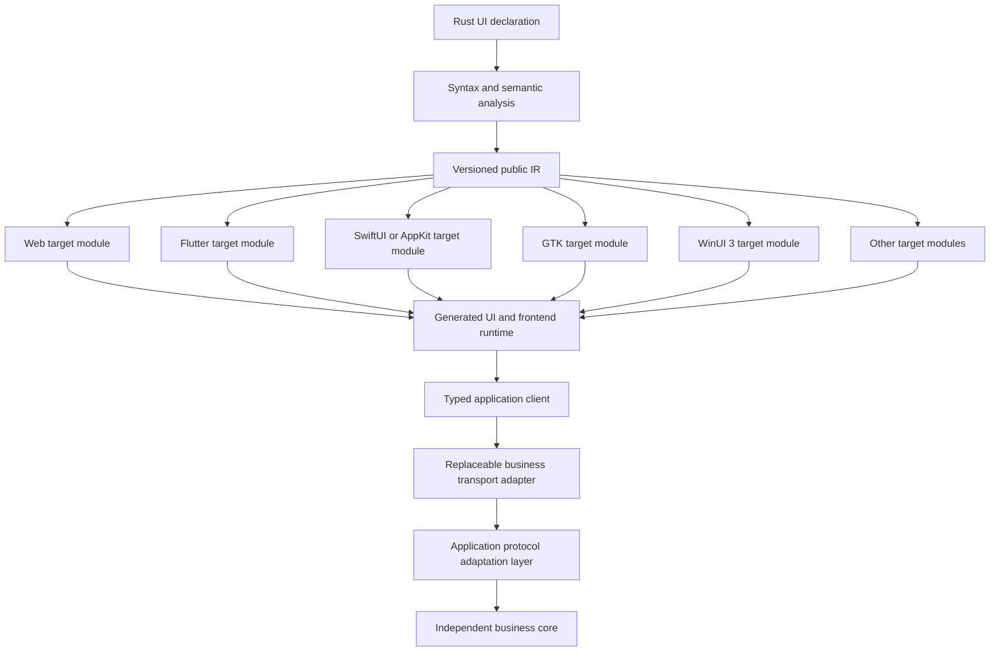
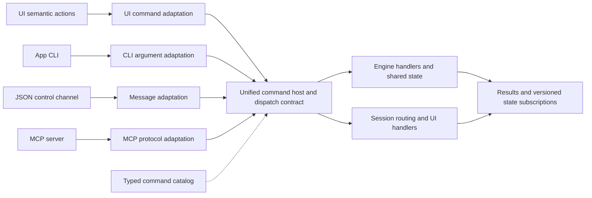
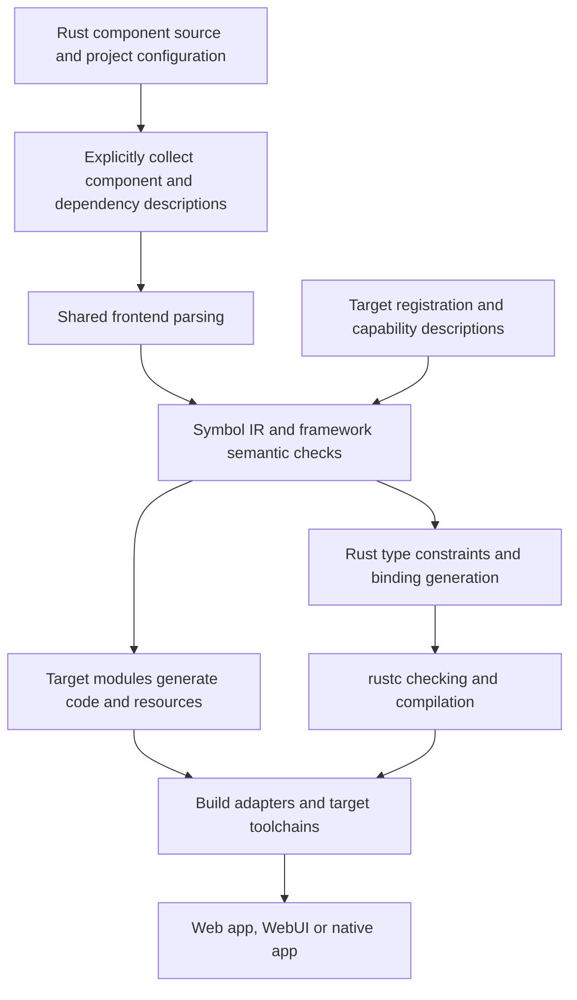

**English** · [简体中文](zh-CN/Design.md)

# Bern UI framework design document

- Version: v0.34
- Status: architecture and semantics specification; current interfaces, platform support and targets yet to be implemented are marked separately
- Updated: 2026-10-21
- Project name: Bern UI
- Repository: AimesSoft/Bern
- Main development language: Rust
- First target platform: macOS (SwiftUI)

Backends are currently provided for macOS / iOS / tvOS SwiftUI, Android Compose, Windows WinUI 3, Linux GTK and the Web, along with tools for commands, queries, sessions, module composition, resources, building and packaging. Recent work filled in Web settings and onboarding, controlled controls, the search panel, the player coordinate layout, shared capsule controls and image Hero transitions across split-view columns. Feature coverage and the degree of verification differ between backends; the [platform capability table](Reference/Platforms.md) and each platform's implementation notes are authoritative.

Write interfaces with the [component reference](Reference/UI.md) and the [full property table](Reference/Component-Properties.md). This document keeps the architectural decisions, semantics and future targets; entry points and the topic index are in the [documentation index](README.md).

Official platform sources, the UI adaptation mappings and the acceptance scenarios for each device are in the [UI adaptation guidelines](Adaptation/README.md). Platforms and devices newly researched there do not mean a backend has been implemented; this document remains authoritative for the core architectural constraints.

Native UI connection mechanisms and implementation experience are covered in the [React Native source study](Research/ReactNative.md), which distinguishes runtime rendering, interface code generation and Bern's target code generation approach.

Bern is a Rust-based, command-centered modular application framework, and Bern UI is its declarative cross-platform interface layer, aimed at developers and AI agents. The framework also defines commands, queries, state, sessions and the entry point adaptation protocol. Developers define components in Rust source files, and Bern compiles the analyzable UI declarations into each platform's interface implementation, reusing existing UI technology instead of developing a complete graphics rendering engine of its own.

The core constraint established in this version is: **UI components that can be exported across platforms must use constrained, statically analyzable declarations; every actionable entry point must be bound to a typed command.** Bern automatically generates session commands for the common interactions of standard controls, business operations bind to commands the app has registered, and UI declarations that lack a binding or bypass commands must fail to compile. Ordinary Rust is used for command handlers, query providers and the app's internal implementation; arbitrary Rust code is not transpiled into Dart, Swift or Kotlin.

**Frontend–backend separation and modularity are fundamental architectural requirements.** An app's UI frontend connects to the business core through a typed protocol; the compiler connects to different UI technologies through a versioned IR and a generator interface. Flutter, native macOS UI and later new targets should be extended as independent modules; they must not require apps to rewrite their business core, nor keep adding platform special cases to the core compiler.

**The UI, CLI, JSON control channel and MCP server are different entry points to the same application engine.** They share command descriptions, execution rules, state and results, and do not each implement business logic. Bern provides general command infrastructure and adaptation interfaces, and the app provides the concrete business handlers; when an existing engine is used, an adaptation layer connects it to the same contract.

**Every UI control supports light and dark mode from the ground up, and colors come from the target UI framework by default.** When the target UI framework has its own complete light/dark and semantic color system, such as SwiftUI, WinUI 3 and Compose, Bern uses its system colors, materials and standard control styles directly; only when the target lacks such a system (for example the Web) or a control is drawn by Bern itself does Bern use its unified color algorithm, semantic colors and control state recipes. By default an app does not need to configure colors, check for light or dark mode, or maintain two sets of styles. This requirement applies equally to built-in controls, extension controls and all UI targets.

**Native targets follow the platform design guidelines.** For targets with clear design guidelines and a native component library, such as macOS, the generated code uses the platform's standard containers, controls and system styles, and the appearance evolves with the SDK and system version. When an explicit container, size or grouping is needed, system visual APIs may be used; newer APIs are branched by system version with a defined fallback for older systems. Button containers and functional groupings required by an app's design are expressed by the declaration and must not be removed by a backend on its own.

**Multiple windows are a unified declarative capability.** The same Window declarations and window commands use native windows on platforms that support them, and automatically use in-app virtual windows where the required native multi-window capability is unavailable. Window identity, state and business connections do not change with the presentation.

**The Web provides two independent build outputs.** A Web app runs the UI and the Rust WASM business engine in the browser; WebUI contains only the interface, the frontend runtime and the protocol client, and connects to a separately running Bern engine through the JSON control channel. The two builds share the Web backend, component declarations and command protocol; where the business engine runs is chosen explicitly by the build configuration.

This document keeps both implemented semantics and clearly marked future designs. Current components and properties are defined by `bern-ir::spec::COMPONENTS`, and target support by each backend's `TargetDescriptor` and capability checks; the ellipses and pseudocode in this document explain semantics. Complete buildable apps are in `examples/hello`, `examples/showcase`, `examples/planner`, `examples/gallery` and `examples/svg-animation`. The API is still in an early stage of evolution; items yet to be implemented are not to be taken as existing interfaces.

## Project goals

The name Bern comes from Frederica Bernkastel in *Umineko When They Cry*. Bern is developed as an independent general-purpose framework and does not depend on any specific app's business model or command implementations.

The project goals include:

- Express portable UI semantics with one set of Rust component declarations, allowing different sizes and input methods to use different layouts.
- Separate app UI, business core and transport implementation, so that UI technology and runtime platform can be chosen independently.
- New UI targets connect through independent generators, runtime adaptation and build integration; the core layer does not depend on any specific UI framework.
- Provide complete light and dark mode adaptation by default: native targets use the platform's own color system, and for targets lacking it Bern derives colors, control states and contrast relationships uniformly, so that people building apps do not take on theme adaptation work.
- Check component properties, localization completeness, feature entry point coverage and platform capability requirements through compile-time diagnostics.
- Require every semantic operation of the UI to be a command, so that the UI, CLI, JSON control channel and MCP can drive the same engine instance.
- Derive every entry point from the same typed description, and provide general rules for navigation, focus, asynchronous resources and reproducible scenarios.
- Support multiple independent windows with a unified declaration, adapting automatically to virtual windows when native multiple windows are unavailable, and preserving each window's interaction state.
- Keep a necessary and explicit runtime responsible for dynamic state, events and platform bridging.
- Provide a stable, short and consistently written API so that agents can complete changes from the diagnostics.

Initially the project does not pursue automatic cross-language conversion of arbitrary Rust UI, nor does it promise pixel-identical results across platforms. For now it does not develop a new standalone source file language or a complete rendering engine, and does not build app business such as media libraries or accounts into the framework; general command descriptions, the dispatch protocol, the video component and the media adaptation interface are framework responsibilities. Bern reuses existing media facilities and does not implement a general audio/video decoder itself.

Desktop and mobile do not introduce a JavaScript engine as the UI runtime. The Web may use the necessary JavaScript and Web API bindings. An app that enables runtime plugins carries a JavaScript engine that runs plugin scripts; it takes no part in the interface, and apps that do not enable plugins do not link it.

## Core decisions

| Area | Decision |
| --- | --- |
| Source organization | All UI definitions live in `.rs` files, reusing Rust modules and dependency management |
| Declaration entry | `#[component]` marks exportable components, and a component uses the unified `ui!` declaration |
| Static boundary | Component structure, expressions, command references and feature entry points must be recognizable by the Bern frontend |
| Dynamic behavior | Conditions, lists and property values can change dynamically, expressed as explicit IR nodes and Rust bindings |
| Type checking | Bern checks declaration semantics and generates Rust type constraints; `rustc` checks the actual Rust types |
| Localization | User-visible static text is declared together with its translations, with natural language carried by string literals |
| Feature coverage | An explicit Feature Contract is the basis; each adaptive layout must declare and implement the required entry points |
| Automatic theming | Native first: when the target UI framework has a light/dark system, its system colors and standard styles are used, following the system by default; a brand color is optional and maps to the platform accent color |
| Color algorithm | A shared Rust theme core generates and validates color schemes for targets lacking a native system (such as the Web) and for Bern's self-drawn controls; these parts consume the same theme snapshot |
| Native visuals | Native targets use platform standard components and system styles; explicit containers, sizes, functional groups and system visual APIs with version-based fallbacks are supported; the macOS rules are under backend implementation boundaries |
| Mandatory commands | Every actionable entry point binds an engine command or session command; standard interactions are generated automatically, and violating declarations fail to compile |
| Multi-entry engine | The UI, app CLI, JSON channel and MCP use the same command catalog, dispatch contract and engine state |
| Operation semantics | A Command performs an action, a Query stays read-only, an Event reports a fact; they are described uniformly without blurring side effects |
| Runtime plugins | Opt-in per app; plugins use the command catalog according to app-defined permission groups and hand results back through hooks; the first version runs JavaScript and loads no native code at runtime |
| Build entry | `bern build` coordinates component collection, code generation, Rust compilation and platform builds |
| Bundled resources | `Bern.toml` declares, in a restricted form, the files shipped with the app; the build validates them strictly and targets copy them into the outputs; the engine resolves them by name through the `Resources` assembled by the host, independent of platform layout |
| App layering | A general command host routes engine and UI session commands; the business core does not depend on any specific UI |
| Target extension | The public IR and target interface connect to independent generators; platform runtimes and build tools are each adapted |
| Target selection | UI technology and runtime platform are two dimensions; the same platform can choose different UI frontends |
| Desktop defaults | macOS uses SwiftUI, Linux uses GTK, Windows uses WinUI 3; explicit configuration can select other supported targets |
| Multiple windows | WindowSet and Window declare windows; native first by default and presented virtually when native is unavailable, sharing identity, commands and lifecycle |
| Video playback | Uses a dedicated Video declaration; the Web maps it to the video element by default, other platforms connect through independent media backends and presentation interfaces |
| Deployment | The first version prioritizes local execution; the business protocol is not tied to in-process, FFI or network transport |
| First backend | macOS SwiftUI: generates SwiftUI code that uses standard native components, with the business engine running in the app process by default |
| Web builds | `app` generates the in-browser UI and WASM engine; `ui` generates WebUI that connects to a separate engine; they are built and accepted separately |

`ui!` still contains a declaration syntax. Using a Rust macro means no additional file format; it does not mean that syntax rules, tool support and learning costs go away. Therefore each feature should have only one recommended way of writing it.

## Platform targets and native semantics

A platform is not permanently bound to one UI technology. A build target is determined jointly by "UI technology, runtime platform, build mode, UI bridge and business transport", and only combinations that have been declared and verified are available. The build mode decides which runtime parts the output contains; it is not an additional UI technology.

| UI technology | Target runtime platform | Generated output | Role and phase |
| --- | --- | --- | --- |
| Web DOM | Browser | Web app or WebUI; shares HTML, CSS, bindings and frontend WASM, with the mode deciding whether the business engine is included | Second official backend; needs Bern's own design guidelines and theme algorithm; both modes need acceptance |
| SwiftUI | macOS, iOS, tvOS | SwiftUI views, Swift bindings and platform project integration | Default for macOS, iOS and tvOS; macOS is the first official backend; the iOS and tvOS targets have built simulator apps, while device signing and packaging come later |
| GTK | Linux | GTK widgets, Rust bindings and desktop integration | Linux default; first batch of Phase 5 implemented |
| WinUI 3 | Windows | WinUI 3 interface (falling back to system XAML when the runtime is absent), C++/WinRT platform host and Rust bridge | Windows default; second batch of Phase 5 implemented |
| Jetpack Compose | Android | Kotlin Compose UI, bindings and Android project integration | Android default; first version implemented |
| Flutter | Platforms that Flutter supports and Bern has adapted to | Dart Widgets, binding code and Flutter project integration | Optional cross-platform target |
| GPUI | Windows, macOS, Linux (including embedded Linux without a desktop environment) | GPUI Rust UI, Rust runtime and native windows | Optional desktop target for large productivity software, a consistent cross-platform look and embedded devices; first version on macOS |
| AppKit | macOS | AppKit controls and window integration | Can be extended independently, or assist SwiftUI adaptation |

PCs default to each platform's native UI technology: `swiftui + macos`, `gtk + linux`, `winui3 + windows`. `swiftui + macos` is the first official implementation target: macOS has clear design guidelines and a mature native component library, making it the easiest place to reach the visual standard of the system's own apps and to verify the complete architecture. The Web has no unified style guidelines, so Bern must define its own design guidelines and theme algorithm; it is the second official target. The other desktop default mappings do not mean the corresponding backends have been implemented.

A project can explicitly select other supported combinations such as `flutter + macos` and `gpui + windows`. GPUI and Flutter mainly use their own drawing systems and are kept as optional choices. Linux has many desktop environments and UI toolkits, and GTK is the Linux default Bern has chosen; the support scope is verified per actual environment, without assuming that all Linux desktops behave the same.

The default mappings are provided by the target registration and configuration assembly layer, not written into the public IR or the business core. When no UI technology is specified, the default is resolved from the target platform; when the default backend is not implemented, not installed, or cannot satisfy the contract including its standard alternatives, an explicit error is reported, with no silent switch to GPUI, Flutter or the Web. The automatic choice between native and virtual windows happens within the same selected UI backend and does not change the UI technology. An explicit selection always takes precedence and is subject to the same capability checks.

The Flutter backend reuses Flutter's engine and toolchain; it does not mean Bern develops its own rendering engine. Flutter itself supporting a platform also does not mean that Bern's bindings, resources and capabilities have been adapted to that platform. All capabilities are reported per specific combination.

Bern unifies component semantics, state interfaces, feature contracts and the theme protocol. Control geometry, text metrics, input method behavior and some interactions may follow platform conventions; light and dark mode adaptation must be done by the backend. When the target UI framework has a light/dark system, the platform provides the colors; Bern's self-drawn parts and targets lacking such a system use the unified algorithm, with the rules given below. Only behavior written into the component specification is part of the cross-backend consistency promise.

## Frontend–backend separation and module boundaries

### App layering and compiler layering

"Frontend" and "backend" have two sets of meanings, and interface and module names must keep them apart:

| Layer | Frontend | Backend |
| --- | --- | --- |
| App runtime | The Web, Flutter, SwiftUI or other UI the user sees, and its local interactions | The Application Core that provides business operations and state |
| UI compilation | The Compiler Frontend that reads constrained Rust declarations and builds a semantic model | The Target Backend that turns the public IR into target UI code |

So adding a Flutter app frontend is, for the Bern compiler, adding a Flutter target backend. The two are composed through explicit interfaces, and business logic is not put into generators.



UI in the diagram stands for the frontend that each target generates on its own, not all UI frameworks loaded into one app at the same time. The diagram shows the engine connection path; state and events notify the frontend in the reverse direction through the same protocol, and local session commands run in place according to the routing rules later in this document and need not pass through the business transport.

### Dependency directions that must hold

- The public semantics, IR, protocols and check rules do not depend on Flutter, SwiftUI, GTK, WinUI 3, GPUI, the DOM or any specific operating system SDK.
- The compiler core calls the target extension interface, and target modules implement that interface; the core layer does not import concrete target implementations.
- Only the build host or the registration entry selects and assembles target modules; the business core does not choose a UI backend.
- The business core does not depend on generated components, window objects, the UI runtime or the compiler. An existing app can implement the Bern protocol through an independent adaptation layer, without being reworked into a Bern-specific business framework.
- The general frontend runtime handles only state binding, component identity and the event protocol; concrete UI scheduling, controls and resource lifecycles are the responsibility of the target runtime adapter.
- The theme core is an independent frontend foundation module that does not depend on the business core, the network or any target UI SDK; all targets use it through the theme protocol.
- The general media contract does not depend on UI SDKs or specific decoders; media backends and presentation adapters handle the actual playback and view attachment, and the assembly layer selects compatible combinations.
- The app and the frontend do not share freely mutable in-memory objects; across the boundary they interact through declared values, commands and subscriptions. Active UI session operations managed by Bern also run through session commands; facts that have already happened in external systems such as the window manager are synchronized through trusted adapter events.

During development these modules can be organized in the same workspace, and on release they can also be packaged into a single executable. Logical separation does not require every app to deploy a server.

### Frontend computation and the business core

Strict UI declarations allow only typed state snapshots, event fields, literals, restricted operations and conversions known to the framework. Custom Rust computation outputs values through described Queries or derived state providers; the UI does not directly run functions that cannot be analyzed, or read or write business core objects. The business core can be compiled and run independently and verified by tests without a UI.

Restricted expressions and typed bindings can run in the generated Rust frontend binding module, which Flutter or SwiftUI use through a bridge; this does not mean transliterating arbitrary Rust into Dart or Swift, nor does it require bundling the complete business core into the client.

Expensive business computation is provided on the business side through Queries or Commands. Operations such as focus, editing and navigation are performed by frontend session commands; making them commands does not require network transport or JSON serialization. Drawing, layout, animation sampling and raw input sampling are runtime mechanisms; there is no need to publish every frame or every pointer coordinate as a business command.

### UI bridge and business transport

The UI bridge handles the interaction between UI code such as Dart, Swift and JavaScript and the Rust frontend binding module. The business transport handles the interaction between the typed application client and the business core. The two are independent extension points: Flutter can use local frontend bindings through Dart FFI while connecting to a remote business core over the network.

Conceptually the business interface provides a typed `dispatch`, snapshot queries and state subscriptions. The protocol schema is independent of the transport encoding; local Rust calls can pass values directly, without forcing serialization for the sake of modularity.

| Business deployment | Transport adaptation | Architectural requirements |
| --- | --- | --- |
| In-process | Direct Rust calls or a local channel | Core internal objects do not leak; asynchronous completion is allowed |
| Separate processes | IPC adapter | Defines message encoding, process disconnection and resource cleanup |
| Remote service | Network adapter | Defines connection identity, version negotiation, reconnection and state resynchronization |

Initially, both the Web app's in-browser engine path and the minimal browser-accessible control channel that WebUI needs to connect to a separate engine are verified. Joint testing of the four entry points first has WebUI, the CLI, JSON and MCP connect to the same local engine host. A separate CLI process must not pose as the shared engine by instantiating the business core again. Broad IPC and remote deployment schemes are accepted separately; passing the minimal channel is not taken to mean that all network environments are supported. Network retries must not re-execute commands with side effects by default; transport adapters must make request identity, failure and retry semantics explicit.

The application protocol should be versioned independently, and on connection the command parameters, state schema and service capabilities are checked. UI targets and the business protocol evolve separately; replacing the UI technology should not force business APIs to be renamed or rewritten.

## Modular applications

Implementation progress: composition of the command catalog, state and engine, module UIs, collecting source files by directory, slots and page slots, enabling, disabling and cascading of optional modules, commands, events and state reads between modules, and `bern new --module` have been verified on macOS with `examples/planner` and newly created apps. Not yet implemented: module resources. When a module is disabled, its pages disappear from the sidebar and the selected page returns to the sidebar's `fallback` (see the navigation item rules in "UI execution model"); dynamic navigation items are now implemented by SwiftUI, Compose, Web, GTK and WinUI 3, with the verification scope given in "Allowed dynamic behavior" and each backend's notes.

Large apps are developed in parallel by many people and many agents. State, commands, interfaces, translations and resources need to be split up by feature: each feature is a module, changing one module does not require touching other modules' files, and modules interact only through declared protocols.

### What a module consists of

A module is a directory with its own `Bern.toml`. It usually has three parts, each of them a crate:

| Part | Content | May depend on |
| --- | --- | --- |
| Protocol | `#[bern::protocol(namespace = "…")]`: this module's value types, state, commands, queries and events | The protocols of the modules it depends on |
| Engine | The business logic that implements this module's protocol | The protocols of this module and the modules it depends on, ordinary libraries that do not depend on Bern |
| UI | This module's components and pages, which can bind the state and commands of this module and the modules it depends on | The protocols and UIs of this module and the modules it depends on, component libraries |

A module with only logic and no UI, and a component library with only presentational components and no state, are both allowed forms.

A module's protocol can use the value types declared by the protocols of the modules it depends on directly: after writing `use library_protocol::library::Song;`, it uses `Song` in its state, commands and events, so the dependency module's UI components can show it directly. The macros and the build tool read the protocols of the modules depended on and copy the types used (and the types those types use in turn) into this protocol's descriptor, so the descriptor stays self-contained; after composition the whole app has only one copy. Types of modules not declared as dependencies are not found (2026-11-02).

```toml
# modules/downloads/Bern.toml
[module]
id = "downloads"
name = { "zh-Hans" = "下载", "en" = "Downloads" }
depends = ["library"]
optional = true

[module.protocol]
package = "downloads-protocol"
source = "protocol/src/lib.rs"

[module.engine]
package = "downloads-core"
type = "downloads_core::DownloadsEngine"

[module.ui]
package = "downloads-ui"
sources = "ui/src"            # Directory: collects every .rs file in it

[languages]
supported = ["zh-Hans", "en"]
default = "zh-Hans"

[resources]
paths = ["ui/images"]

[[pages]]
slot = "main"
id = "downloads"
label = { "zh-Hans" = "下载", "en" = "Downloads" }
icon = "arrow.down.circle"
component = "downloads_page"

[contributes]
toolbar = ["downloads_progress"]
settings = ["downloads_settings"]
```

The app's `Bern.toml` registers the modules in order, and the order determines the order of content in the slots:

```toml
[[modules]]
path = "modules/library"

[[modules]]
path = "modules/downloads"
```

The app's own `[protocol]`, `[engine]` and `[ui]` still exist; they are the shell that assembles the modules: windows, the navigation frame, slots and cross-module flows.

### Composing the command catalog, state and engine

- **Command catalog**: The app's command catalog is merged from the protocols of the shell and of each module. Command IDs have the form `namespace.command`, and the CLI and MCP group them by module, for example `app downloads add`. A duplicate namespace fails the build.
- **Type names**: The names of value types, session drafts and components are unique across the whole app; a conflict fails the build and points to both declarations; the generated code in each language therefore uses the same names as the source. Each module's state is combined into one record type, named after the module ID in UpperCamelCase plus `State`, for example `DownloadsState`.
- **State**: Each module occupies one top-level field in the app state. UI components receive the module client as a parameter, for example `downloads: downloads::Client`, and bindings are written `downloads.items`.
- **Engine**: The app engine consists of the shell engine and the engines of the modules. The host hands each command to the matching module by namespace, the state snapshot is assembled from the parts, the state version is still a single sequence, and the behavior of the four entry points is unchanged.
- **Calling dependency modules**: Each protocol module generates `calls::command_name(…)` and `current_state()`. When a module engine handles a command, it uses the former to queue commands to the modules it depends on and the latter to read their current state (a disabled module reads as `None`). The state is taken only when it is read, once per module within a command, so modules that are not read cost nothing (2026-11-02; previously every command and every wake first copied the state of all the dependency modules). Queued commands run one after another after the current command completes, without nesting and without reentry.
- **Events**: A module declares events with `#[events]` in its protocol and emits them in its engine with the generated `emit::event_name(…)`. A module that depends on it responds with an ordinary command annotated `#[on(module::event)]`, whose parameters are the same as the event's; the app shell can also respond to any module's events. After the command that emitted the event completes, the host runs these commands in catalog order; disabled modules do not receive events. Lower-level modules therefore do not need to know about higher-level ones; for example, the playback module reports "a file was opened" and the other modules each respond.
- **Failures and loops**: When the original command fails, all the commands and events it queued are discarded; a failure of a follow-up command is only written to the log and does not change the original command's result. When the follow-up commands triggered by one command exceed ten thousand, the rest are discarded as a loop and written to the log.
- **Dependency rules**: Dependencies must be acyclic; an undeclared dependency cannot even be accessed at compile time, because the other module's protocol crate is not among the dependencies.
- **Session commands**: Generated session commands such as those for windows, navigation and focus belong to the app session, not to any module.

### Slots

The shell declares slots in its interface, modules declare in their manifests which components go into which slot, and the compiler wires them up at build time:

```rust
Toolbar {
    Slot(id: toolbar)
}

SplitView {
    Sidebar(selection: draft.page) {
        Section { Pages(slot: main) }
    }
    Detail {
        PageContent(slot: main, selected: draft.page)
    }
}
```

- **Ordinary slots**: `Slot` places the components contributed by each module in module registration order. A slot can declare parameters passed to the contributed components, for example `Slot(id: player_controls, player: players.main)`; contributed components receive these values by parameter name, and Bern injects the module clients and session drafts they need.
- **App contributions**: The app's own `Bern.toml` can also have `[contributes]`, placing shell components into slots, including slots declared in module pages (for example, a module page leaves a `Slot(id: page_header)` at the top of its scrolling content, and the shell puts the phone's top bar there). App contributions come before all modules and are not switched on and off with optional modules. When a contributed component needs a window handle, Bern provides it; the component containing the slot does not need a `windows` parameter.
- **Page slots**: `Pages` generates a navigation item in the navigation container for each contributed page; `PageContent` shows the selected page. The type of the selection value is generated by the slot, and its values come from all pages registered at build time, so it is still typed and checkable.
- **Page visibility and start**: a page in the manifest can write `when = "field"`, so that its navigation item shows only while this boolean state field of the module is true, for example hiding a page's entry while the feature behind it is turned off; `start = true` puts the page first in the slot enum, so selection starts from it, and when it is not excluded it is the page selected after launch (a slot can have only one); `tab = false` keeps `Tabs` from listing it, so it appears only in the sidebar, for pages that a module's own button opens on phones, such as search. All three only shape the conditions and the variant order generated when the slot is expanded, and all targets support them (2026-11-02).
- **Opening a page**: An action in a component written `=> pages.downloads.show()` switches to the page with ID `downloads` in a page slot, for example "All ›" on the home page jumping to the module's own page. The module does not need to know how the shell displays pages: the compiler finds the enum that selects this slot, then the session field holding that enum (the shell's `Sidebar`, `Tabs` or `PageContent` selects by it), turns the action into an assignment to that field, and has the component read that session draft. The build fails when there is no such page, when two slots both have this ID, or when there is not exactly one session field holding the enum. It is only a session assignment, and all targets support it.
- **Container rules**: The container a slot sits in accepts only the children it allows. For example, the root element of a component contributed to a toolbar slot must be a child that the toolbar allows. When it does not match, the build fails and points to the declaration of the contributed component.

### Optional modules

A module that declares `optional = true` can be enabled and disabled at runtime:

- Bern generates a field `modules` at the end of the app state, with one boolean per optional module, written `app.modules.downloads` in the shell; and the command `modules.set_enabled(id, enabled)`.
  - Enabling a module also enables the modules it depends on; disabling a module also disables the modules that depend on it.
  - The command result lists the modules that actually changed, which the interface can use to notify the user.
  - A module that always runs cannot depend on an optional module; this is checked at build time.
- A disabled module has no engine: when it is enabled a new one is created from its `Default` and woken once, as the host does at startup (`wake`), so work needed from the start begins there, and the commands it sends run after the enabling command (2026-11-02); when it is disabled the engine is dropped. While it is disabled, its commands return `module_disabled` and its state reads as default values. Its contributions to slots and pages are wrapped by the framework in an "is enabled" condition and disappear automatically when it is disabled, so the app does not need to write conditions everywhere. When the shell binds directly to an optional module's state, it reads default values while the module is disabled; if it needs to hide something, it writes the condition itself.
- When the app has not saved a choice, optional modules run according to the manifest's `enabled`, which defaults to enabled. The shell engine implements `initial_modules` to return the saved choice and `modules_changed` to save after each change; how the choice is stored is up to the app.

### Source files, translations and resources

- **Source files**: `sources` can name a directory, collecting every `.rs` file in it sorted by path, so new files need no change to the manifest; files can also still be listed one by one.
- **Translations**: Checked per module. Each module's language set must cover the languages the app declares; when one is missing, an error is reported or a fallback is used according to the app's strictness setting.
- **Resources**: Declared per module, with resource names prefixed by the module, for example `downloads/images/empty.png`, so different modules do not conflict.

### Tools and tests

- `bern new --module <id>` generates a module directory (protocol, engine, UI, manifest, readme and tests), registers it in the app's `Bern.toml`, and adds the three crates to the Cargo workspace. The new app template leaves a `Slot(id: extras)` in the window, and a new module puts its page component there by default, so it is visible immediately after generation.
- In the generated code, module command names carry the module prefix, for example Swift's `downloadsAddOne`, so same-named commands of the shell and of modules do not conflict.
- A module's engine tests need only the protocols of this module and of the modules it depends on; dependency modules can be replaced with test doubles, and neither a UI nor other modules are needed.
- External entry points can list a single module's commands, for example `app downloads --help`.
- UI crates can also be compiled directly with `cargo check` and `cargo test`: the macro reads the app's `Bern.toml`, adds `modules` (one switch per optional module) to the shell protocol's `Client`, and adds to enums marked `pages = "slot"` the pages each module registered in that slot, with the same names as those the build tool composes. When Rust code references a component from another file or crate, it must import both the component function and its props struct `<component>_props`, for example `use player::{player, player_props};`.

### Acceptance

- Two modules that each define a command with the same name can coexist; same-named types report both declarations at build time;
- After an optional module is disabled, its slot content and pages disappear, its commands return `module_disabled`, and its engine part stops; after it is enabled again, everything is restored;
- Enabling and disabling cascade along dependencies, and the result lists the affected modules;
- A module's events are handled by the modules that depend on it, in dependency order;
- Adding a module needs only one registration in the app's `Bern.toml`, with no change to other modules' files.

## Runtime plugins

Implementation progress: not yet implemented; this section is a design.

Modules are compiled into the app at build time; plugins are modules loaded only after installation, added, enabled and disabled at runtime by the user or an agent. Once an app enables plugins in `Bern.toml`, the commands, queries, state, events and hooks in the command catalog are opened to plugins according to the permission groups the app defines, and developers do not need to write a separate interface for plugins. An app that does not enable plugins links no plugin runtime and has none of the `plugins` state and commands generated below.

### Plugins and modules

Plugins follow the rules of modules:

- Enabling and disabling work as for optional modules: enabling creates a new runtime and runs the entry, and disabling first calls the plugin's stop handler and then drops the runtime. A disabled plugin receives no events and takes no part in hooks.
- Commands issued by a plugin are queued and run one after another after the current command completes, without nesting and without reentry; failures and loops are handled as for commands between modules.
- Plugins respond to events in the same way as `#[on]`, running after the modules, in plugin order.

Differences from modules:

- No `rustc`: parameters and results are validated against the catalog's schema at the call boundary, and a mismatch returns `invalid_params`.
- No UI compiled into the app: a plugin appears in the interface only through its settings form, which the app's own components display.
- In the first version a plugin cannot add commands to the command catalog; capabilities that plugins provide plug in through hooks the app declares.

### Runtimes

| Form | Phase | Notes |
| --- | --- | --- |
| JavaScript | First version | Embedded QuickJS, one independent runtime per plugin; runs synchronously, with no event loop and no access to the network or files |
| WebAssembly | Later | Interpreted, so it also works on platforms that do not allow JIT |
| Dynamic libraries | Not loaded at runtime | Equivalent in security to the app's own code; when needed, they are built and signed with the app as a dependency, not installed as plugins |

Each call has a time limit and a memory cap, configured in `[plugins]`; when a limit is exceeded, the call is interrupted and recorded, and the plugin shows an error. WebUI's engine host is the same as on desktop; a Web app runs the engine in the browser, and its plugin runtime will be implemented later.

### Enabling plugins and permission groups

```toml
[plugins]
runtimes = ["js"]
api = 1                       # Interface version the app promises to plugins, separate from the app's version number

[plugins.permissions."player.control"]
name = { "zh-Hans" = "播放器控制", "en" = "Player control" }
commands = ["player.play", "player.pause", "player.seek"]
state = ["player"]

[plugins.permissions."links.resolve"]
name = { "zh-Hans" = "链接解析", "en" = "Link resolution" }
hooks = ["links.resolve"]
```

- Permission groups are defined by the app and list the available `commands`, `queries`, `state`, `events` and `hooks`; `module.*` may be written. A group name is an arbitrary string and need not correspond to a namespace.
- A plugin requests permission groups in its manifest, and they are shown to the user at installation. A call to an interface that was not granted is rejected by the host with `permission_denied`; the check is made on the host side, and plugin scripts cannot bypass it.
- A plugin's own storage, settings and logs need no permission. Session commands (windows, navigation, `ui.activate` and so on) are not opened to plugins in the first version.
- When the app changes the names or parameters of the commands opened to plugins, it raises `api`; a plugin whose declared `api` differs from the app's is refused loading.

### Plugin packages

```toml
# plugin.toml
[plugin]
id = "example.links"
name = { "zh-Hans" = "链接解析示例", "en" = "Link resolver example" }
version = "1.2.0"
api = 1
entry = "main.js"
priority = 50
permissions = ["links.resolve"]
```

- `id` consists of letters, digits, `.`, `_` and `-`, and is unique within the app. `priority` determines the plugin's order in events and hooks: smaller values come first, ties follow installation order, and the default is 50.
- A package is a directory or a `.zip`, installed to `plugins/<id>/` in the app data directory. Only a higher version can be installed for the same ID; during development the same version can be loaded again.

### JavaScript interface

The entry script runs once when the plugin is enabled, and registers handlers and calls the app through the global object `bern`:

| Interface | Purpose |
| --- | --- |
| `bern.call(command, params, done?)` | Queues an engine command and returns immediately; when `done` is given, it is called with the result after the command completes |
| `bern.query(query, params)` | Runs a read-only query and returns the result |
| `bern.state(field)` | Reads a field of the current state snapshot |
| `bern.on(event, handler)` | Responds to an event; `handler` receives the event parameters |
| `bern.hook(hook, handler)` | Implements a hook, see below |
| `bern.onStop(handler)` | Called before the plugin is disabled |
| `bern.storage.get / set / remove / keys` | The plugin's own persistent data, with JSON values |
| `bern.form(items)` | Sets the plugin's settings form; it can be replaced at any time |
| `bern.settings.get(item)`, `bern.settings.set(item, value)` | Reads and writes the value of a form item |
| `bern.onSetting(handler)` | The value of a form item was changed |
| `bern.onPress(handler)` | A button in the form was pressed; when it returns `{ title, text }`, the host shows it to the user |
| `bern.log(text)`, `bern.error(text)` | Writes to the app log, tagged with the plugin ID |

The JSON form of values is the same as in the JSON control channel, including the encoding of 64-bit integers. Exceptions thrown by handlers are recorded and do not affect other plugins; when the entry script fails, the plugin is marked as not loaded and shows the error.

### Hooks

Events only report facts that have already happened, and responders cannot hand results back to the emitter. Places where plugins need to hand back results are declared by the app in its protocol as hooks:

```rust
#[hooks]
pub trait Hooks {
    /// After captions load, they are passed to the plugins in turn for rewriting.
    #[chain]
    fn captions_loaded(&self, cues: Vec<Cue>) -> Vec<Cue>;
    /// The first plugin that recognizes this link takes over.
    #[first]
    fn resolve(&self, input: LinkInput) -> Option<LinkStep>;
    /// Collects each plugin's blocked words.
    #[collect]
    fn blocked_words(&self) -> Vec<String>;
}
```

| Merge mode | Rule |
| --- | --- |
| `#[chain]` | Called in plugin order, each receiving the previous result; when a plugin returns nothing or fails, the value is passed on unchanged to the next |
| `#[first]` | Called in order, and the first plugin that returns a non-empty value takes over. The engine gets the result and this plugin, and can ask only that plugin with `hooks::resolve_with(plugin, …)` for a multi-round interaction; between two rounds the engine can wait for operations such as network requests |
| `#[collect]` | Calls all plugins and gets each one's result, in order |

- The engine calls the generated `hooks::name(…)` in a command handler or engine task and gets the merged result synchronously. When no enabled plugin implements a hook, `chain` returns the input unchanged, `first` returns `None` and `collect` returns an empty list.
- While a hook runs, plugins can read state and call queries; the commands they issue are queued after the current command.
- Hooks appear in the command catalog: the CLI and MCP can list which plugins currently implement each hook, but cannot call hooks. In the first version only plugins implement hooks.

### Settings forms and plugin management

For an app with plugins enabled, Bern generates the state field `plugins` and the following commands; like other commands, they appear in the CLI, MCP and the agent skill:

| Command | Purpose |
| --- | --- |
| `plugins.install(path)` | Installs a plugin package, or a file to be converted by an importer |
| `plugins.remove(id)` | Disables and deletes a plugin |
| `plugins.set_enabled(id, enabled)` | Enables or disables a plugin |
| `plugins.set_setting(id, item, value)` | Changes the value of a form item, after which the plugin's `onSetting` is called |
| `plugins.press(id, item)` | Presses a button in the form; the result is the message the plugin returns |

`plugins` lists each plugin's ID, name, version, author, whether it is enabled and loaded, errors, requested permissions, unsupported parts, the form and the value of each item. There are three kinds of form items, switch, text and button, each with an ID, a title and a description; switches and text items have default values, and text items can have placeholder text.

Apps display the plugin list and forms with ordinary components: `ForEach` over the plugins and form items, `match` on the kind of form item, and place a `Switch`, `TextInput` or `Button` accordingly. Plugin interfaces are therefore platform standard controls on every backend, needing no new components and no interface generated at runtime.

Enabled plugins, form values and plugin storage are saved in the app data directory, isolated by the app's bundle ID. A remote plugin catalog, update checks and downloads are implemented by the app, which finally installs with `plugins.install`.

### App background and foreground events

When the app enters the background and returns to the foreground, Bern emits the standard events `app.suspended` and `app.resumed`, and both modules and plugins can respond. Each backend obtains these two facts from the platform's app lifecycle; on desktop, "background" means that none of the app's windows is active any more.

### Importers and compatibility layers

An app can install importers that convert plugins in other formats into plugin packages at installation, to stay compatible with existing plugin ecosystems:

- An importer receives the file being installed and returns a manifest, an entry script and an optional prelude script.
- The prelude script is provided by the app and runs before the entry in the same runtime, with access to the whole `bern` interface. It implements another plugin interface on top of `bern`: it defines the global objects and functions that the foreign plugins expect, and connects their callbacks to `bern.on`, `bern.hook` and `bern.onPress`.
- Permissions in the original format are converted into permission groups according to the mapping the app provides, and the host checks them as usual.
- Declarations that cannot be supported are listed under "unsupported parts" in the plugin state. When the rest is still usable, the plugin loads as usual; when no part is usable, installation is refused with the reason.

### Platforms and security

- The plugin runtime is distributed and signed with the app, and no executable code is downloaded; plugin scripts are interpreted by the runtime. Some app stores restrict code downloaded later that changes an app's functionality; whether users may install plugins from the internet is up to the app.
- Plugins cannot access files, the network, processes or system interfaces directly, and can only use the commands that the app opens through permission groups. When network access is needed, the app provides a command, or makes the request on the plugin's behalf in the multi-round interaction of a hook.

### Acceptance

- An app with plugins enabled generates the `plugins` state and commands, and the CLI and MCP can install, enable and disable plugins and change their settings; an app without plugins enabled does not link the plugin runtime;
- Commands, queries, state, events and hooks that were not granted are rejected by the host, and plugin scripts cannot bypass this;
- The three kinds of hooks merge in plugin order, disabled plugins take no part, and failing plugins are skipped without affecting other plugins;
- Commands issued by plugins run after the current command, without reentry;
- Settings forms display with standard controls on every backend, and the messages returned by buttons are shown to the user;
- When the app enters the background and returns to the foreground, every backend emits the corresponding event;
- A plugin in another format, converted by an importer, runs without modification, and its unsupported parts are marked in the plugin list.

## UI target extension protocol

### Responsibilities of a target module

Adding a UI technology requires not only static component mappings but also a working runtime and build integration. A target package can consist of several independent modules:

| Interface responsibility | Input and output |
| --- | --- |
| Target description | Declares the target ID, version and supported platforms, and the version ranges of the IR, target interface, UI binding and theme protocol |
| Capability description | Declares components, properties, events, accessibility, theme mapping, style override properties and motion usage, native and virtual window capabilities, platform services, video presentation compatibility and the allowed alternative implementations |
| Validity check | For standard IR, reports support, an explicit alternative, or an unsupported diagnostic with the source location |
| Target transformation | Turns the public IR into a target-private representation, preserving structural identity and semantics |
| Code and resource generation | Outputs target source code, resources, a list of binding requirements and source maps |
| Runtime adaptation | Provides the target-language client, UI scheduling, theme environment listening, snapshot application and the instance lifecycle implementation |
| Build adaptation | Returns toolchain requirements, build steps, dependencies and the list of outputs, executed by the build driver |

The public interface can be summarized as describe, check, transform, generate and build plan; the concrete Rust trait names and function signatures are to be confirmed by a prototype. A target generator receives the IR, schemas and binding IDs, and does not need to reparse Rust UI source or infer the types of business functions.

Backend-specific transformations happen in the target-private representation. For example, Flutter can organize Widgets, SwiftUI can choose a view composition, and the Web can generate DOM templates. The public IR does not add framework-specific objects such as `BuildContext`, `NSView` or CSS selectors.

### Registration and version compatibility

The first version assembles targets with independent crates and an explicit registry, and target implementations can be compiled together with the build host. A new target may add dependencies, registry entries and project configuration, but when the public semantics can already express the need, it should not modify the parser, the public IR, the core check rules or the business core.

The Rust dynamic library ABI is not treated as a stable plugin protocol. When generators in the form of external processes are needed, versioned serialized requests and responses will be defined then; internal trait objects cannot be used directly as a third-party binary plugin interface.

The public IR, target extension interface, UI binding protocol, theme protocol and application protocol are versioned separately. Target modules check the IR, UI binding, theme and other interfaces they consume; application clients, business adapters and services check the application protocol. When video is enabled, the media contract version and the compatibility ranges of media backends and presentation adapters must also be checked. Generators can consume command schemas to generate typed bindings without thereby depending on a specific business transport. The initial API is not yet stable; incompatible versions should fail explicitly, not ignore unknown nodes and go on generating an incomplete UI.

If a new target needs new semantics that the public IR does not yet express, the semantics should be extended through a separate design with added acceptance, instead of stuffing all the target code into a string escape hatch. Platform-specific components can use namespaced extension descriptions, but still need a property schema, capability requirements, and alternative or failure rules for the other targets.

### Capability negotiation and configuration

The app declares the capabilities it needs, targets provide a support matrix per concrete platform combination, and the build driver computes before generation whether the requirements are met. A missing required capability fails by default; only alternative paths that a standard component contract defines, or alternative paths and exemptions that the app declares explicitly, may be used. Window's default auto policy explicitly includes adaptation from native to virtual and is part of the normal contract; it cannot substitute for native capabilities the app explicitly requires, such as the system taskbar or spanning multiple displays.

The following configuration shows the default selection on the three desktop platforms, an explicit switch to Flutter, and the two Web builds. The configuration keys are still a draft; when `ui` is omitted on desktop, the platform default mapping above is used, and the UI bridge is determined by the target combination, which does not mean that incompatible modules may be combined arbitrarily. Web targets must declare `web_mode` explicitly, with the value `app` or `ui`; the mode is not guessed from the service address.

```toml
[targets.native_macos]
platform = "macos"       # ui defaults to swiftui

[targets.native_linux]
platform = "linux"       # ui defaults to gtk

[targets.native_windows]
platform = "windows"     # ui defaults to winui3
frontends = ["winui3", "xaml-islands"]   # Both are compiled by default; you can list just one

[targets.flutter_macos]
ui = "flutter"
platform = "macos"
ui_bridge = "dart-ffi"
application_transport = "in-process"

[targets.web_app]
ui = "web"
platform = "browser"
web_mode = "app"
application_transport = "in-process"

[targets.web_ui]
ui = "web"
platform = "browser"
web_mode = "ui"
application_transport = "websocket"
application_codec = "json"
```

The Windows target's `frontends` chooses which frontends to compile: `winui3` and `xaml-islands`, both by default; an empty list, an unknown or duplicate name, and use on any other platform all fail at build time. `web_app` and `web_ui` are target names within the project; `web_mode` is what sets the build mode. In the example `websocket` is the transport and `json` the encoding; WebUI can also use a browser-compatible transport that is implemented and accepted separately. The connection address is provided through the runtime connection configuration, and credentials are not written into static build resources. `app` must assemble the in-browser engine adaptation and `ui` must assemble the separate engine client; incompatible configurations fail at build time. The configuration spelling and the command forms `bern build --target web_app` and `bern build --target web_ui` are all drafts.

These targets can share component declarations, feature contracts and the business core. When capabilities or platform interaction call for different layouts, the differences must be expressed in analyzable adaptive branches or explicit platform extensions.

### Criteria for a completed extension

A new target must be verified with the same samples as existing targets for state, commands, conditional branches, stable-key lists, localization, feature entry points, multi-window semantics and complete light and dark mode adaptation. A target without native multi-window capability must provide a virtual window path. A target that implements only one appearance mode, or requires apps to add colors themselves, cannot pass acceptance for standard controls.

Modularity acceptance must also check whether the parser and the business core stay unchanged when an independent target is added within the scope of the public semantics, and whether the other targets can still be built on their own after a target is removed or disabled. No specific framework SDK may become a global prerequisite for building all targets.

## Constrained component declarations

### Component definition and references

Portable components use an explicit marker, and the first version requires the component body to be a single `ui!` declaration. Component parameters must have explicit types, and the component name is the same as the Rust function name.

```rust
#[component]
fn play_button(player: PlayerHandle) -> impl View {
    ui! {
        Button(
            label: tr! {
                "zh-Hans" => "播放",
                "en" => "Play",
                "ja" => "再生",
            }
        ) => player.toggle()
    }
}

#[component]
fn player_screen(player: PlayerHandle) -> impl View {
    ui! {
        Column(gap: 12, padding: 16) {
            Text(content: player.title)
            play_button(player: player)
        }
    }
}
```

Built-in components have fixed names; custom components are referenced by function name or explicit path, and `play_button` is not implicitly rewritten as `PlayButton`. A reference must resolve to a collected component description; whether a function is an exportable component is never decided by guessing its return type.

`PlayerHandle` in the example stands for the typed application client used by the frontend, not a direct reference to a business core object. `player.title` must be a declared snapshot state binding; `player.toggle()` must resolve to a typed reference to a registered command, dispatched when the event occurs, not an arbitrary method call. The declaration syntax for the application interface will be finalized separately.

### Allowed dynamic behavior

Constrained declarations do not mean static pages. Bern must support the following dynamic behaviors and preserve their structure:

| Behavior | IR representation | Runtime responsibility |
| --- | --- | --- |
| Properties change with state | Property bindings and dependency sets | Recompute and update the affected properties |
| Conditional display | `If` nodes and their branches | Evaluate conditions and mount or unmount branches |
| Dynamic lists | `List` nodes and element templates | Create, update and remove instances by stable key |
| Adaptive layout | `Adaptive` nodes and selection rules | Switch layouts according to the environment |
| User events | Typed semantic actions and command bindings | Extract event parameters and dispatch engine or session commands |
| Presentation computation | Restricted expressions or explicit query result bindings | Evaluate known operations or subscribe to derived values |
| Lengths change with state | Numeric expressions bound to length properties | Recompute the length and transition with the element's `animate` motion |

The items of navigation containers can be dynamic too: the items of `Sidebar`, `Tabs`, `Toolbar` and of a `Section` in a sidebar can be written inside `if`, `match` and `ForEach`, and each branch and template may produce only the children that the container allows. When the branch holding the currently selected item disappears, the selection returns to the `fallback` value the container declares; without one, it returns to the first visible item, and this is reported as a fact with `changed_by: System`. Items being added and removed can use the element appear, disappear and reorder transitions (see "Style overrides, motion and self-drawing").

Implementation progress: structural checking checks the items of these containers element by element in branches and templates; SwiftUI generates items in conditions, `match` and lists, `fallback` and the return to the first visible item, and the options the control exposes to accessibility include only the currently visible items; the sidebar has been verified on macOS with `examples/planner`, and type checks of the generated code cover `Tabs` and `Toolbar`. Not yet implemented: reporting `changed_by: System`, and appear and disappear transitions for `SidebarItem` and `Tab` (they do not accept motion properties yet). Web implemented: sidebar and tab content is generated as ordinary builder functions, so `if`, `match` and `ForEach` work as usual; sidebar items and tabs register when mounted and unregister when unmounted, and when the selected item disappears the selection returns to `fallback` or the first visible item; verified in the browser with `examples/planner` that disabling the "Notes" module removes its sidebar item and returns the selection to "Overview", and that the item reappears after re-enabling; tabs are added and removed by module in the phone shell of a media app (2026-10-21; before that, the Web generated only tabs written directly in `Tabs`). GTK and WinUI 3 implemented (WinUI 3 sidebar items are `NavigationView` menu items, tabs are `SelectorBar` items, and in Islands a button group); verified on the Linux VM and the Windows PC with `examples/planner` that the "Archive" item appears and disappears, the selection returns to `fallback`, and the "Notes" page appears through the optional module. GTK tabs previously did not read `fallback`: after the selected tab disappeared, the selection stayed on the unmounted value and the page was blank; since 2026-10-21 the selection returns to `fallback` or the first tab, as for the sidebar, verified on the Linux VM with a probe app (with `fallback` it returns there, without it to the first tab). GPUI likewise returns to `fallback` or the first tab (2026-11-01: on every build it checks whether the selected value is still among the tabs and writes back the replacement if not); `bar: floating` applies only to phones and GPUI runs only on desktops, so its tab bar is unchanged. On GTK, tabs mounted later than other tabs used to be placed at the end of the switcher; since the same day they are placed at their declared position and also reorder when `ForEach` reorders (unit tests cover the ordering; not verified on a real machine).

A restricted expression can use `if condition { value } else { value }` to choose between two values of the same type, and `else if` can follow; when integers and decimals are mixed, the result is a decimal. Length properties (a container's `padding`, `gap`, `width` and `height`, `Grid`'s `min_width`, the size of `Image` and `Canvas`, and `Video`'s `corner`) can be literals or bound to numeric expressions, for example `padding: if window.idle { 0 } else { 24 }` or `min_width: draft.card_size`. Displayed text does not accept `if`; write the two texts separately with an element-level `if`. Implementation progress: all five targets generate expression `if`; bound lengths are implemented in SwiftUI and Compose (Compose does not accept negative padding or sizes, so bound values and springs that overshoot past zero both stop at zero) and on the Web (lengths are driven by the page's springs and written into styles, likewise never below zero). GTK and WinUI 3 implemented, following the spring when `animate` is set; verified on the Linux VM and the Windows PC that after the frame page goes idle its padding shrinks to 0 and the video's corner radius of 20 becomes square corners.

Titles, progress or conditions can come from restricted expressions and typed query results, but they cannot secretly perform business operations through arbitrary function calls, nor return component trees that cannot be analyzed. Dynamic lists use known element templates; undeclared component types cannot be chosen through runtime callbacks.

The state dependencies a binding needs must come from typed snapshots or explicit query descriptions. Bern does not try to derive dependencies or prove purity from inside arbitrary Rust functions. Custom query implementations must follow the read-only contract; changes to business or interaction state must go through commands, and the resource access that query execution needs is managed by the query provider.

### Static constraints in the first version

- An exportable component must have an explicit identity, a property interface and a complete declaration body.
- Every custom component reference must have a corresponding description; the first version does not support choosing an arbitrary component factory at runtime.
- Every structural branch of a dynamic condition must appear in an analyzable declaration.
- An updatable list must provide a key that is stable and unique among its siblings; position cannot stand in for data identity by default.
- Arbitrary recursive component structures are not supported; displaying recursive data requires first designing a dedicated analyzable mechanism.
- The first version does not support implicitly generating components to be collected through arbitrary macro expansion, `include!` or build scripts.
- Component export interfaces use only supported, explicit types; arbitrary generics, trait objects, closures or borrows are not exported across languages.
- Interaction handlers may only reference registered commands or use the session commands generated automatically by standard controls; arbitrary `on_click` closures, direct field assignment and platform event escape hatches are not accepted.
- Display expressions must not call Rust functions that are not covered by the constrained expression specification. Custom computation moves into a Query or derived-state provider that has a contract.

Constrained operations apply only to base values and record fields known to the schema; arbitrary user code cannot be reintroduced through custom operators or trait implementations. The generated UI handle exposes only reading, subscription and command dispatch, and gives components no writable reference to business state; the right to modify it belongs to the corresponding handler.

Ordinary Rust functions remain available for implementing the app, but an `fn ... -> impl View` that is not declared as a Bern component does not automatically qualify for cross-platform export. An unanalyzable structure or a command bypass must produce an error and must not silently degrade to a partial check. The macro constrains only the declarations it controls; business handlers, query providers, native bridges and external plugins lie within the trusted implementation boundary, and none of this can be used to claim proof that the whole Rust program has no side effects.

## Component and layout semantics

The table below outlines component semantics and implementation scope; the complete current interface is defined by the [property table](Reference/Component-Properties.md). Component semantics and default behavior are defined by the Bern specification; the IR stays platform-independent and does not introduce SwiftUI types.

| Component | Core semantics | Notes and implementation scope |
| --- | --- | --- |
| WindowSet and Window | Window catalog, content, instance policy, native or virtual presentation and lifecycle | Basic component; macOS uses native windows, the Web uses the page host and in-app virtual windows |
| SplitView and Sidebar | Sidebar and detail split view, sidebar groups and the selected item; a Sidebar can carry an `id` so external entry points can switch it; items can appear conditionally or from a list, and run fallback when the selected item disappears | Basic component |
| SidebarFooter | Content fixed at the bottom of the sidebar, below the list, laid out top to bottom, such as a mini player or account and settings entry points; the list scrolls above it; at most one per sidebar | For media apps; implemented in SwiftUI (inset in the safe area); implemented in Compose and the Web (a section at the bottom of the sidebar), verified in a web browser; implemented in GTK and WinUI 3 (WinUI 3 uses `NavigationView.PaneFooter`), verified on the Linux VM and the Windows PC |
| Navigation, Destination and NavLink | Push navigation and back, bound to typed routes; a Navigation can carry an `id` so external entry points can go back; optional `reset: key` identifies its root with text, an integer or an enum: mounting the container or changing that key clears the bound path, while updates with the same key preserve it | Basic component |
| Tabs and Tab | Tab switching between sibling pages; Tabs can carry an `id` so external entry points can switch it. `Tab(display: icon)` shows only the icon (`icon` is required); `label` is still the accessible name, and on desktop also the hover tooltip, for example a search page that is only a magnifying glass in a TV tab bar; the keywords are the same as for `Label(display:)` | Basic component. `display: icon` is the capability `icon_tabs`, generated by all six targets: tvOS and iOS tab items hold only the symbol image (`accessibilityLabel` is the label); on macOS 27 the tabs in the window toolbar are `Label` views that show only the icon; the classic tabs in a dialog form can only draw text, so the title is shown there (a tab holding only an image or an icon-style `Label` is blank, measured on macOS 27); toolbar tabs before macOS 27 were not measured and also show the title; Compose's `NavigationBarItem` carries no text, and the icon's `contentDescription` is the label; the Web's tab buttons hold only the icon, with `aria-label` and `title` set to the label; GTK hides the titles in the `AdwViewSwitcher` and bottom switcher bar buttons, and the label is the tooltip and accessible name (the switcher rebuilds its buttons when pages are added or removed, and they are hidden again afterwards); WinUI 3's `SelectorBarItem` sets only the icon, in system XAML the content of the switch button is the icon, and the label is the UI Automation name and tooltip. Viewed on the tvOS simulator, macOS 27, Chromium, the Ubuntu VM (Broadway), both frontends on the Windows PC and a real Android phone; screen reader announcements not measured |
| TabAccessory | A strip that stays with the tabs and shows on every page, such as a mini player for what is playing; written directly in `Tabs`, at most one, collapsed with `shown:` rather than written inside an `if`. The strip is a background drawn by the system, and the icon buttons in it are symbols on the strip, no longer each with its own layer of glass | Capability `tab_accessory`. SwiftUI: from iOS 26.1 it is the tab view's `tabViewBottomAccessory` (the system glass strip above the tab bar, verified on the iPhone simulator with iOS 26.5); earlier iOS and macOS inset a material capsule in the safe area at the bottom of each page; Compose uses a raised surface above the navigation bar; GTK an Adwaita card that slides out below the page (`GtkRevealer`); WinUI 3 a card below the page; the Web a strip below the page. Compose, GTK, WinUI 3 and the Web not verified |
| Toolbar | Window- or page-level action area; it can hold one `Search`, written directly in the toolbar, not inside a condition or repetition. Adjacent items form a group, and `Divider` splits them into several groups: group by function; the items of a group share one background on the platform (the same Liquid Glass capsule), with a fixed gap between groups; `Divider` can only be written directly between two items, and platform guidelines recommend no more than three groups | Basic component; the search field in the toolbar is implemented in SwiftUI. Grouping: SwiftUI generates `ToolbarItemGroup`, and from macOS 26 and iOS 26 inserts `ToolbarSpacer(.fixed)` between groups; icon buttons in a group are left to the toolbar to draw, and a menu grouped with other items shows no dropdown arrow (a menu with an arrow becomes a block of its own), verified on macOS. GTK and WinUI 3 draw a vertical line between groups, verified on the Linux VM and the Windows PC (the same for both WinUI 3 frontends); the Web also draws a vertical line, verified in a browser; Compose leaves 12dp between groups, verified on Android |
| Column and Row | Single-axis arrangement, spacing, alignment, constraints; `width` and `height` set the size. When the children together are longer than it, they are laid out from the start and overflow past the end; a child declared wider (taller) than it keeps its own size and overflows according to the alignment (split evenly on both sides when centered); neither kind of overflow is clipped. A `Column` without `align` behaves as `leading`: children keep their own width and stand where `align` puts them; buttons, icon buttons, menus and popover buttons are not stretched, and inner `Column` and `Stack` containers are only as wide as their own content; to span the whole column write `Button(width: fill)`; horizontally filling content (text inputs, sliders, dividers, `Grid`, `Flow`, `List`, progress bars with a value, scroll views, a `Canvas` without a width, an image with only `aspect`, a row containing a `Spacer`, a `Stack` with a backing plate) and the columns and `Stack` containers holding it span the whole column; such content appearing later makes the outer container span along with it, and the outer container shrinks back after it leaves; when written directly in a window, see "One set of window declarations". When leading text in a row (a `Text` without a width, or a `Column` against the leading edge) is immediately followed by a `Spacer`, the text takes the `Spacer`'s place and wraps within the remaining width, and the controls after it keep their own width, like the label of a system list row | Basic component; the six targets lay out by the same rules; leading text taking the `Spacer`'s place is implemented by SwiftUI and Compose (`bern_ir::leads_row`) |
| Grid | Equal-width columns, each no narrower than `min_width`, as many columns as fit, with children filled in row by row; `gap` defaults to 8. With `masonry` it is a masonry layout: items are laid out at their own height, each placed into the currently shortest column, suited to cards of varying height. A grid whose only child is a `ForEach` (not masonry) inside a vertical scroll view builds only the visible rows and one screen of rows before and after; rows scrolled out of range are released together with their controls and state, and rebuilt when scrolled back; rows not yet built hold their place at the height they had when built, or, if never measured, at the height of the first item built, so lists of thousands of rows open and scroll without stutter; outside a vertical scroll view all rows are built as usual. When `ScrollView(position:)` is set to a row not yet built, it first scrolls near it by the estimated position, builds it there, and then stops on it | Implemented; `masonry` is implemented by SwiftUI and Compose (custom layout) and the Web (one-pixel-high grid rows), while GTK and WinUI 3 lay it out as an ordinary grid. Building only visible rows: SwiftUI is `LazyVGrid` already; Compose is a `SubcomposeLayout` (`BernLazyGrid`), with the scroll view providing the visible part (`LocalBernViewport`); WinUI 3 is a custom panel (`LazyGridPanel`) that builds rows outside layout on `EffectiveViewportChanged`; GTK is a custom widget (`lazy.rs`) that builds rows when idle, following the scroll view's `vadjustment`; the Web and GPUI put a spacer above and below and build only the rows in between, from the part visible in the previous frame (Web `B.LazyGrid`, GPUI `lazy_grid`). The five-thousand-row list and six hundred cards of `examples/catalog` were verified on all six targets: only about twenty rows are built, and scrolling to the middle, to the end and "Go to row 4000" build the corresponding rows; on the Windows PC, opening an app's list of 1327 local songs went from about 5 seconds to 0.1–0.3 seconds |
| Stack | Layering: a layer written later is on top and receives input first; the whole is as large as the largest layer (or as `width` and `height` when written), and smaller layers align to one of the nine positions of `align`, centered by default | Implemented |
| Accordion | Horizontal accordion; `count` is the number of columns, `selected` is the zero-based expanded column, the other columns are `collapsed_width` wide, and the expanded column fills the remaining width; `gap` and `height` define the spacing and height, and `corner` defines each column's clipping corner radius. `animate` changes the column widths frame by frame, positions accumulate from the current column widths, and content is clipped to each column; with Reduce Motion it switches directly | Implemented by the six targets (`accordion_layout`) |
| ScaleBox / Positioned | A fixed logical canvas scaled proportionally to fit its parent container; layers declare position, size and state animations in logical coordinates | Implemented by the six targets (`scaled_scene`); see [player layout](Reference/UI.md#coordinate-scenes-and-scrolling-content) |
| Marquee | Horizontally looping content timed on the rendering side, supporting pause, phase, opacity and Reduce Motion | Implemented by the six targets (`scaled_scene`); no per-frame business callbacks |
| ControlGroup | Puts controls into a shared capsule by function, keeping each one's own hit area, menu and action | Implemented by the six targets (`capsule_controls`); see [control containers](Reference/UI.md#control-containers-and-sizes) |
| SidebarHeader | Content fixed at the top of the sidebar, above the list; `role: title` means it only names the window (app icon and name), and it is not shown on Windows and Linux, where the title bar already shows the app name | Implemented by the six targets (`sidebar_header`) |
| WindowButtons | In content that extends under the title bar, the space the window's own buttons take at the leading edge: on macOS the traffic lights; other targets have no buttons there, so it takes no space and leaves no gap | Generated by the six targets; SwiftUI takes 84 points on macOS |
| Svg | Presents bundled animated and interactive SVG documents on demand | See [dedicated interface and dependencies](Implementation/Animated-SVG.md) |
| Form and Section | Grouped forms, row labels, section headers and descriptions; a Form can declare the title of the page it is on. `Section(style: plain)` is a header that scrolls with the form; its rows sit directly on the page and do not take the row insets the Form gives sections, only their own; a form that begins with it starts at the top of the page; this header can also come from a slot, a component or a condition, and each target looks at the first item during layout and follows it when the condition changes | Basic component; the six targets implement it by the same rules |
| Label | Icon and title combined; `display: icon` shows only the icon and keeps `title` as the accessible name; the icon's font size is still determined by `style` | `display: icon` implemented by the six targets (`icon_labels`) |
| Spacer and Divider | Flexible space and divider lines | Basic component |
| Text | Localized or dynamic text, text hierarchy, wrapping and truncation; `color` draws the text in the accent color or a status color (mutually exclusive with `emphasis`); `mark` adds annotation shading; `markdown` treats the content as inline Markdown (emphasis, code, strikethrough and links) shown in the platform style; `style: code` is the platform's monospaced font | Basic component; for `mark` see "Canvas and annotation text"; `markdown` is implemented by SwiftUI, Compose, the Web and GTK, WinUI 3 strips the markup and shows only the text, and a whole document is split into blocks by the app and shown block by block; for `code` all five backends use their own platform's monospaced font, see the [property table](Reference/Component-Properties.md); `color` is implemented by six backends: SwiftUI's `foregroundStyle` (the system green, orange, red and accent color), libadwaita's `accent`/`success`/`warning`/`error` text classes, WinUI 3's theme brushes, the Compose palette and the Web's theme variables |
| Button | Accessible name, semantic role, emphasis level, enabled state and activation event; it can carry one child as the content it shows, see "Buttons with content and reveal on hover". `pick: draft.file` makes a press first bring up the system Open panel; after one file is chosen it is stored in this session field (`MediaSource` or `Option<MediaSource>`) and then the action runs, and canceling does nothing; `files` lists the accepted kinds: `any` (default), `video`, `audio`, `picture`, `folder` and extensions such as `.ass`, separated by spaces or commas. `IconButton` and `MenuItem` can be written the same way | Basic component; for content, see that section's implementation progress. `pick` is implemented in SwiftUI (`file_pick`): on macOS it is an Open panel attached to the window, with files that are not accepted grayed out, verified; on iOS it is the document picker, and the chosen file is opened in place and stays readable, verified on the iOS 26.5 simulator. Compose uses the system document picker (`OpenDocument`), filtering by kind and keeping the read grant; verified on the Android emulator that only videos or only images are listed and that the chosen one plays or is shown. Besides the system movie types, `video` also accepts containers such as mkv, webm, flv and rmvb that the system may not recognize. The Web uses the browser's file chooser (`<input type=file>`), filtering by kind, and the chosen file is passed to the action as a page `blob:` URL; the system chooser cannot be operated by automation, so this is not measured, and the action was verified with `ui.set_file`. GTK uses `GtkFileDialog`, filtering by kind; the VM has no desktop portal, so choosing is not measured; WinUI 3 uses `FileOpenPicker` and `FolderPicker`, verified on the Windows PC that Ctrl+O brings up the Open panel |
| IconButton | Icon activation, hit area and accessible name | Basic component; native targets use the platform's icon button style by default |
| FocusRegion | Editing region: it wraps a piece of content; while a text input inside it is being edited, the first press outside the region only ends editing (no submit, no clearing), and that press is not passed on to other controls; controls inside the region and later presses work as usual | Generated by the six targets |
| TextInput | Text editing, input methods and the submit event; in a row it takes the remaining width of the row and gives way when the row is narrow, and in a column it spans the whole column; with `label_hidden: true` the label serves only as the accessible name and is not shown; `submit: clear` clears the draft and gives up keyboard focus after submitting and running the action (like an input for sending danmaku or messages), and a send button next to it writes `clears: draft.x` to do the same | Basic component; `submit: clear` and the button's `clears` (2026-10-21): the six targets append clearing the draft after the generated action, and SwiftUI and the Web also give up focus; clearing measured on macOS in a text input of a real app |
| Search | Search text editing and submission; its children are the results shown below the search field while it is in use, such as a result list driven by a `Query`, and buttons in the results open or run directly | Basic component; results are implemented in SwiftUI: on macOS as `searchSuggestions`; on iOS, when there are results they are listed by a system list where the page is, and when there are none it is shown centered, verified on the iOS 26.5 simulator; on the Web the results are a popover below the search field, shown when it has focus and text and dismissed after a result is chosen, verified in a browser; GTK and WinUI 3 (`Flyout`, not the suggestion list of `AutoSuggestBox`) likewise use a popover below the search field, verified on the Linux VM and the Windows PC that Ctrl+K focuses it and typing lists the matching items (on GTK, clicking "Tartan" opens it and dismisses the results) |
| Switch | Boolean state and change event; `style: button` is a button that stays pressed while on, can carry an `icon` and can also be placed in a `Toolbar`; `login_item: true` is the system login item (see "Status bar items") | Basic component; the button style is implemented by the six targets (`toggle_button`); `login_item` is implemented by the three desktop targets and is not shown on other targets (`login_switch`) |
| SplitButton | Split toggle button: one side is a toggle, and the other shows its children in a popover, such as common settings for the feature it turns on; as with `Switch`, the toggle takes one of two forms: `value:` binds a `bool` draft, or `checked:` shows engine state and runs an action when toggled (`checked: app.show_danmaku => app.set_show_danmaku(app.show_danmaku)`, where this expression in the action arguments is the new value); `more_label` is the accessible name of the second part; external entry points toggle it with `set_bool` and open the popover with `activate` | For media apps; implemented in SwiftUI (`ControlGroup` and a popover), verified on macOS: the toggle, the popover and the controls in it, with the popover following `appearance`; on iPhone the system would otherwise turn the popover into a full-page sheet with its background resolved as light; it now stays a popover and is drawn in the appearance of the area it is in, verified on the iOS 26.5 simulator; on the Web it is a toggle button plus an arrow button that pops up the popover, verified in a browser: the popover and the slider in it, with the popover following `appearance`; GTK and WinUI 3 (`ToggleSplitButton`) are implemented, verified on the Linux VM and the Windows PC: the toggle and the popover, with the popover following `appearance`. `checked:` and actions (2026-10-21): the generators of all six targets switched to the controlled form of `Switch`, and the GTK and WinUI 3 runtimes now take a `Model`; compiler tests, each backend's generation tests (the gallery's "Caption" changed to engine state), the GTK runtime type-checked on macOS, SwiftUI measured on macOS in a real app; GTK and WinUI 3 not yet run on real machines |
| Inspector | Side panel: when `presented` is true it is shown at the trailing side of the container it is in, and the rest of the container's content makes room; written directly in the container, not inside a condition or repetition, at most one per container | For media apps; implemented in SwiftUI (`.inspector`); on the Web it is a panel that slides in at the trailing end of the detail column and pushes the content aside, and a bottom sheet in narrow windows; verified in a browser: pushing aside and closing in a wide window; GTK (`AdwOverlaySplitView`) and WinUI 3 (a `SplitView` with the pane on the right) are implemented, verified on the Linux VM and the Windows PC that the detail panel pushes the poster wall aside |
| Drop | Drop zone: its content accepts files dragged onto it, with `files` as for `pick`; while an acceptable file is held over it, the session field bound to `over` is true, and other files are rejected and trigger nothing; on release the file is stored in `value` and then the action runs. Accepts only one file. `opens: true` makes it also receive files the system hands to the app: "Open With" in Finder, dragging onto the Dock icon, "Open in…" on iOS; the app registers as an optional handler for these kinds (without taking over the default), and when no such drop zone is on screen the main window comes back and the file waits for it to appear | For media apps; implemented in SwiftUI: verified on macOS that dragging a video in from Finder makes `over` true and releasing plays it, and that dragging in a txt is rejected; for `opens: true`, verified on macOS that the system lists the app under Open With for mp4 and mkv (not for txt or png), that opening a file with it, both while running and while not running, hands the file to the drop zone and starts playback, and that when the drop zone is not on screen the file waits until it appears; "Open in…" verified on the iOS 26.5 simulator, dragging in from Files not verified. Implemented in Compose (`dragAndDropTarget`; `opens: true` registers `VIEW` and `SEND` intents in the manifest), verified on the Android emulator: in split screen, long-pressing a video in Files and dragging it in makes `over` true while passing over and plays it on release; videos handed over by other apps with a `VIEW` intent are passed to the drop zone and played. Implemented on the Web: `over` becomes true while an acceptable file passes over, and on release the file is passed to the action as a page `blob:` URL; in a browser, a drag was simulated with a real video file constructed in the page: the outline appears and the frame wiggles, on release it plays and the outline fades out; `opens: true` receives files only through the browser's `launchQueue` after the page is installed as an app, not verified. GTK (`GtkDropTarget`; `opens: true` registers `MimeType` and `%U` in the desktop file) and WinUI 3 (`StorageItems` drag and drop, no file association registered) are implemented; neither real drag and drop nor files handed over by the system are verified (Broadway does not support dragging files in from the system), and the action was verified with `ui.set_file` |
| PopoverButton | Popover button: pressing it pops up a popover holding arbitrary content (sliders, toggles, text), such as a volume button; `label` is the accessible name, and with an `icon` only the icon is shown; `prominence: plain` draws no background and `font_size` sets the icon size, like an `IconButton(prominence: plain)` beside it (on iOS and macOS 26 it is no longer a separate glass circle, and on Linux the border is removed); `presented` can bind a session `bool` field; alternatively `open: app.panel => app.set_panel(app.panel)` follows engine state, with the same expression in the action replaced by the new open value, and closing by clicking outside or with Escape also submits `false`; the two forms are mutually exclusive; external entry points open it with `ui.activate`; the controls in the content mount with the popover; on iOS, the system chooses an arrow edge that keeps the popover on screen rather than forcing it above its button | For media apps; implemented on the Web (a popup layer), verified in a browser with the volume popover on the Frame page: when closed there is only the button, the slider in it appears in `ui.inspect` only after `ui.activate` opens it, and it unmounts after closing; implemented on macOS and iOS (system popover, which stays a bubble on iPhone rather than a bottom sheet), verified the same way on macOS and the iPhone 17 Pro simulator; implemented in Compose (a Material `DropdownMenu` popup; a tonal button when it has only text), verified on the Android emulator that the slider is likewise mounted only while open, with both directions of `presented` and `shortcut` verified in a temporary app; GTK and WinUI 3 (`Flyout`) are implemented, verified on the Linux VM that the slider appears in `ui.inspect` after `ui.activate` opens it, and on the Windows PC that it mounts on opening and unmounts after closing; on GPUI, with an `icon` only the icon is shown (36 points square; previously the label text followed the icon), `prominence: plain` uses the icon button's backgroundless colors, and `font_size` sets the icon size (2026-11-01, a playlist button compiled and run on GPUI) |
| Toast | Brief notification: appears when it is shown or its `key` (the content when not written) changes, and hides itself after `duration` seconds (default 3); shown wherever it is placed, usually layered at the bottom of the page | For media apps; implemented in SwiftUI; on the Web it pops up centered at the bottom of the window and sinks and fades out on time, verified in a browser; GTK (`AdwToast`) and WinUI 3 (a capsule with `ThemeShadow`) are implemented, verified on the Linux VM and the Windows PC with the toast after adding a favorite |
| Slider | Range value, continuous change and commit event | Basic component |
| Picker | Single choice from a finite set of options, presented according to context as a menu, segmented control, radio list or a row of tags (`style: chips`, each option a system toggle button or chip; when placed directly in a `Flow` without a label, each one is a child of the Flow) | Basic component; `chips` is implemented by all six targets (2026-10-20). The menu does not take the app's accent color: on macOS it is the system's own pop-up button, with the value and arrow in the text color; in an iOS form row the value is in the secondary text color; capsule menu pickers (`shape: capsule`) and capsule `Menu`s take the text color as their tint on SwiftUI (macOS's borderless pull-down button would otherwise draw the label in the accent color), and Compose's capsules use `surfaceContainerHighest` and `onSurface` |
| ScrollView, List and ForEach | Scroll container, list with identity, and keyed repetition in any container; for `ScrollView`'s `snap` and `position` see "Linked effects". A keyed `ForEach` in a `Column` inside a vertical scroll view likewise builds only the visible rows and one screen before and after, without being rewritten as a grid: before generating, every target replaces it with a one-column lazy grid (`bern_ir::lower_lists`, after `style!` lengths are resolved for each platform); rows take their place by this column's `align`, the spacing is this column's `gap` (when not written, the platform's default column spacing: the system spacing on SwiftUI, 8 on Compose, GTK and WinUI 3, 0 on the Web and GPUI), no rows take neither space nor spacing, and this column's `stagger` applies to the rows as usual; when a row consists of several parts (for example a row of content and the divider below it), the parts go into a column arranged by this column's `align` and `gap`, still laid out one above the other, so every target's cell holds only one row (previously Compose and WinUI 3 stacked the parts at the same place in the cell, drawing the divider on top of the row); a `ForEach` in a conditional branch is the same, and a component counts only when every place that uses it is inside a vertical scroll view. Columns with `reflow` and columns outside vertical scroll views are built in full as usual | Basic component; lazy lists (2026-11-01): SwiftUI generates this column as a `LazyVStack`; Compose, the Web, GTK, WinUI 3 and GPUI use Grid's lazy grid, placing each row by the column's alignment (Compose widens the width and places by `Alignment.Horizontal`; the Web uses `justify-items`, so rows that fill still fill; GTK and WinUI 3 row containers align children the way the column does, and the lazy list reports the widest row built so far as the width it wants, so that it is not squeezed to zero inside a scroll view sized by its content; GPUI's cells use `items_start` and so on, with the list filling or not as its rows need). With the five-thousand-row list and the sixty-line lyrics-style list of `examples/catalog` both written as `Column { ForEach }`, verified in Chromium, GPUI (macOS offscreen), macOS SwiftUI, the Android emulator (Compose) and the Linux VM (GTK, Broadway): only 14–28 rows are built at first, "Go to row 4000" stops at row 4000, and the lyrics-style list's current line is still at 0.35; WinUI 3 only passed the generation checks and was not compiled or run on Windows; `snap` and `position` are implemented by SwiftUI, Compose, the Web, GTK and WinUI 3, see "Linked effects"; on iOS horizontal scroll views do not clip content and shadows (`.scrollClipDisabled()`) |
| PreviewList | Bounded vertical preview: lays out only the rows that fit completely and collapses the items that do not fit into a +N marker; `item_height` is the height of each row and `more_height` the height of the marker; does not scroll | Generated by the six targets |
| Pinch and Swipe | Bind a two-finger pinch or a drag to a session number, see "Linked effects" | For media apps; implemented by SwiftUI, Compose, the Web, GTK and WinUI 3, see "Linked effects" |
| Image | A bundled PNG or JPEG resource, or a `MediaSource` in engine state (a local file or an http(s) address, read at runtime; it can be an `Option`, and nothing is shown when it is empty); at least one of `width`, `height` and `aspect` must be written; with only the width or the height, the other side follows the image's proportions, and with only aspect it keeps that ratio at the parent container's width; with none of the three and `fit: cover` it fills the space the parent container gives, cropping what is beyond, for laying a background image as a layer in a `Stack` that never shows its edges however the window's proportions change; `fit` is `contain` (default), `cover` or `fill`; `label` is the alternative text, and without it the image is decorative; photos are turned upright according to their EXIF orientation. After a `MediaSource` changes to another address, nothing is shown until the new image has been read, rather than standing in with the previous one: the layer below it (for example a loading animation) shows through meanwhile (2026-11-02; previously SwiftUI, the Web and GTK kept showing the previous image until the new one was read). HDR images (PQ or HLG PNGs, JPEGs with a gain map) are shown in high dynamic range when the display can show HDR, with SDR white kept at the system's SDR brightness and highlights tone-mapped to the display's peak; when HDR cannot be shown, JPEGs with a gain map show the SDR image the author provided, and PQ and HLG are tone-mapped | Implemented; `MediaSource` images are implemented by SwiftUI, Compose, the Web, GTK and WinUI 3 (`runtime_images`), shown in SDR only; filling the parent container without sizes (`cover_images`) is implemented by SwiftUI, Compose, WinUI 3 and GTK, and on the Web and GPUI the capability check reports an error; http(s) images on WinUI 3 not verified. HDR measured on macOS and the Web (Chrome); on Windows it is self-drawn, measured only on an SDR display; HDR output on Linux needs GTK 4.16 or later with GTK's color management turned on by the user, not measured; the iOS simulator shows the SDR version, real device not measured |
| Progress | With `value` it is a progress bar, with progress `value / total` (`total` defaults to 1, and values out of range are shown at the bounds); without `value` it is indeterminate progress; `label` is also the accessible name | Implemented |
| Menu and MenuItem | A menu holding action entries; each menu item binds a command and can bind a feature | Implemented |
| Adaptive and Layout | Chooses among four layout tiers, `compact`, `medium`, `expanded` and `large`, by available width, keeping state | Implemented |
| LanguagePicker | Switches the UI language at runtime; with `label_hidden: true` the label serves only as the accessible name, for settings rows that lay out their own name | Implemented; `label_hidden` (2026-11-01): SwiftUI `labelsHidden()`, Compose shows no label, GTK uses a dropdown without a title in lists, WinUI 3 adds no header, the Web wraps no label, and GPUI shows no label before the menu; measured on an iPhone simulator, an Android emulator and macOS |
| ContextMenu | A button's context menu: written inside a `Button`, holding `MenuItem` and `Divider`, and not part of what the button shows; it opens on right-click (and the Menu key, Shift+F10) on desktops and on long press on touch screens, and the press that opens it does not also press the button. Menu items are registered like other controls, so external entry points can `ui.activate` them while the menu is closed. Menu items in a button are exempt from the rule that buttons cannot contain controls; when the two branches of an `if` in the same component each have a button with a menu, the two branches need different ids | Implemented 2026-11-01: SwiftUI is `.contextMenu` (on iOS the system's long-press menu with preview, on macOS a right-click menu), verified by long-pressing a song row on an iPhone 17 Pro simulator; Compose is a `Box` wrapping the button that sees presses before its children (`PointerEventPass.Initial`), opening a `DropdownMenu` on right-click or press-and-hold and swallowing the rest of the press, verified on an Android 16 emulator by long-pressing a song row: the menu appeared and the song did not play; WinUI 3 sets the button's `ContextFlyout`; GTK adds a `PopoverMenu` for right-click and a touch-only long-press gesture (shared with table row menus); the Web uses the `contextmenu` event and a 500-millisecond touch long press; GPUI wraps the button in a layer, and a right click (GPUI treats Control-click as a right click on macOS) opens the same panel as `Menu` at the pointer, closing on a press outside the panel. On macOS "Play Next" and "Add to Queue" were verified through `ui.activate`; on GPUI, "Delete" on each row of `examples/catalog` was verified through `ui.activate` to delete that row (2026-11-01), while the right click itself was not measured (synthetic mouse events do not reach GPUI's window); WinUI 3, GTK and the Web were only compiled or type-checked, not measured |
| Rail | Proportional placement: along `axis`, places children at the `at` fraction, or spreads them between `from` and `to`; the fractions can bind state, see "Proportional placement" | For media apps; see that section for implementation progress |
| Canvas | Non-interactive drawing area: shapes, number series from state and tiled patterns, with colors only from semantic roles | Implemented by SwiftUI, Compose, the Web, GTK and WinUI 3, see "Canvas and annotation text" |
| Dialog | In-app dialogs, focus and dismissal behavior | Expressed with `Window(role: dialog)`, not as a separate Dialog component; implemented by SwiftUI, Compose, the Web, GTK and WinUI 3, see "Declarative multi-window" |
| Video | Media source, managed player, playback commands, state and standard controls; `corner` clips the picture to rounded corners | Early verification of the native media adaptation on macOS and of the Web video mapping. HDR video measured on macOS; on Windows output by the media engine, measured only on an SDR display; Linux, the Web and iOS not measured |

Component specifications must spell out default behavior, so that the first backend does not end up defining the standard in reverse:

- Sizes use logical units, and backends handle the scale conversion; layout distinguishes fixed sizes, fitting the content and allocating available space.
- Specify minimum and maximum sizes and the semantics of overflow, scrolling, alignment, wrapping and occlusion.
- Text editing must cover input method composition, selection, submission and undo boundaries; string replacement alone cannot be used to simulate all editing behavior.
- Interactive components must have a semantic role, an accessible name, a disabled state and basic keyboard operation.
- Colors are expressed through semantic roles and control theme recipes; fonts, spacing and other styles use platform-independent properties, and CSS properties are not treated as standard IR properties.
- Each control must declare its applicable interaction states, color roles and foreground–background relationships; light and dark mode adaptation cannot be left for apps to fill in one by one.
- Platform-specific extensions must declare the backends they apply to, their capability requirements and how other backends handle them.

D-pad focus on TV, touch gestures and mouse hover are planned as separate interaction capabilities, without assuming that one layout naturally suits every input method.

## Automatic light and dark mode and the theme algorithm

### Native first, algorithm as fallback

The source of colors is determined by the target's capabilities. A target declares in its capability description which case it belongs to, and app code does not change with it:

| Target case | Color source | Examples |
| --- | --- | --- |
| The UI framework has complete light and dark mode, semantic colors and standard control styles | The framework's own system colors, materials and standard control styles; system-managed surfaces are not overridden by default, except for style overrides the app declares | SwiftUI, AppKit, WinUI 3, Compose, Flutter, and GTK under verified desktop themes |
| The UI framework lacks a unified light and dark system or style guidelines | Semantic colors and control recipes generated by the Bern theme core | Web, GPUI |
| Controls or surfaces Bern draws itself, on any target | The Bern theme core, coordinated with the adjacent system surfaces | Self-drawn graphics, media overlays |

When an app declares a brand color, native targets map it to the platform's accent color interface, such as SwiftUI's tint or AccentColor and WinUI 3's accent color resources; when none is declared, the accent color the user chose in the system is used. Algorithmic targets generate the palette from the brand seed. In both cases, the app writes no light/dark branches.

### Zero-configuration control contract

Apps get complete theme adaptation just by using standard components, without passing `is_dark`, hand-writing `light_color` and `dark_color`, or reading the system appearance in every component. When no theme configuration is provided, native targets use the system palette and the system accent color, and algorithmic targets use Bern's built-in brand seed and neutral colors; both follow the system by default.

The theme modes are `system`, `light` and `dark`. Explicit app or window settings decide which mode is used; for `system`, the target adapter reads the system environment of the window it belongs to. When detection is not possible, light is used uniformly, and updates resume normally once detection recovers. Increased contrast, forced system colors and Reduce Motion are separate environment preferences and cannot be compressed into a single dark-mode boolean.

An app can provide a single brand color: native targets map it to the platform accent color, and on algorithmic targets Bern automatically generates the colors each mode and state needs. A custom brand is optional; ordinary apps need not know the color algorithm or the details of backend styles. Users can actively choose an appearance mode but need not take part in coloring individual controls.

On SwiftUI and Compose, `brand_seed` is the same as writing a single color in the `accents` of `style!`: light and dark each take the color as adjusted for readability by `bern_theme::native_accent` (`bern_target_api::style::brand_accent`), which tints the system controls and replaces the `accent` role; GTK and WinUI 3 hand it to the system accent color resources, and the Web uses it as the seed of the Bern palette. When `WindowSet(accent:)` chooses an accent color at runtime, the chosen one takes precedence.

```toml
# The whole section can be omitted and follows the system by default; native targets use the system palette, algorithmic targets use Bern's built-in palette.
[theme]
mode = "system"
# brand_seed = "#6750A4"  # Optional; only an example of a brand input.
```

### Shared theme core and control recipes

The theme core, semantic colors and control recipes described from this section through "Theme snapshot and runtime switching" apply to the last two cases in the table above; the standard controls of native targets are not resolved through Bern recipes.

Theme capability is provided by a separate `bern-theme` module, which contains the deterministic palette algorithm, the semantic color schema, control recipe resolution and contrast checks. The purely computational part does not access platform APIs; platform adapters only supply the environment, output target colors and apply snapshots.

One shared algorithm generates the palette, and each kind of control has its own state recipe. A recipe describes roles and rules, not two hand-made color tables. Every built-in control must have a recipe; composite controls inherit the capabilities of their child controls by default, and new controls follow the same extension protocol.

```text
ThemeSnapshot = generate(seed, resolved_mode, contrast_policy, algorithm_version)
ControlStyle  = resolve(recipe, ThemeSnapshot, surface_context, interaction_state)
```

State resolution can pre-generate the supported combinations, so the target runtime only selects by state; the parts that depend on the actual background are resolved by the local theme core. The Web, Flutter and SwiftUI must not each copy and modify their own version of the color algorithm.

### Semantic colors and surface relationships

Components reference meaningful color roles, and the algorithm decides the final values:

| Role group | Use |
| --- | --- |
| surface.canvas, surface.panel, surface.raised | The layering of pages, content areas and overlays |
| text.primary, text.secondary, text.placeholder | Body text, secondary descriptions and readable input placeholders |
| icon.primary, icon.secondary | Action icons and auxiliary icons |
| accent, on_accent | Accent backgrounds paired with the text and icons on them |
| status.success, status.warning, status.error | Business states and the corresponding background and foreground pairs |
| control.border, control.track, control.thumb | Necessary control borders, slider tracks and thumbs |
| focus.indicator, selection.background, selection.foreground | Focus and selection feedback |
| fill.subtle, fill.strong | Neutral fills without emphasis, such as the fills for hover and pressed; native targets map them to the system fill colors |
| disabled.foreground, disabled.surface | Colors dedicated to the disabled state |

Color roles must declare their usage relationships. For example, `on_accent` is only guaranteed to pair with the accent surface it is declared for and cannot be assumed to suit every background. Surface context is passed through layout and theme scopes, including the background role, opacity and known layers.

Errors, warnings, selection and similar information cannot be distinguished by color alone; text, icons, shapes or accessible state must be kept. The theme algorithm only handles the color part and does not replace the semantic design of components.

### Reference flow of the Bern color algorithm

The algorithm is provisionally called Bern Theme Algorithm v1. Below is the resolution flow that must be implemented; the concrete tonal-scale parameters, chroma limits and search precision are to be settled through prototypes and visual evaluation, and this draft does not claim to have found the best parameters.

1. **Normalize the inputs.** Read the built-in or app-supplied brand seed, the resolved mode and the contrast policy. Neutral and status colors use the framework's default seeds; a target platform cannot swap in a different brand palette algorithm of its own.
2. **Generate candidate colors.** Convert the seed to OKLCH and derive surface layers, text and semantic colors in the perceptual lightness, chroma and hue space. Light and dark are assigned tonal scales separately; dark mode does not use RGB inversion or simple lightness inversion.
3. **Map to the usable gamut.** The first version outputs explicitly encoded sRGB colors throughout. When a candidate is out of gamut, chroma is reduced first and hue is kept as far as possible; after mapping, the actual display parameters are recomputed, without assuming that OKLCH lightness equals final readability.
4. **Resolve foreground–background pairs.** From the control recipe and the surface context, obtain the colors actually used for display. For supported transparent layers, composite first according to the blending rules the target declares, then check the relative luminance of the final sRGB colors. The first version prefers opaque key text and stable backgrounds, reducing combinations that cannot be inferred.
5. **Correct the contrast.** Within the supported range, search the lightness and chroma of the foreground or background, first meeting the requirements for reading and for recognizing controls and then staying as close as possible to the brand seed. Recheck after every gamut mapping or state adjustment; when the requirements cannot be met, use a verified neutral foreground–background pair and output diagnosable fallback information.
6. **Expand the states.** From each control recipe, generate the applicable states and their combinations, such as hover, pressed, focus, selected, disabled and error, and keep checking the elements that must be distinguishable. A uniform reduction in opacity cannot replace designing the disabled state.
7. **Output deterministic results.** Fixed inputs and a fixed algorithm version must produce the same tokens and recipe results. Output the theme snapshot, the color encodings and validation information for controlled pairs, for each backend to consume and test.

Contrast is computed from the relative luminance of the final colors: `(Y_lighter + 0.05) / (Y_darker + 0.05)`, where Y comes from correctly linearized sRGB. The initial design baseline is: usable normal text at least 4.5:1, and non-text graphics, borders and focus feedback needed to recognize controls at least 3:1 against the relevant adjacent colors. Secondary text and placeholder text are not automatically exempt from the check for being "de-emphasized"; decorative elements and unavailable controls have their own explicit categories and do not get the same threshold. Titles and icons on controls filled with the accent color (prominent buttons, selected navigation items) are checked against the graphics contrast, consistent with the white titles on each platform's system accent-colored buttons, so that the accent color can be exactly the color the user chose; under the high-contrast policy the requirement is 4.5:1.

Readability takes precedence over keeping the brand color's values exactly unchanged. Original content such as brand artwork and photos does not take part in this color search; a button's accent color can be a readable variant of the brand seed.

Color resolution and fallback can only adjust the color slots a recipe allows or carrier surfaces declared as adjustable; they cannot change the appearance contract, for example by automatically adding a backing plate to a control that has none. Standard controls cover the supported scenarios with built-in safe recipes; extension recipes that still cannot be resolved should produce diagnostics for the control or backend author to fix, and must not pass silently with wrong colors.

### Control states and the limits of automatic adaptation

Each control recipe lists its supported states, combination rules and conflict handling, such as selected and hovered, or error and focused. The disabled state blocks the corresponding operation but must not drop necessary selection or error semantics. Keyboard focus feedback must be kept independently and cannot be overridden by ordinary hover styles.

Images, videos, covers and brand artwork keep their original colors by default, without automatic inversion or global filters. Monochrome semantic icons take part in theme tinting; full-color resources are treated as content. `Image(rendering: template)` explicitly uses the image's transparency as a monochrome pattern, drawn in the text foreground color of the place it is in and changing with the appearance; it is meant for brand logos that already have transparent cutouts, not for turning color photos gray. Omitting it or writing `rendering: original` keeps the original colors. SwiftUI supports this capability (`image_template`); on other targets that have not implemented it, the build reports an error. When text or controls cover dynamic media, the component provides a declared stable carrier surface or a whole scrim, and apps are not required to choose a text color for every frame. When a semi-transparent scrim is used, the worst case within the allowed background range must be checked; the average color of a single frame cannot be taken to mean that later frames are all readable.

The shells, loading and error indicators and overlaid actions of components such as Image and Video still take part in automatic theming; what is preserved is the content pixels, and the component as a whole is not exempt from the theme requirements.

For arbitrary transparent layers over unknown backgrounds, external embedded content and custom pixel drawing, token checks alone cannot be used to claim that contrast is proven. Implementations of standard controls must establish verifiable background conditions; extension components must declare their limits and complete the corresponding verification, and cannot silently shift the responsibility back onto the app.

### Custom controls and color types

The theme protocol distinguishes semantic colors, palette seeds and content-fixed colors. Ordinary control styles accept semantic color references; the app only names a role such as "primary action" or "destructive action". Custom control authors register recipes and color relationships, so that each app is not required to adapt two sets of light and dark colors separately.

Compile-time checks cover recognizable control declarations: the color roles exist, the recipes are complete, the applicable states have rules, the foreground–background pairs are valid and the target supports the mapping. Writing a fixed color directly into a theme-managed standard style slot should produce a diagnostic; a fixed color in a style override must give both a light and a dark value and pass the contrast check. Fixed colors used for original material or explicit brand graphics need an explicit content type and cannot be used to get around the requirements for standard controls.

Arbitrary self-drawn code cannot be statically proven to adapt correctly. Such controls must consume the theme snapshot, declare their supported modes and complete target verification before they can be published as components conforming to the Bern theme contract.

### Native controls and backend mapping

The standard controls, windows, menus and materials of native targets are managed by the system and adapt through the system appearance, semantic colors and the supported tint interfaces; by default Bern does not layer custom background colors over system-managed surfaces, except for style overrides the app declares, whose colors also pass the theme core's checks. The parts Bern draws itself use the same algorithm and snapshot as algorithmic targets. Both paths are completed by the backend, and the app does not need to add any colors.

A target's component description must distinguish the parts Bern manages from the parts the system manages. For the former, tokens and recipes are verified; for the latter, the system's light and dark mode, high-contrast behavior and coordination with adjacent Bern surfaces are verified, without promising that every pixel drawn inside the system equals a Bern color value. A standard control cannot go without dark mode adaptation because it is system-managed; the backend must provide an implementation that meets the contract or report it as unsupported.

| Target | Theme adaptation responsibility |
| --- | --- |
| Web | Maps semantic tokens and state styles from the Bern theme snapshot, listens to the system appearance and forced-colors preferences, and distinguishes Bern styles from browser-managed controls |
| Flutter | Uses the framework's own light and dark theme system and configures both modes, with the brand color as its palette input; the parts Bern draws itself consume the Bern snapshot |
| SwiftUI and AppKit | Use system semantic colors, materials and standard control styles, with the brand color mapped to tint or AccentColor; by default the backgrounds of system surfaces such as windows, sidebars and forms are not overridden |
| GTK | Uses the light and dark styles of GTK and supported desktop themes; when the chosen environment cannot provide complete light and dark mode, it switches to the Bern palette as the capability description specifies and verifies the system-managed parts |
| WinUI 3 | Uses WinUI theme resources, the platform appearance and high-contrast semantics, with the brand color mapped to accent color resources |
| GPUI | Has no unified platform color system; draws with Bern tokens and recipes, connected to the system appearance and contrast preferences |
| Compose | Uses Material light and dark color schemes, can connect to platform dynamic color, and takes the brand color as a palette input |

The operating system's forced colors or required accessibility policies take precedence over exact brand colors; platform-managed accessibility behavior must not be defeated by custom color values. Support for high contrast and the handling of unknown backgrounds should be reported per capability and pass acceptance on the actual platform.

### Theme snapshot and runtime switching

On native targets, system colors are updated automatically by the platform when the appearance changes, without going through the Bern theme snapshot; the rules in this section apply to the parts colored by Bern.

A theme snapshot contains the schema version, the algorithm version, the resolved appearance and contrast policy, the semantic tokens, recipe compatibility information and the determined color encodings. The system and window environment is reported by the UI adapter, and the theme core computes locally or selects a cached snapshot; it does not wait for a business server and does not treat changes in the system appearance as business commands.

At runtime, a monotonically increasing update version is passed per window or theme scope, and tokens and control state results are committed in the same update batch, so that it never happens that some controls have already changed color while others still use the old theme. Switching themes does not rebuild business state, and does not lose focus, input method composition, edited content or list identity.

When feasible, the first frame should use the resolved appearance or a pre-generated snapshot, to avoid first showing the wrong mode. When the system mode cannot be known in advance, a deterministic fallback is used and updated promptly. By default, mode switches can be committed directly without animation; if a transition is implemented, it must still meet the contrast conditions and respect Reduce Motion.

Apps can also let users choose the accent color and the appearance at runtime. The `accents` block of `style!` declares the selectable accent colors; `WindowSet` binds an enum with `accent`, each value of which corresponds to the accent color of the same name (case-insensitive, underscores ignored), and binds an enum made of `System`, `Light` and `Dark` with `appearance`. These two values are usually engine state, because they are the user's preferences and are saved with the settings.

```rust
style! {
    accents {
        crimson: "#FF2E55",
        neon: "#07FF94",
        mint: color(light: "#00A75F", dark: "#07FF94"),
    }
}

WindowSet(handle: AppWindows, primary: main, accent: app.accent, appearance: app.appearance) { … }
```

When only one color is written, the compiler computes the color actually used once for light and once for dark (`bern_theme::native_accent`). Native controls are tinted with the accent color and put white or near-black text on its fill (near-black text when the luminance is above 0.4, the same on every native target). So the color must reach 3:1 against each surface layer of that mode, and the text on it must also reach 3:1. When it does, it is used as is; when it does not, the hue is kept and only the lightness is adjusted, just until it does. In the example above, crimson is used as is in both modes; neon green is darkened to `#00A75F` with white text in light mode, and used as is with near-black text in dark mode. `color(light:, dark:)` is used as written, without further adjustment.

The chosen accent color tints system controls and replaces the `accent` role, and the parts Bern draws itself (annotations, patterns, fills) change with it; the chosen appearance applies to all windows, and `System` follows the system. The compiler checks that every value of the enum has a corresponding accent color. Implementation progress: implemented in SwiftUI, verified on macOS with `examples/gallery` switching among three accent colors and between light and dark; the sidebar selection highlight drawn by the system is still the system accent color. Implemented on the Web: at build time, light, dark and higher-contrast theme variables are generated for each accent color, and at runtime `data-bern-accent` and `data-bern-appearance` are switched on the root element, with the canvas redrawn accordingly; verified in a browser switching between crimson and ultramarine and between light and dark. Implemented in GTK: the accent color is written with `@define-color` into a higher-priority style sheet, and the appearance is set through `AdwStyleManager`; implemented in WinUI 3: the accent color brush in the theme dictionary is changed directly and the `SystemAccentColor` shades are updated, and the appearance is set on the `RequestedTheme` of the window root; verified on the Linux VM and the Windows PC that the gallery switches from crimson to ultramarine and from light to dark, with the canvas redrawn accordingly (verified with both WinUI 3 frontends).

A change in the algorithm version can affect appearance and needs a controlled upgrade and visual regression testing. Recipes can be verified and snapshots for known modes pre-generated at compile time, but `system` and runtime brand input cannot be permanently resolved into one mode at build time.

### Theme acceptance

Every combination of standard control and target must cover light, dark and switching while following the system, as well as all applicable states and key combinations. Verification includes several brand seeds, nested surfaces, menus and dialogs, error and focus present at the same time, the disabled state and controls over media.

Tests of the theme core check gamut, determinism of results, fallback paths and the contrast of known pairs; target tests check actual control output and snapshot application. The system-managed parts of native targets use platform interaction and appearance tests and do not infer what the system actually draws from computed tokens; without style overrides, native targets must also be compared against the system's own apps on the same system version.

"Every standard control is used correctly without the app writing any light/dark branch" is the acceptance condition for the default theme. Automatic color checks cover controlled pairs; the complete interface still needs verification of real layering, text and interaction usability.

## Style overrides, motion and self-drawing

Implementation progress: the parsing, validation and IR of `style!`, the style capability checks of each target, and on SwiftUI the style overrides and state-transform motion of `Button`, `IconButton` and `SidebarItem` have been verified on macOS with `examples/planner`. Implemented on the Web: the base appearance is written as styles, and the hover, pressed, focus, disabled and selected appearances are merged in order; colors use short CSS transitions, while scale, offset and opacity use the state's spring, and returning to the normal state uses `settle`; verified in a browser with `examples/planner` that a sidebar item scales up to 1.03 on hover and gains a fill, goes to 0.96 when pressed and back to 1 on leaving, and that the primary button has the accent-colored fill, a corner radius of 10 and the large size. Implemented in GTK: each style is written as a style sheet, states come from GTK's own state flags, and at equal priority the one written later wins, which is exactly the merge order of states; implemented in WinUI 3: colors and borders are written as the control's own lightweight styling resources, states are switched by the visual states of the control template, and shadows are drawn by Direct2D into a bitmap placed under the button; both use springs for scale, offset and opacity. Verified on the Linux VM and the Windows PC with `examples/planner` and `gallery`: sidebar items scale up to 1.03 on hover and fill when selected, and cards scale up and cast a shadow on hover. WinUI 3 does not support `indicator` for the selected sidebar item (`NavigationView` draws only the indicator bar at the leading edge), and the check reports an error. State transforms must not interrupt the system sidebar's own selection animation: WinUI 3's `NavigationView` slides the indicator bar from the old item to the new one only when the old and new indicator bars are horizontally aligned; otherwise the two bars scale separately at the same time and look broken into two pieces; so there, sidebar items scale with the vertical line where the indicator bar sits as the origin, and at the moment the selection changes every item temporarily returns to no transform, verified frame by frame on the Windows PC. The system sidebars of the other targets have no indicator that moves between items (SwiftUI and GTK use a selection fill, Compose the full-row capsule of `NavigationDrawerItem`, the Web an accent-color fill), and an `indicator` drawn by a style appears and disappears row by row with the selection. Once a SwiftUI sidebar item has a style, Bern draws the selected, hover and pressed states, and the list no longer keeps the system selection; when such a sidebar has focus, the up and down arrow keys move the selection in the order of the currently visible items; hidden conditional items and the pages of modules that are turned off do not take part in navigation. Icons on a neutral fill still follow the app's accent color, and an explicit foreground color or a colored selection fill keeps its original contrast pairing. Structural transitions (`appear`, `disappear`, `reflow`), shared elements (`hero`), the window's `chrome`, `immersive` and `idle_after`, and `Canvas` and annotation text are also implemented in SwiftUI and verified on macOS: transitions and shared elements were confirmed to move with frame-by-frame screenshots, and immersive windows hide the title bar when idle and restore it after a click. The spring feel of hover and press is not verified. Also implemented on the Web: springs are driven by the page's own per-frame integration and can be interrupted while keeping their velocity; an element's transform is split into several layers (style state, appear and disappear, shared element, making room, wiggle, scroll linkage), each driven separately and then composed; a shared element records its position when the old element unmounts and keeps a copy, and the new element grows from there while the copy fades out at the same time; a disappearing element leaves the page only after its transition has finished; `window.idle` restarts its timer on pointer, touch, wheel and key input within the window, and in immersive mode the page header is hidden, and the pointer is hidden when idle. Frame-by-frame sampling in a browser confirmed that the planner's title scales between two font sizes with a cross-fade, that a new tag pops out from 0.4 times its size, that the drop outline is removed after fading out, and that the immersive window hides the page header after 3 seconds idle and restores it when the pointer moves. GTK and WinUI 3 also implement all motion uses and window appearances; for how they do it and how it was verified, see the sections below and their implementation notes. Not yet implemented: style overrides for the remaining controls. The mapping on each platform is an expectation based on platform documentation, measured item by item during implementation, and whatever cannot be done is reported as it is.

### Default appearance and override layers

Standard controls use the target platform's native appearance and interaction feedback by default. This is Bern's default value, not a restriction on apps: Bern is a UI engine and does not dictate an app's design. When an app needs to present the same design on every platform, it declares style overrides explicitly. Overrides come in four layers; the later the layer, the more freedom it gives, and the more the consistency across platforms is the app's own responsibility:

| Layer | Content | Example |
| --- | --- | --- |
| System default | No style written; the appearance and feedback of the platform control are used | Each platform's own look for the selected sidebar item |
| Style intent | A limited set of options defined by Bern, which each target maps to the closest native implementation | The selected sidebar item as `indicator` or `fill`, hover as `none`, `highlight` or `scale` |
| Parameters | Color roles, corner radius, padding, border, size tier, indicator size, transforms and motion | Selected fill `accent`, corner radius 8, hover scale 1.03 |
| Self-drawn | The app composes the appearance from Bern components and `Canvas`, with interaction still provided by standard controls and commands | A progress bar with a data curve |

Overrides change only appearance and motion, not the control's semantic role, command binding, accessible name or keyboard operation. Focus feedback can be restyled but not removed; under touch, the hit area is no smaller than 44 logical units.

### Style declaration

Apps declare app-wide styles with `style!` in the UI crate; the compiler collects it as it collects components, and an app has at most one. Styles are declared per component kind and are consistent across the whole app; instances that need an exception use named variants.

```rust
style! {
    motion {
        jelly: spring(period: 0.42, damping: 0.42),
    }

    SidebarItem {
        corner: 8,
        hover: scale(1.03, snappy),
        pressed: scale(0.94, press),
        settle: jelly,
        selected: fill(accent),
    }

    IconButton {
        hover: background(fill.subtle) + scale(1.08, snappy),
        pressed: scale(0.84, press),
        settle: jelly,
    }

    Button.hero {
        size: large,
        pressed: scale(x: 0.97, y: 0.90, press),
        settle: jelly,
    }

    #[target(macos)]
    SidebarItem {
        selected: system,
    }
}
```

- **Selectors**: a component kind (`SidebarItem`), or a kind plus a named variant (`Button.hero`, chosen by an instance with `variant: hero`; `style` is already a property of components such as `Text` and `Picker` and is not reused). Selection is never by position, hierarchy or runtime condition; an instance written inside a component and one written directly in the body of a `Window` are treated the same.
- **States**: `hover`, `pressed`, `selected`, `focus`, `disabled`, the same as the states of control recipes; combinations are merged by the recipe rules, and focus feedback is kept independently. A transform written in a state enters that state with the motion it carries; `settle` is the motion used when returning to the normal state.
- **Properties**: only the set defined by Bern is accepted. Appearance has `background`, `foreground`, `border` (`border: role`, or `border: border(role, width: 0.5)` to set the line width, default 1), `corner`, `padding` and `size` (`small`, `regular`, `large`, `extra_large`, mapped to the platform's control sizes); selection has `fill(role)` and `indicator(role, edge, width)`; transforms have `scale`, `offset` and `opacity`; the shadow `shadow(radius, y: offset, opacity: opacity)` looks like the control floating up, with `y` defaulting to a third of the radius and the opacity to 0.2, and for a shadow at rest write `shadow: 4`; `system` means the item uses the platform default, and `none` means the state has no feedback at all. The properties and states available to each component are given in the component specification.
- **Colors**: only semantic roles are written, such as `accent`, `fill.subtle`, `text.primary`. The foreground is paired with the background automatically: text and icons on `fill(accent)` use `on_accent`, which the theme core resolves and checks according to the mode and contrast policy and updates when the brand color changes at runtime. When a fixed color is really needed, write `color(light: "#…", dark: "#…")`; both modes must be given and must pass the contrast check, or the build fails.
- **Determinism**: styles are fixed at build time. At runtime only the interaction state and the theme snapshot change the result, and styles cannot be switched with state bindings.
- **Target exceptions**: a `#[target(...)]` block overrides the declaration of the same name on the specified targets, for platform differences or for falling back to the system default on one target.
- **Named corner radii**: each platform's design language uses different corner radii (for example, cards are 22 on Apple platforms and 8 in Fluent); the app names corner radii in a `corner` block, `corner` blocks under `#[target(...)]` give those platforms other values, and style rules and elements write the names:

  ```rust
  style! {
      corner { card: 22, poster: 10 }
      #[target(windows)]
      corner { card: 8, poster: 6 }

      Button.stage { corner: card }
  }

  Image(source: show.poster, width: 220, height: 330, corner: poster)
  Image(source: app.still, corner: if shown { card } else { 0 }, animate: hero)
  ```

  A name must first be given its value for all platforms in a block without `#[target]`, and target blocks can only override existing names; the same name can appear only once in the all-platform blocks, and a platform block overrides it whether written before or after it. Every `corner` property (`Image`, `Video`, `Shape`, `Accordion` and style rules) can use a name, and so can a bound `corner` expression; inside `corner`, names declared by `style!` take precedence over variables of the same name. Names are replaced with the target platform's numbers at build time, so each target still receives numbers: `bern build` evaluates for each target first and then checks and generates, and style rules expand into the all-platform values plus, for each platform whose value differs, a target rule holding only the corner radius. Implementation progress: implemented in the compiler and the `bern` command line; the generators of all six targets only see numbers and need no implementation of their own; verified on a physical Windows machine, see the WinUI 3 implementation notes.

Style overrides also apply to system-managed controls: native targets implement them through the styling interfaces the platform provides, such as SwiftUI modifiers and style protocols, WinUI 3 lightweight styling resources and templates, and GTK style sheets; the Web changes the Bern recipe directly. The cost of implementing the same override differs greatly between platforms; for example, overriding the system-drawn sidebar selection highlight requires, on some platforms, replacing the system's selection presentation and maintaining the selection and keyboard navigation itself.

### Buttons with content and reveal on hover

Posters, cards and list rows, the things that open when clicked, show pictures and text rather than a button title. A `Button` can take one child element as the content it shows; `label` is still required as the accessible name, and `icon` and `prominence` can no longer be written; several elements go into a `Column`, `Row` or `Stack`. The content cannot contain other controls, including through components, otherwise one press would have two meanings, and the build fails; when a second action is needed, place it next to the button, for example layered in the same `Stack`. A video without a control bar (`Video(controls: none)`) only shows the picture and receives no input, and like `Image` it can be a button's content, for example a player frame that pauses when pressed.

The `text` block of `style!` sets weight and size for text styles, for example `body: font(size: 13, weight: regular)`. When the design gives TV a separate set of sizes, write `tv:`, for example `body: font(size: 13, tv: 16)` or `caption: font(tv: 14)` (sets a size only for TV): a TV is viewed from a distance, so tvOS builds take the TV size at build time, Android and Web take it when they determine at runtime that they run on a TV (Web adds the `bern-television` class to the document), and macOS, iOS, Windows and Linux are unaffected. In scenes drawn at design size on tvOS (`ScaleBox`), system text without a specified font takes the TV size of the app's body text, not tvOS's own 29 points.

A content button with `shape: capsule` is the platform's own capsule button wrapping the content. Text in the content written with `style: control` takes the font of the platform's button titles, matching the titles of the other buttons in the same interface: macOS and iOS set no font of their own and use the font of the control's environment (13 points on macOS, 17 points on iOS); WinUI 3 inherits the button's size (14) and weight; GTK inherits the font of the button title; Compose uses the Material button's `labelLarge` (14 sp, medium weight); Web inherits the button's font. `control` only denotes the platform's control font, and the `text` block of `style!` cannot give it a different size or weight; when `font_size` is written, only the size changes.

```rust
Stack(align: top_trailing) {
    Button(id: open, label: item.name, variant: card) {
        Canvas(height: 120, label: item.name) { Pattern(name: gingham) }
    } => app.open(item.id)
    IconButton(id: favorite, icon: "star", label: tr! { "zh-Hans" => "收藏", "en" => "Favorite" }, reveal: hover) => app.favorite(item.id)
}
```

- A content button has no platform button frame, and the content is shown as it is; style overrides apply to it as well, `corner` also clips the content to the rounded corners, and `shadow` is cast along the clipped shape. Without a style, the content darkens when pressed.
- A content button with `shape: capsule` is the platform's own capsule button wrapping this content; its frame, its height (`height`) and the accent color of `prominence: prominent` are the same as for a capsule button with only a title, for example "Resume [Space]" with a key hint. SwiftUI uses the system capsule control (Liquid Glass from 26 on), GTK keeps the button's own frame, WinUI 3 uses the default or accent button style, Compose uses `FilledTonalButton` or `Button`, and Web uses the standard button classes.
- `reveal: hover` can be written on any element: the element is shown while the pointer is over its container and hidden when the pointer leaves, switching with the `snappy` motion. It is also shown when it gets keyboard focus, and assistive technologies can always read it; on devices without a pointer it is always shown. Reveal on hover is only a shortcut and cannot be the only entry point to an action.
- Expected implementation: SwiftUI uses a frameless `ButtonStyle`, `.clipShape` and `.shadow`, with hover passed to the content through `.onHover` and an environment value; Compose uses `Modifier.clickable` and `hoverable`; WinUI 3 uses a `Button` whose content is an arbitrary element, plus lightweight styling; GTK uses a `.flat` button with a child widget and `GtkEventControllerMotion`; Web uses a `<button>` whose content is an arbitrary element, plus `:hover` and `:focus-within`.

Implementation status: SwiftUI is implemented and verified on macOS with `examples/gallery`: on hover the card scales up and casts a shadow and the star appears, the rounded corners clip the content, and both the card and the star can be triggered from the command line by the row's key. The spring feel of pressing, keyboard focus showing the star, and iOS are not measured. Compose is implemented (`clickable` and `hoverable`, the shadow with `shadow`), and tapping the card and the star is verified on the Android emulator; touch screens have no hover, so the `reveal` content is always shown. Web is implemented: a content button is a `<button>` without a frame, the `reveal` content is shown when its container is hovered or gets focus and is always shown on devices without a pointer; verified in the browser: hovering a card scales it up to 1.03 and casts a shadow and the star appears, clicking the star favorites the item and shows a toast, and clicking the card opens the pattern. GTK and WinUI 3 are implemented (WinUI 3 clips the rounded corners with Composition's rounded-rectangle geometry, and `reveal` fades in when the pointer is over the container or it gets focus); verified on the Linux VM and the Windows PC: hovering a card scales it up and casts a shadow, and the star appears.

### Motion

Motion is described with springs: the period T (the undamped oscillation period, in seconds) and the damping ratio ζ. When converting to stiffness and damping, the mass is 1: stiffness = (2π / T)², damping = 4πζ / T. Bern has the following built-in tokens; apps can change their values or add new tokens in the `motion` block of `style!`:

| Token | T | ζ | Feel |
| --- | --- | --- | --- |
| `press` | 0.12 | 1.00 | Immediate, no bounce |
| `snappy` | 0.22 | 0.85 | Crisp |
| `smooth` | 0.45 | 1.00 | Smooth, no bounce |
| `bouncy` | 0.50 | 0.62 | Slight bounce |
| `jelly` | 0.42 | 0.42 | Pronounced bounce |
| `hero` | 0.48 | 0.86 | Almost no bounce, for shared elements |

Motion is used in the following ways; neither a timeline nor per-frame callbacks are exposed:

1. **State transforms**: styles declare scale, offset and opacity for states; they act on the control's outer container, do not change how the control itself is drawn, and do not affect the layout of neighboring elements.
2. **Structural transitions**: any element can declare `appear` and `disappear`, played when it is mounted or unmounted because of a change in `if`, `match` or `ForEach`; they do not play on first display. The only transitions are `fade`, `pop`, `slide`, `grow` and `move`, each taking a motion token written last, `smooth` when omitted. A container can declare `reflow: motion` so that neighboring elements move aside smoothly.

   Transition parameters can be written by name or by position; both forms mean the same:

   | Transition | By name | By position | When omitted |
   | --- | --- | --- | --- |
   | `pop` | `pop(from: 0.8, bouncy)` | `pop(0.8, bouncy)` | Scales up from 0.8 |
   | `slide` | `slide(edge: bottom, distance: 12, smooth)` | `slide(bottom, 12, smooth)` | Slides in 16 points from the bottom edge |
   | `grow` | `grow(edge: trailing, jelly)` | `grow(trailing, jelly)` | Bottom edge fixed |
   | `move` | `move(edge: bottom, sheet)` | `move(bottom, sheet)` | Moves in from the bottom edge |

   The only edges are `leading`, `trailing`, `top` and `bottom`; `left`, `right` and other names are build errors. In the positional form, the edge is the name before the motion token; when only one name is written, it is the edge if it is an edge name (`slide(leading)`), otherwise the token (`slide(jelly)`), and if it is neither, it is a build error. The distance of `slide` is a number not less than 0, in points; `grow` has no distance. Writing the same parameter of `slide` or `grow` twice, or extra names or numbers, is likewise a build error and is not silently replaced by a default. Captured frame by frame in a macOS window slowed down 10 times, a panel in a real app that appears with `slide(trailing, 24, hero)` moves in horizontally from the right with no vertical offset; the offsets generated for page-change transitions declared in the positional form are also the declared 12 points and 8 points respectively, no longer uniformly 16 points.

   `move` moves a whole page in and out: the element moves in from one side across its own full width or height, and when it disappears it leaves the way it came, without fading, for example a player page that rises from the bottom and sinks down, `Stack(appear: sheet, disappear: sheet)` (`sheet: move(bottom, sheet)`). Like `slide`, it has only an edge, no distance. Implemented on all six targets (2026-11-01): SwiftUI is `.move(edge:)`, offset by the element's own size in `stagger`; Compose is `slideIn`/`slideOut` by the full size; the Web moves by `offsetHeight`/`offsetWidth`; GTK, WinUI 3 and GPUI move by the allocated size. SwiftUI's `ZStack` draws a layer that is leaving behind the other layers, so a whole page's exit would be hidden from the start by the page it reveals; so when the conditions of a `Stack` contain a layer with a transition, every layer gets its own `zIndex` in writing order, and a leaving layer stays in place without passing the layers written after it (hints, dialogs). Verified on macOS with frame-by-frame screenshots that the player page moves as it rises and sinks; on an iPhone 17 Pro simulator a screen recording verified rising and sinking from the second time on; on first opening, a debug build first has to build the whole player page, so the first movement hitches. On iOS a `Stack` without a size that moves across the window this way (2026-11-03) fills the window under its bars while it moves and keeps its content out from under them itself, with the bars the window measures once at its root: laid out within the bars, it moved only its own height and left the strip it drew under the home indicator on screen at the end, and that strip came and went on the way. Coming in, it stops at the edge, where the spring would carry it past and lift it off the far edge for a moment; going out, it goes a tenth of its size past the edge, so the slow end of the spring passes off screen instead of keeping its last strip at the edge. Verified with screen recordings on an iPhone 17 Pro simulator (iOS 26.5): rising, the page covers the bottom of the screen in every frame and stops without overshooting; sinking, it is gone in about a tenth of a second.

   In SwiftUI, `match`, like `if`, sets up an animation transaction for changes of the discriminant when the direct children of a branch declare transitions; a `match` without declared transitions keeps its previous behavior. The dynamic navigation regression test covers the generated code and Swift type checking, and slow motion on a real app's settings page confirmed the fades and offsets between ordinary categories, between different branches of the same component and between standalone layouts; changing a preference within the current page does not replay the entrance.

   ```rust
   ForEach(items: app.sections, key: id, reflow: smooth) |section| {
       Text(content: section.title, appear: pop(from: 0.4, jelly))
   }
   ```

   `grow(edge: bottom, bouncy)` is a transition that keeps one edge fixed and extends from zero to full size perpendicular to that edge; it does not fade in and does not scale the other axis. `appear_delay: seconds` must be paired with `appear`; the delay is non-negative and adds to the round delay of `stagger`; each mount (including the first load) starts the clock once the first frame's layout is ready, unmounting cancels the wait, and ordinary state updates do not replay it. With the system's Reduce Motion the element is shown immediately, with no wait and no extension. SwiftUI and Web are implemented (`edge_grow`, `delayed_appear`); other targets report a build error when these are used.

   A container can declare `stagger: seconds` so that its children appear staggered: when the container itself appears, or when one update adds several children to it, its direct children with `appear` play their own transitions one after another, each `stagger` seconds after the previous one. Unlike usual, these children also play `appear` when the container appears, which is exactly what staggering is for; by default it does not play on first display, and when `appear_delay` is written explicitly it plays after the first frame's layout completes; with the system's Reduce Motion there is no staggering. `stagger` is written on `Column`, `Row`, `Grid`, `Stack`, `ForEach` and `List` and takes 0 to 1 seconds; the children of `ForEach` are its rows. Implementation status: Web is implemented; in the browser, with the poster wall of `examples/gallery` (`ForEach(stagger: 0.04)`, cards with `appear: rise`), frame-by-frame inspection confirmed that on switching to the "Patterns" page the 6 cards start rising one after another at about 0, 47, 97, 130, 164 and 214 milliseconds; macOS and iOS are implemented: children that appear in the same update are queued in reading order (top to bottom, and within a row in the writing direction), not in the order in which the system reports their appearance (the order reported by lazy grids is not fixed); slowed down 10 times in a macOS window and on the iPhone 17 Pro simulator, frame-by-frame inspection confirmed the cards rising in order from Gingham to Windowpane; Compose, GTK and WinUI 3 are implemented, with rounds assigned in writing and item order while composing or building the rows: with the animation scale set to 100 on the Android emulator and screenshots taken one by one, and with frames captured one by one on the Windows PC, the 6 cards likewise rise one after another; on the Linux VM the motion log measured the 6 cards starting at about 3, 44, 84, 123, 164 and 204 milliseconds. The case of one update adding several children is not verified on Compose.

   ```rust
   Column(gap: 12, stagger: 0.03) {
       Text(content: app.title, style: title, appear: fade)
       Text(content: app.summary, appear: fade)
       Row(gap: 8, appear: fade) { /* … */ }
   }
   ```

3. **Shared elements**: two elements declare the same static `hero` name and can bind a record identity with `hero_key`, for example `hero: poster, hero_key: item.id`. Within one window, when an update makes an element with a given key appear while another element with the same key was visible before the update, the backend expands the new element from the old element's position and size with the `hero` motion and cross-fades the content; going back reverses it. At any moment at most one visible element in a window carries a given key; elements are not paired across windows. On macOS, `Image` uses a window-level pixel overlay, and Web images use a viewport-level copy and wait for the first valid layout of ScaleBox; both are verified for an image expanding, shrinking and restoring across split-view columns. iOS and the other macOS views still use matched geometry, and the image verification cannot be taken to mean that continuous handoff of the video picture is complete.
4. **Length changes**: once an element declares `animate: motion`, changes to the lengths it binds transition with that motion, for example a picture moving between filling the window and stepping back: `Column(padding: if window.idle { 0 } else { 40 }, animate: hero)`. The `corner` of `Video` transitions too; the rounded corners of the picture layer are driven by the platform's layer animation.

There are also two general properties unrelated to motion: `appearance: dark` or `light` makes an element and everything in it always use the dark or light appearance, without switching with the window, for example a playback layer that is always dark; for `reveal: hover`, see "Buttons with content and reveal on hover". Implementation status: `animate`, `appearance` and the rounded corners of `Video` are implemented in SwiftUI and verified on macOS with `examples/gallery`: the frame fills the window when idle and steps back when the pointer moves, the rounded corners clip the picture, and the frame area stays dark in a light window; the intermediate frames of the transition were not confirmed frame by frame. Overlays popping up from it follow `appearance`, verified. AppKit draws menus in the window's appearance, so menus popping up from such a region used to be light; now a marker view that does not receive clicks sits behind the region, and when a menu begins tracking, the appearance of the innermost region under the pointer is set on that menu; verified on macOS: in a light window the menu in the frame is dark and its items work as usual. On iOS, UIKit draws a menu in the appearance of the control it comes from, and SwiftUI's menu button (a UIKit button on iOS 26) does not follow the region's appearance, so the same menu used to be light as well; now the marker view observes touches on the window, and when a touch begins on a menu control inside a region, it sets the innermost region's appearance on that control, and the menu is drawn in that appearance when it pops up. Verified on the iOS 26.5 simulator: in a light window the menu in the frame is dark, a screen recording viewed frame by frame shows the expansion animation dark from the first frame, and after choosing "Large" the text size is 18; with the frame temporarily changed to `light` and the window set to dark, the menu is light; toolbar menus outside the region still follow the window. Menus that were never touched, opened from the keyboard or with VoiceOver, still use the window's appearance according to the implementation; not measured. On iOS the appearance chosen by the app (`WindowSet(appearance:)`) used to be overridden by the snapshot setting on the scene root and had no effect; this is fixed, and switching to dark and following the system are verified on the iOS 26.5 simulator. Compose is implemented and verified on the Android emulator: the frame area stays dark in a light window, and the split-button overlay and the menu popping up from it are dark too; after three seconds idle the frame fills the window and its rounded corners become square, and a touch makes it step back and restores the rounded corners (a video with rounded corners can only be clipped with `TextureView`); when switching to dark, the status bar icons change color accordingly. Web is implemented: the region switches to another set of theme variables, and overlays and menus popping up from it are still inside this region in the page structure, so they are dark along with it; verified in the browser: in a light window the frame stays dark, the split button's overlay and the "Font size" menu are both dark, and after 3 seconds idle the frame fills the window, its rounded corners become square and the buttons hide. GTK is implemented: libadwaita's style rules are scoped under the region and use the named colors of the other appearance; WinUI 3 is implemented: the region's `RequestedTheme`, with the same theme set separately on overlays; verified on the Linux VM and the Windows PC: the frame page is dark in a light window, and the split-button overlay inside it is dark too.

Expected implementation per target:

| Target | Springs and transforms | Shared elements |
| --- | --- | --- |
| SwiftUI | `.spring(response: T, dampingFraction: ζ)`, interruptible with velocity preserved | `matchedGeometryEffect` within one view hierarchy; navigation pushes use `navigationTransition(.zoom)` from iOS 18 on |
| WinUI 3 | The runtime's own spring, advanced every frame in `CompositionTarget.Rendering` with velocity preserved, written to `Translation`, `Scale` and `Opacity` | The leaving element moves to the window overlay, and the new element expands from the old position and size while the old element fades out (`ConnectedAnimationService` requires preparing pairs during navigation, so it is not used) |
| GTK | libadwaita's `AdwSpringAnimation`; transforms of any widget are applied during allocation | No native solution: the leaving element leaves a picture in a layer above the window, and the new element expands from the old position and size while the old picture moves along and fades out (video and canvas leave no picture) |
| Web | The page's own per-frame spring integration (`requestAnimationFrame`), keeping the current value and velocity when interrupted | The new element grows from the old element's position and size (FLIP) while a copy of the old element fades out |

- **Interruption**: a spring accepts a new target value and continues from the current position; it preserves velocity where the platform can.
- **Reduce Motion**: when the system setting is on, state transforms no longer run, and structural transitions and shared elements become 150-millisecond fades. Development and tests can force this setting with `BERN_MOTION=reduce` so that screenshots and scene replays are deterministic; the SwiftUI target can also use `BERN_MOTION=slow` to slow springs and staggering down 10 times, for checking motion with frame-by-frame screenshots.
- **Facts and the semantic tree**: state, window facts and `ui.inspect` report the updated target state, not intermediate animation values; commands do not wait for animations to finish.
- **Mappings that cannot be done**: targets declare the motion uses they support in their capability descriptions; an unsupported use is presented with the fallback in the table and listed in the build diagnostics.

#### Linked effects

Effects that change continuously with the scroll position or a gesture do not use springs, and no per-frame callbacks are exposed either: the interface only declares the mapping, and the platform's rendering system computes it frame by frame.

- **Changing with scrolling**: with `scroll_scale: 1.12`, an element is scaled up to 1.12 times at the center of the scroll area it is in, gets closer to its original size the farther it is from the center, and is 1 at the edge; `scroll_opacity: 0.6` makes it 0.6 at the edge and fully opaque at the center. Both can be written together; they only change drawing, not layout, and elements that are not in a scroll area are unaffected. With Reduce Motion they no longer change.
- **Scroll snapping**: `ScrollView(snap: start | center)` makes one item align to the start or the center when scrolling stops; with `center`, the first and last items can also stop at the center.
- **Scroll position**: `ScrollView(position: draft.x)` binds a session field of the same type as the list key (`i64` or `String`) that denotes the item resting at the anchor (the center with `snap: center`, otherwise the start). When the user scrolls, the field follows; when the field is set to another item's key (for example `=> draft.x.set(item.id)`), the view scrolls there with `smooth`. An episode filmstrip's "next episode rests at the center" and a pinyin index's "tap a letter to scroll there" are both written this way:

```rust
ScrollView(axis: horizontal, snap: center, position: draft.episode) {
    Row(gap: 30) {
        ForEach(items: app.episodes, key: id) |episode| {
            Column(width: 240, scroll_scale: 1.12) {
                episode_cell(episode: episode)
            }
        }
    }
}
```

- **Nudge**: any element can write `nudge: condition`; when the condition becomes true, the element scales up slightly and springs back with `jelly`, for example a frame that wiggles when a file is dragged in: `Stack(nudge: draft.dragging)`. `ScrollView(position:, arrival: nudge)` makes the item that setting `position` scrolled to wiggle once it has come to rest, for example the poster after tapping the pinyin index; the user's own scrolling does not trigger it. With Reduce Motion there is no wiggle.
- **Rotation**: any element can write `spin: condition`; while the condition holds, the element rotates at constant speed around its own center, one turn every `spin_period` seconds (default 1), counterclockwise when negative; when the condition stops holding it stops at its current angle, and when it holds again it continues from there; with Reduce Motion it does not rotate. Rotation does not affect layout; it is only drawing. For example, a logo that rotates when the receiving service is ready: `Image(source: "logo.png", width: 200, height: 200, spin: app.ready, spin_period: 15)`. Rotating an image does not need `Svg`: `Svg` needs a document engine (each platform's web view), whereas a bitmap with `spin` is rotated by the system compositor. SwiftUI uses `TimelineView` and `rotationEffect`, Compose writes `rotationZ` of `graphicsLayer` from a per-frame clock, WinUI 3 writes the `Rotation` of a wrapper layer every frame, GTK adds the rotation to the transform of `MotionBox` in the frame clock, and Web uses a CSS `rotate` property animation (it and the `transform` of other motion do not override each other). GPUI rotates only an `Image` from the resources: when the visible pixels in the image are all one color (or `rendering: template`), it is drawn on the GPU with a transform as a monochrome shape; multicolor images are rotated frame by frame on a background thread and then drawn; other elements do not rotate, and `bern check` gives a warning.
- **Glow**: any element can write `glow: multiple`; while the pointer is within it, a white glow follows the pointer: its radius is this multiple of the element's shorter side, the opacity at its center is `glow_opacity` (default 0.4), it falls to a fifth of the center at 55% of the radius and to zero at the radius; the glow is added to the element's picture, stays within the element's bounds and corner radius, and fades in and out over 0.18 seconds each. It lights up while the mouse hovers; on touch screens it lights up while a finger is held down, follows the finger and disappears when it lifts. It looks at whether the pointer is within the element's bounds, not at whether the element is the topmost one, so a title or a lyrics preview laid over a cover does not keep the cover from lighting up there; the glow takes no taps and does not affect layout. For example a song cover: `Image(source: app.cover, width: 320, height: 320, corner: 12, glow: 1.05, glow_opacity: 0.22)`. Each window tracks the pointer at its root, and elements with a glow take it according to their own position: SwiftUI uses `onContinuousHover` at the window root, and iOS additionally attaches a gesture recognizer to the window that only observes and never recognizes, to follow fingers; the glow is a radial gradient blended with `plusLighter`. Compose reads the pointer on the window content in the `Initial` pass, looking without consuming; the glow reads the pointer in the draw phase and blends with `Plus`, so pointer movement does not trigger recomposition. The Web listens to the pointer on the document; the glow is a layer blended with `plus-lighter`, and for elements that cannot have children, such as images, a layer is placed beside them at the position where the image is drawn. GTK observes with capture-phase motion and touch controllers on the window, and the glow blends with `Screen` in `MotionBox`'s drawing. WinUI 3 receives pointer events on the window content with `handledEventsToo`; the glow is a Composition radial gradient sprite above the element, overlaid with ordinary opacity (Composition without Win2D has no additive blending). GPUI wraps the element in a layer whose canvas reads the window's pointer position each time it draws, and registers an observe-only mouse move listener so that it redraws when the pointer moves over or leaves the element; the glow is a pre-drawn white radial image (`glow_opacity` at the center, a fifth at 55%, zero at the edge), drawn with `paint_image` centered on the pointer within the element's bounds and clipped to the element's corner radius (GPUI's image sprites carry their own corner distance field), with the fades advancing linearly with elapsed time; GPUI has no blend modes, so like WinUI 3 it overlays with ordinary opacity.
- **Blur**: when any element writes `blur: radius`, its picture is blurred by this radius (points); the blur does not go beyond the element's bounds and corner radius, and the edges fade with it; it is often used to lay a blurred copy of the same cover behind. SwiftUI uses `blur(radius:)` plus a rounded clip; Compose uses `Modifier.blur` (from Android 12; earlier systems stay sharp); the Web uses CSS `filter: blur()` and a `clip-path` following the corner radius, and the shadow a style casts coexists with the blur; GTK uses a blur node in `MotionBox`'s drawing (with twice the radius, matching CSS's standard deviation); WinUI 3 places a Composition sprite above the element that blurs the picture below it with a Gaussian blur effect it describes to Direct2D itself (no Win2D needed), so a little of the surrounding color comes in near the edges. GPUI has no element filters and draws in three ways: images are blurred on the CPU, first laid into the element's box by `fit`, transparent outside the box, then blurred with three box blurs approximating a Gaussian (premultiplied colors, so the edges fade while the colors stay), scaled down first for large radii (a Gaussian removes the detail anyway), drawn with the element's corner radius, and cached by image, size and radius, with replaced old images removed from the atlas; a container's blur passes to the text and icons in it: text keeps its original layout position, and a canvas draws the laid-out text once at each of a set of offsets with a Gaussian distribution (a golden-angle spiral, 8 to 40 copies), each copy's opacity chosen so that the density in the middle of the strokes equals that of a real Gaussian blur (estimating strokes at about a tenth of the font size), and icons are likewise drawn several times; the container itself keeps these inside its box with `overflow_hidden`. A radius that follows state changes with `animate`'s spring and redraws every frame.

  Measured (2026-10-31, the about window of `examples/gallery`: a spinning record over a blurred poster, the poster with a glow): in Chromium the poster lights up while the pointer is over the record and over the poster and not after it leaves, the glow's position and radius follow the poster's own units (still aligned when the window is zoomed), and the blur is clipped within the 12-point corner radius; on an Android 15 emulator the poster lights up around the record while a finger holds the record down (the same pixel 152 → 166) and recovers after lifting, the blur shows correctly, and Kotlin compiles without warnings; SwiftUI's `tests/glow.rs` renders the runtime's glow and blur offscreen: the glow is at the pointer and brighter at the center, a view on top and the area outside the corner radius do not light up, nothing lights up after the pointer leaves, and the blur does not go beyond the bounds; the WinUI 3 and system XAML frontends compile with MSVC on the Windows PC. Not verified: hovering with a real mouse through the window root on macOS (synthetic mouse events do not drive SwiftUI's hover), fingers on iOS, GTK (only clippy passed; the Linux VM was not started) and the actual picture on WinUI 3.
- **Anchor ratio**: `ScrollView(position: draft.x, anchor: 0.35)` does not snap; it stops the `position` item at 35% of the view, and where the start or end of the content cannot reach that, it naturally rests against the edge (unlike `snap: center`, which leaves margins at the start and end). Used for lists such as lyrics, where the current item sits slightly above the middle and there is no gap at the start. SwiftUI uses the anchor of `scrollPosition(id:anchor:)`; Compose, GTK, WinUI 3, the Web and GPUI compute the item's scroll position from the same ratio (the item and the view are aligned at the same ratio point); only with `snap` does it snap to the nearest item after the user lets go, and with only `position` and `anchor` it stays where the user lets go.
- **Scroll views under layers**: while an `under_bars` layer is shown, the window toolbar draws no background, and scroll views in the layer do not draw their top edge effect either (`toolbarBackgroundVisibility(.hidden)` from macOS 15, plus `scrollEdgeEffectHidden` from 26): previously the scroll view drew the toolbar background in the window's light appearance within its own bounds, and a grey-white strip appeared at the top edge of a dark layer (reproduced and verified gone on macOS 27 on 2026-10-31).
- **Layers that cover the window**: when a `Stack(under_bars: true)` contains controls, it is a page covering the whole window, and while it is shown the split view does not show the button that shows and hides the sidebar; layers with only images and color blocks (such as a background under the split view) do not affect it. On SwiftUI this layer reports to the window root, and the sidebar list applies `toolbar(removing: .sidebarToggle)` accordingly: this button can only be removed from the sidebar column, and removing it on the layer has no effect (verified on macOS 27 on 2026-10-31: the button disappears on the lyrics page and comes back after it closes). On macOS it is the only item in the toolbar, and once it is removed the toolbar shrinks to a title bar, moving the traffic lights and the whole window's content up; so while removing it, an item of the same size that draws nothing and takes no clicks is put in (from macOS 26 without the shared glass background), and the toolbar keeps its height (verified on macOS 27 on 2026-11-03: the traffic lights do not move when the lyrics page opens and closes). On WinUI 3, while the same layer is shown, the title bar's pane toggle, icon and title fade out, leaving only the caption buttons, and the title bar still drags the window; the caption buttons' appearance follows this page's `appearance` (`AppWindowTitleBar.PreferredTheme`), so on a dark page they are light buttons, returning to the window's appearance after the page closes; controls on the layer are placed away from the area below the caption buttons, otherwise the title bar's drag region blocks them (verified on Windows 11 on 2026-11-01: only the caption buttons remain on the lyrics page, and the cover background under the page does not affect the title bar).
- **Hand scrolling**: `ScrollView(browsing: draft.x)` binds a session boolean field that is true while the user scrolls by hand (dragging, trackpad and scroll wheel, and the momentum after letting go) and false once it stops; scrolling caused by setting `position` does not count. Used to hold off following while the user is browsing, for example lyrics: while browsing, the blur is removed and the view no longer scrolls automatically to the line being sung, coming back a few seconds after it stops. SwiftUI uses `onScrollPhaseChange`: `tracking`, `interacting` and `decelerating` count as hand scrolling, `animating` does not; macOS 14 and iOS 17 lack this API, and the field stays false. Measured (2026-10-31, macOS 27, a real app's lyrics page): scrolling caused by setting the position reports only `animating`, and the field stays false; hand scrolling needs a real mouse or trackpad, and synthetic scroll wheel events do not reach SwiftUI, so it was not measured. Compose goes by scrolling that is in progress and not caused by setting the position (`isScrollInProgress`, momentum included); GTK sets it true on scroll value changes it did not cause itself and false after scrolling has been still for 160 milliseconds; WinUI 3 sets it true on intermediate view changes not caused by its own `ChangeView` calls and false on the final change; the Web counts only scrolling within 400 milliseconds of user input (scroll wheel, keyboard, dragging the scroll bar, momentum after a touch drag) and sets it false 200 milliseconds after scrolling stops, so setting the position by tapping a line does not count; GPUI sets it true on scroll wheel and trackpad events (momentum is also such events) and false 160 milliseconds after they stop, and offsets the view sets itself produce no such events. Measured (2026-10-31): on an Android emulator, Windows 11 and Linux (GTK, Broadway), scrolling of a real app's lyrics page caused by setting the position keeps it false; hand scrolling has not been measured on these three targets.
- **Blur and bold that follow state**: `blur` can be written as an expression, and `Text(bold: condition)` makes text bold while the condition holds; both work with the element's `animate`, transitioning with its motion when they change, for example the line being sung grows bigger and bolder while the other lines blur: `Text(content: line.text, font_size: if line.current { 32 } else { 26 }, bold: line.current, animate: smooth)`. On SwiftUI both blur and bold follow `.animation`; Compose's blur radius follows `animate`'s spring through `bernLength`, and bold changes `fontWeight`; GTK's blur radius follows the spring through `bind_number`, and bold adds `label.bern-bold`; WinUI 3's Gaussian blur effect declares its standard deviation as the animatable property `Blur.Deviation`, the radius is written with a spring through `BindLen`, bold switches between the style's weight and bold, and `animate` also makes a bound font size follow the spring. The Web's blur follows the spring through `bindNumber`, kept separately from the style's shadow and then composed into `filter` (browsers rewrite how `filter` values are written, so it cannot be replaced as a string), and bold toggles `bern-bold` (weight 700, transitioning over `animate`'s duration); GPUI's blur radius follows the spring through `eased`, see the blur drawing above, and bold switches to the bold weight. Measured (2026-10-31): on the same lyrics page on an Android emulator, Windows 11 and Linux, the line being sung is bold and larger, with slight blur nearby and more further away. Measured (2026-11-01, the lyrics-style panel of `examples/catalog`: 60 lines, `anchor: 0.35`, blur by distance, the current line bold): in Chromium (headless), after pressing "Next line" nine times the current line stops at 0.35 of the view with weight 700 and size 24, and the blurs run 6, 4.5, 3, 1.5, 0, 1.5…, with `browsing` false throughout; with real scroll wheel scrolling it is true and all lines' blur springs to near 0, and after stopping it is false, the view returns to the current line at 0.35 and the blur comes back. In GPUI (macOS, offscreen window) the current line likewise stops at about 0.35 and is bold, distant lines are clearly blurred, and the background image filling the window, blurred on the CPU, matches the web's result; with a music app built for GPUI, the player page's background and the lyrics' bold and blur by distance are correct. Hand scrolling on GPUI has not been measured: synthetic scroll wheel and mouse events do not reach GPUI's windows.
- **Repeat feedback** (SwiftUI): `nudge_key: app.revision` plays feedback once each time the key changes, not on first mount; it can be combined with `nudge_scale: 0.95`, which shrinks first and springs back with `jelly` after 90 ms. Used for operations that do not change the selected value, such as choosing the same preset again; a new event cancels the previous wait, and with Reduce Motion the element stays still. Other backends do not play it for now and give a capability warning.
- **Gestures bound to values**: `Pinch` and `Swipe` are gesture areas that wrap content. `Pinch(value:, min:, max:)` multiplies the value by the two-finger zoom factor; `Swipe(value:, min:, max:, axis:, distance:)` converts the drag distance into a change of the value, increasing upward or to the right, with `distance` points (default 300) covering the whole range. The action runs when the finger lifts, as with `Slider`; external entry points use `ui.set_number`, and assistive technologies adjust in steps of one tenth of the range. A gesture cannot be the only entry point: the same value should also have a slider, buttons or a menu.

Expected implementation per target: SwiftUI's `scrollTransition`, `scrollTargetBehavior`, `MagnifyGesture` and `DragGesture`; in Compose, `graphicsLayer` computed from each cell's position and the scroll amount, its own `FlingBehavior`, and `calculateZoom` on multi-pointer events; WinUI 3's composition expression animations (`ExpressionAnimation` reading the offset of `ScrollViewer`), `SnapPointsType` and manipulation events; GTK reads the adjustments in the frame clock and uses `GtkGestureZoom` and `GtkGestureDrag`; Web's scroll-driven animations (`animation-timeline: view()`), `scroll-snap` and pointer events.

Implementation status: SwiftUI is implemented and verified with the "Filmstrip" page of `examples/gallery`. macOS: the center cell is scaled up and the cells on both sides get smaller and fainter; after wheel scrolling it stops with a cell at the center and the field updates accordingly; buttons set the field, scroll to the first or last cell and stop at the center; dragging the mouse up and down changes the value; `ui.set_number` drives `Pinch` to change the column count of the poster wall; after a button scrolls to the first cell, a screen recording viewed frame by frame confirmed that the cell scales up and springs back once it has come to rest; dragging a video in from Finder makes the frame scale up and spring back (measured frame by frame, the bounce overshoots the original position). iOS 26.5 simulator: fast flicks and slow drags with a finger both stop with a cell at the center, including the first gesture after a button scroll; pinching and spreading two fingers press the card size of the poster wall down to the lower bound and stretch it to the upper bound; dragging a finger up 90 points increases the value by 0.3. iOS 18.6 simulator: the initial position and button scrolling both stop at the center; finger operations are not measured; two-finger zoom on the macOS trackpad is not measured. Compose is implemented: scaling and fading are computed in `graphicsLayer` from each cell's distance to the viewport center, snapping uses its own `FlingBehavior` (it computes the landing point from the inertia and takes the nearest cell), and each cell's position is recorded as its coordinates within the scroll content, which do not change with scrolling; verified on the Android emulator: the initial position stops with the set cell at the center, a fast flick with a finger advances one cell and a short drag springs back to the original cell, buttons scroll to the first and last cell, dragging up and down changes the value, and spreading two fingers stretches the cards of the poster wall to the upper bound while pinching shrinks them (two-finger touches sent through the emulator's gRPC touch interface). Web is implemented: snapping uses CSS `scroll-snap`, after scrolling stops the field follows the cell resting at the anchor, setting the field scrolls there smoothly and wiggles on arrival, and the first and last cells can also stop at the center thanks to blank space on both sides of the scroll view sized for the largest cell; scaling and fading are computed from the distance to the viewport center on the next frame after each scroll; pinch accepts two-finger touches and the trackpad (reported by the browser as a wheel with Control), and `Swipe` uses pointer dragging. Verified in the browser: the initial position stops with the set cell at the center, wheel scrolling snaps to a cell and the field updates accordingly, buttons scroll to the first and last cell and wiggle, dragging up increases the value, and the wheel with Control stretches the cards to the upper bound. GTK is implemented: 160 milliseconds after scrolling stops, the nearest item is aligned to the anchor, and after a movement of more than 24 points the next item in the direction of motion is taken; verified on the Linux VM: it initially stops with the specified cell at the center, the center cell is scaled up to 1.12, buttons scroll to the end and stop at the center, and `ui.set_number` sets `Swipe` and `Pinch`; touchpad pinching and touch dragging are not verified. WinUI 3 is implemented: once `ViewChanged` stops, the nearest item is aligned with an animation, the scroll linkage is an `ExpressionAnimation`, and pinch is touch `ManipulationDelta` and the wheel with Ctrl; verified on the Windows PC: it initially stops at the center, the first and last cells are centered, wheel scrolling snaps and writes back the field, dragging up changes the value from 0.5 to 0.767, and the wheel with Ctrl scales the cards up; touch and trackpad gestures are not verified.

`snap: center` leaves margins before and after the content based on the scroll view's length; when the scroll view takes its length from its content (for example in a row inside `Stack(under_bars: true)`), its length in turn includes those margins, the two push each other up, and SwiftUI's main thread keeps laying out from then on. Now when the length grows by exactly twice the change in the margins, it is treated as the margins' own echo and no longer followed (2026-10-31, reproduced and verified on a real app's full-window lyrics page: before the change the length grew by 2 each round and the main thread was saturated; after it, CPU is 0 at rest).

The snapping rule is implemented by Bern itself (a custom `ScrollTargetBehavior`): each item reports its position in the content, and when scrolling stops, the item nearest the predicted stopping point is aligned to the anchor, so a fast flick still travels several cells; this works from iOS 17 and macOS 14 on. The platform's own `viewAligned(anchor: .center)` exists only from 26 on, and on iOS the next gesture after a programmatic scroll stops off target, so it is not used. The platform's scroll position only gets cleared when the user scrolls and does not report which item it rests on; Bern has each item report its position relative to the viewport and writes the item nearest the anchor back to the field; once a scroll caused by setting the position has come to rest (no movement for about 150 milliseconds), the platform's position binding is released right away so that it does not affect the user's next gestures. Other targets fail the build for `snap` and `position`, give a warning for `scroll_scale` and `scroll_opacity` and leave the element as it is, and `Pinch` and `Swipe` are not in their capability descriptions.

### Canvas and annotation text

`Canvas` is a non-interactive drawing area for data graphics, decorative patterns and the self-drawn parts of component appearances. Its children can only be drawing elements:

- `Shape`: rectangles, rounded rectangles, capsules and ellipses, with position, size, fill and stroke; `dash` draws the stroke as a dashed line, each dash `dash` long with a gap of `dash_gap` (the same as `dash` when omitted), for example the dashed inner border in an empty frame;
- `Series`: a list of numbers from state, spanning the canvas width as `area` or `line`; `max` can be declared or taken as the largest value in the data;
- `Pattern`: a tiled pattern defined by a sequence of bands. Each band has a color role, a width and an opacity; using the sequence in both the horizontal and the vertical direction makes a check, and `twill: true` overlays a 45° twill.

`Shape(fill_from: image)` fills with the average color of an image, which can be a bundled resource or a `MediaSource` in engine state; `fade: up | down | left | right` makes the fill fade to transparent in that direction. The header of a poster detail page that takes the poster's color, fills the width and blends down into the page is written like this:

```rust
Stack(align: bottom_leading) {
    Canvas(height: 180, label: tr! { "zh-Hans" => "海报的颜色", "en" => "The poster's color" }) {
        Shape(kind: rect, fill_from: app.poster, fade: down)
    }
    Image(source: app.poster, height: 150, label: tr! { "zh-Hans" => "海报", "en" => "Poster" })
}
```

The average color is decoration: until the image has been read, `fill` (the default fill role when not written) is used instead, and the shape is redrawn once it is read; text layered on top still uses its own surface pairing and does not change color according to the sampled color.

Coordinates and sizes are in canvas points, with the origin at the top left. A `Shape` without a size extends to the canvas edges; a `Canvas` without `width` or `height` fills the available space in that direction. A `Canvas` with no size in either direction that is directly a layer of a `Stack` is a backdrop for the other layers: it takes the size the other layers give the `Stack` (its own size when the `Stack` has one), does not make the `Stack` bigger, and does not make it expand along the direction of the row or column it is in; when the `Stack` has no width and is in a column (or a grid cell), it fills the width like a block in a column, and the backdrop covers that width along with it; when the `Stack` contains only the backdrop, it fills as usual. For example, the background of a selected sidebar item is only as tall as that row, and the backing image of a banner on a settings page is as wide as the body text. Drawing elements are drawn in the order they are written, later ones on top; a canvas directly contains only drawing elements and no conditions; when needed, put the whole canvas in a condition.

`Canvas(bleed: true)` is for a color laid behind content: it keeps its place in the layout and draws past each edge of the safe area it reaches, to the edge of the screen, so a wash behind a scrolling page's header doesn't stop at a phone's notch in landscape or beside a foldable's side status bar. A vertical `ScrollView` keeps room above its content for the status bar; a canvas at the very top of that content fills this room too, so a page's wash starts at the top of the screen and scrolls away with the content, while a canvas lower in the content stays in its place (2026-11-07; before, a wash at the top stopped below the status bar). On iOS 26 and later, once the content of such a scroll view has scrolled up under the status bar, the system's scroll edge effect blurs and fades it there, as it does under a bar, so the time and the icons stay legible; the system draws that effect only behind a bar's content, so the scroll view gets a bar holding a blank text that takes no height. The effect shows only after the content has scrolled: it reaches a little below the status bar, where an unscrolled page has its header, and it would darken the wash. SwiftUI implements it on iOS and tvOS, Compose on Android (2026-11-07), where the safe area is what the system bars and the app bar leave: there a vertical scroll view reaches up under the status bar, and past the system bar at its side in landscape, only while a canvas that bleeds is in what it scrolls, keeping that room above and beside its content, which stays in its place; once the content has scrolled, what scrolls up under the status bar fades into Android's status bar protection, the window's background fading out just below the bar. A macOS window's only safe area is its title bar, so the property does nothing there; Web, GTK and WinUI 3 don't implement it yet: writing it is no error, and the canvas stays in the content area.

Patterns are declared in the `pattern` block of `style!` and referenced by `Pattern(name:)` in a canvas. `band(color, width, opacity)` is a color band and `gap(width)` is a gap; there must be at least one band with a width:

```rust
style! {
    pattern {
        gingham: check(band(accent, 6, 0.22), gap(6), band(accent, 1, 0.4), gap(5), twill: true),
    }
}
```

```rust
Stack {
    Canvas(height: 24, label: tr! { "zh-Hans" => "弹幕密度", "en" => "Comment density" }) {
        Series(values: app.density, kind: area, fill: accent, opacity: 0.3)
    }
    Slider(id: position, label: tr! { "zh-Hans" => "进度", "en" => "Position" }, value: draft.position, min: 0, max: app.duration) => app.seek(draft.position)
}
```

- Canvas colors use only semantic roles, which the theme core resolves for each mode; the canvas is drawn by Bern itself, so the theme rules for self-drawn parts apply. Patterns and data graphics are decoration or display and cannot carry the only entry point to an action; when they convey information, a `label` must be provided.
- Interaction is provided by standard controls layered on top, such as the `Slider` in the example above, so commands, keyboard and accessibility are unaffected.
- Expected implementation: SwiftUI's `Canvas` and `Shape`, WinUI 3's XAML shapes and tiled brushes, GTK's `GtkSnapshot`, and Web's SVG or `<canvas>`. Patterns are generated as tiles per theme and cached; no bitmaps are shipped in the package.
- Implementation status: SwiftUI is implemented; the state a canvas reads is read when the view updates, and a state change redraws the canvas; the `fill_from` image is read in the background and scaled down to 1×1 pixel to get the average color, sharing a cache with `Image` (`picture_fills`), verified on macOS; Compose scales it down to 32×32 and averages the whole image (a single pixel only samples the middle), and on the Android emulator it is verified that after changing the poster from the system picker the header takes its color; patterns are currently drawn directly as bands on every draw, without cached tiles. A canvas with a `label` is a named image, and one without is hidden from assistive technologies. Web is implemented: the canvas is a 2D `<canvas>` drawn at the device pixel ratio and redrawn when state, size or colors change, and the `fill_from` image is scaled down to 32×32 for the average color (a cross-origin image without CORS cannot be read, and `fill` is used); verified in the browser: the check, area and line of planner, and the poster wall, filmstrip and color-sampled background of gallery. GTK is implemented (`GtkDrawingArea`; `fill_from` reads the image in the background, scales it down to 32×32 and averages it); WinUI 3 is implemented (Direct2D draws into a WIC bitmap handed to an `Image`, the same code for both frontends); verified on the Linux VM and the Windows PC: the check, area, line and capsules of planner, and the patterns on gallery cards and the color-sampled fade on the detail page.

`Text` can declare an annotation `mark: role`: a capsule-shaped underlay is drawn under each line of the text, and the text color stays unchanged. By default the underlay covers 74% to 98% of the line height, and its right end extends 0.4 character widths beyond the text without taking layout space; by design these parameters can be overridden for `Text` in `style!`, which is not yet implemented. The underlay color is a solid color role, because the text color does not change and readability is ensured by the text's own pairing. Expected implementation: SwiftUI uses `TextRenderer` from macOS 15 and iOS 18 on to get the line positions, falling back to an underline on earlier systems; Web uses the background of an inline element with `box-decoration-break: clone`; GTK draws it in custom drawing using Pango's line extents; the WinUI 3 approach is still to be verified.

Implementation status: SwiftUI is implemented with the default parameters above, verified on macOS; overriding the underlay parameters in `style!` is not yet implemented. Web is implemented: each line's position comes from the text's line boxes (`Range.getClientRects`), the underlay is drawn behind the text and redrawn when the text rewraps or fonts load, verified in the browser. GTK and WinUI 3 are implemented with the default parameters (WinUI 3 gets each line's rectangle from `TextPointer`); planner's "Recent progress" is verified on the Linux VM and the Windows PC.


### Proportional placement

Posters placed by air time on a timeline, chapter ticks and names on a progress bar, comment peaks, the background of a download row that fills up with progress, and install progress inside a button all need an element placed at some fraction of a length, with the fraction coming from state. `Rail` is such a track: along `axis` (horizontal by default) it spans the length it is given, and each child writes `at: fraction` to be placed at that point, or `from: fraction, to: fraction` to span between two points; a fraction is a number from 0 to 1, can be bound to state, and is clamped to the ends when out of range.

```rust
Stack(align: center) {
    Slider(id: position, label: tr! { "zh-Hans" => "进度", "en" => "Position" }, value: draft.position, min: 0, max: 1)
    Rail {
        ForEach(items: app.chapters, key: id) |chapter| {
            Canvas(width: 2, height: 10, at: chapter.start) { Shape(kind: capsule, fill: text.secondary) }
        }
    }
}

Stack(align: leading) {
    Rail { Canvas(from: 0, to: row.progress) { Shape(kind: rect, fill: fill.subtle) } }
    Row(gap: 8, padding: 12) { Text(content: row.name) }
}
```

- A child with `at` keeps its own size and by default centers on that point; `Rail(anchor: start)` or `end` aligns the child's start or end with it instead. A child with `from` and `to` spans along the axis from one point to the other and, when it has no cross-axis size, fills the thickness of the track. Every child must use one of the two.
- A track takes the full length it is given along the axis; its cross-axis thickness is that of the thickest child, or it is stretched by the parent container. In a `Stack`, a track is a backdrop for the other layers and does not enlarge the `Stack`: the size of the `Stack` is determined by the other layers, and the track takes that length along the axis. When no child has a cross-axis size, the track fills that size, for example a background in a panel that fills up with a value is as tall as the panel; otherwise the track takes the thickness of its children and is placed by the alignment of the `Stack`, for example a progress bar along the bottom edge of an image inside a content button is as wide as the image and does not get wider with the sidebar the button is in. Horizontal and vertical tracks behave the same. Children can extend beyond the track and are not clipped; the track itself does not receive clicks, so when it is layered over a slider the slider can still be dragged as usual.
- A change in one child does not rearrange its siblings: avoiding overlaps is up to whoever declares the layout, for example chapter names use `anchor: start` and keep their length in check. When the state bound by `at`, `from` or `to` changes, the element moves with the `animate` spring; without `animate` it jumps to the new position.
- A target must list `rails` in its capability description to build `Rail`; targets that do not support it fail the build.
- Implementation status: Web is implemented: the children of a horizontal track share one grid cell and are positioned with a proportional start margin, and vertical tracks use absolute positioning; verified in the browser with the filmstrip page of `examples/gallery`: a timeline (a baseline, 6 ticks placed at fractions given by the engine, names with `anchor: start`, and a "now" vertical line bound to `draft.level`) and a background that fills up with a value; when dragging, the vertical line moves smoothly from 50% to 80% with `animate: smooth`. macOS and iOS are implemented (a custom layout; a `Stack` that contains a track switches to a layout that makes the track fill the size of the other layers), verified with the same timeline in a macOS window and on the iPhone 17 Pro simulator: after `ui.set-number` changes the value to 0.9 and 0.8, the vertical line and the background move to the corresponding fractions, and the background is as tall as the panel. Compose is implemented (a custom layout in which children carry their fractions through `layoutId`; a track in a `Stack` uses `matchParentSize()`), verified with the same timeline on the Android emulator: after level changes from 0.5 to 0.8, the vertical line moves smoothly and the background fills the 120 dp tall panel; vertical tracks and `anchor: end` are verified as well. GTK and WinUI 3 are implemented: a track expands only along its axis and, in a `Stack`, fills the size given by the other layers; verified on the Linux VM and the Windows PC: the timeline and the vertical line move with the value, and when the window has extra height the background is still as tall as the 120-point panel. The WinUI 3 track used to report the length it was given as its desired length during measurement, so when the `Stack` was inside a content button that does not stretch it, the width available to the button became the width of the `Stack`, and the progress bar along the bottom edge of the image was wider than the image; vertical tracks used to fill in both directions, stretching the `Stack` to the full size. On 2026-10-20 this was changed so that a track requests no length along its axis and a vertical track fills only along its axis: in a 296-wide column on the Windows PC, the progress bar along the bottom edge of a 208-wide image is as wide as the image, and a vertical track is as tall as the 120-tall bar next to it; in a macOS window, the browser, the Linux VM (GTK) and on an Android phone (Compose), the same structure already behaved this way. The fractions come from the engine: Bern's expressions have no arithmetic, and the position of each cell in the example is computed by the engine and put into state.
### Capability declarations and build checks

Each target lists in its capability description: the properties and states each component supports overriding, the motion uses it supports and their fallbacks, the drawing elements of `Canvas` and the `Text` annotations, and the other IR features it can build (`features`, for example `button_content`, `reveal`); every new capability is registered by name in this list. At build time they are compared item by item:

- When an override declared by the app cannot be implemented on a target, the build fails and names the declaration's location and the target;
- When the app confirms it accepts that target's system default, it writes `system` with `#[target(...)]` in `style!`, or annotates the declaration block with `#[exempt(target, "reason")]`;
- Targets are not allowed to silently ignore overrides.

### Acceptance

- Controls with declared overrides are screenshotted on each target in light, dark and increased contrast, and the override colors pass the theme core's pairing check;
- State transforms and transitions are measured on each target for interruption (changing the target mid-animation) and for Reduce Motion;
- Shared elements are measured for navigation push and back on the targets that support them, and confirmed to be cross-fades on the fallback targets;
- After `style!` is removed, the interface returns to each platform's system default appearance.

## Localization

### Co-located declarations and text types

User-visible static text and its translations must be maintained in the same logical declaration. By default it is written next to the component; reused strings can be extracted into localization declarations with a clear identity, but all languages are still kept together.

Natural language is carried in string literals, which preserve whitespace, punctuation and escapes, instead of parsing arbitrary natural language directly as Rust tokens:

```rust
tr! {
    "zh-Hans" => "已播放 {count} 集",
    "en" => "{count} episodes watched",
    "ja" => "{count} 話を視聴済み",
}
```

Language identifiers are standard language tags, for example `zh-Hans`, `zh-Hant`, `en`, `ja`. Regional differences can use more specific tags. The first version requires the tags in the configuration and in the declarations to match exactly and does not rely on guesses from implicit fallback.

The type system should distinguish localized text, runtime text and plain strings. Display properties such as window titles, button labels, hints, error messages, menu items and accessible names must accept the appropriate display text type; internal strings such as paths, command IDs and resource identifiers are not subject to the translation rules.

Runtime text is for data such as media titles and user input, and cannot serve as a routine channel for static text to bypass translation. The compiler does not trace where strings returned by arbitrary app functions come from; instead it requires sources to declare themselves: text fields of protocol and UI types and text parameters of components are content (titles, file names, notes the user wrote) only when written with `#[content]`, and only content can be displayed directly or used as a `tr!` argument, otherwise B105 is reported; session fields are user input and count as content. The engine therefore does not assemble sentences: it provides numbers, `CalendarDate` and enums, and the interface writes them in the reader's language with `tr!` or labeled enums (labels can display variant fields). When the engine needs to know today's date or the current time, it calls `bern::date::now()`: it returns the UTC seconds and the number of seconds the local time zone is ahead of UTC at that moment; native targets take the system clock and time zone, and browsers take the page's `Date.now()` and time zone offset (2026-10-21).

### Project configuration and completeness checks

A reference project configuration follows; the configuration file is tentatively named `Bern.toml`:

```toml
[languages]
supported = ["zh-Hans", "en", "ja"]
default = "zh-Hans"
strict = true
```

Strict mode checks:

- Every localization declaration contains all required languages, and the default language is also in the supported list.
- Language tags have no duplicates or misspellings; extra languages shipped with external components can stay and do not count as omissions.
- Static text written directly into display properties does not bypass localization declarations.
- Interpolation variables are declared, every language references a consistent set of parameters, parameter types match their usage (plurals and durations are numbers, dates are `CalendarDate`), and each language writes out the plural categories it uses.
- Displayed runtime text and the text arguments of `tr!` come from `#[content]` fields or parameters.
- Referenced shared text exists, and generated resource IDs do not collide and can be traced back to the source code.

Example diagnostic:

```text
error[B102]: Missing translation
Component: player_screen
Property: Button.label
Missing language: ja
Required languages: zh-Hans, en, ja
```

Each diagnostic has its own code, so negative test cases can be told apart:

| Code | Problem |
| --- | --- |
| B101 | Duplicate language tag, or a tag not in `[languages].supported` (misspelling) |
| B102 | Missing translation for a required language |
| B103 | A display property is written as a literal directly, bypassing localization declarations |
| B104 | Invalid interpolation: a placeholder without a matching parameter, a parameter not used by any translation, inconsistent placeholder sets across languages, a malformed placeholder, a missing plural branch that a language requires, or a parameter type that does not match its usage |
| B105 | Displayed text is not content: a text field or parameter not marked `#[content]` is displayed directly or used as a `tr!` argument, or a `tr!` argument is written as a literal |

### Message format

`tr!` and enum labels share a subset of ICU MessageFormat, parsed and checked by `bern-protocol`; every backend writes messages out at runtime in the current language with the same semantics:

- `{name}`: text as it is, numbers in Bern's notation, enums as their labels.
- `{n, plural, =0 {…} one {# 项} other {# 项}}`: selects a branch by the number's plural category in that language; an exact `=N` match takes precedence, and `#` is the number. Chinese, Japanese, Korean, Vietnamese, Thai, Indonesian and Malay have only `other`; all other languages distinguish `one` and `other`.
- `{d, date, pattern}`: a `CalendarDate` written out with `y`, `yy`, `M`, `MM`, `MMM`, `MMMM`, `d`, `dd`, `EEE`, `EEEE`; month and weekday names are framework text.
- `{t, duration, pattern}`: a number of seconds written out with `h`, `m`, `s` (doubled for zero padding); the largest unit written out absorbs the larger parts.
- `{{` and `}}` are literal braces; inside a plural branch, `}` always ends the branch.

Locale-specific number notation (thousands separators, decimal point), currency, relative time and RTL still need explicit formatting and layout rules and will be extended separately later. The semantic quality of translations is not something the completeness checks guarantee.

### Switching languages at runtime

The display language belongs to the UI session: the interface of a macOS app is one session, and each Web page is a session of its own. When a session starts, it picks a language from the supported list according to the system or browser language preferences, and the language can then be switched while the app runs:

- The `LanguagePicker(id: …, label: …)` component lists the supported languages, each shown under its own name (such as "简体中文", "English", "日本語"); choosing one switches to it, and the app keeps that language through a restart.
- The session command `ui.set_language` (whose argument is a language tag) is for the CLI, JSON and MCP and takes the same switching path as the component; `ui.language` returns the current language. A tag not in the supported list returns `unsupported_language`.

On a switch, all localized text (including window titles, labels, hints and the framework's own strings) is recomputed in the same update. Engine state, session drafts, navigation paths, open windows and players are unaffected, and windows are not rebuilt. System strings managed by the platform (for example the items the system provides in the macOS menu bar) follow the system language and are outside the scope of the switch; this must be stated in the backend documentation.

### Generating platform resources

The core compiler validates localization declarations and keeps a unified description, and each target module generates the data and resources that Web, SwiftUI, GTK, WinUI 3, Flutter, GPUI or Compose need. Generated files are build outputs, not the authoritative source of translations. Formatting across platforms should keep the same semantics, without promoting one platform's placeholder format directly into the common rule.

Text from dependency components must also be included in the app's language checks. Dependencies should ship structured translation descriptions; when a language the app needs is missing, a strict build fails. The mechanism for supplementing and overriding dependency translations is to be finalized in the cross-crate support phase; it must not silently fall back and then claim that the check passed.

## Adaptive layout and feature contracts

### Layout selection

Layout selection is based on the window's available size, the input method and the device capabilities, not just on the category of operating system. The first version provides the two size layouts `compact` and `expanded` first; TV uses `Layout(size: tv)` (see below), and other interaction modes will be extended later.

Selection rules must be deterministic and testable, and guarantee that every supported environment has a matching branch. Breakpoints, priorities and fallback rules are configured explicitly by the project. Combinations across sizes and input modes should be enumerated explicitly; the checks cannot claim to cover every undeclared combination.

Switching layouts preserves app state. Whether local edits, focus, scroll position and the like carry across branches must be defined through stable identities and migration rules; components are not automatically inferred to be the same instance from their position in the tree.

Declaration:

```toml
[layouts]
compact_below = 600     # logical units
medium_below = 1024     # optional: without it there is no medium class
expanded_below = 1440   # optional: without it there is no large class
```

```rust
Adaptive(id: clip_choice) {
    Layout(size: expanded) { /* wide layout */ }
    Layout(size: compact) { /* narrow layout */ }
}
```

- There are four size classes: below `compact_below` is `compact`, below `medium_below` is `medium`, below `expanded_below` is `expanded`, and the rest is `large`; a breakpoint that is not written makes the corresponding class not exist, and its widths fall into the class above. Every width falls into exactly one size class; the rule is deterministic and testable. Input methods will be extended later, and the checks do not claim to cover them.
- `Adaptive` selects by the available width at its position. It can contain only `Layout`; one `compact` and one `expanded` are required, and `medium` and `large` are optional; when a class has no `Layout` of its own, the next larger class's is used, or the next smaller class's when there is no larger one, so apps that write only `compact` and `expanded` behave as before. A missing required class, a duplicate, or a class that does not exist in the configuration reports B401. Using `Adaptive` without configuring `[layouts]` reports B402.
- Expressions can read the class the window width falls into: `window.compact`, `window.medium`, `window.expanded`, `window.large`, of which exactly one is true, for example page margins `padding: if window.large { 48 } else if window.expanded { 32 } else if window.medium { 24 } else { 16 }`. They are computed from the window width with the same set of breakpoints and need `[layouts]`. A target must list `size_classes` in its capability description to support `medium`, `large` and these window fields; targets that do not support it fail the build. Implementation status: Web is implemented, verified in the browser with the viewport set to 1024, 800 and 1100 wide: the page margins of the poster wall follow the window class as 32, 24 and 32; the `Adaptive` of the filmstrip page is `compact` (icon buttons) at an available width of about 560 and `medium` (text buttons) at about 860. macOS and iOS are implemented: with the macOS window 880, 1200 and over 1440 wide, the page margins of the poster wall are 24, 32 and 48; the `Adaptive` of the filmstrip page is `compact`, `medium` and `expanded` at window widths of 600, 1100 and 1470; iPhone 17 Pro in portrait is `compact`. Compose is implemented; with the window set to 448, 896, 1344 and 1493 dp wide on the Android emulator, the page margins of the poster wall are 16, 24, 32 and about 48, and the `Adaptive` of the filmstrip page is `compact`, `medium` and `expanded` in turn. GTK is implemented: a zero-height probe at the top of the window content measures the width, and on the Linux VM the filmstrip page is `medium` in a medium-sized window; WinUI 3 is implemented, verified on the Windows PC: the page margins of the poster wall change with the class, and the filmstrip page switches between `compact`, `medium` and `expanded`. The coverage of feature contracts is still checked against `compact` and `expanded`.
- `window.keyboard`: a physical keyboard is connected. Always true on macOS, Linux and Windows; iOS and tvOS follow the keyboard connections and disconnections reported by GameController; Android reads the hardware keyboard in the current configuration (a full keyboard that is not hidden) and updates as the configuration changes when one is plugged in or out; browsers do not report keyboards, so it is true when the primary pointer is not a coarse pointer (touch screen), and becomes true once a named physical key is pressed (keys of on-screen keyboards have no name). Used to hide content that is only useful with a keyboard when there is none, for example keyboard shortcut settings.
- `window.app_version`: `version` of `[app]`, as text. The compiler writes it in, so no target has anything to read.
- `window.short`: the window height is below the `compact_below` breakpoint, for example when a phone is turned sideways (an iPhone in landscape is 390 tall), independent of the width class; needs `[layouts]`. Capability `window_short`: SwiftUI and Web are implemented; other targets fail the build. A window's `landscape` is something else: on a phone, it requests landscape while the condition holds and returns to portrait when it does not (capability `window_landscape`: implemented on iOS, Android and Web, where Web only takes effect when the browser allows locking the orientation, mostly when a phone browser is in full screen or runs as an installed app; TVs are always landscape and desktop windows have no orientation, so tvOS, macOS, Linux and Windows treat it as not applicable and likewise declare this capability, without a warning; targets that do not declare it give a warning and keep the device orientation).
- `window.rail`: a `SplitView` shows its `Sidebar` as a navigation rail, as Material does beside a tablet's content. Items show their icon over their label; a header or footer should be narrow while this holds. Only the Android target has it.
- `window.unfolded`, `window.tabletop` and `window.fold`: a foldable's postures. `unfolded` is open with the fold down the middle, and each half counts as a window of its own for `window.compact` and its siblings; `tabletop` is resting half open with the fold across; `fold` is how far from the window's left edge the fold lies, a number for the width of what goes left of it, as the status bar of an open foldable keeps the window from centring on it. Only the iOS target reads them, from `UIHingeInteraction`, and only when built with the iOS 27.1 SDK or later.
- **Before the width is measured**: when a window and an `Adaptive` are first built, the width has not been measured yet; selection then still goes by the width that will be obtained, instead of building with the widest class first and replacing it once measured: a wasted build brings side effects such as entrance animations, control registration and player binding. Before its first layout, a window computes `window.compact` and the other classes and `window.short` from the size it will get when opened: iOS takes the scene's size, or the screen's size where separate windows can be opened (iPad); Android takes the screen width or the width declared for a dialog; on Web, the main window takes the page size, and dialogs and floating windows take the declared size (a floating window with a recorded position takes the recorded one), limited by the page; GTK takes the declared size, limited by the largest display; Windows takes the size set when opening, and dialogs take the declared width (at most 548 when not declared), limited by the containing window. Until it has measured its own available width, an `Adaptive` selects by the width of its window; its available width cannot be wider than the window. So on a phone a newly mounted subtree, whether at app launch or an `Adaptive` newly created when a condition switches, builds only the phone layout, and `Modal(cover: compact)` fills the screen from the start; the estimates on iOS and Web are not smaller than the actual size, so wide windows do not build the narrow layout first either. macOS does not know the window size before the first layout (SwiftUI may restore the last window size), so the window fields still start from the widest class; an `Adaptive` inserted after the window has measured its width selects by the window width. Compose's `Adaptive` composes according to the actual constraints in the layout phase, so it never builds another layout first anyway. Tests: SwiftUI counts the builds of each layout in an offscreen window, Web checks the first build of `Adaptive` and the window's estimated size in a DOM fixture, and GTK checks the computation of the opening size. Measured (2026-10-20): on the iPhone 17 simulator and in a 375-wide browser viewport, `Adaptive` at launch and on insertion builds only `compact`, and a covering modal fills the screen from the start, while a 1280-wide viewport builds only `expanded`; on the Linux VM (GTK, via Broadway) a window declared 900 wide is `medium` as soon as it opens, the `Adaptive` newly mounted when switching to the filmstrip page builds `medium` only once, and a dialog opened at the declared 360 is `compact` right away; on the Windows PC (WinUI 3), windows declared 400 and 900 wide are `compact` and `medium` as soon as they open, `Adaptive` at launch and on insertion builds only once each, and a covering modal in a narrow window fills it from the start. Two cases still cost one extra build: when the position of the `Adaptive` is one class narrower than the window (for example with a sidebar next to it), it first builds the layout one class larger by the window width and replaces it once measured (measured on GTK); when the minimum content width of a GTK window is larger than the display, the window is wider than estimated and first builds one class narrower (measured on Broadway).
- **TV**: `Layout(size: tv)` is the layout on a TV; it is optional, at most one is allowed, and it is not subject to the required-class and fallback rules of the size classes: on a TV, an `Adaptive` that has it shows only it; when not on a TV it is never selected, and the other layouts are selected by width as usual. Expressions can read `window.tv`, which is true on a TV and does not need `[layouts]`. A TV window is always the whole screen (1920 × 1080 points), so a target that runs only on TVs (tvOS) knows these conditions at build time: only the `tv` layout is kept, `window.tv`, the size classes and `window.short` are evaluated against the screen, branches known to be false and the components placed only by them are not generated, capability checks look only at what the TV shows, and a file picker in the phone layout does not make the tvOS build fail. Other targets decide at runtime: Android by the system's TV mode or the leanback feature, Web by the user agent of TV browsers, and on macOS, iOS, Windows and Linux it is always false. Implementation status: tvOS is measured on the simulator; the detection on Android and Web is not verified on TV devices.
- State preservation rules: engine state and session drafts are not in the view tree and are unaffected by layout switches; a control's identity is "component + control `id`", so controls with the same `id` in two layouts are the same control, and after a switch focus moves to it (when the target supports focus migration); scroll positions and uncommitted local edits are not migrated in the first version.
- An `Adaptive` with an `id` appears in `ui.inspect` with the current size as its value, so external entry points can confirm a layout switch.

### Feature and Command

A Feature is something the user can accomplish; a Command is a request to perform an engine or session action. A Feature can be implemented by a single command, or it can consist of several interaction steps.

For example, the `subtitle` feature can first open a selection menu and then send the specific subtitle-selection command. As long as this entry-point relationship is declared and can be traced, desktop and phone are not required to show the same button.

A Feature Contract must explicitly declare feature identifiers, scope and implementation bindings. The following table expresses a player contract:

| Feature | Behavior | expanded entry point | compact entry point |
| --- | --- | --- | --- |
| play | Toggle playback | Toolbar button | Play button |
| seek | Jump to a given position | Progress slider | Progress slider |
| subtitle | Select a subtitle track | Subtitle menu | Subtitle item in the More menu |
| fullscreen | Toggle full screen | Toolbar button | Full-screen item in the More menu |

The bindings from contract to command and from entry point to Feature both have to be expressed explicitly; they cannot be guessed from button text or command names. First-version syntax:

```rust
/// Features the media page can perform.
#[bern::features]
pub enum MediaFeature {
    /// Select the clip to play.
    #[commands(feature)]
    Clip,
    /// Toggle full screen.
    #[commands(toggle_fullscreen)]
    #[layouts(expanded)]
    #[exempt(browser, "Browser full screen needs a user gesture and cannot be triggered by a command")]
    Fullscreen,
}

#[component(features = MediaFeature)]
pub fn media_page(app: showcase::Client) -> impl View {
    ui! {
        Adaptive(id: clip_choice) {
            Layout(size: expanded) {
                Row { Button(id: bars, label: …, feature: MediaFeature::Clip) => app.feature(Clip::Bars) }
            }
            Layout(size: compact) {
                Menu(id: clip_menu, label: …) {
                    MenuItem(id: bars, label: …, feature: MediaFeature::Clip) => app.feature(Clip::Bars)
                }
            }
        }
    }
}
```

- `#[bern::features]` declares the feature set of a contract; the variants are the feature identifiers, and references to them are type-checked by `rustc`.
- `#[commands(…)]` lists the commands that implement the feature: command names in the protocol, or `media.<operation>` standard media commands. Entry points bound to the feature can only run these commands.
- `#[layouts(…)]` restricts the sizes the feature applies to; when omitted, it applies to all sizes.
- `#[guaranteed("reason")]` gives a manual guarantee for a conditional entry point that cannot be proven statically; `#[exempt(platform, "reason")]` declares a capability exemption, with platform names matching `[targets.*].platform` (such as `macos`, `browser`).
- `#[component(features = X)]` establishes the component as the scope of the contract; within the scope, entry points that run business commands bind a feature with `feature: X::Variant`. The elements that can carry `feature` are Button, IconButton, MenuItem, TextInput, Search and Slider when they have a business action.
- Different entry-point forms are expressed through components: the same feature can be a button in a wide layout and a `MenuItem` inside a `Menu` in a narrow layout.

### Coverage check rules

The explicit contract is the sole basis for the set of required features; the features other layouts should have cannot be inferred from the desktop layout alone. Within the scope managed by a contract, business operations the user can trigger must bind a registered Feature; session operations such as opening a menu or moving focus need not register a business Feature, but must still bind a session command. Not needing a Feature does not mean Command can be bypassed.

When adding a screenshot feature, first add `screenshot` to the contract, then provide an entry point for each applicable layout. Adding only an unregistered business entry point should also produce a diagnostic, so that the contract cannot be bypassed by binding a command directly.

The check works per registered screen or feature scope, recursively merging component descriptions with the declared menu, dialog and navigation-target relationships. External components must provide composable descriptions of their feature entry points, not just an untraceable "covered" boolean.

Conditional entry points need to carry condition information. Entry points that depend on runtime query results, or whose conditions cannot be proven statically, cannot automatically count as unconditional coverage; where necessary, explicit declarations of applicable conditions, capability relationships or manual guarantees are required, and the parts not proven statically are listed separately in the report. The first version only proves the condition rules the framework understands.

A required Feature that cannot be proven is treated as uncovered by default and blocks the build. A project can let such items pass only by explicitly accepting a manual guarantee; the report must still mark them as unproven, and they cannot count toward strict static coverage success.

When a platform lacks a capability, the contract can declare an alternative entry point or a justified capability exemption. Exemptions must appear in the build report; missing, alternative and exempt are different results and cannot all be shown as ordinary coverage success.

```text
error[B201]: Feature missing in adaptive layout
Contract: Player
Feature: screenshot
expanded: covered
compact: missing
```

What the static check proves is this: within the declared structure, applicable conditions and capability scope, an entry point associated with the feature exists. It cannot prove that the entry point is not obscured, that focus can reach it, that permissions are always satisfied, or that the operation necessarily succeeds. These behaviors still have to be verified by UI tests and application-level tests.

First-version check rules:

- **Scope**: starting from the contract component, recurse into the child components it renders, `Menu`, the pages of `Tabs`, the target pages of `Navigation` and the layouts of `Adaptive`. If a child component has its own contract, the entry points belonging to that contract are checked by the child contract.
- **Size**: entry points in one `Layout` of an `Adaptive` cover only that size; entry points not inside any `Adaptive` cover all sizes.
- **Conditions**: entry points inside `if`, `if let` or `match` branches are conditional entry points. The framework can prove only one case: the same feature has an entry point in every branch of the condition (`if` with `else`, `if let` with `else`, `match` covering all variants), in which case it counts as unconditional coverage.
- **Business entry points**: every entry point within a contract scope that runs an engine command or a standard media command must bind a feature. Session operations such as windows, navigation and session drafts do not need a feature, but must still bind a session command.

Each feature gets one result for each applicable size. `bern check` and `bern build` output a full report for each target, and the build also writes it to `features.json` in the output directory:

| Result | Meaning | Diagnostic |
| --- | --- | --- |
| Covered | An unconditional entry point exists | — |
| Manual guarantee | Only conditional entry points, and the feature declares `#[guaranteed]`; listed separately in the report as unproven | Warning B206 |
| Exempt | No entry point, and the current target platform is in `#[exempt]` | Note B205 |
| Missing | No entry point and not exempt | Error B201 |
| Unproven | Only conditional entry points and no manual guarantee | Error B203 |

In addition, a business entry point within a contract scope that does not bind a feature reports B202; an entry point that runs a command not in its feature's `#[commands]` reports B204; a `feature:` that references a feature not belonging to the enclosing contract, or that appears outside any contract scope, also reports B204.

## Mandatory commands and the multi-entry-point engine

### Commands underlie every actionable entry point

Bern turns "every operation is a command" into a strict declaration and runtime protocol. The semantic operations Bern provides, such as playing, searching, changing settings, editing drafts, opening and closing windows, opening menus, navigating and moving focus, must all have typed commands. Purely presentational components with no operations do not need invented commands; raw input sampling, drawing and layout are execution mechanisms of the framework.

The command constraint covers the interaction entry points and active requests that Bern owns. Changes that cannot be intercepted and are produced by external systems, such as the operating system's window manager or termination by the host, are factual events; only trusted adapters may synchronize the observed results. Commands cannot be forged after the fact, and the framework cannot promise to control the whole operating system. This boundary does not let applications add arbitrary callbacks or modify business state directly on the grounds of "platform events".

Query stays read-only, and Event represents a fact that has happened. They use the same catalog and type descriptions as Command and can be accessed from the same entry points, but a query must not be marked as a write operation just because the entry point is called a command line. The engine receiving internal events such as timers and decoders to update its state also does not require forging a UI click; these sources are managed by the engine itself.

| Category | Scope and responsibility | Examples |
| --- | --- | --- |
| Engine Command | Changes the application engine's state; does not depend on the UI existing | Play, seek, change playback settings |
| Session Command | Operates on an explicit UI session or window; executed by session handlers | Open and close windows, edit drafts, navigate, open menus, move focus |
| Query | Reads engine or session state; declares the result type and subscription capability | Playback state, current route, control availability |
| Event | Notifies facts and state versions; not a side path for writing state from outside | Playback position changed, route changed |

Engine commands and session commands share the description format and invocation rules, and their handlers are registered separately. The general command host handles routing; session handlers execute in the frontend, and the business core holds no window objects. High-frequency edit and focus commands can execute locally, without a detour through a remote business server.

### Automatic generation and compile failure rules

Operations whose semantics a standard control can determine are adapted by Bern automatically into session commands, such as editing fields, expanding menus, closing popups and maintaining focus. What is generated automatically is typed command descriptions and bindings that can be queried and driven, not event callbacks quietly kept without descriptions.

Automatic actions use stable action descriptions and explicit instance targets; list instances are located by data key and instance version. Concrete parameters and valid targets can be queried from the session catalog, without depending on screen coordinates, translated text or the internal object address of some UI framework.

Business intent must explicitly bind a registered command. The framework cannot infer which player to call from the text of a "Play" button, nor can it automatically wrap arbitrary closures and then claim that the business interface is complete.

| UI declaration | Compile result |
| --- | --- |
| A standard TextInput edits an explicitly typed session draft field | Generates an edit command automatically and binds the field |
| Standard interactions such as Menu expansion and Dialog closing | Generates or references the corresponding session command automatically |
| Window operations such as opening a Window, requesting close and activation | Generates typed window commands automatically, shared by native and virtual presentation |
| Slider previews a local drag value, then explicitly binds a commit command | Uses a session command and a business command respectively |
| Button points to a registered command, with checkable parameter sources | Generates a typed binding |
| Button has no behavior, or references an unknown command | Compile failure; a valid binding is required |
| Modifies a read-only business snapshot without binding a business command | Compile failure; does not guess how to write back |
| Arbitrary on_click closures, direct state assignment, unknown function calls | Compile failure; must be moved into a registered handler or query |
| A third-party interactive component lacks a command description | Cannot be exported as a compliant component |

```text
error[B301]: UI action must bind a registered command
Component: player_screen
Action: Button.activate
Found: arbitrary callback
Required: engine command or session command
```

This constraint is the default requirement of the Bern component model; there is no mode that turns the check off to mix arbitrary callbacks into standard components. Previews use explicit mock command handlers, and preview placeholder handlers cannot be delivered as the real business implementation.

Bern checks the declarations and bindings it controls, and `rustc` checks the actual types. The read-only nature of query implementations, the faithfulness of native adapters and the internal logic of arbitrary Rust handlers still require implementation review and tests; one cannot claim that the macros prove all side effects of the whole program.

### One command catalog drives all entry points

Command descriptions are the common source of the Rust client, the app CLI, the JSON schema, the MCP tool mapping, the help text and the agent skill shipped with the app. Channels only parse, encode, provide invocation context and forward; they do not duplicate business logic.

Each description contains at least: a stable command ID, the catalog version, parameter and result schemas, structured errors, engine or session scope, required capabilities, and the cancellability, concurrency and retry policies. Query and event descriptions reuse the type system and keep their own categories.

The build catalog defines stable operations and types; the runtime session catalog enumerates the currently valid instances and their action targets. Instance discovery must not quietly change the compiled business schema; a change of catalog version requires compatibility to be matched again.

External names need explicit, stable and conflict-free mappings. For example, the command ID `player.seek` can map to `player seek` in the CLI and to the MCP tool `player_seek`, but not every name can be handled with an irreversible string replacement alone. Description conflicts or schema incompatibilities must be diagnosed.



The unified host stands for common routing and execution rules; it does not force every invocation through one remote process. Session handlers can execute in place; invocations dispatched to the engine must still connect to the specified, same instance.

### Responsibilities of the four entry points

| Entry point | Responsibility |
| --- | --- |
| UI | Turns mouse, touch, keyboard, remote control and other input into semantic control actions, binds parameters and dispatches commands |
| App CLI | Derives subcommands, parameters, help and result format from the catalog, connects to the specified engine and provides an explicit exit status |
| JSON control channel | Receives structured requests and returns results or status messages; the concrete transport is implemented by adapters |
| MCP server | Maps tools and query capabilities from the command catalog, follows the MCP protocol, then calls the same dispatch interface |

The app CLI and `bern build` are two different things: the former controls the generated application, the latter builds the application. The command adaptation module must not be mixed into the UI generators, and it cannot require a UI-less engine to install Flutter or Xcode.

JSON is an encoding; it is not a transport, and it is not MCP. JSON control messages can be carried over a local channel or the network; the MCP server has its own protocol adapter and does not pass off a custom JSON envelope as MCP messages. Generating entry-point capabilities does not automatically start a network listener; the application host decides which channels to assemble.

### The agent skill shipped with the app

When an application listens on the control channel (the target declares `channels = ["ipc"]`), the build writes `skills/<program>/SKILL.md` next to `bin/` (on macOS another copy goes into the app bundle's `Contents/Resources/skills`, with the program in `Contents/Helpers`), so that agents can use the application through the app CLI and the MCP server. It comes from the same command catalog as the CLI help and the MCP tool list, and lists everything in this build:

- state fields with their types and descriptions;
- each engine command and query: the CLI syntax, parameters (type, whether it can be omitted, description), result type, error codes, whether running it again yields the same state, the MCP tool name, and the events that trigger it automatically;
- the player and media commands, when the application declares a player;
- the session commands that drive the UI, the window kind ids, and how to write the UI language and control identities;
- the JSON form of the records and enums used by parameters and results.

The file starts with skill front matter: `name` is the program name, and `description` gives the application's name in each language, its purpose and the command list, in no more than 1024 characters. The body explains where the program is relative to the skill file and after installation, the invocation syntax, the exit status and how to register the MCP server; error codes shared by a group of commands are explained only once, at the head of the group. Targets that need extra steps to connect get additional notes: apps in the iOS and tvOS simulators must be launched with `BERN_IPC_DIR`, Android needs `adb forward` to forward the control channel, and WebUI needs the engine host to be started first. The whole folder can be copied as is into an agent's skills directory.

Targets that do not listen on the control channel write no skill, and delete one left by an earlier build; Web `app` builds have no CLI and no skill. Installers ship it too: macOS puts it in the app's `Contents/Resources/skills`, signed together with the app; the Windows installer and `.zip`, the Linux `.deb` (`/opt/<bundle_id>/skills`) and `.tar.gz`, and the WebUI archive all put it next to `bin/`. Android APKs and AABs contain neither the CLI nor the skill.

The entry-point mapping for the same seek operation looks like this:

| Entry point | Request |
| --- | --- |
| UI | The progress slider commits 90000 milliseconds, bound to `player.seek` |
| App CLI | `my-app --engine engine-main player seek --position-ms 90000` |
| JSON | The control message below |
| MCP | Calls the mapped `player_seek` tool, with parameters pointing to the same engine and position |

```json
{
  "schema_version": 1,
  "request_id": "req-42",
  "engine_id": "engine-main",
  "command": "player.seek",
  "params": { "position_ms": 90000 }
}
```

This JSON is a draft of the control protocol. The encoding of numbers, optional values and errors follows the unified schema, so no entry point has to guess Rust types on its own. Channels such as MCP can determine the engine from the bound connection context; the key point is that a different instance must never be picked quietly. Like the app CLI, the MCP server takes `--engine` when it starts and then sends every call to that engine. `--engine` takes the engine's id or the system it runs on (`macos`, `ios`, `tvos`, `windows`, `linux`, `android`, which the socket's name carries); the id is new each time the app starts, so a registration names the system. Without it, the only engine running is taken; when several run, or several on the named system, none is picked and the error lists them with their systems.

### Same engine and session identity

A running engine has an identifiable `engine_id`, and UI sessions and windows have their own stable identities. By default the CLI connects to an existing engine that is explicitly specified or can be discovered uniquely; when there is ambiguity it should require one to be specified, and when none is running it should return an explicit error. Starting a new instance must be an explicit action; a CLI invocation must not create a fresh copy of the application state every time.

Engine commands do not generally presuppose a UI and can be called in a UI-less host; operations that need a media executor or a device are still checked by capability, and success cannot be guaranteed when the device is missing. Session commands need a `session_id`, and where necessary a window and control identity as well. A known command with no usable session returns `requires_ui_session`; when the target has already been destroyed, the corresponding invalidation error is returned. A window-open command can explicitly create a window inside an existing usable session; the UI must not be started secretly in order to execute other commands, and a command must not pretend to have succeeded.

All entry points read the same engine's state snapshots, versions and events; UI session state is marked separately with its owner. After a subscription disconnects, it recovers through the snapshot and the version; command responses must not be treated as the only source of all state changes.

### Command validation and execution results

Every entry point goes through the same checks of parameters, invocation permissions, scope, capabilities and business preconditions. Identity and permissions come from the invocation context verified by the host, not from something the command parameters declare themselves. A disabled state in the UI is not a business permission, and conditions must be checked again at execution time; engine commands can be called by the CLI while the UI is not shown. Session commands such as `ui.activate`, on the other hand, must check that the control exists and is visible, enabled and operable, and cannot skip the UI path to call business handlers directly.

Generated Rust calls reference a typed client, and `rustc` verifies the actual parameter types; the mapping from adapters to handlers also has to be type-checked. Dynamic external input is validated at the receiving boundary. Compiling a remote client can only verify the agreed schema; the server's version and implementation need independent verification.

Command results distinguish accepted, running, succeeded, failed and cancelled. A long operation can return an operation handle, through which progress can then be queried or completion awaited; receiving a request does not mean the business operation has completed. By default the app CLI waits for the final result before giving the corresponding exit status; an explicit background mode can return a handle, but its output must state that the command has only been accepted.

`request_id` correlates invocations, and the idempotency key deduplicates within an agreed scope; the two are not automatically equivalent. A command description should specify the queuing, rejection or merge policy on the same resource; a cancellation request does not mean that side effects that already happened have been rolled back. Closing an external connection also does not cancel application-level business operations by default.

High-frequency slider updates can use "a preview session command plus a commit engine command", or merge pending values when the command explicitly allows it. Commands cannot all be processed by keeping only the latest value; above all, business operations that must execute every time cannot be dropped.

## State and asynchronous resources

### Reactive state and lifecycle

Application state is provided to the UI through read-only snapshots or subscriptions. The runtime records dependencies and updates only the affected bindings. State updates that touch several properties need batch or version boundaries, so that one business change does not let the UI briefly read mutually contradictory state.

The UI's own state is written in the session draft (`#[bern::session]`), for example whether a panel is open, which step a flow has reached, or which item is selected. Controls can change the draft directly: switches, pickers and input fields change the fields they bind; buttons change it through session actions, written `=> draft.panel.set(true)` or `=> draft.panel.toggle()` (only for `bool`); decimal fields can be given integers, for example `=> draft.size.set(12)`. Text fields also have `=> draft.query.push_str("A")` (appends text at the end) and `=> draft.query.pop()` (removes the last character, by character rather than by byte or UTF-16 unit), for keys such as those of an on-screen keyboard; the names are taken from Rust's `String`, and all six targets implement them (besides the Web runtime tests, SwiftUI is type-checked on tvOS and macOS, and GTK and WinUI 3 are compiled on their own systems). Session actions change only this session's draft; they do not enter the business engine and are not business commands, so they belong to no feature; like other actions, they are triggered by external entry points through `ui.activate`. Implementation progress: SwiftUI, Compose and Web are implemented, and on Web a menu item setting the font size to 18 was verified; GTK and WinUI 3 are implemented, verified on the Windows PC that a menu item sets the font size to 18 and the split button's flyout shows 18, not verified separately on GTK.

The minimal runtime must handle:

- Ownership of application state, component-local state and derived state.
- Mounting, updating and unmounting components, and releasing subscriptions.
- The logical window catalog, instance lifecycles, native or virtual presentation, and the state scope of each window.
- Identity and preservation of local state for dynamic lists.
- Event dispatch, asynchronous completion and error presentation.
- Update batching, and scheduling on each platform's UI thread.
- Changes of the local theme environment, snapshot versions and a unified commit that keeps component instances and interaction state.

The first version is not required to introduce a general virtual DOM. Static nodes can directly generate creation and update logic; conditions and lists use explicit structural update mechanisms. Whether more general tree reconciliation is needed should be decided by what prototypes require.

### Asynchronous queries and presentation state

Query resources need a unified expression for first load, data available, refreshing and failure, so that applications do not piece together boolean flags again for every control. An empty result is part of the content semantics of a successful query, and how it is shown is decided by the declared empty-state rules; an empty list must not be equated with a failed request.

During a refresh, the previous successful data can be kept while refresh progress or errors are recorded. Each query subscription uses its own parameter version and request identity, and by default accepts only the result for the current parameters. For example, when two searches are typed in a row, a slow response to the earlier request cannot overwrite the newer results. Resource providers should support cancelling queries that are no longer needed; when a query cannot be cancelled immediately, its stale result must still be discarded.

This "accept only the current result" policy applies to queries and presentation resources and does not automatically extend to engine commands. Retrying a business command must follow its idempotency and execution policies.

### Work the engine does elsewhere

Commands execute one after another on the engine thread, so time-consuming work (network requests, scanning folders, computing checksums) is not waited for inside a command: the command hands the work to another thread and returns immediately; when the work is done, that thread wakes the engine, the engine takes the result into its state on its own thread, and the host then publishes the state as it does after a command (2026-10-21).

- While executing a command, a query or a wake, the engine gets its own `Waker` with `bern::wake::waker()` and gives it to the thread doing the work; that thread calls `waker.wake()` when it finishes, which returns `false` once the engine has stopped.
- The host then calls the engine's `wake` on the engine thread (the `Engine` trait generated by the protocol macro has a default empty implementation) and publishes the state afterwards; an application made of modules wakes the shell and each open module in turn, and the calls and events they emit execute as they do after a command.
- Several wakes that arrive while the engine is waiting in the queue are merged into one: `wake` takes in all results that are ready, rather than one wake corresponding to one result.
- When the host starts, it first wakes each engine once, and the engine can start here the work it needs from the very beginning, for example refreshing network data after reading a cache.
- A `Waker` does not keep alive an engine thread that no longer has a host; on WebAssembly there are no threads, and wakes are queued and run on the caller's thread.

### Ownership and release rules

Every piece of state, every subscription and every long-lived resource must have an explicit owner: a component, page, window, UI session or the application engine. For the temporary edit state of standard controls the framework picks a reasonable scope automatically; application-level resources are declared through explicit descriptions, and their lifetime is not inferred from whether they are currently visible.

| Owner example | Handling on destruction |
| --- | --- |
| Query subscription of a search page | Unsubscribe; cancel or discard results the page no longer needs |
| Temporary preview value of a component | Released after the component unmounts; not written back to a destroyed instance |
| Page state kept in the navigation stack | Kept according to the route restoration policy until the page leaves the corresponding scope |
| Window-level drafts, navigation and tasks | Released according to policy once the window's close confirmation completes; merely hiding, minimizing or switching virtual windows does not destroy them |
| Application-level player | Leaving a page only removes that page's observation of it; playback does not stop automatically |

Resources are released through the lifecycle rules of the owning scope. Closing, quitting and stopping managed by Bern enter these rules through the corresponding commands; facts such as forced destruction by the system are synchronized by adapters, which then perform the cleanup, and internal cleanup does not need to forge additional user operations. Cleanup should handle subscriptions, tasks, cache references and cross-language handles, so that no resource still references a UI instance that has already been destroyed.

## Interaction semantics and typed navigation

### Input normalization and focus scopes

Target adapters convert mouse, touch, keyboard, remote control and accessibility actions into semantic actions such as activate, edit, select, submit and back, and then dispatch the corresponding commands. Controls do not maintain a separate set of mouse-only business callbacks. Adapters preserve the platform's native rules for keys, input methods and gestures.

Adapters must distinguish input requests from the write-back of results that have already been executed. Change callbacks produced after a session command or a state subscription updates a native control must not dispatch the same action again. Loops are prevented with an explicit update source, an applied version or the target framework's write-back guard; real user input must not be crudely swallowed by a time window or by value equality. The path from command to control to platform callback needs dedicated tests to prevent double execution and infinite loops.

Focus operations initiated by Bern are executed by standard session commands and the focus manager, and must declare a scope; actual activation and loss of focus by the operating system are synchronized through events, without assuming that a focus request necessarily succeeds. The default rules include:

- When a modal popup opens, focus moves to its valid entry, preventing navigation to the obscured controls beneath it; after it closes, focus tries to return to the control that triggered it.
- When the currently focused control is removed, a valid target in the same scope is chosen in declared order; when there is none, focus falls back to the scope's entry, and no dangling reference is kept.
- Lists identify items by data key, so after reordering, focus is not wrongly handed to a different data item at the same position.
- Adaptive switching restores focus through an explicit logical identity mapping; when no mapping exists, the new layout's default entry is used.
- Input method composition and text selection belong to the editing session; an intermediate composition state must not be mistaken for a final submit command.

When a platform has several input methods, size layouts and input modes are described separately. Directional navigation on TV needs independent verification; adaptation cannot be declared complete just by enlarging desktop buttons.

`ui.set_file` hands a `file://` or http(s) address to a button with `pick` or to a `Drop`, as if the user had chosen or dropped it, and then runs the action; when the kind does not match it replies `unsupported_file`, and when the address is invalid it replies `invalid_url`. External entry points and tests use it instead of system panels and drag and drop. Implementation progress: SwiftUI is implemented and verified on macOS; Compose is implemented; Web is implemented and verified in the browser: something that is not an address replies `invalid_url`, something that is not a video replies `unsupported_file`, and a video address the page can access, handed to "Open Video", starts playing; GTK and WinUI 3 are implemented, and `invalid_url`, `unsupported_file` and playback after handing a video address to the drop zone were verified on the Linux VM and the Windows PC. A folder's `file://` address is handed only to buttons whose `files` include `folder`, the same on all four targets (GTK and WinUI 3 previously refused folders altogether, filled in on 2026-11-01; verified on the Windows PC that handing a folder to "Add Folder" reads the music in it).

`ui.focus` is the standard session command that gives a control keyboard focus; external entry points use it to focus the search field, whose results then appear. Implementation progress: SwiftUI's search field supports it, requiring macOS 15 or iOS 18 (`searchFocused`), and on macOS it was verified that the results appear and can be opened through `ui.activate`; Web's search field supports it too, verified in the browser that typing after focusing shows the results dropdown and clicking a result opens the pattern. The GTK and WinUI 3 search fields also support it, not verified separately. Other controls and other targets reply to it with `target_unavailable` or `unknown_command`.

### Keyboard shortcuts

Buttons, icon buttons, menu items, switches and search fields can declare `shortcut`: the modifier keys `cmd`, `ctrl`, `alt`, `shift` plus one key, joined with `+`, for example `"cmd+k"`, `"cmd+shift+p"`, `"space"`, `"escape"`. `cmd` is the primary modifier: Command on Apple systems, Control on other systems. The key is a printable character, or `space`, `escape`, `return`, `tab`, `delete`, the arrow keys `up`, `down`, `left`, `right`, `home`, `end`, `pageup`, `pagedown`; the notation is case-insensitive and is normalized and checked at compile time. A shortcut does the same thing as clicking its control: a button runs its action, a switch toggles, a search field gets focus. When the control is disabled or not in the UI, its shortcut has no effect.

Expected implementation: SwiftUI's `keyboardShortcut` (menu items also show the keys); Compose checks shortcuts first in the activity's `dispatchKeyEvent` (Compose only delivers keys to the focused control and its ancestors, so when no control has focus an `onPreviewKeyEvent` on the root receives nothing), where `cmd` is Ctrl; WinUI 3's `KeyboardAccelerator`; GTK's `GtkShortcutController`; Web listens for keys on the page. Implementation progress: SwiftUI is implemented, verified on macOS by sending keyboard events to the frontmost `examples/gallery`: ⌘O brings up the open panel, ⌘⌥I toggles the details panel, ⌘K focuses the search field, and typing after that shows the results dropdown; Compose is implemented, verified on the Android emulator with key combinations from an external keyboard that Ctrl+O opens the system picker and Ctrl+Alt+I toggles the details panel; only controls on the current screen register shortcuts, so on a phone that is showing the sidebar, the page toolbar's shortcuts have no effect. Web is implemented: keys are listened for on the page, `cmd` is ⌘ on Apple systems and Ctrl on other systems, and shortcuts without modifiers do not fire while text is being typed; verified in the browser that ⌘⌥I toggles details and ⌘K focuses the search field (⌘O brings up the system file dialog and was not triggered in automation). GTK is implemented: one capture-phase key controller per window, where `cmd` and `ctrl` are both Control, verified on the Linux VM that Ctrl+K focuses the search field and Ctrl+Alt+I toggles details; WinUI 3 is implemented: a `KeyboardAccelerator` on the window's root element, verified on the Windows PC with real key presses that Ctrl+O brings up the open panel, Ctrl+Alt+I toggles details and Ctrl+K focuses the search field; the Islands frontend is not verified. Neither of the two fires shortcuts without Ctrl or Alt while text is being edited.

Shortcuts that have no corresponding control use `Shortcut`:

```rust
if app.details_open {
    Shortcut(key: "escape") => app.close_details()
}
Shortcut(key: "space", enabled: app.has_video) => app.toggle_pause()
```

It has no appearance; while it is in the UI and enabled (`enabled` can be bound and defaults to true), pressing the key runs the action. It is for operations like "Esc closes details" or "Space pauses" that belong to the page rather than to a particular button; the key notation is the same as for `shortcut`. All six targets generate it: a hidden button plus `keyboardShortcut` in SwiftUI, a page key listener on Web, the activity's shortcut table in Compose, a capture-phase key controller in GTK, and `KeyboardAccelerator` in WinUI 3.

TVs have no keyboard, so `Shortcut` and a control's `shortcut` correspond to buttons on the Siri Remote: `escape` is the Back (Menu) button, `space` is the Play/Pause button, and the arrow keys are touchpad directions, which reach shortcuts only when focus has nowhere to move (otherwise they move focus); combinations with modifiers have no corresponding button on a TV. Android TV works the same way: the remote's Back button corresponds to `escape` and the Play/Pause button to `space`, and the arrow keys move focus first and are handed to shortcuts only when focus cannot move. When the same key has several enabled shortcuts, the one shown last takes effect, and a disabled one gives the key back to the one shown before it (this holds on tvOS, Web, Compose and GTK; on macOS, iOS and WinUI 3 the order for the same key is decided by the system, not verified); when there is no shortcut for the Back key, Back goes to the system (closing a full-screen page, returning to the home screen). Implementation progress: the arrow keys were measured on the tvOS simulator; Web runtime tests cover a disabled shortcut giving up its key; Back and Play/Pause, Android TV, and `Shortcut` keys on other targets were not measured.

#### State-following shortcuts and rebinding

Shortcuts can also follow state: besides a literal, `shortcut:` and `Shortcut(key:)` can take a text binding, for example `shortcut: app.keys.open`. The text uses the same notation as the literal (`cmd+o`, `space`) and is read by the same rules every time it changes at runtime; empty text, or text that cannot be read as a shortcut, means there is no shortcut, and the control remains usable, just without a key. Literals are still checked at compile time. Before saving the keys the user chose, the engine normalizes them with `bern::shortcut::parse_shortcut`, and it uses `bern::shortcut::same_keys` to decide whether two key texts are the same key combination on a given system (outside Apple systems, `cmd` and `ctrl` are both Control). Target capability `bound_shortcuts`.

```rust
Button(id: open, label: tr! { "zh-Hans" => "打开", "en" => "Open" }, pick: draft.file, files: "video", shortcut: app.keys.open) => app.open(draft.file)
Shortcut(key: app.keys.back) => app.close_details()
ShortcutInput(id: open_key, label: tr! { "zh-Hans" => "打开文件", "en" => "Open File" }, current: app.keys.open) => app.set_open_key(app.keys.open)
```

`ShortcutInput` lets the user rebind a shortcut by pressing a new key combination: it is a system button that shows `current` in the platform's notation (`⇧⌘O` on Apple systems, `Ctrl+Shift+O` on other systems, with the space key written out in the UI language), and shows `empty` (default "None") when there is no shortcut. After the button is pressed it shows `prompt` (default "Press shortcut…") and waits for the next key press: a combination with modifiers is passed to the action in Bern's notation (expressions in the action arguments identical to `current` are replaced by the new value, as with controlled controls), pressing only modifiers keeps it waiting, Esc leaves the shortcut unchanged, and pressing Delete (Backspace) on its own clears it; pressing the button again or clicking elsewhere also stops the waiting. While it waits, key presses trigger no shortcuts or menu items. External entry points set it directly with `ui.edit` (`cmd+shift+o`; empty text clears it). `current` must be state, not a literal; conflicts, saving and restoring defaults are decided by the application's engine. Target capability `shortcut_input`.

Implementation: SwiftUI uses `KeyboardShortcut?` and optional remote buttons (tvOS); `ShortcutInput` uses an in-app key monitor on macOS and the hardware keyboard's `onKeyPress` on iOS, while tvOS only shows the shortcut. Web reads the text on every key press, and `ShortcutInput` takes keys in the capture phase. Compose registers the current text in the activity's shortcut table, and `ShortcutInput` takes keys through the activity's `dispatchKeyEvent` (the Back key is equivalent to Esc). GTK reads the text on every key press, and `ShortcutInput` takes keys through the window's capture-phase key controller. WinUI 3 rebuilds the `KeyboardAccelerator` when the text changes, and `ShortcutInput` takes keys in the button's `PreviewKeyDown` and disables accelerators while waiting. Implementation progress (2026-10-24): measured on macOS with `examples/gallery`: after rebinding, the old key stops working and the new key works, and `ShortcutInput` records ⌃⌘F, Esc keeps the shortcut and Delete clears it; SwiftUI tests type-check against the macOS, iOS and tvOS SDKs; Web runtime tests cover state-following keys, recording, Esc, Delete and `ui.edit`; unit tests of the GTK runtime cover the key notation and reading on every key press; Compose compiles with the Android build of `examples/gallery`, not run on a device; WinUI 3 has only been through generator tests, and the C++ was not compiled.

### Menu bar

An application's menus are written in a `MenuBar` inside the `WindowSet`: each `CommandMenu` is one menu on the menu bar, or uses `role` to add its items to the system menu of the same name (`app` the app menu, `file`, `edit`, `view`, `window`, `help`); a `CommandMenu` placed inside a `CommandMenu` is a submenu that opens beside that item; `Divider` separates groups. Two items in the system menus are provided by the system: the app menu's "About" item opens the system's standard About panel, and the Help menu's help item opens the application's help book (when there is no help book it only says that no help is available). An item with `role: about` replaces the former and an item with `role: help` replaces the latter, which lets the application open its own About and help screens; without these two roles the system items stay as they are. `CommandItem` is one command: `label`, the bound action, an optional `shortcut` (literal or state-following), a bindable `enabled` (greyed out when false) and `checked` (shows a checkmark when true); `pick` and `files` choose a file first, as with buttons. Menus can contain `if`, `match` and `ForEach`.

```rust
WindowSet(handle: AppWindows, primary: main) {
    Window(id: main, title: tr! { "zh-Hans" => "主窗口", "en" => "Main" }, initial: open) { page(app: app) }
    MenuBar {
        CommandMenu(role: about) {
            CommandItem(id: about, label: tr! { "zh-Hans" => "关于播放器", "en" => "About Player" }) => app.show_about(true)
        }
        CommandMenu(role: file) {
            CommandItem(id: open, label: tr! { "zh-Hans" => "打开…", "en" => "Open…" }, shortcut: app.keys.open, pick: draft.file, files: "video") => app.open(draft.file)
        }
        CommandMenu(label: tr! { "zh-Hans" => "播放", "en" => "Playback" }) {
            CommandItem(id: play, label: tr! { "zh-Hans" => "播放 / 暂停", "en" => "Play / Pause" }, shortcut: "space", enabled: app.has_video) => app.toggle_pause()
            Divider
            CommandMenu(label: tr! { "zh-Hans" => "倍速", "en" => "Speed" }) {
                CommandItem(id: double, label: tr! { "zh-Hans" => "2×", "en" => "2×" }, checked: app.speed == Speed::Double) => app.set_speed(Speed::Double)
            }
        }
    }
}
```

The menu bar belongs to the application, not to any window: menu items can be executed from any window, and the drafts they read and write are those of the primary window (`primary`); the root component declares them with a `#[session]` parameter, so the primary window owns these drafts; when the primary window is closed, menu items read and write a new draft. External entry points list menu items as `menu_bar.<id>` (role `menu_item`), and `ui.activate` is the same as choosing the item in the menu.

Only platforms whose system menu bar belongs to the application show `MenuBar`: macOS. Expressions can read `window.menu_bar`, which is already known when building for each platform (true on macOS, false elsewhere), to show settings that only menus have, such as the shortcuts of these menu items, on the Mac only. iOS, tvOS, Android, Linux, Windows and the Web have no application menu bar, and the target capability `menu_bar` is "not applicable" there: the declaration is accepted, nothing is generated and there is no warning; the commands of the menu items should have other entry points in the UI. The same goes for "About" and help: Windows and Linux have no system-defined About and help items (GNOME apps put "About" in their own main menu, and Windows apps each put it in the Help menu, in settings or behind a button in the title bar), so `role: about` and `role: help` generate nothing there either, and the application puts the commands that open About and help in its own UI, for example an "About" page in settings, which executes the same command as the macOS menu item.

Expected implementation: SwiftUI's `.commands`: the application's own menus are `CommandMenu`, and system menus are `CommandGroup` (`app` after the settings item, `about` replaces the About item `.appInfo`, `file` replaces the new-document item, `edit` after the pasteboard items, `view` before the toolbar items, `window` after the window arrangement items, `help` replaces the help item); the items of each menu are a view, so enabled state, checkmarks and shortcuts update with state. Implementation progress (2026-10-24): macOS is implemented, measured with `examples/gallery` and a real application: the menus appear in the menu bar, items of the system menus are in their positions, submenus open, `ui.activate` and real clicks on menu items both execute commands, and checkmarks and enabled state update after the draft and engine state change (verified by reading the menus' accessibility attributes). `role: about` (2026-10-30): macOS is implemented, see the macOS implementation notes.

### Status bar item

An application can declare one `StatusItem` in its `WindowSet`: the application's item in the system status area, commonly called a tray icon. With it, closing the last window does not quit the application; the application stays there, and from the item's menu windows can be opened again or the application quit.

```rust
WindowSet(handle: AppWindows, primary: main) {
    Window(id: main, title: tr! { "zh-Hans" => "显示器调节", "en" => "Monitor Dial" }, initial: open) { monitor_list(app: app) }
    StatusItem(icon: "sun.max.fill", label: tr! { "zh-Hans" => "显示器调节", "en" => "Monitor Dial" }, login_item: true) {
        ForEach(items: app.monitors, key: id) |monitor| {
            CommandMenu(label: tr! { "zh-Hans" => "{name} 亮度", "en" => "{name} Brightness"; name: monitor.name }) {
                CommandItem(id: dim, label: tr! { "zh-Hans" => "10%", "en" => "10%" }, checked: monitor.brightness == 10) => app.set_brightness(monitor.id, 10)
            }
        }
    }
}
```

- `label` is its tooltip and accessible name and can take state arguments; `icon` is a Bern icon name, used only on macOS: by system rule, status items in the menu bar are monochrome template icons, which the system tints according to the menu bar's appearance. The Windows notification area and the Linux status area show the application icon (`[app.icon]`, or the Bern logo when there is none), in color like other programs.
- You can also write `image: "art/tray.svg"` (either it or `icon`): a monochrome SVG in `[resources]`, of which only the shape is used, whatever its color; the hollow parts of the icon are what is cut out of the shape. All three desktop platforms show it, white or black depending on the appearance of the bar it sits in, like the system's own status icons: on macOS it is a template image tinted by the menu bar; on Windows it is black on a light taskbar and white on a dark taskbar, and changes when the system switches appearance; on Linux it is white on GNOME's top bar (always dark) and in dark color schemes and black in light color schemes, following the `color-scheme` of the settings portal. Bern draws the image at build time in the sizes each platform needs; the application carries no SVG renderer.
- The menu is put together by Bern: the first item opens the primary window (Open "primary window title"), followed by the declared `CommandItem`, `CommandMenu` (submenus) and `Divider`, and the last item quits the application; dividers appear only between two items. Menu items can be written inside `if`, `if let`, `match` and `ForEach`, and are added, removed, checked and greyed out following engine state.
- On Windows and Linux, clicking the icon opens the primary window (bringing it to the front if it is already open), and right-clicking opens the menu; on macOS, clicking the icon opens the menu.
- The status item belongs to no window: it can be opened when no window exists, so its menu only reads engine state and executes commands and window actions; it does not read or write drafts or read the window's own fields such as `window.compact` (except those already known at build time, such as `window.menu_bar`), and its menu items take no `pick` or `shortcut`; all of these report errors at compile time. When a command fails, the failure is shown in the primary window if it is open.
- Quitting does not go through the windows' close checks, the same as Cmd-Q on macOS and Ctrl+Q on Linux.
- `login_item: true` adds a "Open at Login" item before "Quit": when it is checked, the system starts the application when the user logs in; an application started this way opens no window, only the status item, from which it is opened when needed; unchecking it stops the launch. The switch is turned on only by the user in the menu, and the application never registers itself; this is what every platform requires of login items. The setting is the system's login item itself, and the application stores nothing separately: one turned off in System Settings or Task Manager also shows as unchecked in the menu; when the registered item belongs to another copy (for example a development build) it also counts as unchecked, and checking it switches it to the current copy.
- A switch in the settings window written `Switch(id:, label:, login_item: true)` is this login item: it reads and writes the same place as "Open at Login" in the menu, and the two follow each other; it takes no `value`, `checked` or action, and likewise registers only when the user flips it. Phones, TVs and the Web, which have no login items, do not show it (the target capability `login_switch` is not applicable).
- Phones, TVs and the Web have no status area for applications: the target capability `status_item` is "not applicable" on iOS, tvOS, Android and the Web; the declaration is accepted, nothing is generated, there is no warning, and the application ends according to the platform's rules as usual.

Implementation on each platform: on macOS it is SwiftUI's `MenuBarExtra`; `icon` is an SF Symbol, and `image` is an 18-point template image in the bundle (`BernStatusIcon.png` and `@2x`); when no window is open, the application switches to the `accessory` activation policy and its Dock icon goes away, and it returns to `regular` when a window is opened again, as menu bar apps customarily do. On Windows it is an icon placed in the notification area with `Shell_NotifyIcon` (version 4 callbacks; `image` is drawn as two `.ico` files, black and white, compiled as icon resources 2 and 3, chosen by `SystemUsesLightTheme`, and swapped when the `ImmersiveColorSet` setting change arrives), with a hidden window receiving its messages; the menu is the system's popup menu (`TrackPopupMenuEx`), built when it opens from the state at that moment; when the system is in dark mode the menu is dark too (through uxtheme's `SetPreferredAppMode`), and the icon is added again after Explorer restarts. Linux has no GTK control for this: the application provides a StatusNotifierItem and a `com.canonical.dbusmenu` menu on the session bus and registers with `org.kde.StatusNotifierWatcher`; the icon is the application icon or `image`, given as ARGB pixels in several sizes; KDE Plasma shows these items itself, and GNOME shows them through the AppIndicator extension (included by default on Ubuntu); the menu is rebuilt with the state it reads, and also once before it opens (`AboutToShow`); on Wayland, a click brings the window to the front with the activation token provided by the status area. On macOS, external entry points list menu items as `status_item.<id>` (role `menu_item`); on Windows and Linux the menu is built only when it opens, so external entry points do not list its items, and the commands of the menu items are available as their own tools as usual.

The login item behind "Open at Login": on Windows it is a value named after `bundle_id` under the current user's `Run` key, whose command is the program's full path plus `--at-login`; one turned off in Task Manager's "Startup apps" (an odd first byte in `StartupApproved`) counts as unchecked, and checking the item clears that record; the uninstaller removes the value. On Linux it is the XDG autostart desktop file `~/.config/autostart/<bundle_id>.desktop`, whose `Exec` also carries `--at-login` and whose `TryExec` points to the program, so the session no longer starts it once the program has been removed; `Hidden=true` or GNOME's `X-GNOME-Autostart-enabled=false` counts as unchecked, and unchecking removes the file. On macOS it is `SMAppService.mainApp`: `register` when checked, `unregister` when unchecked; when the user has turned it off in System Settings (`requiresApproval`), this item opens the Login Items page of System Settings. When started with `--at-login`, the application opens no initial window; when an instance is already running, this launch simply ends without bringing that instance to the front. Login items on macOS cannot take arguments, so in `applicationDidFinishLaunching` the application checks whether the Apple event that opened it is marked `keyAELaunchedAsLogInItem`; if so, it closes the windows this launch opened and shows no Dock icon until the user opens it again from the menu or the Finder.

Implementation progress (2026-10-28): the three desktop targets are implemented. Measured on a physical Windows machine with a real application: after the last window is closed the application stays in the notification area, clicking the icon opens the primary window again, the items of the right-click menu and the submenus generated by `ForEach` are correct, submenu items execute commands, and "Quit" ends the application and removes the icon; the menu in dark mode and re-adding the icon after Explorer restarts are not verified. On Linux, registration, properties, the menu, clicking, menu items and quitting were verified in the VM over D-Bus with a test StatusNotifierWatcher; the real status areas of KDE and GNOME were not looked at. macOS was only built and type-checked, not run. See the implementation notes of each platform.

"Open at Login" (2026-10-29): the three desktop targets are implemented. Measured on a physical Windows machine with the installed release build: started with the login command, there is only the notification-area icon and no window; checking the item in the menu writes the `Run` value and unchecking removes it; a disabled record from Task Manager shows as unchecked and is cleared after checking again; launching again while running simply ends; uninstalling removes the `Run` value. On Linux, verified in the VM with a test watcher: checking writes the autostart file, a turned-off item shows as unchecked, starting through `Exec` opens no window, a repeated launch simply ends, clicking the icon opens the primary window, and unchecking removes the file. A real log-out and log-in, and opening the window from the icon after a hidden launch on Windows, are not verified; macOS has only generator tests and type checking.

`Button` and `IconButton` can take `default_focus: true`: when the screen appears, focus starts from it. On a TV, focus is where the remote acts, so every screen should provide a starting focus, for example "Continue" in onboarding or pause in the player. On tvOS it is the preferred focus of its focus section (`prefersDefaultFocus`), and each tab page is a focus section of its own; on other platforms it is keyboard focus: SwiftUI's `FocusState`, Web's `focus()`, Compose's `FocusRequester`, and GTK and WinUI 3 request focus after the control is shown. Implementation progress: measured on the tvOS simulator; other targets not measured.

### Table

`Table` lays out a list of records in columns: one row per item, with `key` as the row's identity, and rows keep their own controls and state as they are added, removed and reordered following state. `TableColumn` has a header `title` and can take a `width`; its children are the content of this column's cell in each row, written with the table's row variable; columns without `width` share the remaining width. Cells can contain `if`, `match` and any content, and update with the row's value.

```rust
Table(id: servers, label: tr! { "zh-Hans" => "服务器", "en" => "Servers" }, items: app.servers, key: id, selection: draft.selected) |server| {
    TableColumn(title: tr! { "zh-Hans" => "别名", "en" => "Name" }, width: 260, sorted: app.sort == SortKey::Name, descending: app.descending) {
        Text(content: server.name, lines: 1)
    } => app.sort_by(SortKey::Name)
    TableMenu {
        MenuItem(id: copy_links, label: tr! { "zh-Hans" => "复制分享链接", "en" => "Copy Share Links" }) => app.copy_links(draft.selected)
    }
} => app.use_chosen(draft.selected)
```

- Selection: `selection` is a `Vec<String>` or `Vec<i64>` draft that stores the keys of the selected rows in row order. On the desktop a click selects just one row, Shift extends the selection over a range, and the platform's toggle key (Command on macOS, Ctrl on Windows and Linux) adds a row to or removes it from the selection, the same as each platform's lists. External entry points select rows with `ui select` and comma-separated keys; it fails when any of the keys does not exist.
- Primary action: the table's action runs on the selected rows on double-click or Enter. On touch screens, tapping a row selects only that row and runs the action; when there is no action, tapping a row adds it to or removes it from the selection.
- Sorting: clicking a header runs that column's action, and the engine changes the order; `sorted` and `descending` only decide which column's header shows the sort indicator and in which direction. Row order is always the order of `items`; Bern does not sort in the UI, so sorting can follow rules that are invisible in the UI (for example, rows that have not been tested always come last).
- Row menu: the `MenuItem` and `Divider` items in `TableMenu` open on right-click (or the keyboard's Menu key or Shift+F10) or a long press on a row. If that row is not among the selected rows, it alone is selected first, so menu items that read `selection` get exactly the rows to act on, as in the Finder and File Explorer. Like those of `Menu`, the menu items are each controls for external entry points and can be operated while the menu is closed.

On each platform: on macOS and iOS it is SwiftUI's `Table`, with the header's sort indicator shown through a `sortOrder` binding, and the row menu and primary action are `contextMenu(forSelectionType:primaryAction:)`; on a compact-width iPhone the system shows only the first column. tvOS has no table, so it is a column of row buttons with each column's cells laid out horizontally; pressing runs the primary action and a long press shows the row menu. GTK uses `GtkColumnView` and `GtkMultiSelection`, the header's sort indicator is shown by `GtkColumnViewSorter`, and the row menu is a `GtkPopoverMenu`; each cell sits in a boundary box, so Bern's stretch rules do not cross into ColumnView's own widgets (when they did, GTK failed an assertion while recycling rows). WinUI 3 has no system table (DataGrid is in the Community Toolkit and does not ship with the Windows App SDK): the rows are a `ListView` (`Extended` selection) under a row of header buttons, column widths are shared between the header and the rows, and the header aligns with the positions of the cells in the rows; the row menu is a `MenuFlyout`. The Web uses a `<table>` whose headers are buttons, `aria-sort` marks the sorting, and the arrow keys move between rows. Android has no table control either, so it follows the look of Material data tables: a header row, a checkbox in front of each row, a header checkbox that selects all or none, selected rows tinted with `secondaryContainer`, and a long press that shows a `DropdownMenu`.

Implementation progress (2026-10-29): seven targets are implemented. Measured on the Linux VM with a real application (GTK, Broadway): a stress test repeatedly adding, removing and reordering rows, selection, right-click selecting the row first and then showing the menu, menu items, clicking headers to change the sorting, and the primary action through external entry points; on the Web, single click and Shift selection, the row menu, sorting and double-click were measured in the browser. macOS, iOS and Android were only built, and WinUI 3 was only compiled with MSVC; none of them were run.

### Clipboard

Controls read the clipboard and the engine writes it, each by its own path:

- `paste: draft.text` on `Button`, `IconButton`, `MenuItem` and `CommandItem`: when pressed, it first puts the text on the clipboard into that draft and then runs the action; when the clipboard holds no text, neither the draft nor the action is touched. Mutually exclusive with `pick`. Reading the clipboard requires a press by the user, which is also what iOS and browsers require (iOS asks the user the first time; the browser requests permission).
- The engine's `bern::platform::copy_text(text)`: puts text on the clipboard; it can be called from any thread and is carried out by the UI thread; the host wires it up through `bern_platform_install` before starting the engine (Android already provides it through JNI). macOS uses `NSPasteboard`, iOS `UIPasteboard`, Windows `Clipboard.SetContent` plus `Flush` (the text remains after the app exits), GTK `GdkClipboard`, and the web `navigator.clipboard.writeText`. tvOS has no clipboard: `paste` is unavailable (the capability check reports it), and `copy_text` returns failure.

Implementation status (2026-10-29): measured on the Linux VM: a share link copied from an app and read back with `paste` matches character for character; on the web, only the call to the clipboard API was verified in the browser (the browser refused automated reads, and the read result was replaced with a stand-in). Other targets not run.

### The system's Now Playing

Apps that play music, podcasts and video need to appear in the system's playback controls: the keyboard's media keys, headset controls, "Now Playing" in the menu bar and Control Center, the lock screen and the notification shade. The engine does this itself, and the UI does not need to declare anything:

```rust
bern::now_playing::update(Some(&NowPlaying {
    title, artist, album,
    artwork: Some(cover_bytes),   // JPEG or PNG
    duration: 245.0, position: 12.5, playing: true,
}));
for command in bern::now_playing::take_commands() {
    match command {
        Command::Toggle => self.toggle(),
        Command::Next => self.next(),
        Command::Seek(seconds) => self.seek(seconds),
        _ => {}
    }
}
```

- `update` is called when the song changes, on play and pause, and when the position jumps; `None` means nothing is playing, and the system's controls go away with it. The system extrapolates progress itself from `position` and `playing`, so there is no need to update every second.
- The commands the system sends are play, pause, play or pause, next, previous and seek to a second; each one wakes the engine (`bern::wake`), and the engine takes them with `take_commands` the next time it handles something.
- `[app].background_audio = true` lets the app keep sounding in the background and on the lock screen: iOS declares `audio` in `UIBackgroundModes`, and Android declares the foreground service permissions, with a foreground service of type `mediaPlayback` (`BernPlaybackService`) guarding the process during playback. Desktop platforms do not need it.
- On Android the host also holds the audio focus for what plays, so a call or another app's music stops it instead of sounding over it. `playing: true` takes the focus, and pausing or `None` gives it back. Lost for good, the engine receives `Pause`; lost for a while, it receives `Pause` and then `Play` when the focus is back, and the same happens when the user presses play during a call. A player the system cannot lower under a short sound, such as AAudio's, pauses for that while. Headphones coming out send `Pause`, and the music does not come back by itself. While the music waits for the focus the playback service stays in the foreground, since Android 12 and later would not let it back from the background. For the same reason it stays there for 30 seconds after the music stops: an engine usually reports `playing: false` while the next song loads, and only then does it leave the foreground, with the notification staying. If the system still refuses the foreground, the notification keeps up with the music; Android 15 and later then refuse the focus as well, unless the user just pressed play, and the engine receives `Pause`.

Implementation on each platform: macOS and iOS use MediaPlayer's `MPNowPlayingInfoCenter` and `MPRemoteCommandCenter`, updated on the main queue; iOS also sets the audio session to `playback`. Windows uses the System Media Transport Controls (SMTC): a `MediaPlayer` with its command manager turned off is created on its own thread, only to borrow its controls. Linux provides MPRIS on the session bus (`org.mpris.MediaPlayer2.<last component of the bundle_id>`), implemented with zbus. On Android the host creates a `MediaSession`, a notification with `MediaStyle` and a foreground service, and commands return to the engine through JNI's `nowPlayingCommand`.

Implementation progress (2026-11-03): measured with a real music app: on macOS the media keys for play, pause and next work, and the system's Now Playing shows the title, artist and cover; on the iOS simulator and the Android emulator the system receives Now Playing, and Android's notification buttons return to the engine; on the Linux VM, MPRIS state, metadata and position were read over D-Bus, and `PlayPause`, `Next` and `SetPosition` become commands. Windows was only compiled, not run.

Implementation progress (2026-11-04): audio focus measured on an Android 16 emulator with a music app behind other apps: another app taking the focus for good, for a while and with ducking, a call ringing and answered, and play pressed during a call all behaved as above, with the service in the foreground throughout the wait, also through a wait longer than the 30 seconds. Behind other apps for over a minute, the service stayed in the foreground through 14 song changes, left it about 30 seconds after a real pause, and came back with the media controls' play button. The emulator has no headset device, so the headphones broadcast itself was not received: the receiver's registration was checked and its branch driven by a stand-in broadcast.

### Floating text

`bern::overlay` shows a few lines of text above all windows, for example desktop lyrics, or a line on the Windows taskbar:

```rust
bern::overlay::show("lyrics", &Overlay {
    lines: vec![Line { text, size: 30.0, bold: true, color: [255, 255, 255, 255] }],
    place: Place::Free,
    locked,
    buttons: vec![
        Button { id: "toggle".into(), symbol: "pause.fill".into(), while_locked: false },
        Button { id: "lock".into(), symbol: "lock.open.fill".into(), while_locked: true },
    ],
});
for (overlay, button) in bern::overlay::take_presses() { /* … */ }
```

- The text has a soft shadow so it is legible on any background, and the window itself is transparent. `Place::Free` puts it where the user last left it (the first time centered near the bottom of the main screen), with the position remembered by `storage`; `Place::Taskbar` stands it on the Windows taskbar, to the left of the notification area.
- When unlocked it can be dragged; when locked, clicks pass through it to the window below.
- `buttons` is a row of buttons above freely placed floating text that appears when the pointer moves over the text, together with a translucent backing plate when unlocked; when locked only the `while_locked` buttons appear, each at its unlocked position, and only they receive the pointer, so the user can unlock in place. Button presses return to the engine through `take_presses`, waking the engine each time. `symbol` is an SF Symbols name: macOS draws any of them, and the other platforms draw `backward.fill`, `forward.fill`, `play.fill`, `pause.fill`, `lock.fill`, `lock.open.fill` and `xmark`.
- On Android the app first needs the user to allow "Display over other apps": `allowed()` answers whether it is allowed, and `ask()` opens the system settings page; `[app].overlays = true` declares the `SYSTEM_ALERT_WINDOW` permission. There is no hover there: when unlocked, tapping the text shows the buttons, which go away after a few seconds, and the window moves up by the buttons' height while the text stays still.
- `supported()` answers whether this system has floating text: iOS, tvOS and the web do not.

Implementation on each platform: macOS uses a borderless, non-activating `NSPanel` at the status bar level, above all desktop spaces and full-screen apps, with one text label per line; the buttons are `NSButton`s, the pointer is known by reading `NSEvent.mouseLocation` on a timer, and when locked the panel receives the mouse only while the pointer is over a button. Windows uses a layered topmost tool window drawn into a bitmap with Direct2D and DirectWrite, whose transparency `UpdateLayeredWindow` takes; when locked it has `WS_EX_TRANSPARENT`, removed while the pointer is over a button; the buttons' glyphs come from the system icon font (Segoe Fluent Icons on Windows 11, Segoe MDL2 Assets before); the one on the taskbar is put back above the taskbar every second. On Linux the GTK host connects it through `overlay::install`: an undecorated transparent window whose input region, when locked, contains only the unlock button, and which the compositor moves on a press when unlocked; GTK 4 cannot request a position or staying on top, so the desktop decides both. On Android it is a system floating window of type `TYPE_APPLICATION_OVERLAY`, with `FLAG_NOT_TOUCHABLE` when locked, and the host draws the buttons' glyphs itself.

Implementation progress (2026-11-03): measured with a real music app: on macOS it shows, drags, lets clicks through after locking, shows the buttons when the pointer moves over it, and pause, lock and unlocking in place work; on the Android emulator it shows, a tap shows the buttons, and pause, play and lock work. Linux was only tried on the Broadway display: the buttons and the plate appear when the pointer moves over it and the buttons work; the input region after locking and staying on top on a real compositor have not been verified. Windows was only compiled, not run.

### Actions that follow a value

`Watch(value: draft.selected) => app.inspect(draft.selected)` runs the action once on mount and then once each time the value changes; an equal new value does not count as a change. It lets the engine know about state that exists only in the UI: the selected row of a table (the inspector shows that row accordingly), the page selected in the sidebar (the engine lists only that group's servers accordingly), the text of a search field. The value is a boolean, number, text or enum, or an optional or list of them; records are not allowed, because platforms compare records differently. The action can be a command, a session action or a window action. Written inside an `if`, it mounts with the condition and runs once the moment the condition becomes true, for example to switch to another page when a certain state appears.

Per platform: SwiftUI uses `onChange(of:initial:)`; GTK, WinUI 3 and the web use an effect that remembers the previous value, with the action running in an untracked scope, so state the action reads does not make it run again; Compose uses `LaunchedEffect(value)`.

Implementation status (2026-10-29): implemented on seven targets (`watch`). Measured with a real app on the Linux VM: sidebar page changes, the selected table row and the search field reach the engine through it; web runtime tests cover the first run, changes, equal values and unmounting; SwiftUI is type-checked against the macOS, iOS and tvOS SDKs; for WinUI 3, a real app that uses it was compiled with MSVC; Compose has only generator tests.

### Routing and back behavior

The route catalog declares stable identities, typed parameters, destinations and state-retention rules. Session commands such as `ui.navigate` and `ui.back` reference this catalog; route IDs may be used in transport, but arbitrary string paths cannot replace parameter type checking.

The same "view video details" intent can enter a new page on a phone and update the detail area on a desktop. The layout is responsible for mapping how it is presented; business commands do not hard-code page stacks or window objects. Flows that need to run a business operation before navigating must compose commands explicitly and handle the result; background business handlers must not quietly open UI.

By default, a back action goes first to the innermost dismissible overlay of the current window, then to that window's navigation stack; if it is still unhandled, a non-primary virtual window requests close and goes through the unified close check, while the primary window notifies the host. A window blocked by a modal relationship must not respond to back. Specific containers may declare rules, but browser back, system back and keyboard back must not each produce mutually contradictory state.

Scroll position, search criteria, edit drafts and focus each declare a retention policy and are restored using page identity and data keys. When the data or target is no longer valid, an explicit fallback is used rather than forcing restoration onto another item. Restoration across processes or app restarts uses versioned serializable state and does not save active tasks or platform objects.

## Declarative multi-window and virtual windows

### One set of window declarations

Window expresses a logical window with its own identity and interaction state. WindowSet registers window declarations at the session root, and the window manager creates the instances; it is not an ordinary row or column layout container. Apps use the same declaration and do not need to rewrite a set of popup UIs for the web or phones.

```rust
#[component]
fn application(windows: WindowManagerHandle) -> impl View {
    ui! {
        WindowSet(primary: main) {
            Window(
                id: main,
                title: tr! {
                    "zh-Hans" => "主窗口",
                    "en" => "Main",
                    "ja" => "メイン",
                },
                initial: open,
                presentation: auto
            ) {
                Button(
                    label: tr! {
                        "zh-Hans" => "打开设置",
                        "en" => "Open settings",
                        "ja" => "設定を開く",
                    }
                ) => windows.settings.open()
            }

            Window(
                id: settings,
                title: tr! {
                    "zh-Hans" => "设置",
                    "en" => "Settings",
                    "ja" => "設定",
                },
                initial: closed
            ) {
                settings_screen()
            }
        }
    }
}
```

`settings_screen` in the example is an ordinary registered Bern component. `WindowManagerHandle` is a typed session client; `windows.settings.open()` is generated from the window catalog and is a command reference. `id` defines a static window kind, not a platform handle; the primary of each session-root WindowSet must reference a unique single-instance primary window, cannot point to a kind that creates multiple instances by key, and is not guessed from names or opening order. The primary window role and the initial state are declared separately, and multiple windows may be open initially. `presentation: auto` is the default; the initial state defaults to closed, and the example opens the primary window explicitly.

A window body can also contain elements written directly, without a component, and the compiler checks them as it checks a component body: referenced bundled resources must be declared in `[resources]`; the session drafts they read and write belong to each instance of this window, just like the `#[session]` of a component placed in the window; neither windows nor components can place the root component. The window's own close check and its `immersive`, `idle_enabled` and `landscape` expressions can only read session drafts this window owns, that is, the `#[session]` of the placed components and the drafts the body reads and writes directly; the runtime builds only the sessions a window instance owns, and reading other drafts is a compile-time error.

The window body occupies the window's content area: below the title bar and toolbar in a desktop window; on a phone, below the top bar and within the safe area. A body smaller than the content area is laid out from the content area's top-left corner (leading edge and top), not centered. A `Column` written directly in a window without a width is as wide as the content area, and its children are placed horizontally according to its `align` (default `leading`): in `Window { Column(gap: 12, padding: 24) { Text …; Button … } }` the title and the button are laid out from the top-left, and the button keeps its own width; `Column(align: center)` centers them horizontally in the window. A `Stack` written directly in a window without a size fills the content area, and smaller layers are aligned according to its `align` (centered by default). Bodies placed in the window through conditions or components behave the same. Six targets implement this (2026-10-21), and it was checked on macOS, the iOS and tvOS simulators, an Android phone, a Windows PC, the Linux VM and Chromium; before the change, the platforms respectively centered, centered horizontally at the top, placed at the top-left, and stretched horizontally; see the implementation notes of each.

Window declarations only register content, parameters and policies; they do not create windows on each evaluation or redraw. `initial: open` generates an open command once at session initialization; once the window is closed, a redraw does not reopen it. Window catalog conditions must be determinable from the build configuration; runtime conditions affect availability, do not dynamically create unknown window kinds, and do not revoke already open windows because a button or page unmounts.

By default, each window kind has only one live instance in a session; opening it again returns the existing instance and requests activation, without clearing drafts. Multi-document scenarios can declare typed parameters and a stable key: the same key locates the same instance, and different keys create different instances. The open command does not implicitly rewrite an existing instance's parameters; mismatched parameters return a conflict, and updating the content requires a separate explicit command. The exact property spelling for multiple instances awaits prototype validation; arbitrary runtime component factories must not replace analyzable declarations.

### Native first, automatic virtual presentation

auto decides the presentation based on the chosen UI backend, the platform and the current host's capabilities:

| Environment | Default window implementation |
| --- | --- |
| Desktop targets that support the required native window capabilities | Their own system windows, sharing one Bern engine and session |
| Web browser | Virtual presentation in the page host: the primary window is the page itself, and secondary windows are presented as dialogs or side panels according to their role; does not rely on popup-window permission |
| Mobile or restricted hosts without native multi-window support | Virtual windows in a single host surface |
| Mobile environments that support multiple scenes or windows | Chosen according to verified native capabilities, otherwise virtual windows |

A virtual window is an in-app window presentation that uses the target UI technology's layout, controls and layering, and does not require a rendering engine built by Bern. The form of virtual presentation follows the host's own design conventions instead of imitating desktop operating system windows: in a web page, the primary window is the page itself, with no title bar and no window buttons; secondary windows are presented according to their role: a settings window defaults to a centered dialog, other windows default to dialogs, and the host can choose a side panel based on the window's declared size and role; on narrow screens, dialogs and panels fill the available area. Hidden instances keep their navigation stack, edit drafts and window-level resources; showing one instance full screen does not mean closing the others.

Draggable, resizable floating windows and a window switcher bar are not the default presentation on the web but a form the app chooses explicitly (`presentation: floating`), suited to apps such as editors and monitoring consoles that really need several windows side by side; targets that do not support it report an error at build time.

Automatic adaptation is part of Window's standard contract; apps do not need to declare a fallback separately. An app can explicitly choose virtual for a fixed in-app presentation, choose floating for draggable, resizable floating windows, or declare native_required to state that it truly depends on native windows; floating and native_required fail explicitly when unsupported. A missing UI backend or one that fails to initialize is not masked by window fallback, and unimplemented virtual windows cannot be reported as satisfying the multi-window contract.

The capability check covers the actual environment before creation. When native capability is truly unavailable and virtual presentation can meet the requirements, auto chooses the virtual implementation; execution failures such as insufficient resources or configuration errors cannot all be treated as missing capability. If fallback is needed during creation, partially created native objects must first be confirmed and cleaned up, so that one request does not produce two windows. The first version does not promise arbitrary hot migration of open windows between native and virtual; virtual layout switching under size changes must keep the logical instance.

Virtual windows cannot simulate system-level capabilities such as placement across displays, separate entries in the system taskbar, or staying on top of other apps. Window descriptions distinguish common operations from native-only requirements; the common maximize only means filling the presentation area the window belongs to, and cannot pass itself off as operating system full screen. Geometry uses logical units and states whether it is in host or screen coordinate space; move and resize requests may be adjusted by the window manager, which returns the actual result. When a required native-only capability cannot be met, an error is still reported.

Virtual windows must attach to a valid UI host; a headless engine without a window host returns `requires_ui_session`, and must not start a UI on its own because a virtual implementation exists. The host is the app surface that carries the windows, and the primary window is the logical instance shown at startup; their lifetimes are not the same by default. The web does not treat `window.open()` as a reliable standard multi-window implementation; separate browser windows can only be an extension capability verified separately.

### Dialog windows

A window with `role: dialog` is a modal window stacked on the primary window, for example first-launch onboarding: it has everything a window has (identity, drafts, close check and saving, open and close commands), except that it is presented as a sheet over the primary window, and the primary window cannot be operated while it is open. Opening a dialog from inside a dialog stacks the new one on top; closing a dialog also closes those above it. The declared `width` and `height` are its minimum size.

Expected implementation: macOS and iOS use `.sheet`, which on iPad is also a sheet rather than a separate scene; Compose uses a centered `Dialog`, sized as declared; GTK uses a modal transient window; WinUI 3 uses `ContentDialog`; the web uses a dialog, like other secondary windows. Implementation status: SwiftUI implemented, verified on macOS with `examples/gallery`: buttons as well as `window open` and `window close` open and close it, and the declared size takes effect; on iPhone it is a sheet rising from the bottom at the declared height (plus the title bar), verified on the iOS 26.5 simulator. Compose implemented; verified on the Android emulator opening it from the bottom of the sidebar and closing it with "OK". Web implemented; verified in the browser that the dialog is shown at the declared width over the primary window's scrim and closes with "OK". GTK implemented (a modal transient window of the primary window, closed with Esc); verified on the Linux VM that the About window opens as a modal dialog and closes with "OK"; attachment to the primary window under GNOME not verified (Broadway has no window manager); WinUI 3 implemented (`ContentDialog` on the primary window; the declared width takes effect within the range the dialog allows), verified on the Windows PC opening and closing it with buttons and with `window open` and `window close` (both frontends).

### Window chrome, immersion and overlays

Window chrome and idle detection already have backend implementations; the semantics and verification scope of each are described below. The macOS / Web full-window player overlay has been verified in a real app; the status of image Hero transitions and of handing off Video frames is recorded separately.

```rust
Window(id: main, title: tr! { "zh-Hans" => "主窗口", "en" => "Main" }, chrome: unified, idle_after: 3, immersive: draft.playing && window.idle) {
    Stack {
        SplitView { /* sidebar and detail */ }
        if draft.playing {
            player_layer(player: app.player)
        }
    }
}
```

- **`chrome`**: `standard` is the platform's default title bar; `unified` extends the content under the title bar, makes the title bar transparent and lets the sidebar reach the window's top edge, with the backend reserving room for the system window controls and keeping a drag area. Expected implementation: full-size content and a transparent title bar on macOS, `ExtendsContentIntoTitleBar` on WinUI 3 (the window already uses a Mica backdrop), a flat top bar in `AdwToolbarView` on GTK. The web and iPhone have no window title bar and are unaffected. Implementation status: on WinUI 3 the content already extends into the title bar, and the title bar shows the window title next to the app icon as usual (as Fluent windows do), while Islands keeps the system title bar; GTK uses a flat top bar to remove the separator shadow, and the content does not extend under the title bar; Android phones have no window title bar: with `unified`, a top bar that would show only the window title does not appear, and the top bar appears as usual when the content provides a title, back or tools.
- **`under_bars`**: while shown, `Stack(under_bars: true)` fills the whole window to its edges: in a desktop window it extends past the title bar and toolbar (they float above this layer, and the title bar shows no title text); on a phone it extends past the status bar and the home indicator. Used for scenes drawn in window coordinates, for example an empty frame in the same coordinate system as the immersive player, so that when the player opens the two frames coincide exactly. Implementation: SwiftUI ignores the top safe area on macOS and all container safe areas on iOS; the web floats the app bar and page header above the content; GTK turns on `extend-content-to-top-edge` of the window's `AdwToolbarView`; WinUI 3 lets the content span the title bar row and the header row, with the title bar and header staying on the layer above, the header still below the title bar, and its trailing edge leaving room for the width of the caption buttons plus 12; in a stack in the window, this layer reaches the top even when wrapped in a wrapper or a container with only one child (for example the layout of an `Adaptive`), while the other layers still leave room for the title bar; Compose expands this layer outward by the `Scaffold` padding and makes the top bar transparent while the layer is shown.
- **`immersive`**: a boolean binding. When true, the window hides its title bar and toolbar, touch platforms also hide the status bar and home indicator, and the pointer hides after it stops moving and reappears when it moves; when false, everything is restored. It is not full screen: the window size does not change, and full screen remains a window command. Expected implementation: toolbar visibility and `NSCursor.setHiddenUntilMouseMoves` on macOS, `AdwToolbarView:reveal-top-bars` and a blank cursor on GTK, `statusBarHidden` and `persistentSystemOverlays` on iOS, `cursor: none` on the web; WinUI 3 collapses its title bar, removes the system title bar and caption buttons, and hides the pointer when idle (Islands removes `WS_CAPTION`). Implementation status: GTK and WinUI 3 implemented; verified on the Linux VM and the Windows PC that planner's focus mode hides the title bar after 3 seconds idle; WinUI 3 restores it after the pointer moves; restoration on Islands not verified.
- **`idle_after` and `window.idle`**: once `idle_after` is declared in seconds, the window provides the read-only session state `window.idle`: true when there has been no pointer, keyboard or touch input during that time, and false as soon as there is input. Fading out a control layer and `immersive` can both bind to it, so the app does not need its own timer. It is UI session state and does not enter the business engine. `idle_enabled` defaults to true and can bind a boolean state; false pauses detection and clears the idle state, and timing restarts when it resumes. This switch is currently consumed by SwiftUI and the web; other backends have not wired it up yet, and it cannot be relied on to stop the timer there. On macOS, editing text or opening a menu or child window keeps the control layer. Any element can declare `idle_area: seconds` (an idle area, for example the player's picture): when the page has an idle area, the mouse enters idle only after resting on the idle area for that many seconds, and resting elsewhere or leaving the window keeps it awake; touch, remote and keyboard still follow `idle_after`. Implementation status (2026-10-24): implemented on macOS (`onContinuousHover` records which idle area the pointer is in), the web (only mouse pointer events count; when the time is up it hit-tests again at the pointer position), Compose (hover enter and exit of idle areas, mouse only), GTK and WinUI 3 (they record the mouse position in the window and, when timing starts and when it expires, find the idle area it is in through GTK picking and XAML hit testing respectively); measured on macOS with the playback view of a real app; Compose, GTK and WinUI 3 have only been through compilation and generator tests; iOS and tvOS have no mouse and are unaffected.
- **Overlays**: a window's content can be a `Stack` that layers other things above the navigation container, for example a full-window playback layer or a mini player pinned to the bottom of the sidebar. macOS and the web have verified layering a player above the navigation container and switching to the sidebar mini player. The topmost layer handles back first, under the same rules as in "Routing and back behavior". Players are separate from views: two positions can attach the same player; media backends that do not support multiple views show the picture in the most recently attached view. The cross-column animation accepted so far is for `Image`; continuous picture transfer for `Video` still needs a dedicated media backend implementation and verification.

### Identity, state and unified commands

The runtime distinguishes the static `window_kind`, the logical `window_id` and the instance generation. Commands locate an instance by `engine_id`, `session_id`, `window_id` and generation; when a window of the same kind is closed and reopened, old references must become invalid. Native handles, DOM nodes and virtual panel objects are managed only by adapters.

The window manager automatically provides typed session commands to open, request close, activate, minimize, restore, maximize, and set position and size, and through queries returns the actual presentation, lifecycle, visibility, geometry, focus, modal relationships and available actions. Open targets a window kind, parameters and an optional key; the other actions locate an instance. The command catalog's schema is stable, while available capabilities and reasons an action cannot be performed update with the instance: for example, a window presented as a page or a dialog on the web has no minimize, maximize, move or resize; `window.list` lists the available actions truthfully, and executing these commands returns `target_unavailable` instead of pretending to succeed.

UI controls, Bern keyboard shortcuts, virtual title bars, and the CLI, JSON and MCP all call the same command. Creation distinguishes accepted from opened; repeated or concurrent opens are merged according to the single-instance or key policy, without creating extra windows. Activation may be refused by the operating system and a position setting may be adjusted; completion cannot be announced merely because the request was sent.

Native close requests that can be reliably intercepted before they take effect are converted into the same request-close command. Focus changes, drags, resizes, minimizing or forced destruction that the operating system has already completed are synchronized as fact events carrying their source and the instance version; a command of the same name is not dispatched again, which would form a loop. External control entry points cannot inject such adapter events directly, and window events cannot become a channel for directly modifying business state. Dragging and resizing virtual windows are managed by standard session commands, which may coalesce high-frequency previews; actual layout sampling does not need to publish a command per frame.

### Close, focus and resource ownership

The close protocol is the same under native and virtual presentation: after a close request, the declared close checks run and return closed, refused or `confirmation_required`. When confirmation needs a choice from the user, the UI shows a standard dialog; the CLI, JSON and MCP can submit the same typed confirmation decision without waiting for a popup that no one is operating. The confirmation context is bound to the window generation and the relevant draft versions, so an old confirmation cannot discard modifications made afterwards; repeated close requests are merged and do not show the dialog again.

Saving or discarding business data is handled by the corresponding engine commands, and a failed save does not complete the close. Native backends must be able to defer an ordinary close to run the declared checks; when they cannot, a virtual presentation that satisfies the contract is chosen according to capability, or failure is reported under native_required. Forced termination by the operating system, browser page unload or crashes may not be preventable; only cleanup and saving recovery information according to the available capabilities are possible, and there is no promise that every host close can be stopped by a confirmation dialog.

Each window has its own navigation, focus scope and edit session. By default a modal blocks only the window it belongs to; blocking the whole Bern session requires an explicit declaration; modal relationships are logical and do not depend on native parent–child handles. Even when a UI activation command is issued through the CLI or MCP, whether the target window is blocked by a modal must be checked. After a close, focus is preferably restored to the opener if it is still valid; otherwise an available window is chosen. The system's actual focus is always taken from observation.

Ordinary windows are held by the session by default, and closing the window that opened them does not cascade-close them; instances declared as dependent modal windows are handled under their owner's close protocol, and when a child window refuses to close, the owner cannot be released first. Closing the last logical window follows an explicit host policy: the default keep_running keeps the engine and session and allows opening windows later; request_quit can be configured to enter the app quit command. Each platform's default follows platform convention: macOS and Linux keep running, while Windows quits with the last window; when a `StatusItem` is declared, all three keep running, and windows are reopened or the app quit from the status item (see "Status bar items"). Virtual hosts keep an entry point for reopening windows; closing the primary window does not mean directly closing the browser page. State after the host or process is destroyed externally is handled separately by the session disconnection rules.

Closing a window releases its subscriptions and window-level resources and detaches its Video presentation. App-level players and tasks live on according to their own owners; when multiple windows share one player_id, the media backend's multi-view capability is checked, and when it is unsupported the attachment is transferred explicitly or unsupported is returned; the player cannot be duplicated behind the scenes. When switching virtual windows temporarily hides a view, an unavailable background playback capability cannot be passed off as continuous playback.

Dialogs, panels, floating window title bars and switchers, and loading and close confirmations in virtual presentation use the unified light and dark theme and accessibility semantics. Dialogs and panels provide a title and a close button; Esc is equivalent to a close request and still goes through the close protocol. Minimized floating window instances must have a discoverable restore entry point; window switching, dragging and resizing provide keyboard or command equivalents. Icon buttons in title bars and dialogs keep a sufficient hit area, an accessible name and focus feedback. Native system decorations follow the declared boundary of the system-managed theme.

## Agent inspection and reproducible scenarios

### Queryable runtime semantic tree

Development mode provides a separate inspection interface through which agents and test tools can read: stable control identity, role, accessible name, state, owning window and scope, the window's actual presentation, the current layout, theme, command and Feature bindings, and available source locations.

When a control cannot be operated, a machine-readable reason should be provided, for example not mounted, hidden, disabled, blocked by a modal scope, or capability unavailable. Semantic tree snapshots carry versions, and list node identities include stable data keys; a stale reference should fail explicitly rather than mistakenly operate another control that later occupies the same position. For a control inside repeated items, the key of each level of repetition is appended to the target name in turn, from outer to inner, across components too; for example `card.open[3]` is the `open` in the card of item 3. Implementation status: in SwiftUI, each level of repetition passes its key to the controls inside it at runtime, verified on macOS; other targets currently only append the innermost key within the same component.

Controls appear in the semantic tree only while mounted: they are registered when the control appears and unregistered when it disappears, both synchronously. A control mounted only for an instant leaves no registration, for example the wide layout shown before the width is measured, or a modal on a phone first laid out as a floating panel and then changed to fill the screen; otherwise the same target would be listed several times and `ui.activate` would report `target_ambiguous`. Compose, the web, GTK and WinUI 3 register when building the control and unregister on cleanup; SwiftUI (shared by macOS, iOS and tvOS) registers in `onAppear` and unregisters in `onDisappear`, not in a task that might start only after the control has disappeared. Verified on the iPhone 17 simulator (iOS 26.1); see the iOS implementation notes.

Source inspection, detailed layout diagnostics and test drivers belong to optional development modules and do not become required dependencies of the business core. Production sessions still keep the target identities and action descriptions that command calls need; turning off the development inspector cannot remove normal command drivability.

### Engine tests and UI tests

Engine tests call commands directly and check that the four entry points produce equivalent business results from the same initial state in a controlled environment. It is verified separately that the entry points, when connected to the same running instance, observe continuous, consistent state versions.

UI tests call session actions such as `ui.activate`, editing and focus by stable control identity; through the target adapter these enter the real control's event binding flow, which then dispatches the business command. Tests must not bypass the disabled state and call the engine command a control is bound to directly just to make the test pass. A successful pure business call does not prove that the UI entry point is operable.

Semantic tests can be reused across backends; hit areas, occlusion, actual key presses, input methods and native focus still need real input tests on the corresponding backend. MCP or the CLI can call engine commands and can also drive UI test commands against an explicit session; the verification conclusions of the two must be kept distinct.

### Reproducible page scenarios

Components or pages can declare named scenarios such as loading, empty results, failure, long text, and a dark narrow window. A scenario contains mock data, environment parameters and operation steps, and can be used for previews, examples and regression tests, without maintaining a separate set of presentation logic.

The scenario runner creates an isolated test engine and session, and allows injecting the clock, resource providers and the order in which async work completes. The initial state is set up by a fixture, and user operations during the run still go through the command path. To reproduce races, the order of search results can be swapped deliberately, subscriptions disconnected, or the page unmounted before an operation completes.

Command records can include requests, results and state versions to help locate problems, but external resources and the async environment also affect the results, so replaying only command names cannot be claimed as complete reproducibility. Scenarios should record or simulate the necessary environment; each backend is accepted against the shared interaction semantics, and pixel-perfect equality is not required.

## Debugging and performance tracing

When the UI stutters, it must be possible to see which step it is stuck in. App code does not run on the UI thread; the UI thread runs only framework-generated code and the system UI framework, so by placing trace points in each of its own stages, the framework can break down the time of an operation completely. Tracing is part of the framework and is included in release builds, off by default; for switches, rules and output format see the [performance tracing reference](Reference/Tracing.md).

### Segments

An operation starts at a control, passes through these segments, and finally reaches the screen in some frame:

1. The frontend encodes the arguments and dispatches the command (UI thread).
2. Waiting in the engine queue (engine thread).
3. Executing the command; queries separately record the time from start to reply. In a composed engine, commands issued by modules are listed under the command that issued them.
4. Snapshot, per-field comparison and encoding: which fields changed, how many bytes each, how many items each list has. Changing one item in a large list makes the whole list get snapshotted, compared and sent again, and this segment marks that.
5. After the callback fires, waiting until the UI thread starts processing: a direct reflection of how busy the UI thread is.
6. The UI thread decodes and writes field by field.

The interaction chain links these segments: from the control's action to the first frame on screen after the results of the commands it issued have all been written. Long-frame detection, when a frame interval exceeds the threshold, lists Bern's own segments in that frame and records the rest as time outside Bern (recomputation of generated views and the system's layout and drawing), along with what the engine was doing at the same time.

### Recording and correlation

Each trace point first reads a category mask; when tracing is off, that is the entire overhead. When it is on, the trace point reads the platform's monotonic clock and writes a fixed-length record into the current thread's ring buffer; no synchronous IO is done on the UI thread. A background thread reads each thread's buffer, matches records from different threads by command token, engine task sequence number and state revision number, and then outputs three results: a terminal summary, a timeline file Perfetto can read, and `trace.report`. The shared parts are in `bern-command` (engine side and summary) and `bern-ffi` (bridge side and C interface); frontends only add the UI-thread time points.

`trace.start`, `trace.stop` and `trace.report` are session commands, which the CLI and MCP get automatically; the runtime answers them itself, without going through the frontend. An AI can first operate the UI with `ui.activate`, then read in `trace.report` each command's p50, p95 and maximum, the slowest interactions and the long frames.

### Implementation status and next steps

Implemented: rules and filtering, recording and summary, the timeline, the session commands, `bern run --trace`, the segments on the engine and bridge sides, and `bern::trace::span!` for app code, verified in Rust tests. The UI-thread trace points in each frontend (dispatch, thread switch, write, control actions, frame ticks) are not wired up yet.

Next steps: count view recomputations and their duration at generated component entry points (the category `view` is reserved); route all trace points through a unified entry so they can also emit system profiler markers (`os_signpost`, `android.os.Trace`, Windows TraceLogging, the browser's `performance.mark`). System markers must be emitted at the trace point itself and cannot be handed to a background thread.

## UI intermediate representation

Bern IR expresses cross-platform semantics and does not use DOM, CSS, GPUI elements, Flutter Widgets, SwiftUI types, GTK objects or WinUI 3 controls as standard nodes. After the core checks complete, the same shared IR can be consumed by different target modules; target-specific optimizations should not change the app's shared semantics in reverse.

| IR content | Information to preserve |
| --- | --- |
| Component | Stable identity, property interface, source location, child structure |
| ComponentRef | Referenced component identity, arguments and dependency version |
| Element | Standard component kind, static properties and layout constraints |
| Binding | Constrained expression or query binding identity, declared type and state dependencies |
| If | Condition binding and all structural branches |
| List | Data binding, stable key, element template and scope |
| Adaptive | Environment conditions, branch priority and fallback |
| WindowSet and Window | Window kind, parameters and instance policy, content reference, initial open, presentation policy, close check and capability requirements |
| CommandBinding | Semantic action, typed command reference, argument mapping and engine or session target |
| Route | Typed route reference, destination and state-retention policy |
| FocusScope | Focus scope, stable identity and restoration rules |
| Video | Media source or player reference, instance ownership, playback commands, state bindings, presentation policy and overlay requirements |
| Resource | Name and declaration location of bundled resources; no file contents or platform paths |
| LocalizedText | Language values, interpolation parameters, text identity |
| ThemeRef | Semantic color roles, control recipes, surface and theme scope, content color boundary |
| Style | Style override table: component kinds and named variants, states, properties, target exceptions and exemptions |
| Motion | Motion tokens, appear, disappear and reorder transitions of elements, shared element keys |
| Canvas | Drawing elements, data bindings, pattern strips and accessible names |
| Feature | Contract, entry point relationships, applicability conditions and exemptions |
| Capability | Backend capability requirements, alternative implementations or failure rules |
| Accessibility | Semantic role, name, state and necessary interaction information |

Runtime computation in the IR uses constrained expressions or typed query bindings and contains no Rust AST for target backends to execute at will. Actionable entry points can only be associated with a CommandBinding; arbitrary callbacks are not kept as an escape hatch that bypasses commands. Platform facts enter through the typed event interfaces of trusted adapters, not through state-writing callbacks in UI declarations. Structural analysis cannot run app code to discover the UI.

The IR and component descriptions need version numbers, and the app protocol, the target extension interface and the theme protocol are versioned separately. Generated outputs should record the UI technology, platform, build mode, engine deployment, transport and encoding, target module and theme algorithm versions, a configuration digest and dependency versions; when video is enabled, also the media contract, media backend and presentation adapter versions, so that stale or incompatible descriptions can be recognized. Source mapping should run through the whole check and generation pipeline, so that errors point back to the declaration location the developer wrote.

## Compiler and build integration

### Division of responsibilities

Rust procedural macros can only process the tokens passed to them; they do not automatically get arbitrary function bodies, whole-program information across crates, or the results of Rust type inference. Bern must distinguish syntax parsing, metadata collection and actual language compilation.

| Layer | Responsibility |
| --- | --- |
| Shared frontend | Parses constrained component declarations and expressions, builds the structure and symbol references |
| Procedural macros | Expand components and binding code within Rust scope, generate the constraints needed for type checking |
| Metadata collector | Collects component and dependency descriptions from explicit inputs, without depending on macro execution order |
| Semantic checks and IR | Validate the command-routing constraints, expressions, declarations, localization, theme recipes, feature contracts and capabilities |
| Command descriptions and adapter generation | Generate typed clients, the app CLI, JSON and MCP mappings from the unified catalog |
| Theme core | Generates and validates semantic color schemes and resolves control recipes, shared by build time and the frontend runtime |
| Target backend interface | Provides IR, capability checks, generation and the build plan protocol to independent modules |
| Target modules | Implement the structure, resources, bindings and runtime adaptation for a specific UI technology |
| Build driver | Assembles registered targets, manages inputs, configuration, generated directories and toolchain invocations |
| Target compilers | Toolchains such as Rust, Dart, Swift, Kotlin and the C++ or C# a target chooses check and build the outputs |

### Reference build flow



The reference execution order of `bern build` is as follows:

1. Read the project configuration, the UI technology and platform combination, the build mode and Cargo dependency information, and determine the features, conditional configuration and target modules used; validate and expand the declared bundled resources.
2. Collect inputs from explicitly registered component modules and dependency descriptions, and verify that description versions match the configuration.
3. Build the symbol IR with the parsing library shared with the procedural macros, resolving constrained expressions, query results and typed command references.
4. The core checks command coverage, argument sources, expressions, component properties, localization, theme recipes and the Feature Contract; the chosen combination is verified through target capability descriptions and check interfaces.
5. Generate the clients and adapter code for the chosen entry points from the command catalog, then call the target generators to output UI source, resources and binding requirements; light and dark snapshots for known theme inputs can be pre-generated. When generating Rust glue, the scope and hygiene of legitimate references are preserved.
6. Call `rustc` to verify the generated constraints and actual types, and compile the frontend binding library and the business library the current mode needs. A Web app compiles its business core to WASM usable in the browser; WebUI compiles its client from the versioned protocol description and does not link the standalone engine's handlers or server-side dependencies into the frontend. The standalone engine has its own type checking, build and deployment outputs.
7. Following the target module's build plan, copy bundled resources, call the needed toolchains and package. A build succeeds only when all required steps succeed.

Specific steps can be staged differently to suit toolchain dependencies, but successful symbol checking cannot be taken to mean that Rust type checking has passed.

### First-version scope of metadata collection

The reference approach uses an explicit module manifest and source collection. The first version only covers registered component sources that follow the constrained declaration rules, and does not implement the macro expansion and name resolution of the whole Rust compiler.

Portable component references use resolvable explicit paths; the supported scope of aliases, re-exports and conditional modules must be listed in the frontend rules. When a reference cannot be resolved reliably, a diagnostic is issued directly; string matching must not be used to guess the target.

Cross-crate components need versioned descriptions shipped with the dependency, containing component identity, property schema, structure references, command and query references, session actions, theme recipes, feature entry point conditions, localized content, capability requirements and binding interfaces. Descriptions are generated from the same source and associated with the dependency version and build configuration; the concrete generation, distribution and caching mechanisms must be validated in the prototype phase.

`cfg`, Cargo features, the target platform and dependency descriptions must be consistent. Condition combinations that are not yet supported should fail explicitly, rather than merging all platform branches and giving a wrong coverage conclusion. Initially this can be restricted to components within the same workspace, with third-party component packages opened up after cross-crate validation passes.

Build scripts or extra compiler arguments may also introduce custom `cfg`. When the collector cannot reliably obtain and match these conditions, the first version must reject the affected component declarations rather than assume the conditions do not exist.

Collection does not rely on procedural macros appending data to shared files, does not rely on macro execution order, and does not use global mutable state to collect the whole app. Compiler behavior that happens to work is not to be treated as a protocol.

### Bundled resources

Apps can declare files that are published with the build outputs, such as sample media, initial data and templates. Like components, resources use constrained, analyzable declarations, written in the project configuration:

```toml
[resources]
paths = ["media/aurora.mp4", "media/tides.mp4", "data"]
```

Each item of `paths` is a file or directory relative to the directory containing `Bern.toml`. A resource's name is the file's path relative to that directory, separated by `/`, for example `media/aurora.mp4`; a directory publishes all files under it, each named by its relative path, and hidden items starting with `.` are not published. Each segment of a name may only use ASCII letters, digits, `-`, `_` and `.`, and cannot start with `.`; absolute paths, `..`, backslashes and paths that leave the project directory are invalid. In the first version only the app manifest can declare resources; component libraries cannot.

The build driver validates resources before generation. The following are all build errors pointing at the corresponding `Bern.toml` entry; the build does not skip them and continue:

- The entry does not exist, or is neither a regular file nor a directory, for example a symbolic link.
- The name is invalid, or the directory contains no publishable files.
- The same file is listed twice (including a file already included by a listed directory), or two names differ only in case.

The compiler writes the expanded resource manifest (names and declaration locations) into the IR; file contents and build machine paths do not enter the IR. Target modules decide where resources go in the outputs, check names for conflicts with their own layout and report them at the declaration location, and copy resources in the build plan; resources removed from the manifest must not remain in the outputs.

The engine references resources by name and knows nothing about platform layout:

```rust
let resources = Resources::host();
let clip = MediaSource::resource(&resources, "media/aurora.mp4")?;
let seed = std::fs::read(resources.path("data/seed.json")?)?;
```

`Resources` is assembled by the engine host before it constructs the engine, and contains the location of the resources in the outputs and the catalog of names declared at build time. Resolution failures return structured errors and do not fall back to the source directory: an invalid name is `invalid_resource_name`, an undeclared one is `undeclared_resource` (even if a file with that name happens to exist), one missing from the outputs is `resource_missing`, and a host that has not assembled resources gives `resources_unavailable`. The engine does not read build-time paths such as `CARGO_MANIFEST_DIR`, and does not build platform paths itself.

The resolution result is a location that the host's deployment can access: a native app in the same process gets a file path and a file URL inside the outputs. When the engine and the media executor are not in the same place, for example a standalone engine connected to WebUI, the host must provide an address the executor can access; the exact mechanism is defined when the corresponding target is implemented. Tests and headless tools can explicitly pass a `Resources` pointing to the project source, the same way a clock is injected; this assembly is only for development and does not enter release outputs.

### App icon

Apps can declare their own icon in `[app]`:

```toml
[app]
icon = "art/icon.png"
```

`icon` is a square PNG relative to `Bern.toml`, 256, 512 or 1024 pixels on a side (1024 recommended), with the same path rules as bundled resources. A file that does not exist, goes through a symbolic link, is not a PNG, is not square or has the wrong size is a build error pointing at that entry. The IR records only the relative path; target modules read the file during generation.

Each platform can also have its own icon. Design tools usually export native formats per platform; written as a table, they are used as-is:

```toml
[app.icon]
default = "art/icon.png"                    # used by every platform not declared separately; can be omitted
macos = "art/macos/App.icns"                # .icns, an Icon Composer .icon folder, or a square PNG
ios = "art/ios/AppIcon.appiconset"          # .appiconset folder (may include dark and tinted versions), .icon folder, or a square PNG
tvos = "art/tvos/App.brandassets"           # .brandassets folder (layered icons and Top Shelf images), or a square PNG
windows = "art/windows/app.ico"             # .ico, or a square PNG
linux = "art/linux/hicolor"                 # icon theme folder laid out as hicolor, or a square PNG
android = "art/android/res"                 # res folder containing mipmap-*/ic_launcher, or a square PNG
browser = "art/web"                         # page icon folder, SVG, or a square PNG
```

The keys are the platform names in `[targets]`, plus `default`. Every entry can be a square PNG (same rules as above); native formats are checked per platform during configuration, and any problem is a build error pointing at the `icon` entry:

| Platform | Native format | Check | Generated |
| --- | --- | --- | --- |
| `macos` | `.icns` file | File header and the length of each entry | Used as-is as `AppIcon.icns` |
| `ios` | `.appiconset` folder | `Contents.json` parses, and the images it lists are all at the folder's top level | The folder's contents are placed as-is into `AppIcon.appiconset` in the asset catalog and compiled by `actool`; dark and tinted versions take effect along with it |
| `macos`, `ios` | Icon Composer `.icon` folder | `icon.json` parses and has `groups`, and the images each layer references (including per-appearance replacements) are all in `Assets` | The folder's contents are placed next to the app bundle as `AppIcon.icon` and compiled by `actool` into `Assets.car`: from macOS 26 and iOS 26 on, the Liquid Glass icon is shown, with the dark, clear and tinted appearances taking effect along with it; older systems use the flat image `actool` renders from it. macOS also gets `AppIcon.icns`, and `Info.plist` gets `CFBundleIconName` |
| `tvos` | `.brandassets` folder | The image stacks and image sets listed in `Contents.json` all exist; image stacks have 2 to 5 layers, with the images of every layer present; there is a 400 × 240 primary app icon | The folder's contents are placed as-is into `App Icon & Top Shelf Image.brandassets` in the asset catalog and compiled by `actool`; a square PNG instead generates the layered icon and Top Shelf images (see the table below) |
| `windows` | `.ico` file | File header and the position of each image | Used as-is as `app.ico`; both PNG and bitmap entries in it are usable |
| `linux` | Icon theme folder | Contains only `<size>/apps/<name>.png` (size directories such as `48x48`, `48x48@2`; the PNG size must match its directory), `scalable/apps/<name>.svg` and `symbolic/apps/<name>-symbolic.svg`, all with the same name, and at least one PNG | The name is replaced with `bundle_id`; the largest PNG is placed next to the executable for use at runtime, all icons go under `icons/hicolor`, and the `.deb` installs them into `/usr/share/icons/hicolor` |
| `android` | `res` folder | Contains only `mipmap*`, `drawable*` and `values*` resource directories, has `mipmap*/ic_launcher`, and does not contain `strings.xml` or `themes.xml`, which Bern writes itself | Merged as-is into the app's `res`: adaptive icons and themed icons (the monochrome layer) take effect along with it; when `ic_launcher_round` exists, the manifest gets `android:roundIcon` |
| `browser` | Page icon folder or SVG | The folder holds only `.svg`, `.ico`, `.png` and `.webmanifest` (or `manifest.json`) files at its top level, with file names usable in URLs, and at least one image | The folder is copied to `icons/`, and `<link>` tags are generated by kind: `.ico`, SVG, `apple-touch-icon*.png` and the manifest; when there is no SVG and no `.ico`, the non-maskable PNGs are linked; a single SVG becomes `favicon.svg` |

When nothing is declared, all targets use the Bern logo, and that is what the app shows throughout the system after launch. The logo ships with the target modules in the form each platform displays, pre-rendered at the sizes each platform needs:

| Target | Icon | Where it shows |
| --- | --- | --- |
| macOS | `Contents/Resources/AppIcon.icns` (`CFBundleIconFile`); the logo fills a square canvas and the system clips it to a rounded square | Dock, Finder, app switcher |
| iOS | `AppIcon.appiconset` in the asset catalog (1024 pixels), clipped by the system to a rounded square | Home Screen, Settings, app switcher |
| tvOS | `App Icon & Top Shelf Image.brandassets` in the asset catalog: a two-layer Home Screen icon (400 × 240; the back layer is the logo's main color, the front layer is the logo), an App Store icon (1280 × 768) and Top Shelf images (1920 × 720, 2320 × 720); a declared square PNG is generated the same way | Home Screen, Top Shelf |
| Windows | `app.ico` compiled into the executable's icon resource; at runtime it is set as each window's large and small icon, and the WinUI 3 title bar shows it too | File Explorer, taskbar, Alt+Tab, title bar |
| Linux | `icons/<bundle_id>.png` next to the executable, added to the icon theme search path and set as the windows' default icon; the generated `.desktop` file points to it | Windows and desktop entries. GNOME on Wayland takes the dock icon from the installed `.desktop` file |
| Android | Adaptive icon: the foreground layer is a 432-pixel `mipmap-xxxhdpi/ic_launcher_foreground.png` with the logo in the central 72/108 safe zone, and the background layer is the color of the logo's corner; before Android 8, `mipmap-xxxhdpi/ic_launcher.png` | Launcher |
| Web | `favicon.svg`, `icon.png` and `apple-touch-icon.png` | Browser tabs and home screen |

The round logo with a transparent background is used on Windows, Linux, Android and the web; macOS puts icons that are not rounded squares onto a grey plate, so it uses a version of the same artwork that fills the square. Declared PNGs are used as-is, without scaling, except on Android: the launcher crops icons to a circle or rounded square showing only the middle, and a square PNG put in as is would be shrunk to a picture a size smaller than other apps' icons, so an adaptive icon is generated there too, with the whole picture placed in the foreground layer's safe zone (2026-11-01, the same size as system apps' icons on an Android 16 emulator); on macOS, provide artwork that fills the square, or an icon with its plate drawn to Apple's template (an 824 square, a continuous rounded rectangle with corner radius 185.4; when the plate shape does not match, macOS 26 and later put the icon onto a grey plate). When each platform needs its own shape (rounded plate, adaptive layers, monochrome themed icon), use the native formats in the table above; for the Liquid Glass icons of macOS 26 and iOS 26, declare an Icon Composer `.icon`, and both platforms can point to the same folder.

#### Icons switched at runtime

Apps can let users switch between several icons (for example "App Icon" in settings). Alternate icons are declared under `[app.alternate_icons.<name>]`, written the same way as `[app.icon]`; names use lowercase letters, digits and `_`, start with a letter, and cannot be `default`:

```toml
[app.alternate_icons.skin]
default = "art/skin/icon.png"               # used by every platform not declared separately
macos = "art/skin/App.icon"                 # each platform's own format, same rules as [app.icon]
ios = "art/skin/App.icon"
```

The root component's `WindowSet(icon:)` binds an enum: the `Default` variant is `[app.icon]`, and every other variant refers to an alternate icon, `DarkSkin` to `dark_skin`; a variant that refers to an undeclared alternate icon is a build error. When the value changes, each target switches like this:

| Target | Switching | Packaging |
| --- | --- | --- |
| iOS | `setAlternateIconName`; the system shows a confirmation | `.icon`, `.appiconset` or a 1024-pixel PNG, compiled into `Assets.car` as `AppIcon-<name>` (`--alternate-app-icon`) and listed in `CFBundleAlternateIcons` in `Info.plist` |
| macOS | While the app runs, the Dock shows that icon (`applicationIconImage`); after it quits, Finder and the Dock still show the icon that comes with the app bundle, since changing that would modify the signed app bundle | `.icon` compiled into `Assets.car`, `.icns` or PNG placed in `Contents/Resources`, all named `AppIcon-<name>` |
| Android | Each icon is an `activity-alias` of the main activity; the selected one is enabled and the others disabled only when the app leaves the screen (its UI stops), because disabling the entry that launched it would close the app; the launcher refreshes a little later, and with themed icons turned on it shows each icon's monochrome layer | `ic_launcher*` in the `res` folder is renamed to `ic_launcher_<name>*` and merged; a PNG goes into `mipmap-xxxhdpi` |
| Windows | Each window's title bar, taskbar button and Alt+Tab entry switch to that icon; the icons of the executable and of shortcuts do not change | `.ico` (a PNG is packaged into an `.ico`) placed next to the executable, named `app-<name>.ico` |
| Linux | The window's icon name becomes `<bundle_id>-<name>`; the dock of GNOME on Wayland takes the icon from the `.desktop` file and does not follow | The largest PNG in the icon theme, or the declared PNG, placed in `icons/` next to the executable |
| Web | The page's icon links switch to that icon's; the web app manifest does not change | The page icon folder, SVG or PNG is copied to `icons-<name>/`, and the links are placed in the page's `<template id="bern-icon-<name>">` |

tvOS does not support alternate icons yet: apps that bind `icon` keep the primary icon on TV.

### Build outputs and incremental updates

It is recommended to write generated outputs to `target/bern/<target>/`, where target is the independent target identity in the configuration, kept apart from handwritten source. The example's two Web builds write to `target/bern/web_app/` and `target/bern/web_ui/` respectively and must not share one directory, which would leave engine files behind. Caching must account for changes to source files, project configuration, dependency descriptions, protocol versions, theme algorithm and recipe versions, and target module and tool versions, as well as the UI technology, platform, build mode, engine deployment, and transport and encoding.

Early on, correct and repeatable full builds come first; incremental compilation, the development server and hot reload are added after closed-loop validation. Default builds do not run app business code and do not access real user state to decide the generated structure.

Parts that are independent of the app but expensive to compile are cached by the target module and invalidated based on all of their inputs. The Windows target puts the C++/WinRT headers and runtime into a precompiled header saved per configuration, keyed by a fingerprint of the runtime and compile options, the compiler version, the SDK version and paths; changes to the app only recompile the generated sources.

### Build tool commands

`bern` is the build tool; it and the app CLI produced by a build are two separate programs:

| Command | Purpose |
| --- | --- |
| `bern new <path>` | Creates an app in an empty directory |
| `bern run` | Builds one target and launches it |
| `bern build` | Builds targets |
| `bern package` | Builds in release mode and produces packages for installation and distribution |
| `bern check` | Only runs the declaration, localization and feature coverage checks; generates nothing and calls no toolchain |
| `bern doctor` | Checks the tools this machine needs to build each target, and gives installation instructions for missing ones |
| `bern ir` | Prints the compiled IR |

`bern new` generates a standalone Cargo workspace: `Bern.toml`, a root `Cargo.toml`, a `rust-toolchain.toml` matching Bern's, `.gitignore`, and three crates: protocol, engine and UI. The starter app is a window with a counter: one state field, two commands, two buttons in the UI, and unit tests for the engine. The name is taken from the directory name, and both `-` and `_` are allowed; the app id is the lowercase underscore form; `--bundle-id` defaults to `com.example.<name>`; `--languages` defaults to `en,zh-Hans`, the first being the default language; the template only carries text for four languages, `en`, `zh-Hans`, `zh-Hant` and `ja`, and other languages are added after creation. `Bern.toml` declares all four targets, turns on `channels = ["ipc"]` for the desktop targets, and notes that removing it means no channel is listened on. A new project must pass all compile checks as generated, which a test guarantees.

The `bern` dependency of a new project points by default to the checkout directory the current `bern` was built from; when that directory lies in Cargo's Git cache, the public repository is used instead, and when it does not exist (a `bern` installed from crates.io or downloaded from a release), Bern of the same version from crates.io; `--bern-path` can name a checkout directory. `bern --version` prints the current `bern`'s version.

The generated glue crate does not assume the project lives inside the Bern repository. The build driver reads the source of the engine package's `bern` dependency via `cargo metadata --no-deps`, and the glue references every Bern crate from the same source: for a checkout directory, the crates in the same `crates` directory; for a Git repository, the same URL and the same `branch`, `tag` or `rev`; for crates.io, the same version requirement. The sources must be exactly the same, otherwise the app and the glue get two copies of the Bern crates whose types are incompatible with each other. When the project's Cargo configuration uses `[patch]` to replace `bern` with a local checkout directory (for example, declaring a pinned version of the public repository and switching to a checkout next to it during development), the build driver also reads, via an offline `cargo metadata`, the `bern` that Cargo actually resolved, and the glue takes every Bern crate from that checkout directory instead, so the configuration only needs to replace the one crate `bern`; when the offline resolution fails, the declared source is still used.

When `--target` is not given, `bern build` builds every target this machine can build: each target module declares the operating systems it can be built on (macOS for SwiftUI, Windows for WinUI 3, Linux for GTK, any for Web); targets for other systems and targets whose tools are missing on this machine are skipped, with the reason and how to install the tools. When a target is given, being on the wrong system or missing tools fails immediately, without entering the toolchain. `bern check` always checks all targets.

A browser app can use `bern run --target web_app --port 4173` to fix the development origin, so that reloads and restarts keep reading the same localStorage. `--port` applies only to browser apps and ranges over 1–65535; when omitted, a free port is chosen; the target name follows the project manifest.

`bern run --trace <rule>` launches the app with performance tracing; the rule is the same as for `BERN_TRACE`, and a malformed rule is reported before the build: desktop programs and the WebUI engine host get the environment variable `BERN_TRACE`, the simulator gets it via `SIMCTL_CHILD_BERN_TRACE`, Android via `bern.trace` on the launch intent, and browser apps via `#bern-trace=` in the address. For rules and output see the [performance tracing reference](Reference/Tracing.md).

`bern run` picks this system's desktop target by default, or, when there is none, a target any system can build. After building, it launches the target in the way its target module specifies: desktop targets run the executable directly and wait for it to exit; a Web `app` build serves the page on 127.0.0.1 (with the same `Host` check as the WebUI host, without the WebSocket channel) and opens the browser; a WebUI build runs the engine host and opens the address it prints.

`bern doctor` checks the Rust version (1.99 or later), macOS SDK 26 and the Swift compiler, Visual Studio with C++ tools plus a Windows SDK containing `cppwinrt.exe` and the MSVC build of Rust, the development packages of GTK 4.14 and libadwaita 1.5, and the `wasm32-unknown-unknown` target. Run inside a project, it also lists Bern's source and whether each target can be built on this machine; it exits with a failure when a declared target that this machine can build is missing tools.

Generated crates are workspaces of their own, and the `[profile]` sections in the app workspace's `Cargo.toml` are carried into them as is (`bern_target_api::glue::profiles`); for example `[profile.dev.package."*"] opt-level = 3` makes the libraries that read tags, decode images and decode audio optimized in debug builds too: on the Windows PC, an app's import of 1345 music files went from about 100 seconds to 5.5 seconds. In release builds, generated crates are all compiled with `lto = true`, `codegen-units = 1` and `strip = true` (`bern_target_api::glue::RELEASE_PROFILE`, which the app's own release settings override; where the engine catches panics, `panic = "unwind"` is kept, and the app cannot change this one): on macOS arm64, planner's app CLI and MCP server shrink from 1.50 MB to 0.91 MB, the WebUI engine host from 2.50 MB to 1.35 MB, and the page module from 685 KB to 518 KB; the host's release build takes about twice as long.

`bern package` builds the targets this machine can build in release mode, then has the target modules produce installation packages, all written to `target/bern/dist/`:

| Target | Package | Notes |
| --- | --- | --- |
| macOS | `<product>-<version>-macos-<arch>.dmg` | The app and a link to "Applications"; the app CLI and MCP server go in `Contents/Helpers`, the agent skill in `Contents/Resources/skills` |
| iOS | `<product>-<version>-ios.ipa` | The bundle built for the simulator, with the engine, the SwiftUI frontend and the icon recompiled for devices (`aarch64-apple-ios`, `iphoneos`), Info.plist marked `iPhoneOS`, and an ad-hoc signature; iOS installs only apps signed by a developer, so install it with a tool such as AltStore or Sideloadly that re-signs it with an Apple ID (signing with developer certificates and provisioning profiles is not implemented yet) |
| Windows | `…-windows-<arch>-setup.exe` and `.zip` | The installer is generated by Bern and compiled with the same MSVC: it installs per user into `%LOCALAPPDATA%\Programs` without administrator rights, creates a Start menu shortcut and an uninstall entry in "Apps & features", and `/S` installs and uninstalls silently; while the app is running, it refuses to overwrite or uninstall it. The `.zip` is the portable version. Both carry the CLI and MCP server in `bin\` and the agent skill in `skills\` |
| Linux | `<product>-<version>-linux-<arch>.deb` and `.tar.gz` | The `.deb` installs into `/opt/<bundle_id>`, with a menu entry, an icon in the icon theme and a launcher in `/usr/bin`; its dependencies declare GTK 4.14 and libadwaita 1.5, plus GStreamer when media is used; when the system has no `dpkg-deb`, only the `.tar.gz` is produced. Both carry the CLI and MCP server in `bin/` and the agent skill in `skills/` |
| Android | `<app>-<version>-android.apk` and `.aab` | The APK installs directly, the App Bundle is for store publishing; Gradle reads the release key from `BERN_ANDROID_KEYSTORE`, `BERN_ANDROID_KEYSTORE_PASSWORD`, `BERN_ANDROID_KEY_ALIAS` (optionally `BERN_ANDROID_KEY_PASSWORD`); when they are not set, it signs with the debug key and warns that the package cannot be published to a store |
| Web | `<program>-<version>-web.zip`, for WebUI `…-webui-<os>-<arch>` | Contains only the files the server needs; WebUI additionally contains the engine host with its CLI, MCP server and agent skill |

The certificates needed for signing stay only on the build machine or in the CI service and are supplied through environment variables, never written into `Bern.toml`: `BERN_MACOS_SIGNING_IDENTITY` signs the app, the tools and the disk image with the hardened runtime and a secure timestamp, and `BERN_MACOS_NOTARY_PROFILE` additionally submits them for notarization and staples the ticket; `BERN_WINDOWS_CERTIFICATE` (a thumbprint in the certificate store or a `.pfx`, with the password taken from `BERN_WINDOWS_CERTIFICATE_PASSWORD`) signs the app, the tools and the installer with `signtool` and adds an RFC 3161 timestamp. Without this configuration packages are still produced, with an explanation of the consequences of being unsigned. `[app].publisher` is an optional publisher name, shown in the installer, the uninstall entry and the Debian package. `[app].files_folder = true` makes the app's Documents folder appear in the Files app on iOS (`UIFileSharingEnabled` and `LSSupportsOpeningDocumentsInPlace`), and the engine reads the files the user puts there itself, for example a music app's local library; other platforms have nothing corresponding. `[app].background_audio = true` lets the app keep playing its own sound in the background and on the lock screen (iOS's `audio` background mode; Android's foreground service permissions and `BernPlaybackService`), and `[app].overlays = true` lets an Android app request to show floating text (`SYSTEM_ALERT_WINDOW`), see "The system's Now Playing" and "Floating text". `[app].photos = true` lets the engine save pictures where the system keeps the user's photos with `bern::platform::save_image(path)`, for other apps to pick from, for example a sign-in code another app on the same phone scans from the album: on iOS the Info.plist says why with `NSPhotoLibraryAddUsageDescription`, in each supported language, and the system asks the user only to add to the photo library the first time; Android 10 and later put the picture in the Pictures collection, in a folder named after the app, without asking. The call waits for the system's answer, so the engine makes it on a worker thread; `refused` means the user did not allow it, and other platforms answer `platform_unavailable`.

Controls written directly in a `Window` use the window id as their component name, so targets look like `main.add_one`; controls written inside a component are still `component.control_id`. The four targets agree on this.

### Releasing Bern

Bern's crates are released together at one version and require one another at exactly that version (`=version`): the workspace's `[workspace.dependencies]` states the versions, and `bern-gtk`, which is outside the workspace, states its own. For a new version, change the workspace `version`, the versions in `[workspace.dependencies]`, and `bern-gtk`'s version and dependencies, write the version's notes in `.github/releases/v<version>.md` (what the version brings, naming no app built with Bern), then push a `v<version>` tag; `.github/workflows/release.yml` releases it, and does not without the notes:

- It builds `bern` for macOS (arm64, x86_64), Linux (x86_64, arm64, built on Ubuntu 22.04, so it runs on distributions with glibc 2.35 or later; `bern-command`'s keyring links the system's libdbus, which a static musl build cannot) and Windows (x64, arm64), and attaches them to a GitHub release: `bern-<target>.tar.gz`, `.zip` on Windows, holding `bern` and the license. `bern-cli`'s `[package.metadata.binstall]` points at them, so `cargo binstall bern-cli` downloads `bern` instead of compiling it.
- It then publishes every crate to crates.io in dependency order (dev-dependencies count too: crates.io requires them to exist), with the token from the repository secret `CARGO_REGISTRY_TOKEN` (`.github/scripts/publish-crates.py`). The tag must match the crates' version. Versions already on crates.io are skipped, so running it again finishes a release that stopped part way. crates.io lets an account publish five new crates in a row and then one every ten minutes; the script waits and retries when it meets that limit, so the first release of 28 crates takes about four hours, and later versions are not limited this way.
- A pull request that changes the release only builds `bern` for each platform and packages and builds every crate, publishing nothing.

A published crate holds only the files in its own directory. A file several crates share is provided as a constant by one of them: the JavaScript runtime by `bern-script`, the sources of the Windows script host by `bern_target_api::script::WINDOWS_SOURCES`; the GTK icon table exists in both `bern-gtk` and `bern-backend-gtk`, and a test keeps the two equal. `bern-gpui` is not published yet: apps that choose `ui = "gpui"` take Bern from a checkout or the Git repository.

## Language bindings

Web, Flutter, SwiftUI, GTK, WinUI 3 and Compose use a uniformly defined UI binding schema, with the concrete transport adapted by each. Targets that use Rust bindings can use local typed interfaces directly, cross-language targets use the corresponding bridges, and not every backend is forced through FFI. UI bindings manage display values, the mapping from native events to commands, and frontend instances; the unified command protocol defines engine and session calls, and the business engine still does not need to understand platform controls. The two must not be merged into one interface just because both use FFI or message passing.

In the first version, data crossing the boundary supports only booleans, numbers, strings, enums, optional values, records and necessary lists, each with an explicit schema. Rust numeric ranges, string encoding, optional values and errors must have deterministic mappings; for example, 64-bit integers must not all be mapped to JavaScript Number without handling.

Rust borrowed references, generic instances, arbitrary closures, trait objects and platform objects are not passed across languages directly. Sharing long-lived objects uses handles with lifetime rules, and the release of subscriptions and objects must be verifiable.

An app's value types (the `#[value]` enums and records in the protocol and the UI) may share names with platform framework types, such as `Layout`, `View`, `Text`, `Color`, `Modifier`, `List`, `Error`. Generated code lives in the same module as the framework and the Bern runtime, so a target must ensure that app types neither shadow framework types nor are shadowed by them; it cannot require the app to rename them, and `bern check` does not report an error for this either. Targets that declare value types as types of their own language in generated code (Swift for SwiftUI, Kotlin for Compose) always write them as `App_` plus the declared name (`App_Layout`); neither the framework nor the Bern runtime (`Bern…`) has types starting with `App_`. Kotlin writes variants with fields as classes nested inside the enum class, and the variant names shadow Kotlin types of the same name, so Kotlin standard types inside these classes are written with their full names (`kotlin.String`, `kotlin.collections.List`). Targets that describe types to the runtime by name produce no type names: WinUI 3's C++ and GTK's Rust describe them with strings, and Web's JavaScript stores codecs, variant names and labels as properties of `T`, `N` and `L` objects. Keys of the string tables, external entry points and error messages still use the declared names. The types in the example `examples/framework-names` share names with common framework types of the six platforms; each backend's generator tests generate it and, when the corresponding toolchain is installed, compile or parse it (Kotlin needs `BERN_TEST_KOTLIN=1`).

Component and session names are likewise decided by the app, and generated names must not collide with framework and runtime names either. Names derived from a declared name plus a suffix do collide: a component name converted to UpperCamelCase plus `View` turns `empty`, `any`, `scroll` and `content_unavailable` into SwiftUI's `EmptyView`, `AnyView`, `ScrollView` and `ContentUnavailableView`, and `bern_player` into the runtime's `BernPlayerView`; a session name plus `Session` turns `URL` into Foundation's `URLSession`; the variable through which a view reads a session is `bern` plus the session name, which turns `Window` and `Engine` into the view's own `bernWindow` and `bernEngine`. Swift and Kotlin generated code therefore writes session classes as `App_` plus the declared name (`App_URL`; Bern type names are unique within an app, so sessions and value types share this prefix), components as `AppView_` plus the declared name (`AppView_empty`, `AppView_content_unavailable`), and the variables through which views read sessions as `session_` plus the declared name (`session_Window`); all three are given uniformly by `bern_target_api::names`. The framework and the Bern runtime have no names starting with these prefixes, generated names of parameters and bindings contain no underscores, and the declared name is kept verbatim after the prefix, so different components and sessions still get different names. WinUI 3's C++, GTK's Rust and Web's JavaScript already write components as functions named `c_` plus the declared name and describe sessions by name string and index; the runtimes have no functions starting with `c_`, so no change is needed. The example `examples/framework-names` contains components and sessions with these names, and each backend's `tests/framework_names.rs` checks the generated spelling.

The two protocols each define their own identity, versioning and lifecycle:

| Protocol | What must be defined |
| --- | --- |
| UI binding | Display values and update batches, theme snapshot references and versions, property and event binding IDs, window and UI instance identity and generation, list keys, partial subscriptions, thread scheduling and instance release |
| App protocol | Engine and session scope, typed commands and queries, request IDs, parameters and results, structured errors, the state version they belong to, and subscriptions |

Actionable UI events managed by Bern must be turned into engine or session commands through declared bindings, but raw events and command requests do not share identity or lifecycle by default. Facts that have already happened on an external platform are merged through adapter events, without forging active requests. General session routing can identify session, window and control targets, and business handlers do not need to receive Widget objects or view identities; the UI generator likewise does not need to know the concrete encoding of business network messages. Unmounting a component should release its display subscriptions; business requests already sent are handled by their own command policy.

Cross-boundary calls are not assumed to be synchronous, zero-cost or inherently ordered. High-frequency progress changes need batching or coalescing strategies; stale results of different requests must not wrongly overwrite newer state. When IPC or network business transport is used, these identity and version rules still apply, and the frontend cannot hold in-process handles of the server.

## Backend implementation boundaries

### macOS: SwiftUI by default

macOS is the first official backend. The SwiftUI target generates Swift views, state adaptation and event bindings; windows, menus and necessary desktop integration can be supplemented via AppKit. A standalone AppKit generator can be implemented as another target behind the same extension interface.

Both SwiftUI and AppKit connect to the business core through the app client and do not hold arbitrary Rust objects directly. The target module is responsible for the Swift–Rust bridge, main-thread scheduling, window and subscription release, and project integration with Xcode or the corresponding toolchain.

The macOS target takes the visual standard of the system's built-in apps as its acceptance reference and follows these rules:

- Generated code uses SwiftUI's standard scenes, containers and controls, such as `WindowGroup`, `Settings`, `NavigationSplitView`, `NavigationStack`, `Form`, `List`, `Toggle`, `Slider`, `TextField` and toolbars, with system-provided styles.
- By default no custom background color is set on system-managed surfaces such as windows, sidebars and forms, except for style overrides declared by the app; text hierarchy uses system font styles, and colors use system semantic colors.
- The appearance of standard components is determined jointly by the build SDK and the running system: new systems automatically show the new design, and older systems keep their existing appearance. Explicitly declared capsules and control groups use the system `glassEffect` from macOS / iOS 26 on and fall back to system-material capsules on older systems. Other newer APIs are likewise used behind system version branches, and their behavior and limits on older systems must be documented.
- Builds use the latest installed release SDK. Apps built with an older SDK may keep the old appearance on new systems.
- The minimum deployment version of the first release is macOS 14. That version provides Observation, used by the state bridge, and standard components such as Inspector, ContentUnavailableView and SettingsLink; raising the minimum version requires a separate assessment of the benefits and of the device range given up.

The default build compiles the business engine, the session runtime and the generated Rust bindings into a static library linked into the app, and Swift and Rust communicate in the same process through typed interfaces: no helper process is started, no network port is listened on, and local calls do not go through JSON strings. When the app CLI, JSON or MCP entry points need to connect to this engine, the app host explicitly assembles a local IPC channel, such as a Unix domain socket, and follows the earlier rules on engine identity, permissions, disconnection and resynchronization.

The generator outputs `.lproj` string resources for each language according to the project's language configuration and declares the supported languages and the development region in Info.plist; the UI language follows the system or the language the user has chosen separately for this app.

SwiftUI supporting both iOS and macOS does not mean that window, navigation, menu and lifecycle logic can be reused indiscriminately; capability descriptions and verification are still carried out per platform combination.

### Web app and WebUI

The Web backend generates HTML and CSS, plus the necessary bindings for DOM creation, event listening and property updates. It provides two explicit build modes that share component semantics, theme, command bindings, virtual windows and the Video implementation.

| Aspect | Web app `app` | WebUI `ui` |
| --- | --- | --- |
| Contained in the browser | UI, frontend runtime, protocol client and the Rust WASM business engine | UI, frontend runtime and the protocol client of a standalone engine |
| Authoritative business state | The current in-browser engine instance | The connected standalone Bern engine instance |
| Engine command execution | Calls the in-browser engine through a typed local adapter | Asks the standalone engine to execute through the JSON control channel |
| Frontend WASM | Takes on frontend duties such as UI binding and theme computation, and contains a usable engine implementation | Can still take on UI binding, theme computation and limited display computation, and contains no business engine implementation |
| Deployment outputs | Static Web resources and a WASM output that contains the engine | Static UI resources, deployed independently or served by the engine host; the engine is built and deployed separately |
| Closing the page | The in-browser engine's lifecycle ends or is kept according to its host policy; persistence is declared separately | Releases or invalidates that UI session and the browser executor; does not terminate the standalone engine by default |

A Web app does not require running an additional Bern engine service, but this does not mean every feature is available offline; media addresses, external services, storage and browser permissions are still handled by capability. When engine dependencies cannot be compiled to WASM or a capability cannot be met, the build should give a precisely located diagnostic and not switch to WebUI automatically. Each in-browser engine instance has its own identity; multiple tabs cannot be assumed to share the same state.

In WebUI, "contains no business engine" does not mean "has no local state or allows no WASM". Navigation, editing drafts, focus and virtual windows are still managed by registered frontend Session Commands; theme and display computation need not ask the server on every interaction. Business queries and Engine Commands go through the standalone engine client; the UI must not duplicate server handlers or maintain a second authoritative business state. Building the client only needs a compatible protocol description; the server's dependencies are not required to compile to WASM too.

WebUI's JSON control channel must use a transport the browser can access, and the example uses WebSocket; alternatives such as HTTP requests and event streams are declared and accepted separately, and the browser cannot connect directly to an ordinary process's stdin or a Unix socket. The JSON encoding continues to follow the unified command, query, event and error schemas, without adding a separate business API only for WebUI.

When a connection is established, protocol compatibility, the identity and permissions verified by the host, the `engine_id` and capabilities are checked before the UI session and state subscriptions are set up. Multiple WebUI sessions may connect to the same engine, each keeping its own windows and drafts. For external CLI, JSON and MCP to drive a particular browser session, the host must route to the registered `session_id`; merely forwarding engine commands does not justify claiming support for all UI session operations.

On disconnection, frontend session state that is allowed to be kept is kept, and remote state is marked as possibly stale; operations that depend on the engine report that they are unavailable or that their result awaits confirmation, and commands with side effects are not silently cached and replayed. Reconnection restores subscriptions through snapshots and versions; requests already sent are reconciled by request identity and execution result. If the session has become invalid, a new session is explicitly established, and old window and control references can no longer be used. Whether deployed same-origin or cross-origin, connection configuration, origin checks and access control are enforced by the host and the transport adapter; an engine address in static resources does not represent permission to call it.

In both builds, the standard Video node by default generates an HTML `<video>` bound to the media protocol, without copying frame by frame through Canvas or requiring the app to upload textures. WebUI connecting to a standalone engine does not mean video must play on the server: the browser player registers as a media executor, commands are routed to the executor that actually holds that player, and results and events are merged into the single player state in the engine. The control channel does not carry video bytes; media sources, user activation restrictions and control bars follow the video contract below.

Files the user picks or drops in the page are handed to actions as the page's `blob:` addresses; the address contains no file name and is only valid within this page: the page's players and images can read it. When the engine is in the page, it reads the file's name and content via `MediaSource::file_name()` and `open()`; a chosen folder is also a `blob:` address, and the engine lists the files in it through `bern::files::list` and `walk`, see "The engine reads files handed to it"; an engine running natively in WebUI cannot read the page's files.

WindowSet uses one page host, and Window is presented virtually by default, following web conventions: the main window is the page, secondary windows appear as dialogs or side panels (the settings window defaults to a dialog), and windows that declare `presentation: floating` appear as draggable, resizable floating windows. The backend handles stacking, focus, modality and narrow-screen presentation, and window instances do not depend on browser popups. The stacking of native video overlays with virtual presentation needs to be verified together.

AOT generates structure templates, static resources and update code; it does not require knowing the data of dynamic lists at build time, nor does it guarantee that every node can be written as final static HTML. The exact division between initial static markup and nodes created at runtime is decided by the prototype.

JavaScript may be used as the Web API bridge, and no unmeasured promises are made about the bridge's size. Correct input methods, accessibility, event cleanup and dynamic updates take priority over merely reducing the bridge's line count.

Web is the second official backend and carries both official builds, browser preview and automated UI testing. Web has no unified platform style guidelines, so the backend needs to define its own design guidelines and control styles based on Bern's theme algorithm, written up separately before implementation. These guidelines are Bern's own neutral web style: they distill the practices common to the various web design systems (the page is the app, a top app bar, dialogs and side panels, labels above input fields, selection states on a light background, and so on), without copying Material, Fluent or any one company's visual language, and without imitating the window and control appearance of desktop operating systems. Both modes must pass the acceptance for mandatory command routing, automatic theming, adaptivity, multiple windows and media. The standard semantics of the IR must be independent of the DOM. File system, native decoders and operating system capabilities need Web replacement implementations or explicit unsupported diagnostics. PWA, offline caching, SSR or embedding in other hosts are separate capabilities, not automatically promised by the names `app` or `ui`.

### GPUI optional desktop target

The GPUI target module, an explicitly selected optional backend, generates Rust UI code; it no longer serves as the default route for PCs. It still uses the unified app client to get state and execute commands. Windows, fonts, input methods, accessibility, focus and video surface integration need to be verified separately; success on one platform must not be taken to mean that all desktop platforms are supported.

Implementation progress: first version. On macOS, RustSend and a large media app pass the checks, build and run; on Windows the same media app and the planner example, and on Linux a video probe app and that media app, have been built and run, including the window frames and video on those two platforms; the Linux platform crate brings in wgpu 30, and apps whose dependencies pin an older `js-sys` cannot be resolved on Linux. See the [GPUI implementation notes](Implementation/GPUI.md).

The runtime draws the window frames on Windows and Linux:

- **Windows**: windows with a unified title bar draw title bar buttons that look like the system's and hand them to Windows hit testing.
- **Linux**: when the desktop provides no server-side decorations (a GNOME Wayland session), and for unified windows, the runtime draws an Adwaita-style title bar, rounded corners, shadow and resize edges.
- **Toolbar under the title bar**: a `Toolbar` in `Stack(under_bars:)` stands in the title bar's row, on the same center line as the window buttons, and the title bar takes this row's height (52 points on macOS, with the traffic lights moved to this row's center line; a tall 48-point title bar on Windows; 46 points on Linux); dragging an empty part of the toolbar moves the window.

Video surfaces:

- **Windows**: the media core's swap chain sits in the DirectComposition tree behind GPUI.
- **Linux, and cores that only render images**: the core hands over images, and the window draws them as pictures.

This target serves three kinds of apps, and they are the reasons for choosing GPUI over the platform's default target:

- **Large productivity software**: tables and lists with hundreds of thousands of rows, multi-panel layouts that dock and drag, code and rich text editing, data views that refresh several times per second. These interfaces need virtual scrolling, self-drawing and GPU compositing; assembling them from system controls is costly, and the result behaves inconsistently across platforms.
- **Consistent cross-platform appearance**: the same app looks and behaves the same on macOS, Windows and Linux, with the app deciding the visuals instead of following each platform's system controls.
- **Embedded devices without a native UI**: devices with only Linux, a GPU driver and a display server, and no desktop environment or GTK, such as industrial control panels, in-car systems and kiosks.

The target's positioning:

- Explicit selection: `ui = "gpui"`, with `platform` set to `macos`, `windows` or `linux`; it is not the default for any platform. The same app can build a GPUI target and the platform's default target at the same time.
- Colors come from `BernTheme`: like Web, this is an algorithmic target, and controls are drawn according to Bern's own design guidelines (currently the [Web design guidelines](Adaptation/Web.md), shared by the two algorithmic targets and not imitating any system's control appearance). The theme snapshot is generated at runtime by `bern-theme`, hooked up to the system's appearance and contrast preferences, and to the accent color where the platform provides one.
- The engine and the UI are in one process, both in Rust, connected through the in-process interface of `bern-ffi`, the same as the GTK target; there is no C interface and no Swift or C++ host.

The target consists of two crates:

| crate | Responsibility |
| --- | --- |
| `bern-backend-gpui` | Target description, capability checks, Rust code generation, build plan and packaging; it only generates code and does not depend on GPUI |
| `bern-gpui` | Runtime: window host, session bridge, theme, controls, icons and motion; like `bern-gtk`, it is not part of the Bern workspace, and GPUI is only a build dependency of this target |

Dependency and interface isolation:

- The official `gpui` on crates.io stopped at 0.2.2 (2025-10). The Zed mainline is published weekly by longbridge as `gpui-pre`, and GPUI Kit (`gpui-base`, `gpui-component`) is published in sync with it. The runtime pins a set of versions that match each other; upgrading is a separate change and reruns this target's acceptance.
- Generated code only calls functions of `bern-gpui`, never GPUI or the control library directly; changes in GPUI's interfaces stay inside the runtime and do not reach the generator.
- macOS uses `runtime_shaders`: shaders are compiled at startup, and the build does not need Xcode's Metal toolchain.

Control behavior and appearance are kept separate:

- Behavior comes from GPUI Kit's unstyled layer `gpui-base`: input fields and input methods, text selection, focus traps, virtual lists, tables, dockable panels, popover positioning, Reduce Motion and AccessKit accessibility. These are the hardest parts of self-drawn controls to get right, and are not rewritten.
- Appearance is drawn by `bern-gpui` according to Bern's design guidelines and the control recipes of `bern-theme`. The ready-made styles of `gpui-component` are not adopted: they are a different design language and would make the two algorithmic targets, GPUI and Web, look different. Complex components that only `gpui-component` provides and for which `gpui-base` has no behavior layer (for example a code editor) are evaluated one by one.

Platforms and windows:

| Platform | Rendering | Display |
| --- | --- | --- |
| macOS | Metal | AppKit windows |
| Windows | Direct3D 11 and DirectComposition | Win32 windows |
| Linux | wgpu: Vulkan, or OpenGL ES | Wayland or X11 |

All three platforms use native multiple windows; this target does not need the virtual presentation of Window. GPUI's Linux platform only connects to Wayland and X11 and has no output that writes to DRM/KMS directly, so on embedded devices a fullscreen Wayland compositor (for example cage, or weston in kiosk mode) hosts the app. Devices need at least a Vulkan or OpenGL ES 3.0 driver; devices with only OpenGL ES 2 or without a GPU are out of scope. Embedded use additionally needs cross-compilation and presentation with only one fullscreen window, designed separately in a later phase and accepted on the target devices.

Capabilities are declared item by item as they are implemented: the first version's capability description lists only the components and feature flags already implemented; when an app uses anything else, the existing capability check reports an error at build time, and no placeholder UI is generated. The capability table is kept in sync with the implementation.

Implementation order:

1. Preparation: dependency versions and build measurements, the target and runtime skeleton, a minimal app that builds and runs.
2. Control showcase example: toggles, sliders, input fields, pickers, sidebar navigation, toolbars, the settings window, multiple windows, localization and appearance.
3. What productivity software needs: virtual lists and `Table`, resizable and dockable split views, keyboard shortcuts and a command palette, the menu bar, and frame time and memory measurements with large data volumes.
4. Video, `Canvas`, style overrides and motion, and platform services such as status bar items.
5. Embedded: cross-compilation, fullscreen presentation and measurements on target devices.

Each phase is accepted by the "Criteria for a completed extension": the parser, the IR and the business core stay unchanged; with the GPUI target removed, the other targets still build as usual; each of the three platforms is measured on its own, and macOS results do not stand in for Windows and Linux.

### Flutter

The Flutter target module generates Dart Widgets, property and event bindings, localization data and the required project configuration. Flutter manages layout, drawing and the lifecycle of target-side controls; Bern's Rust frontend binding module handles the expressions kept in Rust and the protocol client.

Native Flutter builds can connect to Rust via Dart FFI; Flutter Web needs separate verification of a WASM and JavaScript interop approach and cannot directly reuse native FFI assumptions. The generator must make explicit the mapping of state notification, Dart isolate scheduling, subscription release and stable keys.

Whether to use a particular off-the-shelf Dart–Rust binding tool is an internal choice of the adapter and should not change component declarations or the business protocol. The Flutter framework and the Dart runtime are dependencies of this target, managed by the target's build adapter.

### Linux: GTK by default

On Linux, the GTK target generates the control structure, state bindings and command adapters by default. The target uses Rust's GTK bindings (gtk4-rs): the generated Rust code calls a standalone GTK runtime crate, and the engine and the session runtime connect in the same process through the same in-process interface; the versions of GTK 4, libadwaita and the bindings are written into the target support matrix and the build manifest.

The backend is responsible for main loop scheduling, the release of objects and subscriptions, input methods, focus, accessibility, and window and video surface integration. System appearance detection, display environments and distribution dependencies are verified on actual targets; "uses GTK" does not imply that all Linux desktops are already compatible.

The `gtk + linux` target explicitly adopts libadwaita: it provides the standard containers and rows of the GNOME HIG, adaptive split views, dialogs, and a style manager that follows the system's light and dark mode and accent color, and it is the native implementation of GNOME's platform design guidelines. This dependency is declared by the target description and the build manifest (the first version's minimum is GTK 4.14 and libadwaita 1.5, the versions in Ubuntu 24.04); controls still go through Bern's command contract, and all colors come from libadwaita; environments that do not provide libadwaita, or other Linux UI routes, must be declared as separate targets, and the GTK target does not silently change its dependencies. The GTK runtime is not part of the Bern workspace's default build and is compiled only in generated Linux apps, so GTK does not become a prerequisite for building other targets.

GTK 4 provides no way to read or set window positions, and Wayland compositors do not report that a window has been minimized: the target truthfully reports these actions as unavailable or their results as unknown, and does not treat sending the request as completion.

### Windows: WinUI 3 by default

On Windows, the WinUI 3 target generates the UI, the platform host and the Rust bindings by default. The host uses C++/WinRT: the generated C++ code calls a C++ runtime distributed with the target module, and the UI is built entirely in code, with no XAML pages generated; business logic and the command catalog stay in the standalone Rust engine, the engine, the session runtime and the C interface are compiled into a static library linked into the same executable, and the runtime directly calls the same in-process interface as the SwiftUI target. The C++ runtime is not part of the Bern workspace build, so MSVC and the Windows SDK do not become prerequisites for building other targets.

Apps use only components already on the system: by default the same executable contains two frontends, and one is chosen at startup. When the system has Windows App Runtime 2 (any 2.x, installed by another program or bundled with Windows 11), WinUI 3 is used (Windows 11 look); when it does not, the app does not prompt for an installation but falls back to the system XAML present on every Windows 10 and 11 machine, hosted through XAML Islands (Windows 10 look). A target can also use `frontends` to compile only one of them: with only system XAML, it does not look for the runtime and ships no bootstrapper; with only WinUI 3, on systems without the runtime it shows a prompt in the UI language and can open the installer of the latest runtime in the browser. The two frontends share one runtime source and one set of generated code, compiled once per XAML namespace; in both, window facts and commands are obtained through Win32. Apps ship no .NET, Windows App SDK or VC++ runtime libraries, and the C runtime is linked statically.

The backend is responsible for UI thread scheduling, platform object lifecycles, the two-way mapping between events and commands, theme resources, focus, input methods, accessibility and window integration. State writeback must follow the unified rules that prevent native callbacks from dispatching twice. Following Windows conventions, the app runs as a single instance: launching it again shows the main window, and it exits after the last window closes; the brand color maps to `SystemAccentColor` and its resources for the lighter and darker shades.

The Windows App SDK, the required Windows SDK, the minimum system version, the build environment and the deployment method are explicitly declared by the target description: the code is written against the latest Windows App SDK (currently 2.5.1, whose headers and metadata are used only for building) and uses only APIs present in every 2.x, and at runtime any 2.x is accepted: first the bootstrapper looks for one installed by another program, then the system's dynamic dependency API looks for the copy bundled with Windows 11 (`Microsoft.WindowsAppRuntime.CBS.2`, in which case the app points WinUI to this runtime's resource index); C++/WinRT headers are generated by the Windows SDK's `cppwinrt`, the minimum is Windows 10 2004 (10.0.19041), and the app is unpackaged. The supported range of WinUI 3 and of the fallback frontend needs verification through actual builds and runs; "Windows native" must not be taken as a guarantee of supporting every Windows environment.

### Android and iOS

Android's Compose route generates Kotlin UI, and iOS's SwiftUI route generates Swift UI. Flutter can also be chosen separately. Every route connects to the business logic through the same app protocol, and the target modules are each responsible for the UI framework and the language bridge.

Mobile adaptation must handle the foreground and background lifecycle, screen rotation, platform navigation, the keyboard, safe areas and resource release. Native multi-window or multi-scene capability is detected in the actual environment; when it is unavailable, virtual windows that keep each window's state, plus narrow-screen switching, are provided. The specific FFI tools, project templates and packaging process are decided after verification.

**Implementation of `compose + android`.** The target module `bern-backend-compose` generates Kotlin and Jetpack Compose (Material 3) from the IR and puts them into the Gradle project it generates:

- The engine, the session runtime and the bridge are compiled with the NDK into `libbern_app.so` and run inside the app process; the Kotlin runtime calls it via JNI, and engine callbacks enter Kotlin on Rust threads and are then moved to the main thread. The binary layout of values is the same as in the C ABI.
- One Activity hosts all windows: the main window fills the screen, other windows are stacked on top of it, and system back closes the topmost window. The Activity handles configuration changes such as rotation itself, so windows and drafts are not recreated because of them. The top bar shows the window or page title, back, and toolbar actions.
- Sidebar split views are shown side by side when the width is at least 600dp; when narrower, the list is shown first, selecting an item enters the destination page, and system back returns to the list. Tabs are shown as a bottom navigation bar.
- Colors come from the Material 3 color scheme, following the wallpaper's dynamic color from Android 12 on, and light and dark mode follow the system. The UI language is chosen from the system languages among those the app supports; string tables are placed in the APK's assets, and switching languages at runtime does not rebuild the UI.
- The control channel listens on an abstract socket; after `bern run` installs and launches the app, it uses `adb forward` to connect the socket to the app directory on this computer, and the build also generates a command line and an MCP service that run on this computer, so external entry points such as `ui.inspect` are the same as on desktop.
- Toolchain: the Android SDK and NDK, Gradle 9.4 or later, JDK 17 or later. The generated project uses Android Gradle Plugin 9.3, Compose BOM 2026.09, compileSdk 37, targetSdk 36 and minSdk 26 (Android 8.0), and builds only arm64-v8a. On the first build Gradle downloads the plugins and libraries.

- Video: Media3's ExoPlayer is the media executor; `Video` shows the picture with a `PlayerView` that has no controls of its own, the control bar is made of Material components, and all playback changes go through Bern media commands. A player is shown in only one view at a time; playing in the background needs a media service, which the app does not currently declare, so the capability description declares background playback unsupported.
- `bern package` produces a release APK (installed directly) and an Android App Bundle (for store publishing) in `target/bern/dist/`. Gradle reads the release key from `BERN_ANDROID_KEYSTORE`, `BERN_ANDROID_KEYSTORE_PASSWORD` and `BERN_ANDROID_KEY_ALIAS`, and passwords are not written into any file; without these variables it signs with the debug key and warns that the package cannot be published to a store.
- `chrome` has no effect on phones, since phone windows have no title bar; when `immersive` is true, the top bar and the system status and navigation bars are hidden, and swiping from the screen edge shows the system bars temporarily; on iOS the window content also fills the whole screen and extends under the safe areas (the notch, the rounded corners and the home indicator area), like a video player, and the app itself keeps clear of those areas; `idle_after` is restarted by touch, pointer and key input. On iOS, touches are noticed by a UIKit gesture recognizer attached to the window that only observes and does not take part in recognition: noticing them with a SwiftUI drag gesture, as was done before, made the navigation bar's back button and the toolbar buttons untappable; this was fixed and verified on the iOS 26.5 simulator.

Implementation progress: `examples/hello`, `examples/planner` and `examples/showcase` have run on a Xiaomi MIX 2S (LineageOS, Android 15). Verified: modules, the sidebar and conditionally appearing items, toggles, buttons, style overrides, `Canvas` and shapes, text annotations, the control channel, every page of showcase (text, buttons, toggles and sliders, input fields, images and layout, the `Query` list, video playback) and the settings window; the pop-in transition of items added to a list later and shared elements (a title growing between two font sizes) were confirmed frame by frame from screen recordings; in immersive mode the top bar and the system bars hide after a period of inactivity and come back on touch; when the settings window is stacked over a detail page, back closes the settings window first. Switching conditional branches uses `AnimatedContent`, with the old and new branches occupying the same position; shared elements are laid out at their own size and then scaled to the moving bounds, and text does not rewrap during the transition. HDR images are shown as SDR on this phone; HDR display is not verified.

All v0.29 capabilities are implemented on Compose, and the capability description lists all `features` and the motion properties such as `scroll_scale`, `scroll_opacity` and `nudge`; `examples/gallery` was verified item by item on the Android emulator (Android 15), with each result written in the corresponding subsection. Single-finger and multi-finger gestures were sent through the emulator's gRPC touch interface, since the `input` command can only simulate a single finger. Four problems were fixed during the measurements: after the filmstrip's initial positioning, each cell's position was computed from the window coordinates before positioning combined with the scroll offset after it, so following wrote the second cell back into the field; positions are now recorded in the scroll content's coordinates; a bound padding overshot zero while a spring shrank it to zero, and Compose rejects negative values, so it crashed; keyboard shortcuts received no key presses when no control had focus; color sampling took only one pixel in the middle of the image.

Files Android hands to the app (pickers, drag and drop, "Open with…") are `content://` addresses; the address contains no file name and is not a path. The engine reads the file's name and content via `MediaSource::file_name()` and `open()`: the host gets the display name through the content resolver, opens the document and hands over a file descriptor; a folder from the picker is a document tree, and the engine lists the documents in it through `bern::files::list` and `walk`, see "The engine reads files handed to it".

The iOS target (`swiftui + ios`) has settled on the following:

- It shares the SwiftUI generator, the runtime and the C ABI with macOS, and the engine is linked into the app process as a static library; windows, scenes and lifecycle are implemented in each platform's own runtime files, and the generator distinguishes the platforms only in scenes, window sizes and a few control styles. The minimum is iOS 17, the same generation as macOS 14; a target that also names the `swiftui-16` front end reaches iOS 16, from the same source rewritten at generation, in one package or one for each.
- There is one app bundle; how windows are presented is decided per device at startup and told to the engine. iPhone has only one scene, and all windows are virtual windows in the forms iOS uses: the main window fills the scene, and other windows are sheets stacked in the order they were opened, with a title and a "Done" button that closes them through the close protocol; when the close check needs confirmation, the sheet cannot be swiped down to close. A covered window cannot be activated or closed on its own, which is truthfully reported as unavailable.
- iPad supports multiple windows (the app declares multiple scenes), and every kind of window except settings is a native window: one `WindowGroup` whose value is the window kind, which brings an existing window to the front when it is opened again, keeping one instance per kind of window; the declared default size and minimum size are used for resizable iPad windows. iPadOS has no settings scene, so the settings window is still a sheet on the main window, opened with ⌘,. Minimizing, moving and resizing have no public API and are reported as unavailable. In windowed mode the scenes of several windows can be active at the same time, and focus is reported by whether a window appears active (`appearsActive`).
- Foreground and background changes are reported as window facts (entering the background counts as hidden and losing focus); media reports only the actual state of AVFoundation.
- Simulator apps are built first. An app in the simulator accepts the Mac's CLI, JSON and MCP entry points through the IPC channel: `bern run` hands a directory on the Mac to the app via `BERN_IPC_DIR`, and on iOS the channel listens only when that directory is set. Signing, provisioning profiles, installation and packaging for real devices are implemented later.

The tvOS target (`swiftui + tvos`) has settled on the following:

- It shares the SwiftUI generator, the UIKit runtime and the C ABI with iOS, with platform differences separated by `#if os(tvOS)`. The minimum is tvOS 18, and the engine uses the `aarch64-apple-tvos-sim` target, for which rustup provides a precompiled standard library (nightly `-Zbuild-std` is not needed).
- One fullscreen scene, and all windows are virtual windows: the main window fills the screen, other windows (including settings) open as fullscreen pages, and the back button closes them. All controls are tvOS system controls with the system focus effects; controls tvOS lacks are replaced the way the system does it: a slider is a focusable track that steps with the direction buttons, the content of a popover button is shown as a sheet, and there is no file picking, drag and drop or hover.
- Only the parts shown on a TV display are built: `Layout(size: tv)` and known window conditions are pruned at build time (see "Adaptive layout"); `Shortcut` and `shortcut` are remote buttons, and `default_focus` is the preferred focus.
- The icon is a layered set of brand assets (`[app.icon].tvos`). Simulator builds and `bern run --target tvos`; CLI, JSON and MCP connect to the app in the simulator through IPC. `Svg` depends on WebKit, which tvOS does not have, so it is unavailable. For details see the [tvOS implementation notes](Implementation/tvOS-SwiftUI.md).

## Declarative video and extensible media backends

### Dedicated video semantics

An app uses Video to declare "what to play, how to present it and which controls to use"; it is not responsible for grabbing frames, managing textures, drawing on a Canvas or passing native window handles. `VideoSurface` is no longer a recommended app-level component; concrete surface types are only implementation details of the media backend and the UI adapter.

In the simplest form, the framework creates a managed player instance and binds the standard commands:

```rust
ui! {
    Video(
        source: media.current,
        controls: standard,
        fit: contain
    )
}
```

`media.current` is a typed MediaSource value or snapshot field; ordinary URLs, supported local resources and media manifests are all expressed through this type; bundled resources are resolved by name by the engine, via the host, into locations the executor can access, see "Bundled resources". Resource locators are not user-visible text and need no localization. `controls: standard` is the default; it generates a standard control bar that conforms to the theme, accessibility and the command contract, so the app does not need to wire up play, pause and the progress bar one by one.

When playback must continue across pages, media is opened from the CLI, or an existing engine player is reused, the same Video node is still used, bound to an existing instance:

```rust
ui! {
    Video(player: player, controls: standard, fit: contain)
}
```

`source` and `player` are mutually exclusive ways of creating and attaching, and exactly one must be chosen. The source form generates from the declaration a player description with a stable identity and an explicit scope; the initial source and later source version changes are handled through framework-generated load commands, and media is not reopened on every layout or redraw. The player form only attaches to an existing instance, and the media source is updated by that instance's commands, which avoids multiple views competing to write the same source.

In the source form, the source is decided solely by the declared binding. When an external entry point such as the CLI needs to change the source, it should call the command of the source's owner to update the bound value, or use the player form; it must not independently rewrite the source of a controlled player only to have it overwritten by the next binding update. The media adapter should reject direct source-change requests that conflict with the source binding; other commands such as play and pause still use the same player.

`fit`, poster, preload policy, looping, initial mute, overlays and the like are dedicated media properties; their exact names and supported range await confirmation by the prototype. When a declaration requests a change in playback behavior, it likewise generates declared commands; observations of the backend's actual state are synchronized through events and are not disguised as new user commands. Video provides no arbitrary platform callbacks that bypass commands.

### Separation of player and view

Player instances are held by a component, page or app-level scope, and views only establish presentation attachments. The source shorthand follows the scope of the component it belongs to by default; continuous playback should use an explicitly held player. When the same instance is reused across adaptive layouts, switching views does not imply reloading the source or automatically stopping playback.

Each player has a stable `player_id`. Opening media, play, pause, seek, volume, mute, playback rate and track selection use standard typed commands; presentation operations such as fullscreen and picture-in-picture also need a valid view or session target. The command schema comes from the build catalog, and each instance reports, by capability, whether a command is available and why not; runtime capability changes do not silently rewrite the command schema, and missing capabilities should return explicit results.

Command names can be provided by the framework's media namespace, and an app can also explicitly map existing `player.*` commands to the same player. Aliases or adaptation do not create a second executing instance. UI, CLI, JSON and MCP must target the same `player_id` and its executor, and must not open another player just because the entry point differs.

Unmounting a view only removes the attachment and the corresponding subscriptions; whether the player is released is decided by its owner. If a backend cannot continue playing without a view, it should explicitly report this capability and act according to the declared pause or release policy, and must not pretend that playback is still going on. Whether multiple views or casting can attach at the same time is declared by the backend and not guaranteed by default.

### Web: HTML video by default

The Web default media adapter manages the HTMLMediaElement directly, using `<video>` to load and present resources. It is responsible for media properties, playback requests, event subscription and cleanup; the app only provides the declaration and the media source.

Player state distinguishes at least loading, ready, playing, paused, buffering, ended and failed, and separately expresses the playback position, the available duration and track information. For live streams, or before metadata is available, an unknown duration must not be disguised as a zero-length file, nor may any position be assumed to be seekable.

A play command being accepted does not mean playback has started. The Web adapter updates the actual state based on the completion or failure of `play()` and on media events; backend observations are merged through the media protocol into the same player state and then published to all entry points. The UI must not maintain a separate, independent "is playing" fact locally.

Each source change gets a new source version or load identity, and delayed events from an old source must not overwrite the new source. Command requests, execution results and media events are distinguished by origin; receiving fact notifications such as `pause` and `timeupdate` must not dispatch the same command again and form a loop.

The browser's native `controls` often change media state first and notify scripts afterwards, and generally cannot be intercepted before the side effect happens. To satisfy mandatory command routing, Web Video turns this native control bar off by default and drives `<video>` with standard controls generated automatically by Bern. Recording a command after the fact does not count as satisfying mandatory command routing; control schemes that cannot reliably honor the contract are not standard compliant configurations.

Autoplay, playback with sound, fullscreen and picture-in-picture may require genuine user activation. Where this is allowed, the browser adapter should keep the genuine gesture call path and execute the restricted APIs through the same local validation and command dispatch; eligibility that cannot be carried across asynchronous or remote boundaries must explicitly return results such as `user_activation_required`. Necessary execution checks must not be skipped to keep the gesture, and it must not be promised that the CLI or MCP can bypass browser policy.

Resource URLs, cross-origin policies, media formats, streaming protocols and DRM are checked against browser capabilities. The default approach does not force a switch to Canvas, WebGL or some WASM decoder for the sake of uniformity with other platforms; these can be optional media implementations with separately declared capabilities.

### Media interfaces independent of the UI backend

The UI backend decides whether SwiftUI, GTK, WinUI 3, Flutter or Web controls are generated. The media backend decides loading, decoding, playback and the reporting of media state. The two kinds of extension are versioned separately and combined through a presentation adapter interface, so adding a player does not require rewriting the whole UI generator.

| Interface responsibility | What it must express |
| --- | --- |
| MediaSource | Source identity, location or resource reference, necessary options and version; platform file handles are expressed through managed references |
| MediaBackend | Creating and releasing players, executing declared media commands, providing state and error events |
| MediaCapabilities | Capabilities such as formats, tracks, seeking, playback rate, hardware decoding, protected media and running without a view |
| VideoPresenter | Attaching a given player to a target view, and handling size, scaling, visibility and detaching |
| PresentationCapabilities | Fullscreen, picture-in-picture, overlays, input hit testing and multi-view attachment capabilities |

These are interface responsibilities; the concrete trait names await verification. The cross-language protocol only passes media references, commands and state that follow defined rules; it does not expose raw pointers or require the app to hold GPU textures. Backends may use native media views, platform surfaces or textures internally, but these are managed by the adapter.

macOS, Linux and Windows can each plug in their platform media facilities, or an app can choose another playback core through the interface. UI targets such as Flutter can likewise provide their own presentation adapters; the media core is not hardcoded into the public IR just because the desktops use SwiftUI, GTK and WinUI 3 by default.

Not every media core can be embedded directly into every UI framework. The target support matrix must validate the combination of "UI technology, platform, media backend, presentation adapter". When versions or mounting capabilities do not match, the build fails explicitly, and textures or window handles are not handed back to the app to patch things up on its own.

### Media executors and capability boundaries

Real browser playback happens in the browser executor. When a standalone engine host is used, the media proxy must route commands to the executor that holds the player and merge the actual results and events into the single player state; the server must not declare that playback has started while the browser has not executed it.

The control protocol is only responsible for commands and state; media data is fetched by the executor according to the MediaSource; a shared engine does not mean that the first version needs to implement remote video transport or transcoding services.

When an executor disconnects, an unavailable or disconnected state should be published, and later requests return explicit results. The engine can keep running without a UI, but playback or presentation capabilities that need a valid media executor cannot appear out of nothing. State reports from the browser side are only an adapter protocol; arbitrary UI controls are not allowed to write the business snapshot directly.

Capability checks distinguish build-time support from runtime availability. Hardware decoding, subtitles, protected media, system permissions and browser restrictions are described separately; the presence of a Video node does not mean all of them are available. The default control bar assembles the available actions according to the capabilities; required Features demanded by the project are still checked by the existing rules, and must not be silently hidden while coverage is claimed.

Video content pixels keep their original colors; the control bar, loading states and error messages use the unified theme. Danmaku, subtitles and custom toolbars are composed through declared overlays, and the stacking and hit testing on native video surfaces must be verified, without assuming that every platform behaves like the DOM.

### App-provided media cores

An app can replace the platform's media facilities with its own playback core, for example a core written in Rust that does its own decoding and rendering. The engine registers a core that implements `MediaKernel` when it is created; at startup the frontend reports which native surfaces its video views can create, and when the core can draw into one of them, the core becomes the executor of all players, and the frontend no longer hooks up its own media facilities. The app's declaration does not change: it is still `Video(player: …)` or `Video(source: …)`.

```rust
// When the engine is created, on supported platforms
let kernel = Arc::new(MyKernel::start());
bern::media::kernel::install(kernel.clone());
```

| Interface | Contents |
| --- | --- |
| `MediaKernel: MediaExecutor` | `capabilities`, and the surface kinds it can draw into, `surfaces`; `attached(hub)` and `detached`; `attach_surface(view, player, surface)`, `resize_surface`, `detach_surface`; the per-frame `frame(view, timing)` |
| `KernelHub` | The media hub as the core sees it: `complete` completes requests, `observe` reports facts carrying a source version, `dispatch` sends standard media commands on behalf of its app |
| `VideoSurface` | The surface handle (`SurfaceHandle`: on Apple the address of a `CAMetalLayer`, on Windows the `ISwapChainPanelNative` of a `SwapChainPanel`, on GTK the registration of a frame sink, `FrameSink`), the size in physical pixels and the pixel ratio (`SurfaceSize`, including magnification by an outer `ScaleBox`), and the declared `fit` |
| `FrameTiming` | The time the frame clock fired and the time this frame reaches the screen, in seconds of the host's monotonic clock (`CACurrentMediaTime` on Apple, the performance counter on Windows, `g_get_monotonic_time` on GTK) |
| `FrameSink` | The receiver that a view which composites its own picture (GTK) gives to the core: the core renders the whole picture at the surface's physical pixels (RGBA, opaque, `VideoFrame`) and hands it to `present`; each picture replaces the previous one, the view shows the latest one at its own pace, and the core never waits for it. `register_frame_sink` and `unregister_frame_sink` are called by the view, and the core gets the receiver with `frame_sink(handle)` |

- Standard media commands are, as usual, validated by the media hub and routed to the core with their source version; the core completes requests and reports facts via `KernelHub`, and facts produce no commands. When the app's own commands need to open, play, pause, seek or change the volume, the core also sends standard commands via `KernelHub::dispatch`, which are validated and counted toward the source version just like those from the CLI and MCP, so every entry point still sees the same player. Capabilities beyond the standard commands (subtitle tracks, danmaku, super-resolution, etc.) are called on the core directly by the app's engine and do not enter the media contract.
- Surfaces are held by views, and app code does not touch them: the view creates the native surface the core requires instead of the platform's player view and hands it to the core (`attach_surface`), calls `resize_surface` when the size or pixel ratio changes, and `detach_surface` before the view unmounts; once that returns, the core no longer uses the surface. The cross-language command and state protocol contains no surface handles.
- Frame clock: each surface has a display-synchronized frame callback that runs on a dedicated thread, unaffected by main-thread layout and animation; the core should coalesce frames it cannot keep up with, and `frame` only records and does not draw on the calling thread. GTK has a frame clock only on the UI thread, so its frame callbacks are on the UI thread, and `frame` must return immediately all the more.
- GTK draws the whole window into one surface, so a view has no native surface of its own to hand over, and it gives the core a frame sink instead: pictures the core finishes come back to the view through it, and the view shows the latest one as a texture, composited by GTK together with the surrounding and overlying content (control bar, rounded corners, transitions). Every picture must be read back from the GPU and uploaded again, so the core should stop rendering while the picture does not change (for example after pausing).
- With the capability `multi_view: false`, a player draws into the most recently attached view; after that view unmounts, it returns to the previous view that is still attached. For example, when the playback layer shrinks into the mini player in the sidebar, the picture follows into the mini player and keeps playing.
- When no core is registered, or the core supports none of the surface kinds the frontend offers, the frontend hooks up the platform media facilities as usual. So a core that exists only on some platforms (for example a core without a Web version) does not affect other targets.
- Implementation progress: the `kernel` module of `bern-media` and the C ABI (`bern_media_kernel_attach`, `bern_media_surface_attach`, `_resize`, `_detach`, `_frame`); in core mode, SwiftUI's video view creates a view backed by a `CAMetalLayer`, and the frame clock is the `CADisplayLink` of the screen the view is on (provided by the view from macOS 14 on, following the window to another screen), running on a thread named "Bern media frames". Measured on macOS with the playback core bundled by a real app (2026-10-21): playing an HEVC mkv, the picture, ASS subtitles, audio, pause, seek, playback rate, switching subtitle tracks, finishing and replaying all go through the core; when the video box fills the window, recedes or is pushed aside, its rounded corners and size follow; after the playback layer shrinks into the sidebar, the picture moves to the mini player and keeps playing, and moves back on expanding; when the window is narrowed to the phone landscape layout, it moves to another view; command-line commands such as `media.pause` act on the same player. iOS and tvOS generate the same view (a `UIView` whose layer class is `CAMetalLayer`, with `CADisplayLink`); not measured. WinUI 3 (2026-10-25): in core mode the video view provides a `SwapChainPanel`; the core draws with a swap chain created for composition and hands it over from any thread via `ISwapChainPanelNative::SetSwapChain`, and the view puts it into the panel on the UI thread; the panel's pixels correspond one to one to the video box's physical pixels, and `fit` is drawn by the core itself (including letterboxing); the frame clock is a thread named "Bern media frames", which gives each surface one frame at every vertical blank of the primary display (`IDXGIOutput::WaitForVBlank`). Measured on a physical Windows 11 machine with the same real app's core: playing an HEVC 10-bit mkv, the picture with two ASS subtitle tracks, hardware decoding, pause and seek all go through the core. GTK (2026-10-27): in core mode the video view provides a frame sink (`FrameSink`); the core renders at the view's physical pixels and hands pictures back, and on the UI thread the view turns the latest one into a `GdkMemoryTexture` that fills the view; the frame clock is the view's GTK frame clock (`add_tick_callback`), which on each frame first follows the view's size and pixel ratio (`GdkSurface::scale`), then calls `bern_media_surface_frame` targeting the frame after the next presentation (a picture handed back through the sink only reaches the screen on the next frame). Measured on a physical Steam Deck (SteamOS 3.8, KDE Plasma Wayland session, AMD GPU) with the same real app's core: playing an HEVC mkv, the picture, ASS subtitles, audio, pause, seeking while paused, resuming, fullscreen, shrinking into the mini player and expanding back to the playback layer all go through the core; about 60 pictures per second are handed back and shown on the 60 Hz screen; the rounded corners on the mini player are clipped as usual. Compose and Web do not yet provide core surfaces, so the core is not hooked up there.

### The engine reads files handed to it

Files that the user selects, drops in or opens with the app are handed to the engine as a `MediaSource`. Players and images read it by URL; the engine itself often needs to read it too: to recognize the work from the file name and the content at the start, to compute checksums, or to pass it to the app's own decoding core. How the URL is written differs by platform: macOS, iOS, Linux and Windows hand over `file://` URLs; Android hands over `content://` document URLs, which have no file name and are not paths; the web hands over the page's `blob:` URLs. The engine does not tell these forms apart and reads all of them through `MediaSource`:

```rust
let name = source.file_name();   // Option<String>
let mut file = source.open()?;    // Read + Seek; file.len() is the size in bytes
```

- `file_name()`: for `file://`, the last segment of the path; for http(s), the last segment of the URL path; both are percent-decoded; for `content://`, the name the system displays for the document (`OpenableColumns.DISPLAY_NAME`); for `blob:`, the name of the file the user gave the page. `None` when there is no name.
- `open()`: `file://` opens the local file directly; `content://` is opened by the Android host through the content resolver, which hands the file descriptor over for the engine to hold, and the engine reads it like an ordinary file and can seek; for `blob:`, the page reads the file it remembers, one chunk per read. http(s) URLs answer `unreadable_source`, and the engine fetches them with its own network client; when the file no longer exists or the read permission has been lost, the answer is `source_unavailable`; when it is not a URL, the answer is `invalid_url`.
- Reads happen synchronously on the calling thread. On native targets commands run on the engine thread, and reading the first few MB costs the same as reading a local file; long reads go to the engine's own threads, and a `SourceFile` can be moved to other threads. On the web the engine and the page share one thread; the page reads a chunk of the file with a synchronous request and does not respond during the read, which suits reading the start of a file and computing checksums but not reading a large file in full.
- Local files and URL parsing are handled on the engine side (the `files` module of `bern-command`); for URLs that only the host can resolve, the host registers how to open that scheme when the engine starts (the name, opening and listing of `files::Opener`), and Android registers `content`; on the web the page provides four imports: the file name, the size, chunked reads and folder listing. App code is the same on every target.
- Limits: on Android, descriptors from document providers that supply content through a pipe (for example some cloud drives) cannot seek and have a length of 0; in WebUI builds the engine is in a separate engine host and cannot read the page's files, so `blob:` URLs answer `unreadable_source`, and handing files to the engine host needs a separate design; files handed over by the iOS and macOS pickers are readable while the app runs, and long-term access after the app restarts (security-scoped bookmarks) is not yet implemented and not verified. The Android picker keeps the read permission, so the files remain readable after a restart.
- Implementation progress: the engine of `examples/gallery` uses `file_name()` and `open()` to write a hint during playback, for example "▶ 海浪 Tides #2.mp4 · MP4 · 49 KB", where the format is recognized from the file's first bytes and the size comes from the opened file. On the Android emulator, "Open with" handed a video from the media library (`content://media/external/video/media/29`) to the app, and the engine got the Chinese file name the system displays, recognized MP4 and read the size; a document that does not exist shows only the URL. On the web (the build with the engine in the page), dropping a real video file constructed by the page onto the frame in the browser gave the same hint, with no errors in the console. On macOS, a local file handed over through `ui.set_file` gave the same result. iOS, Linux and Windows hand over `file://` URLs and go through the same code; not verified separately.

The folder the user chooses (`Button(pick: draft.folder, files: "folder")`) is likewise handed to the engine as a `MediaSource`: macOS, iOS, Linux and Windows hand a `file://` address, Android hands the document tree the system picker gives (`content://…/tree/…`), and the web hands the `blob:` address the page made for this folder. The engine reads it through `bern::files` without telling these forms apart, and does not need to copy the folder locally first:

```rust
let here = bern::files::list(&folder.url)?;                                   // this level's Vec<Entry>
let all = bern::files::walk(&folder.url, |entry| !entry.name.starts_with('.'))?; // with the levels inside, without hidden entries
for entry in all.iter().filter(|entry| !entry.folder) {
    let mut file = bern::files::open(&entry.url)?; // entry.size and entry.modified come from the listing
}
```

- `Entry`: `url` is the entry's own address, which `open`, `name` and `list` all accept; `name` is the name the user recognizes; `path` is its position in the listed folder: in `walk`, the names of the folders passed through and its own joined with `/`, for example `Live/01 Intro.mp3`, which apps use to find other files in the same place, such as an `.lrc` of the same name; there are also `folder`, `size` (bytes, 0 for folders) and `modified` (only when the system provides it). Address forms differ per platform, so apps should not join or split addresses, and should find neighboring files in the listing.
- `list(url)`: the files and folders of this level, in no particular order. Local folders are read through `std::fs`, links are listed as what they point to, and links pointing nowhere and names that are not valid Unicode are not listed; for Android document trees the host queries the children through `DocumentsContract` (display name, type, size, modification time), each entry is a document address under the same document tree, and the read grant the picker saved covers them, so they stay readable after a restart; on the web the page lists the files and folders recorded at the time of choosing. A file replies `not_a_folder`, something no longer there or no longer granted replies `source_unavailable`, an http(s) address replies `unreadable_source`, and something that is not an address replies `invalid_url`.
- `walk(url, keep)`: together with the folders at the levels inside, a folder coming before its contents; `keep` looks at each entry first, entries it rejects are not listed, and folders it rejects are not entered. Only the outermost level must be readable, and a folder inside that cannot be read lists only itself; each folder is entered only once (local folders are told apart by their real path, so links looping back up are not repeated), at most 64 levels deep.
- `name(url)` also gives a folder's name: for an Android document tree the display name of its top-level document, on the web the name of the chosen folder.
- Listing runs synchronously on the calling thread, with one cross-process query per folder on Android; hand large folders to the engine's own thread.
- Limits: on the web the content of a chosen folder is fixed at the time of choosing, and files put in later are not seen until it is chosen again; browsers do not hand over folders with no files, so choosing an empty folder does not run the action; drop zones take only one file, and dropping a folder is not supported. An engine running natively in WebUI cannot read the page's folders.
- Implementation progress (2026-11-02): `bern-command`'s unit tests cover listing and walking local folders (hidden entries rejected by `keep`, links looping back up entered only once, and the replies for files, deleted folders and http(s) addresses), walking a document tree through the host's opener, and the listing format the host hands over; the Web runtime tests check that a chosen folder is recorded level by level in the page, that each file has its own address, and the listing text handed to the engine; `bern-ffi` and `bern-command` compile for Android and wasm32 respectively. Measured on an Android emulator (API 36) with a real app: after choosing a folder under `Music` in the system picker and allowing access, the engine lists two songs, an `.lrc` and a song in the subfolder `Live` through `walk`, with the folder name taken from the display name; through `open` the engine reads the tags, duration and embedded cover, shows the lyrics from the `.lrc` of the same name in the listing, and playback reads from the document address (volume 0), with the song in the subfolder playing too; after a force stop and restart the grant is still there, and walking again at startup gives the same three songs. A document tree without a grant (`primary:Download`) replies `source_unavailable`. The web only ran the runtime tests, without choosing a folder in a browser (the system's picker cannot be operated in automation); macOS, iOS, Linux and Windows go through the same `std::fs` code, verified by unit tests only on macOS.

### Pictures the engine serves

A picture does not have to be a file. `bern::files::serve` gives a scheme of the application's own a stream, read once from start to end, and `Image(source:)` shows URLs of that scheme with no temporary file:

```rust
bern::files::serve("archive", |url| {
    let (file, entry) = url["archive:".len()..].split_once('#').unwrap_or_default();
    let output = Command::new("7zz").args(["x", "-so", file, entry]).output()?;
    Ok(Box::new(Cursor::new(output.stdout)) as Box<dyn Read + Send>)
});
self.state.page = MediaSource::new("archive:/books/one.7z#01.jpg");
```

- The picture's decoders need the whole file and to go back in it (orientation, frames, sampling to the size shown), so the host reads the stream to its end on a thread of its own and decodes the bytes in memory, each platform with its own decoder and sampling. One picture is in memory at a time while it decodes, as for a download.
- Hosts keep decoded pictures by URL, so a URL stands for one picture. A stream that fails or gives nothing shows no picture and is not tried again until the view appears again.
- `files::open` and `files::name` read these URLs too; `open` buffers the stream to give a `SourceFile` that can seek.
- macOS, iOS, tvOS, Android, Windows and Linux. Browsers and GPUI targets do not read them yet: a page has no thread to read the stream on, and a WebUI server would hand these URLs to anyone on the network.

### Cleartext http addresses

Apple's platforms, and Android from version 9, refuse `http` in the system's network stack by default, so an `http` address in `Image(source:)` shows nothing there. When a service offers only cleartext, declare it in `Bern.toml`:

```toml
[app]
cleartext_http = true
```

This writes `NSAppTransportSecurity` (`NSAllowsArbitraryLoads`) into `Info.plist` and `android:usesCleartextTraffic` into the Android manifest. The declaration covers the whole application: Apple's exception domains don't accept IP addresses, so there is no narrower key, and App Store review asks for a reason. An engine's own network client isn't subject to this, and Windows and Linux have no such limit.

### Files the system opens the application with

`[[app.opens]]` in `Bern.toml` declares the files the system may open the application with, and what the context menu of a file manager shows for them:

```toml
[[app.opens]]
files = ["audio", ".cue"]   # as `files:` of a control takes them
menu = { "en" = "Play with Demo", "zh-Hans" = "用 Demo 播放" }   # optional; needs the default language
```

There may be several entries, each with its own item. The engine takes the files in `wake`, which the host runs once as the engine starts and again for every later file:

```rust
for url in bern::files::take_opened() {
    let name = bern::files::name(&url);   // read like any other file the user handed over
}
```

A `Drop(opens: true)` on screen that takes the kind gets the file first, and declares it too; what no drop takes goes to the engine when `[[app.opens]]` declares it. The primary window comes forward either way. `bern::platform::make_default_opener()` makes the application what opens the declared files, as far as the system lets an application do so, for a button in its settings.

| Platform | Open with | Context menu | Default application |
| --- | --- | --- | --- |
| macOS | Document types in `Info.plist`, at rank `Alternate`: the system's choice stays until the user changes it | `NSServices`: Finder lists the item among its Quick Actions | Finder's "Change All"; `make_default_opener` sets it through `NSWorkspace` |
| Windows | `setup.exe` registers a file type for the user, with `OpenWithProgids` for each extension, and removes it on uninstalling | Verbs under `SystemFileAssociations`, `Directory` for `folder`, `*` for `any`; Windows 11 shows them under "Show more options", as its first menu takes only packaged applications | `RegisteredApplications` lists the application in Settings > Default apps; `make_default_opener` opens its page there, since Windows leaves the choice to the user |
| Linux | `MimeType` in the desktop entry of the `.deb`; `folder` is `inode/directory`, and an extension without a known media type is left out | The `.deb` installs a Dolphin service menu, a Nemo action and a file manager action (PCManFM-Qt and others); GNOME Files reads only the user's folder, so the installed application writes the item into `Scripts` when it starts, and the script removes itself once the application is gone | The system's settings; `make_default_opener` sets it through GIO, except for folders |
| Android | `VIEW`, `SEND` and `SEND_MULTIPLE` intents; `folder` does not apply | Not applicable | "Always" in the system's chooser; `make_default_opener` answers `platform_unavailable` |
| iOS | Document types, opened in place, with a type imported for each extension | Not applicable | The user's choice in Files; `make_default_opener` answers `platform_unavailable` |

The `.zip` and `.tar.gz`, which run without installing, register nothing. tvOS and browsers have no such files. GPUI targets declare nothing yet.

## Project organization

Bern is developed in one Rust workspace; the compiler does not get a separate repository. A split by responsibility is recommended; small crates can be merged at first:

| Module or crate | Responsibility |
| --- | --- |
| bern | Public app-facing interfaces and types |
| bern-macros | Declaration macros for components, UI and related items |
| bern-syntax | Shared syntax parsing and source locations |
| bern-ir | IR, component descriptions and the version protocol |
| bern-protocol | UI-framework-independent schemas for commands, queries, state, session identity and subscriptions |
| bern-command | The general command catalog, dispatch contract, invocation context and result lifecycle, and the bundled-resource lookup the host provides to the engine |
| bern-adapter-cli | Generates the app's command-line entry point from the catalog and connects to a specified engine |
| bern-adapter-json | JSON control message encoding, validation and result mapping |
| bern-adapter-mcp | MCP tool and query adaptation, reusing the unified catalog and dispatch interface |
| bern-target-api | Public interfaces for target descriptions, capabilities, generators and build adapters |
| bern-theme | Pure-Rust color algorithm, semantic color and recipe schema, contrast checks and theme snapshots |
| bern-media | MediaSource, player identity, standard media commands and state, executor routing and the media capability contract, independent of any specific UI SDK |
| bern-image | For targets that cannot display HDR images themselves, decodes PQ and HLG PNGs and JPEGs with gain maps (ISO 21496-1, Ultra HDR), outputs linear light with SDR white at 1.0, and provides tone mapping to SDR |
| bern-media-backend-* | Execution adapters for the Web HTMLMediaElement, platform media facilities or third-party playback cores |
| bern-video-presenter-* | Adapters for video attachment, layout, overlays and presentation capabilities between compatible media backends and UI targets |
| bern-compiler | Semantic checks, structural analysis and coordination of generation through the public interfaces, independent of any specific target |
| bern-runtime | Frontend bindings, session commands, instance lifecycle, focus and typed navigation, without pulling in a target UI SDK |
| bern-window | Window catalog, instance and close protocol, presentation selection, focus and modal coordination; connects to native windows or a virtual host through target adapters |
| bern-transport-* | Adapters for in-process transport, the local control channel, and later general IPC and remote transport |
| bern-backend-web | Shared Web generator and frontend runtime; assembles the engine or the client by app/ui mode and emits independent build outputs |
| bern-backend-flutter | Flutter generator, Dart adaptation and Flutter build plan |
| bern-backend-swiftui | SwiftUI generator and adaptations split by macOS and iOS |
| bern-backend-gtk | Default Linux GTK generator, runtime and desktop build adaptation |
| bern-backend-winui3 | Default Windows WinUI 3 generator, host, Rust bridge and build adaptation |
| Other bern-backend-* | GPUI, AppKit, Compose or third-party UI targets |
| bern-cli | Build tool, platform default mapping and target registration assembly; kept separate from the CLI of generated apps |
| bern-devtools | Semantic tree inspection, scene preview and cross-target test drivers |
| examples | Feature verification apps with no business coupling |

These are boundaries of responsibility; not every crate has to be created at once. The code generator and the target runtime in a backend package can be split into further packages, so that build-time dependencies do not end up in the app. Targets that are not enabled must not make toolchains such as Flutter or Xcode a global build requirement.

The theme recipe schema and the algorithm core do not depend on specific control implementations or UI SDKs. Standard controls ship recipes with their descriptions, and extension controls register under the same schema; target adapters are responsible for the mapping and must not each become an independent authoritative source of the theme.

Localization and Feature analysis are compiler capabilities; general media commands, the video component and the adapter interfaces belong to the optional media module. App-specific business such as media libraries, accounts and playback history, as well as an app's file management rules, does not enter the framework core. App business crates are kept separate from protocol adapter crates, and business tests do not need to create a window or load a generator. Component interfaces and protocols should be usable independently by other Rust apps.

## Phased implementation and acceptance

### Phase 1: verifying the compile boundary

Verify that constrained declarations really can serve both source analysis and Rust expansion:

- Define components, explicit properties, component references and clear error locations.
- Let components in two modules compose, with unknown references and invalid structures reporting clear errors.
- Verify the generation of constrained expressions and valid references, with `rustc` checking the actual types; unknown functions, direct assignment and arbitrary callbacks must fail to compile.
- Build a versioned description prototype, and verify reference and configuration matching with a separate dependency crate.
- Build the public target interface, consume the same IR with a separate test target, and verify that registering a new target requires no changes to the parser.
- Separate the example business core from the UI client, so that commands and state can run without a UI.
- Register the same command catalog and generate descriptions for each entry point, verifying that duplicate identifiers, unknown commands and parameter mismatches cannot pass the check.
- Verify that standard controls generate session commands automatically and that a business action without a binding fails to compile.
- Check the window catalog for duplicate IDs, an invalid main window or command reference, parameter and key types, and presentation capability requirements; repeated evaluation does not generate extra open operations.
- Define the type distinction between localized text, runtime text and plain strings, and the project language configuration; in strict mode, missing languages, literals written directly into display properties and mismatched interpolation arguments can be diagnosed.
- Declare the color source (platform native or Bern palette) in the target capability description; the app declaration does not change from target to target.

This phase first settles the boundaries of structural and type responsibilities; a large number of static components is not the completion criterion.

### Phase 2: macOS SwiftUI and the four-entry-point loop

Build a standalone control showcase example. The main window uses a sidebar and detail structure and contains a title and text hierarchy, buttons, switches, sliders, text fields, sidebar search, list-to-detail push navigation and a toolbar segmented picker; the settings window uses tabs. The business core needs only a minimal mock implementation, for example recording the most recent button action, to verify the complete path of a command from the UI to the engine and back to the UI. The example declares at least two languages.

The example generates a macOS app, with the business engine and the session runtime running in the app process. Once the UI loop passes, the app host explicitly assembles a local IPC channel and provides a minimal app CLI, a JSON control channel and an MCP adapter, all connecting to this running engine instance; a separate engine must not be started for the external entry points to pose as shared state.

macOS is first verified on its own:

- When no external entry points are assembled, the app starts no helper process and has no network or IPC listener; local calls do not go through JSON strings.
- Generated code uses only standard SwiftUI scenes, containers, controls and system styles; when no style overrides are declared, system-managed surfaces have no custom colors.
- Take screenshots in light and in dark mode and compare spacing, type hierarchy and control styles with system apps of the same OS version (for example System Settings).
- After the app language is switched, UI text updates as declared; strict-mode localization negative cases fail to compile.
- Version incompatibility, disconnected external entry points and unknown request results have explicit outcomes, and commands with side effects are not executed twice.

Acceptance must cover:

- State changes update only the related display, and data within a batch is consistent.
- Sliders produce commands with arguments, and async results and errors come back correctly.
- The four entry points drive the same instance and observe shared state; the engine still runs without a UI, and a UI command without a session returns an explicit error.
- Standard editing and expand actions are driven by session commands, and the CLI or MCP can invoke the same actions against an existing session.
- Accepted and completed results can be told apart, and duplicate requests, cancellation and invalidated sessions follow the declared policy.
- After a session command updates a native control, the callback does not trigger the same action again, and real input can be distinguished from result write-back.
- Conditional branches can mount and unmount, and subscriptions are cleaned up promptly.
- After list insertion, deletion and reordering, the correct instance state is kept by key.
- Basic keyboard interaction, input method editing and semantic labels work.
- The app writes no light/dark branches, and all implemented controls and their states follow system light and dark mode and accent color changes.
- Appearance changes keep input, focus and list identity.
- Use "search list → detail → back" to verify typed navigation and state restoration; after video is added, extend it to "search list → detail → play → back" to verify resource ownership.
- Provide a minimal scene with a controllable clock and async ordering to verify that old search results do not overwrite new results and that returning to the list does not wrongly destroy app-level playback resources.

Add a main window and a settings window to the same app to verify that WindowSet declarations use native windows, open/close/activate from the four entry points, reuse on repeated opening, and independent drafts and navigation state. Cover restoring after minimizing, modal blocking, close cancellation, confirmation from external entry points, old confirmations becoming invalid after a draft changes, and rejection of old references and late events after closing and reopening. After the last logical window closes, keep a reopenable entry point according to the host policy, without unexpectedly exiting the engine.

Once the mock loop above passes, add real macOS Video verification with controlled test media; the media backend and the control bar follow the video contract, and mock playback state must not stand in for media backend acceptance:

- All supported operations, such as play, pause, seek, mute and volume, go through commands.
- UI, CLI, JSON and MCP operate the same `player_id`, and the state observed by each entry point matches actual playback.
- Verify playback failure, unknown duration and non-seekable resources, distinguishing accepted, actually executed and failed.
- After a source change, results from the old source are ignored, and playback events do not dispatch commands again; tests with controllable command and event ordering cover the risk of duplicate execution.
- The source shorthand does not reload repeatedly on redraw, and external source changes do not compete with bindings for write ownership; view unmounting, reattachment and owner destruction for shared players follow the lifecycle policy.
- An executor disconnect is explicitly reported as unavailable and must not keep showing a confirmed playing state; the control bar follows light and dark mode changes while the video content keeps its original colors.

### Phase 3: two Web builds

Before the Web implementation, first define the Web design guidelines separately and complete the Bern theme core: define theme roles, control recipes and the snapshot protocol, verify that the shared algorithm deterministically generates both modes in a pure Rust environment, and pass verification of controlled pairings and brand seed changes.

The Phase 2 example must generate both a Web app and a WebUI. First verify `app` running the WASM engine in the browser, then use `ui` to connect to a separate local Rust engine for joint testing of the four entry points; the browser reaches that instance through a supported local service connection, and the CLI and the other adapters connect to the same host. Browser WASM cannot directly act as an ordinary local listening service; if `app` is to accept external CLI, JSON or MCP control, there must be an explicit relay pointing to that browser engine instance, and the relay's connectivity and lifecycle also need acceptance. Whichever deployment is used, only one authoritative source of engine state is kept; the browser and a local service must not each start an engine to pose as shared state.

The two builds are verified separately:

- The same component declarations and command schema can generate two independent directories; a mode change invalidates incompatible caches and leaves no engine or connection outputs of the other mode behind.
- `app` can complete the example's business without a separate Bern engine service; business dependencies that do not support WASM fail explicitly.
- `ui` outputs contain no business handlers or server implementation dependencies; the frontend WASM, the theme and Session Command work normally.
- Multiple sessions of a WebUI connected to the same `engine_id` share business state, while windows and drafts are not mixed up between them; CLI/MCP route correctly to the specified session.
- Version incompatibility, insufficient permissions, disconnects, unknown request results and reconnect resync have explicit outcomes, and commands with side effects are not executed twice.
- The general acceptance items of Phase 2 are run again on the web; theme switching additionally needs verification of the color algorithm's controlled pairings.
- The main window is presented as the page and the settings window as a dialog, with switching between wide and narrow screens added; floating windows with `presentation: floating` are separately verified for dragging, resizing, minimizing and the restore entry point.
- Video generates an actual `<video>`, and browser restrictions such as `play()` rejection and insufficient user activation are verified.

### Phase 4: localization and feature contracts

Add `compact` and `expanded` layouts, and different entry point forms such as buttons and menus.

Verify through negative cases that missing languages, invalid interpolation, missing required Features, unregistered business entry points, unprovable conditional entry points and capability exemptions can be told apart. Test switching language and layout at runtime without losing business state that should be shared.

Acceptance:

- The compiler has negative cases for each of B101–B104, B201–B206 and B401–B402, and diagnostic codes and locations are not confused with each other; exemptions and manual guarantees are reported separately from "covered".
- The example app declares a feature contract in which the same feature is a button in the wide layout and a menu item in the narrow layout, and `bern check` outputs a complete coverage report.
- Both macOS and Web implement `Adaptive`, `Menu`, `MenuItem` and `LanguagePicker`; changing the window width switches the layout, external entry points can see the current size, session drafts and engine state stay unchanged, and controls with the same `id` keep the same target in both layouts.
- Switching the language at runtime through `LanguagePicker` and `ui.set_language` updates all UI text, while drafts, navigation and windows stay unchanged.

### Phase 5: extensibility and verification of other native frontends

Before expanding to a large number of components, complete minimal examples for the two default desktop combinations `gtk + linux` and `winui3 + windows` in batches, and verify backend replaceability with an explicitly selected `flutter + macos`. The first batch, `gtk + linux`, is done; see the [Linux GTK implementation notes](Implementation/Linux-GTK.md); the second batch, `winui3 + windows`, is done; see the [Windows WinUI 3 implementation notes](Implementation/Windows-WinUI3.md). They use the same business core, app protocol and public IR, verifying that extending targets does not depend on rewriting the parser and does not require rewriting the business logic in the UI host language.

Acceptance covers: generated code builds, state can be subscribed to, commands with arguments and errors come back, list identity is correct, subscriptions can be released, the same theme snapshot maps correctly to light and dark, and other builds remain independently usable after a target is disabled. System-managed controls are verified separately according to their theming capabilities. Parts that need new public semantics should be described separately; acceptance cannot be passed by copying the whole compiler.

Each default desktop target is accepted in its required toolchain and actual platform environment; success on macOS cannot stand in for Linux or Windows verification. Also test default resolution when the UI technology is omitted, explicit target overrides, and an explicit failure without silent substitution when the default target is unavailable.

Use the same WindowSet to verify native multi-window and explicit virtual presentation, and use controlled capability environments to verify auto fallback, native_required failure and cleanup of partially created objects. Closing from the native title bar, system focus and resizing need tests on the real platform; request results and events that have already occurred must not be dispatched twice. Verify that closing one window does not affect another window's state or duplicate the business engine, as well as the difference between releasing window-level and app-level media resources. Narrow screens and mobile additionally verify window switching, back and safe areas; desktop floating-window tests are not taken as having passed them.

GPUI, Compose and more platform combinations continue to extend on the same interface; desktop trials cannot replace mobile lifecycle verification. Business transport uses stand-ins to verify async and disconnect behavior; IPC and remote network extensions beyond the minimal local control channel of Phase 2 are accepted separately.

In parallel, verify Video's native presentation adaptation, including separate release of the player and the view, layout switching, subtitle and control bar overlays, input hit testing and full-screen capability. Replace the media backend on at least one verified UI target and check that the app declaration and the command schema need no changes; incompatible combinations must fail explicitly. Trial results are used to correct the component contract; do not immediately claim that all native platforms are usable.

### Phase 6: engineering and the component library

Once the loops above are stable, expand the component library and theme customization, and improve resource management, platform packaging, incremental builds and developer tools. Basic light and dark mode support must ship with the first batch of controls and cannot be postponed to this phase. Performance conclusions should be based on measurements of startup, state updates, list interaction, memory and cross-boundary overhead.

## Verification strategy

Verification maps directly to the framework's promises:

| Scope | Verification focus |
| --- | --- |
| Frontend and compile diagnostics | Invalid component, property, reference, localization and Feature cases fail as expected |
| Mandatory commands | Unbound operations, arbitrary callbacks, direct state writes, unknown expressions and extension components without descriptions must fail |
| Multi-entry-point engine | The four entry points share handlers and the same instance, the catalog is consistent, and results and state versions correspond |
| Rust type constraints | Wrong command arguments, wrong state types and unsupported export types cannot compile |
| Build and metadata | Configuration changes invalidate old descriptions; cross-crate references and target conditions are consistent |
| Runtime | Lifecycle, subscription release, async result ordering and list identity |
| Interaction and navigation | Focus scopes, modal return order, route parameters and state restoration |
| Multi-window | Separation of declaration and instance, automatic native/virtual selection, single instance and key, close confirmation, focus and modality, state retention on narrow screens, and last-window policy |
| Window platform boundary | Consistent targets across the four entry points, distinction between native requests and fact events, rejection of old instances, insufficient capability and creation failure, no-host errors and virtual capability limits |
| Agents and scenes | Stable target identity, reasons for not being actionable, real UI binding paths and controllable async reproduction |
| Two Web builds | app contains the in-browser engine, ui contains only the frontend and the client; outputs and caches are isolated, and configuration conflicts and missing WASM capabilities fail explicitly |
| WebUI connection | Protocol and identity validation, a single engine, multi-session routing, disconnect results, reconnect resync and no duplicate execution of side-effect commands |
| Web interaction | Real input, focus, menu entry points, adaptive switching and text editing in both modes |
| Video and media commands | Actual HTML video playback, command coverage of the standard controls, the same player across the four entry points, distinction between requested and actual state, source changes and event loops |
| Media capability and presentation | User activation, executor disconnect, independent lifecycles, backend replacement, overlays and UI/media combination compatibility |
| Native bindings | Data mapping, thread scheduling, object release and platform lifecycle |
| Module boundaries | The core does not depend on UI SDKs, business can be tested without a UI, and targets can be enabled and removed individually |
| Theme algorithm | Gamut, determinism, brand color fallback, contrast of the final composited colors and recipe completeness |
| Control theming | Light/dark and state combinations, system switching, use with no configuration, custom controls, and icon buttons without containers |
| Target extension | The same IR can be consumed by independent generators, default and explicit selection agree, and missing capabilities and incompatible versions fail explicitly |
| Business transport | Swapping local or async adapters does not change the command schema; failure and state resync behavior is explicit |
| Contract consistency | Multiple backends keep component semantics and feature entry point requirements, with declared appearance differences allowed |

Static checks and UI tests each report what they can prove; screenshot similarity does not replace functional verification, and functional summaries do not replace tests of actual operability.

## Open questions for the prototype

The following mechanisms are not yet finalized and must not be treated as implemented capabilities:

1. The configuration form of explicit component manifests, and the supported scope of module paths, aliases and re-exports.
2. How procedural macros and the builder generate binding identities, and how they keep Rust scoping, hygiene and stable source mapping.
3. Generation and distribution of cross-crate descriptions, and consistency checks for Cargo features, `cfg` and target configuration.
4. The concrete Rust APIs for typed state, commands, display text and cross-language schemas.
5. The provable scope of Feature conditional coverage in the first version, and how explicit manual guarantees are presented.
6. Mechanisms for keeping local state, focus and editing sessions when the layout switches.
7. Binding implementations for Web, Dart, Swift, GTK, WinUI 3 and Kotlin, and native presentation integration for Video.
8. The minimal set and compatibility policy of the target registration, capability description, generator and build adapter interfaces.
9. The concrete package split of the app protocol and UI bindings, and lifecycle rules for local, IPC and network transports.
10. Bern tonal scale parameters, the contrast solving strategy, the control recipe schema, and the verification scope of native system-managed theming capabilities.
11. The exact set of constrained expressions, automatic session command naming, and the rules for mapping the command catalog across entry points.
12. A minimal protocol for discovering and connecting to the same engine, session routing, long-task results and the idempotency policy.
13. First-version APIs for routing and focus restoration, async resource ownership and reproducible scenes.
14. The GTK version and display environment matrix, the WinUI 3 host language and toolchain, and the packaging and OS version ranges of the three default desktop backends.
15. Video's source/player API, the media contract and presentation interface, each platform's default media backend, and the combination support matrix.
16. A minimal implementation of command routing between browser media executors and a shared engine, the real user activation path, the standard control bar and state merging.
17. The exact syntax of WindowSet, Window, multi-instance keys and parameters, typed window clients and the close confirmation protocol.
18. Each target's native window capabilities and virtual host interface, narrow-screen switching rules, the last-window policy, and the verification scope of cross-window media attachment and resource restoration.
19. The configuration and output manifests of the two Web builds, WebUI browser transport and session registration, runtime connection configuration, and the external control relay and persistence policy of the in-browser engine.
20. The complete set of style properties, the properties and states each component allows to be overridden, and the cost on each platform of implementing overrides such as system-drawn selection states.
21. Hit-testing and focus rules during animations; springs on Web, GTK and WinUI 3 can all be interrupted and keep their velocity, and shared elements on GTK and WinUI 3 use the left-behind picture as a stand-in; the feel still needs to be confirmed in real desktop sessions.
22. The final form of `Canvas` drawing elements and pattern descriptions; restoring immersive mode after the pointer moves in the Islands frontend.
23. The dispatch order and failure handling of module events, the parameter injection rules for components contributed to slots, how page slot selection values are generated, and where the enabled state of optional modules is saved.

Prototypes should answer these questions first, before the public API is fixed. Constrained components, mandatory commands, one engine with multiple entry points, frontend–backend separation of apps, replaceable target modules, automatic theming by default, and native or virtual multi-window are the architectural foundation; specific tools and syntax can be adjusted after verification.

## Version history

The following keeps the design and implementation scope of each version as it was at the time; "not yet implemented" in historical entries is not the current status; for current support, see the [platform capability table](Reference/Platforms.md).

| Version | Main content |
| --- | --- |
| v0.41 | Positioning and preparation of the GPUI target: aimed at large productivity software, a consistent cross-platform appearance, and embedded devices without a native UI; the runtime pins the `gpui-pre` version, control behavior comes from `gpui-base`, and the appearance is drawn per the Bern design guidelines; embedded Linux is hosted through a full-screen Wayland compositor; the first version of `bern-backend-gpui` and `bern-gpui` |
| v0.40 | Keyboard shortcuts that follow state: `shortcut:` and `Shortcut(key:)` can be bound to text, read by the runtimes of the six targets; `ShortcutInput` rebinds when a new key combination is pressed; `MenuBar`, `CommandMenu`, `CommandItem`: the app's menu bar menus and items and submenus in system menus, where items have an action, a keyboard shortcut, and bindable enabled and checked states, implemented on macOS and not applicable on other targets; `window.menu_bar`; the engine-side `bern::shortcut` |
| v0.39 | The current time and local time zone (`bern::date::now()`; the browser takes the page's clock); work the engine does elsewhere: a command hands time-consuming work to another thread, and when it finishes, `bern::wake::Waker` wakes the engine to take in the result; the app's data and cache folders (`bern::storage::data_dir / cache_dir`, following each platform's conventions); secrets in the system credential store (`bern::secrets`) |
| v0.38 | Text field `submit: clear` and button `clears: draft.x`: after sending, the draft is cleared and focus is given up |
| v0.37 | Idle area `idle_area: seconds`: when the page has an idle area, the window goes idle only when the mouse rests over it |
| v0.36 | `SplitButton`, like `Switch`, can show engine state with `checked:` and run an action when toggled |
| v0.35 | Media cores shipped with the app: the engine registers a `MediaKernel`, the frontend's video view gives it a native surface (a `CAMetalLayer` on Apple) and a display-synchronized frame clock, and standard media commands are routed to it through the media hub as usual; a `Video` without a control bar can be the content of a button; Apple targets hand the system frameworks and libraries needed by the engine's dependencies (rustc's `native-static-libs`) to swiftc for linking |
| v0.34 | `style!` gives lengths per platform (`gap`, `padding_x`, `padding_y`, `width` and `fit`, `height`, `font_size`, `row_height`), replacing the lengths written on elements before each target is built; `shape: chip`; `Positioned(bleed:)` filled in on GTK and WinUI 3; a `Column` without `align` is a leading-edge column on GTK and WinUI 3 as well; value types, components and sessions with the same name as framework types compile on every target; builds that listen on the control channel ship an agent skill listing the commands next to `bin/`; the generated crate of release builds is compiled with LTO and a single codegen unit and has its symbols stripped; the WebUI installer carries only this app's programs; framework-level performance tracing (`BERN_TRACE`, the session commands `trace.*`, `bern run --trace` and `bern::trace::span!`), wired into the engine and bridge side first |
| v0.33 | `swiftui + tvos`: Apple TV simulator builds and `bern run --target tvos`, virtual windows in one scene, system focus and the remote; the TV layout `Layout(size: tv)` and `window.tv`, with targets that run only on TV trimming at build time the parts the TV does not show; keyboard shortcuts without a control, `Shortcut`, which map to remote buttons on TV; the initial focus of buttons, `default_focus`; `[app.icon].tvos` accepts `.brandassets`, and when it is not declared, layered icons and the top shelf image are generated from the icon; TV font sizes for text styles, `font(tv:)`; the text session actions `push_str` and `pop`; `Search(suggest: true)` lists results before any input; all six targets generate the new Bern capabilities above; in scenes drawn at design size on tvOS, controls are drawn at design size (switches, segments, sliders, menu rows, group headings, body font size), and self-drawn buttons follow the TV focus of the design mockups (rows turn white, images lift, buttons turn white and scale up); `Sidebar(width:)` becomes a warning on targets that keep the system sidebar width; icon-only tabs `Tab(display: icon)` (search in the TV tab bar is just a magnifying glass) |
| v0.32 | Docs synced with the current interfaces: a new component and property reference and target capability matrix; player coordinate scenes and scroll content, shared capsules and controlled sliders, the idle detection switch, image Hero transitions across split-view columns; Web search, onboarding, layout and storage support synced. Historical verification records keep their own scope, and later designs are marked separately; `[app.icon]` lets each platform use its own icon (a square PNG or a platform-native format: `.icns`, `.appiconset`, `.ico`, a hicolor icon theme, Android `res`, a page icon folder); `SidebarHeader(role: title)` is not shown on Windows, where the title bar already shows the app icon and title |
| v0.2 | Proposes Rust macro UI, multiple languages, adaptive feature contracts and multi-backend compile targets |
| v0.3 | Clarifies constrained exportable components; adds the dynamic IR, compile responsibilities, state and language bindings, localization types, conditional coverage and phased acceptance |
| v0.4 | Establishes app frontend–backend separation, the target extension protocol, and independent choice of UI technology and platform as architectural requirements; adds the Flutter and macOS native UI routes and modular acceptance |
| v0.5 | Establishes automatic light and dark mode adaptation of all controls as an underlying contract; adds the shared color algorithm, semantic roles, control state recipes, theme snapshots and cross-target acceptance |
| v0.6 | Clarifies Bern's positioning as a command-driven application framework, makes every UI operation a command and generates standard session actions automatically; adds a shared engine for the four entry points, constrained expressions, navigation focus, async ownership and reproducible scenes for agents |
| v0.7 | Changes the default PC backends to macOS SwiftUI, Linux GTK and Windows WinUI 3, keeps GPUI and Flutter as options, and syncs the theme, build, module and acceptance rules |
| v0.8 | Introduces a dedicated Video declaration, managed players and independent media and presentation interfaces; Web uses HTML video and command-driven standard controls by default; adds real playback state, executor capabilities and cross-entry-point verification |
| v0.9 | Adds WindowSet and Window multi-window declarations, automatic virtual presentation when native windows are unavailable, and unified identity, commands, close confirmation, focus and modality, narrow-screen state and resource lifecycle; clarifies the boundary of OS fact events |
| v0.10 | Clarifies the two builds, Web app and WebUI, distinguishing the in-browser WASM engine from the client of a separate engine; adds configuration, output isolation, session and media routing, disconnect and reconnect, and acceptance for both modes |
| v0.11 | Changes the first official backend to macOS SwiftUI, with Web moved to second; theming becomes native first with the algorithm as the fallback; macOS uses standard components and system styles and does not call new-OS visual APIs separately, the minimum is macOS 14, and the engine runs in-process by default; expands the initial components and reorders the implementation phases |
| v0.12 | Adds bundled resources: constrained declarations in `Bern.toml` with strict build validation, the IR resource manifest, copying by targets, and name resolution through the `Resources` the host assembles for the engine |
| v0.13 | Virtual presentation follows the host's design conventions: on the web the main window is the page, secondary windows are dialogs or side panels, and floating windows become the explicitly chosen `presentation: floating`; window actions that are not provided are reported truthfully as unavailable; the Web design guidelines are set as Bern's own neutral web style |
| v0.14 | Settles the declaration style of Phase 4: `[layouts]` breakpoints and `Adaptive`/`Layout`, `Menu`/`MenuItem`, `#[bern::features]` feature contracts and the coverage check (B201–B206), localization diagnostic codes (B101–B104), and runtime language switching per UI session (`LanguagePicker` and `ui.set_language`) |
| v0.15 | Phase 5, first batch: the `gtk + linux` target uses gtk4-rs and explicitly declared libadwaita (minimum GTK 4.14, libadwaita 1.5), and the runtime crate is not part of the workspace's default build; window actions that are unavailable or cannot be confirmed under GTK 4 and Wayland are reported truthfully |
| v0.16 | Phase 5, second batch: the `winui3 + windows` target uses C#/.NET as the host, builds the UI in code, and calls the same in-process interface in `bern_app.dll` through P/Invoke; declares Windows App SDK 1.8, .NET 10 and the minimum Windows version; single instance, exiting after the last window closes; the local control channel and resource file URLs support Windows |
| v0.17 | The `winui3 + windows` host changes to C++/WinRT: one executable contains two frontends, WinUI 3 and system XAML (XAML Islands), chosen automatically at startup by whether the system has the Windows App Runtime; the engine is linked in as a static library and the C runtime is linked statically; no .NET is needed and the Windows App SDK is not shipped |
| v0.18 | Adds the app icon: `[app].icon` declares a square PNG with strict validation; when it is not declared, every target uses the Bern logo, generating the macOS `.icns`, the Windows icon resource, the Linux icon theme entry and the Web page icon |
| v0.19 | Adds the build tool commands `bern new`, `bern run` and `bern doctor`; the generated glue references Bern crates by the source of the project's own `bern` dependency, so projects no longer need to be inside the Bern repository; when no target is specified, the target is chosen by the local OS and tools; controls written directly in a window are named by the window id; the Windows target builds incrementally with precompiled headers, switches to Windows App SDK 2.x and accepts any 2.x runtime (including the one that ships with Windows 11), and can compile only WinUI 3 or only system XAML with `frontends`; adds `bern package` and `[app].publisher`, producing macOS disk images, Windows installers, Debian packages and Web archives, with signing configured through environment variables |
| v0.20 | Component library, first batch: `Image` (bundled PNG and JPEG; the compiler checks that the resource is declared, including references in component libraries), `Progress` (determinate and indeterminate progress; the value is a constrained expression), `Grid` (adaptive equal-width columns no narrower than `min_width`) and `Stack` (layering with nine-position alignment); IR version 6 |
| v0.21 | HDR images: `Image` shows PQ and HLG PNGs and JPEGs with gain maps in high dynamic range on displays that can show HDR, and the SDR version where they cannot; the new `bern-image` decodes them in Rust; both Windows frontends draw them themselves with `SwapChainPanel` and Direct2D; GTK 4.16 and later hands them to GTK to composite, and earlier GTK shows the SDR version |
| v0.22 | The Windows `Video` switches to the Media Foundation media engine: one engine per source, drawing in windowless swap chain mode, displayed with `SwapChainPanel` in both frontends; HDR video is output by the engine (not measured on an HDR display); a player shows its picture only in the most recently attached view at any one time |
| v0.23 | `swiftui + ios`: shares the generator and runtime with macOS, with the platform parts split into two runtime files, AppKit and UIKit; virtual windows in one scene (the main window fills the screen, other windows are sheets); simulator builds and install-and-launch with `bern run`; `BERN_IPC_DIR` lets the CLI and MCP on the Mac connect to the app in the simulator; minimum iOS 17 |
| v0.31 | The engine reads files handed to it: `MediaSource::file_name()` and `open()` uniformly read local files, Android `content://` documents and web `blob:` files, and the host registers how to open schemes that only it can resolve |
| v0.30 | Four additions after the feasibility review of the design mockups: a container's `stagger` makes its children appear staggered; `Rail` places children at a ratio given by state or spreads them between two points; `PopoverButton` pops up a floating layer holding arbitrary content; size classes expand to four: `compact`, `medium`, `expanded` and `large`, and expressions can read window classes such as `window.compact` |
| v0.29 | Capabilities that media apps need (in progress item by item): buttons with content and `reveal: hover`, the style `shadow`; the sidebar footer area `SidebarFooter`, `Search` in the toolbar and search results; session actions (`draft.x.set(…)`, `toggle()`), the side panel `Inspector`, the lightweight notification `Toast`, `Switch(style: button)`, dialog windows `role: dialog`; `if` in expressions, lengths bound to state and `animate`, container sizes, rounded corners on `Video`, `appearance`; the keyboard shortcut `shortcut` and the session command `ui.focus`; accent color and appearance chosen at runtime (`accents`, `WindowSet(accent:, appearance:)`); the split toggle button `SplitButton`; images provided by the engine, `Image(source: app.x)`, and shapes that take an image's average color, `Shape(fill_from:)`, and fade toward one side, `fade`; a button's `pick` and `files` pop up an open panel, the drop zone `Drop`, the session command `ui.set_file`; toolbar grouping with `Divider`; linked motion: `scroll_scale`, `scroll_opacity`, `ScrollView(snap:, position:, arrival:)`, `nudge`, the gesture areas `Pinch` and `Swipe`; `Drop(opens: true)` receives files the system hands to the app and registers document types; target capability descriptions gain a `features` list; control identities in repeated items carry the key of every level, also through components; the new example `examples/gallery`; SwiftUI, Compose and Web have all implemented the capabilities above, and Web also filled in style overrides, `Canvas` and annotations, structural transitions and shared elements, sidebar items that can be added and removed, and window idling |
| v0.28 | First version of `compose + android`: generates a Kotlin, Compose and Gradle project, and the engine is compiled with the NDK and runs in-process through JNI; the control channel is reached through `adb forward`; style overrides, `Canvas`, text annotations, navigation items that appear conditionally, appear, disappear, reorder and shared-element motion, `Query`, `Video` based on Media3, immersive and idle, `bern package` producing APK and AAB; `bern run` installs onto the connected device; the framework's built-in strings and style rules are merged and moved into the shared target interface |
| v0.27 | Implements the SwiftUI part of v0.25 and v0.26 and verifies it on macOS: module composition, slots and optional modules, `style!` overrides and motion tokens, structural transitions, shared elements and window immersion, `Canvas` and patterns (the `pattern` block in `style!`, with the new `gap`), `Text` annotations, items in navigation containers that appear conditionally and from lists, and `fallback`; target capability descriptions gain annotations and dynamic navigation items, and what a target cannot do is reported as an error or warning at build time |
| v0.26 | Design of modular apps: an app consists of a shell and several modules, each with its own protocol, engine, UI, translations and resources; command catalogs and state are merged by namespace, and modules interact through the commands and events of the modules they depend on; slots and page slots let modules contribute UI to the shell; optional modules can be turned on and off at runtime, cascading along dependencies; `sources` can name directories; `bern new --module` |
| v0.25 | Design of style overrides, motion and self-drawing (not yet implemented): standard controls default to the native appearance; apps declare app-wide style overrides and motion tokens with `style!`, colors use only semantic roles and are checked by the theme core, and overrides a target cannot do are reported at build time; elements can declare appear, disappear and reorder transitions and shared elements; items of navigation containers can appear conditionally; windows gain `chrome`, `immersive` and `idle_after`; `Canvas` and `Text` annotations; the new roles `fill.subtle` and `fill.strong`. Removes appearance restrictions such as icon buttons drawing no container and system-managed surfaces not being overridden; newer system APIs needed for features may be used in version branches |
| v0.24 | iPad: the same iOS app bundle uses native multi-window on iPad (one `WindowGroup` per window kind, kept to a single instance with the window kind as the value), and settings remain a sheet opened with ⌘,; the presentation is decided by device at startup and reported to the engine; the declared default and minimum sizes are used for resizable iPad windows; focus is reported by whether the window is shown as active; the IPC client's handshake has a timeout, and an app suspended by the system is reported as not responding |


### Search panel (2026-10-14)

`Search(style: palette)` in a `Toolbar` is a command palette: after a click on the search entry point or the keyboard shortcut, it expands from the entry point above the content area, a scrim covers the window, and the input is focused automatically; Esc, clicking outside and activating a result all close it. `panel_prompt` is the prompt shown when it is expanded, and `width`/`height` are the panel's ideal width and maximum height (default 640/480); it shrinks with the window and with the height of the results. A plain `Search` keeps the native suggestion list.

A `Search` in a page normally lists results only while in use (focused or containing text). With `suggest: true` it lists them before any input, for example on a TV search page with no keyboard, where the first letters are typed on the remote's on-screen keyboard: SwiftUI and Web list them on focus, on TV they are always listed, the search page of the Compose toolbar lists them as soon as it opens anyway, and GTK and WinUI 3 pop up the results on focus.

`SearchItem` is a search result button; `id`, `label` and an action are required, and `icon`, `detail` and `hint` are optional. The row height is 42; children can replace the default row, for example with a 70×105 poster. A poster with `navigation: false` can still be clicked and focused with Tab, but does not take part in up/down arrow key selection. Results are navigated in declaration order, Enter activates, and the first row is selected again after the query changes; `pick`/`files` are supported. The panel keeps its state per window; after it closes, the results are unmounted and focus returns to the search entry point; with Reduce Motion, no geometric transforms are applied.

All seven targets declare `search_palette` (see the [platform capability table](Reference/Platforms.md)). macOS uses a native view, and Web uses a dialog with keyboard navigation and focus restoration.

### Adaptive posters (2026-10-14)

`Button(shape: capsule, height: 32)` and `Menu(shape: capsule, height: 32)` declare capsule controls of the same height; `Picker`, `Switch` and `SplitButton` also accept `shape` / `height`. Related actions share one capsule with `ControlGroup(height: 40)`, and the child controls keep their own interaction. SwiftUI uses the system's interactive Liquid Glass on macOS / iOS 26; menus keep the system popup and keyboard interaction, and the glass is applied after the rectangular backing of old-style menu buttons is removed. Older systems use a system material capsule. Omitting the shape keeps the original control. Web already provides capsules and control groups for the same declaration, using Web's own styles; the other targets reject usage that is not yet implemented through the `capsule_controls` capability check.

`Image(aspect: 0.6666666667, fit: cover)` keeps a 2:3 ratio at the width offered by the parent container, without a fixed width or height; cropping stays within that ratio, and the layout does not jump before or after loading. `Grid(row_gap:)` can set the row spacing separately from the column spacing; when it is omitted, `gap` is still used. SwiftUI and Web support this; other backends report an explicit error through the `adaptive_images` capability check.

A `Rail` in a `Stack`, even when generated by a conditional branch or `ForEach`, only covers the area given by the other layers and does not take part in enlarging the stack. Items in the same grid row are top-aligned, so a wrapping title does not move the poster. `Slider(label_hidden: true)` hides the visible label and keeps the accessible name; `Text(font_size:)` can fine-tune the index font size, and multi-line text with a line limit keeps the height of its wrapped lines. When query parameters change, the previous result and the view identity are kept, so that the whole page does not re-enter while filtering; after the generation of the window that owns the subscription changes, the old results are cleared.


### Engine-driven settings controls (2026-10-14)

`Switch(checked: app.enabled) => app.set_enabled(app.enabled)` and
`Picker(selected: app.appearance) => app.set_appearance(app.appearance)`, as well as
`Slider(current: app.volume, min: 0, max: 1) => app.set_volume(app.volume)`
read the engine snapshot (the id and label each control requires are omitted here); in the action arguments, an expression **exactly the same as** `checked` / `selected` / `current` stands for the new value the user just chose. Only complete argument expressions are replaced, not strings or other fields. Controls do not modify the engine snapshot directly. The existing `value: draft.field` is still used for session drafts, and an optional action runs after the write.

`TextInput(current: app.name) => app.rename(app.name)` likewise reads the engine snapshot (2026-10-29): every edit runs the action, and the expression in the action arguments that is the same as `current` is the whole edited text. While the field has focus, the user's text stays in the field and the engine's response does not replace it, because otherwise the round-trip delay would move the cursor and swallow characters just typed; once focus leaves, the engine's text is shown. All seven targets implement it this way (SwiftUI and Compose keep a copy of the text being edited in the view; GTK, WinUI 3 and the web do not write into the control while it has focus).

Exactly one of the two sources must be written; an engine source must declare a commit action, and `selected` must be an enum whose variants all have labels. `label_hidden: true` hides the visible label and keeps the accessible name. In SwiftUI, mouse, keyboard and `ui.set-bool` / `ui.select` use the same setter. Web supports controlled controls too; a Slider shows a local preview while being dragged and commits when the drag ends. The other targets reject usage that is not yet implemented through the `controlled_values` capability check.

Containers can write `reduce_motion: app.preferences.reduce_motion`. SwiftUI merges the app preference with the system accessibility setting; turning this option off in the app does not cancel the system's Reduce Motion. The shared `BernReducedMotion` property wrapper lets buttons, transitions, shared elements, scrolling and the search panel read the same preference.

The shell engine can call `bern::modules::set_enabled(id, enabled)`, which Composite queues and runs after the command finishes. Dependencies, engine release and `modules_changed` are still managed by Composite; apps update their preview with a callback and do not copy the dependency algorithm themselves.


### Settings page layout surfaces (2026-10-15)

`Sidebar(width: 220)` declares a fixed column width; SwiftUI sets the split view column's minimum/ideal/maximum width and the content frame width together, so that the system does not compress the sidebar to the minimum intrinsic width of the search and the list. When it is omitted, the adjustable default column width of 180–320 pt is still used. The `NavigationView` pane in WinUI 3 and Islands cannot be dragged wider by itself, so Bern places an invisible drag bar with the system left-right resize cursor at the edge of the expanded pane: when `width` is omitted, the pane starts at the system default of 320 and can be dragged within 180–480 (the narrowest is the same as macOS, and the widest is one and a half times 320, close to the proportion between macOS's ideal 210 and maximum 320); when `width` is declared, the width is fixed and there is no drag bar. The sidebar's toggle button comes from each platform's own split view: on macOS it is the system button in the toolbar, and the whole sidebar hides; on WinUI 3 it is the pane toggle of the `TitleBar` (to the left of the app icon), and on Islands it is the button at the top of the pane; the sidebar collapses into the `NavigationView` icon bar, with the header and footer hidden, and restored when it expands. On the web the toggle is the icon button at the very start of the detail page header, and the whole sidebar, together with its header, search field and footer, slides out and hides, the same as on macOS, which is also how the Window Splitter pattern used by the Web design mockups collapses the primary pane (Web sidebar items can have no icon, and an icon bar has no room for groups and search); when `width` is omitted, the sidebar edge has a Window Splitter drag bar that starts at 240 and can be adjusted by pointer drag or arrow keys within 200–320 (the range of the Web design mockups); when `width` is declared, the width is fixed and there is no drag bar. In narrow windows the sidebar is the first page, and the web shows neither the toggle nor the drag bar. The tvOS sidebar is a floating panel of system width, `width` has no effect, the check gives a warning and the sidebar is shown as usual; other targets that do not list `sidebar_width` give a warning as well.

`Stack.<variant>` in `style!` can configure the background, foreground color and corner radius. The foreground color is passed on to native child controls; rounded surfaces also clip child layers, so checkered patterns and images do not cross the edge. SwiftUI and Web have implemented this; other targets handle it according to their own style capability checks.


### Same-window onboarding and background state (2026-10-15)

`Modal(width: 960, height: 600)` presents a centered panel over a scrim at the window root; its size does not exceed the window minus 32 pt and is not stretched by the intrinsic width of the background content; it shares the shared-element namespace with the main UI and applies entry, exit and reduced-animation preferences to the actual panel. In small windows it avoids the macOS top toolbar. Callers disable the background subtree (clicks, keyboard and accessibility) with `Stack(enabled: false)`; the body can use a `ScrollView`, and the footer is placed outside the scroll area. When `height` is not written (since 2026-10-25), the panel is as tall as its content: the height the content needs is measured at the panel's width, where a vertical `ScrollView` reports the height of the content it scrolls and a `Spacer` takes no height; beyond the window minus 32 pt it stops there and the `ScrollView` scrolls. Previously the default height was 600, and apps could only estimate a height from the content and hard-code it; whenever the content changed with state (one more hint line, a different kind of account), the number had to change too, and short dialogs on phones either left a large blank area or used `cover: compact` to fill the screen. The six targets agree: SwiftUI uses a `Layout` to measure the card's ideal height under a proposal with unbounded height; Compose measures the content's intrinsic height (content that cannot state an intrinsic height, such as a lazy list, takes the height the window allows); the web's `<dialog>` sets no height and is shrunk by the flex layout; GTK measures the natural height at the card's width, and scroll views inside pass on the natural height of their content; the WinUI content panel first measures once with unbounded height and uses that height if it fits. Panels with `height` written do not change. On iOS the card stays within the safe area, not reaching up to the status bar and the Dynamic Island and not covering the home indicator at the bottom or the keyboard, while the scrim still fills the whole screen (2026-10-25). The card's surface is the one the system gives what it presents over a window: on iOS 26 and later the glass its alerts are made of, before that the elevated background, which in dark mode is lighter than the page; macOS keeps the window's background (2026-11-07; before, iOS cards took the page's color, pure black in dark mode). `Flow(gap: 8)` wraps children from left to right by their intrinsic size, centering the children of each row vertically; `align: center` or `trailing` centers a row without a `Spacer` or puts it at the end (the same as CSS `justify-content`), for example several tags wrapping in a sign-in card form two centered rows on a narrow screen, implemented on all six targets (2026-11-01); a `Spacer` takes no width when wrapping and, once laid out, fills the remaining width of its row (the same as CSS `flex-wrap` with `flex: 1`); the six targets agree (2026-10-20).

`Timer(interval: 0.5, enabled: app.running) => app.tick()` submits the command periodically while it is enabled and mounted; unmounting and disabling cancel the task; it is not a per-frame drawing API. It can be inserted into a background slot through a module contribution to keep running across pages. A `Picker` can explicitly contain `PickerOption(value:, label:)`, and labels can interpolate state counts. These are provided by the `modal_flow_timer` capability of SwiftUI and Web; other targets reject them explicitly.

`SidebarItem(badge: app.count)` shows a positive count; `badge = "active_count"` in a module's page manifest is automatically bound to that module's numeric state field. SwiftUI and Web provide this through `page_badges`; the other targets reject it explicitly.

`bern::storage::Store::host()` reads/writes small files isolated by the app's bundle ID, with keys limited to simple file names; writes go through a temporary file in the same directory, a sync and a replace. FFI hosts install storage before constructing the engine: macOS/iOS use Application Support, Windows uses APPDATA, and Linux uses XDG_CONFIG_HOME / ~/.config; the Web app uses same-origin localStorage isolated by bundle ID, subject to browser permissions and capacity limits; WebUI uses the file storage of its native engine host. Other hosts that are not wired up yet do not persist for now. An engine without an installed host can be used for pure in-memory tests, and `Store::directory` can point to a test directory.

Once storage is installed, the app also knows its two folders (2026-10-21): `bern::storage::data_dir()` holds the app's own data that is not settings, for example a database; `bern::storage::cache_dir()` holds files that can be fetched again at any time, which the system or the user may clear at any time. Both are already named after the app identity and are created on access if they do not exist. On macOS and iOS they are Application Support and Caches respectively; on Windows both are in LOCALAPPDATA, with the cache in a separate `Cache` subfolder (small values stay in APPDATA, which roams with the account); on Linux, following the XDG Base Directory Specification, they are `XDG_DATA_HOME` (default `~/.local/share`) and `XDG_CACHE_HOME` (default `~/.cache`) respectively, and only absolute paths are accepted; tvOS can only write caches, so both are in Caches, and the system clears them when space is tight; Android has no home directory, so the host hands the app-private files folder to Bern (resources are already placed there): the data is in it, the cache is in the cache folder next to it, and small values are persisted there too. In the browser both are `None`.

When the engine reads a file or folder the user chose, it uses `bern::files`'s `open`, `list` and `walk`, which can read the addresses pickers hand over on every target (see "The engine reads files handed to it"); `bern::files::name` takes the name the user recognizes. Only when a local path is really needed is `bern::files::file_path` used: it turns a `file:` URL into a local path (percent-decoded; on Windows, into a drive-letter path or a share path), while Android documents and web files have no path and get `None`; conversely, `MediaSource::file(path)` gives the canonical `file:` URL. For example, a media app scans the folders the user added, records the videos it finds by URL, and then hands them to the player.

The user's secrets, for example a token obtained after signing in, go to `bern::secrets::read / write / delete`, which keeps them in the system credential store: the Keychain on macOS and iOS, Credential Manager on Windows, and the Secret Service on Linux (the build needs the dbus development files). Each secret is stored under the app identity plus a simple name and does not go into any of the app's files, so backing up or syncing those files does not carry the secrets along. An engine without an installed host keeps secrets in this process's memory; tvOS, Android and the browser have no usable credential store for now: reads get nothing and writes return `secrets_unavailable`. Implementation progress: unit tests and read/write verification on macOS; Windows passes type checking; Linux not verified.
