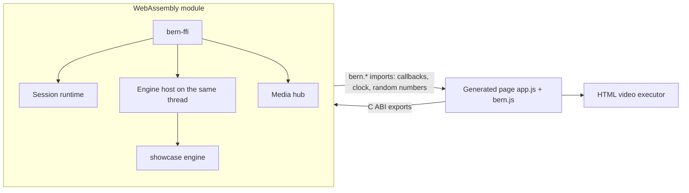
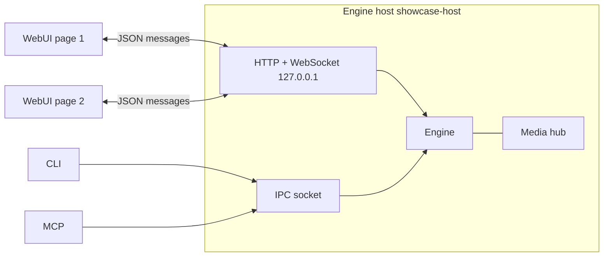

**English** · [简体中文](../zh-CN/Implementation/Web.md)

# Web implementation notes

- First recorded: 2026-10-10
- Updated: 2026-10-17
- Basis: [Bern architecture design](../Design.md) (originally implemented against v0.14), [Web design guidelines v0.6](../Adaptation/Web.md)
- Toolchain: Rust 1.99.0 (`wasm32-unknown-unknown`); plain C-ABI modules need no wasm-bindgen tool. Modules with wasm-bindgen dependencies additionally require the matching `wasm-bindgen-cli` (see below).
- Verification browsers: the built-in Chromium, and desktop Safari 27.0.1 for specific scenarios; the scope of each round is given below

This document records what was actually completed in Phase 3 (the Web dual build): the design guidelines, the Bern theme core, the `app` build (engine inside the page) and the `ui` build (WebUI connected to a separate engine host) are all implemented and verified in the browser. The v0.2 design guidelines changed the Web presentation to Bern's own neutral web style (the main window is the page, secondary windows are dialogs); for the implementation and verification see "Window presentation" and the third verification record; v0.3 adjusted the controls (see "Controls (v0.3)" and the fourth verification record).

## 2026-10-15: Web app adaptation of a multi-page app

A multi-page media app that already has a macOS version keeps using the same declaration and compiles its engine to WASM with `web_mode = "app"`. The following browser capabilities were added for the existing UI before the corresponding capability checks were opened:

- `Modal` (without a height, the `<dialog>` gets no height and is as tall as its content, `max-height` is the viewport minus 32, and beyond that the scroll area inside it shrinks), `Flow`, `Timer`, the search panel and grouped results, explicit `PickerOption`, engine-controlled Switch/Picker. `Picker(style: chips)` is pill buttons in Radio Group mode (the `chip` recipe); placed directly in a `Flow`, the group container is `display: contents` and each chip is a child of the Flow. Timers are cleaned up with the declaration's lifecycle; search supports the arrow keys, Enter, Escape and focus restoration.
- Stack styles, text size/weight/line count, icon-only Label/Menu, capsule controls, per-axis padding, baseline, template images and intrinsic aspect ratio, image corner radius and responsive aspect ratio, independent Grid row spacing.
- Fixed sidebar width, top bar, dynamic badge, untitled Detail, toolbar leading items, accordion column-width animation, edge grow, delayed entrance, event-triggered nudge, app-level Reduce Motion.
- A layout's stretch intent stops at an explicit width or height, and Spacer takes part in layout along the main axis. In a row, what fills starts from nothing (`flex: 1 1 0`), but a stack that fills only through a `Spacer` inside it, beside a `Spacer` of the row, gets `bern-keeps-width` (`flex: 1 1 auto`) and shares only what is left; previously a column of that kind in a 380-wide modal was 105 wide, its title wrapped and its labels overlapped (2026-11-05). A stack holding only controls gets `bern-firm-width` (`flex-shrink: 0`) in a row: previously it went down to nothing in a row too narrow for it, and its button ran into its neighbours (2026-11-05). `reflow` observes the actual parent element after a conditional branch's DocumentFragment is mounted, shares one observer, and cleans it up after the last declaration unmounts.
- Added mappings from the SF names this app uses to Lucide; the SVGs ship offline with the build, with their license kept.

`bern-command::storage::Store` uses the host imports `storage_read/storage_write` in WASM and saves to same-origin localStorage under `bern:<bundle_id>:<key>`. Binary values are encoded as byte arrays; missing differs from empty, and permission, format and quota errors return `CommandError`. The native file storage path keeps its original behavior.

`bern run --target web_app --port 4173` can use a fixed development origin, so that a random port does not make the browser read another copy of the site's settings. `--port` applies only to the browser app target; without the argument the port stays random.

First round of automated verification: the Web backend/CLI/storage Rust tests, the browser runtime Node tests, the app's engine tests, the Web WASM build and the macOS declaration check passed. The format check of the modified Rust files and strict clippy for the Web backend and storage passed. In that round, strict clippy including the CLI was blocked by three `collapsible_if` warnings in `bern-compiler`; during the 2026-10-17 documentation sync these conditional branches were cleaned up, and the compiler's 49 regression tests passed. The app's original UI crate depends on Bern's module composition, so running `cargo test --workspace` directly fails at the uncomposed Pages/component symbols; the UI is therefore checked with a Bern build and each engine is tested separately. As of this round's review on 2026-10-16, 46 Bern Rust tests and 27 Node runtime tests pass, with regression tests added for scrolling, layout and color pairing. After rebuilding the Bern CLI, the latest Web build and the macOS declaration check (72 components) pass; these checks do not replace browser acceptance.

The first round of browser checks used the built-in Chromium at 1280 × 800 and 390 × 844: four-step onboarding, restoring after a reload, theme switching, settings search, optional module dependencies, expanding the weekly calendar/returning from details, media library filtering and sorting, global search and simulated playback, download progress and pause/resume. The shrinking scroll area with a fixed bottom bar in the narrow-screen onboarding and the full height of the settings window were also checked in that round. A later real Safari 27.0.1 exposed problems that these checks and the logic tests had not found, so the first-round record cannot be taken as complete Web acceptance.

Fixes and re-checks on Safari 27.0.1:

- **Plain scroll areas**: a `ScrollView` without `snap` was defaulted to `center` by the runtime, and the centering padding fed into the next measurement round, eventually producing 6793.7 px of padding and moving the media library list out of the visible area. The default is now leading-edge alignment, only an explicit `snap: center` uses centered snapping, and the feedback that accumulated the centering padding is removed.
- **Height and width constraints**: the `Query` wrapper broke the flex height chain, and the `min-content` width of deeply nested images propagated to ancestor layouts, making the page wider than the viewport. After these constraints were fixed, Safari confirmed that the media library list shows again and that the home toolbar and right column are within the viewport.
- **Sidebar selection color**: after the declaration changed the selected background to `fill.strong`, the default `on_accent` foreground color was not replaced along with the background; with the vermilion and neon dark themes the text contrast was only 1.33:1. Neutral `fill.*` and `surface.*` backgrounds are now paired with `text.primary`, and `selection.background` with `selection.foreground`; an explicit foreground color still takes precedence, and accent backgrounds keep their own pairing. The selected icon inherits the text foreground color; the contrast of that dark combination is 12.59:1, and measured on Safari the text and icon are clearly visible. Regression tests cover theme pairing, selected/hover switching and explicit foreground precedence.
- **Rail overlay**: Rail no longer takes part in enlarging a Stack that contains images/text; the covered area is determined by the content. On 2026-10-16, Safari at a width of 1470 CSS px confirmed that the right corner radius of the home stage image and the 28 px spacing are restored, and that the toolbar and right column are normal; in Chromium DOM measurements at 1470 × 754, the stage button and the image are both 528 × 297, with matching frames.
- **Scope of the Safari interaction re-check**: the media library shows 16 posters, and filtering by "Unwatched" gives 8; the white selected text and icon in the dark sidebar are readable; switching the weekly calendar from Monday to Wednesday and settings from General to Appearance looked correct. This was verification on desktop Safari 27.0.1 and does not include the Safari phone layout or every page.
- **Narrow-screen re-check of the media library**: the shared UI's `compact` layout changed to a three-row header, `Flow` filter items and a narrower zoom control. In Chromium at 390 × 844 and 360 × 780, the title does not wrap, both ends of the full zoom control are visible, the poster grid is normal, and the document's `clientWidth` equals its `scrollWidth`. The conclusion is limited to the media library layout at these two sizes and is not extended to all narrow-screen pages passing; the Safari phone layout and Firefox have not been measured yet.

The app is still a UI and state simulation, with no actual playback, transfers, updates or plugin installation wired in.

## Completion status

| Design requirement | Status | Notes |
| --- | --- | --- |
| Define the Web design guidelines separately before implementation | Done | [Docs/Adaptation/Web.md](../Adaptation/Web.md) v0.2: Bern's own neutral web style; metrics and font sizes, theme roles and declared pairings, control recipes, presentation and keyboard behavior of each component, page and dialog presentation, focus, motion, icons and acceptance |
| Bern theme core: roles, control recipes, snapshots, determinism, controlled pairings, brand seed variation | Done | `bern-theme` (Bern Theme Algorithm v5), see "Theme core" |
| The same declaration and command schema generate two independent directories; a mode change leaves no outputs of the other mode behind | Done | `web_app` and `web_ui` each generate into `target/bern/<target_name>/`; the WebAssembly compilation directories of the two modes are separate (`target/bern-web-glue/app`, `…/ui`). After changing the same target from `ui` to `app`, the build deletes the engine host program and its glue crate, and after changing back to `ui` the page module again contains no engine code (measured) |
| `app` completes the example business flow without a separate engine service | Done | The engine, the session runtime and the C ABI compile into one WebAssembly module that runs inside the page |
| Business dependencies that do not support WASM fail explicitly | Partial | When a dependency cannot compile to `wasm32`, the build fails at the Cargo step and prints the compiler diagnostics; there is no dedicated diagnostic pointing to `Bern.toml` yet |
| `ui` outputs contain no business handlers and no server-side dependencies | Done | The page module links only the protocol crate and `bern-ffi` (the `remote` feature); the output contains no `showcase_core` symbols at all (the `app` build has 1368) |
| Multiple WebUI sessions share business state, while windows and drafts are not mixed between them; CLI/MCP route to a specified session | Done | The engine host registers one UI session per page; without a specified session it returns `session_required` |
| Version incompatibility, insufficient permissions, disconnection, unknown results, reconnection and resynchronization | Done | See "`ui` build"; the handshake checks the token, protocol version and catalog fingerprint; on disconnection, pending requests end with `connection_lost` and are not resent; after reconnecting, a full snapshot resynchronizes and the same session is restored |
| Phase 2's general acceptance is re-run on the Web | Partial | See "Verification log"; end-to-end testing of the four entry points is done in the `ui` build; keyboard, input methods and screen readers not measured |
| Theme switching verifies the controlled pairings of the color algorithm | Done | 298 seeds × light/dark × standard/increased contrast; every declared pairing meets its requirement with no fallback (unit tests) |
| Virtual presentation follows host conventions and switches between wide and narrow screens | Done | The main window is the page; secondary windows such as settings are modal dialogs (title and close button; the backdrop, Esc and the close button go through the close protocol); only windows declared `presentation: floating` are floating panels that can be dragged, resized and minimized; the only window actions for pages and dialogs are activate and close, the others return `target_unavailable`; on narrow screens dialogs fill the page area |
| Video generates a real `<video>`; `play()` rejection and insufficient user activation | Partial | The player is an HTML `<video>` with the native control bar turned off, and the Bern control bar sends commands; when `play()` is rejected it returns `user_activation_required` (the code path is implemented, not verified in a real rejection scenario) |

## Theme core

`crates/bern-theme`, pure computation, no access to platform interfaces.

- **Input and output**: `generate(seed, mode, contrast_policy)` yields a snapshot: schema version, algorithm version, tokens sorted by name, the measured contrast and the requirement of each declared pairing, and fallback reasons. Default seed `#2f6fe4`.
- **Color space**: 8-bit sRGB ↔ OKLab/OKLCH (Björn Ottosson's reference matrices); out of gamut, lightness and hue are kept and chroma is reduced by bisection; contrast is computed on the final 8-bit color from correctly linearized sRGB relative luminance.
- **Solving**: each role starts from a target lightness (brand roles use the seed's hue, surfaces and text a fixed neutral hue, status colors fixed hues) and searches, in lightness steps of 0.0025, for the color closest to the target that satisfies all its declared pairings; if none is found, it reduces chroma by factors of 1, 0.75, 0.5, 0.25 and 0 and searches again; if that still fails, it takes the neutral endpoint with the highest worst-case contrast and records the fallback reason.
- **Pair solving**: `accent` with `on_accent` and `status.error.surface` with `on_error` are solved together: when the lightness change needed to bring the background to the required contrast against a white foreground is no more than 0.12 (OKLCH), white is used, consistent with white text on accent colors on every platform; otherwise it chooses between white and a dark neutral so that the background stays closest to its target. The accent pair starts from the seed itself and is checked against graphics contrast (v7), the error pair against body-text contrast.
- **Layers** (v2): in light mode the canvas and popovers are white, the panel (sidebar) is slightly darker, and the host background darker still; in dark mode the host, canvas, panel and popover get progressively lighter, with no RGB inversion. Plain buttons use the canvas as their background and `separator` as their border; hover and pressed backgrounds are derived by offsetting the canvas lightness. Status colors are not affected by the brand seed.
- **Contrast policies**: standard is 4.5:1 for body text, 3:1 for graphics needed for recognition, 3:1 for disabled; increased contrast is 7:1, 4.5:1, 4.5:1.
- **Control recipes**: `RECIPES` describes as data the slots and tokens of each state of each control, including `nav_item` (sidebar), underlined `tab` (including the vertical selected state), `menu` (dropdown menu), `media_scrubber` (media progress bar) and `dialog`; the background and border of icon buttons are `transparent` in every state.
- **Changes in v3**: `accent` also reaches 3:1 against `surface.raised` (the icon button hover color appears in dialog headers); added `media.track` (a fixed light track) and `media.played` (neutral, 3:1 against the track and every surface).
- **Changes in v4**: the selected navigation item is now filled with `accent`, with text and icon in `on_accent`, and there is no longer a light selected background; the three roles `selection.background`, `selection.foreground` and `selection.indicator` are removed.
- **Changes in v5**: `accent.text` is now solved starting from the lightness of `accent` itself and moves only as far as needed for 4.5:1 against every surface. With the default seed, light changes from `#1a5acd` to `#2060d4`, and dark from the washed-out `#85b1ff` to `#528fff`; the text of borderless buttons, links and selected tabs is closer to the accent color. New tests: the lightness difference between brand text and the accent color is less than 0.12, and chroma is greater than 0.15.
- **Changes in v6** (2026-10-19): the foreground on accent colors prefers white (see "Pair solving"). Previously, reddish and bright accent colors got near-black text because a dark foreground was closer, and selected sidebar items and the knob of switched-on switches had the same color as plain text in light mode; now, for example, the seed `#FF2E55` gives `#db364f` with white in both light and dark mode (previously `#e54056` and `#f04b5f` with `#0e1217`). Seeds such as bright green, which would need heavy darkening to pair with white text, still get a dark foreground in dark mode.
- **Changes in v7** (2026-10-20): `accent` starts from the color the user picked itself (lightness is no longer first clamped to the 0.45–0.72 range) and is solved with `on_accent` against graphics contrast: 3:1 under the standard policy, 4.5:1 under high contrast, consistent with the white titles on system accent-color buttons; the hover and pressed variants stay at the same level. When the seed satisfies this it is used as is: `#FF2E55` under the standard policy is `#ff2e55` with white in both light and dark (v6 gave `#db364f`), and `#e50043` in light with high contrast; the default seed `#2f6fe4` is used as is; `#34c759` becomes `#00a73f` in light, and `#ffcc00` becomes `#b08c00` in light and is used as is with a dark foreground in dark. Previously the accent color was solved against body-text 4.5:1, and the chosen color looked noticeably darker on the page.
- **Tests**: 298 seeds (hue every 15°, four lightness levels, three chroma levels, plus extremes such as pure black, pure white, gray, yellow and green) × light/dark × both contrast policies; every pairing meets its requirement with no fallback; there are also tests for determinism, surface layering, brand hue preservation, status colors being independent of the seed, and complete recipe references.

## Optional wasm-bindgen dependencies

After Cargo builds the page module, `BuildStep::WebAssembly` checks for wasm-bindgen metadata/imports. A plain C-ABI module is copied unchanged, without invoking another tool; rebuilding it removes stale bindings. A module using JavaScript dependencies is processed with `wasm-bindgen --target bundler`, using `BERN_WASM_BINDGEN` if set, otherwise `wasm-bindgen` on PATH. Use the CLI version matching the application's resolved wasm-bindgen crate. Missing tools, version mismatches and conversion errors stop the build with diagnostics; Bern neither downloads a tool nor changes its global installation.

The processed module is `app.wasm`; its JavaScript and local snippets ship in a content-versioned `bindgen/<hash>/` directory, also in static packages and embedded WebUI resources. The module records the relative script path in a `bern.bindgen` custom section, so a changed local snippet cannot reuse the previous crate-version-only URL. The page combines these generated imports with the Bern C ABI and application extension imports, sets the bindings' WASM exports, then calls `__wbindgen_start` before initializing the application. Pure modules do not request binding scripts. This enables browser-backed async dependencies without changing Bern's C ABI or removing the browser's normal origin/CORS restrictions.

Verified on 2026-11-09: format checks, 86 Rust tests in the changed crates, 95 Node runtime tests, workspace clippy with warnings denied, and workspace all-target checks passed. In Chromium, a separately built minimal application ran a wasm-bindgen start function, fetched a local resource using gloo-net, awaited a timer/Promise, and called an inline JavaScript snippet; clicking its retry button produced a second successful query without console errors. This does not establish acceptance of any application using the framework or of other browsers.

## `app` build

Page icons: without a declared `[app].icon`, the build generates a `favicon.svg` of the Bern logo, a 512-pixel `icon.png` and an `apple-touch-icon.png` that fills the square (the home screen icon); when one is declared, all three use that PNG; when `[app.icon].browser` is an SVG, only `favicon.svg` is generated, and when it is a page icon folder, the whole folder is copied to `icons/`, with `.ico`, SVG, `apple-touch-icon*.png` and `.webmanifest` files each getting a `<link>` (without SVG and `.ico`, the non-maskable PNG is linked). `index.html` references them with addresses that carry the build version. The `ui` build uses the same page.



- **The same C ABI**: `bern-ffi` is compiled to `wasm32` without the `ipc` feature, and the `bern_*` functions the macOS frontend calls are exported to the page unchanged; the session runtime, close protocol, query subscriptions and media hub have only one implementation. The generated glue crate connects the callbacks to the `bern` import module provided by the page.
- **WebAssembly adaptation**:
  - Without threads, the engine host runs tasks one after another on the calling thread, and requests made while a task runs are queued after it (`Host::start_local`).
  - `SystemClock` uses the page's `performance.now()` and `setTimeout` instead.
  - The engine instance ID comes from the page's `crypto.getRandomValues`, so every tab has its own identity.
  - Bundled resources are served as page-relative URLs (`Resources::served("resources/")`), and the build syncs the declared files into `resources/` in the output directory.
- **Calling convention**: exports that return structs return them through a hidden result pointer, and structs passed by value are passed by pointer; 64-bit integers are BigInt in JavaScript. For callbacks the page receives during a call, the bytes are copied first and processed in arrival order after the call returns, which avoids reentrancy.
- **Generated page**: `index.html`, `theme.css` (four theme snapshots, selected by `prefers-color-scheme` and `prefers-contrast`), `bern.css` (the design guidelines, no literal colors), `bern.js` (the runtime), `app.js` (generated from the IR), `app.wasm`, `resources/`, `build.json`. The style, script and module addresses the page references carry this build's version parameter (`?v=…`), so after a rebuild the browser and static-hosting caches do not make the page mix in old files.
- **Runtime**:
  - Fine-grained reactive cells: engine fields, session fields and row variables are all cells or getters, and a state change re-runs only the bindings that read it; one engine state update is committed in a single batch.
  - Conditional branches are rebuilt only when the branch switches; lists keep each row's DOM, controls and state by key, and rows are delimited by comment markers without adding wrapper elements.
  - Push navigation keeps the root page (hidden rather than unmounted), so after going back the query subscriptions, players and scroll position are still there.
  - Control registration is the same as on macOS: target ID, role, name, enabled state, and the same closure that user input uses.
  - Localization: a supported language is chosen from the browser language (`zh-CN` and others map to `zh-Hans`); text keeps `{name}` placeholders and fills them by name.
- **Icons**: the Web version uses Lucide (`lucide-static` v1.54.0). The 87 Lucide SVGs in use and their LICENSE are stored in `crates/bern-backend-web/icons/lucide/` and compiled in with `include_str!`, so the build does not go online. The mapping table in `icons.rs` maps each SF Symbols name to a Lucide icon and specifies the fill style for `.fill` names: whole (`play.fill`, `pause.fill`, `speaker.fill`, `star.fill`), partial (`speaker.wave.3.fill` and `speaker.slash.fill` fill only the speaker, `sun.max.fill` only the disc), cut-out (`xmark.circle.fill` uses a mask to cut the cross out of a filled circle; the mask id is a placeholder that the runtime replaces with a unique id for each icon instance). Fills keep the 2 px stroke, so the filled and outline versions have the same contour. The runtime's `icon()` sets Lucide's stroke attributes on the root `<svg>`. The generated page directory contains `THIRD_PARTY_NOTICES.txt` (the full text of the ISC license and Feather's MIT license), and the icon table in `app.js` is preceded by a comment pointing to it. When the app uses a name that is not in the mapping table, the build fails and points to the declaration (the check is shared with Compose, GTK and Windows: `bern_target_api::icon_set::check`). The mapping table contains at least every name in the Bern icon set (`icon_set::NAMES`), which a test checks one by one. On 2026-10-20, `arrow.left` (`arrow-left`), `chevron.up` (`chevron-up`) and `star.fill` (`star` with a whole fill), which Windows already had and the Web lacked, were added; the two new SVGs were written from the path data and file format of the same-named icons in lucide-static 1.54.0, without downloading anything, and were not compared byte for byte with the release package.
- **Media**: one HTML `<video>` per player; the executor fulfills the hub's load, unload, play, pause, seek, volume and mute requests, `play()` completes its request with the result of the Promise, and a seek completes on `seeked`; media events are only reported as observations and do not dispatch commands. The view places the player's element in its own area, single view (`multi_view: false`).

## Window presentation

Under the v0.2 design guidelines, the generated `app.js` states the presentation of each window kind: windows declared `presentation: floating` are `floating`, the WindowSet's main window is `page`, and the rest are `dialog`. The IR version is 4 (adding `Presentation::Floating` and the target capability `WindowCapabilities.floating`; targets that cannot provide floating windows reject that declaration during the check).

- **App bar**: 48 px, with the app name at the leading end; it appears only when there is something to put in it (the window switcher or the settings button), otherwise the page starts with the window content; when a window with `role: settings` is declared, the trailing end holds a settings button, and Ctrl / Cmd + , opens settings. The window switcher appears only when the app declares floating windows, and lists only the floating windows.
- **Page**: the main window fills the area below the app bar, with no title bar and no window buttons. After it is closed by a command it shows the app name and an "Open '{title}'" button.
- **Dialog**: a centered panel on a backdrop; the width is the declared width (560 px if not declared), the height fits the content up to 85%, and the content area scrolls beyond that. The header is the page header: title (the page title after a navigation push), toolbar, close button. Clicking the backdrop (both press and release on the backdrop), Esc and the close button all request closing and go through the close protocol. On opening, focus moves to the first control, Tab is trapped in the dialog, and after closing, focus returns to the element that opened it. Tabs at the dialog root become vertical navigation on the left when the width is ≥ 640 px (`aria-orientation` switches accordingly, and the arrow keys become up/down).
- **Floating window**: keeps the existing title bar, dragging, resizing, minimize, maximize and keyboard moving; after minimizing, it is restored from the switcher.
- **Close confirmation and failure notices**: a modal notice inside the owning window, with buttons aligned right and the main choice last ("Don't Save" on the left); Esc equals Cancel, and Tab is trapped in the notice.
- **Window facts**: the frame is computed from the layout size; the scale of the opening animation does not affect the reported size and position.
- **Navigation**: after a push, focus moves into the new page; Esc or Alt + ← goes back, and after going back focus returns to the link that pushed.
- **Form**: `gap` between groups, rows by `row_height` and `padding_x` / `padding_y`; plain groups use only their own padding (`.bern-group-plain` zeroes what the form gives). When a form starts with a plain group there is no top padding: the rule is `.bern-form:has(> .bern-section:first-child > .bern-group-plain)`; conditional regions are delimited only by comment nodes, and a heading given by a slot, component or condition is also the form's first element, so the result follows when the condition changes.

## Controls (v0.3)

- **Buttons**: 32 px tall, 20 px horizontal padding, minimum width 80 px; text fields and dropdown menus are also 32 px, so controls in one row line up.
- **Icon buttons**: the default and plain styles use the icon color as feedback for hover, pressed and selected; an explicit prominent draws an accent container, and ControlGroup provides a capsule shared within the group. Size and style follow the current declaration.
- **Tabs**: the selected item's text and icon are `accent.text`, the underline is `accent`.
- **Sidebar and vertical navigation**: by default the selected item is filled with `accent`, with text and icon in `on_accent`, and selected-and-hovered is `button.prominent.hover`; there is no vertical bar on the left. When a declaration overrides the background, the foreground color is re-paired by the corresponding semantic role, an explicit foreground color takes precedence, and the selected icon inherits the text color. The current item of the floating window switcher is likewise filled with the accent color.
- **Switch**: a 40 × 20 track; when off, a `control.border` border with a knob of the same color; when on, the track is filled with `accent` and the knob is `on_accent`; on hover, the off state's border and knob change to `text.secondary`, and the on state to `button.prominent.hover`.
- **Slider**: still a native `<input type="range">`; the thumb is now a 4 px white `control.thumb` ring around an `accent` center with a 1 px outline, and on hover and drag the center uses the hover and pressed variants.
- **Dropdown menu**: the `automatic` and `menu` styles no longer use `<select>`. The trigger is a button with `role="combobox"`, and the list is a Popover API element with `popover="auto"` (top layer, not clipped by cards, dialogs or scroll containers; closes automatically on an outside click); in `beforetoggle` it is positioned synchronously from the trigger's position (upward when there is less than 160 px below and more space above), up to 328 px tall. Focus stays on the trigger, and the active item uses `aria-activedescendant`; the keyboard follows the APG select-only combobox; Esc is handled on the trigger and its default action is prevented, so the dialog does not close along with it; it closes when the page scrolls or the window is resized. Selecting calls the same `select` closure as the external entry points.
- **Media progress bar**: the progress and volume of the video control bar now use `scrubber()` instead of range inputs. `role="slider"`, with `aria-valuetext` as a time or percentage; pressing the pointer jumps to that point and starts previewing, dragging only updates the preview (the progress time is shown in sync), and releasing commits once; the arrow keys move 5 seconds per press (volume 5%), PageUp / PageDown 10% per press, Home / End to the start and end, committing on key release. The played part is `media.played`, the unplayed part `media.track`; the thumb is 20 × 16 px, corner radius 7, `control.thumb` with a 0.5 px outline and a shadow, and it scales up to 1.1× while dragging.

## First batch of the component library

- **Image**: ``, whose address is the resource name under `resources/` (both builds copy resources there), with `object-fit` corresponding to `fit`; when only one side is given, the other is `auto`, following the image's aspect ratio. `label` goes into `alt`; without it `alt` is empty, i.e. a decorative image. In a form group it takes its own row, aligned to the leading edge. Images keep their declared frame through `flex: none` and explicit size rules, while ancestor `Row` and `Column` can still shrink; on 2026-10-15 the rule that set `min-width: min-content` on ancestors because of any deeply nested image was removed, so image content no longer stretches the whole page wider. HDR is up to the browser: Chrome 154 on macOS shows JPEGs with a gain map and PQ PNGs as HDR (the right halves at 1.69× and 1.85× SDR white), while WKWebView in its default configuration (macOS 27) on the same Mac shows the SDR version, and `dynamic-range-limit: no-limit` does not change that either; Safari's HDR has not been measured yet. A picture that does not come is tried again (2026-11-05): after a failed network or a 408, 429 or 5xx answer, about 1, 2, 4, 8, 16 and 32 seconds later, give or take a quarter, and then not until the network changes or the page is shown again. An `` does not say why it failed, so a `fetch` of the address asks; any other answer without a picture is not asked again on the same network, and an answer from another origin without CORS, which cannot be read, counts as a failed network. A try that shows nothing counts as failed after 15 seconds, doubling with each try because the browser reports no progress and the try may only be queued, unless the picture's size has come; a stall after that stays with the browser. The connection is the browser's too: in Chrome 156, a try after a stalled HTTP/2 connection went out on a new one. A view that leaves stops trying, and one that appears starts over at once. Declared resources, template pictures and fills from a picture go the same way. Checked in Chrome 156 with pictures over TLS and HTTP/2 through a relay that failed on purpose, 6 pictures each: with the network down for 8 seconds, half the connections reset, a connection stalled after its first data and a connection silent from the start, the old code stayed at 0, 4, 0 and 0 pictures and the new one showed all 6 within 17, 3, 20 and 38 seconds; a 404 cost one more request and no further tries. Safari and Firefox were not tested.
- **Progress**: with `value`, a `role="progressbar"` of a track plus a fill, with `aria-valuenow` and `aria-valuemax`, label above; the track is `control.track` like the slider's, the fill is `accent`, and width changes transition with `--bern-motion` (0 under Reduce Motion). Without `value`, it is the `.bern-spinner` that queries already use, plus secondary text.
- **Grid**: CSS Grid, `grid-template-columns: repeat(auto-fill, minmax(min(100%, min_width), 1fr))`, `gap` 8 px by default.
- **Stack**: a one-cell CSS Grid, each layer `grid-area: 1 / 1`, `place-items` corresponding to the nine positions of `align`; the width is `fit-content`, so it is as large as its largest layer and is not stretched to fill a group.

Verified in the built-in browser (800 wide): the three `fit` values, width only, and stacking look the same as on macOS; the grid has four columns; the progress bars' `aria-valuenow` values are 50 (`total` 100) and 0.6, their names are their respective labels, and the decorative image's `alt` is empty.

## Phase 4: adaptive layout, menus and languages

- **`Adaptive`**: generates `B.Adaptive(p, ctx, { id, breakpoint, layouts: { compact, expanded } })`, with the breakpoint from `[layouts]`. The runtime measures the container width with `ResizeObserver` and rebuilds only the layout area when the size changes; the control focused before the switch gets focus back in the new layout via `data-bern-target`, and when the target is inside a menu that is not open, the menu button is focused.
- **`Menu` / `MenuItem`**: a menu button with a Popover API popup menu, keyboard per the APG Menu Button; positioning is shared with the dropdown menu (`placePopover`). Each menu item is registered by `id`, and external entry points can run it while the menu is closed.
- **Language**: the current language and the string table are reactive cells that `tr()` reads, so all text bindings update at once on a switch; `<html lang>` and the page title are updated by the same effect. `ui.language` and `ui.set_language` are handled in session requests (command numbers 18, 19). `LanguagePicker` reuses the self-drawn dropdown menu, and option names use `Intl.DisplayNames` to get each language's own name for itself.
- **Feature contract report**: `bern build` writes the report for each target to `features.json` in the output directory.
- **Message format** (2026-10-18): `B.fmt` parses translations according to the [message format](../Reference/UI.md#text-content-and-formatting) (each translation is parsed once and then cached) and writes out `{name}`, plural branches, dates and durations; date arguments are passed as records, the rest in their display form. Enum labels of display-variant fields are generated as `L.<enum>` branching by variant, and fields are written out by type (nested enums use their own labels). Month and weekday names are generated with the string table. Measured in the browser pane: `=0`, `one`, `other`, enum labels nested inside plural branches, dates, durations and language switching.

## `ui` build



- **Page**: the same `app.js` and `bern.js`; the page module is the session runtime and the C ABI, and the engine is reached over `bern-ffi`'s remote link (the engine and the media hub are provided through the `EngineLink` and `MediaLink` interfaces; the in-process build uses the local implementation, WebUI the remote one). Drafts, navigation, windows and query subscriptions stay in the page.
- **Engine host** (`bin/<app>-host`): runs the engine and media hub natively, serves the page files and the `/bern` WebSocket channel on 127.0.0.1, and sets up the local IPC channel according to the target's `channels = ["ipc"]`; `bin/<app>` and `bin/<app>-mcp`, generated in the same directory, connect to the same engine.
- **Channel messages**: the same JSON control messages as IPC (`bern-adapter-json`), plus page-only messages: session registration and resume, window list, session requests and results, query cancellation, the media executor (register, create, bind, release, view, complete, observe) and media requests. Commands and queries are answered asynchronously, so a slow query does not block other requests on the same connection; a query superseded by new arguments sends a cancellation.
- **Access control**:
  - Listens only on 127.0.0.1.
  - The `Host` of every request must be this server (against DNS rebinding).
  - The WebSocket upgrade requires the `Origin` to match it.
  - The first message must carry the token generated at startup (constant-time comparison). The token is placed in the address fragment, which the browser does not send to the server; the static files themselves grant no permissions.
- **Sessions**: each page registers as a `<engine_id>-web<n>` session; session commands from external entry points are passed to the page over the WebSocket and executed by the page's real control closures. After a disconnection, the page restores the same session with a `resume` request (when it is the same engine instance and that ID is free), and resends the window list and the player and view registrations. After the engine host restarts, the old token is invalid, so the page shows "Can't connect to the engine" and stops retrying; when the engine instance changes under the same token, the page reloads and sets up a new session.
- **Media**: the page registers as a media executor; the host's router hands each player's requests to the page that holds it (the page that created it; app-level players go to the page that most recently showed them, otherwise to the most recently registered page). The IDs and owners of window players carry a session prefix (`<session>/<window>/<target>`), so same-named windows on several pages do not conflict.
- **Resources**: the engine resolves resources with `Resources::served("resources/", dir, declaration)` and returns page-relative URLs; engines that need to read files can still read the same directory.

## Packaging

`bern package --target web_app` produces `<program>-<version>-web.zip` (`.tar.gz` on Linux) containing only the files the server needs: page, scripts, WebAssembly, styles, icons, bundled resources and third-party notices, without the generated glue source and build reports. The `ui` build additionally includes the engine host with its CLI and MCP server, and the file name states the system and architecture (`…-webui-macos-arm64`). On macOS it is packed with `ditto`, without resource forks and extended attributes. A new project's `app` package is 0.55 MB (uncompressed), 11 files.

## Styles, motion and capabilities for media apps (v0.29)

On 2026-10-13 the parts that the Web had previously declared unsupported in its capability description were filled in, so that both `examples/planner` and `examples/gallery` can be built for the Web. The capability description now lists all `features` and all motion properties, `text_marks`, `dynamic_items` and `window_chrome` are true, and the style capabilities are the same as Compose's (`Button`, `IconButton`, `SidebarItem`). The new runtime is in `templates/features.js` and `templates/features.css`: the former imports `bern.js` with the same versioned address as the page, so the two share one runtime and `bern.js` keeps only a few hook points; the latter is appended after `bern.css` at build time.

- **Springs**: the page integrates them itself frame by frame (mass 1, stiffness (2π/T)², damping 4πζ/T), and a new target continues from the current value and velocity; when the system asks for Reduce Motion, transforms jump straight to their end and transitions become a 150-millisecond fade.
- **Transform layers**: an element's translation, scale and opacity are split into the layers style state, appear, disappear, shared element, make way, nudge and scroll-linked, each driven on its own and then composed into one `transform` and `opacity`, with scaling around the center.
- **Structural transitions**: elements that `When` and `Each` mount in changes after the first display play `appear` (elements inside them appear along with them rather than each playing their own); elements with `disappear` finish their transition before leaving the page when removed. A `reflow` container, after children are added or removed or sizes change, makes moved children slide over from their old positions.
- **Shared elements**: when an element with a `hero` key unmounts, its position is recorded and a copy is left behind (video and canvas are not copied); an element with the same key mounted in the same update grows out from there, while the copy moves along with it and fades out, one spring driving both.
- **Style overrides**: the base look is written as styles, and the per-state looks are merged in turn for hover, pressed, focus, disabled and selected; colors go through CSS transitions, transforms through the state's spring. `fill.subtle`, `fill.strong` and `selection.*`, which the theme lacks, are derived from existing variables.
- **Canvas and annotations**: a 2D `<canvas>`, drawn at the device pixel ratio and redrawn when state, size or colors change; the line boxes of annotations come from `Range.getClientRects`.
- **Stretchable views**: canvases, scroll views, forms, grids, videos and progress bars without a size are marked stretchable, and children of a `Stack`, column, row or panel that contain them stretch accordingly (using `:has()`); elements with a size do not take part. `SplitView` also fills a `Stack`, and the `Stack`'s alignment only arranges the other layers. This corresponds to these views taking all the space they are given on native targets. Before this (fixed on 2026-10-19), a form in a `Column` with the default leading alignment was only as wide as its content, and a `SplitView` in `Stack(align: bottom)` stayed at its content size at the bottom center.
  - The page's own spaces (a page of the navigation stack `.bern-nav-page`, the tab page area `.bern-tabpanels`, the layout selected by `Adaptive` `.bern-adaptive`) are columns of this kind too, like the detail body (2026-10-21): children that contain stretchable views stretch fully horizontally and fill vertically. Before, these three were not in the list, so a `Stack` containing a form inside an `Adaptive` or a tab was only as wide and tall as its content, the form in turn was only as wide as its content, and an `align: bottom` layer landed at the bottom of the content rather than the bottom of the page.
- **Tabs** (2026-10-21): as with the sidebar, the children of `Tabs` are generated as ordinary build functions and built inside the tab bar, so `if`, `match` and `ForEach` work as usual; each `Tab` places its button where it is written, registers on mount and unregisters on unmount, and only the selected tab's page is built. When the selected tab disappears, selection returns to `fallback` (if it is still shown) or to the first remaining tab; the arrow keys move in display order, and the external entry points' `select` only recognizes mounted tabs. Previously the generator took only the direct children of `Tabs`, so tabs written inside conditions (including the tabs that `Pages` expands per module) were all lost. `TabAccessory` can still only be written directly inside `Tabs`.
- **Sidebar**: the content is generated as ordinary build functions, sidebar items register on mount, and when the selected item disappears selection returns to `fallback` or the first visible item; `SidebarFooter` is at the bottom of the sidebar. `SidebarHeader` is fixed above the list, with its children laid out vertically 8 px apart, and by default 8 px of space above and below and 7 px left and right; previously the container layout was missing, so the brand sat against the top and too far left. This spacing is the platform default and does not automatically adjust the icon column or text column of arbitrary Header content.
- **Sidebar toggle and width (2026-10-20)**: as on macOS and Windows, the sidebar in a wide window can be collapsed, and when no width is declared it can be dragged wider.
  - The toggle is the icon button at the very leading end of the detail header (`sidebar.left`, i.e. Lucide's `panel-left`, mirrored in right-to-left), before the back button and the toolbar's leading items; its name and tooltip follow the state as "Hide Sidebar" and "Show Sidebar", and `aria-controls` points to the sidebar. Pressing it slides the whole sidebar, together with `SidebarHeader`, the search field and `SidebarFooter`, out toward the leading edge (0.25 seconds; hidden directly when the system or the app asks for Reduce Motion); once the slide finishes it is `visibility: hidden` and leaves the Tab order and the accessibility tree; pressing again slides it back in from the leading edge. The button's position in the header does not change, and keyboard focus stays on it.
  - It hides completely instead of collapsing into an icon rail as on Windows: the Web design spec gives the sidebar the Window Splitter pattern, in which collapsing gives up the whole primary pane; Web sidebar items may have no icons, and group headings, the search field, the header and the footer do not fit in an icon rail; the Windows icon rail is a display mode of `NavigationView` itself, and the web has no corresponding control. The button is at the leading end of the header: the macOS system button is also in the toolbar at the window's leading edge, common web apps (mail, documents, code hosting) put the sidebar button at the top left, and this is also where the back button sits in the Web design spec.
  - Without `Sidebar(width:)`, the trailing edge of the sidebar has a drag bar that is 8 px wide, transparent, and overlaps the separator line by 4 px on each side (`role="separator"`, `aria-orientation="vertical"`, its value the sidebar width, name "Sidebar"), with a `col-resize` pointer. A primary-button press captures the pointer, and horizontal movement changes the width, rounded and clamped to 200–320 (the range in section 5.2 of the Web design spec; starting at 232, the same width as the desktop sidebar in the design spec; 240 before 2026-10-21); while dragging, the whole split view shows the left-right resize pointer and no text gets selected. The drag bar can be focused with Tab, shows a 2 px vertical line in the focus color while focused, the left and right arrow keys move it 10 px per press, and Home / End go to the narrowest and widest; in right-to-left the sidebar is on the right, and dragging left or pressing the left arrow both make it wider.
  - With `width` declared, the width is fixed and there is no drag bar. Previously the 200–320 minimum and maximum width of `.bern-sidebar` also constrained the declared width (for example `width: 180` showed as 200); now the declared width takes effect as is, the same as on macOS and Windows.
  - In a narrow window (< 768 px) the sidebar is the first page, neither the toggle nor the drag bar is shown, and the collapsed state does not affect it; back in a wide window, the previous collapsed state and width are restored.
- **Window**: `window.idle` restarts its timer on pointer, touch, wheel and key input inside the window; when immersive the page header is hidden, and when idle the pointer is hidden. `chrome` has no effect on the page.
- **Landscape** (2026-10-24): when `Window(landscape:)` is true, the Screen Orientation API `screen.orientation.lock("landscape")` locks the screen to landscape, and when it becomes false or the window closes, `unlock()` hands orientation back to the device. Browsers lock only on phones and tablets, most (Chrome and Firefox on Android) also require the page to be full screen or running as an installed app, and Safari on iOS does not offer locking; when the lock is refused, the page keeps the device orientation without reporting an error and requests again every time it enters full screen. Runtime tests use a simulated screen orientation to check locking, retrying after full screen, unlocking and handing back on close; not measured in a phone browser.
- **Runtime theme**: at build time, light, dark and increased-contrast variables are generated for each accent color, and at runtime the root element's `data-bern-accent` and `data-bern-appearance` are switched; a part with `appearance` switches to the other set of variables, and the popovers and menus inside it follow.
- **Files**: `pick` uses `<input type=file>`, filtered by the kind's extensions and MIME types; `Drop` handles dropped files; the action receives the page's `blob:` addresses. `files: "folder"` chooses a folder with `webkitdirectory`: from each file's `webkitRelativePath` the page makes a `blob:` address for the folder and for every level in it (the address of an empty `Blob`, only as a token), each file also has its own address, and the action receives the address of the chosen folder; the browser does not hand over a folder with no files, and then the action does not run. `opens: true` receives files through `launchQueue` only after the page is installed as an app. The session commands `ui.set_file` and `ui.focus` were added.
- **Scroll snapping**: CSS `scroll-snap`; list rows carry their own keys, which the scroll view uses to find each cell; the field follows once scrolling stops, and setting the field scrolls smoothly and nudges on arrival.
- **Other components**: buttons with content, toggle buttons, split buttons (popover), toolbar search with a results popover, toasts, side panels (pushing the content aside, a bottom sheet in narrow windows), pinch (two-finger touch, or the trackpad's scroll wheel with Control) and swipe gestures, images supplied by the engine, video corner radius, keyboard shortcuts (`cmd` is ⌘ on Apple systems). The identity of controls inside repeated items carries the key of every level, including through components.

## Four extensions after the design review (v0.30)

On 2026-10-13 the four extensions were implemented on the Web first, and the capability description gains `rails`, `popover_button`, `size_classes` and the motion property `stagger`:

- **Stagger**: `When` and `Each` remember the stagger clock of their container; when a container appears in an update (at any depth), its direct children with `appear` start one after another, each `stagger` seconds later than the one before, hidden at their starting point until then; the count resets to zero when the update ends.
- **Proportional placement**: a horizontal `Rail` is a one-cell grid; each child is positioned by a proportional start margin and translated by its `anchor`; a child that spans two points stretches across a proportional width. Vertical rails use absolute positioning. When a proportion is bound to state, the page's spring moves it, and `animate` supplies the spring.
- **Popover button**: a popover (Popover API) whose content is mounted when it opens and unmounted when it closes; `presented` follows in both directions. Like native popovers it is sized to its content (at least 240 wide, at most up to the window edge), its height is limited only by the space on the side it opens to, and it opens upward when it does not fit below but fits above; drop-down lists and menus stay at most 328 px tall.
- **Four size classes**: `Adaptive` picks a class from the available width and three breakpoints; a class without its own layout uses the layout of the next larger class, or otherwise the next smaller one; each window keeps the four values such as `window.compact` according to its own width.

## Value types named like framework types (2026-10-21)

The generated `app.js` stores the codecs, variant names and labels of value types as properties of the `T`, `N` and `L` objects (`T.Layout`, `N.Layout`, `L.Layout`) and creates no module-level bindings, so app types never meet the browser's globals (`Text`, `Image`, `Event`, `Map`, `Error`) (for the rule, see "Language bindings" in the design document). `tests/framework_names.rs` generates the example `examples/framework-names`, checks that no `const`, `let`, `function` or `class` is declared with a type name, and parses the module with Node.js. Measured (2026-10-21, Node.js 25.2.1): passes; not opened in a browser.

## Components and sessions named like framework types (2026-10-21)

The generated `app.js` writes a component as `function c_` plus the declared name (`function c_empty(p, ctx, a)`), describes a session by its name string (`{ name: "URL", fields: [...] }`) and refers to the runtime as `B`; the module has no other binding that starts with `c_`, so the components and sessions that SwiftUI and Compose renamed this time cannot collide on the Web, and the generator is unchanged (for the rule, see "Language bindings" in the design document). `tests/framework_names.rs` gains assertions for these forms; they were not run this time, not verified.

## State-driven keyboard shortcuts and rebinding (2026-10-24)

`F.shortcut` accepts text or a function that returns text: a state-driven shortcut reads the current text on every key press, and claims no key when the text is empty or cannot be read as a shortcut. `F.ShortcutInput` is a button; once pressed, it takes the next key press in the capture phase (`pressedKeys`, with the same key names as shortcut matching); Esc keeps the shortcut as it was, Backspace or Delete pressed on its own clears it, and clicking elsewhere stops waiting; while it waits, all shortcuts step aside. The text on the button is written by `shortcutText`: on Apple systems ⌃⌥⇧⌘ and key symbols, on other systems `Ctrl+Shift+K`, with the space key named in the UI language (framework string `bern.shortcut.space`). The key hints in the search panel also follow state. `MenuBar` generates nothing on the Web. Verification: `tests/features-runtime.test.mjs` covers the old key being released and the new one taking effect after the text changes, empty text claiming no key, as well as recording, Esc, continuing to wait when a modifier is pressed on its own, Delete clearing, `ui.edit`, and no longer listening after unmount; not measured in a browser.

## Scroll indicators shown only for the mouse (2026-10-27)

`ScrollView(indicators: mouse)` generates `mouseIndicators: true`, and the runtime's `followPointer` toggles `bern-scroll-indicators-hidden` by device: at first it looks at `(pointer: fine)`, so devices whose primary pointer is a mouse show the indicators from the start, and the page does not gain a scroll bar's height the first time the mouse moves over it; after that the indicators are shown when the `pointerType` of `pointerover` or `pointerdown` is `mouse`, and hidden for touch and pen. Verification: generator tests cover the generated code; not measured in a browser.

## Tables, controlled text and the clipboard (2026-10-29)

`F.Table` is a `<table>` with `role="grid"` and `aria-multiselectable`: one header row, in which column headers that have an action are buttons (they run that column's action), and `aria-sort` and the arrow follow `sorted` and `descending`; `width` is the pixel width of the `<th>`. Rows are kept by key, and when items are reordered the existing `<tr>` elements are moved. A click selects only one row, the platform's toggle key (Command on macOS, Ctrl on other platforms) adds to or removes from the selection, and Shift selects a range from the row selected last; arrow keys move and select, and Shift plus an arrow key extends the selection; selected rows get `aria-selected`. Double-click or Enter runs the table's action; a secondary click (`contextmenu`) and the Menu key open the row menu at the pointer or at the current row, first selecting only that row when it is not selected; the menu looks the same as the pop-up list of `Menu`, and each of its items is registered as a button for external entry points. The role for external entry points is `table`, and `select` takes comma-separated keys.

`TextInput(current:)` generates `controlled: true`, and the field's write is that command: `editable` does not write while the input has focus, writes the state's text back on `blur`, and every `input` (once when an input method composition ends) sends the command. `paste:` uses `navigator.clipboard.readText()`, writes to the draft and runs the action only when there is text, and does nothing when the browser refuses. The engine's `copy_text` is a WebAssembly import, and the command runs in the same task as the click, so `navigator.clipboard.writeText` still counts as a user action; in `web_ui` mode the engine is in the native host, and its `copy_text` is not forwarded to the page (not implemented). The table's `chevron.up` is added to the runtime icons.

Verification (2026-10-29, the gallery's `web_app` in a desktop Chromium-based browser): table display, click and Shift multi-selection, opening the row menu with a real `contextmenu` event (the row is selected first), menu items, clicking a header to change the sort and the arrow, double-click running the primary action; typing in a controlled input keeps the text (writing the engine's text back after focus is lost was not verified separately). Clipboard: the browser refuses automated clipboard reads, so `readText` and `writeText` were replaced with stand-ins, verifying the call path and the draft and command that follow. Observed: a button next to a `TextInput` in a row gets squeezed narrower than its own text (an existing problem, not introduced this time). Safari and Firefox were not checked.

## Actions that follow a value, text color and the login item switch (2026-10-29)

`Watch` is `B.Watch`: an effect reads the value and compares it with the previous one using `eq` (a deep comparison; 64-bit integers are `bigint`, on which `JSON.stringify` throws), runs the action inside `untrack` when they differ, and always runs the first time. `Text(color:)` sets the text's `color` to a theme variable (`var(--bern-status-success)` and so on), which switches with appearance and high contrast. A web page cannot open at login, so `Switch(login_item: true)` generates nothing (the capability `login_switch` does not apply).

Verification: the `features-runtime` tests cover `Watch`'s first run, changes, equal values not counting as a change, 64-bit numbers, and not running after unmount; the gallery's generator tests cover `Watch` and text color. Not run in a browser.

## Verification log

2026-10-10, v0.1 design guidelines (the window presentation has since been replaced by v0.2), built-in browser, `python3 -m http.server` serving `target/bern/web_app`:

- After loading the roughly 21 MB debug module, the page starts the engine and opens the main window (maximized); the text hierarchy, labels and text bound to engine state display correctly.
- The sidebar switches pages, the page title bar shows the selected page's name, and toolbar buttons sit at the trailing end of the title bar.
- Buttons: clicking "Primary" updates state through an engine command, and "Last Action" changes to "Primary button".
- Settings window: "Open Settings…" opens the floating settings window (icon tabs, grouped switches, a display name input); clicking the main window brings the main window to the front, and the switcher reactivates the settings window; after typing "Ada" and clicking close, the window shows "Do you want to save the display name?" with Save, Don't Save and Cancel; choosing "Save" runs the save command and closes the window.
- Switches and sliders page: switches, checkboxes, a slider with icons at both ends, segmented pickers in the toolbar and in the form, drop-down menus; dragging the volume slider only updates the preview and commits once on release, and the engine's "Committed volume" becomes 80.2158… (the declaration sets no step, so Bern's basic number text is shown, the same as on macOS).
- Inputs page and list page: query results arrive asynchronously through the page clock, five categories with counts; typing "mo" into the real search field leaves only "Movies", and the clear button appears; clicking a row pushes the detail, and the title bar shows "Item 4" and a back button.
- Video page: the featured clip loads from `resources/media/aurora.mp4` and shows the first frame and 0:00 / 0:08; after clicking play on the control bar the merged state is `Playing`; switching to a corrupt file shows "Can't Play" and the browser's error message, and the play and progress controls are disabled; the app-level preview player is `Idle`.
- Dark mode (`prefers-color-scheme: dark`): everything comes from theme variables, with no branching code.
- Narrow screen (375 × 812, coarse pointer): the window fills the screen, the sidebar becomes the first page, selecting shows the detail and a back button, and controls are enlarged for the coarse pointer.
- `cargo test --workspace`: 129 tests pass; `cargo clippy --workspace --all-targets -- -D warnings` and `cargo fmt --check` pass.

2026-10-10, `ui` build (`showcase-host --port 8790`, built-in browser):

- New tests: 4 for the channel (the handshake requires the token, the protocol version and the catalog fingerprint; commands do not wait for slower queries, and a cancelled query reports `cancelled`; the page is driven by external entry points as a UI session, and the session ends when the page leaves; player requests are routed to the page that holds the player, and closing a window releases its players), 2 for HTTP and WebSocket (files are served only for requests addressed to this server, paths cannot leave the root, byte ranges; only this page's origin can open the channel, the accept key from the RFC 6455 example, a hello without a token receives an explanation and is then closed), 3 each for SHA-1, base64, tokens and frames, and 1 end-to-end test of the page runtime against the engine host (handshake, session registration, full state, commands and state updates, page windows and `window.list`, requests waiting at a disconnect ending with an unknown result and not being resent). 144 tests pass in total.
- The page connects through the address the host prints and opens the main window; the CLI's `sessions` lists `…-web1` (`main#1`); `ui inspect` returns the page's controls; `ui select --option Library` switches the browser to the list page; after `showcase add-item` the page's query refreshes automatically to 6 items; after `ui edit` types "mo" into the page's search field, only "Movies" remains.
- MCP: `showcase_search_library` returns "Photos" (resource address `resources/media/tides.mp4`), `ui_select` switches pages, and `window_list` returns window facts with `Virtual` presentation.
- A second browser tab registers as `…-web2`: the two sessions share engine state, and each has its own selected page; without a session specified, the result is `session_required`.
- Disconnecting the page's WebSocket: "Lost the connection to the engine. Reconnecting…" appears, the same session is restored after about 0.5 s (`…-web3`), the page's drafts are kept, and the notice disappears. After the engine host restarts, the old page shows "Can't Connect to the Engine" with the reason and does not retry.
- Video: after the page opens the video page, the featured clip loads through the host's media hub (`Ready 0:00 / 0:08`); the CLI's `media players` lists `…-web3/main#1/media_page.featured`, `media play` reaches the page through routing, and `media state` is `Playing`, with the request `Executed`.
- Regression: the macOS app's engine commands, session selection, queries and `window.list` (`Native`) work; the `app` build works.

2026-10-10, v0.2 neutral web style (built-in browser, `app` and `ui` builds):

- The main window is the page, with no window buttons; the selected sidebar item has a light accent background plus an indicator bar on the left, the page header is 64 px, sections are a title plus a card with a thin border, text input labels are above the input, switches and pickers are at the end of the row, and toolbar buttons have the regular button appearance.
- Settings: the gear button and Cmd + , open the settings dialog (520 px, underlined tabs, focus moves into the current tab); after typing "Ada" into the display name and pressing Esc, a close confirmation appears inside the dialog (Don't Save on the left, Cancel and Save on the right); pressing Esc again cancels the confirmation and the dialog stays; clicking the scrim requests closing again, and choosing "Save" runs the save command and closes the dialog, with focus returning to the gear button; reopening it shows "Saved name: Ada".
- With the dialog width changed to 760 px, the root Tabs become vertical navigation on the left, with `aria-orientation` set to `vertical`.
- Window actions: `actions()` of the page and the dialog are only activate and close; in the `ui` build the CLI's `window minimize --window main#1` returns `target_unavailable` (with the available actions), `window open --kind settings` opens the dialog in the browser, and `window list` shows both windows as `Virtual`.
- Floating windows: after temporarily changing the settings window in the built `app.js` to `floating`, the app bar shows a switcher, the window has a 40 px title bar with minimize and close buttons, and `actions()` includes move; after minimizing, the switcher item has the minimized style and clicking it restores the window; after `move` the frame is (100, 50). Rebuilding restores the dialog.
- After the main window is closed, an empty state with "Open Bern Showcase" is shown, and clicking it restores the main window.
- List page: query results are separated rows in a card; clicking "Documents" pushes "Item 1", focus moves into the new page, and Esc goes back with focus returning to "Documents".
- Dark mode: the canvas, panels and dialogs get lighter layer by layer, and cards inside a dialog share the dialog's background and keep their border.
- Narrow screen (390 × 760, coarse pointer): controls are 44 px, the sidebar is the first page, the settings dialog fills the area below the app bar, and focus rings in the app bar are inset so they are not clipped.
- `cargo test --workspace`: 145 tests pass (new: 2 for theme surface levels and selection colors, and a capability check for floating presentation); `cargo clippy --workspace --all-targets` and `cargo fmt --check` pass.

2026-10-10, v0.3 controls (built-in browser, `app` build; macOS 27.0.1 screenshots):

- Switches and sliders page: a switch is a hollow track with a round knob, accent-colored when on; the slider knob is a white ring around an accent-colored center; on the buttons page buttons are 32 px tall, a regular button is 134 px wide ("Toolbar Button", with an icon), and icon buttons turn `#2f6fe4` (`accent`) on hover.
- Drop-down menu: clicking "Density" opens the list (upward when there is not enough space below), and the selected item has a checkmark; choosing "Spacious" updates the value, closes the list and returns focus to the trigger; clicking the trigger again closes the list instead of reopening it; ↓ opens, ↑ moves to "Regular", and Enter selects. The same drop-down menu in the settings dialog pops out beyond the dialog's bounds without being clipped, and Esc closes only the list while the dialog stays.
- Settings dialog: the selected tab "Appearance" has accent-colored text and an underline.
- Video: clicking the middle of the progress bar jumps to 4.035 s (`aria-valuetext` "0:04"), → advances to 8 s (stopping at the end), the volume is 0.21 after dragging the volume slider, and the played part of the progress bar is a neutral dark gray.
- In dark mode, the colors of switches, sliders, drop-down menus and the media progress bar all come from theme variables.
- macOS: with `.tint(.primary)` added to the system `Slider` (the macOS 26 and later branch), the played part in an inactive window is light gray `#bfbfbf` instead of the accent color; after temporarily changing the availability check to macOS 99 to build the fallback branch, the fallback's shape (6 pt track, 20 × 16 pt white thumb) coincides with the system slider, and the played part in an inactive window turns lighter along with the system. All screenshots come from background windows; the colors in an active window were not verified with screenshots.
- `cargo test --workspace`: 146 tests pass (new: media progress is a neutral color and reaches 3:1 against the track); clippy and fmt pass; the generated Swift code type-checks in Swift 6 mode.
- Then the selected item of the sidebar, of the dialog's vertical navigation and of the window switcher was changed to a full accent fill, dropping the vertical bar on the left (theme algorithm v4): in light and dark mode the selected sidebar item has a `#2f6fe4` background with white text, the computed style of the selected vertical navigation item is likewise a `rgb(47, 111, 228)` background with white text, and `::before` is `none`; the generated `theme.css` no longer has a `selection` variable.

2026-10-10, icons switched to Lucide (built-in browser, `app` build):

- The sidebar, toolbar, icon buttons and settings button show Lucide icons; after typing in the search field, the clear button is a cross cut out of a filled circle; on the video control bar, play is a filled triangle and volume is a filled speaker with line sound waves (checked enlarged to 72 px).
- The generated directory contains `THIRD_PARTY_NOTICES.txt`, which starts by stating the source and the modifications, followed by the full text of the ISC and MIT licenses.
- New tests: every mapping entry comes from a `lucide-static v1.54.0` file, the shapes a fill refers to exist, and only `.fill` names are filled; fills are generated according to the table (whole, partial, cut-out mask); the notice text contains both licenses.

2026-10-10, Phase 4 (built-in browser, `app` build):

- At 1280 wide, the media page's `media_page.clip_choice` is `expanded` and shows three clip buttons; after focusing "Color Bars" and changing the viewport to 480 wide, it becomes `compact` and shows the "Change Clip" menu, with focus moving to the menu button; ↓ opens the menu and focuses "Test Pattern", then ↓ and Enter choose "Color Bars": the menu closes, focus returns to the button, and the clip changes to the color bars; changing back to 1280 wide returns to the button layout, with the clip still the color bars. At 600 wide the container is 566 px, which by the rule is still `expanded`.
- With the display name draft "Ada" in the settings dialog, choosing "English" in the language picker: the whole page (sidebar, pages, dialog, the video page's description) switches to English, `<html lang>` is `en`, the page title is "Bern Showcase", and the draft, the dialog and the current page are kept.
- `features.json` lists the covering entry points of `MediaFeature::Clip` at both sizes.
- `ui` build (engine host restarted): the CLI's `ui language` returns `"zh-Hans"`; after `ui set-language --language en` the browser page switches to English (`<html lang>` is `en`, the sidebar group is "Controls"), and `ui language` returns `"en"`; `--language ja` returns `unsupported_language` and lists the supported languages.
- `cargo test --workspace`: 159 tests pass; clippy and fmt pass.

2026-10-13, v0.29 (built-in browser, `ui` build, Chromium-based):

- **planner**: the canvas's grid pattern, area and line, and theme-colored annotations under the title; styled sidebar items scale up to 1.03 and gain a background on hover, go to 0.96 when pressed and back to 1 on leaving, and the primary button has an accent background, a corner radius of 10 and a height of 42; frame-by-frame sampling confirms that the title scales between the two font sizes with a cross-fade and that the copy is removed afterwards, and that a new label pops in from 0.4×; turning off the "Notes" module makes its sidebar item disappear and the selection return to "Overview", and the item reappears when the module is turned back on; focus mode hides the page header after 3 seconds of inactivity and restores it when the pointer moves.
- **gallery Patterns page**: a three-column poster wall; on hover a card lifts and a star appears, clicking the star adds a favorite and pops up a toast at the bottom of the window, and clicking a card opens the pattern; the side panel pushes the poster wall aside (three columns become two) and holds the poster, a header colored from the poster that fades out downward, and the opened pattern; the Look menu switches to ultramarine and to light, and the canvas redraws accordingly; the scroll wheel with Control pushes the card size to its maximum, and `ui set-number` sets it back.
- **gallery toolbar**: icon menus, group dividers, and toggle buttons that are accent-colored when on; after `ui focus`, typing shows a results drop-down, and clicking a result opens the pattern; ⌘⌥I toggles the detail and ⌘K focuses the search field.
- **gallery Frame page**: in a light window the frame stays dark, and the video has rounded corners; the split button's popover and the "Size" menu are both dark, and choosing "Large" sets the size to 18; after inactivity the frame fills the window; when dragging in a real video file is simulated, an outline appears and the frame wiggles, playback starts on release, and the outline fades out and is then removed; `ui set-file` answers `invalid_url` for something that is not an address and `unsupported_file` for something that is not a video, and a video address handed to "Open Video" plays.
- **gallery Film page**: initially it rests centered on the configured cell, the center cell is enlarged, and the cells on either side become smaller and fainter; after scrolling with the wheel it snaps to a cell and the field follows; the buttons scroll to the first and last cell and wiggle to 1.06 on arrival; dragging up increases the value from 0.5 to 0.88.
- **About dialog**: shown as a 360-wide modal dialog over a scrim, closed with "OK".
- **Regression**: the showcase's sidebar groups, search field, page switching and list page work.

2026-10-13, v0.30 (built-in browser, `ui` build):

- **Stagger**: when switching from "Film" to "Patterns", the 6 cards of the poster wall start rising one after another at about 0, 47, 97, 130, 164 and 214 ms (`stagger: 0.04`).
- **Proportional placement**: the Film page's timeline has a baseline, 6 ticks placed at proportions given by the engine, and left-aligned names; the "Now" vertical line is bound to `draft.level` and moves smoothly from 50% to 80% when dragged up; the drag area's background fills up according to the value.
- **Popover button**: the Frame page's volume button; only after `ui activate` opens it does the slider in the popover appear in `ui inspect`, `ui set-number` sets it to 0.3, and after closing, the slider is unmounted.
- **Four size classes**: with the viewport 1024, 800 and 1100 wide, the poster wall's page margins are 32, 24 and 32; the Film page's `Adaptive` is `compact` at an available width of about 560 and `medium` at about 860.

2026-10-14, the engine reads handed-over files. `examples/gallery` gains a `web_app` target with the engine in the page; in the built-in browser, a file named "海浪 Tides #3.mp4" was built from the `tides.mp4` fetched by the page and dropped onto the frame, and the toast read "▶ 海浪 Tides #3.mp4 · MP4 · 49 KB": the engine got the file name and size through imports and read the first 12 bytes to recognize MP4; no errors in the console.

2026-10-20, Chromium (built-in browser, 1280 × 800, dark), the optional feature preview in step two of the onboarding of the media app used for acceptance: a `Canvas` given no size in either direction is the backdrop of a `Stack`, and is excluded like a rail when computing the layout intent (`layoutIntent`, `fixedSize`), so the `Stack` no longer stretches in a column because of it. Measured: card 300 × 188, sidebar backdrop 72 × 188, selected item background 58 × 16, picture on the right 228 × 188. One new runtime test covers the backdrop.

The same day, whole-page acceptance of the same app (Chromium, light and dark):

- **Backdrops fill horizontally**: a `Stack` with a backdrop and no width gets `align-self: stretch` in columns, detail bodies, window content, modal content and grid cells, consistent with "blocks in a column" on the other targets; the grid tracks of a stack with a declared size are `minmax(0, 100%)`, so content no longer widens the cell. On the settings page the plugin banner is as wide as the body, and plugin cards have equal widths and align in two columns.
- **Text color for a fixed appearance**: a subtree with `appearance: light / dark` sets both that appearance's text color and `color-scheme`; before, only the variables used for backgrounds were switched, and in light mode a title on a dark banner was still dark text.
- **Accent color**: the theme core solves the accent color for graphics contrast (3:1 at the standard level), starting from the color the user picked and using it as is when it meets that; before, it darkened the picked color to body text contrast (4.5:1). The high-contrast level is still 4.5:1, and the error color still follows body text contrast.
- **Corner clipping**: `corner` on stacks and on buttons with content clips with `overflow: clip`; buttons with content no longer have `overflow: hidden` themselves, so the selection outline of the color rings in onboarding is no longer clipped to a square.
- **App bar**: appears only when there is a window switcher or a settings button; without them, the top of the page no longer leaves 48 px empty.
- **Search panel**: on opening, it grows into the panel from the search field's position and size (a translation plus a rounded `clip-path`, spring period 0.48 seconds, damping 0.86, a `linear()` easing sampled from the spring), and the scrim fades in; on closing, it shrinks back into the search field before the dialog closes, with the search field hidden meanwhile. When the system asks for Reduce Motion, there is no translation or clipping.
- **Scroll bar gutter**: vertical scroll containers have `scrollbar-gutter: stable`, so the content width does not change when a classic (non-overlay) scroll bar appears or disappears.
- **`control` font**: text with `style: control` inherits the button's `font`.

- **Chip picker and wrapping toolbar (2026-10-20)**: the app's Settings › Plugins page, headless Chromium. At 1280 × 800 the segmented control is on the left and the five chips on the right; chips are 50 × 30, 13 px at weight 500, pill-shaped, with the selected one in inverted colors, matching the prototype's web version (30 tall, 12 left and right). At 390 × 844 the first row holds the segmented control and, on the right, "All", "Danmaku" and "Picture" (x = 176, 240, 304), while "Tools" and "Appearance" wrap to the second row (x = 0, 64), matching the prototype's phone version position by position; chips are 54 × 30. At phone width the page keeps 16 on the left and right (the margin of the prototype's `phHTML`); the previous 28 left room for only two in the first row.

2026-10-20 (continued), toggling the sidebar and dragging it wider (built-in browser, Chromium, 1280 × 800, dark, `web_app` build of `examples/showcase`):

- **Dragging**: dragging the sidebar edge with a real mouse, 240 → 299; dragging too far right stops at 320, too far left stops at 200; on release the capture is released and the sidebar stops following, and no text is selected while dragging. The drag handle is 8 wide and centered over the divider line; `elementFromPoint` hits it 2 px on either side of the line, and the cursor is `col-resize`.
- **Keyboard**: after dragging, focus is on the drag handle; three presses of the right arrow go 200 → 230, End goes to 320, and each press of the left arrow is −10; with keyboard focus, the edge shows a vertical line in the focus color.
- **Toggle**: after clicking "Hide Sidebar", the sidebar slides from 0 to −320 in about 0.24 seconds and then gets `visibility: hidden`, the drag handle is hidden, the detail takes the full width, and the button moves to x = 16 and is renamed "Show Sidebar", with focus still on it; pressing Space expands it, the sidebar is visible immediately and slides back, still 320 wide. With `?motion=reduce` it hides directly, with no transition.
- **Narrow window**: after collapsing, changing the viewport to 600 wide shows the sidebar as the first page, filling all 600 and visible, with neither the toggle nor the drag handle shown; after changing back to 1280 wide, it is still collapsed.
- **Declared width**: temporarily adding `width: 180` to the sidebar in the build output: the sidebar is exactly 180 (before, it would have been limited to 200), there is no drag handle, and the edge shows the normal cursor; when collapsing, it slides to −180.
- **Right-to-left**: with `dir="rtl"` on the root element the sidebar is on the right (1040–1280), the drag handle at 1036–1044, and the toggle icon is mirrored; dragging 40 to the left takes the width 240 → 280; collapsing slides it out to the right. The sidebar's divider used to be a physical `border-right`, which in right-to-left was drawn on the outer side; it is now `border-inline-end`, drawn on the inner side.
- No errors in the console.

2026-10-20, style variants written directly in a window body (built-in browser, Chromium): before, `style::used` looked only at component bodies, so a `variant:` written in a window body had no entry in `S` (for the cause, see the entry of the same day in the WinUI 3 implementation notes). `web_app` build of a test app: `S` has `buttonStage` and `buttonCard`; the button in the window body has an accent background (`rgb(47, 111, 228)`) and a 12px corner radius, the one in the component a 4px radius; clicking the button in the window increments the count, and there are no errors in the console. Generator test: `tests/window_styles.rs`.

2026-10-21, popovers and side panels no longer get extra scroll bars (built-in browser, Chromium, classic 15 px scroll bars, dark; `web_app` build of the media app used for acceptance; the playback page scales with the window, and the values below are before scaling):

- **Cause**: the popovers of split buttons and popover buttons inherited the drop-down list's height limit `min(328, space on its side)`; the content of the Danmaku options popover is 320 × 323, 347 tall with padding, so it scrolled vertically by 21 px. The vertical `ScrollView` in the playback settings panel was `overflow: auto` in both directions; the panel is 320 wide, and after subtracting the 1 px border, the 15 px scroll bar gutter and 16 of padding on each side only 271 remained, while the five-segment segmented control needs at least 56 per segment, 294 in all, and could not shrink, so it scrolled horizontally by 23 px. On the other targets vertical scroll views never scroll horizontally (SwiftUI and Compose set only vertical, GTK's horizontal policy is `PolicyType::Never`, WinUI 3's horizontal is `Disabled`), and popovers are sized to their content (SwiftUI, Compose and GTK at least 240 wide; WinUI 3 uses the system `FlyoutPresenter`), so from the code neither place gets extra scroll bars there; this was not measured on those platforms this time.
- **Popovers**: `placePopover` no longer applies the 328 limit to popover panels, whose maximum height is the space on their side; before opening, it measures the content's height, and opens upward when the panel does not fit below but fits above (before, it opened downward and scrolled whenever more than 160 remained below). At 1440 × 900 and 1024 × 640 the Danmaku options popover is 346 × 349, `scrollHeight` equals `clientHeight`, and there is no scroll bar; after measuring, the inline styles are restored, and after closing it is `display: none`.
- **Vertical scroll views and side panels**: vertical `ScrollView` and `Inspector` scroll only vertically (`overflow-x: hidden`), and no longer scroll horizontally when the content is slightly wider.
- **Segmented control**: each segment is a three-column grid with the label in the middle column (at least 30), and on each side 4 of padding plus a 0–8 column of slack. When it fits, it is the same as before (12 on each side of the label, at least 56 per segment); when it does not fit, the slack on both sides shrinks first and the label is not truncated; the control has `max-width: 100%`. At 1440 × 900 the segmented control in the playback settings panel is 271 wide, 51 per segment, with 11.7 on each side of the label; at 900 × 360 the playback page switches to the phone landscape layout, the segmented control in the panel is 235 wide, 44 per segment, and the content is taller than the panel, so only a vertical scroll bar appears. The three segments of "Display area" in the popover are still 56 each.
- Two new runtime tests: the height and opening direction of popover panels and the 328 limit of lists; vertical scroll views and side panels scrolling only vertically, and the grid of each segmented control segment.

2026-10-21, conditional tabs in the phone shell and forms inside stacks (headless Chromium 390 × 844; `web_app` build of the media app used for acceptance):

- **Conditional tabs**: with the "Anime" preset turned on, the tab bar is "Home", "New Shows", "Library", "Search", and the Home content displays correctly (before, there was only the unconditional "Search", and the page area was 0 tall). Turning on "Downloads" on the optional features page makes "Downloads" appear between "Library" and "Search"; selecting "Library" and then turning it off removes it from the tab bar and returns the selection to the first tab, "Home"; then turning off "Anime" leaves only "Downloads" and "Search", and with "Home" selected the selection goes back to "Downloads". The mini player (`TabAccessory`) sits below the tab bar under every tab (12, 790, 366 × 48).
- **Forms inside stacks**: in pure mode (Library, show tracking and Downloads turned off), settings are placed in a `Stack(align: bottom)` inside the layout chosen by `Adaptive`. Before, that `Stack` and the form in it were only as wide as their content (settings list 224 × 525); now the `Stack` and the form shell are both 390 × 844, and the groups on the three pages, the settings list, General and Optional features, are all 358 wide with 16 on each side. The `Stack` in a tab also changes from its content size (search page 218 × 117) to the page area's 390 × 800.
- The other targets already behaved this way: Compose and SwiftUI generate tabs from conditions, `match` and lists, and GTK and WinUI 3 register tabs when they mount; in Compose the form is `fillMaxSize` and `Adaptive` and the tab content area fill the space, the GTK form's scrolled window propagates `hexpand` and `vexpand` upward, the WinUI 3 form uses `MarkFill` and its host stretches, and SwiftUI's `Form` fills the space it is given by itself.
- Two new runtime tests (adding and removing conditional tabs, order, `fallback`, arrow keys and external entry points; the rule for stretchable children in the page space), and one generator test (`Tab` inside a condition, and `fallback`).

2026-10-21, placement of a window body (built-in browser, Chromium, 420 × 300 viewport; "One set of window declarations" in the design document): no change on the Web, which already followed this rule. `.bern-window-content` is a vertical flex container whose children stretch horizontally, so a `Column` written directly in a window is as wide as the window (420), and its children are arranged by its `align` (default `flex-start`). Measured with a probe app: the buttons of the default column at x = 24, 123 and 77 wide; the title of a `Column(align: center)` written in a component at 154–266 (window center line 210); a `Stack` with only one small layer fills 420 × 300, with the card at (154, 98), dead center; icon button, menu and popover button at x = 24, 44, 87 and 61 wide. The new test `content_in_a_window_starts_at_its_top_leading_corner` (`tests/window_styles.rs`) asserts these styles and the generated code.

2026-10-21, columns without `align` (built-in browser, Chromium, 480 × 600 viewport, probe app `fillcheck`; the `Column` row of the component table in the design document): the Web's default column was already `align-items: flex-start`; a `Column(align: center)` nested in it is only as wide as its title, with a short button centered under the title, and a small styled `Stack` is only as wide as its text, the same as on macOS and tvOS. Also seen and not yet fixed: a `TextInput` in a default column is only about 200 px wide (24–227), while on macOS, GTK and WinUI 3 it spans the whole column; in a card (`Stack(variant: card) { Column { … } }`), a `Divider` that comes later does not make the card wider (24–208 unchanged), and a `TextInput` that comes later stretches the card only to the input's own width (24–251), while on macOS, tvOS, GTK and WinUI 3 the card spans the whole column. Cause: `layoutIntent` does not count dividers and inputs as filling horizontally.

2026-10-21, search fields in a page take their width from their column (headless Chromium 390 × 844 and 1280 × 800; `web_app` builds of the media app used for acceptance and of the gallery):

- **Cause**: the field of `B.Search` is a `display: flex` block, and columns default to `align-items: flex-start`, so without `width:` it was only as wide as its content: the search field of the phone settings list was 186 × 34 in a 358 column. The field on the phone search page was already 358 only because the results popover contained a stretchable view, and `layoutIntent` attributed the stretch inside the popover to the field; with no stretchable view in the results, only the content width remained. On the other targets a field without a width fills the space: GTK `set_hexpand(true)`, Compose `fillMaxWidth()`, WinUI 3's `AutoSuggestBox` stretches horizontally; SwiftUI's `BernSearchInput` (`NSSearchField` on macOS, `UISearchTextField` on iOS) has horizontal hugging `defaultLow` and spreads to the width it is given, and on tvOS it is a `TextField`, likewise stretchable (from the code; not measured on Apple platforms this time). Search fields in toolbars have their own widths: GTK 18 characters, WinUI 3 240, Web by content.
- **Change**: a field in a page (not in a toolbar) without a width gets `bern-fill-width`, and by the existing rule for stretchable views it fills a column horizontally, shares the remaining space with other stretchable views in a row, and fills a `Stack`; a field with a width gets `bern-sized-width`; the field's height is always its own, with `bern-sized-height`. Results in the popover no longer make the field stretchable, and a field with a width is not stretched in a row either. Fields in toolbars get no class, and their width is unchanged.
- **Measured**: the search field of the phone settings list is 358 × 34 at x = 16, aligned with the groups below it; after typing, the results popover is also 358 wide. Phone search page: 358. At 1280 × 800, the toolbar's search entry (command palette) is 250 × 34, the search field in the settings window's sidebar 195 × 32, and the gallery toolbar's search field 192 × 32 (x = 1064); measuring with the runtime from before the change gives the same values. Rows built with page styles: a search field plus a button, search field 276 and button 74; a search field plus a `Spacer` split the remaining space evenly (183 and 167, the former including 16 of padding and the border); one with `width: 200` is still 200; in a centered column it fills 358.
- One new runtime test (the classes of the three kinds of search fields, in a page without a width, in a page with a width and in a toolbar, and that stretchable results in the popover do not affect the field).

2026-10-21, popover panels no longer stretch their buttons (headless Chromium 1280 × 800 and 390 × 844; `web_app` builds of the gallery, the media app used for acceptance and a probe app):

- **Cause**: `F.SplitButton` and `F.PopoverButton` put the `popover="auto"` panel inside the button's node, and the results popover of `B.Search` is inside the field too. `layoutIntent` walks all descendants and skips only `DIALOG`, so a `Slider` (whose track has `bern-fill-width`), `ScrollView` or `Grid` in the panel made the button and the row it is in stretchable: `flex: 1 1 0` in a row, filling horizontally in a column, and a `ScrollView` also made it grow taller. A split button's content is always in the panel, so it was always stretched; a popover button's content is mounted only when the panel opens, so the row it is in jumped only on opening.
- **Measured before the change**: the `Row(gap: 12, align: center)` on the gallery's Frame page should be as wide as its content and centered under the video, but was 960 wide starting at x = 280; the split button "Caption" was 541 wide (content 116), and the "Size" menu was pushed to x = 833; after opening the "Volume" popover, the volume button went from 36 to 288 and the caption button shrank to 288. In the probe app, a split button with a `ScrollView` in its panel was 1078 × 484 (content 119 × 36), a split button in a 200-tall column was 1232 × 172, and a popover button went from 69 wide to 574 × 484 when its panel opened.
- **Change**: `layoutIntent` skips elements with the `popover` attribute just as it skips `DIALOG`: top-layer panels do not count toward the button's layout, the inside of a panel is computed as usual, and scroll views and sliders in a panel still fill the panel. `fixedSize` looks only at a stack's direct child layers, and a panel is never a direct child layer of a stack, so it needs no change.
- **Measured after the change**: the row on the Frame page is 535 wide and centered (x = 492), the caption button is 116, and the row does not move when the volume popover opens; the probe app's buttons are all back to their content size and do not change when a panel opens. On the media app's playback page, the panel content of the split button and of the volume and episode popovers was already a fixed-width `Column` (320, 240, 276), and the buttons are content-wide both before and after the change (134, 36, 88). Comparing, element by element, the layout classes, positions and sizes of the runtimes from before and after the change under the same operations: the phone search page (results popover open after typing, field 358, popover 358 × 259), search in the settings list (results open, field 358), the search entry in the home toolbar at 1280 × 800 (command palette open), search in the settings window's sidebar (results open), and each popover on the playback page are all identical; the only difference is that the results popover itself no longer carries `bern-layout-*` classes, which no style reads. In the gallery only the Frame row changes; the toolbar is unchanged.
- On the other targets popovers were already outside layout (from the code): SwiftUI `.popover` (`.sheet` on tvOS), Compose `DropdownMenu`, GTK `gtk::Popover`, WinUI 3 `Flyout`.
- One new runtime test (split buttons and popover buttons in a row: a scroll view filling the panel does not make the button and the row stretchable, and still fills the panel), and the layout intent test in `runtime.mjs` gains an assertion for popover panels.

## Unfinished work and known limitations

- In a column without `align`, a `TextInput` has only its own width (about 200 px) and does not span the whole column; `layoutIntent` does not count dividers and inputs as filling horizontally, so a card holding a divider that comes later does not get wider, and a card holding an input that comes later stretches only to the input's width. On macOS, tvOS, GTK and WinUI 3 they span the whole column (measured 2026-10-21; see the entry of the same day in the verification log).
- Picked or dropped files are `blob:` addresses of the page. When the engine is in the page, the page remembers the file for each address and hands the name, the size and a range of content to the engine through the imports `file_name`, `file_size` and `file_read` (a synchronous request reads a range of the file, and the page does not respond during the read); chosen folders are recorded in `pageFolders`, the import `folder_list` hands the content of one level (each entry's address, name, folder or file, size and modification time, each field followed by a NUL) to `bern::files::list`, and `file_name` also answers with a folder's name. The content is fixed at the time of choosing, and files put into the folder later are not seen. The runtime tests check these records and the listing text; choosing in a browser has not been measured. An engine running natively under WebUI cannot read the page's files and folders.
- The system file picker and dragging files in from the desktop cannot be operated in automation, so they were verified with `ui.set_file` and with files constructed in the page respectively; `launchQueue` for `opens: true` is not verified.
- Trackpad pinch was verified only in Chromium (the wheel with Control); two-finger touch and Safari's gesture events were not measured.
- Copies of shared elements do not copy video and canvases; those only transition their position and size.
- When the built-in browser pane is hidden, the browser pauses per-frame callbacks, so motion stops midway and continues once the pane is shown again; this is browser behavior.

- The `app` build has no external control entry point: an engine inside the browser cannot listen, and the design calls for a separate, explicit relay, which is not implemented.
- When several WebUI pages register as media executors at the same time, the first page's registration hands the executor to the host's router; after a page leaves, the app-level players it held are not automatically reloaded in other pages.
- When the engine host disconnects, the media state already shown on the page is kept until reconnection; after reconnecting, the page's players reload, and the playback position is not kept.
- The host serves only HTTP; HTTPS and cross-origin deployment need separate configuration, which is not implemented.
- A panic in WebAssembly terminates the module, and the `app` build has no "engine rejects later commands" as on macOS.
- The runtime theme is snapshotted only at build time; there is no interface for changing the brand seed at runtime. Forced colors mode, increased contrast mode, a complete check of keyboard traversal, and VoiceOver/NVDA are not verified.
- Video: real user-activation refusals are not verified; there is no full screen or picture-in-picture; single view: one player cannot be shown in two views at the same time.
- The early debug module was about 21 MB. For the size record of the 2026-10-11 release showcase app, see [the measurement method in the README](../../README.md#measured); these numbers do not represent the size or performance of other apps.
- Desktop Safari 27.0.1 has verified the app's library, filtering, theme readability, navigation and part of the layout, within the scope described earlier. Firefox, Safari's phone layout and interactions not listed are still not measured.
- The width the sidebar is dragged to and its collapsed state are kept only while the page is open; after a reload it is back to 240 px and expanded; there is no keyboard shortcut for toggling the sidebar.
- The example app declares no floating window; floating presentation has been verified only by temporarily modifying the build output.
- Drop-down menus depend on the Popover API (from Chromium 114, Safari 17, Firefox 125); older browsers have no fallback.
- The media progress bar does not show buffered ranges.
- When a segmented control still does not fit with each segment shrunk to 4 on each side, it overflows its container (and is clipped inside a vertical scroll view), and labels get no ellipsis. Resizing the window after a popover opens does not reposition it.

## A WebUI inside a native app

A native target that writes `web_ui = "<target>"`, naming a `web_mode = "ui"` target, has `bern build` compile that target's page first (not its engine host) and put the page's files among the app's resources, in `__bern_web_ui/`:

```toml
[targets.macos]
platform = "macos"
web_ui = "web_ui"

[targets.web_ui]
ui = "web"
platform = "browser"
web_mode = "ui"
application_transport = "websocket"
application_codec = "json"
```

At run time the app listens to nothing by default. The engine says what it wants through `bern::web_ui`:

```rust
bern::web_ui::set(Some(bern::web_ui::Options { port: 8080, routes: None }));
match bern::web_ui::status() { /* Stopped, Running { port }, Failed(message) */ }
```

- `set` is declarative: the engine can call it before the server exists, and the runtime follows once it is up; changed options restart the server. `available()` says, once the engine is up, whether this build has a page.
- A page is one more UI session of the engine: it shares the engine's state with the windows and keeps its own drafts and windows. Its commands come through `Entry::Web`, which the engine reads with `bern::current_entry()` while it runs them, for example to play in the page a video the page started.
- While the engine has its own media executor, a page does not take it over: opening a page leaves playback on the device alone. A player runs where its source was opened, in that page or on the device, and other commands follow it. When a page goes, what it ran returns to the engine's executor. A page becomes the executor only where the engine has none, as in an engine host.
- This server listens on every interface, takes any `Host` and asks no token, because another device must be able to open the address alone; an application offers it as something the user turns on. The WebSocket upgrade still requires the server's own `Origin`, so a page of another site cannot drive the engine.
- `Options.routes` are the application's own HTTP routes on the same port. They answer before the page, and `None` leaves the request to the page's files. They run on the connection's thread and may run engine commands through `host`. `Body::File` sends part of a file; ranges are the application's to decide.
- `file:` pictures the engine names reach a page through `/__bern/file`, limited to the app's cache and data folders.
- An engine host (the `<program>-host` of `web_mode = "ui"`) can open up the same way; its own 127.0.0.1 server keeps its token.

Verification: the `bern-transport-ws` tests run over real TCP connections and cover any `Host`, routes before the page, `HEAD`, and the limits on app files; a configuration test covers `web_ui` having to name a `web_mode = "ui"` target. Measured on macOS with a real application: the page opened from the server inside the app with the running native app as its engine, 1080p HEVC decoded and played in the browser, and a LAN client read files by range through the application's routes.
