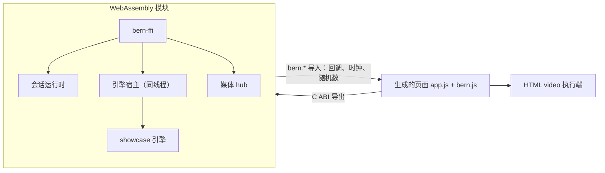
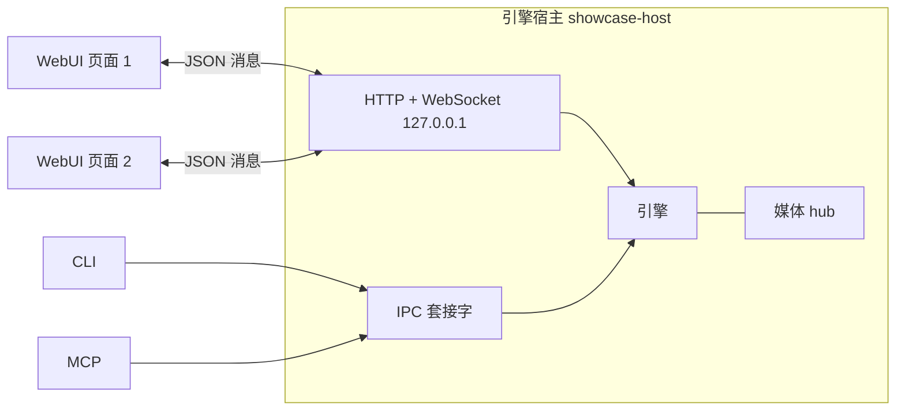

# Web 实现记录

- 首次记录：2026-10-10
- 更新日期：2026-10-17
- 依据：[Bern 架构设计](../Design.md)（最初按 v0.14 实现）、[Web 视觉规范 v0.6](../Adaptation/Web.md)
- 工具链：Rust 1.99.0（`wasm32-unknown-unknown`）；不依赖 wasm-bindgen，页面直接实例化 WebAssembly 模块
- 验证浏览器：内置 Chromium，以及桌面 Safari 27.0.1 的指定场景；各轮范围见下文

本文记录阶段三（Web 双构建）的实际完成情况：视觉规范、Bern 主题内核、`app` 构建（引擎在页面内）与 `ui` 构建（WebUI 连接独立引擎宿主）均已实现并在浏览器中验证。v0.2 视觉规范把 Web 呈现改为 Bern 自有的中性网页风格（主窗口即页面、次级窗口为对话框），实现与验证见“窗口呈现”和第三份验证记录；v0.3 调整控件（见“控件（v0.3）”与第四份验证记录）。

## 2026-10-15：多页应用的 Web app 适配

一个已有 macOS 版的多页媒体应用继续使用同一套声明，以 `web_mode = "app"` 将引擎编译成 WASM。为现有界面补齐以下浏览器能力，再开放对应 capability 检查：

- `Modal`、`Flow`、`Timer`、搜索面板及分组结果、显式 `PickerOption`、引擎受控 Switch/Picker。定时器随声明生命周期清理；搜索支持方向键、回车、Escape 和焦点恢复。
- Stack 样式、文本字号/字重/行数、纯图标 Label/Menu、胶囊控件、分轴 padding、baseline、模板图及固有比例、图片圆角与响应式比例、独立 Grid 行距。
- 固定侧栏宽度、顶栏、动态 badge、无标题 Detail、工具栏 leading 项、手风琴列宽动画、边缘 grow、延迟入场、事件触发 nudge、应用减少动态效果。
- 布局的伸展意图在显式宽高处停止，Spacer 按主轴参与布局。`reflow` 在条件分支的 DocumentFragment 挂载后观察实际父元素，共享观察器并在最后一个声明卸载后清理。
- 新增该应用用到的 SF 名称到 Lucide 的映射；SVG 随构建离线分发，授权保留。

`bern-command::storage::Store` 在 WASM 中使用宿主导入 `storage_read/storage_write`，保存到同源 localStorage 的 `bern:<bundle_id>:<key>`。二进制值以字节数组编码；缺失与空值不同，权限、格式和容量错误返回 `CommandError`。原生文件存储路径保持原行为。

`bern run --target web_app --port 4173` 可使用固定开发 origin，避免随机端口使浏览器读取到另一份站点配置。`--port` 仅适用于浏览器 app 目标；未传参数保留随机端口。

首轮自动验证：Web 后端/CLI/存储 Rust 测试、浏览器运行时 Node 测试、应用引擎测试、Web WASM 构建与 macOS 声明检查通过。修改的 Rust 文件格式检查、Web 后端和存储的严格 clippy 通过。该轮包含 CLI 的严格 clippy 曾受 `bern-compiler` 三处 `collapsible_if` 警告阻断；2026-10-17 文档同步时已清理这些条件分支，并通过编译器 49 项回归。应用的原始 UI crate 依赖 Bern 模块组合，直接 `cargo test --workspace` 会在未组合的 Pages/组件符号处失败，因此使用 Bern 构建检查 UI、单独测试各引擎。截至 2026-10-16 本轮复查，Bern Rust 测试 46 项、Node 运行时测试 27 项通过，已补充滚动、布局及颜色配对回归。重新构建 Bern CLI 后，最新 Web 构建及 macOS 声明检查（72 个组件）通过；这些检查不替代浏览器验收。

首轮浏览器检查使用内置 Chromium，覆盖 1280 × 800 与 390 × 844：四步引导、刷新恢复、主题切换、设置搜索、可选模块依赖、周历展开/详情返回、媒体库筛选排序、全局搜索和模拟播放、下载进度及暂停/继续。窄屏引导的滚动区收缩与固定底栏、设置窗口全高也在该轮检查。后续真实 Safari 27.0.1 暴露了这些检查和逻辑测试未发现的问题，因此不能把首轮记录视为完整 Web 验收。

Safari 27.0.1 的修复与复查记录：

- **普通滚动区**：未声明 `snap` 的 `ScrollView` 被运行时默认为 `center`，居中内边距又参与下一轮测量，最终产生 6793.7 px 内边距，媒体库列表移出可见区域。默认改为起始边对齐，仅显式 `snap: center` 使用居中停靠，并消除居中边距的累加反馈。
- **高度与宽度约束**：`Query` 包装层中断 flex 高度链，深层图片的 `min-content` 宽度又传播到祖先布局，使页面超出视口。修复这些约束后，Safari 已确认媒体库列表恢复显示，首页工具栏与右栏位于视口内。
- **侧栏选中色**：声明将选中背景改为 `fill.strong` 后，默认 `on_accent` 前景色没有随背景替换；朱红、霓虹深色主题的文字对比度只有 1.33:1。中性 `fill.*`、`surface.*` 背景现在配对 `text.primary`，`selection.background` 配对 `selection.foreground`；显式前景色仍优先，强调色背景继续使用自己的配对。选中图标继承文字前景色，该深色组合的对比度为 12.59:1，Safari 实测文字与图标清晰可见。回归覆盖主题配对、选中/悬停切换和显式前景色优先级。
- **Rail 覆盖层**：Rail 不再参与放大含图片/文字的 Stack，覆盖范围由内容决定。2026-10-16，Safari 在 1470 CSS px 宽度下确认首页舞台图右侧圆角与 28 px 间距恢复，工具栏和右栏正常；Chromium 1470 × 754 的 DOM 测量中，舞台按钮与图片均为 528 × 297，画框一致。
- **Safari 交互复查范围**：媒体库显示 16 张海报，筛选「未看」得到 8 张；深色侧栏选中白色文字与图标可读；周历从周一切换到周三、设置从通用切换到外观均目视正常。此次为桌面 Safari 27.0.1 验证，不包含 Safari 手机布局或所有页面。
- **媒体库窄屏复查**：共享 UI 的 `compact` 布局改为三行头部、`Flow` 筛选项与较窄缩放控件。Chromium 390 × 844 和 360 × 780 下标题不换行，完整缩放控件两端均可见，海报网格正常，文档 `clientWidth` 与 `scrollWidth` 相等。结论限于这两个尺寸的媒体库布局，不扩展为所有窄屏页面通过；Safari 手机布局及 Firefox 尚未实测。

应用仍为 UI 与状态模拟，没有接入实际播放、传输、更新或插件安装。

## 完成情况

| 设计要求 | 状态 | 说明 |
| --- | --- | --- |
| 实现前单独定义 Web 视觉规范 | 完成 | [Docs/Adaptation/Web.md](../Adaptation/Web.md) v0.2：Bern 自有的中性网页风格；度量与字号、主题角色与声明的配对、控件配方、各组件呈现与键盘行为、页面与对话框呈现、焦点、动效、图标与验收 |
| Bern 主题内核：角色、控件配方、快照、确定性、受控配对、品牌种子变化 | 完成 | `bern-theme`（Bern Theme Algorithm v5），见“主题内核” |
| 同一声明与命令 schema 生成两个独立目录；模式变化不残留另一模式的产物 | 完成 | `web_app`、`web_ui` 各自生成到 `target/bern/<目标名>/`；两种模式的 WebAssembly 编译目录分开（`target/bern-web-glue/app`、`…/ui`）。把同一目标从 `ui` 改为 `app` 后构建会删除引擎宿主程序与其胶水 crate，改回 `ui` 后页面模块重新不含引擎代码（实测） |
| `app` 在没有独立引擎服务时完成示例业务 | 完成 | 引擎、会话运行时与 C ABI 编译为一个 WebAssembly 模块，在页面内运行 |
| 不支持 WASM 的业务依赖明确失败 | 部分 | 依赖无法编译到 `wasm32` 时，构建在 Cargo 步骤失败并输出编译器诊断；尚未给出指向 `Bern.toml` 的专门诊断 |
| `ui` 产物不包含业务处理器与服务端依赖 | 完成 | 页面模块只链接协议 crate 与 `bern-ffi`（`remote` 特性）；产物中没有任何 `showcase_core` 符号（`app` 构建有 1368 个） |
| WebUI 多会话共享业务状态，窗口与草稿互不串用；CLI/MCP 路由到指定会话 | 完成 | 引擎宿主为每个页面登记一个 UI 会话；未指定会话时返回 `session_required` |
| 版本不兼容、权限不足、断线、结果未知、重连与重同步 | 完成 | 见“`ui` 构建”；握手核对令牌、协议版本与目录指纹；断线时等待中的请求以 `connection_lost` 结束，不重发；重连后以完整快照重同步并恢复同一会话 |
| 阶段二的通用验收在 Web 上重新执行 | 部分 | 见“验证记录”；四入口联调在 `ui` 构建中完成；键盘、输入法、读屏未实测 |
| 主题切换验证颜色算法的受控配对 | 完成 | 298 个种子 × 浅深 × 标准/更高对比，全部声明的配对达标、无回退（单元测试） |
| 虚拟呈现遵循宿主惯例，宽窄屏切换 | 完成 | 主窗口就是页面；设置等次级窗口为模态对话框（标题与关闭按钮，遮罩、Esc 与关闭按钮经关闭协议）；只有声明 `presentation: floating` 的窗口才是可拖动、可调整尺寸、可最小化的浮动面板；页面与对话框的窗口动作只有激活与关闭，其余返回 `target_unavailable`；窄屏时对话框占满页面区域 |
| Video 生成实际 `<video>`；`play()` 拒绝与用户激活不足 | 部分 | 播放器为 HTML `<video>`，关闭原生控制条，用 Bern 控制条发命令；`play()` 被拒时返回 `user_activation_required`（代码路径已实现，未在真实拒绝场景下验证） |

## 主题内核

`crates/bern-theme`，纯计算，不访问平台接口。

- **输入与输出**：`generate(种子, 模式, 对比策略)` 得到快照：schema 版本、算法版本、按名称排序的 token、每个声明配对的实测对比度与要求、回退原因。默认种子 `#2f6fe4`。
- **颜色空间**：8 位 sRGB ↔ OKLab/OKLCH（Björn Ottosson 的参考矩阵）；超出色域时保持明度与色相、二分降低色度；对比度按正确线性化的 sRGB 相对亮度在最终 8 位颜色上计算。
- **求解**：每个角色从目标明度出发（品牌角色用种子色相，表面与文字用固定的中性色相，状态色用固定色相），在 0.0025 的明度步长上寻找离目标最近、满足它所有声明配对的颜色；找不到时按 1、0.75、0.5、0.25、0 倍降低色度再找；仍不行则取最坏对比最大的中性端点并记录回退原因。
- **配对求解**：`accent` 与 `on_accent`、`status.error.surface` 与 `on_error` 一起求解：前景在白色与深色中性之间选择，使背景离目标最近。
- **层级**（v2）：浅色模式画布与浮层为白色，面板（侧边栏）略暗，宿主底色更暗；深色模式宿主、画布、面板、浮层逐层提亮，不做 RGB 反色。普通按钮以画布为底、`separator` 为边，悬停与按下底色由画布明度偏移得到。状态色不受品牌种子影响。
- **对比策略**：标准为正文 4.5:1、辨识所需图形 3:1、禁用 3:1；更高对比为 7:1、4.5:1、4.5:1。
- **控件配方**：`RECIPES` 以数据描述各控件各状态的槽位与 token，包括 `nav_item`（侧边栏）、下划线 `tab`（含竖排选中状态）、`menu`（下拉菜单）、`media_scrubber`（媒体进度条）与 `dialog`；图标按钮的底色与边框在所有状态都是 `transparent`。
- **v3 的变化**：`accent` 也对 `surface.raised` 达到 3:1（图标按钮悬停色出现在对话框头部）；新增 `media.track`（固定的浅槽）与 `media.played`（中性色，对槽与各表面 3:1）。
- **v4 的变化**：选中的导航项改为填满 `accent`、文字图标为 `on_accent`，不再有浅色选中底；`selection.background`、`selection.foreground`、`selection.indicator` 三个角色删除。
- **v5 的变化**：`accent.text` 改为从 `accent` 自身的明度出发求解，只移动到对各表面 4.5:1 所需的程度。默认种子下浅色由 `#1a5acd` 变为 `#2060d4`，深色由偏淡的 `#85b1ff` 变为 `#528fff`；无边框按钮、链接、选中页签的文字更接近强调色。新增测试：品牌文字与强调色的明度差小于 0.12、色度大于 0.15。
- **测试**：298 个种子（色相每 15°，四档明度，三档色度，加纯黑、纯白、灰、黄、绿等极端值）× 浅深 × 两种对比策略，全部配对达标且无回退；另有确定性、表面层级、品牌色相保持、状态色独立于种子、配方引用完整等测试。

## `app` 构建

页面图标：没有声明 `[app].icon` 时生成 Bern 标志的 `favicon.svg`、512 像素的 `icon.png` 与铺满方形的 `apple-touch-icon.png`（主屏幕图标），声明时三处都用该 PNG；`[app.icon].browser` 为 SVG 时只生成 `favicon.svg`，为页面图标文件夹时整个复制到 `icons/`，`.ico`、SVG、`apple-touch-icon*.png` 与 `.webmanifest` 各自生成 `<link>`（没有 SVG 与 `.ico` 时链接非 maskable 的 PNG）。`index.html` 以带构建版本的地址引用它们。`ui` 构建使用同一页面。

- **同一套 C ABI**：`bern-ffi` 不带 `ipc` 特性编译到 `wasm32`，macOS 前端调用的 `bern_*` 函数原样导出给页面，会话运行时、关闭协议、查询订阅与媒体 hub 只有一份实现。生成的胶水 crate 把回调接到页面提供的 `bern` 导入模块。
- **WebAssembly 适配**：
  - 引擎宿主在没有线程时于调用线程上依次执行任务，任务运行中发起的请求排在其后（`Host::start_local`）。
  - `SystemClock` 改用页面的 `performance.now()` 与 `setTimeout`。
  - 引擎实例 ID 取自页面的 `crypto.getRandomValues`，每个标签页各有独立身份。
  - 随包资源以页面相对 URL 提供（`Resources::served("resources/")`），构建把声明的文件同步到输出目录的 `resources/`。
- **调用约定**：返回结构体的导出通过隐藏的结果指针返回，按值传入的结构体按指针传递；64 位整数在 JavaScript 中是 BigInt。页面在调用期间收到的回调先复制字节，等调用返回后再按到达顺序处理，避免重入。
- **生成的页面**：`index.html`、`theme.css`（四份主题快照，按 `prefers-color-scheme` 与 `prefers-contrast` 选择）、`bern.css`（视觉规范，无字面颜色）、`bern.js`（运行时）、`app.js`（由 IR 生成）、`app.wasm`、`resources/`、`build.json`。页面引用的样式、脚本与模块地址带本次构建的版本参数（`?v=…`），重新构建后浏览器与静态托管的缓存不会让页面混用旧文件。
- **运行时**：
  - 细粒度响应式单元：引擎字段、会话字段与行变量都是单元或 getter，状态变化只重新执行读取它的绑定；引擎的一次状态更新在同一批次内提交。
  - 条件分支只在分支切换时重建；列表按 key 保持行的 DOM、控件与状态，行以注释标记界定，不增加包装元素。
  - 推入导航保留根页面（隐藏而非卸载），返回后查询订阅、播放器与滚动位置仍在。
  - 控件登记与 macOS 相同：目标 ID、角色、名称、启用状态与用户输入使用的同一闭包。
  - 本地化：按浏览器语言选择受支持的语言（`zh-CN` 等映射到 `zh-Hans`），文本保留 `{name}` 占位并按名称填充。
- **图标**：Web 版本用 Lucide（`lucide-static` v1.54.0）。所用的 41 个 Lucide SVG 与其 LICENSE 原样保存在 `crates/bern-backend-web/icons/lucide/`，以 `include_str!` 编入，构建时不联网。`icons.rs` 的对照表把每个 SF Symbols 名字对应到一个 Lucide 图标，并为 `.fill` 名字标明填充方式：整体（`play.fill`、`pause.fill`、`speaker.fill`）、部分（`speaker.wave.3.fill`、`speaker.slash.fill` 只填喇叭，`sun.max.fill` 只填圆盘）、镂空（`xmark.circle.fill` 用遮罩把叉号从实心圆中挖出；遮罩 id 是占位符，运行时为每个图标实例替换成唯一 id）。填充保留 2 px 描边，实心版与线条版轮廓一致。运行时的 `icon()` 在根 `<svg>` 上设置 Lucide 的描边属性。生成的页面目录包含 `THIRD_PARTY_NOTICES.txt`（ISC 与 Feather 的 MIT 授权全文），`app.js` 的图标表前有指向它的注释。应用用到对照表中没有的名字时构建失败并指向声明。
- **媒体**：每个播放器一个 HTML `<video>`；执行端完成 hub 的加载、卸载、播放、暂停、跳转、音量、静音请求，`play()` 以 Promise 的结果完成请求，跳转以 `seeked` 完成；媒体事件只作为观测报告，不派发命令。视图把播放器的元素放入自己的区域，单视图（`multi_view: false`）。

## 窗口呈现

v0.2 视觉规范下，生成的 `app.js` 为每个窗口种类写明呈现方式：声明 `presentation: floating` 的为 `floating`，WindowSet 的主窗口为 `page`，其余为 `dialog`。IR 版本为 4（新增 `Presentation::Floating` 与目标能力 `WindowCapabilities.floating`；不能提供浮动窗口的目标在检查阶段拒绝该声明）。

- **应用栏**：48 px，前端为应用名；声明了 `role: settings` 的窗口时尾端为设置按钮，Ctrl / Cmd + , 打开设置。只有应用声明了浮动窗口时才出现窗口切换条，且只列浮动窗口。
- **页面**：主窗口铺满应用栏下方，没有标题栏和窗口按钮。被命令关闭后显示应用名与“打开“{标题}””按钮。
- **对话框**：遮罩上的居中面板，宽度取声明宽度（未声明 560 px），高度贴合内容、最高 85%，超出时内容区滚动。头部即页面头：标题（导航推入时为页面标题）、工具栏、关闭按钮。点按遮罩（按下与松开都在遮罩上）、Esc、关闭按钮都请求关闭并经过关闭协议。打开时焦点进入第一个控件，Tab 限制在对话框内，关闭后焦点回到打开它的元素。对话框根部的 Tabs 在宽度 ≥ 640 px 时为左侧竖排导航（`aria-orientation` 随之切换，方向键改为上下）。
- **浮动窗口**：保留原有的标题栏、拖动、调整尺寸、最小化、最大化与键盘移动；最小化后在切换条恢复。
- **关闭确认与失败提示**：所属窗口内的模态提示，按钮靠右、主要选择在最后（“不存储”在左侧）；Esc 等同取消，Tab 限制在提示内。
- **窗口事实**：帧按布局尺寸计算，打开动画的缩放不影响报告的尺寸与位置。
- **导航**：推入后焦点移入新页面，Esc 或 Alt + ← 返回，返回后焦点回到推入时的链接。

## 控件（v0.3）

- **按钮**：高 32 px，左右内边距 20 px，最小宽度 80 px；输入框与下拉菜单同为 32 px，同一行中的控件对齐。
- **图标按钮**：默认及 plain 样式用图标颜色反馈悬停、按下与选中；显式 prominent 绘制强调容器，ControlGroup 提供组内共享胶囊。尺寸和样式以当前声明为准。
- **页签**：选中项文字与图标为 `accent.text`，下划线为 `accent`。
- **侧边栏与竖排导航**：默认选中项填满 `accent`，文字与图标为 `on_accent`，选中且悬停为 `button.prominent.hover`；不带左侧竖线。声明覆盖背景时按对应语义角色重新配对前景色，显式前景色优先，选中图标继承文字颜色。浮动窗口切换条的当前项同样填满强调色。
- **开关**：40 × 20 的轨道，关闭时为 `control.border` 边框加同色圆钮，开启时轨道填满 `accent`、圆钮为 `on_accent`；悬停时关闭态的边框与圆钮变为 `text.secondary`，开启态变为 `button.prominent.hover`。
- **滑块**：仍是原生 `<input type="range">`，圆钮改为 4 px `control.thumb` 白环包住 `accent` 圆心并加 1 px 轮廓，悬停、拖动时圆心为 hover、pressed 变体。
- **下拉菜单**：`automatic`、`menu` 样式不再用 `<select>`。触发器是 `role="combobox"` 的按钮，列表是 Popover API 的 `popover="auto"` 元素（顶层，不受卡片、对话框与滚动容器裁切；外部点按自动关闭），在 `beforetoggle` 中按触发器位置同步定位（下方不足 160 px 且上方更宽时向上），最高 328 px。焦点留在触发器上，活动项用 `aria-activedescendant`；键盘按 APG 只选组合框；Esc 在触发器上处理并阻止默认动作，所以对话框不会一起关闭；滚动页面或改变窗口大小时关闭。选择调用与外部入口相同的 `select` 闭包。
- **媒体进度条**：视频控制条的进度与音量改用 `scrubber()`，不再是 range 输入。`role="slider"`，`aria-valuetext` 为时间或百分比；指针按下即跳到该点并开始预览，拖动只更新预览（进度时间同步显示），松开提交一次；方向键每次 5 秒（音量 5%），PageUp / PageDown 每次 10%，Home / End 到首尾，键松开时提交。已播放部分为 `media.played`，未播放为 `media.track`，滑块 20 × 16 px、圆角 7、`control.thumb` 加 0.5 px 轮廓与投影，拖动时放大到 1.1 倍。

## 组件库第一批

- **图片**：``，地址为 `resources/` 下的资源名称（两种构建都把资源复制到这里），`object-fit` 对应 `fit`；只写一边时另一边为 `auto`，按图片比例。`label` 写入 `alt`，没有时 `alt` 为空，即装饰图片。在表单分组中单独成行并靠前缘。图片通过 `flex: none` 和显式尺寸规则保留声明的画框，祖先 `Row` 与 `Column` 仍可收缩；2026-10-15 已移除因任意深层图片而设置祖先 `min-width: min-content` 的规则，避免整页被图片内容撑宽。HDR 由浏览器决定：Chrome 154 在 macOS 上按 HDR 显示带增益图的 JPEG 与 PQ 的 PNG（右半 1.69 与 1.85 倍 SDR 白），同一台 Mac 上默认配置的 WKWebView（macOS 27）显示 SDR 版本，`dynamic-range-limit: no-limit` 也不改变；Safari 的 HDR 尚未实测。
- **进度**：有 `value` 时是轨道加填充的 `role="progressbar"`，带 `aria-valuenow` 与 `aria-valuemax`，标签在上；轨道与滑块同为 `control.track`，填充为 `accent`，宽度变化用 `--bern-motion` 过渡（减少动态效果时为 0）。没有 `value` 时为查询已在用的 `.bern-spinner` 加次要文字。
- **网格**：CSS Grid，`grid-template-columns: repeat(auto-fill, minmax(min(100%, min_width), 1fr))`，`gap` 默认 8 px。
- **层叠**：一个单元格的 CSS Grid，每层 `grid-area: 1 / 1`，`place-items` 对应 `align` 的九个方位；宽度为 `fit-content`，所以与最大的一层一样大，不会被分组撑满。

在内置浏览器（800 宽）验证：三种 `fit`、只写宽度与层叠的效果与 macOS 相同；网格为四列；进度条的 `aria-valuenow` 分别为 50（`total` 100）与 0.6，名称为各自的标签，装饰图片的 `alt` 为空。

## 阶段四：自适应布局、菜单与语言

- **`Adaptive`**：生成 `B.Adaptive(p, ctx, { id, breakpoint, layouts: { compact, expanded } })`，断点来自 `[layouts]`。运行时用 `ResizeObserver` 量容器宽度，尺寸变化时只重建布局区域；切换前聚焦的控件按 `data-bern-target` 在新布局中找回焦点，目标在未打开的菜单里时聚焦菜单按钮。
- **`Menu` / `MenuItem`**：菜单按钮加 Popover API 弹出菜单，键盘按 APG Menu Button；与下拉菜单共用定位（`placePopover`）。每个菜单项按 `id` 登记，外部入口可在菜单关闭时执行。
- **语言**：当前语言与字符串表是响应式单元，`tr()` 读取它们，所有文本绑定在切换时一次更新；`<html lang>` 与页面标题由同一效果更新。`ui.language`、`ui.set_language` 在会话请求中处理（命令序号 18、19）。`LanguagePicker` 复用自绘下拉菜单，选项名用 `Intl.DisplayNames` 取语言自称。
- **功能契约报告**：`bern build` 为每个目标把报告写入产物目录的 `features.json`。
- **消息格式**（2026-10-18）：`B.fmt` 按[消息格式](../Reference/UI.md#文本内容与格式化)解析译文（每条译文解析一次后缓存），写出 `{name}`、复数分支、日期与时长；日期参数以记录传入，其余按显示形式传入。显示变体字段的枚举标签生成为按变体分支的 `L.枚举`，字段按类型写出（嵌套枚举用它自己的标签）。月名与星期名随字符串表生成。浏览器面板中实测 `=0`、`one`、`other`、复数分支内嵌枚举标签、日期、时长与语言切换。

## `ui` 构建

- **页面**：同一个 `app.js` 与 `bern.js`；页面模块是会话运行时与 C ABI，引擎经 `bern-ffi` 的远程链接到达（引擎与媒体 hub 通过 `EngineLink`、`MediaLink` 接口提供，同进程构建用本地实现，WebUI 用远程实现）。草稿、导航、窗口与查询订阅留在页面。
- **引擎宿主**（`bin/<应用>-host`）：原生运行引擎与媒体 hub，在 127.0.0.1 提供页面文件与 `/bern` WebSocket 通道，并按目标的 `channels = ["ipc"]` 装配本地 IPC 通道；同目录生成的 `bin/<应用>`、`bin/<应用>-mcp` 连接同一引擎。
- **通道消息**：与 IPC 相同的 JSON 控制消息（`bern-adapter-json`），另加页面专用消息：会话登记与恢复、窗口列表、会话请求与结果、查询取消、媒体执行端（登记、创建、绑定、释放、视图、完成、观测）与媒体请求。命令与查询异步应答，慢查询不阻塞同一连接上的其他请求；被新参数取代的查询发送取消。
- **访问控制**：
  - 只监听 127.0.0.1。
  - 每个请求的 `Host` 必须是本服务器（防 DNS 重绑定）。
  - WebSocket 升级要求 `Origin` 与之相同。
  - 第一条消息必须携带启动时生成的令牌（常量时间比较）。令牌放在地址的片段中，浏览器不会发给服务器；静态文件本身不授予任何权限。
- **会话**：每个页面登记为 `<engine_id>-web<n>` 会话，外部入口的会话命令经 WebSocket 交给页面，由页面的真实控件闭包执行。断线后页面以 `resume` 请求恢复同一会话（同一引擎实例且该 ID 空闲时），并重新发送窗口列表、播放器与视图登记。引擎宿主重启后旧令牌失效，页面显示“无法连接到引擎”并停止重试；同一令牌下引擎实例改变时页面重新载入，建立新会话。
- **媒体**：页面登记为媒体执行端；宿主的路由器把每个播放器的请求交给持有它的页面（创建它的页面；应用级播放器交给最近显示它的页面，否则最近登记的页面）。窗口播放器的 ID 与所有者带会话前缀（`<会话>/<窗口>/<目标>`），多个页面的同名窗口不冲突。
- **资源**：引擎以 `Resources::served("resources/", 目录, 声明)` 解析资源，返回页面相对 URL；需要读文件的引擎仍可读同一目录。

## 打包

`bern package --target web_app` 生成 `<程序>-<版本>-web.zip`（Linux 上为 `.tar.gz`），只含服务器需要的文件：页面、脚本、WebAssembly、样式、图标、随包资源与第三方声明，不含生成的胶水源码与构建报告。`ui` 构建另含引擎宿主及其 CLI 与 MCP 服务器，文件名标明系统与架构（`…-webui-macos-arm64`）。macOS 上用 `ditto` 打包，不带资源分叉与扩展属性。新项目的 `app` 包为 0.55 MB（未压缩），11 个文件。

## 样式、动效与媒体类应用的能力（v0.29）

2026-10-13 补上了 Web 此前在能力描述中声明不支持的部分，使 `examples/planner` 与 `examples/gallery` 都能构建为 Web。能力描述现在列出全部 `features`、全部动效属性，`text_marks`、`dynamic_items` 与 `window_chrome` 为真，样式能力与 Compose 相同（`Button`、`IconButton`、`SidebarItem`）。新增的运行时在 `templates/features.js` 与 `templates/features.css`：前者以与页面相同的带版本地址导入 `bern.js`，两者共用一份运行时，`bern.js` 只留几个挂钩点；后者在构建时接在 `bern.css` 后面。

- **弹簧**：页面自己逐帧积分（质量 1，刚度 (2π/T)²，阻尼 4πζ/T），新目标从当前值与速度继续；系统要求减少动态效果时变换直接到位、过渡改为 150 毫秒淡入淡出。
- **变换分层**：一个元素的位移、缩放与透明度分成样式状态、出现、消失、共享元素、让位、晃一下、滚动联动几层，各自驱动，再合成为一个 `transform` 与 `opacity`，缩放以中心为原点。
- **结构过渡**：`When` 与 `Each` 在第一次显示之后的变化中挂载的元素播放 `appear`（其中的元素随它一起出现，不各自播放）；带 `disappear` 的元素在移除时先播完过渡再离开页面。`reflow` 的容器在子元素增减或尺寸变化后，让移动的子元素从旧位置滑过去。
- **共享元素**：带 `hero` 键的元素卸载时记下位置并留一份副本（视频与画布不复制），同一更新中挂载的同键元素从那里长出，副本随之移动并淡出，一个弹簧驱动两者。
- **样式覆盖**：基础外观写成样式，各状态的外观按悬停、按下、焦点、禁用与选中依次合并；颜色经 CSS 过渡，变换经状态的弹簧。主题缺少的 `fill.subtle`、`fill.strong`、`selection.*` 由现有变量派生。
- **画布与标注**：2D `<canvas>`，按设备像素比绘制，状态、尺寸与颜色变化时重绘；标注的行框来自 `Range.getClientRects`。
- **可伸展的视图**：没有尺寸的画布、滚动视图、网格、视频与进度条标为可伸展，`Stack`、列、行与面板中含有它们的子元素随之拉伸（用 `:has()`）；写了尺寸的元素不参与。这对应原生目标上这些视图占满给它们的空间。
- **侧栏**：内容生成为普通的构建函数，侧栏项挂载时登记，选中项消失时回到 `fallback` 或第一个可见项；`SidebarFooter` 在侧栏底部。`SidebarHeader` 固定在列表上方，子项纵向排列、间距 8 px，默认上下留白 8 px、左右留白 7 px；此前遗漏容器布局，导致品牌贴顶并偏左。该留白是平台默认值，不会自动调整任意 Header 内容的图标列或文字列。
- **窗口**：`window.idle` 由窗口内的指针、触摸、滚轮与按键重新计时；沉浸时隐藏页头，静置时隐藏指针。`chrome` 在页面上没有效果。
- **运行时主题**：构建时为每个强调色生成浅色、深色与更高对比的变量，运行时切换根元素的 `data-bern-accent` 与 `data-bern-appearance`；`appearance` 的部分换用另一套变量，其中的浮层与菜单随之。
- **文件**：`pick` 用 `<input type=file>`，按种类的扩展名与 MIME 过滤；`Drop` 处理拖入的文件；交给动作的是页面的 `blob:` 地址。`opens: true` 只在页面作为应用安装后经 `launchQueue` 收到文件。会话命令 `ui.set_file` 与 `ui.focus` 已加入。
- **滚动停靠**：CSS `scroll-snap`；列表行带上自己的键，滚动视图据此找到各格；字段在滚动停下后跟随，设置字段时平滑滚动，到达后晃一下。
- **其他组件**：带内容的按钮、开关按钮、分体按钮（浮层）、工具栏搜索与结果浮层、轻提示、侧面板（推开内容，窄窗口为底部弹层）、捏合（两指触摸，或触控板的带 Control 的滚轮）与滑动手势、引擎给出的图片、视频圆角、快捷键（`cmd` 在苹果系统上是 ⌘）。重复项中的控件身份带上每一层的键，经过组件也一样。

## 设计稿审阅后的四项扩展（v0.30）

2026-10-13，四项扩展先在 Web 上实现，能力描述加上 `rails`、`popover_button`、`size_classes` 与动效属性 `stagger`：

- **错峰**：`When` 与 `Each` 记住所在容器的错峰时钟；容器在一次更新中出现时（任意深度），它带 `appear` 的直接子元素依次开始，每个晚 `stagger` 秒，起点先隐藏；一次更新结束后计数归零。
- **按比例摆放**：横向 `Rail` 是一格网格，每个子元素以按比例的起始边距定位、按 `anchor` 平移；铺在两点之间的子元素以比例宽度铺开。竖向轨道用绝对定位。比例绑定状态时由页面的弹簧移动，`animate` 给出弹簧。
- **浮层按钮**：弹出层（Popover API），内容在打开时挂载、关闭时卸载；`presented` 双向跟随。
- **四档尺寸**：`Adaptive` 按可用宽度和三条断点选档，没有自己布局的档用更大一档、否则更小一档的布局；每个窗口按自身宽度保持 `window.compact` 等四个值。

## 验证记录

2026-10-10，v0.1 视觉规范（窗口呈现已由 v0.2 取代），内置浏览器，`python3 -m http.server` 提供 `target/bern/web_app`：

- 页面加载约 21 MB 的调试版模块后启动引擎、打开主窗口（最大化），文字层级、标签与绑定引擎状态的文字正确显示。
- 侧边栏切换页面，页面标题栏显示所选页面名，工具栏按钮位于标题栏尾端。
- 按钮：点按“主要”后经引擎命令更新状态，“最近操作”变为“主要按钮”。
- 设置窗口：“打开设置…”打开浮动的设置窗口（图标页签、分组开关、显示名称输入框）；点按主窗口时主窗口置顶，经切换条重新激活设置窗口；输入“Ada”后点关闭，窗口内弹出“要存储对显示名称的更改吗？”与存储、不存储、取消；选“存储”后运行存储命令并关闭窗口。
- 开关与滑块页：开关、复选框、带两端图标的滑块、工具栏与表单中的分段选择器、下拉菜单；拖动音量滑块时只更新预览，松开后提交一次，引擎的“已提交的音量”变为 80.2158…（声明未设步长，显示 Bern 的基本数字文本，与 macOS 相同）。
- 输入框页与列表页：查询结果经页面时钟异步到达，五个类别带计数；在真实搜索框输入“mo”后只剩“影片”，清除按钮出现；点按行推入详情，标题栏显示“项目 4”与返回按钮。
- 视频页：精选片段从 `resources/media/aurora.mp4` 加载并显示首帧与 0:00 / 0:08；点控制条播放后合并状态为 `Playing`；切到损坏的文件后显示“无法播放”与浏览器的错误信息，播放与进度控件禁用；应用级预览播放器为 `Idle`。
- 深色模式（`prefers-color-scheme: dark`）：全部来自主题变量，无分支代码。
- 窄屏（375 × 812，粗略指针）：窗口铺满，侧边栏成为第一页，选择后显示详情与返回按钮，控件按粗略指针放大。
- `cargo test --workspace` 129 项通过，`cargo clippy --workspace --all-targets -- -D warnings` 与 `cargo fmt --check` 通过。

2026-10-10，`ui` 构建（`showcase-host --port 8790`，内置浏览器）：

- 新增测试：通道 4 项（握手需要令牌、协议版本与目录指纹；命令不等待更慢的查询，取消的查询报告 `cancelled`；页面作为 UI 会话被外部入口驱动，页面离开后会话结束；播放器请求路由到持有它的页面，关闭窗口释放其播放器），HTTP 与 WebSocket 2 项（只为指向本服务器的请求提供文件，路径不能离开根目录，字节范围；只有本页面来源能打开通道，RFC 6455 示例的接受键，无令牌的 hello 收到说明后关闭），SHA-1、base64、令牌、帧各 3 项，以及页面运行时对引擎宿主的端到端测试 1 项（握手、会话登记、完整状态、命令与状态更新、页面窗口与 `window.list`、断线后等待的请求以未知结果结束且不重发）。共 144 项通过。
- 页面经宿主打印的地址连接，打开主窗口；CLI 的 `sessions` 列出 `…-web1`（`main#1`）；`ui inspect` 返回页面的控件；`ui select --option Library` 让浏览器切到列表页；`showcase add-item` 后页面的查询自动刷新为 6 项；`ui edit` 在页面搜索框输入“mo”后只剩“影片”。
- MCP：`showcase_search_library` 返回照片（资源地址为 `resources/media/tides.mp4`），`ui_select` 切换页面，`window_list` 返回 `Virtual` 呈现的窗口事实。
- 第二个标签页登记为 `…-web2`：两个会话共享引擎状态，所选页面各不相同；不指定会话时 `session_required`。
- 断开页面的 WebSocket：出现“与引擎的连接已断开，正在重新连接…”，约 0.5 s 后恢复同一会话（`…-web3`），页面草稿保留，提示消失。重启引擎宿主后旧页面显示“无法连接到引擎”与原因，不再重试。
- 视频：页面打开视频页后，精选片段经宿主的媒体 hub 加载（`Ready 0:00 / 0:08`）；CLI 的 `media players` 列出 `…-web3/main#1/media_page.featured`，`media play` 经路由到达页面，`media state` 为 `Playing`、请求 `Executed`。
- 回归：macOS 应用的引擎命令、会话选择、查询与 `window.list`（`Native`）正常；`app` 构建正常。

2026-10-10，v0.2 中性网页风格（内置浏览器，`app` 与 `ui` 构建）：

- 主窗口为页面，没有窗口按钮；侧边栏选中项为浅色强调底加左侧指示条，页面头 64 px，分区为标题加细边框卡片，文本输入的标签在上方，开关与选择器在行尾，工具栏按钮为普通按钮外观。
- 设置：齿轮按钮与 Cmd + , 打开设置对话框（520 px，下划线页签，焦点进入当前页签）；在显示名称输入“Ada”后按 Esc，对话框内出现关闭确认（不存储在左，取消、存储在右）；再按 Esc 取消确认，对话框保留；点按遮罩再次请求关闭，选“存储”后运行存储命令、关闭对话框，焦点回到齿轮按钮；再次打开显示“已存储的名称：Ada”。
- 把对话框宽度改为 760 px 后，根部 Tabs 变为左侧竖排导航，`aria-orientation` 为 `vertical`。
- 窗口动作：页面与对话框的 `actions()` 只有激活与关闭；`ui` 构建中 CLI `window minimize --window main#1` 返回 `target_unavailable`（附可用动作），`window open --kind settings` 在浏览器中打开对话框，`window list` 两个窗口均为 `Virtual`。
- 浮动窗口：把构建出的 `app.js` 中设置窗口临时改为 `floating` 后，应用栏出现切换条，窗口有 40 px 标题栏与最小化、关闭按钮，`actions()` 含移动；最小化后切换条项为最小化样式，点按后恢复，`move` 后帧为 (100, 50)。重新构建后恢复为对话框。
- 关闭主窗口后显示空状态与“打开“Bern 控件展示””，点按后主窗口恢复。
- 列表页：查询结果在卡片中为分隔的行；点按“文稿”推入“项目 1”，焦点移入新页面，按 Esc 返回且焦点回到“文稿”。
- 深色模式：画布、面板、对话框逐层提亮，卡片在对话框内与对话框同底、保留边框。
- 窄屏（390 × 760，粗略指针）：控件 44 px，侧边栏为第一页，设置对话框占满应用栏下方区域，应用栏中的焦点环内收不被裁切。
- `cargo test --workspace` 145 项通过（新增：主题表面层级与选中配色 2 项、浮动呈现的能力检查），`cargo clippy --workspace --all-targets` 与 `cargo fmt --check` 通过。

2026-10-10，v0.3 控件（内置浏览器，`app` 构建；macOS 27.0.1 截图）：

- 开关与滑块页：开关为空心轨道加圆钮、开启为强调色；滑块圆钮为白环包住强调色圆心；按钮页的按钮高 32 px，普通按钮宽 134 px（“工具栏按钮”带图标），图标按钮悬停时颜色为 `#2f6fe4`（`accent`）。
- 下拉菜单：点按“密度”打开列表（下方空间不足时向上弹出），选中项有对勾；点选“宽松”后值更新、列表关闭、焦点回到触发器；再次点按触发器时列表关闭而不是重开；↓ 打开、↑ 移动到“标准”、Enter 选择。设置对话框中的同一下拉菜单弹出到对话框边界之外不被裁切，按 Esc 只关闭列表，对话框保留。
- 设置对话框：选中的页签“外观”为强调色文字与下划线。
- 视频：点按进度条中部跳到 4.035 s（`aria-valuetext` “0:04”），→ 前进到 8 s（到头为止），拖动音量滑块后音量为 0.21，进度条已播放部分为中性深灰。
- 深色模式下开关、滑块、下拉菜单与媒体进度条的颜色全部来自主题变量。
- macOS：系统 `Slider`（macOS 26 及以上分支）加 `.tint(.primary)` 后，非活动窗口中已播放部分为浅灰 `#bfbfbf`，不再是强调色；把可用性判断临时改为 macOS 99 构建回退分支后，回退的形状（6 pt 轨道、20 × 16 pt 白色滑块）与系统滑块重合，非活动窗口中已播放部分随系统变浅。截图都来自后台窗口，活动窗口中的颜色未截图验证。
- `cargo test --workspace` 146 项通过（新增：媒体进度为中性色且与轨道达到 3:1），clippy 与 fmt 通过；Swift 生成代码在 Swift 6 模式下类型检查通过。
- 随后把侧边栏、对话框竖排导航与窗口切换条的选中项改为填满强调色、去掉左侧竖线（主题算法 v4）：浅色与深色模式下侧边栏选中项为 `#2f6fe4` 底、白字，竖排导航选中项计算样式同样为 `rgb(47, 111, 228)` 底、白字，`::before` 为 `none`；生成的 `theme.css` 中不再有 `selection` 变量。

2026-10-10，图标改用 Lucide（内置浏览器，`app` 构建）：

- 侧边栏、工具栏、图标按钮与设置按钮显示 Lucide 图标；搜索框输入后，清除按钮为实心圆中挖空的叉号；视频控制条的播放为实心三角，音量为实心喇叭加线条声波（放大到 72 px 检查）。
- 生成目录中有 `THIRD_PARTY_NOTICES.txt`，开头说明来源与修改，随后是 ISC 与 MIT 授权全文。
- 新增测试：每个对照项都来自 `lucide-static v1.54.0` 文件、填充所指的形状存在、只有 `.fill` 名字被填充；填充方式按表生成（整体、部分、镂空遮罩）；声明文本包含两份授权。

2026-10-10，阶段四（内置浏览器，`app` 构建）：

- 1280 宽时媒体页的 `media_page.clip_choice` 为 `expanded`，显示三个片段按钮；聚焦“色条”后把视口改为 480 宽，变为 `compact`，显示“换片”菜单，焦点移到菜单按钮；按 ↓ 打开菜单并聚焦“测试图”，再 ↓、Enter 选择“色条”，菜单关闭、焦点回到按钮、片段变为色条；改回 1280 宽后回到按钮布局，片段仍是色条。600 宽时容器为 566 px，按规则仍为 `expanded`。
- 设置对话框中显示名称草稿为“Ada”，经语言选择器选“English”：整页（侧边栏、页面、对话框、视频页说明）变为英文，`<html lang>` 为 `en`、页面标题为“Bern Showcase”，草稿、对话框与当前页面保持。
- `features.json` 列出 `MediaFeature::Clip` 在两个尺寸的覆盖入口。
- `ui` 构建（重启后的引擎宿主）：CLI 的 `ui language` 返回 `"zh-Hans"`；`ui set-language --language en` 后浏览器页面变为英文（`<html lang>` 为 `en`，侧边栏分组为“Controls”），`ui language` 返回 `"en"`；`--language ja` 返回 `unsupported_language` 并列出支持的语言。
- `cargo test --workspace` 159 项通过，clippy 与 fmt 通过。

2026-10-13，v0.29（内置浏览器，`ui` 构建，Chromium 内核）：

- **planner**：画布的格纹、面积与折线，标题下的主题色标注；样式化的侧栏项悬停放大到 1.03 并出现底色、按下 0.96、离开回 1，主要按钮为强调色底、10 圆角、42 高；逐帧采样确认标题在两种字号间放大并交叉淡化、副本随后移除，新标签从 0.4 倍弹出；关闭“笔记”模块时侧栏项消失、选中回到“概览”，重新开启后出现；专注模式静置 3 秒后隐藏页头，移动指针后恢复。
- **gallery 图案页**：三列海报墙，悬停时卡片浮起并出现星标，点星标收藏并在窗口底部弹出轻提示，点卡片打开图案；侧面板推开海报墙（三列变两列），其中海报、从海报取色并向下渐隐的头部与打开的图案；外观菜单切换群青与浅色，画布随之重绘；带 Control 的滚轮把卡片尺寸撑到上限，`ui set-number` 设回。
- **gallery 工具栏**：图标菜单、分组竖线、开关按钮按下为强调色；`ui focus` 后输入出现结果下拉，点结果打开图案；⌘⌥I 开关详情、⌘K 聚焦搜索框。
- **gallery 画框页**：浅色窗口中画框保持深色，视频圆角；分体按钮的浮层与“字号”菜单都是深色，选“大”后字号为 18；静置后画框铺满；模拟拖入真实视频文件时描边出现、画框晃一下，松手后播放，描边淡出后移除；`ui set-file` 对非地址答复 `invalid_url`、对非视频答复 `unsupported_file`，视频地址交给“打开视频”后播放。
- **gallery 胶片页**：初始停在设定的一格正中、正中一格放大、两侧变小变淡；滚轮滚动后吸附到某一格且字段跟随；按钮滚到首尾并在到达时晃到 1.06；上拖使值从 0.5 增到 0.88。
- **关于对话框**：以 360 宽的模态对话框显示在遮罩上，按“好”关闭。
- **回归**：showcase 的侧栏分组、搜索框、页面切换与列表页正常。

2026-10-13，v0.30（内置浏览器，`ui` 构建）：

- **错峰**：从“胶片”切到“图案”时，海报墙 6 张卡片依次在约 0、47、97、130、164、214 毫秒开始升起（`stagger: 0.04`）。
- **按比例摆放**：胶片页的时间轴有底线、6 个按引擎给出的比例摆放的刻度与左对齐的名字；“现在”竖线绑定 `draft.level`，上拖时从 50% 平滑移到 80%；拖动区的底色按数值涨满。
- **浮层按钮**：画框页的音量按钮，`ui activate` 打开后浮层里的滑块才出现在 `ui inspect` 中，`ui set-number` 设为 0.3，关闭后滑块卸载。
- **四档尺寸**：视口 1024、800、1100 宽时海报墙页边距为 32、24、32；胶片页的 `Adaptive` 在可用宽度约 560 时为 `compact`，约 860 时为 `medium`。

2026-10-14，引擎读取交来的文件。`examples/gallery` 新增引擎在页面中的 `web_app` 目标；在内置浏览器中用页面取到的 `tides.mp4` 构造名为“海浪 Tides #3.mp4”的文件拖入画框，轻提示为“▶ 海浪 Tides #3.mp4 · MP4 · 49 KB”：引擎经导入取到文件名与大小，并读出开头的 12 个字节认出 MP4；控制台没有报错。

## 未完成与已知限制

- 选到或拖入的文件是页面的 `blob:` 地址。引擎在页面中时，页面记住每个地址对应的文件，经导入 `file_name`、`file_size`、`file_read` 把名字、大小与一段内容交给引擎（同步请求读取文件的一段，读取期间页面不响应）；WebUI 中原生运行的引擎读不到页面的文件。
- 系统的文件选择框与从桌面拖入文件无法在自动化中操作，分别用 `ui.set_file` 与页面内构造的文件验证；`opens: true` 的 `launchQueue` 未验证。
- 触控板捏合只在 Chromium 中验证（带 Control 的滚轮）；两指触摸、Safari 的手势事件未实测。
- 共享元素的副本不复制视频与画布，它们只做位置与尺寸的过渡。
- 内置浏览器面板隐藏时浏览器暂停逐帧回调，动效停在中途、显示后继续；这是浏览器的行为。

- `app` 构建没有外部控制入口：浏览器内的引擎不能监听，设计要求另设明确中继，未实现。
- 多个 WebUI 页面同时登记为媒体执行端时，第一个页面登记即把执行端交给宿主的路由器；页面离开后，它持有的应用级播放器不会自动在其他页面重新加载。
- 引擎宿主断开时，页面上已显示的媒体状态保留到重连；重连后页面播放器重新加载，播放位置不保留。
- 宿主只服务 HTTP；HTTPS 与跨源部署需要另行配置，未实现。
- WebAssembly 中 panic 会终止模块，`app` 构建没有 macOS 那样的“引擎拒绝后续命令”。
- 运行时主题只在构建时生成快照；没有运行时更换品牌种子的接口。强制颜色模式、更高对比模式与键盘遍历的完整检查、VoiceOver/NVDA 未验证。
- 视频：未验证真实的用户激活拒绝；没有全屏与画中画；单视图，一个播放器不能同时在两个视图中显示。
- 早期调试版模块约 21 MB。2026-10-11 release 展示应用的体积记录见 [README 测量方法](../../README.md#实测数据)；这些数字不代表其他应用的体积或性能。
- 桌面 Safari 27.0.1 已验证该应用的媒体库、筛选、主题可读性、导航和部分布局，范围见前文。Firefox、Safari 手机布局及未列出的交互仍未实测。
- 侧栏默认宽度为 240 px，可用 `Sidebar(width:)` 指定固定宽度；用户拖动调整列宽的 Window Splitter 模式尚未实现。
- 示例应用没有声明浮动窗口；浮动呈现只通过临时修改构建产物验证过。
- 下拉菜单依赖 Popover API（Chromium 114、Safari 17、Firefox 125 起）；更旧的浏览器没有回退。
- 媒体进度条没有显示缓冲范围。
