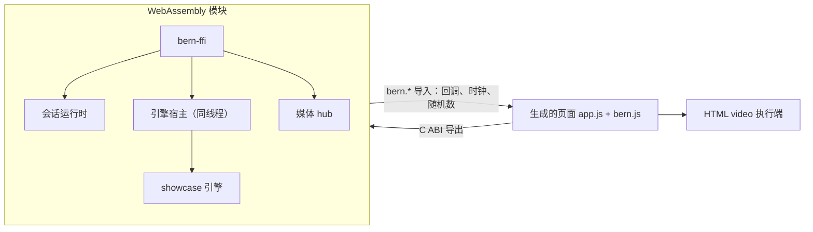

# Web 实现记录

- 日期：2026-10-10
- 依据：[Bern 架构设计 v0.12](../Design.md)、[Web 视觉规范 v0.1](../Adaptation/Web.md)
- 工具链：Rust 1.99.0（`wasm32-unknown-unknown`）；不依赖 wasm-bindgen，页面直接实例化 WebAssembly 模块
- 验证浏览器：Claude 桌面应用的内置浏览器（Chromium 内核）

本文记录阶段三（Web 双构建）的实际完成情况。目前完成了视觉规范、Bern 主题内核和 `app` 构建；`ui` 构建（WebUI 连接独立引擎）尚未实现。

## 完成情况

| 设计要求 | 状态 | 说明 |
| --- | --- | --- |
| 实现前单独定义 Web 视觉规范 | 完成 | [Docs/Adaptation/Web.md](../Adaptation/Web.md)：度量与字号、主题角色与声明的配对、控件配方、各组件呈现与键盘行为、虚拟窗口、焦点、动效、图标与验收 |
| Bern 主题内核：角色、控件配方、快照、确定性、受控配对、品牌种子变化 | 完成 | `bern-theme`（Bern Theme Algorithm v1），见“主题内核” |
| 同一声明与命令 schema 生成两个独立目录 | 部分 | `app` 生成到 `target/bern/<目标名>/`；`ui` 未实现，构建时明确报错 |
| `app` 在没有独立引擎服务时完成示例业务 | 完成 | 引擎、会话运行时与 C ABI 编译为一个 WebAssembly 模块，在页面内运行 |
| 不支持 WASM 的业务依赖明确失败 | 部分 | 依赖无法编译到 `wasm32` 时，构建在 Cargo 步骤失败并输出编译器诊断；尚未给出指向 `Bern.toml` 的专门诊断 |
| `ui` 产物、WebUI 会话、CLI/MCP 路由、断线与重连 | 未做 | 阶段三的下一部分 |
| 阶段二的通用验收在 Web 上重新执行 | 部分 | 见“验证记录”；外部入口（CLI、JSON、MCP）需要 `ui` 构建 |
| 主题切换验证颜色算法的受控配对 | 完成 | 298 个种子 × 浅深 × 标准/更高对比，全部声明的配对达标、无回退（单元测试） |
| 主窗口与设置窗口使用虚拟窗口，宽窄屏切换 | 完成 | 页面宿主、应用栏、浮动窗口、拖动与调整尺寸、最小化与最大化、窄屏铺满 |
| Video 生成实际 `<video>`；`play()` 拒绝与用户激活不足 | 部分 | 播放器为 HTML `<video>`，关闭原生控制条，用 Bern 控制条发命令；`play()` 被拒时返回 `user_activation_required`（代码路径已实现，未在真实拒绝场景下验证） |

## 主题内核

`crates/bern-theme`，纯计算，不访问平台接口。

- **输入与输出**：`generate(种子, 模式, 对比策略)` 得到快照：schema 版本、算法版本、按名称排序的 token、每个声明配对的实测对比度与要求、回退原因。默认种子 `#2f6fe4`。
- **颜色空间**：8 位 sRGB ↔ OKLab/OKLCH（Björn Ottosson 的参考矩阵）；超出色域时保持明度与色相、二分降低色度；对比度按正确线性化的 sRGB 相对亮度在最终 8 位颜色上计算。
- **求解**：每个角色从目标明度出发（品牌角色用种子色相，表面与文字用固定的中性色相，状态色用固定色相），在 0.0025 的明度步长上寻找离目标最近、满足它所有声明配对的颜色；找不到时按 1、0.75、0.5、0.25、0 倍降低色度再找；仍不行则取最坏对比最大的中性端点并记录回退原因。
- **配对求解**：`accent` 与 `on_accent`、`selection.background` 与 `selection.foreground`、`status.error.surface` 与 `on_error` 一起求解：前景在白色与深色中性之间选择，使背景离目标最近。
- **层级**：浅色模式画布为浅灰、分组与浮层更亮；深色模式表面逐层提亮，不做 RGB 反色。状态色不受品牌种子影响。
- **对比策略**：标准为正文 4.5:1、辨识所需图形 3:1、禁用 3:1；更高对比为 7:1、4.5:1、4.5:1。
- **控件配方**：`RECIPES` 以数据描述各控件各状态的槽位与 token；图标按钮的底色与边框在所有状态都是 `transparent`。
- **测试**：298 个种子（色相每 15°，四档明度，三档色度，加纯黑、纯白、灰、黄、绿等极端值）× 浅深 × 两种对比策略，全部配对达标且无回退；另有确定性、表面层级、品牌色相保持、状态色独立于种子、配方引用完整等测试。

## `app` 构建

- **同一套 C ABI**：`bern-ffi` 不带 `ipc` 特性编译到 `wasm32`，macOS 前端调用的 `bern_*` 函数原样导出给页面，会话运行时、关闭协议、查询订阅与媒体 hub 只有一份实现。生成的胶水 crate 把回调接到页面提供的 `bern` 导入模块。
- **WebAssembly 适配**：
  - 引擎宿主在没有线程时于调用线程上依次执行任务，任务运行中发起的请求排在其后（`Host::start_local`）。
  - `SystemClock` 改用页面的 `performance.now()` 与 `setTimeout`。
  - 引擎实例 ID 取自页面的 `crypto.getRandomValues`，每个标签页各有独立身份。
  - 随包资源以页面相对 URL 提供（`Resources::served("resources/")`），构建把声明的文件同步到输出目录的 `resources/`。
- **调用约定**：返回结构体的导出通过隐藏的结果指针返回，按值传入的结构体按指针传递；64 位整数在 JavaScript 中是 BigInt。页面在调用期间收到的回调先复制字节，等调用返回后再按到达顺序处理，避免重入。
- **生成的页面**：`index.html`、`theme.css`（四份主题快照，按 `prefers-color-scheme` 与 `prefers-contrast` 选择）、`bern.css`（视觉规范，无字面颜色）、`bern.js`（运行时）、`app.js`（由 IR 生成）、`app.wasm`、`resources/`、`build.json`。
- **运行时**：
  - 细粒度响应式单元：引擎字段、会话字段与行变量都是单元或 getter，状态变化只重新执行读取它的绑定；引擎的一次状态更新在同一批次内提交。
  - 条件分支只在分支切换时重建；列表按 key 保持行的 DOM、控件与状态，行以注释标记界定，不增加包装元素。
  - 推入导航保留根页面（隐藏而非卸载），返回后查询订阅、播放器与滚动位置仍在。
  - 控件登记与 macOS 相同：目标 ID、角色、名称、启用状态与用户输入使用的同一闭包。
  - 本地化：按浏览器语言选择受支持的语言（`zh-CN` 等映射到 `zh-Hans`），文本保留 `{name}` 占位并按名称填充。
- **图标**：Bern 图标集的 Web 版本是 Bern 自己绘制的 24 × 24 描边 SVG（齿轮与星形由几何计算生成）；应用用到 Web 图标表中没有的名字时构建失败并指向声明。
- **媒体**：每个播放器一个 HTML `<video>`；执行端完成 hub 的加载、卸载、播放、暂停、跳转、音量、静音请求，`play()` 以 Promise 的结果完成请求，跳转以 `seeked` 完成；媒体事件只作为观测报告，不派发命令。视图把播放器的元素放入自己的区域，单视图（`multi_view: false`）。

## 验证记录

2026-10-10，内置浏览器，`python3 -m http.server` 提供 `target/bern/web_app`：

- 页面加载约 21 MB 的调试版模块后启动引擎、打开主窗口（最大化），文字层级、标签与绑定引擎状态的文字正确显示。
- 侧边栏切换页面，页面标题栏显示所选页面名，工具栏按钮位于标题栏尾端。
- 按钮：点按“主要”后经引擎命令更新状态，“最近操作”变为“主要按钮”。
- 设置窗口：“打开设置…”打开浮动的设置窗口（图标页签、分组开关、显示名称输入框）；点按主窗口时主窗口置顶，经切换条重新激活设置窗口；输入“Ada”后点关闭，窗口内弹出“要存储对显示名称的更改吗？”与存储、不存储、取消；选“存储”后运行存储命令并关闭窗口。
- 开关与滑块页：开关、复选框、带两端图标的滑块、工具栏与表单中的分段选择器、下拉菜单；拖动音量滑块时只更新预览，松开后提交一次，引擎的“已提交的音量”变为 80.2158…（声明未设步长，显示 Bern 的基本数字文本，与 macOS 相同）。
- 输入框页与列表页：查询结果经页面时钟异步到达，五个类别带计数；在真实搜索框输入“mo”后只剩“影片”，清除按钮出现；点按行推入详情，标题栏显示“项目 4”与返回按钮。
- 视频页：精选片段从 `resources/media/aurora.mp4` 加载并显示首帧与 0:00 / 0:08；点控制条播放后合并状态为 `Playing`；切到损坏的文件后显示“无法播放”与浏览器的错误信息，播放与进度控件禁用；应用级预览播放器为 `Idle`。
- 深色模式（`prefers-color-scheme: dark`）：全部来自主题变量，无分支代码。
- 窄屏（375 × 812，粗略指针）：窗口铺满，侧边栏成为第一页，选择后显示详情与返回按钮，控件按粗略指针放大。
- `cargo test --workspace` 129 项通过，`cargo clippy --workspace --all-targets -- -D warnings` 与 `cargo fmt --check` 通过。

## 未完成与已知限制

- `ui` 构建、WebSocket JSON 通道、多 WebUI 会话、外部入口驱动页面会话、断线与重连均未实现；`app` 构建没有外部控制入口（设计要求另设明确中继，未实现），页面收到的会话请求返回 `unknown_command`。
- WebAssembly 中 panic 会终止模块，`app` 构建没有 macOS 那样的“引擎拒绝后续命令”。
- 运行时主题只在构建时生成快照；没有运行时更换品牌种子的接口。强制颜色模式、更高对比模式与键盘遍历的完整检查、VoiceOver/NVDA 未验证。
- 视频：未验证真实的用户激活拒绝；没有全屏与画中画；单视图，一个播放器不能同时在两个视图中显示。
- 调试版模块约 21 MB；发布构建（`--release`，`opt-level = "s"`、LTO）未测量。
- Firefox、Safari 未测试；只在 Chromium 内核中验证。
