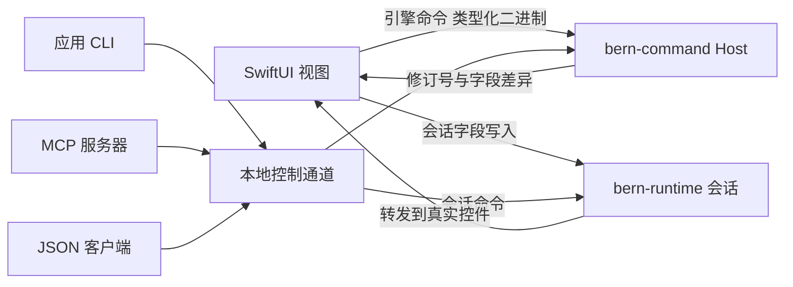
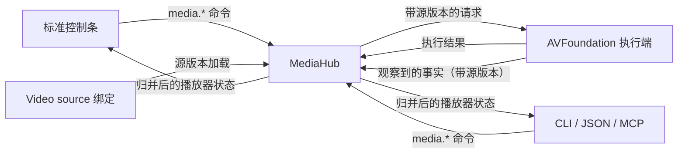
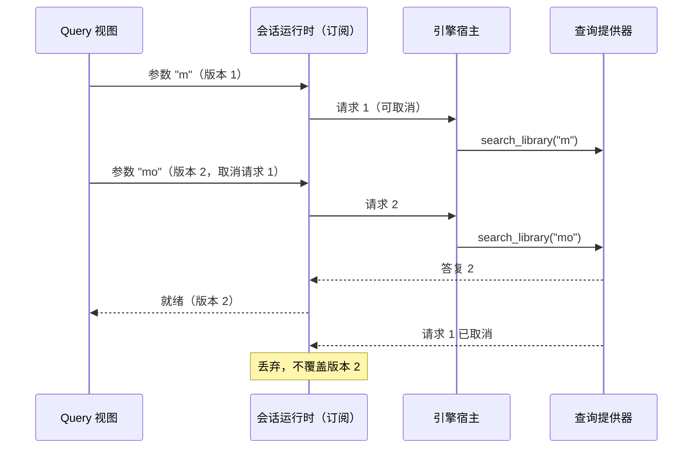

# macOS SwiftUI 实现记录

- 首次记录：2026-10-10
- 更新日期：2026-10-17
- 最初依据：[Bern 架构设计 v0.14](../Design.md)、[Apple 平台适配](../Adaptation/Apple.md)
- 工具链：Rust 1.99.0（Edition 2024）；Swift 6.3.2，以 Swift 6 语言模式编译；Xcode 26.5（SDK 26.5）
- 部署：最低 macOS 14，构建本机架构，本地临时签名
- 补记：2026-10-12，[架构设计 v0.25–v0.27](../Design.md) 的样式覆盖、动效、自绘与模块化应用（见“样式、动效、自绘与模块化”一节；工具链 Xcode 27.0，SDK 27.0，Swift 6.4）

本文记录阶段一（编译边界验证）、阶段二（macOS SwiftUI 与四入口闭环，含 Video、窗口关闭协议、窗口最小化与恢复、声明式异步查询与随包资源）与阶段四（本地化与功能契约）在 macOS 上的实际完成情况。当前声明接口见[组件参考](../Reference/UI.md)，后端覆盖见[平台能力表](../Reference/Platforms.md)；下文保留各阶段的验收记录与未完成项。

## 完成情况

### 阶段一 编译边界验证

| 设计要求 | 状态 | 说明 |
| --- | --- | --- |
| 组件、显式属性、组件引用及错误位置 | 完成 | `#[component]` + `ui!`；宏与编译器的诊断都定位到声明源码 |
| 多模块组件组合，未知引用和非法结构报错 | 完成 | 组件可跨模块引用；未知组件、未知属性、缺少必需属性、错误的子节点结构均报错 |
| 受限表达式与合法引用由 rustc 检查实际类型；未知函数、直接赋值、任意回调编译失败 | 完成 | 声明展开为从不执行的类型检查代码；`crates/bern/tests/ui` 中 13 个编译失败用例 |
| 带版本的描述原型，用独立依赖 crate 验证引用与配置匹配 | 完成 | 组件库有自己的 `Bern.toml`；编译器生成带描述版本、IR 版本、包版本和源码指纹的描述，并检查库是否覆盖应用要求的全部语言；示例 `showcase-widgets` |
| 公共目标接口，独立测试目标消费同一 IR，注册新目标无需改动解析器 | 完成 | `bern-target-api`；编译器测试中从外部注册的目标消费展示应用 IR |
| 业务核心与 UI 分离，命令和状态可在无 UI 环境运行 | 完成 | `showcase-core` 只依赖协议；其测试通过共享 `Host` 无界面运行 |
| 注册命令目录并生成各入口描述；重复标识、未知命令、参数不匹配无法通过 | 完成 | 命令描述含 ID、目录版本、参数和结果 schema、作用域、策略、错误码和显式 CLI/MCP 名称；名称冲突报错 |
| 标准控件自动生成会话命令，业务动作缺失绑定编译失败（B301） | 完成 | 输入框、开关、滑块、选择器等写会话字段；按钮缺少命令报 B301 |
| 窗口目录检查 | 部分 | 已检查重复 ID、主窗口、窗口命令引用、呈现能力和关闭检查（只能读本窗口拥有的草稿，存储动作必须是引擎命令）；首版只支持单实例窗口，多实例参数与 key 未实现 |
| 本地化文本类型与严格诊断 | 完成 | 本地化文本、运行时文本、普通字符串分开；缺少语言（B102）、展示属性直接写字面量（B103）、插值不一致均报错 |
| 目标能力描述中声明颜色来源 | 完成 | `ColorSource::Native` / `BernTheme`；macOS 为 Native |

### 阶段二 macOS SwiftUI 与四入口闭环

| 设计要求 | 状态 | 说明 |
| --- | --- | --- |
| 控件展示示例：侧边栏与详情、标题与文字层级、按钮、开关、滑块、输入框、侧边栏搜索、列表到详情的推入导航、工具栏分段选择器；设置窗口使用页签；至少两种语言 | 完成 | `examples/showcase`，中文与英文 |
| 引擎与会话运行时在应用进程内运行 | 完成 | Rust 静态库链接进应用 |
| 显式装配本地 IPC 通道，提供 CLI、JSON、MCP，连接同一引擎 | 完成 | `channels = ["ipc"]`；生成 `bin/showcase` 与 `bin/showcase-mcp` |
| 未装配外部入口时无辅助进程、无监听；本地调用不经过 JSON | 完成 | 桥接使用类型化二进制值；`ipc = false` 由单元测试覆盖；装配 IPC 时实测无子进程、无 TCP 端口 |
| 未声明样式覆盖时只用标准 SwiftUI 组件与系统样式 | 完成 | 生成测试检查展示应用（没有样式覆盖）生成的视图代码不含 `Color(`、`.background(`、`glassEffect`；运行时模板按功能需要分系统版本，例如视频控制条的媒体进度条在 macOS 26 以下绘制回退（见 [Apple 适配](../Adaptation/Apple.md) 第 8 节） |
| 浅色与深色截图，与系统自带应用对照 | 部分 | 浅色、深色、英文截图已检查；与“系统设置”的并排对照未做（见验证记录） |
| 切换应用语言后文本更新；严格模式负面用例编译失败 | 完成 | 通过系统按应用指定语言验证；应用内实时切换在阶段四实现 |
| 版本不兼容、外部入口断开、结果未知 | 部分 | 协议版本、目录指纹、前端与引擎指纹不匹配均明确失败；会话请求超时返回 `ui_timeout`（结果未知），不重放 |
| 状态变化只更新相关展示，批次内一致 | 完成 | 引擎按修订号发布字段差异；Swift 侧为按字段观察的 `@Observable` |
| 滑块产生带参数命令 | 完成 | 拖动只改会话预览，松开提交 `showcase.set_volume(value)` |
| 四入口驱动同一实例；无 UI 引擎可运行；缺少会话返回明确错误 | 完成 | 无会话返回 `requires_ui_session`，多会话未指定返回 `session_required` |
| 标准编辑、选择动作由会话命令驱动，CLI/MCP 可调用 | 完成 | `ui.edit`、`ui.set_bool`、`ui.set_number`、`ui.select`、`ui.activate`、`ui.back` 等，经真实控件闭包执行 |
| 已接受与完成结果可区分 | 部分 | 引擎命令同步完成；媒体命令在播放器状态的 `request` 中区分已接受（Accepted）、执行端已执行（Executed）与失败（Failed），实际播放只看执行端回报的 `phase` |
| 会话命令写回控件不触发重复动作 | 完成 | 写入通过同一 setter；SwiftUI 对程序写回不调用绑定 setter；开关使用幂等的设置而非翻转 |
| 条件分支挂载与卸载、订阅清理 | 完成 | `if` / `if let` / `match`；控件登记随视图出现与消失 |
| 列表按 key 保持实例 | 完成 | `ForEach(items, id: \.key)`；键必须是 `i64` 或 `String` 字段 |
| 键盘、输入法、语义标签 | 部分 | 使用系统控件与可访问名称；输入法组合与键盘遍历未实测 |
| 不写深浅色分支，控件跟随系统 | 完成 | 未设置任何颜色 |
| “搜索列表 → 详情 → 播放 → 返回” | 完成 | 侧边栏搜索经引擎查询 `showcase.search_library` 筛选列表 → 详情 → 在应用级播放器中打开并播放 → 返回，经真实控件驱动，返回后搜索结果与播放都保留 |
| 可控时钟与异步顺序场景 | 完成 | 查询在协议中声明、在 `ui!` 中以 `Query` 绑定（见“异步查询”与“查询订阅与答复”）；`showcase-core` 的场景测试用 `ManualClock` 驱动真实引擎、宿主与会话订阅，较早的慢搜索不会覆盖较新的结果；C ABI 测试覆盖同一路径 |
| 主窗口与设置窗口：四入口打开/关闭/激活、重复打开复用、独立草稿 | 完成 | 窗口实例带代次，重开后旧引用被拒绝；启动时总是打开 `initial: open` 的主窗口，主窗口关闭后点 Dock 图标重新打开 |
| 关闭确认、模态阻挡、确认失效 | 完成 | 见“窗口关闭协议”；系统关闭按钮与 File > Close 先走关闭检查 |
| 最后一个窗口关闭后保留引擎 | 完成 | `applicationShouldTerminateAfterLastWindowClosed` 返回 false；应用级播放器继续播放 |
| 最小化后恢复 | 完成 | `window.minimize`、`window.restore`、`window.maximize`、`window.move`、`window.resize` 与查询 `window.list`；系统完成的最小化、缩放、移动与聚焦以带来源和代次的事实同步，不派发命令（见“窗口呈现”）；最小化不释放草稿、导航与查询订阅 |
| macOS Video 验证 | 完成 | 见“Video”；用受控测试媒体实测 AVFoundation 播放 |

### 阶段四 本地化与功能契约

| 设计要求 | 状态 | 说明 |
| --- | --- | --- |
| `compact` 与 `expanded` 布局 | 完成 | `[layouts] compact_below`；`Adaptive` 生成 `BernAdaptive`，用 `onGeometryChange` 量自身可用宽度并选择布局 |
| 按钮、菜单等不同入口形式 | 完成 | `Menu` / `MenuItem` 生成系统 `Menu`；菜单项的控件登记挂在菜单按钮上，菜单未打开时外部入口也能执行 |
| 功能契约与覆盖检查 | 完成 | 与目标无关，见 [设计文档](../Design.md)“覆盖检查规则”；`bern check` 输出每个功能在每个尺寸上的结果 |
| 负面用例互相区分 | 完成 | 编译器测试分别覆盖 B101–B104、B201–B206、B401–B402 |
| 运行时切换语言与布局，不丢失应共享的状态 | 完成 | 见“验证记录”；语言经 `LanguagePicker` 与 `ui.set_language` 切换 |

### 阶段六 组件库第一批

| 组件 | SwiftUI | 说明 |
| --- | --- | --- |
| `Image` | 运行时视图 `BernImage` | 用 ImageIO 从 `Contents/Resources` 解码（按名称缓存）：macOS 15 起按 HDR 解码，带增益图的 JPEG 应用增益图，PQ 与 HLG 的 PNG 保留原有范围；EXIF 方向由 `Image(decorative:scale:orientation:)` 应用。`resizable()` 后按 `fit` 用 `.fit`、`.fill` 或直接拉伸，`frame` 后 `clipped()`，并允许高动态范围（`.allowedDynamicRange(.high)`）；只写一边时另一边按图片比例。有 `label` 时是带名称的图片元素，没有时对辅助技术隐藏 |
| `Progress` | `ProgressView` | 有 `value` 时为 `ProgressView(value:total:)`，数值先限制在 0 到 `total`；没有时为不确定的 `ProgressView()`（转圈）；`label` 是它的标签 |
| `Grid` | `LazyVGrid` | 一列 `GridItem(.adaptive(minimum: min_width), spacing: gap)`，行距同为 `gap` |
| `Stack` | `ZStack(alignment:)` | 九个方位对应 `.topLeading` 到 `.bottomTrailing` |

在展示应用的“图片与布局”页验证：同一张 16:9 图片在 120×90 的框中按 `contain`、`cover`、`fill` 分别留白、裁掉两边、拉伸，只写宽度的标志保持比例；层叠中标志在右上角；音量（引擎状态，`total: 100`）与亮度（会话草稿）两个进度条在 CLI 执行 `showcase set-volume --value 90` 与 `ui set-number --target layout_page.layout_brightness --value 0.2` 后立即变为 90% 与 20%；920 宽的窗口中网格为三列。HDR 图片在 M4 的内建屏幕（EDR 余量最高 2 倍）上验证：测试图左半为 SDR 白、右半为它的 4 倍，用 ScreenCaptureKit 以 HDR 截取窗口读像素值。改为 HDR 解码并允许高动态范围之前，带增益图的 JPEG 只显示 SDR 基础图（右半 0.96），PQ 的 PNG 被压进 SDR（0.94）；之后系统把余量提到 2.0，两者右半分别为 1.79 与 1.87，普通 SDR 图仍为 1.0。带 EXIF 方向 6 的照片按竖图显示。HDR 视频不用额外处理：`AVPlayerView` 自动按 EDR 显示，用 ffmpeg 把 PQ 测试图编成 10 位 HEVC（BT.2020、PQ、HDR10 元数据）作为展示应用的精选片段播放，画面最亮处为 SDR 白的 1.48 倍。

另外，Bern 的引擎几乎不增加启动时间：用 `benchmarks/measure.swift` 在 M4 上测，Hello 10 次启动的中位数为 0.20 s，只有一个窗口和一行文字的空白 SwiftUI 应用 5 次的中位数为 0.22 s。

## 工程结构

| crate | 职责 |
| --- | --- |
| `bern` | 应用接口：宏、绑定类型、`Host`、`CommandError` |
| `bern-macros` | `#[bern::protocol]`、`#[bern::value]`、`#[bern::session]`、`#[component]` |
| `bern-syntax` | 宏与编译器共用的唯一解析器，以及协议描述的降级 |
| `bern-protocol` | 值、schema、命令与状态描述、框架会话命令目录、二进制编码 |
| `bern-media` | 媒体契约：`MediaSource`、播放器身份、标准媒体命令与状态、执行端协议、`MediaHub`（路由与状态归并） |
| `bern-ir` | 平台无关 IR、组件规格表、组件库描述 |
| `bern-command` | 引擎宿主：边界校验、串行执行命令、异步作答且可取消的只读查询、按修订号发布状态；宿主装配的随包资源 `Resources` |
| `bern-runtime` | UI 会话：窗口实例与代次、窗口作用域草稿、关闭协议、会话命令路由；异步查询资源、窗口所属的查询订阅与时钟（系统时钟、可控时钟） |
| `bern-compiler` | 读取 `Bern.toml`、校验并展开随包资源、显式源码收集、语义检查、输出 IR |
| `bern-target-api` | 目标描述、能力检查、构建计划、按平台解析默认目标 |
| `bern-backend-swiftui` | `swiftui + macos` 目标：生成 Swift、Rust 胶水 crate 与资源。Swift 运行时分为与 iOS 共用的 `BernRuntime.swift`、`BernMedia.swift` 和 macOS 专用的 `BernAppKit.swift`（窗口事实与命令、关闭守卫、开发快照、`AVPlayerView`）；iOS 见 [iOS SwiftUI 实现记录](iOS-SwiftUI.md) |
| `bern-ffi` | 进程内 C ABI |
| `bern-adapter-json` / `bern-transport-ipc` | JSON 编码与本地控制通道 |
| `bern-adapter-cli` / `bern-adapter-mcp` | 从命令目录派生的应用 CLI 与 MCP 服务器 |
| `bern-cli` | 构建工具 `bern` |

## 声明语法

### 协议

```rust
#[bern::protocol(namespace = "showcase", version = 1)]
pub mod showcase {
    use bern::prelude::*;

    #[value]
    pub enum Action {
        #[label(tr! { "zh-Hans" => "主要按钮", "en" => "Primary button" })]
        Primary,
    }

    #[state]
    pub struct State {
        pub last_action: Option<Action>,
        pub volume: f64,
    }

    #[commands]
    pub trait Commands {
        /// 提交音量
        #[idempotent]
        #[errors("out_of_range")]
        fn set_volume(&mut self, value: f64) -> Result<(), CommandError>;
    }

    #[queries]
    pub trait Queries {
        /// 按类别名称搜索资料库
        #[reads(items)]
        #[errors("invalid_search")]
        fn search_library(&self, text: String, answer: Answer<Vec<Item>>);
    }
}
```

协议模块自包含：只含 `use`、`#[value]` 类型、一个 `#[state]`、一个 `#[commands]` 和可选的 `#[queries]`。宏生成描述、引擎适配器 `Adapter<E>`、需要实现的 `Engine` trait（同时要求命令与查询 trait），以及 UI 声明用的类型化客户端 `Client`。命令 ID 为 `命名空间.名称`；CLI 名称为 `showcase set-volume`，MCP 工具名为 `showcase_set_volume`，冲突时报错。跨边界类型限于 `bool`、`i64`、`f64`、`String`、`Option`、`Vec`、枚举与记录；`i32`、引用、泛型等会给出替代建议。

### 会话状态与组件

```rust
#[bern::session]
pub struct MainDraft {
    #[initial(50.0)]
    pub volume: f64,
    pub path: Vec<Route>,
}

#[component]
pub fn controls_page(app: showcase::Client, #[session] draft: MainDraft) -> impl View {
    ui! {
        Form {
            Slider(id: volume, label: tr! { "zh-Hans" => "音量", "en" => "Volume" },
                   value: draft.volume, min: 0, max: 100) => app.set_volume(draft.volume)
        }
    }
}
```

- `#[session]` 参数由宿主窗口持有，同一窗口内同类型共享一个实例，每个窗口实例各有一份。
- 组件主体只有一个 `ui!`，且只有一个根节点。
- 元素：`名称(属性: 值, …) |模板变量| { 子节点 } => 客户端.命令(位置参数)`。
- 控制结构：`if 条件 { } else { }`、`if let Some(x) = 绑定 { }`、`match 绑定 { 类型::变体 { 字段 } => { } }`。
- 表达式：字面量、`tr!`、绑定路径（如 `app.volume`、`item.kind`）、`类型::变体 { 字段: 值 }`、`! - == != < <= > >= && ||`。不允许函数调用、索引、赋值和闭包。
- `tr! { "zh-Hans" => "按钮共按下 {count} 次", "en" => "…"; count: app.activations }`：插值参数写在分号之后。
- 组件引用使用命名参数：`item_detail(app: app, id: id)`，库组件写成 `showcase_widgets::item_count(count: item.count)`。
- 根组件主体为 `WindowSet(handle: AppWindows, primary: main) { Window(…) { … } }`，并生成类型化窗口句柄 `windows.settings.open()`。
- 应用级播放器用 `#[bern::players]` 声明，字段名就是稳定的 `player_id`；组件以 `players: Players` 参数接收，动作写成 `=> players.preview.open(clip)`、`play()`、`pause()`、`seek(ms)`、`set_volume(v)`、`set_muted(b)`。
- `MediaSource { url }` 是框架值类型（`bern::prelude::MediaSource`），可以出现在协议状态、命令参数与 UI 值里；协议和 UI 不能自行声明同名类型。

### 异步查询

查询只读：方法取 `&self`，最后一个参数是 `answer: Answer<T>`，没有返回值。提供器可以立即作答，也可以把 `answer` 交给计时器或其他线程稍后作答（`answer.ok(v)`、`answer.fail(e)`、`answer.send(r)`）；`answer.is_cancelled()` 让提供器在请求作废时提前停止。`#[reads(字段)]` 声明答复依赖的状态字段，`#[errors(...)]` 与命令相同。`&mut self`、带返回值、缺少 `Answer<T>`、读未声明的字段都会报错。

```rust
Query(
    id: library_results,
    query: app.search_library(draft.query),
    loading: tr! { "zh-Hans" => "正在搜索…", "en" => "Searching…" },
    empty: tr! { "zh-Hans" => "没有与“{query}”匹配的项目", "en" => "No Items Match “{query}”"; query: draft.query },
    failed: tr! { "zh-Hans" => "无法搜索", "en" => "Search Failed" },
    icon: "magnifyingglass"
) |items| {
    ForEach(items: items, key: id) |item| { … }
}
```

- `query:` 是 `ui!` 里唯一能写调用的位置，而且只能调用引擎客户端上的查询；参数是受限表达式，由 `rustc` 与编译器检查类型。客户端的查询方法返回 `QueryRef`，命令方法返回 `CommandRef`：把查询写成 `=>` 动作、把命令写进 `query:` 都编译失败。
- 模板变量是查询结果；结果是 `Option<T>` 时是其中的 `T`。
- 状态：首次加载显示 `loading` 文案与系统进度指示；就绪由模板显示数据；刷新时保留上一份数据，并在其上方显示进度行；失败而没有数据时显示 `ContentUnavailableView` 与“重试”，有上一份数据时在数据上方显示错误行与“重试”。`loading`、`failed` 省略时使用框架文案。
- 空结果是成功：列表为空或可选结果为 `None` 时，若声明了 `empty` 则显示以 `icon`（默认 `tray`）为图标的 `ContentUnavailableView`，否则模板照常显示空数据。`empty` 只能用于列表或可选结果，`icon` 必须与 `empty` 同时出现。
- 查询登记为控件 `组件.id`，角色 `query`：`ui.inspect` 的值形如 `ready v3 (2)`（阶段、参数版本、条数），`ui.activate` 以当前参数重新请求。

### Video

```rust
#[bern::players]
pub struct Players {
    /// 跨页面、跨窗口持续播放
    pub preview: Player,
}

Video(id: featured, source: app.featured_source)                 // 由声明创建播放器
Video(id: preview, player: players.preview, controls: standard)  // 附着到应用级播放器
```

- `source:` 与 `player:` 必须且只能写一个，类型分别为 `MediaSource`/`Option<MediaSource>` 的绑定和应用级播放器；`controls` 为 `standard`（默认）或 `none`，`fit` 为 `contain`（默认）、`cover`、`fill`，`label` 是可访问名称。
- source 方式：播放器属于声明所在的组件实例，`player_id` 为 `窗口实例/组件.控件id`（如 `main#1/media_page.featured`）。源由绑定决定：同一个值不会重复加载；新值以新的源版本加载；外部 `media.open` 返回 `source_bound`，换源要调用源所有者的命令（示例中为 `showcase feature`）。组件实例结束或窗口关闭时释放播放器。
- player 方式：只附着呈现；源由该播放器的命令更新。视图卸载只解除附着，应用级播放器在离开页面或关闭窗口后继续播放。
- 标准控制条的进度与音量使用 `BernScrubber`：macOS 26 及以上是系统 `Slider` 加 `.tint(.primary)`，已播放部分为中性色；更早的系统绘制同样形状的回退（6 pt 轨道、20 × 16 pt 白色圆角滑块、柔和阴影，非活动窗口中已播放部分变浅），向辅助功能报告为系统 `Slider`，方向键逐步调整。拖动只更新预览，松开时提交一次，与 `Slider` 的编辑结束相同。见 [Apple 适配](../Adaptation/Apple.md) 第 8 节。

### 窗口关闭检查

```rust
#[component]
pub fn app(app: showcase::Client, windows: AppWindows, players: Players,
           #[session] draft: MainDraft, #[session] profile: SettingsDraft) -> impl View {
    ui! {
        WindowSet(handle: AppWindows, primary: main) {
            Window(id: main, …, confirm_close: draft.notes != "",
                   close_message: tr! { "zh-Hans" => "要放弃备注吗？", "en" => "Discard your notes?" }) { … }
            Window(id: settings, …, confirm_close: profile.display_name != "" && profile.display_name != app.display_name,
                   close_message: tr! { … }) { … } => app.set_display_name(profile.display_name)
        }
    }
}
```

- `confirm_close` 是受限布尔表达式，`close_message` 是 `tr!` 文本，两者同时出现；`Window` 上的动作是存储命令（只能是引擎命令），有它时决策为“存储 / 不存储 / 取消”，否则为“放弃更改 / 取消”。
- 根组件的 `#[session]` 参数按窗口实例求值，只能用在拥有该会话类型的窗口的关闭检查里，编译器检查归属。

### 随包资源

```toml
# Bern.toml：每项是相对本文件的文件或目录，也是引擎使用的资源名称
[resources]
paths = ["media/aurora.mp4", "media/tides.mp4", "media/broken.mp4"]
```

```rust
use bern::resources::Resources;

let resources = Resources::host();                                  // 应用宿主装配
let clip = MediaSource::resource(&resources, "media/aurora.mp4")?;  // 包内文件 URL
let seed = resources.path("data/seed.json")?;                       // 包内文件路径
```

- 名称是相对 `Bern.toml` 的 `/` 分隔路径，每段只能用 ASCII 字母、数字、`-`、`_`、`.`，不以 `.` 开头；目录展开为其下全部文件（跳过隐藏项）。条目不存在、符号链接、空目录、名称不合法、重复列出、只有大小写不同都是构建错误，位置指向 `Bern.toml` 中的条目（如 `examples/showcase/Bern.toml:43:10`）。规则由 `bern_protocol::check_resource_name` 定义，构建与运行时共用。
- macOS 目标另外拒绝含 `.` 的目录段与以 `.lproj` 结尾的段（签名工具把含点目录当作包，`.lproj` 存放生成的本地化），报错同样指向声明位置。
- 引擎按名称解析：`Resources::host()` 是宿主为本进程装配的资源；`Resources::catalog(目录, 名称)` 与宿主相同但显式给出；`Resources::directory(目录)` 不带名称目录，只供测试与工具。错误码为 `invalid_resource_name`、`resources_unavailable`（没有宿主装配，例如单元测试直接调用 `Default`）、`undeclared_resource`（即使包里有同名文件）、`resource_missing`。没有回退路径。
- 示例引擎 `ShowcaseEngine::new(时钟, 资源)` 与注入时钟的方式相同；`Default` 使用 `SystemClock` 与 `Resources::host()`。片段解析失败时引擎无法构造，应用显示“the engine panicked while starting: resources_unavailable: …”这样带原因的启动错误。测试用 `bern_compiler::config::load` 读取示例的 `Bern.toml`，以与应用包相同的名称目录在源码目录中解析，因此引擎使用未声明的名称会在测试中失败。

### 组件规格

规格表位于 `crates/bern-ir/src/spec.rs`，宏、编译器和目标共同读取。首批组件：`WindowSet`、`Window`、`SplitView`、`Sidebar`、`SidebarItem`、`Detail`、`Navigation`、`Destination`、`NavLink`、`Tabs`、`Tab`、`Toolbar`、`Form`、`Section`、`Column`、`Row`、`ScrollView`、`List`、`ForEach`、`Spacer`、`Divider`、`Text`、`Label`、`Button`、`IconButton`、`TextInput`、`Search`、`Switch`、`Slider`、`Video`、`Query`、`Picker`；阶段四加入 `Adaptive`、`Layout`、`Menu`、`MenuItem` 与 `LanguagePicker`；阶段六加入 `Image`、`Progress`、`Grid` 与 `Stack`。IR 因加入查询绑定升为版本 2，加入随包资源清单后为版本 3，浮动窗口呈现为版本 4，布局断点与功能契约为版本 5，资源属性（`Image` 的 `source`）为版本 6。可操作控件必须有 `id`；同一 `Adaptive` 的不同布局中 `id` 相同的控件是同一控件。

默认行为：`Column` 前缘对齐；`Row` 垂直居中；`Grid` 的 `gap` 为 8；`Stack` 居中；未写 `style` 时使用平台默认样式。`Image` 的 `source` 必须是声明过的 PNG 或 JPEG 资源，编译器在整个应用（包括组件库中的组件）范围内检查，`width`、`height` 至少写一个且大于零；`Progress` 的 `value` 是整数或浮点数的受限表达式，`total` 必须大于零且只能与 `value` 一起写。`Search` 可以放在 Sidebar 或 Toolbar；`style: palette` 仅在 macOS 的 Toolbar 中开放；`Picker` 的枚举不能携带数据。

## 运行结构



- **进程内桥接**：固定 C ABI（`bern.h`）只有少量函数。参数、状态与回执按 `bern_protocol::codec` 的二进制布局传递，两端由生成代码按 schema 编解码；接收端仍做 schema 校验。前端与引擎的目录指纹不一致时拒绝启动。
- **引擎**：命令在专用线程上串行执行；参数在边界校验；panic 使引擎拒绝后续命令；状态按字段比较，只在变化时递增修订号。
- **窗口与会话**：窗口出现时向运行时登记，获得代次与外部 ID（如 `settings#2`）。草稿属于窗口实例，关闭即释放；带旧代次的写入返回 `stale_window`。
- **窗口呈现**：真实窗口属于目标。宿主观察每个 `NSWindow` 的最小化、全屏、缩放、移动、尺寸（实时缩放结束时一次）、聚焦、遮挡与可见性，以及应用隐藏，把结果作为事实报告给会话运行时：可见性（可见、最小化、隐藏）、尺寸状态（普通、最大化、全屏）、以主显示器左上角为原点的外框、是否聚焦、当前可用动作，并标明来源（命令或用户与系统）。事实带窗口代次，旧实例的迟到事实返回 `stale_window` 被丢弃；值不变时版本号不变。事实从不派发命令，外部入口也无法注入事实。
  - `window.list` 由运行时按记录的事实回答，不经过界面线程；窗口刚挂载、事实未到时生命周期为 `Opening`，关闭确认待决时为 `Closing`（目前 Bern 唯一的模态关系）。
  - 呈现命令先按事实检查动作是否可用（否则 `target_unavailable`，并列出可用动作），再由宿主执行，等 AppKit 报告完成（最小化与恢复等待动画结束的通知，超时 5 秒返回 `ui_timeout`），最后返回运行时记录的窗口信息，因此结果是实际状态而不是请求。
  - 最大化即 AppKit 的缩放；只有可调整大小的窗口能最大化（固定尺寸窗口的 `isZoomed` 不算）。恢复一次撤销一步：最小化、全屏、最大化依次。AppKit 没有可回到的尺寸时（窗口以缩放尺寸启动），恢复到最大化前的外框，或居中的声明尺寸。
  - `window.move` 要求标题栏仍在某个显示器的可见区域内，`window.resize` 保持左上角并遵守窗口的最小与最大尺寸（含 SwiftUI 按根视图设置的内容尺寸），越界返回 `out_of_range` 并给出限制。
- **启动与重新打开**：`initial: open` 表示会话初始化时打开一次，因此不恢复上次运行时窗口的开关状态（`ApplePersistenceIgnoreState`），否则上次退出前关掉的主窗口启动后不出现；窗口尺寸与位置仍由系统记住。主窗口不存在时，点 Dock 图标（重新打开事件）打开主窗口，与“系统设置”“音乐”一致。
- **控件登记与会话命令**：每个可操作控件挂载时登记目标 ID（`组件.控件id`，列表行附加 `[键]`）、角色、名称、启用状态，以及与用户输入相同的动作闭包。名称取控件自己的文案；侧边栏与标签页取当前选中项的文案，导航链接取行内第一段文字（经过容器与 `match` 分支），导航容器与查询没有名称。外部的 `ui.activate` 等命令在主线程上经这些闭包执行；禁用控件返回 `target_unavailable`，被本窗口关闭确认阻挡的控件返回 `target_blocked`，同一目标挂载在多处返回 `target_ambiguous`；密码框的值不暴露。`ui.inspect` 的 `reason` 给出不可操作原因（`disabled`、`blocked_by_modal`）。

- **随包资源**：构建计划在签名之前以 `Mirror` 步骤把声明的文件复制到 `Showcase.app/Contents/Resources/<名称>`：只复制内容、不带扩展属性，大小与修改时间相同的文件不重复复制，删除不再声明的旧文件，保留生成的 `<语言>.lproj`。生成的胶水把声明名称写入 `AppSpec.resources`；Swift 宿主启动时把 `Bundle.main.resourceURL` 的路径传给 `bern_app_start`，`bern-ffi` 在构造引擎之前以“包内目录 + 声明名称”装配 `Resources::host()`。同一进程再次以不同目录装配会失败。`build.json` 记录资源名称。

### Video 与媒体



- **媒体契约**（`bern-media`，契约版本 1）：命令 `media.players`、`media.state`（查询），`media.open`、`media.play`、`media.pause`、`media.seek`、`media.set_volume`、`media.set_muted`；CLI 为 `showcase media play --player-id …`，MCP 工具为 `media_play` 等。播放器状态 `MediaPlayer` 含 `owner`、`source_bound`、`source`、`source_version`、`phase`（Idle、Loading、Ready、Playing、Paused、Buffering、Ended、Failed、Unavailable）、`position_ms`、`duration_ms`（未知或直播时为空）、`seekable`、`volume`、`muted`、`error`、`views` 与最近一次请求 `request`。
- **路由与归并**：命令先在 `MediaHub` 校验（`player_not_found`、`no_source`、`media_failed`、`not_seekable`、`out_of_range`、`source_bound`、`executor_unavailable`），再带当前源版本交给执行端；执行端按版本拒绝过期请求（`stale_source`）。执行端回报的是事实，只有与当前源版本一致时才归并；合并事实不会产生任何命令。命令在执行端完成后才返回结果；外部入口等待 10 秒仍无结果时返回 `media_timeout`（结果未知）。
- **执行端与呈现**：应用启动时 AVFoundation 执行端登记到 hub；每个 `player_id` 一个 `AVPlayer`，周期观察 0.5 秒。视频由 `AVPlayerView` 呈现，`controlsStyle = .none`、不接收键鼠、不接入 Now Playing，因此播放状态只会因 Bern 命令改变。新源加载后保持暂停，等待播放命令。
- **标准控制条**：系统控件（无边框按钮、`Slider`、系统文字样式），位于视频下方而非覆盖在画面上，颜色全部来自系统；拖动进度和音量只改本地预览，松开时提交一次命令，状态更新不会回调成命令。控件登记为 `目标.play_pause`、`目标.position`、`目标.mute`、`目标.volume`，可由 `ui.*` 驱动；视频区域登记为角色 `video`，值为当前阶段与时间。无媒体、加载、失败、不可用时显示系统 `ContentUnavailableView` 或 `ProgressView`，不在视频上叠加文字。
- **生命周期**：视图附着按窗口记录；窗口关闭时立即解除该窗口的附着、释放其组件拥有的播放器，应用级播放器继续。执行端断开时所有播放器变为 `Unavailable`，等待中的请求失败，不再显示已确认的“正在播放”。

### 查询订阅与答复



- **目录**：查询排在命令之后，`kind: query`、`concurrency: overlapping`（按到达顺序启动、答复可以乱序）、`retry: idempotent`、`cancellable: true`，`reads` 列出依赖的状态字段。CLI 名称、MCP 工具与 JSON 调用和命令一样从同一目录派生（`showcase showcase search-library --text mo`、`showcase_search_library`）；CLI 帮助把查询单独列出，MCP 工具标为 `readOnlyHint`。
- **宿主**：提供器在引擎线程上按到达顺序启动，看到之前命令留下的状态，然后通过 `Answer<T>` 在任意时刻、任意线程作答；答复按结果 schema 校验（`invalid_result`）。请求取消后才作答的返回 `cancelled`，提供器丢弃未答复的请求返回 `query_dropped`，排队时已被取消的请求不会启动提供器；提供器 panic 与命令一样使引擎拒绝后续请求。查询不发布新的修订号。
- **会话订阅**：生成的 `Query` 视图为自己的窗口实例打开订阅（`bern_query_open`），每次渲染编码参数，参数变化后在本次更新之外调用 `bern_query_request`。运行时（`QuerySubscriptions`，基于 `bern_runtime::query::Query`）为每次请求分配新版本并取消上一请求，只把当前版本的答复经 `on_query` 回调交给视图；Swift 侧同样忽略比已显示状态更旧的版本。视图身份结束（例如切换到其他页面）时订阅结束，窗口关闭时运行时结束该窗口的全部订阅，在途请求随之取消；导航栈覆盖页面时订阅保留。
- **随状态刷新**：引擎修订中有字段属于某个查询的 `#[reads]` 时，该查询的每个订阅以相同参数重新请求，界面保留数据并显示“刷新”；例如添加或删除项目后搜索结果自动更新。
- **外部入口**：CLI、JSON 与 MCP 的每次调用是一次请求，最多等待 10 秒，超时返回 `query_timeout` 并取消请求；查询没有副作用，可以直接再次调用。
- **示例提供器**：`showcase-core` 的搜索按类别的全部译名（中文与英文）匹配，`!` 开头返回 `invalid_search`。宽泛的搜索比精确的搜索慢（0 个字符 250 ms，1 个 900 ms，2 个 450 ms，更多 150 ms），因此快速输入时答复会乱序到达；计时来自注入的时钟，应用中是 `SystemClock`，测试中是 `ManualClock`。

### 窗口关闭协议

- 请求关闭（UI 动作、系统关闭按钮与 File > Close、`window.close`）都先求值窗口声明的关闭检查，再由会话运行时决定：`Closed` 立即关闭；`ConfirmationRequired` 返回确认 ID、绑定的草稿修订号和可选决策，同时以系统警告框（窗口级 sheet）显示。重复请求返回同一个确认，不重复弹框。
- `window.confirm_close` 提交与对话框相同的类型化决策：`Save` 运行声明的存储命令，失败则 `Rejected`（`save_failed: …`）且窗口保留；`Discard` 关闭并释放草稿；`Cancel` 返回 `Rejected`（`cancelled`）。
- 确认绑定窗口代次与草稿修订号：确认之后草稿又改变、确认已被处理、或窗口已关闭重开时，决策返回 `stale_confirmation` 或 `stale_window`，不会丢弃后来的修改。
- 确认待决时，该窗口的控件对所有入口都被阻挡（`target_blocked`），其他窗口不受影响。
- 系统关闭的拦截：窗口有关闭检查时，Bern 以转发代理替换窗口委托，只实现 `windowShouldClose(_:)`，其余委托消息转给 SwiftUI 原有的委托。

## 外部入口

`Bern.toml` 中 `[targets.macos] channels = ["ipc"]` 才会装配控制通道。通道位置是 `$TMPDIR/bern-<应用标识哈希>/<engine_id>.sock`，目录权限 0700，套接字 0600，只服务同一用户。握手核对协议版本，并可核对目录指纹。消息为逐行 JSON；64 位整数超出 ±(2^53−1) 时编码为十进制字符串，修订号也是字符串。

```sh
target/bern/macos/bin/showcase --help
target/bern/macos/bin/showcase state
target/bern/macos/bin/showcase showcase record --action Primary
target/bern/macos/bin/showcase showcase search-library --text mo
target/bern/macos/bin/showcase ui inspect
target/bern/macos/bin/showcase ui select --target main_window.pages --option Library
target/bern/macos/bin/showcase ui activate --target "library_page.item_link[2]"
target/bern/macos/bin/showcase window open --kind settings
target/bern/macos/bin/showcase window list
target/bern/macos/bin/showcase window minimize --window main#1
target/bern/macos/bin/showcase window restore --window main#1
target/bern/macos/bin/showcase window resize --window main#1 --width 1000 --height 700
```

```sh
target/bern/macos/bin/showcase media players
target/bern/macos/bin/showcase media open --player-id preview --source file:///…/aurora.mp4
target/bern/macos/bin/showcase media play --player-id preview
target/bern/macos/bin/showcase media seek --player-id "main#1/media_page.featured" --position-ms 4000
target/bern/macos/bin/showcase window close --window settings#1
target/bern/macos/bin/showcase window confirm-close --window settings#1 --confirmation settings#1:c1 --decision Save
```

退出码：0 成功，1 命令失败，2 用法错误，3 无法连接。CLI 只连接已运行的引擎，不会另起一份。`showcase-mcp` 通过 stdio 实现 MCP（JSON-RPC 2.0，协议版本 2025-06-18 / 2025-03-26 / 2024-11-05），工具来自引擎命令目录（含只读查询）、媒体命令目录与框架会话命令目录，另有 `bern_state` 与 `bern_sessions`。JSON 客户端订阅后除引擎状态更新外，还会收到完整的 `media` 播放器状态（新修订号覆盖旧的）。`MediaSource` 参数在 CLI 中可以直接写 URL。

## 本地化、主题与视觉规则

- 运行时语言：`BernLanguage`（`@Observable`）持有当前语言与对应的 `.lproj` 资源包，`BernText.string` 都经它查找，因此切换语言后读取文本的视图在同一次更新中重新计算。支持的语言取自应用包的本地化列表，启动时取系统为本应用选择的首选语言。`ui.language` 返回当前语言，`ui.set_language` 切换，不支持的标签返回 `unsupported_language`。每个窗口根视图的 `locale` 环境值取当前语言，因此 SF Symbols 的本地化变体（例如 `textformat` 在英文中为“Aa”、在中文中为“格式”）与数字、日期格式随应用语言而不是系统语言。系统托管的文案（菜单栏中由系统提供的项目等）仍随系统语言。
- `LanguagePicker` 生成系统 `Picker`，选项用 `Locale` 给出的语言自称。

- 资源键可追溯到源码：元素文案为 `组件.节点路径.属性`，枚举标签为 `枚举.变体`，应用名为 `app.name`。生成各语言的 `Localizable.strings` 与 `InfoPlist.strings`。不带参数的文本原样写入（`{{`、`}}` 还原为括号）；带参数的文本保留 Bern 的[消息格式](../Reference/UI.md#文本内容与格式化)，由 `BernText.format(键, [名: BernArg])` 在运行时随当前语言写出复数分支、日期与时长，月名与星期名作为框架文本写入。显示变体字段的枚举标签在 `bernLabel` 中按变体取字段；`CalendarDate` 生成 `bernArg`。2026-10-18 以临时工程经 `BERN_SNAPSHOT_DIR` 快照实测中英文结果。Info.plist 声明 `CFBundleDevelopmentRegion` 与 `CFBundleLocalizations`。
- 框架自身文案（失败提示、视频控制条、关闭确认按钮等）内置 zh-Hans、zh-Hant、en、ja；应用要求其他语言时构建失败。
- 颜色全部来自系统：生成代码不设置颜色、背景或材质。未声明品牌色时使用用户的系统强调色。
- 设置窗口按内容定高、切换页签时自动调整；侧边栏详情列以选中项名称为标题，`Form(title:)` 可为推入页面命名。

## 构建与运行

```sh
cargo run -p bern-cli -- build --manifest examples/showcase/Bern.toml
open target/bern/macos/Showcase.app
```

产物位于 `target/bern/macos/`：`Showcase.app`、调试符号 `Showcase.app.dSYM`、`bin/showcase`、`bin/showcase-mcp`、生成源码 `Sources/`、胶水 crate `glue/`、构建清单 `build.json`（启用视频时记录媒体契约、媒体后端 `avfoundation` 与呈现适配 `avplayerview` 的版本及应用级播放器，并记录随包资源名称）。组件库描述写到 `target/bern/libraries/`。`bern check` 只做检查，`bern ir` 输出 IR JSON。`bern` 使用最近一层 Cargo workspace，因此嵌套在另一个 workspace 里的检出（例如 Git worktree）只用自己的 crate 与 `target/`。

应用图标为 `Contents/Resources/AppIcon.icns`（`CFBundleIconFile`）。没有声明 `[app].icon` 时是 Bern 标志铺满方形画布的版本，16 到 1024 像素各一张 PNG，由系统裁成圆角方形；圆形图标会被 macOS 放进灰色底板，所以 macOS 不用圆形版。资源同步保留这个文件，随包资源不能与它同名。`[app.icon].macos` 为 `.icns` 时原样使用。macOS 26 起，自带底板的旧式图标只有在底板正是苹果模板的形状时才按原样显示：1024 画布中 (100, 100) 起的 824 方块、圆角 185.4 的连续圆角矩形（与 `RoundedRectangle(style: .continuous)` 同一条路径）。底板是别的形状（例如指数 5 的超椭圆，轮廓相差约 4000 像素）或根本没有底板时，系统把整个图标缩小放进灰色底板；铺满方形的画面被裁成系统形状。以上为 macOS 27.0.1 实测：以 `NSWorkspace.icon(forFile:)` 渲染访达图标，比较本机多个只带 `.icns` 的应用，并交换图标排除构建所用 SDK 的影响。

调试符号不随应用包发布：debug 与 release 都以 `-g` 编译，swiftc 写在 `Contents/MacOS/` 中的 dSYM 在签名前移到包旁边的 `Showcase.app.dSYM`（lldb 与崩溃报告符号化在这里查找），上次构建留下的 dSYM 先删除。release 还以 `-dead_strip` 链接，并在签名前用 `strip -S -x` 去掉可执行文件中由 dSYM 保留的调试与本地符号：展示应用的包为 2.6 MB，可执行文件 2.2 MB（此前 5.7 MB），dSYM 约 9 MB。

示例的受控测试媒体在 `examples/showcase/media/`，由 `make-media.sh` 用 ffmpeg 生成：`aurora.mp4`（8 秒）、`tides.mp4`（6 秒）、`broken.mp4`（不是影片，用于失败）声明为随包资源，随应用包发布；`live/live.m3u8`（没有结束标记的 HLS，时长未知、不可跳转）不随包发布，只作开发辅助：AVFoundation 只通过 HTTP 播放 HLS，例如 `python3 -m http.server --directory examples/showcase/media`。

开发时设置 `BERN_SNAPSHOT_DIR` 可让应用在启动后和每条会话命令之后，把自己的窗口渲染成 PNG（本地文件的视频画面会画进截图）；`BERN_APPEARANCE=light|dark` 用于覆盖外观；`BERN_DEV_WINDOW_SIGNALS=<窗口种类>` 时，向进程发送 SIGUSR1 会对该窗口调用 `performClose(_:)`，SIGUSR2 调用 `performMiniaturize(_:)`，与点按标题栏的关闭、最小化按钮相同，供没有屏幕访问的工具验证系统关闭路径和来自用户的窗口事实。这三项只用于开发检查，默认关闭。

### 打包

`bern package --target macos` 按 release 构建，生成 `target/bern/dist/<产品>-<版本>-macos-<架构>.dmg`：

- 应用复制到暂存目录，应用 CLI 与 MCP 服务器放进 `Contents/Helpers`，先签工具、再签应用；磁盘映像里另有指向“应用程序”的链接。
- 有 `BERN_MACOS_SIGNING_IDENTITY` 时以强化运行时与安全时间戳签名，并签磁盘映像；再有 `BERN_MACOS_NOTARY_PROFILE` 时经 `notarytool` 公证并装订。没有时做临时签名，只能在本机打开，并提示 Gatekeeper 会拒绝。
- 磁盘映像在有 `diskutil image` 的系统上用它生成（macOS 27 上 `hdiutil create` 已提示弃用），否则用 `hdiutil`。
- 实测（2026-10-12，新项目）：磁盘映像 1.8 MB；挂载后签名校验通过，从映像中直接启动应用，`Contents/Helpers/my-app state` 能读到引擎状态。公证需要 Developer ID，这台机器只有开发证书，未实测。

## 验证记录

2026-10-11，调试符号与可执行文件体积，本机 macOS 27.0.1（arm64）：

- 此前 release 构建本身不生成 dSYM，但 debug 构建由 swiftc 写入包内的 `Contents/MacOS/Showcase.dSYM`（约 41 MB）会一直留到之后的 release 包里，且与 release 可执行文件的 UUID 不一致。现在 debug 构建后包内只有可执行文件，`Showcase.app.dSYM` 在包旁边，UUID 与可执行文件一致；随后的 release 构建同样如此（dSYM 9.0 MB），`codesign --verify --deep --strict` 通过，`atos` 以 dSYM 解析出 `bern_app_start` 等符号。
- release 可执行文件：只加 `-dead_strip` 为 3.8 MB，再剥离符号为 2.35 MB（此前 5.95 MB）；整个应用包 2.6 MB。`-g` 让 release 的 Swift 编译多约 0.4 秒。
- 功能：直接启动 release 包（`-ApplePersistenceIgnoreState YES`，CLI 用 `--engine`），页面切换、开关、滑块、选择器、按钮与禁用按钮的 `target_unavailable`、精选片段播放、设置窗口的关闭确认与 `Save` 均正常。
- 性能（口径同 README，预热 1 次后 3 次取中位数，`footprint` 以字节计）：新可执行文件 0.413 秒、39.5 MB（复测 0.409 秒、40.0 MB）；只换回旧可执行文件 0.377 秒、39.9 MB，差异在测量波动之内。
- `cargo test --workspace`（171 项）、`cargo clippy --workspace --all-targets -- -D warnings`、`cargo fmt --check` 均通过；新增断言：dSYM 在签名前移出包、上次的 dSYM 先删除、产物包含 dSYM，release 以 `-g` 与 `-dead_strip` 编译并在签名前剥离符号。

2026-10-10，随包资源，本机 macOS 27.0.1（arm64）：

- `cargo test --workspace`（110 项）、`cargo clippy --workspace --all-targets -- -D warnings`、`cargo fmt --check` 均通过；`bern build` 无警告，`codesign --verify --deep --strict` 通过。
- 新增测试：资源名称规则；`Bern.toml` 校验 3 组（目录展开与跳过隐藏项、每个文件指向声明它的条目；不存在、绝对路径、`..`、非法字符、空目录、重复列出、目录内文件重复、只有大小写不同、符号链接均报错且定位到条目）；macOS 目标拒绝 `.lproj` 与含 `.` 的目录段；生成的胶水、`build.json` 与构建计划（`Mirror` 在签名之前，保留本地化文件）；构建驱动的 `Mirror`（只留声明与保留的文件、源文件改变时重新复制、文件与目录互换）；`Resources` 的四种错误；C ABI 3 项（无资源目录时 `resources_unavailable`、宿主目录中只有声明名称可解析、同一进程以不同目录再次装配被拒绝，以及引擎构造失败时启动错误带上原因）；`showcase-core` 以 `Bern.toml` 声明的名称目录解析片段，没有宿主时引擎不能构造。
- 实机：把 `Showcase.app` 复制到仓库之外的临时目录，并把源码中的 `examples/showcase/media` 改名移走，直接启动复制出的应用（`-ApplePersistenceIgnoreState YES`，CLI 用 `--engine` 指定）：
  - `showcase state` 中 `featured_source` 与 6 个项目的片段都是复制出的包内 `…/elsewhere/Showcase.app/Contents/Resources/media/*.mp4`。
  - `ui select --target main_window.pages --option Media` 后，`media players` 中 `main#1/media_page.featured` 为 `Ready`、时长 8000 ms、可跳转，来源为包内的 `aurora.mp4`；`media play` 后 `Playing`；`showcase feature --clip Bars` 后源版本 2、时长 6000（`tides.mp4`）；`--clip Damaged` 后 `Failed`（“无法打开”，`broken.mp4`）；`showcase add-item` 新增项目的片段同样来自包内。
  - 源码媒体移走时 `bern check` 对三个条目分别报 `resource … does not exist`，位置为 `examples/showcase/Bern.toml:43:10`、`:30`、`:49`。
- 在包的 `Contents/Resources` 中放入未声明的旧文件后重新构建：旧文件被删除，本地化文件保留，未变化的片段没有重新复制（inode 与修改时间不变），签名校验通过。

未完成的验证：资源目录较大时的复制耗时；在另一台机器上运行构建产物（本次以复制到其他目录并移走源码代替）。

2026-10-10，声明式异步查询，本机 macOS 27.0.1（arm64）：

- `cargo test --workspace`、`cargo clippy --workspace --all-targets -- -D warnings`、`cargo fmt --check` 均通过；`bern build` 无警告，生成的 Swift 以 `-swift-version 6` 类型检查零错误零警告。
- 新增测试：协议描述（只有查询声明读取的字段，字段必须存在）；宿主 4 项（查询看到之前命令的状态且不产生修订、答复从其他线程乱序到达、取消/丢弃/非法结果/超时、提供器 panic 使引擎拒绝后续请求）；运行时 2 项（订阅随窗口结束、读取的字段变化时以相同参数刷新；系统时钟按到期顺序触发）；解析 3 项与组件规格 1 项；编译器正反用例各 1 组；rustc 用例 1 个通过（声明、引擎、宿主端到端）与 5 个失败（查询写成动作、`query:` 写命令、参数类型错误、标量结果写 `empty:`、查询取 `&mut self`）；C ABI 1 项（乱序答复只显示当前版本、状态变化刷新、失败保留旧数据、关窗后订阅结束）；IPC 与 CLI、MCP 的查询用例；`showcase-core` 场景 3 项（`ManualClock` 下“m”慢、“mo”快时页面保持“mo”的结果并计入 1 次丢弃；中文类别名匹配、添加项目后刷新、失败保留旧数据、空结果；外部入口得到同样的答复）。
- 实机（隔离实例，`-ApplePersistenceIgnoreState YES`，CLI 用 `--engine` 指定）：
  - 列表页登记查询控件 `library_page.library_results`，`ui.inspect` 为 `ready v1 (5)`。经真实搜索框 `ui edit` 相隔约 20 ms 输入“m”与“mo”：立即 `refreshing v3 (5)`，0.52 s 后 `ready v3 (1)`（影片），直到 1.6 s 仍不变，“m”在 0.9 s 时的答复没有出现。
  - 截图（中文浅色）：刷新时进度行在旧数据上方；“zzz”显示居中的“没有与“zzz”匹配的项目”；“!x”在有旧数据时显示错误行与“重试”，离开页面再回来（新订阅 `v1`）时显示 `ContentUnavailableView` 与“重试”。英文深色下空结果文案为英文，颜色全部来自系统。
  - 搜索“影”“下载”分别得到影片与下载。在列表打开时用 CLI `showcase add-item --kind Downloads`：0.01 s `refreshing v3 (1)`，0.43 s `ready v3 (2)`。`ui activate --target library_page.library_results` 以当前参数重新请求。离开列表页后查询控件消失（订阅结束），回来后是新订阅。
  - 搜索进行中关闭主窗口：直接关闭、无错误；重新打开的 `main#2` 草稿为新，查询 `ready v1 (5)`。
  - CLI：`showcase search-library --text mo` 约 0.47 s 返回影片；`--text '!x'` 退出码 1（`invalid_search`）；帮助单独列出“Queries”。JSON：目录中 `kind: query`、`concurrency: overlapping`、`reads: [items]`，原始套接字调用返回音乐。MCP：29 个工具，`showcase_search_library` 带 `readOnlyHint`、`idempotentHint`，调用“照片”返回照片，“!”返回 `isError`。

未完成的验证：真实键盘在搜索框里输入（用 `ui.edit` 走同一个 setter 代替）、真实点按“重试”（用 `ui.activate` 代替）、VoiceOver 读出进度行。

2026-10-10，Video、窗口关闭协议与异步查询，本机 macOS 27.0.1（arm64）：

- `cargo test --workspace`、`cargo clippy --workspace --all-targets -- -D warnings`、`cargo fmt --check` 均通过；生成的 Swift（含 `BernMedia.swift`）以 `-swift-version 6` 类型检查零错误零警告。
- 新增测试：`bern-media` 12 项（路由与执行后才回复、事实不产生命令、旧源版本回报被忽略、源绑定不重复加载与拒绝外部换源、未知时长与失败、超时结果未知、执行端断开、组件与窗口释放、版本化快照）；`bern-runtime` 关闭协议 3 项与查询场景 3 项；C ABI 与 IPC 的媒体及关闭用例；编译器 Video、播放器与关闭检查的正反用例；rustc 失败用例 4 个（Video 缺少来源、来源类型错误、播放器动作参数类型错误、关闭检查缺少文案）。
- 实机（隔离实例，不与其他运行中的 Showcase 共用窗口恢复状态）：
  - 页面播放器：经真实控件播放，CLI 暂停、跳转到 4000 ms，`ui set-bool`/`ui set-number` 静音和调音量，状态与实际播放一致。重复 `showcase feature --clip Pattern` 不重新加载；换为色条后源版本 2、时长 6000；换为损坏文件后 `Failed`（系统错误“无法打开”），`media play` 返回 `media_failed`；外部 `media open` 返回 `source_bound`。
  - 应用级播放器：MCP `media_open`、`media_play` 生效；列表 → 详情 →“在预览播放器中打开”→ 控制条播放 → 返回后仍为 `Playing`，附着视图数从 1 变为 0；回到“视频”页重新附着。关闭主窗口后页面播放器被释放，应用级播放器继续播放。
  - 直播 HLS（本机 HTTP）：`Playing`，`duration_ms` 为空，进度条禁用并显示“直播”，`media seek` 返回 `not_seekable`。
  - 关闭协议：备注有内容时 `window close` 与系统关闭（SIGUSR1 → `performClose`）返回同一个确认，系统警告框以窗口 sheet 显示，窗口控件对 CLI 返回 `target_blocked`；`Cancel` → `Rejected`，之后修改草稿再用旧确认 `Discard` → `stale_confirmation`；新确认 `Discard` → 窗口关闭、引擎继续运行；关闭后旧窗口 ID 返回 `target_not_found`。设置窗口以空白名称 `Save` → `Rejected`（`save_failed: invalid_name`）窗口保留，有效名称 `Save` → 关闭且引擎状态更新。没有未存储内容时，系统关闭直接关闭窗口。
  - 截图：浅色与深色下视频页与控制条使用系统控件与系统颜色，视频画面保持原色；关闭确认为标准系统警告框。

未完成的验证：真实点按标题栏关闭按钮与 Cmd-W（没有屏幕与辅助功能权限，用 `performClose(_:)` 代替）；VoiceOver 读出视频控制条；Intel 与 macOS 14 真机。

2026-10-10，合并后在主仓库复验（不带 `-ApplePersistenceIgnoreState` 启动）：

- 合并后首次启动没有窗口：上次运行时主窗口已关闭，macOS 恢复了“关闭”状态。修复后，关闭主窗口再退出、重新启动，`sessions` 为 `main#1`；运行中关闭主窗口后对应用发送重新打开事件（`open Showcase.app`，与点 Dock 图标相同），得到 `main#2`。
- `ui.inspect` 名称：侧边栏为“列表与详情”“视频”等当前页，标签页为“通用”，列表链接为“文稿”“照片”等行文字。
- 经真实搜索框 `ui edit` 输入“mo”：立即 `refreshing v2 (5)`，约 1 s 后 `ready v2 (1)`，只剩“影片”链接。
- 设置窗口修改显示名称后 `window close` 返回确认，系统警告框“要存储对显示名称的更改吗？”带存储、不存储、取消；待决时开关返回 `target_blocked`；`Save` 后窗口关闭，引擎 `display_name` 更新。
- 视频页：精选片段 `Ready 0:00 / 0:08`，预览播放器 `Idle`，其播放与进度控件禁用；截图中画面、系统控制条与片段按钮正常。

2026-10-10，窗口最小化、恢复与呈现查询：

- 新增测试：运行时 3 项（事实按实例计版本、旧代次被拒、未变化不升版本；动作按事实判断可用并列出可用动作；`WindowInfo` 符合会话目录 schema）；C ABI 1 项（事实未到时 `Opening` 且拒绝最小化；`window.list` 不经过界面；最小化命令到达前端、前端报告事实后无值答复，结果是运行时记录的窗口；关闭后迟到事实被丢弃）。共 114 项通过，clippy 与 fmt 干净，生成的 Swift 零警告。
- 实机（CLI）：
  - `window minimize --window main#1` 约 0.58 s 后返回（等动画结束），`Minimized`、可用动作只剩激活、关闭、恢复，来源 `Command`；`sessions` 仍为 `main#1`，控件仍登记。恢复后搜索框文字、所选页面与查询订阅（`ready v1 (1)`）不变。
  - 恢复一次撤销一步；以缩放尺寸启动的窗口恢复到居中的声明尺寸 920 × 640。最大化后 `Maximized`，再恢复回到原外框；无可恢复时返回 `target_unavailable`。
  - `window move --x 120 --y 90`、`window resize --width 1000 --height 700` 返回实际外框；`--width 300 --height 200` 返回“needs at least 720 × 532”（`out_of_range`）；`--x 99999` 返回标题栏不在任何显示器上。
  - 设置窗口（固定尺寸）为 `Normal`，可用动作为激活、关闭、移动；最小化与调整尺寸返回 `target_unavailable`。
  - 系统路径：`BERN_DEV_WINDOW_SIGNALS=main` 下 SIGUSR2（`performMiniaturize`，与黄色按钮相同）后，`window.list` 为 `Minimized`、来源 `System`，没有派发命令；对应用发送重新打开事件（与点 Dock 图标相同）后恢复为 `Visible`，来源 `System`。
  - 刚打开的设置窗口起初报告为隐藏：AppKit 在窗口上屏前发出移动与尺寸通知，上屏本身在应用未激活时不发出所观察的通知。改为同时以键值观察跟踪 `isVisible` 后为 `Visible`。
  - 关闭已最小化的主窗口直接关闭；MCP 共 35 个工具，`window_list` 带 `readOnlyHint`，`window_restore` 不幂等。
  - `window activate` 后 `focused` 仍为 false：macOS 14 起激活是协作式的，后台应用不能从前台应用（本次为 Claude）抢走焦点；事实如实反映。

未完成的验证：真实点按黄色、绿色按钮与双击标题栏（以 `performMiniaturize(_:)` 代替黄色按钮）；进入全屏后恢复（没有全屏命令，系统路径需要屏幕访问）；应用隐藏（Cmd-H）时为 `Hidden`；多显示器下的坐标与标题栏检查。

2026-10-10，阶段一与阶段二主干，本机 macOS 27.0.1（arm64）：

- `cargo test --workspace` 全部通过，`cargo clippy --workspace --all-targets -- -D warnings` 无警告，`cargo fmt --check` 通过。
- 编译失败用例覆盖：按钮无命令、任意回调、控件写引擎状态、命令参数类型错误、未知命令、显示 bool、静态文本、未知组件、未知绑定、match 不完整、缺少组件参数、函数调用、不支持的类型。
- 生成的 Swift 以 `-swift-version 6` 类型检查，零错误零警告。
- `bern build` 完成 Rust 静态库、Swift 编译、签名，生成 CLI 与 MCP。
- CLI 驱动：切换侧边栏页面；激活按钮后引擎计数增加；禁用按钮返回 `target_unavailable`；开关、滑块提交（引擎音量变为 72）、文本编辑生效；推入详情页；打开和关闭设置窗口；`showcase set-volume --value 140` 返回 `out_of_range`。
- MCP：`initialize`、`tools/list`（17 个工具）、调用引擎命令、`window_open`、`bern_state` 均成功。
- 装配 IPC 时，`lsof` 显示应用无 TCP/UDP 套接字、无子进程，只有一个 0600 的 Unix 套接字；正常退出后套接字被删除。
- 截图（开发快照）：浅色、深色、英文界面下各页面与设置窗口均为原生分组表单、系统控件与工具栏样式。

未完成的验证：

- 开发快照依赖视图自绘，侧边栏等系统材质在图中显示为空白，工具栏玻璃控件也不完整；截图时窗口未激活，强调色显示为灰色。侧边栏的实际外观需要在屏幕上目视确认。
- 与“系统设置”并排对照需要屏幕访问，本次没有获得授权，未进行。
- 输入法组合、键盘遍历、VoiceOver 未实测；macOS 14 与 Intel 真机未测试。

2026-10-10，阶段四，本机 macOS 27.0.1：

- `bern check` 输出 `MediaFeature::Clip` 在 `compact` 与 `expanded` 都由 `media_page.pattern`、`media_page.bars`、`media_page.damaged` 覆盖。
- 宽 920 pt 时 `ui.inspect` 中 `media_page.clip_choice` 为 `expanded`，三个片段按钮挂载；`window.resize` 到 720 pt 后为 `compact`，挂载“换片”菜单（`media_page.clip_menu`），三个菜单项仍是 `media_page.pattern`、`bars`、`damaged`。菜单未打开时 `ui.activate --target media_page.bars` 让引擎的 `featured` 变为 `Bars`。
- 设置窗口的显示名称草稿写入“Ada”后执行 `ui.set_language --language en`：侧边栏、页面标题、菜单、设置页签与表单全部变为英文（截图），`ui.language` 返回 `en`，草稿仍是“Ada”，两个窗口都保持打开；`--language fr` 返回 `unsupported_language`。
- 新增测试：编译器 9 项（覆盖、B201、B202、B203 与 B206、条件分支全覆盖、B204、B205 只对所列平台、B401 与 B402、同 `id` 跨布局），`rustc` 侧 2 项（声明能编译、未知功能报错）；生成的 Swift 在 Swift 6 模式下类型检查通过。

2026-10-20，直接写在窗口正文里的样式变体：此前 `style::used` 只看组件的正文，`Window` 正文里直接写的 `variant:` 不生成 `BernStyles` 的条目，Swift 编译失败（原因见 WinUI 3 实现记录的同日条目）。生成器测试 `a_style_variant_in_a_window_is_defined` 为 macOS 与 iOS 生成并做 Swift 6 类型检查，通过。测试应用的 macOS 窗口（只截该窗口）：窗口正文里的 `Button.stage` 是强调色底、圆角 12，组件里的 `Button.card` 是 `fill.subtle` 底、圆角 4。

2026-10-20，直接写在窗口正文里的 `Drop(opens: true)`：Info.plist 的 `CFBundleDocumentTypes` 此前只看组件的正文（与上一条同因），窗口正文里直接写的拖放区不登记它的种类；macOS 与 iOS 共用这份收集，改为连同窗口正文一起看。生成器测试 `a_drop_in_a_window_lists_its_document_types` 为 macOS 与 iOS 生成，改前失败、改后通过。未在系统的“打开方式”里查看。

2026-10-21，窗口正文的摆放（设计文档“一套窗口声明”）：

- 改前：窗口正文由 `BernSearchPaletteHost` 用窗口大小的 `frame` 包住，没写对齐，SwiftUI 默认居中，比窗口小的正文整体在窗口里水平、竖直都居中。同一份正文在 Windows 与 Web 上靠左上，Android 上水平居中、靠顶，GTK 上横向铺满。
- 修正：这层 `frame` 改为 `alignment: .topLeading`。生成器给直接写在窗口里（经条件或组件也算）、没写宽度的 `Column` 加 `.frame(maxWidth: .infinity, alignment:)`，对齐取它的 `align`，于是它与窗口同宽、子元素按 `align` 摆放；没写尺寸的 `Stack` 加铺满窗口、按它的 `align` 对齐的 `frame`（`under_bars` 本来就铺满）。列里的按钮本来就保持自身宽度。iOS 与 tvOS 共用这段生成。
- 测试：`content_in_a_window_starts_at_its_top_leading_corner` 为 macOS 与 iOS 生成并做 Swift 6 类型检查；撤掉修正时失败。
- 实机（macOS 27，探针应用的 420 × 300 窗口，只截应用窗口，用 CLI 切换正文）：改前默认列、写在组件里的 `Column(align: center)` 与只有一个小层的 `Stack` 都在窗口正中；改后默认列从内容区的 (24, 24) 排起，按钮保持自身宽度，居中列在窗口里水平居中、靠顶，`Stack` 的小层仍在正中。图标按钮、菜单、浮层按钮在默认列里同样保持自身宽度、站在前缘。

## 样式、动效、自绘与模块化

2026-10-12 补记，在 macOS 上用 `examples/planner`（外壳加“笔记”“标签”两个模块）与新建的应用验证。

- **模块化应用**：外壳与模块的命令目录、状态与类型按命名空间合并，CLI 按模块分组（`planner notes add`、`planner tags tag`）；模块界面经插槽与页面插槽出现在外壳中（侧栏的“笔记”页、概览中的摘要）；可选模块关闭后它的命令返回 `module_disabled`、状态读默认值、页面从侧栏消失，依赖它的模块随之关闭；模块间的事件、经 `#[on]` 的应答命令、对依赖模块的命令调用与状态读取实测正常。`bern new --module` 新建的模块加入工作区后编译运行。
- **样式覆盖**：`Button`、`IconButton` 与 `SidebarItem` 的覆盖由 Bern 绘制：带样式的侧栏项选中时填充强调色，列表本身不再保留系统的选中；`Button.hero` 变体是强调色背景、大号尺寸。没有样式的控件保持系统外观。
- **动效**：结构过渡（`appear`、`disappear`、`reflow`）与共享元素（`hero`）用逐帧截图确认在移动：标签弹出、标题在两种字号间放大。悬停与按下的弹簧手感未验证。系统“减弱动态效果”或 `BERN_MOTION=reduce` 时变换静止、过渡改为淡入淡出。
- **窗口外观**：`chrome: unified` 的窗口内容延伸到标题栏下；`idle_after: 3` 与 `immersive: draft.focus && window.idle` 时，静置 3 秒后标题栏隐藏，点按后恢复。
- **自绘与标注**：`Canvas` 的格纹、面积与折线随引擎状态重绘（“记一笔”后折线多出新点）；有 `label` 的画布在辅助功能中是带名称的图像；`Text(mark:)` 在标题下画出胶囊形底纹，macOS 15 以下退回下划线（未实测）。
- **按条件出现的导航项**：“在侧栏显示归档”关闭时 `ui select --option Archive` 返回 `invalid_params`；打开后可选中；在归档页关闭开关后选中回到 `fallback` 指定的概览，详情标题随之更新。
- 未实现：带样式的侧栏中用方向键切换选中。

## 错峰、比例轨道、浮层按钮与四档尺寸

2026-10-14，v0.30，本机 macOS 27.0，用 `examples/gallery`。窗口始终在后台，用窗口截图（`screencapture -l`）与 CLI 检查，不把应用调到前面；动效用 `BERN_MOTION=slow` 放慢 10 倍后逐帧截图。

- **错峰**：`BernStaggerScope` 把一只时钟放进环境，带 `appear` 的子元素出现时先隐藏，向时钟要一个顺序。最初按 `onAppear` 的先后排队，`LazyVGrid` 报告的先后不固定，海报墙按 6、4、2、5、3、1 的顺序出现；改为同一次更新中先收集所有新出现的元素，下一轮主队列再按它们在窗口中的位置排队（自上而下，同一行内按书写方向）。从胶片页切到图案页，6 帧截图中卡片从 Gingham 到 Windowpane 依次淡入升起。窗口首次显示前出现的元素直接显示。
- **比例轨道**：`BernRail` 是自定义 `Layout`，`at` 与 `from`/`to` 经 `LayoutValueKey` 传入，绑定值变化时随 `animate` 的弹簧移动。胶片页的时间轴、6 个刻度与名字位置正确；`ui set-number --target film.level --value 0.9` 后竖线与底色从 0.5 移到 0.9。拖动面板里的底色起初只有 10 pt 高：`ZStack` 中的层不能跟随其他层的大小，没写高度的画布在轨道里按理想高度测量。改为含轨道的 `Stack` 生成 `BernLayers`，轨道不参与决定大小，再按其他层给出的大小摆放；轨道把得到的厚度提供给 `from`/`to` 的子元素。之后底色与 120 pt 的面板等高。
- **浮层按钮**：`BernPopoverButton` 用系统 `.popover`，内容只在打开时存在。画框页静置 3 秒后控件隐藏，因此在重新启动后的 3 秒内经 CLI 打开：打开前 `ui.inspect` 中没有 `frame.volume_level`，`ui activate --target frame.volume` 后按钮值为 `open`、滑块出现且值为 0.7，截图中浮层从按钮下方弹出。浮层是单独的窗口，可以伸出主窗口。
- **四档尺寸**：`BernWindowContext` 记录窗口内容宽度，`window.compact` 等按 `[layouts]` 断点计算；`Adaptive` 按自己的可用宽度选档，没有对应 `Layout` 的档按“先大后小”借用。经“系统事件”改变窗口大小：宽 600 时胶片页为 `compact`（图标按钮），1100 时为 `medium`（文字按钮），1470 时为 `expanded`（多一行说明）。窗口宽度在 1470 封顶（屏幕宽度）；打开检查器时系统会加宽窗口。
- 发给窗口的鼠标移动事件（`CGEventPostToPid`）不经过应用的本地事件监视器，不能用来唤醒静置的页面；本次没有移动真实指针。

## 引擎读取交来的文件

2026-10-14：`file://` 地址由引擎直接打开，不经宿主。`examples/gallery` 经 `ui.set_file` 收到本地的“海浪 Tides #2.mp4”后，引擎状态中的提示为“▶ 海浪 Tides #2.mp4 · MP4 · 49 KB”。地址与路径的互相转换（含 Windows 的盘符与共享路径）由 `bern-command` 的单元测试覆盖。

2026-10-20，macOS 27.0.1，用于验收的媒体类应用的设置窗口“可选功能”（窗口截图与生成的 CLI）：两个方向都不给尺寸的 `Canvas` 作为 `Stack` 的一层时标记为 `bernFillsLayers()`，`Stack` 改用 `BernLayers`，底板取其他层的尺寸；`Stack` 写了尺寸时 `BernLayers` 按写的尺寸算，底板铺满它。此前预览里选中项的底色被拉成整列高的一块。实测选中项一行高，72 宽的侧栏底板铺满 188 高。iOS 走同一生成路径，模拟器本轮未实看。

## 未完成与已知限制

- 多实例窗口、焦点管理（布局切换时的焦点迁移在 macOS 上未实现）、菜单栏命令生成均未实现。
- 查询只读引擎（作用域 Engine）；会话作用域的查询、分页与增量结果、输入防抖、外部入口订阅查询结果（目前每次调用得到一次答复）均未实现。`#[reads]` 由开发者声明，宏只检查字段存在，不能证明提供器只读这些字段。
- `Query` 的进度行与错误行作为普通行出现在数据上方，刷新时列表会下移一行；没有覆盖在内容上的刷新指示。
- Video 未实现：倍速与轨道选择、全屏与画中画、海报、循环、自动播放与初始静音等媒体属性、覆盖层（字幕、弹幕）、系统媒体键与 Now Playing（会绕过命令，因此未接入）、受保护媒体。HLS 需经 HTTP 加载。同一 source 声明在一个窗口里挂载多次时第二个播放器创建失败（`player_exists`）。
- 进程内执行端与引擎同生同灭，“执行端断开”只由 hub 测试覆盖。
- 应用退出（Cmd-Q）不经过窗口关闭检查。
- 窗口呈现：没有进入全屏的命令（全屏只能由用户进入，可由 `window.restore` 退出）；`window.activate` 受系统协作式激活限制，后台应用不一定获得焦点；虚拟窗口的呈现属于 Web 阶段。
- 首版引擎命令同步完成，没有执行中句柄、取消与进度。
- 组件库只支持展示型组件（值参数），不能持有会话状态或调用命令；库从源码现场生成描述，尚无预发布描述的分发与缓存。
- 其他目标见各自的实现记录。
- 控件目标 ID 以 `组件.控件id` 为基础；重复项会携带各层 key，例如 `card.open[3]`，经过组件仍保留上下文。同一窗口中重复使用相同 ID 且没有可区分上下文时，仍可能返回 `target_ambiguous`。
- 设置窗口禁用了滚动以贴合内容高度，内容超出屏幕高度时无法滚动。
- 随包资源只能由应用清单声明，组件库不能；资源只解析为本机文件路径与文件 URL，引擎与媒体执行端不在同一位置（WebUI 等）时的地址方案尚未实现；可执行代码、框架与插件不能作为资源发布；没有列出资源目录的接口。

### 图片跨分栏 Hero（2026-10-17）

`Image(hero:, hero_key:)` 在 macOS 使用窗口级像素覆盖层，绕过 SwiftUI 匹配几何无法跨 NavigationSplitView 列移动的限制。图片的布局、辅助功能和点击由原视图保留；临时画面插值窗口坐标、尺寸和圆角，使用声明的 hero 弹簧。反向切换沿用当前画面位置，窗口之间不配对，减少动态效果时不飞行。图片以外的 `hero` 以及 iOS 仍使用原有 matchedGeometryEffect。

`tests/image_hero.rs` 将真实 AppKit 实现放在两个原生容器中，验证插值、快速反向、还原可见性、减少动态效果及目标卸载清理；真实应用的 macOS 版实测首页舞台展开、完整播放器缩到侧栏及恢复。范围为 Image，不代表 Video 已实现窗口级画面传递。

### 分栏视图的工具栏安全区（2026-10-18）

macOS 上 `NavigationSplitView` 的工具栏安全区受以下做法影响，出问题时侧栏和详情栏的内容会压到标题栏和红绿灯下面，之后也不会恢复：

- **关闭命中测试**：给分栏视图（或包着它的容器）加 `.allowsHitTesting(false)`，安全区当场消失。`Stack(enabled: false)` 因此只生成 `.disabled` 和 `.accessibilityHidden`；`.disabled` 已经让其中的控件和手势失效，全窗口的 `Modal` 遮罩也挡住了指针。
- **共享元素改动布局**：原先非图片的 `hero` 用 `matchedGeometryEffect` 配对整个 frame，分栏视图在动画中按中间尺寸布局；只配对位置、或只在绘制上缩放，替换接连很快时仍会复现。macOS 上非图片的 `hero` 现在和图片一样在窗口上层飞快照（`BernViewHero`）：对旧、新元素所在区域各截一张图，从旧位置飞到新位置并交叉淡化，过渡期间真实元素只是透明，布局和变换都不动。iOS 改为只影响绘制的 `offset` 和 `scaleEffect`；两边都不再使用 `matchedGeometryEffect`。只有前一个同名元素还在、或刚离开不到半秒，新元素才算替换它；列表里滚回来的条目不会飞。
- **分支切换带动画**：分支里有共享元素时，生成器原先给整个分支加 `.animation(_:value:)`，好让 `matchedGeometryEffect` 有动画可用；新插入的分栏视图因此在动画里布局，同样会让侧栏压到标题栏下。共享元素现在自己驱动动画，这个分支动画只为 `appear` / `disappear` 生成。
- **弹窗**：`Modal` 的图层通过偏好值挂在窗口根部的覆盖层，原来出现和消失都没有过渡。现在覆盖层自己给弹窗图层做淡入淡出，面板按 `appear` 在出现时动画，不会连带窗口其余部分。
- **滚动视图的进场**：标题栏背景由它下面的滚动视图绘制，`ScrollView` 或 `Form` 自身做 `appear` 的位移、淡入时，标题栏背景也一起移动、变淡。`ScrollView` 的进场现在作用在它的内容上，内容在滚动视图里滑入、淡入，滚动视图本身不动；`Form` 的行无法包裹，只淡入顶部安全区以下的部分（`bernScrollEntrance`，遮罩淡入，不位移）。两者都立即离开。慢放逐帧测量，窗口在后台时标题栏背景全程不变；窗口在前台时只截到一次，那次标题栏下没有这层背景。
- **图片离开的位置**：图片共享元素被移除时，若它的容器已脱离窗口，换算出的位置会落在原点附近，过渡就从窗口左上角起飞。现在已脱离时改用最后一次布局记下的位置。

`tests/image_hero.rs` 增加了普通视图快照飞行的用例。以上都在一个真实应用上验证：首次引导快节奏连续完成 8 次、慢放（`BERN_MOTION=slow`）2 次，以及完成后切换模块、打开详情和播放器，侧栏位置都正确；慢放下引导窗口从小弹出，完成时小窗口从预览位置长成主窗口。生成器回归测试检查 `Stack(enabled:)` 不再输出 `.allowsHitTesting(`。这个回归测试在高负载时有 2/9 次在原有的图片计时断言处失败，改动前的版本连跑 4 次都通过，怀疑是计时抖动，未证实。

`ScrollView(indicators: hidden)` 生成 `.scrollIndicators(.never)`：`.hidden` 在系统设为「始终显示滚动条」时仍会显示滚动条。

### 标签选择器与换行工具条（2026-10-20）

`Picker(style: chips)` 生成 `BernChips`：每个选项一个系统 `Button`，用 `bernCapsuleControl(height: 30, prominent:)` 画成设计 6.3 的 30 点 chip（13 点中等字重，两端 13 点）；macOS / iOS 26 是系统可交互的 Liquid Glass，选中项染主题色，26 之前是材质胶囊与主题色胶囊；tvOS 上高 40 点、按 tvOS 的焦点样式。选中项带 `.isSelected` 无障碍特征。不显示标签且直接放在 `Flow` 里时，`BernChips` 的主体是一个 `ForEach`，每个按钮都是 `BernFlow` 的子视图，控件登记挂在第一个按钮上；其他位置它们放进自己的 `BernFlow(gap: 8)`，整组带标签作为无障碍名称。

`BernFlow` 先按宽度断行（`Spacer` 带 `BernRowSpacer` 布局值，断行时不占宽度），再把每行余下的宽度平分给这一行的 `Spacer`，子项在行高内竖直居中，与 Web 的 `flex-wrap` 加 `flex: 1` 一致。生成器在 `Flow` 的子项上设 `row` 与 `flow`，所以其中的 `Spacer` 生成 `BernRowSpacer`、分隔线竖立。

验证（2026-10-20，macOS 26，窗口截图）：应用的设置 › 插件页，1000 点宽的设置窗口中分段控件「市场 / 已安装 3」靠左，五个 chip 靠右，chip 52 × 30 点、间距 10，与原型苹果版（52 × 30、间距 10）一致，选中的「全部」为主题色玻璃胶囊，两者竖直居中。设置窗口最小宽 1000，macOS 上看不到换行；换行在 Web、Android 与 iOS 的手机宽度下验证。`showcase_generates_swift_that_type_checks` 与 iOS 版类型检查通过。
