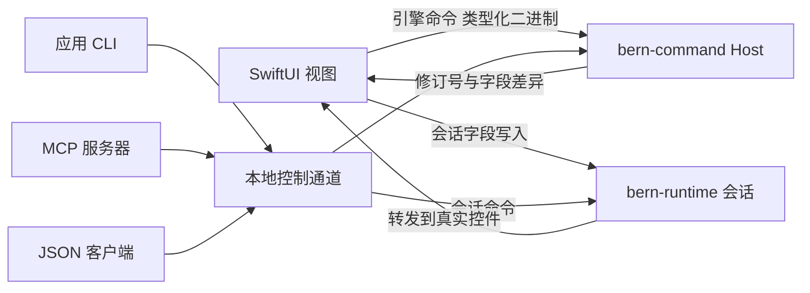

# macOS SwiftUI 实现记录

- 日期：2026-10-10
- 依据：[Bern 架构设计 v0.11](../Design.md)、[Apple 平台适配](../Adaptation/Apple.md)
- 工具链：Rust 1.99.0（Edition 2024）；Swift 6.3.2，以 Swift 6 语言模式编译；Xcode 26.5（SDK 26.5）
- 部署：最低 macOS 14，构建本机架构，本地临时签名

本文记录阶段一（编译边界验证）与阶段二（macOS SwiftUI 与四入口闭环）的实际完成情况。设计文档中的其余能力仍是设计目标；下文“未完成”一节逐项列出。

## 完成情况

### 阶段一 编译边界验证

| 设计要求 | 状态 | 说明 |
| --- | --- | --- |
| 组件、显式属性、组件引用及错误位置 | 完成 | `#[component]` + `ui!`；宏与编译器的诊断都定位到声明源码 |
| 多模块组件组合，未知引用和非法结构报错 | 完成 | 组件可跨模块引用；未知组件、未知属性、缺少必需属性、错误的子节点结构均报错 |
| 受限表达式与合法引用由 rustc 检查实际类型；未知函数、直接赋值、任意回调编译失败 | 完成 | 声明展开为从不执行的类型检查代码；`crates/bern/tests/ui` 中 13 个编译失败用例 |
| 带版本的描述原型，用独立依赖 crate 验证引用与配置匹配 | 完成 | 组件库有自己的 `Bern.toml`；编译器生成带描述版本、IR 版本、包版本和源码指纹的描述，并检查库是否覆盖应用要求的全部语言；示例 `showcase-widgets` |
| 公共目标接口，独立测试目标消费同一 IR，注册新目标无需改动解析器 | 完成 | `bern-target-api`；编译器测试中从外部注册的目标消费展示应用 IR |
| 业务核心与 UI 分离，命令和状态可在无 UI 环境运行 | 完成 | `showcase-core` 只依赖协议；其测试通过共享 `Host` 无界面运行 |
| 注册命令目录并生成各入口描述；重复标识、未知命令、参数不匹配无法通过 | 完成 | 命令描述含 ID、目录版本、参数和结果 schema、作用域、策略、错误码和显式 CLI/MCP 名称；名称冲突报错 |
| 标准控件自动生成会话命令，业务动作缺失绑定编译失败（B301） | 完成 | 输入框、开关、滑块、选择器等写会话字段；按钮缺少命令报 B301 |
| 窗口目录检查 | 部分 | 已检查重复 ID、主窗口、窗口命令引用和呈现能力；首版只支持单实例窗口，多实例参数与 key 未实现 |
| 本地化文本类型与严格诊断 | 完成 | 本地化文本、运行时文本、普通字符串分开；缺少语言（B102）、展示属性直接写字面量（B103）、插值不一致均报错 |
| 目标能力描述中声明颜色来源 | 完成 | `ColorSource::Native` / `BernTheme`；macOS 为 Native |

### 阶段二 macOS SwiftUI 与四入口闭环

| 设计要求 | 状态 | 说明 |
| --- | --- | --- |
| 控件展示示例：侧边栏与详情、标题与文字层级、按钮、开关、滑块、输入框、侧边栏搜索、列表到详情的推入导航、工具栏分段选择器；设置窗口使用页签；至少两种语言 | 完成 | `examples/showcase`，中文与英文 |
| 引擎与会话运行时在应用进程内运行 | 完成 | Rust 静态库链接进应用 |
| 显式装配本地 IPC 通道，提供 CLI、JSON、MCP，连接同一引擎 | 完成 | `channels = ["ipc"]`；生成 `bin/showcase` 与 `bin/showcase-mcp` |
| 未装配外部入口时无辅助进程、无监听；本地调用不经过 JSON | 完成 | 桥接使用类型化二进制值；`ipc = false` 由单元测试覆盖；装配 IPC 时实测无子进程、无 TCP 端口 |
| 只用标准 SwiftUI 组件与系统样式，无按版本分支的代码 | 完成 | 生成测试检查不含 `Color(`、`.background(`、`glassEffect`、`#available` |
| 浅色与深色截图，与系统自带应用对照 | 部分 | 浅色、深色、英文截图已检查；与“系统设置”的并排对照未做（见验证记录） |
| 切换应用语言后文本更新；严格模式负面用例编译失败 | 完成 | 通过系统按应用指定语言验证；应用内实时切换未实现 |
| 版本不兼容、外部入口断开、结果未知 | 部分 | 协议版本、目录指纹、前端与引擎指纹不匹配均明确失败；会话请求超时返回 `ui_timeout`（结果未知），不重放 |
| 状态变化只更新相关展示，批次内一致 | 完成 | 引擎按修订号发布字段差异；Swift 侧为按字段观察的 `@Observable` |
| 滑块产生带参数命令 | 完成 | 拖动只改会话预览，松开提交 `showcase.set_volume(value)` |
| 四入口驱动同一实例；无 UI 引擎可运行；缺少会话返回明确错误 | 完成 | 无会话返回 `requires_ui_session`，多会话未指定返回 `session_required` |
| 标准编辑、选择动作由会话命令驱动，CLI/MCP 可调用 | 完成 | `ui.edit`、`ui.set_bool`、`ui.set_number`、`ui.select`、`ui.activate`、`ui.back` 等，经真实控件闭包执行 |
| 已接受与完成结果可区分 | 部分 | 协议保留 `Accepted`/`Completed`；首版命令均同步完成 |
| 会话命令写回控件不触发重复动作 | 完成 | 写入通过同一 setter；SwiftUI 对程序写回不调用绑定 setter；开关使用幂等的设置而非翻转 |
| 条件分支挂载与卸载、订阅清理 | 完成 | `if` / `if let` / `match`；控件登记随视图出现与消失 |
| 列表按 key 保持实例 | 完成 | `ForEach(items, id: \.key)`；键必须是 `i64` 或 `String` 字段 |
| 键盘、输入法、语义标签 | 部分 | 使用系统控件与可访问名称；输入法组合与键盘遍历未实测 |
| 不写深浅色分支，控件跟随系统 | 完成 | 未设置任何颜色 |
| “搜索列表 → 详情 → 返回” | 部分 | 推入、返回可由 UI 与 CLI 驱动；搜索只保存草稿，没有查询 |
| 可控时钟与异步顺序场景 | 未做 | 首版没有异步查询 |
| 主窗口与设置窗口：四入口打开/关闭/激活、重复打开复用、独立草稿 | 完成 | 窗口实例带代次，重开后旧引用被拒绝 |
| 关闭确认、模态阻挡、确认失效 | 未做 | |
| 最后一个窗口关闭后保留引擎 | 完成 | `applicationShouldTerminateAfterLastWindowClosed` 返回 false |
| macOS Video 验证 | 未做 | |

## 工程结构

| crate | 职责 |
| --- | --- |
| `bern` | 应用接口：宏、绑定类型、`Host`、`CommandError` |
| `bern-macros` | `#[bern::protocol]`、`#[bern::value]`、`#[bern::session]`、`#[component]` |
| `bern-syntax` | 宏与编译器共用的唯一解析器，以及协议描述的降级 |
| `bern-protocol` | 值、schema、命令与状态描述、框架会话命令目录、二进制编码 |
| `bern-ir` | 平台无关 IR、组件规格表、组件库描述 |
| `bern-command` | 引擎宿主：边界校验、串行执行、按修订号发布状态 |
| `bern-runtime` | UI 会话：窗口实例与代次、窗口作用域草稿、会话命令路由 |
| `bern-compiler` | 读取 `Bern.toml`、显式源码收集、语义检查、输出 IR |
| `bern-target-api` | 目标描述、能力检查、构建计划、按平台解析默认目标 |
| `bern-backend-swiftui` | `swiftui + macos` 目标：生成 Swift、Rust 胶水 crate 与资源 |
| `bern-ffi` | 进程内 C ABI |
| `bern-adapter-json` / `bern-transport-ipc` | JSON 编码与本地控制通道 |
| `bern-adapter-cli` / `bern-adapter-mcp` | 从命令目录派生的应用 CLI 与 MCP 服务器 |
| `bern-cli` | 构建工具 `bern` |

## 声明语法

### 协议

```rust
#[bern::protocol(namespace = "showcase", version = 1)]
pub mod showcase {
    use bern::prelude::*;

    #[value]
    pub enum Action {
        #[label(tr! { "zh-Hans" => "主要按钮", "en" => "Primary button" })]
        Primary,
    }

    #[state]
    pub struct State {
        pub last_action: Option<Action>,
        pub volume: f64,
    }

    #[commands]
    pub trait Commands {
        /// 提交音量
        #[idempotent]
        #[errors("out_of_range")]
        fn set_volume(&mut self, value: f64) -> Result<(), CommandError>;
    }
}
```

协议模块自包含：只含 `use`、`#[value]` 类型、一个 `#[state]` 和一个 `#[commands]`。宏生成描述、引擎适配器 `Adapter<E>`、需要实现的 `Engine` trait，以及 UI 声明用的类型化客户端 `Client`。命令 ID 为 `命名空间.名称`；CLI 名称为 `showcase set-volume`，MCP 工具名为 `showcase_set_volume`，冲突时报错。跨边界类型限于 `bool`、`i64`、`f64`、`String`、`Option`、`Vec`、枚举与记录；`i32`、引用、泛型等会给出替代建议。

### 会话状态与组件

```rust
#[bern::session]
pub struct MainDraft {
    #[initial(50.0)]
    pub volume: f64,
    pub path: Vec<Route>,
}

#[component]
pub fn controls_page(app: showcase::Client, #[session] draft: MainDraft) -> impl View {
    ui! {
        Form {
            Slider(id: volume, label: tr! { "zh-Hans" => "音量", "en" => "Volume" },
                   value: draft.volume, min: 0, max: 100) => app.set_volume(draft.volume)
        }
    }
}
```

- `#[session]` 参数由宿主窗口持有，同一窗口内同类型共享一个实例，每个窗口实例各有一份。
- 组件主体只有一个 `ui!`，且只有一个根节点。
- 元素：`名称(属性: 值, …) |模板变量| { 子节点 } => 客户端.命令(位置参数)`。
- 控制结构：`if 条件 { } else { }`、`if let Some(x) = 绑定 { }`、`match 绑定 { 类型::变体 { 字段 } => { } }`。
- 表达式：字面量、`tr!`、绑定路径（如 `app.volume`、`item.kind`）、`类型::变体 { 字段: 值 }`、`! - == != < <= > >= && ||`。不允许函数调用、索引、赋值和闭包。
- `tr! { "zh-Hans" => "按钮共按下 {count} 次", "en" => "…"; count: app.activations }`：插值参数写在分号之后。
- 组件引用使用命名参数：`item_detail(app: app, id: id)`，库组件写成 `showcase_widgets::item_count(count: item.count)`。
- 根组件主体为 `WindowSet(handle: AppWindows, primary: main) { Window(…) { … } }`，并生成类型化窗口句柄 `windows.settings.open()`。

### 组件规格

规格表位于 `crates/bern-ir/src/spec.rs`，宏、编译器和目标共同读取。首批组件：`WindowSet`、`Window`、`SplitView`、`Sidebar`、`SidebarItem`、`Detail`、`Navigation`、`Destination`、`NavLink`、`Tabs`、`Tab`、`Toolbar`、`Form`、`Section`、`Column`、`Row`、`ScrollView`、`List`、`ForEach`、`Spacer`、`Divider`、`Text`、`Label`、`Button`、`IconButton`、`TextInput`、`Search`、`Switch`、`Slider`、`Picker`。可操作控件必须有 `id`。

默认行为：`Column` 前缘对齐；`Row` 垂直居中；未写 `style` 时使用平台默认样式。`Search` 在 SwiftUI 目标中只能放在 `Sidebar` 内；`Picker` 的枚举不能携带数据。

## 运行结构



- **进程内桥接**：固定 C ABI（`bern.h`）只有少量函数。参数、状态与回执按 `bern_protocol::codec` 的二进制布局传递，两端由生成代码按 schema 编解码；接收端仍做 schema 校验。前端与引擎的目录指纹不一致时拒绝启动。
- **引擎**：命令在专用线程上串行执行；参数在边界校验；panic 使引擎拒绝后续命令；状态按字段比较，只在变化时递增修订号。
- **窗口与会话**：窗口出现时向运行时登记，获得代次与外部 ID（如 `settings#2`）。草稿属于窗口实例，关闭即释放；带旧代次的写入返回 `stale_window`。
- **控件登记与会话命令**：每个可操作控件挂载时登记目标 ID（`组件.控件id`，列表行附加 `[键]`）、角色、名称、启用状态，以及与用户输入相同的动作闭包。外部的 `ui.activate` 等命令在主线程上经这些闭包执行；禁用控件返回 `target_unavailable`，同一目标挂载在多处返回 `target_ambiguous`；密码框的值不暴露。

## 外部入口

`Bern.toml` 中 `[targets.macos] channels = ["ipc"]` 才会装配控制通道。通道位置是 `$TMPDIR/bern-<应用标识哈希>/<engine_id>.sock`，目录权限 0700，套接字 0600，只服务同一用户。握手核对协议版本，并可核对目录指纹。消息为逐行 JSON；64 位整数超出 ±(2^53−1) 时编码为十进制字符串，修订号也是字符串。

```sh
target/bern/macos/bin/showcase --help
target/bern/macos/bin/showcase state
target/bern/macos/bin/showcase showcase record --action Primary
target/bern/macos/bin/showcase ui inspect
target/bern/macos/bin/showcase ui select --target main_window.pages --option Library
target/bern/macos/bin/showcase ui activate --target "library_page.item_link[2]"
target/bern/macos/bin/showcase window open --kind settings
```

退出码：0 成功，1 命令失败，2 用法错误，3 无法连接。CLI 只连接已运行的引擎，不会另起一份。`showcase-mcp` 通过 stdio 实现 MCP（JSON-RPC 2.0，协议版本 2025-06-18 / 2025-03-26 / 2024-11-05），工具来自引擎命令目录与框架会话命令目录，另有 `bern_state` 与 `bern_sessions`。

## 本地化、主题与视觉规则

- 资源键可追溯到源码：元素文案为 `组件.节点路径.属性`，枚举标签为 `枚举.变体`，应用名为 `app.name`。生成各语言的 `Localizable.strings` 与 `InfoPlist.strings`；`{name}` 按参数顺序转为 `%1$@`。Info.plist 声明 `CFBundleDevelopmentRegion` 与 `CFBundleLocalizations`。
- 框架自身文案（失败提示等）内置 zh-Hans、zh-Hant、en、ja；应用要求其他语言时构建失败。
- 颜色全部来自系统：生成代码不设置颜色、背景或材质。未声明品牌色时使用用户的系统强调色。
- 设置窗口按内容定高、切换页签时自动调整；侧边栏详情列以选中项名称为标题，`Form(title:)` 可为推入页面命名。

## 构建与运行

```sh
cargo run -p bern-cli -- build --manifest examples/showcase/Bern.toml
open target/bern/macos/Showcase.app
```

产物位于 `target/bern/macos/`：`Showcase.app`、`bin/showcase`、`bin/showcase-mcp`、生成源码 `Sources/`、胶水 crate `glue/`、构建清单 `build.json`。组件库描述写到 `target/bern/libraries/`。`bern check` 只做检查，`bern ir` 输出 IR JSON。

开发时设置 `BERN_SNAPSHOT_DIR` 可让应用在启动后和每条会话命令之后，把自己的窗口渲染成 PNG；`BERN_APPEARANCE=light|dark` 用于覆盖外观。这两项只用于开发检查，默认关闭。

## 验证记录

2026-10-10，本机 macOS 27.0.1（arm64）：

- `cargo test --workspace` 全部通过，`cargo clippy --workspace --all-targets -- -D warnings` 无警告，`cargo fmt --check` 通过。
- 编译失败用例覆盖：按钮无命令、任意回调、控件写引擎状态、命令参数类型错误、未知命令、显示 bool、静态文本、未知组件、未知绑定、match 不完整、缺少组件参数、函数调用、不支持的类型。
- 生成的 Swift 以 `-swift-version 6` 类型检查，零错误零警告。
- `bern build` 完成 Rust 静态库、Swift 编译、签名，生成 CLI 与 MCP。
- CLI 驱动：切换侧边栏页面；激活按钮后引擎计数增加；禁用按钮返回 `target_unavailable`；开关、滑块提交（引擎音量变为 72）、文本编辑生效；推入详情页；打开和关闭设置窗口；`showcase set-volume --value 140` 返回 `out_of_range`。
- MCP：`initialize`、`tools/list`（17 个工具）、调用引擎命令、`window_open`、`bern_state` 均成功。
- 装配 IPC 时，`lsof` 显示应用无 TCP/UDP 套接字、无子进程，只有一个 0600 的 Unix 套接字；正常退出后套接字被删除。
- 截图（开发快照）：浅色、深色、英文界面下各页面与设置窗口均为原生分组表单、系统控件与工具栏样式。

未完成的验证：

- 开发快照依赖视图自绘，侧边栏等系统材质在图中显示为空白，工具栏玻璃控件也不完整；截图时窗口未激活，强调色显示为灰色。侧边栏的实际外观需要在屏幕上目视确认。
- 与“系统设置”并排对照需要屏幕访问，本次没有获得授权，未进行。
- 输入法组合、键盘遍历、VoiceOver 未实测；macOS 14 与 Intel 真机未测试。

## 未完成与已知限制

- 设计中的异步查询、可控时钟场景、关闭确认与模态、多实例窗口、虚拟窗口、Video、自适应布局（`Adaptive`）、焦点管理、菜单命令生成、应用内实时切换语言均未实现。
- 首版引擎命令同步完成，没有执行中句柄、取消与进度。
- 组件库只支持展示型组件（值参数），不能持有会话状态或调用命令；库从源码现场生成描述，尚无预发布描述的分发与缓存。
- Web、GTK、WinUI 3 等其他目标与 Bern 主题算法属于后续阶段。
- 控件目标 ID 为 `组件.控件id`；同一组件在一个窗口中出现多次时目标会冲突，需要指定上下文（返回 `target_ambiguous`）。
- 设置窗口禁用了滚动以贴合内容高度，内容超出屏幕高度时无法滚动。
