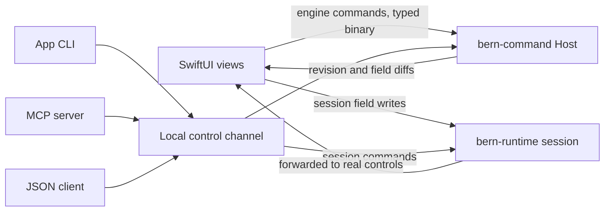
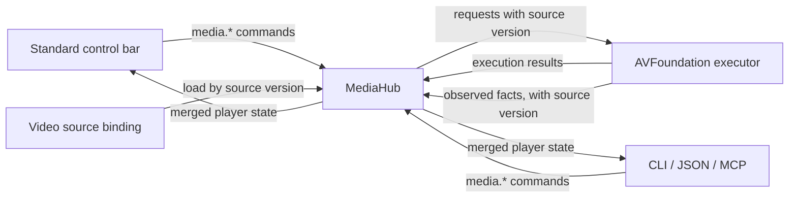
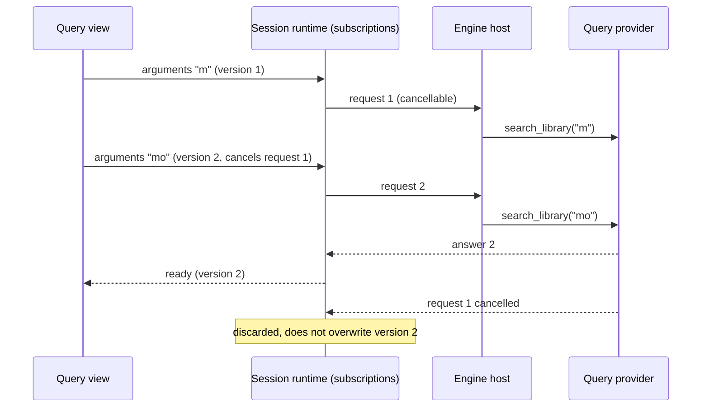

**English** · [简体中文](../zh-CN/Implementation/macOS-SwiftUI.md)

# macOS SwiftUI implementation notes

- First recorded: 2026-10-10
- Updated: 2026-10-17
- Original basis: [Bern architecture design v0.14](../Design.md), [Apple platform adaptation](../Adaptation/Apple.md)
- Toolchain: Rust 1.99.0 (Edition 2024); Swift 6.3.2, compiled in Swift 6 language mode; Xcode 26.5 (SDK 26.5)
- Deployment: minimum macOS 14, built for the host architecture, ad-hoc signed locally
- Addendum: 2026-10-12, style overrides, motion, self-drawing and modular apps from [architecture design v0.25–v0.27](../Design.md) (see the section "Style, motion, self-drawing and modularity"; toolchain Xcode 27.0, SDK 27.0, Swift 6.4)

This document records what was actually completed on macOS for Phase 1 (compile boundary validation), Phase 2 (macOS SwiftUI and the closed loop of four entry points, including Video, the window close protocol, window minimize and restore, declarative asynchronous queries and bundled resources) and Phase 4 (localization and feature contracts). For the current declaration interface see the [component reference](../Reference/UI.md), and for backend coverage the [platform capability table](../Reference/Platforms.md); the acceptance records and unfinished items of each phase are kept below.

## Completion status

### Phase 1: compile boundary validation

| Design requirement | Status | Notes |
| --- | --- | --- |
| Components, explicit properties, component references and error locations | Done | `#[component]` + `ui!`; diagnostics from both the macros and the compiler point to the declaration source |
| Composing components across modules; unknown references and invalid structure report errors | Done | Components can be referenced across modules; unknown components, unknown properties, missing required properties and wrong child structure all report errors |
| Constrained expressions and valid references have their actual types checked by rustc; unknown functions, direct assignment and arbitrary callbacks fail to compile | Done | Declarations expand to type-checking code that never runs; 13 compile-fail cases in `crates/bern/tests/ui` |
| Versioned description prototype; a separate dependency crate verifies that references match the configuration | Done | A component library has its own `Bern.toml`; the compiler generates a description carrying the description version, IR version, package version and source fingerprint, and checks that the library covers every language the app requires; example `showcase-widgets` |
| Public target interface; an independent test target consumes the same IR; registering a new target needs no change to the parser | Done | `bern-target-api`; in the compiler tests an externally registered target consumes the showcase app's IR |
| Business core separated from the UI; commands and state can run without a UI | Done | `showcase-core` depends only on the protocol; its tests run headless through the shared `Host` |
| Register the command catalog and generate descriptions for each entry point; duplicate identifiers, unknown commands and mismatched parameters do not pass | Done | Command descriptions contain the ID, catalog version, parameter and result schemas, scope, policy, error codes and explicit CLI/MCP names; name conflicts report errors |
| Standard controls generate session commands automatically; a business action with a missing binding fails to compile (B301) | Done | Text inputs, switches, sliders, pickers and the like write session fields; a button without a command reports B301 |
| Window catalog checks | Partial | Checked: duplicate IDs, the main window, window command references, presentation capabilities and close checks (which can only read drafts owned by this window, and whose save action must be an engine command); the first version supports only single-instance windows, and multi-instance parameters and keys are not implemented |
| Localized text types and strict diagnostics | Done | Localized text, runtime text and plain strings are kept separate; a missing language (B102), a literal written directly into a display property (B103) and inconsistent interpolation all report errors |
| Target capability descriptions declare the color source | Done | `ColorSource::Native` / `BernTheme`; macOS is Native |

### Phase 2: macOS SwiftUI and the closed loop of four entry points

| Design requirement | Status | Notes |
| --- | --- | --- |
| Control showcase example: sidebar and detail, title and text hierarchy, buttons, switches, sliders, text inputs, sidebar search, push navigation from list to detail, segmented picker in the toolbar; the settings window uses tabs; at least two languages | Done | `examples/showcase`, Chinese and English |
| Engine and session runtime run inside the app process | Done | Rust static library linked into the app |
| Explicitly assembled local IPC channel providing CLI, JSON and MCP, connected to the same engine | Done | `channels = ["ipc"]`; generates `Contents/Helpers/showcase` and `showcase-mcp`, and `bin/` next to the bundle links to them |
| Without external entry points assembled there are no helper processes and no listeners; local calls do not go through JSON | Done | The bridge uses typed binary values; `ipc = false` is covered by unit tests; with IPC assembled, measured: no child processes and no TCP port |
| Without declared style overrides, only standard SwiftUI components and system styles are used | Done | Generation tests check that the view code generated for the showcase app (which has no style overrides) contains no `Color(`, `.background(` or `glassEffect`; runtime templates branch by system version where a feature needs it, e.g. the media progress bar of the video control bar draws a fallback below macOS 26 (see section 8 of [Apple adaptation](../Adaptation/Apple.md)) |
| Light and dark screenshots, compared with built-in system apps | Partial | Light, dark and English screenshots checked; the side-by-side comparison with System Settings has not been done (see Verification log) |
| Text updates after switching the app language; strict-mode negative cases fail to compile | Done | Verified through the system's per-app language setting; live in-app switching is implemented in Phase 4 |
| Version incompatibility, external entry point disconnected, result unknown | Partial | Mismatched protocol versions, catalog fingerprints and frontend/engine fingerprints all fail explicitly; a session request that times out returns `ui_timeout` (result unknown) and is not replayed |
| State changes update only the affected display, consistent within a batch | Done | The engine publishes field diffs by revision number; the Swift side uses `@Observable`, observed per field |
| Slider produces a command with a parameter | Done | Dragging only changes the session preview; releasing submits `showcase.set_volume(value)` |
| Four entry points drive the same instance; the engine runs without a UI; a missing session returns a clear error | Done | With no session it returns `requires_ui_session`; with several sessions and none specified it returns `session_required` |
| Standard edit and select actions are driven by session commands and callable from CLI/MCP | Done | `ui.edit`, `ui.set_bool`, `ui.set_number`, `ui.select`, `ui.activate`, `ui.back` and so on, executed through the real controls' closures |
| Accepted and completed results can be told apart | Partial | Engine commands complete synchronously; media commands distinguish accepted (Accepted), executed by the executor (Executed) and failed (Failed) in the `request` of the player state, and actual playback is judged only by the `phase` reported by the executor |
| Session commands writing back to controls do not trigger duplicate actions | Done | Writes go through the same setter; SwiftUI does not call the binding setter for programmatic write-backs; switches use an idempotent set rather than a toggle |
| Mounting and unmounting conditional branches, subscription cleanup | Done | `if` / `if let` / `match`; control registrations follow views appearing and disappearing |
| Lists keep instances by key | Done | `ForEach(items, id: \.key)`; the key must be an `i64` or `String` field |
| Keyboard, input methods, semantic labels | Partial | Uses system controls and accessible names; input method composition and keyboard traversal not measured |
| No light/dark branches; controls follow the system | Done | No colors set anywhere |
| "Search list → detail → play → back" | Done | Sidebar search filters the list through the engine query `showcase.search_library` → detail → opens and plays in the app-level player → back, driven through real controls; after going back, both the search results and playback are kept |
| Controllable clock and asynchronous ordering scenarios | Done | Queries are declared in the protocol and bound with `Query` in `ui!` (see "Asynchronous queries" and "Query subscriptions and answers"); the scenario tests of `showcase-core` drive the real engine, host and session subscriptions with `ManualClock`, and an earlier slow search does not overwrite a newer result; C ABI tests cover the same path |
| Main window and settings window: open/close/activate from four entry points, repeated opening reuses the window, independent drafts | Done | Window instances carry a generation, and after reopening, old references are rejected; at launch the `initial: open` main window always opens, and after the main window is closed, clicking the Dock icon reopens it |
| Close confirmation, modal blocking, confirmation invalidation | Done | See "Window close protocol"; the system close button and File > Close go through the close check first |
| Engine kept after the last window closes | Done | `applicationShouldTerminateAfterLastWindowClosed` returns false; the app-level player keeps playing; when a `StatusItem` is declared, the Dock icon is hidden while there are no windows, see "Status bar item" |
| Restore after minimize | Done | `window.minimize`, `window.restore`, `window.maximize`, `window.move`, `window.resize` and the query `window.list`; minimize, zoom, move and focus done by the system are synchronized as facts carrying a source and a generation, without dispatching commands (see "Window presentation"); minimizing does not release drafts, navigation or query subscriptions |
| macOS Video verification | Done | See "Video"; AVFoundation playback measured with controlled test media |

### Phase 4: localization and feature contracts

| Design requirement | Status | Notes |
| --- | --- | --- |
| `compact` and `expanded` layouts | Done | `[layouts] compact_below`; `Adaptive` generates `BernAdaptive`, which measures its own available width with `onGeometryChange` and picks the layout |
| Different entry-point forms such as buttons and menus | Done | `Menu` / `MenuItem` generate a system `Menu`; the control registrations of menu items hang on the menu button, so external entry points can run them while the menu is not open |
| Feature contracts and coverage checks | Done | Target-independent, see "Coverage check rules" in the [design document](../Design.md); `bern check` outputs the result of each feature at each size |
| Negative cases are distinguished from each other | Done | Compiler tests cover B101–B104, B201–B206 and B401–B402 separately |
| Switching language and layout at runtime without losing state that should be shared | Done | See "Verification log"; the language is switched through `LanguagePicker` and `ui.set_language` |

### Phase 6: first batch of the component library

| Component | SwiftUI | Notes |
| --- | --- | --- |
| `Image` | runtime view `BernImage` | Images from state (a file or http(s) address in a `MediaSource`) are read and decoded in a background task; when width and height are fixed they are decoded, like declared images, at twice the frame's pixel size (`kCGImageSourceThumbnailMaxPixelSize`), and cached by address and decode size; all decoding uses `kCGImageSourceShouldCacheImmediately` and finishes on the decoding thread instead of being left to the UI thread at the first draw (2026-10-27; before this, images from state were decoded at their original size). Declared images are decoded with ImageIO from `Contents/Resources` (cached by name): from macOS 15 they are decoded as HDR, JPEGs with a gain map apply the gain map, and PQ and HLG PNGs keep their original range; EXIF orientation is applied by `Image(decorative:scale:orientation:)`. After `resizable()`, `fit` selects `.fit`, `.fill` or plain stretching, `frame` is followed by `clipped()`, and high dynamic range is allowed (`.allowedDynamicRange(.high)`); when only one side is written, the other follows the image's aspect ratio. With `label` it is a named image element; without it, it is hidden from assistive technologies |
| `Progress` | `ProgressView` | With `value` it is `ProgressView(value:total:)`, with the value first clamped to the range 0 to `total`; without it, an indeterminate `ProgressView()` (spinner); `label` is its label |
| `Grid` | `LazyVGrid` | A single column definition `GridItem(.adaptive(minimum: min_width), spacing: gap)`; row spacing is also `gap` |
| `Stack` | `ZStack(alignment:)` | The nine positions map to `.topLeading` through `.bottomTrailing` |

Verified on the "Images and layout" page of the showcase app: the same 16:9 image in a 120×90 frame is letterboxed, cropped on both sides and stretched for `contain`, `cover` and `fill` respectively, and the logo with only a width written keeps its aspect ratio; in the stack the logo sits in the top-right corner; the two progress bars for volume (engine state, `total: 100`) and brightness (session draft) change to 90% and 20% immediately after the CLI runs `showcase set-volume --value 90` and `ui set-number --target layout_page.layout_brightness --value 0.2`; in a 920-wide window the grid has three columns. HDR images were verified on the built-in display of an M4 (EDR headroom up to 2x): the left half of the test image is SDR white and the right half 4 times that, and the window was captured in HDR with ScreenCaptureKit to read pixel values. Before switching to HDR decoding and allowing high dynamic range, the JPEG with a gain map showed only the SDR base image (right half 0.96) and the PQ PNG was squeezed into SDR (0.94); afterwards the system raised the headroom to 2.0, the right halves were 1.79 and 1.87 respectively, and an ordinary SDR image stayed at 1.0. A photo with EXIF orientation 6 is shown as portrait. HDR video needs no extra handling: `AVPlayerView` displays it with EDR automatically; a PQ test image encoded with ffmpeg as 10-bit HEVC (BT.2020, PQ, HDR10 metadata) and played as the showcase app's featured clip has its brightest area at 1.48 times SDR white.

In addition, Bern's engine adds almost no launch time: measured with `benchmarks/measure.swift` on an M4, the median of 10 launches of Hello is 0.20 s, and the median of 5 launches of a blank SwiftUI app with only one window and one line of text is 0.22 s.

## Project structure

| crate | Responsibility |
| --- | --- |
| `bern` | App interface: macros, binding types, `Host`, `CommandError` |
| `bern-macros` | `#[bern::protocol]`, `#[bern::value]`, `#[bern::session]`, `#[component]` |
| `bern-syntax` | The single parser shared by the macros and the compiler, plus the lowering of protocol descriptions |
| `bern-protocol` | Values, schemas, command and state descriptions, the framework session command catalog, binary encoding |
| `bern-media` | Media contract: `MediaSource`, player identity, standard media commands and state, the executor protocol, `MediaHub` (routing and state merging) |
| `bern-ir` | Platform-independent IR, the component spec table, component library descriptions |
| `bern-command` | Engine host: boundary validation, serial command execution, read-only queries that are answered asynchronously and can be cancelled, publishing state by revision number; the bundled `Resources` assembled by the host |
| `bern-runtime` | UI session: window instances and generations, window-scoped drafts, the close protocol, session command routing; asynchronous query resources, window-owned query subscriptions and clocks (system clock, controllable clock) |
| `bern-compiler` | Reads `Bern.toml`, validates and expands bundled resources, explicit source collection, semantic checks, IR output |
| `bern-target-api` | Target descriptions, capability checks, build plans, resolving the default target per platform |
| `bern-backend-swiftui` | The `swiftui + macos` target: generates Swift, the Rust glue crate and resources. The Swift runtime is split into `BernRuntime.swift` and `BernMedia.swift`, shared with iOS, and the macOS-only `BernAppKit.swift` (window facts and commands, the close guard, development snapshots, `AVPlayerView`); for iOS see [iOS SwiftUI implementation notes](iOS-SwiftUI.md) |
| `bern-ffi` | In-process C ABI |
| `bern-adapter-json` / `bern-transport-ipc` | JSON encoding and the local control channel |
| `bern-adapter-cli` / `bern-adapter-mcp` | App CLI and MCP server derived from the command catalog |
| `bern-cli` | The build tool `bern` |

## Declaration syntax

### Protocol

```rust
#[bern::protocol(namespace = "showcase", version = 1)]
pub mod showcase {
    use bern::prelude::*;

    #[value]
    pub enum Action {
        #[label(tr! { "zh-Hans" => "主要按钮", "en" => "Primary button" })]
        Primary,
    }

    #[state]
    pub struct State {
        pub last_action: Option<Action>,
        pub volume: f64,
    }

    #[commands]
    pub trait Commands {
        /// Submit the volume
        #[idempotent]
        #[errors("out_of_range")]
        fn set_volume(&mut self, value: f64) -> Result<(), CommandError>;
    }

    #[queries]
    pub trait Queries {
        /// Search the library by category name
        #[reads(items)]
        #[errors("invalid_search")]
        fn search_library(&self, text: String, answer: Answer<Vec<Item>>);
    }
}
```

The protocol module is self-contained: it contains only `use`, `#[value]` types, one `#[state]`, one `#[commands]` and an optional `#[queries]`. The macro generates the description, the engine adapter `Adapter<E>`, the `Engine` trait to implement (which requires both the command and the query traits), and the typed client `Client` used by UI declarations. Command IDs are `namespace.name`; the CLI name is `showcase set-volume` and the MCP tool name is `showcase_set_volume`, and conflicts report errors. Types crossing the boundary are limited to `bool`, `i64`, `f64`, `String`, `Option`, `Vec`, enums and records; `i32`, references, generics and the like get a suggested replacement.

### Session state and components

```rust
#[bern::session]
pub struct MainDraft {
    #[initial(50.0)]
    pub volume: f64,
    pub path: Vec<Route>,
}

#[component]
pub fn controls_page(app: showcase::Client, #[session] draft: MainDraft) -> impl View {
    ui! {
        Form {
            Slider(id: volume, label: tr! { "zh-Hans" => "音量", "en" => "Volume" },
                   value: draft.volume, min: 0, max: 100) => app.set_volume(draft.volume)
        }
    }
}
```

- `#[session]` parameters are held by the host window: within one window, parameters of the same type share one instance, and each window instance has its own.
- A component body has exactly one `ui!`, with exactly one root node.
- Elements: `Name(property: value, …) |template_var| { children } => client.command(positional_args)`.
- Control structures: `if condition { } else { }`, `if let Some(x) = binding { }`, `match binding { Type::Variant { field } => { } }`.
- Expressions: literals, `tr!`, binding paths (such as `app.volume`, `item.kind`), `Type::Variant { field: value }`, `! - == != < <= > >= && ||`. Function calls, indexing, assignment and closures are not allowed.
- `tr! { "zh-Hans" => "按钮共按下 {count} 次", "en" => "…"; count: app.activations }`: interpolation arguments are written after the semicolon.
- Component references use named arguments: `item_detail(app: app, id: id)`; library components are written as `showcase_widgets::item_count(count: item.count)`.
- The root component body is `WindowSet(handle: AppWindows, primary: main) { Window(…) { … } }`, and typed window handles such as `windows.settings.open()` are generated.
- App-level players are declared with `#[bern::players]`, and the field name is the stable `player_id`; components receive them through a `players: Players` parameter, and actions are written as `=> players.preview.open(clip)`, `play()`, `pause()`, `seek(ms)`, `set_volume(v)`, `set_muted(b)`.
- `MediaSource { url }` is a framework value type (`bern::prelude::MediaSource`) that can appear in protocol state, command parameters and UI values; protocols and UIs cannot declare their own type with the same name.

### Asynchronous queries

Queries are read-only: the method takes `&self`, its last parameter is `answer: Answer<T>`, and it has no return value. A provider can answer immediately, or hand `answer` to a timer or another thread to answer later (`answer.ok(v)`, `answer.fail(e)`, `answer.send(r)`); `answer.is_cancelled()` lets the provider stop early when the request has been invalidated. `#[reads(field)]` declares the state fields the answer depends on, and `#[errors(...)]` works as for commands. `&mut self`, a return value, a missing `Answer<T>` and reading an undeclared field all report errors.

```rust
Query(
    id: library_results,
    query: app.search_library(draft.query),
    loading: tr! { "zh-Hans" => "正在搜索…", "en" => "Searching…" },
    empty: tr! { "zh-Hans" => "没有与“{query}”匹配的项目", "en" => "No Items Match “{query}”"; query: draft.query },
    failed: tr! { "zh-Hans" => "无法搜索", "en" => "Search Failed" },
    icon: "magnifyingglass"
) |items| {
    ForEach(items: items, key: id) |item| { … }
}
```

- `query:` is the only place in `ui!` where a call can be written, and it can only call a query on the engine client; the arguments are constrained expressions whose types are checked by `rustc` and the compiler. The client's query methods return `QueryRef` and its command methods return `CommandRef`: writing a query as a `=>` action or a command in `query:` fails to compile.
- The template variable is the query result; when the result is `Option<T>`, it is the `T` inside.
- States: the first load shows the `loading` text and a system progress indicator; when ready, the template shows the data; a refresh keeps the previous data and shows a progress row above it; a failure with no data shows `ContentUnavailableView` and "Retry", and a failure with previous data shows an error row and "Retry" above the data. When `loading` and `failed` are omitted, framework strings are used.
- An empty result is a success: when a list is empty or an optional result is `None`, a `ContentUnavailableView` with `icon` (default `tray`) as its icon is shown if `empty` is declared; otherwise the template shows the empty data as usual. `empty` can only be used with list or optional results, and `icon` must appear together with `empty`.
- A query is registered as the control `component.id` with the role `query`: the value from `ui.inspect` looks like `ready v3 (2)` (phase, argument version, count), and `ui.activate` requests again with the current arguments.

### Video

```rust
#[bern::players]
pub struct Players {
    /// Keeps playing across pages and windows
    pub preview: Player,
}

Video(id: featured, source: app.featured_source)                 // player created by the declaration
Video(id: preview, player: players.preview, controls: standard)  // attached to an app-level player
```

- Exactly one of `source:` and `player:` must be written; their types are, respectively, a binding of `MediaSource`/`Option<MediaSource>` and an app-level player; `controls` is `standard` (default) or `none`, `fit` is `contain` (default), `cover` or `fill`, and `label` is the accessible name.
- The source form: the player belongs to the component instance where it is declared, and its `player_id` is `window_instance/component.control_id` (e.g. `main#1/media_page.featured`). The source is decided by the binding: the same value is not loaded again; a new value is loaded with a new source version; an external `media.open` returns `source_bound`, and changing the source means calling the command of the source's owner (`showcase feature` in the example). The player is released when the component instance ends or the window closes.
- The player form: it only attaches the presentation; the source is updated through that player's commands. Unmounting the view only detaches it, and the app-level player keeps playing after leaving the page or closing the window.
- The progress and volume of the standard control bar use `BernScrubber`: on macOS 26 and later it is a system `Slider` with `.tint(.primary)`, with the played part in a neutral color; earlier systems draw a fallback of the same shape (6 pt track, 20 × 16 pt white rounded thumb, soft shadow, and a lighter played part in inactive windows), reported to accessibility as a system `Slider` and adjusted step by step with the arrow keys. Dragging only updates the preview, and releasing commits once, the same as the end of editing in `Slider`. See section 8 of [Apple adaptation](../Adaptation/Apple.md).

### Window close checks

```rust
#[component]
pub fn app(app: showcase::Client, windows: AppWindows, players: Players,
           #[session] draft: MainDraft, #[session] profile: SettingsDraft) -> impl View {
    ui! {
        WindowSet(handle: AppWindows, primary: main) {
            Window(id: main, …, confirm_close: draft.notes != "",
                   close_message: tr! { "zh-Hans" => "要放弃备注吗？", "en" => "Discard your notes?" }) { … }
            Window(id: settings, …, confirm_close: profile.display_name != "" && profile.display_name != app.display_name,
                   close_message: tr! { … }) { … } => app.set_display_name(profile.display_name)
        }
    }
}
```

- `confirm_close` is a constrained boolean expression and `close_message` is `tr!` text, and the two appear together; the action on `Window` is the save command (it can only be an engine command); with it the decision is "Save / Don't Save / Cancel", otherwise "Discard Changes / Cancel".
- The root component's `#[session]` parameters are evaluated per window instance and can only be used in the close check of the window that owns that session type; the compiler checks the ownership.

### Bundled resources

```toml
# Bern.toml: each entry is a file or directory relative to this file, and also the resource name the engine uses
[resources]
paths = ["media/aurora.mp4", "media/tides.mp4", "media/broken.mp4"]
```

```rust
use bern::resources::Resources;

let resources = Resources::host();                                  // assembled by the app host
let clip = MediaSource::resource(&resources, "media/aurora.mp4")?;  // URL of the file in the bundle
let seed = resources.path("data/seed.json")?;                       // path of the file in the bundle
```

- A name is a `/`-separated path relative to `Bern.toml`; each segment may only use ASCII letters, digits, `-`, `_` and `.`, and must not start with `.`; a directory expands to all files under it (skipping hidden items). A missing entry, a symbolic link, an empty directory, an invalid name, an entry listed twice, and names that differ only in case are all build errors, with the location pointing at the entry in `Bern.toml` (e.g. `examples/showcase/Bern.toml:43:10`). The rules are defined by `bern_protocol::check_resource_name`, shared by the build and the runtime.
- The macOS target additionally rejects directory segments that contain `.` and segments ending in `.lproj` (the signing tool treats directories with a dot as bundles, and `.lproj` holds the generated localizations); the error likewise points at the declaration.
- The engine resolves by name: `Resources::host()` is the resources the host assembled for this process; `Resources::catalog(dir, names)` is the same as the host's but given explicitly; `Resources::directory(dir)` has no name catalog and is only for tests and tools. The error codes are `invalid_resource_name`, `resources_unavailable` (nothing assembled by a host, e.g. a unit test calling `Default` directly), `undeclared_resource` (even if the bundle has a file with that name) and `resource_missing`. There is no fallback path.
- The example engine `ShowcaseEngine::new(clock, resources)` takes resources the same way it injects the clock; `Default` uses `SystemClock` and `Resources::host()`. When a clip fails to resolve, the engine cannot be constructed, and the app shows a startup error with the reason, such as "the engine panicked while starting: resources_unavailable: …". The tests read the example's `Bern.toml` with `bern_compiler::config::load` and resolve in the source directory with the same name catalog as the app bundle, so an engine that uses an undeclared name fails in the tests.

### Component specs

The spec table is at `crates/bern-ir/src/spec.rs` and is read by the macros, the compiler and the targets alike. First batch of components: `WindowSet`, `Window`, `SplitView`, `Sidebar`, `SidebarItem`, `Detail`, `Navigation`, `Destination`, `NavLink`, `Tabs`, `Tab`, `Toolbar`, `Form`, `Section`, `Column`, `Row`, `ScrollView`, `List`, `ForEach`, `Spacer`, `Divider`, `Text`, `Label`, `Button`, `IconButton`, `TextInput`, `Search`, `Switch`, `Slider`, `Video`, `Query`, `Picker`; Phase 4 added `Adaptive`, `Layout`, `Menu`, `MenuItem` and `LanguagePicker`; Phase 6 added `Image`, `Progress`, `Grid` and `Stack`. The IR moved to version 2 with query bindings, version 3 with the bundled resource manifest, version 4 with floating window presentation, version 5 with layout breakpoints and feature contracts, and version 6 with resource properties (`source` of `Image`). Actionable controls must have an `id`; controls with the same `id` in different layouts of the same `Adaptive` are the same control.

Defaults: `Column` aligns to the leading edge; `Row` centers vertically; the `gap` of `Grid` is 8; `Stack` centers; without `style`, the platform default style is used. The `source` of `Image` must be a declared PNG or JPEG resource, which the compiler checks across the whole app (including components in component libraries), and at least one of `width` and `height` must be written and greater than zero; the `value` of `Progress` is a constrained integer or floating-point expression, and `total` must be greater than zero and can only be written together with `value`. `Search` can be placed in a Sidebar or a Toolbar; `style: palette` is only available in a Toolbar on macOS; the enum of a `Picker` cannot carry data.

## Runtime structure



- **In-process bridge**: the fixed C ABI (`bern.h`) has only a few functions. Arguments, state and receipts are passed in the binary layout of `bern_protocol::codec`, encoded and decoded on both ends by generated code according to the schema; the receiving end still validates against the schema. When the catalog fingerprints of the frontend and the engine differ, launch is refused.
- **Engine**: commands run serially on a dedicated thread; arguments are validated at the boundary; a panic makes the engine refuse all later commands; state is compared per field, and the revision number is incremented only when something changed.
- **Windows and sessions**: when a window appears it registers with the runtime and receives a generation and an external ID (e.g. `settings#2`). Drafts belong to the window instance and are released when it closes; writes with an old generation return `stale_window`.
- **Window presentation**: real windows belong to the target. The host observes each `NSWindow`'s minimize, full screen, zoom, move, size (once at the end of a live resize), focus, occlusion and visibility, as well as app hiding, and reports the results to the session runtime as facts: visibility (visible, minimized, hidden), size state (normal, maximized, full screen), the frame with the top-left corner of the main display as the origin, whether it is focused, the currently available actions, and the source (a command, or the user and the system). Facts carry the window generation, so late facts from an old instance return `stale_window` and are discarded; when the value is unchanged, the version number does not change. Facts never dispatch commands, and external entry points cannot inject facts.
  - `window.list` is answered by the runtime from the recorded facts, without going through the UI thread; when a window has just mounted and its facts have not arrived yet, its lifecycle is `Opening`, and while a close confirmation is pending it is `Closing` (currently Bern's only modal relationship).
  - Presentation commands first check against the facts whether the action is available (otherwise `target_unavailable`, listing the available actions), then the host executes them and waits for AppKit to report completion (minimize and restore wait for the notification that the animation has ended, and a 5-second timeout returns `ui_timeout`), and finally they return the window information recorded by the runtime, so the result is the actual state rather than the request.
  - Maximize is AppKit's zoom; only resizable windows can be maximized (`isZoomed` on a fixed-size window does not count). Restore undoes one step at a time: minimize, full screen, maximize, in that order. When AppKit has no size to return to (the window launched at the zoomed size), restore goes back to the frame before maximizing, or to the declared size, centered.
  - `window.move` requires the title bar to stay within the visible area of some display, and `window.resize` keeps the top-left corner and respects the window's minimum and maximum size (including the content size SwiftUI sets from the root view); going out of bounds returns `out_of_range` with the limits.
- **Launch and reopening**: `initial: open` means the window is opened once when the session initializes, so the open or closed state of windows from the last run is not restored (`ApplePersistenceIgnoreState`); otherwise a main window closed before the last quit would not appear after launch. Window size and position are still remembered by the system. When the main window does not exist, clicking the Dock icon (the reopen event) opens the main window, as in System Settings and Music.
- **Control registration and session commands**: each actionable control registers on mount its target ID (`component.control_id`, with `[key]` appended for list rows), role, name, enabled state, and the same action closure that user input uses. The name is taken from the control's own text; sidebars and tabs take the text of the currently selected item, navigation links take the first piece of text in the row (looking through containers and `match` branches), and navigation containers and queries have no name. External commands such as `ui.activate` run through these closures on the main thread; a disabled control returns `target_unavailable`, a control blocked by this window's close confirmation returns `target_blocked`, and a target mounted in several places returns `target_ambiguous`; the values of password fields are not exposed. The `reason` from `ui.inspect` gives why a control cannot be operated (`disabled`, `blocked_by_modal`).

- **Bundled resources**: before signing, the build plan copies the declared files into `Showcase.app/Contents/Resources/<name>` with a `Mirror` step: only the content is copied, without extended attributes; files with the same size and modification time are not copied again; old files that are no longer declared are deleted; and the generated `<language>.lproj` are kept. The generated glue writes the declared names into `AppSpec.resources`; at launch the Swift host passes the path of `Bundle.main.resourceURL` to `bern_app_start`, and `bern-ffi` assembles `Resources::host()` from "directory in the bundle + declared names" before constructing the engine. Assembling again in the same process with a different directory fails. `build.json` records the resource names.

### Video and media



- **Media contract** (`bern-media`, contract version 1): the commands are `media.players`, `media.state` (queries), `media.open`, `media.play`, `media.pause`, `media.seek`, `media.set_volume` and `media.set_muted`; the CLI form is `showcase media play --player-id …`, and the MCP tools are `media_play` and so on. The player state `MediaPlayer` contains `owner`, `source_bound`, `source`, `source_version`, `phase` (Idle, Loading, Ready, Playing, Paused, Buffering, Ended, Failed, Unavailable), `position_ms`, `duration_ms` (empty when unknown or live), `seekable`, `volume`, `muted`, `error`, `views` and the most recent request, `request`.
- **Routing and merging**: commands are first validated in `MediaHub` (`player_not_found`, `no_source`, `media_failed`, `not_seekable`, `out_of_range`, `source_bound`, `executor_unavailable`), then handed to the executor with the current source version; the executor rejects outdated requests by version (`stale_source`). What the executor reports back are facts, which are merged only when they match the current source version; merging facts never produces any command. A command returns its result only after the executor has finished; when an external entry point still has no result after waiting 10 seconds, it returns `media_timeout` (result unknown).
- **Executor and presentation**: at app launch the AVFoundation executor registers with the hub; there is one `AVPlayer` per `player_id`, observed periodically every 0.5 seconds. Video is presented by `AVPlayerView` with `controlsStyle = .none`, receiving no keyboard or mouse input and not connected to Now Playing, so the playback state changes only through Bern commands. After a new source loads, it stays paused and waits for a play command.
- **Standard control bar**: system controls (borderless buttons, `Slider`, system text styles), placed below the video rather than overlaid on the picture, with all colors from the system; dragging the progress and volume only changes a local preview, and releasing submits one command, while state updates do not call back as commands. The controls are registered as `target.play_pause`, `target.position`, `target.mute` and `target.volume` and can be driven by `ui.*`; the video area is registered with the role `video`, and its value is the current phase and time. With no media, while loading, on failure or when unavailable, the system `ContentUnavailableView` or `ProgressView` is shown, and no text is overlaid on the video.
- **Lifecycle**: view attachments are recorded per window; when a window closes, that window's attachments are detached immediately and the players owned by its components are released, while app-level players continue. When the executor disconnects, all players become `Unavailable`, pending requests fail, and a confirmed "playing" is no longer shown.
- **The app's own media core** (2026-10-21): at launch, the host first asks `bern_media_kernel_attach` whether the media core the app registered (one that provides a `MetalLayer`) can be attached; if it can, AVFoundation is not attached and `Video` uses `BernKernelVideoSurface` instead: an `NSView` backed by a `CAMetalLayer` that does not receive clicks, which hands the layer address, the physical pixel size (view size × window pixel ratio × the scale of the outer `ScaleBox`) and `fit` to the core, reports the new size when the layout, the screen or the pixel ratio changes, and on unmount first stops the frame clock and then takes the surface back synchronously. The frame clock is the `CADisplayLink` provided by the view (`NSView.displayLink(target:selector:)`), added to the run loop of a thread named "Bern media frames"; each frame calls `bern_media_surface_frame` while holding a lock, and this is cleared before the app stops, which guarantees that no frame arrives after stopping. Rounded corners are clipped on the layer as usual. For measurements see the [design document](../Design.md#app-provided-media-cores).
- **Refreshing the icon registration after a build** (2026-10-21): every build replaces the app bundle at the same location, and Finder and the Dock keep showing the icon they saw first (still the old icon after the icon has changed). After signing, the app bundle is first `touch`ed and then registered again with Launch Services' `lsregister -f`, after which the Dock and Finder read the new icon; a running app picks it up after it is reopened.
- **Native libraries the engine depends on**: after the engine is built, `cargo rustc --lib -- --print native-static-libs=…` writes the system frameworks and libraries that the static library needs into `libbern_app.native-libs`, which swiftc reads as a response file (`@file`), with `-no_warn_duplicate_libraries` to remove the warnings about libraries duplicated with swiftc's own. Metal, VideoToolbox, CoreAudio, libc++ and others that dependencies such as the media core link against therefore need not be listed one by one in the generator; the iOS and tvOS builds are handled the same way.

### Query subscriptions and answers



- **Catalog**: queries come after commands, with `kind: query`, `concurrency: overlapping` (started in order of arrival, answers may come out of order), `retry: idempotent` and `cancellable: true`, and `reads` lists the state fields they depend on. CLI names, MCP tools and JSON calls are derived from the same catalog as for commands (`showcase showcase search-library --text mo`, `showcase_search_library`); the CLI help lists queries separately, and the MCP tools are marked `readOnlyHint`.
- **Host**: providers start on the engine thread in order of arrival and see the state left by earlier commands, then answer through `Answer<T>` at any time on any thread; answers are validated against the result schema (`invalid_result`). An answer given after the request was cancelled returns `cancelled`, a provider dropping an unanswered request returns `query_dropped`, and a request cancelled while queued never starts the provider; a provider panic, like a command panic, makes the engine refuse later requests. Queries do not publish a new revision number.
- **Session subscriptions**: the generated `Query` view opens a subscription for its own window instance (`bern_query_open`), encodes the arguments on every render, and when the arguments change calls `bern_query_request` outside the current update. The runtime (`QuerySubscriptions`, built on `bern_runtime::query::Query`) assigns a new version to each request and cancels the previous request, and passes only answers for the current version to the view through the `on_query` callback; the Swift side likewise ignores versions older than the state already shown. When the view identity ends (e.g. on switching to another page) the subscription ends; when the window closes, the runtime ends all of that window's subscriptions, and in-flight requests are cancelled with them; when a navigation stack covers the page, the subscription is kept.
- **Refreshing with state**: when an engine revision contains a field that belongs to a query's `#[reads]`, every subscription of that query requests again with the same arguments, and the UI keeps the data and shows "refreshing"; for example, search results update automatically after items are added or deleted.
- **External entry points**: each call from the CLI, JSON or MCP is one request that waits at most 10 seconds; a timeout returns `query_timeout` and cancels the request; queries have no side effects, so they can simply be called again.
- **Example provider**: the search in `showcase-core` matches against all translated names of a category (Chinese and English), and text starting with `!` returns `invalid_search`. Broad searches are slower than precise ones (0 characters 250 ms, 1 character 900 ms, 2 characters 450 ms, more 150 ms), so answers arrive out of order during fast typing; the timing comes from the injected clock, which is `SystemClock` in the app and `ManualClock` in tests.

### Window close protocol

- Close requests (UI actions, the system close button and File > Close, `window.close`) all first evaluate the close check declared on the window, and then the session runtime decides: `Closed` closes immediately; `ConfirmationRequired` returns a confirmation ID, the bound draft revision and the decisions offered, and at the same time shows a system alert (a window-level sheet). Repeated requests return the same confirmation and do not show the dialog again.
- `window.confirm_close` submits the same typed decision as the dialog: `Save` runs the declared save command, and on failure returns `Rejected` (`save_failed: …`) and the window stays; `Discard` closes the window and releases the draft; `Cancel` returns `Rejected` (`cancelled`).
- A confirmation is bound to the window generation and the draft revision: when the draft has changed again after the confirmation, the confirmation has already been handled, or the window has been closed and reopened, the decision returns `stale_confirmation` or `stale_window`, and later changes are not discarded.
- While a confirmation is pending, that window's controls are blocked for all entry points (`target_blocked`); other windows are not affected.
- Intercepting system close: when a window has a close check, Bern replaces the window delegate with a forwarding proxy that implements only `windowShouldClose(_:)` and forwards all other delegate messages to SwiftUI's original delegate.

## External entry points

The control channel is assembled only with `[targets.macos] channels = ["ipc"]` in `Bern.toml`. The channel is at `$TMPDIR/bern-<app-id-hash>/<engine_id>.sock`, with directory permissions 0700 and socket permissions 0600, and serves only the same user. The handshake checks the protocol version and can check the catalog fingerprint. Messages are line-delimited JSON; 64-bit integers beyond ±(2^53−1) are encoded as decimal strings, and revision numbers are strings too.

```sh
target/bern/macos/bin/showcase --help
target/bern/macos/bin/showcase state
target/bern/macos/bin/showcase showcase record --action Primary
target/bern/macos/bin/showcase showcase search-library --text mo
target/bern/macos/bin/showcase ui inspect
target/bern/macos/bin/showcase ui select --target main_window.pages --option Library
target/bern/macos/bin/showcase ui activate --target "library_page.item_link[2]"
target/bern/macos/bin/showcase window open --kind settings
target/bern/macos/bin/showcase window list
target/bern/macos/bin/showcase window minimize --window main#1
target/bern/macos/bin/showcase window restore --window main#1
target/bern/macos/bin/showcase window resize --window main#1 --width 1000 --height 700
```

```sh
target/bern/macos/bin/showcase media players
target/bern/macos/bin/showcase media open --player-id preview --source file:///…/aurora.mp4
target/bern/macos/bin/showcase media play --player-id preview
target/bern/macos/bin/showcase media seek --player-id "main#1/media_page.featured" --position-ms 4000
target/bern/macos/bin/showcase window close --window settings#1
target/bern/macos/bin/showcase window confirm-close --window settings#1 --confirmation settings#1:c1 --decision Save
```

Exit codes: 0 success, 1 command failed, 2 usage error, 3 cannot connect. The CLI only connects to an engine that is already running and never starts another one. `showcase-mcp` implements MCP over stdio (JSON-RPC 2.0, protocol versions 2025-06-18 / 2025-03-26 / 2024-11-05); its tools come from the engine command catalog (including read-only queries), the media command catalog and the framework session command catalog, plus `bern_state` and `bern_sessions`. After subscribing, a JSON client receives the complete `media` player state in addition to engine state updates (a newer revision replaces older ones). `MediaSource` arguments can be written directly as a URL in the CLI.

## Localization, theme and visual rules

- Runtime language: `BernLanguage` (`@Observable`) holds the current language and the matching `.lproj` resource bundle, and `BernText.string` always looks up through it, so views that read text recompute in the same update after the language switches. The supported languages are taken from the app bundle's localization list, and at launch the preferred language that the system chose for this app is used. `ui.language` returns the current language, `ui.set_language` switches it, and an unsupported tag returns `unsupported_language`. The `locale` environment value of each window's root view is the current language, so the localized variants of SF Symbols (e.g. `textformat` is "Aa" in English and "格式" in Chinese) and number and date formats follow the app language rather than the system language. System-managed strings (items in the menu bar provided by the system, etc.) still follow the system language.
- `LanguagePicker` generates a system `Picker`, whose options are each language's name in that language, as given by `Locale`.

- Resource keys can be traced back to the source: element text is `component.node_path.property`, enum labels are `Enum.Variant`, and the app name is `app.name`. `Localizable.strings` and `InfoPlist.strings` are generated for each language. Text without arguments is written as is (`{{` and `}}` are turned back into braces); text with arguments keeps Bern's [message format](../Reference/UI.md#text-content-and-formatting), and `BernText.format(key, [name: BernArg])` writes out plural branches, dates and durations at runtime in the current language, with month and weekday names written as framework text. Enum labels that show variant fields take the field per variant in `bernLabel`; `CalendarDate` generates `bernArg`. On 2026-10-18 the Chinese and English results were measured with `BERN_SNAPSHOT_DIR` snapshots in a temporary project. Info.plist declares `CFBundleDevelopmentRegion` and `CFBundleLocalizations`.
- The framework's own strings (failure messages, the video control bar, close confirmation buttons, etc.) are built in for zh-Hans, zh-Hant, en and ja; the build fails when the app requires other languages.
- All colors come from the system: generated code sets no colors, backgrounds or materials. Without a declared brand color, the user's system accent color is used; when `[theme].brand_seed` is declared and there is no `WindowSet(accent:)`, each window generates `BernThemeChoice(accent: BernColor.fixed(light:, dark:))`, with the colors for both modes computed by `bern_target_api::style::brand_accent` (since 2026-10-30; before that SwiftUI did not read `brand_seed`, and only GTK, WinUI 3 and Web used it).
- The settings window sizes its height to its content and adjusts automatically when switching tabs; the detail column of a sidebar uses the name of the selected item as its title, and `Form(title:)` can name a pushed page. The `BernSearchPaletteHost` outside the window content normally uses `GeometryReader` so that the content fills the window, starting from the top-left corner, but `GeometryReader` has no ideal height of its own: when sized to its content (`fixedSize`) it is only 10 points tall, so a settings window written directly as a single `Form` was blank (settings windows using tabs had measured fine before; fixed 2026-10-29). The settings window now uses `BernSearchPaletteHost(fits: true)`: the content is not inside the `GeometryReader`, and the window takes the content's height; the search panel overlay is unchanged. Measured offscreen, the same grouped form is 10 points tall with the old approach and 446 points with the new one; the `settings_window` test checks the generated code and type-checks it against the macOS SDK.

## Building and running

```sh
cargo run -p bern-cli -- build --manifest examples/showcase/Bern.toml
open target/bern/macos/Showcase.app
```

The outputs are in `target/bern/macos/`: `Showcase.app`, the debug symbols `Showcase.app.dSYM`, `bin/showcase`, `bin/showcase-mcp`, `skills/showcase/SKILL.md`, the generated sources `Sources/`, the glue crate `glue/` and the build manifest `build.json` (with video enabled, it records the versions of the media contract, the media backend `avfoundation` and the presentation adapter `avplayerview`, as well as the app-level players, and it records the bundled resource names). Component library descriptions are written to `target/bern/libraries/`. `bern check` only checks, and `bern ir` outputs the IR as JSON. `bern` uses the nearest Cargo workspace, so a checkout nested inside another workspace (e.g. a Git worktree) uses only its own crates and `target/`.

The app CLI and MCP server are in `Contents/Helpers` inside the bundle, and the agent skill is in `Contents/Resources/skills/<program>/SKILL.md` (the program paths in it are written relative to it as `../../../Helpers/…`, and it also gives the location after the app is installed in Applications); the two programs are ad-hoc signed first, then the app is signed, and the app's signature seals them and the skill. So after the `.app` is dragged elsewhere or installed in Applications, an agent can still call them, e.g. `/Applications/Showcase.app/Contents/Helpers/showcase state`. `bin/showcase` and `bin/showcase-mcp` next to the bundle are relative links to the programs inside the bundle, and `skills/showcase/SKILL.md` finds them through `bin/`, so the commands used during development are unchanged. Previously (before 2026-10-30) the two programs were only copied to `bin/` next to the bundle and the skill was also only next to the bundle; only the app inside the disk image produced by `bern package` carried them, and when the built `.app` was taken directly, an agent had no way to call them.

The app icon is `Contents/Resources/AppIcon.icns` (`CFBundleIconFile`). Without a declared `[app].icon` it is the version of the Bern logo that fills a square canvas, one PNG for each size from 16 to 1024 pixels, which the system crops to a rounded square; macOS would put a round icon on a gray icon plate, so macOS does not use the round version. Resource syncing keeps this file, and bundled resources cannot have the same name. When `[app.icon].macos` is an `.icns`, it is used as is. When it is an Icon Composer `.icon` folder, it is placed next to the bundle as `AppIcon.icon` and compiled by `actool` into `Contents/Resources/Assets.car`, which also writes an `AppIcon.icns` for earlier systems; `Info.plist` additionally gets `CFBundleIconName`, and bundled resources cannot be named `Assets.car` either. From macOS 26 the Liquid Glass icon is shown; macOS 14 and 15 use the flat images drawn from it in `Assets.car` (every size up to 1024 pixels). From macOS 26, an old-style icon with its own plate is shown as is only when the plate is exactly Apple's template shape: an 824 square starting at (100, 100) in a 1024 canvas, a continuous rounded rectangle with a corner radius of 185.4 (the same path as `RoundedRectangle(style: .continuous)`). When the plate has another shape (e.g. a superellipse with exponent 5, whose outline differs by about 4000 pixels) or there is no plate at all, the system shrinks the whole icon and puts it on a gray plate; artwork that fills the square is cropped to the system shape. All of the above was measured on macOS 27.0.1: the Finder icon was rendered with `NSWorkspace.icon(forFile:)`, several apps on this machine that ship only an `.icns` were compared, and icons were swapped to rule out the influence of the SDK used for the build.

Debug symbols are not shipped in the app bundle: both debug and release compile with `-g`, and the dSYM that swiftc writes into `Contents/MacOS/` is moved before signing to `Showcase.app.dSYM` next to the bundle (where lldb and crash report symbolication look for it), after first deleting the dSYM left by the previous build. Release also links with `-dead_strip` and, before signing, uses `strip -S -x` to remove from the executable the debug and local symbols that the dSYM keeps: the showcase app's bundle is 2.6 MB, the executable 2.2 MB (previously 5.7 MB), and the dSYM about 9 MB.

The example's controlled test media are in `examples/showcase/media/`, generated with ffmpeg by `make-media.sh`: `aurora.mp4` (8 seconds), `tides.mp4` (6 seconds) and `broken.mp4` (not a movie, used for failure) are declared as bundled resources and shipped with the app bundle; `live/live.m3u8` (HLS without an end tag, unknown duration, not seekable) is not shipped and serves only as a development aid: AVFoundation plays HLS only over HTTP, e.g. `python3 -m http.server --directory examples/showcase/media`.

During development, setting `BERN_SNAPSHOT_DIR` makes the app render its own windows to PNG after launch and after every session command (video frames from local files are drawn into the screenshots); `BERN_APPEARANCE=light|dark` overrides the appearance; with `BERN_DEV_WINDOW_SIGNALS=<window kind>`, sending SIGUSR1 to the process calls `performClose(_:)` on that window and SIGUSR2 calls `performMiniaturize(_:)`, the same as clicking the close and minimize buttons in the title bar, so that tools without screen access can verify the system close path and window facts that come from the user; with `BERN_TIMING` set, the app writes the clicks and key presses it receives, draft write-backs, engine commands, state sent by the engine, and the duration of every main-thread turn that is busy for more than 4 milliseconds to standard error, timestamped in milliseconds since system boot (the same clock other tools read), to split a slow interaction into waiting and working. These four are only for development checks and are off by default.

### Packaging

`bern package --target macos` builds in release and produces `target/bern/dist/<product>-<version>-macos-<arch>.dmg`:

- The app is copied to a staging directory, and the app CLI, MCP server (`Contents/Helpers`) and agent skill (`Contents/Resources/skills`) that the build already placed in the bundle are copied along with it; the tools are signed first, then the app; the disk image also contains a link to Applications.
- With `BERN_MACOS_SIGNING_IDENTITY`, signing uses the hardened runtime and a secure timestamp, and the disk image is signed too; with `BERN_MACOS_NOTARY_PROFILE` as well, it is notarized through `notarytool` and stapled. Without them it is ad-hoc signed, can only be opened on this machine, and a notice says that Gatekeeper will reject it.
- The disk image is created with `diskutil image` on systems that have it (`hdiutil create` already shows a deprecation notice on macOS 27), otherwise with `hdiutil`.
- Measured (2026-10-12, a new project): the disk image is 1.8 MB; after mounting it, signature verification passed, the app launched directly from the image, and `Contents/Helpers/my-app state` read the engine state. Notarization requires a Developer ID, and this machine has only a development certificate, so it was not measured.

## Verification log

2026-10-11, debug symbols and executable size, on this machine, macOS 27.0.1 (arm64):

- Previously the release build itself did not generate a dSYM, but the `Contents/MacOS/Showcase.dSYM` (about 41 MB) that swiftc wrote into the bundle during a debug build stayed in later release bundles, and its UUID did not match the release executable. Now after a debug build the bundle contains only the executable, and `Showcase.app.dSYM` sits next to the bundle with a UUID matching the executable; the same holds for a subsequent release build (dSYM 9.0 MB), `codesign --verify --deep --strict` passes, and `atos` resolves symbols such as `bern_app_start` with the dSYM.
- Release executable: 3.8 MB with only `-dead_strip` added, 2.35 MB with symbols also stripped (previously 5.95 MB); the whole app bundle is 2.6 MB. `-g` adds about 0.4 seconds to the release Swift compile.
- Functionality: launching the release bundle directly (`-ApplePersistenceIgnoreState YES`, the CLI with `--engine`), page switching, switches, sliders, pickers, buttons and the `target_unavailable` of a disabled button, featured clip playback, and the close confirmation and `Save` of the settings window all work.
- Performance (measured as in the README: one warm-up, then the median of 3 runs; `footprint` in bytes): the new executable 0.413 seconds, 39.5 MB (retest 0.409 seconds, 40.0 MB); with only the old executable swapped back, 0.377 seconds, 39.9 MB; the difference is within measurement noise.
- `cargo test --workspace` (171 tests), `cargo clippy --workspace --all-targets -- -D warnings` and `cargo fmt --check` all pass; new assertions: the dSYM is moved out of the bundle before signing, the previous dSYM is deleted first, the outputs include the dSYM, and release compiles with `-g` and `-dead_strip` and strips symbols before signing.

2026-10-10, bundled resources, on this machine, macOS 27.0.1 (arm64):

- `cargo test --workspace` (110 tests), `cargo clippy --workspace --all-targets -- -D warnings` and `cargo fmt --check` all pass; `bern build` has no warnings, and `codesign --verify --deep --strict` passes.
- New tests: resource name rules; 3 groups of `Bern.toml` validation (directory expansion and skipping hidden items, each file pointing to the entry that declared it; a nonexistent path, an absolute path, `..`, illegal characters, an empty directory, a duplicate listing, duplicate files within a directory, names differing only in case and symbolic links all report errors located at the entry); the macOS target rejects `.lproj` and directory segments containing `.`; the generated glue, `build.json` and the build plan (`Mirror` before signing, localization files kept); the build driver's `Mirror` (keeps only declared and reserved files, recopies when a source file changes, a file and a directory swapping places); the four errors of `Resources`; 3 C ABI tests (`resources_unavailable` without a resource directory, only declared names resolve in the host directory, assembling again in the same process with a different directory is rejected, and when engine construction fails the startup error carries the reason); `showcase-core` resolves clips through the name directory declared in `Bern.toml`, and without a host the engine cannot be constructed.
- Real machine: `Showcase.app` was copied to a temporary directory outside the repository, `examples/showcase/media` in the source was renamed and moved away, and the copied app was launched directly (`-ApplePersistenceIgnoreState YES`, the CLI pointed at it with `--engine`):
  - In `showcase state`, `featured_source` and the clips of the 6 items are all `…/elsewhere/Showcase.app/Contents/Resources/media/*.mp4` inside the copied bundle.
  - After `ui select --target main_window.pages --option Media`, in `media players` `main#1/media_page.featured` is `Ready`, with a duration of 8000 ms, seekable, and its source is `aurora.mp4` inside the bundle; after `media play` it is `Playing`; after `showcase feature --clip Bars` the source version is 2 and the duration 6000 (`tides.mp4`); after `--clip Damaged` it is `Failed` ("Cannot Open", `broken.mp4`); the clip of an item added with `showcase add-item` also comes from inside the bundle.
  - With the source media moved away, `bern check` reports `resource … does not exist` for each of the three entries, located at `examples/showcase/Bern.toml:43:10`, `:30` and `:49`.
- After an undeclared old file was put into the bundle's `Contents/Resources` and the app was rebuilt: the old file is deleted, localization files are kept, unchanged clips are not recopied (inode and modification time unchanged), and signature verification passes.

Verification not done: copy time when the resource directory is large; running the build outputs on another machine (this time replaced by copying to another directory and moving the source away).

2026-10-10, declarative asynchronous queries, on this machine, macOS 27.0.1 (arm64):

- `cargo test --workspace`, `cargo clippy --workspace --all-targets -- -D warnings` and `cargo fmt --check` all pass; `bern build` has no warnings, and the generated Swift type-checks with `-swift-version 6` with zero errors and zero warnings.
- New tests: protocol descriptions (only the fields a query declares it reads; the fields must exist); 4 host tests (a query sees the state of earlier commands and does not produce a revision, answers arrive out of order from other threads, cancel/discard/invalid result/timeout, a provider panic makes the engine reject later requests); 2 runtime tests (subscriptions end with their window and refresh with the same parameters when a field they read changes; the system clock fires in order of expiry); 3 parsing tests and 1 component spec test; one group each of positive and negative compiler cases; rustc cases: 1 passing (declaration, engine and host end to end) and 5 failing (a query written as an action, a command written in `query:`, a wrong parameter type, `empty:` written for a scalar result, a query taking `&mut self`); 1 C ABI test (out-of-order answers show only the current version, state changes refresh, a failure keeps the old data, the subscription ends after the window closes); query cases for IPC, the CLI and MCP; 3 `showcase-core` scenarios (under `ManualClock`, with "m" slow and "mo" fast, the page keeps the result for "mo" and counts 1 discard; Chinese category names match, refresh after adding an item, a failure keeps the old data, empty results; external entry points get the same answer).
- Real machine (isolated instance, `-ApplePersistenceIgnoreState YES`, the CLI pointed at it with `--engine`):
  - The list page registers the query control `library_page.library_results`, and `ui.inspect` gives `ready v1 (5)`. Typing "m" and "mo" about 20 ms apart through the real search field with `ui edit`: immediately `refreshing v3 (5)`, after 0.52 s `ready v3 (1)` (Movies), still unchanged at 1.6 s; the answer for "m" at 0.9 s did not appear.
  - Screenshots (Chinese, light): while refreshing, the progress row is above the old data; "zzz" shows a centered "No Items Match “zzz”"; "!x" shows an error row and "Retry" when there is old data, and after leaving the page and coming back (a new subscription, `v1`) it shows `ContentUnavailableView` and "Retry". In English and dark mode the empty-result text is in English, and all colors come from the system.
  - Searching for "影" and "下载" gives Movies and Downloads respectively. With the list open, the CLI `showcase add-item --kind Downloads`: `refreshing v3 (1)` at 0.01 s, `ready v3 (2)` at 0.43 s. `ui activate --target library_page.library_results` requests again with the current parameters. After leaving the list page the query control disappears (the subscription ends), and after coming back it is a new subscription.
  - Closing the main window while a search is in progress: it closes directly, with no error; the draft of the reopened `main#2` is fresh, and the query is `ready v1 (5)`.
  - CLI: `showcase search-library --text mo` returns Movies in about 0.47 s; `--text '!x'` exits with code 1 (`invalid_search`); the help lists "Queries" separately. JSON: the catalog has `kind: query`, `concurrency: overlapping`, `reads: [items]`, and a raw socket call returns Music. MCP: 29 tools, `showcase_search_library` carries `readOnlyHint` and `idempotentHint`; calling it with "照片" returns Photos, and with "!" returns `isError`.

Verification not done: typing in the search field with a real keyboard (replaced by `ui.edit`, which goes through the same setter), really clicking "Retry" (replaced by `ui.activate`), VoiceOver reading out the progress row.

2026-10-10, Video, window close protocol and asynchronous queries, on this machine, macOS 27.0.1 (arm64):

- `cargo test --workspace`, `cargo clippy --workspace --all-targets -- -D warnings` and `cargo fmt --check` all pass; the generated Swift (including `BernMedia.swift`) type-checks with `-swift-version 6` with zero errors and zero warnings.
- New tests: 12 `bern-media` tests (routing and replying only after execution, facts do not produce commands, reports for an old source version are ignored, source binding does not reload the same source and rejects external source changes, unknown duration and failure, a timeout's result is unknown, executor disconnect, component and window release, versioned snapshots); 3 close protocol tests and 3 query scenario tests in `bern-runtime`; media and close cases for the C ABI and IPC; positive and negative compiler cases for Video, players and close checks; 4 rustc failure cases (Video missing a source, a wrong source type, a wrong parameter type for a player action, a close check missing its text).
- Real machine (isolated instance, not sharing window restoration state with other running Showcase instances):
  - Page player: playing through the real control, pausing and seeking to 4000 ms through the CLI, muting and adjusting the volume with `ui set-bool`/`ui set-number`; the state matches actual playback. Repeating `showcase feature --clip Pattern` does not reload; after switching to the color bars the source version is 2 and the duration 6000; after switching to the corrupt file it is `Failed` (system error "Cannot Open"), and `media play` returns `media_failed`; an external `media open` returns `source_bound`.
  - App-level player: MCP `media_open` and `media_play` take effect; list → detail → "Open in Preview Player" → play from the control bar → after going back it is still `Playing`, and the number of attached views goes from 1 to 0; back on the "Video" page it attaches again. After the main window closes, the page player is released and the app-level player keeps playing.
  - Live HLS (local HTTP): `Playing`, `duration_ms` is empty, the progress bar is disabled and shows "Live", and `media seek` returns `not_seekable`.
  - Close protocol: when the notes have content, `window close` and a system close (SIGUSR1 → `performClose`) return the same confirmation, the system alert is shown as a window sheet, and the window's controls return `target_blocked` to the CLI; `Cancel` → `Rejected`; after that, modifying the draft and then using the old confirmation with `Discard` → `stale_confirmation`; a new confirmation with `Discard` → the window closes and the engine keeps running; after closing, the old window ID returns `target_not_found`. In the settings window, `Save` with a blank name → `Rejected` (`save_failed: invalid_name`) and the window stays; `Save` with a valid name → the window closes and the engine state updates. When there is no unsaved content, a system close closes the window directly.
  - Screenshots: in light and dark mode the video page and the control bar use system controls and system colors, and the video picture keeps its original colors; the close confirmation is a standard system alert.

Verification not done: really clicking the title bar's close button and Cmd-W (no screen or accessibility permission; replaced with `performClose(_:)`); VoiceOver reading out the video control bar; real Intel and macOS 14 machines.

2026-10-10, re-verified in the main repository after the merge (launched without `-ApplePersistenceIgnoreState`):

- The first launch after the merge had no window: the main window had been closed during the previous run, and macOS restored the "closed" state. After the fix, closing the main window, quitting and relaunching gives `sessions` as `main#1`; closing the main window while running and then sending the app a reopen event (`open Showcase.app`, the same as clicking the Dock icon) gives `main#2`.
- `ui.inspect` names: the sidebar is the current page, such as "List & Detail" or "Video", the tab is "General", and the list links are the row texts, such as "Documents" and "Photos".
- Typing "mo" through the real search field with `ui edit`: immediately `refreshing v2 (5)`, about 1 s later `ready v2 (1)`, with only the "Movies" link left.
- After the display name is changed in the settings window, `window close` returns a confirmation, and the system alert "Do you want to save the display name?" has Save, Don't Save and Cancel; while it is pending, the switch returns `target_blocked`; after `Save` the window closes and the engine's `display_name` updates.
- Video page: the featured clip is `Ready 0:00 / 0:08`, the preview player is `Idle`, and its play and progress controls are disabled; in the screenshot the picture, the system control bar and the clip buttons are correct.

2026-10-10, window minimize, restore and presentation queries:

- New tests: 3 runtime tests (facts are versioned per instance, old generations are rejected, and facts that do not change do not bump the version; actions are judged available from facts and the available actions are listed; `WindowInfo` conforms to the session catalog schema); 1 C ABI test (`Opening` before facts arrive, rejecting minimize; `window.list` does not go through the UI; the minimize command reaches the frontend, and after the frontend reports the facts it answers with no value, the result being the window as recorded by the runtime; late facts after closing are discarded). 114 tests pass in total, clippy and fmt are clean, and the generated Swift has zero warnings.
- Real machine (CLI):
  - `window minimize --window main#1` returns after about 0.58 s (it waits for the animation to end): `Minimized`, with only activate, close and restore left as available actions, source `Command`; `sessions` is still `main#1`, and the controls are still registered. After restoring, the search field text, the selected page and the query subscription (`ready v1 (1)`) are unchanged.
  - Each restore undoes one step; a window launched at the zoomed size restores to the centered declared size 920 × 640. After maximizing it is `Maximized`, and restoring again returns it to the original frame; when there is nothing to restore it returns `target_unavailable`.
  - `window move --x 120 --y 90` and `window resize --width 1000 --height 700` return the actual frame; `--width 300 --height 200` returns "needs at least 720 × 532" (`out_of_range`); `--x 99999` returns that the title bar is not on any display.
  - The settings window (fixed size) is `Normal`, and its available actions are activate, close and move; minimize and resize return `target_unavailable`.
  - System path: with `BERN_DEV_WINDOW_SIGNALS=main`, after SIGUSR2 (`performMiniaturize`, the same as the yellow button), `window.list` shows `Minimized`, source `System`, and no command is dispatched; after the app is sent a reopen event (the same as clicking the Dock icon) it is restored to `Visible`, source `System`.
  - A newly opened settings window was at first reported as hidden: AppKit sends the move and resize notifications before the window is on screen, and the window coming on screen does not itself send the observed notifications while the app is not active. After `isVisible` was also tracked with key-value observing, it is `Visible`.
  - Closing a minimized main window closes it directly; MCP has 35 tools in total, `window_list` carries `readOnlyHint`, and `window_restore` is not idempotent.
  - After `window activate`, `focused` is still false: since macOS 14 activation is cooperative, and a background app cannot take focus away from the foreground app (Claude, this time); the facts reflect this accurately.

Verification not done: really clicking the yellow and green buttons and double-clicking the title bar (`performMiniaturize(_:)` stood in for the yellow button); restoring after entering full screen (there is no full-screen command, and the system path needs screen access); `Hidden` when the app is hidden (Cmd-H); coordinates and the title bar check with multiple displays.

2026-10-10, Phase 1 and the core of Phase 2, on this machine, macOS 27.0.1 (arm64):

- `cargo test --workspace` passes in full, `cargo clippy --workspace --all-targets -- -D warnings` has no warnings, and `cargo fmt --check` passes.
- Compile-fail cases cover: a button without a command, an arbitrary callback, a control writing engine state, a wrong command parameter type, an unknown command, displaying a bool, static text, an unknown component, an unknown binding, an incomplete match, a missing component parameter, a function call, an unsupported type.
- The generated Swift type-checks with `-swift-version 6` with zero errors and zero warnings.
- `bern build` completes the Rust static library, the Swift compile and signing, and generates the CLI and MCP.
- Driven through the CLI: switching sidebar pages; activating a button increments the engine's counter; a disabled button returns `target_unavailable`; switches, slider commits (the engine volume becomes 72) and text editing take effect; pushing the detail page; opening and closing the settings window; `showcase set-volume --value 140` returns `out_of_range`.
- MCP: `initialize`, `tools/list` (17 tools), calling engine commands, `window_open` and `bern_state` all succeed.
- With IPC assembled, `lsof` shows that the app has no TCP/UDP sockets and no child processes, only one Unix socket with mode 0600; after a normal quit the socket is deleted.
- Screenshots (development snapshots): in light, dark and English UI, every page and the settings window use native grouped forms, system controls and toolbar styles.

Verification not done:

- Development snapshots rely on the views drawing themselves, so system materials such as the sidebar appear blank in the images, and the toolbar glass controls are incomplete too; the window was not active when the screenshots were taken, so the accent color shows as gray. The sidebar's actual appearance needs to be confirmed by eye on screen.
- A side-by-side comparison with System Settings needs screen access, which was not granted this time, so it was not done.
- Input method composition, keyboard traversal and VoiceOver were not measured; real macOS 14 and Intel machines were not tested.

2026-10-10, Phase 4, on this machine, macOS 27.0.1:

- `bern check` outputs that `MediaFeature::Clip` is covered in both `compact` and `expanded` by `media_page.pattern`, `media_page.bars` and `media_page.damaged`.
- At a width of 920 pt, `media_page.clip_choice` in `ui.inspect` is `expanded`, and the three clip buttons are mounted; after `window.resize` to 720 pt it is `compact`, and the "Change Clip" menu (`media_page.clip_menu`) is mounted, whose three menu items are still `media_page.pattern`, `bars` and `damaged`. With the menu not open, `ui.activate --target media_page.bars` changes the engine's `featured` to `Bars`.
- After "Ada" is written into the display name draft of the settings window, `ui.set_language --language en` is run: the sidebar, page titles, menus, settings tabs and forms all switch to English (screenshots), `ui.language` returns `en`, the draft is still "Ada", and both windows stay open; `--language fr` returns `unsupported_language`.
- New tests: 9 compiler tests (coverage, B201, B202, B203 and B206, full coverage of conditional branches, B204, B205 only for the listed platforms, B401 and B402, the same `id` across layouts), 2 on the `rustc` side (the declaration compiles, an unknown feature reports an error); the generated Swift type-checks in Swift 6 mode.

2026-10-20, style variants written directly in a window's body: previously `style::used` looked only at the bodies of components, so a `variant:` written directly in a `Window` body generated no entry in `BernStyles`, and the Swift compile failed (for the cause, see the entry of the same date in the WinUI 3 implementation notes). The generator test `a_style_variant_in_a_window_is_defined` generates for macOS and iOS and type-checks with Swift 6; it passes. In the test app's macOS window (only that window captured), `Button.stage` in the window body has an accent-color background with a corner radius of 12, and `Button.card` in a component has a `fill.subtle` background with a corner radius of 4.

2026-10-20, `Drop(opens: true)` written directly in a window's body: the `CFBundleDocumentTypes` of Info.plist previously looked only at the bodies of components (for the same reason as the previous entry), so a drop zone written directly in a window's body did not register its kinds; macOS and iOS share this collection, which now looks at window bodies as well. The generator test `a_drop_in_a_window_lists_its_document_types` generates for macOS and iOS; it fails before the change and passes after it. Not checked in the system's "Open With".

2026-10-21, placement of a window's body (design document "One set of window declarations"):

- Before: the window body was wrapped by `BernSearchPaletteHost` in a window-sized `frame` with no alignment written, so SwiftUI centered it by default, and a body smaller than the window sat centered in the window both horizontally and vertically. The same body sits at the top left on Windows and the Web, is horizontally centered and at the top on Android, and fills the width on GTK.
- Fix: this `frame` now uses `alignment: .topLeading`. The generator gives a `Column` without a width that is written directly in a window (also when reached through a condition or a component) a `.frame(maxWidth: .infinity, alignment:)` whose alignment comes from its `align`, so it is as wide as the window and its children are placed by `align`; a `Stack` without a size gets a `frame` that fills the window and aligns by its `align` (`under_bars` already filled it). Buttons in a column already kept their own width. iOS and tvOS share this part of the generation.
- Test: `content_in_a_window_starts_at_its_top_leading_corner` generates for macOS and iOS and type-checks with Swift 6; it fails when the fix is removed.
- Real machine (macOS 27, a 420 × 300 window of a probe app, capturing only the app window, switching the body with the CLI): before the change, the default column, a `Column(align: center)` written in a component and a `Stack` with only one small layer were all in the exact center of the window; after the change, the default column is laid out from (24, 24) of the content area with buttons keeping their own width, the centered column is horizontally centered in the window and at the top, and the small layer of the `Stack` is still in the exact center. Icon buttons, menus and popover buttons in the default column likewise keep their own width and stand at the leading edge.

## Style, motion, self-drawing and modularity

Addendum of 2026-10-12, verified on macOS with `examples/planner` (a shell plus two modules, "Notes" and "Tags") and with newly created apps.

- **Modular apps**: the command catalogs, state and types of the shell and the modules are merged by namespace, and the CLI groups commands by module (`planner notes add`, `planner tags tag`); module UIs appear in the shell through slots and page slots (the "Notes" page in the sidebar, the summary in the overview); after an optional module is turned off, its commands return `module_disabled`, its state reads default values, its pages disappear from the sidebar, and the modules that depend on it are turned off with it; events between modules, response commands via `#[on]`, command calls to a dependency module and reading its state were measured to work. A module newly created with `bern new --module` compiles and runs after being added to the workspace.
- **Style overrides**: the overrides of `Button`, `IconButton` and `SidebarItem` are drawn by Bern: a styled sidebar item is filled with the accent color when selected, and the list itself no longer keeps the system selection; the `Button.hero` variant has an accent-color background and a large size. Controls without styles keep the system appearance.
- **Motion**: structural transitions (`appear`, `disappear`, `reflow`) and shared elements (`hero`) were confirmed to move with frame-by-frame screenshots: a tag pops in, and a title scales up between two font sizes. The spring feel of hover and press is not verified. With the system's Reduce Motion or `BERN_MOTION=reduce`, transforms are static and transitions become crossfades.
- **Window appearance**: the content of a `chrome: unified` window extends under the title bar; with `idle_after: 3` and `immersive: draft.focus && window.idle`, the title bar hides after 3 seconds idle and comes back after a click.
- **Self-drawing and annotation**: the grid, area and polyline of a `Canvas` redraw with engine state (after "Record a day" the polyline gains a new point); a canvas with a `label` is a named image in accessibility; `Text(mark:)` draws a capsule-shaped highlight under the title, falling back to an underline below macOS 15 (not measured).
- **Conditional navigation items**: with "Show the archive in the sidebar" off, `ui select --option Archive` returns `invalid_params`; once it is on, the item can be selected; turning the switch off on the archive page moves the selection back to the overview specified by `fallback`, and the detail title updates with it.
- Not implemented: switching the selection with the arrow keys in a styled sidebar.

## Stagger, proportional rails, popover buttons and four size classes

2026-10-14, v0.30, on this machine, macOS 27.0, with `examples/gallery`. The window stays in the background throughout; checks use window screenshots (`screencapture -l`) and the CLI, without bringing the app to the front; motion is slowed down 10 times with `BERN_MOTION=slow` and captured frame by frame.

- **Stagger**: `BernStaggerScope` puts a clock into the environment; a child with `appear` is hidden at first when it appears and asks the clock for its place in the order. At first the queue followed the order of `onAppear`, but the order `LazyVGrid` reports is not fixed, so the poster wall appeared in the order 6, 4, 2, 5, 3, 1; now all elements newly appearing in the same update are collected first, and on the next turn of the main queue they are queued by their position in the window (top to bottom, and within a row in the writing direction). Switching from the Film page to the Patterns page, in 6 captured frames the cards fade in and rise one after another from Gingham to Windowpane. Elements that appear before the window is first shown are shown directly.
- **Proportional rails**: `BernRail` is a custom `Layout`; `at` and `from`/`to` are passed in through `LayoutValueKey`, and when the bound value changes the children move with the spring of `animate`. On the Film page the timeline, the 6 ticks and the names are in the right places; after `ui set-number --target film.level --value 0.9` the vertical line and the fill move from 0.5 to 0.9. The fill in the drag panel was at first only 10 pt tall: a layer in a `ZStack` cannot follow the size of the other layers, and a canvas without a height is measured at its ideal height in the rail. Now a `Stack` that contains a rail generates `BernLayers`: the rail does not take part in deciding the size and is placed according to the size given by the other layers; the rail offers the thickness it gets to its children with `from`/`to`. After that the fill is as tall as the 120 pt panel.
- **Popover buttons**: `BernPopoverButton` uses the system `.popover`, and its content exists only while it is open. On the Frame page the controls hide after 3 seconds idle, so the popover was opened through the CLI within 3 seconds of a relaunch: before opening, `ui.inspect` has no `frame.volume_level`; after `ui activate --target frame.volume` the button's value is `open`, the slider appears with a value of 0.7, and in the screenshot the popover pops out below the button. The popover is a separate window and can extend beyond the main window.
- **Four size classes**: `BernWindowContext` records the width of the window content, and `window.compact` and the like are computed from the `[layouts]` breakpoints; `Adaptive` chooses a class by its own available width, and a class without a matching `Layout` borrows one "larger first, then smaller". Resizing the window through System Events: at a width of 600 the Film page is `compact` (icon buttons), at 1100 it is `medium` (text buttons), and at 1470 it is `expanded` (one more line of description). The window width is capped at 1470 (the screen width); opening the inspector makes the system widen the window.
- Mouse move events sent to the window (`CGEventPostToPid`) do not go through the app's local event monitor and cannot be used to wake an idle page; the real pointer was not moved this time.

## The engine reads files handed to it

2026-10-14: `file://` addresses are opened by the engine directly, not through the host. After `examples/gallery` received the local file "海浪 Tides #2.mp4" through `ui.set_file`, the prompt in the engine state is "▶ 海浪 Tides #2.mp4 · MP4 · 49 KB". Conversion between addresses and paths (including Windows drive letters and share paths) is covered by the unit tests of `bern-command`.

2026-10-20, macOS 27.0.1, the "Optional features" of the settings window of a media app used for acceptance (window screenshots and the generated CLI): a `Canvas` that is given no size in either direction, as a layer of a `Stack`, is marked `bernFillsLayers()`, and the `Stack` switches to `BernLayers`, with the backing plate taking the size of the other layers; when the `Stack` has a size written, `BernLayers` computes with the written size and the backing plate fills it. Previously the highlight of the selected item in the preview was stretched into a block as tall as the whole column. Measured: the selected item is one row tall, and the 72-wide sidebar backing plate fills the height of 188. iOS goes through the same generation path; the simulator was not looked at in this round.

## Status bar item (2026-10-28)

`StatusItem` generates a SwiftUI `MenuBarExtra` scene whose label is `Image(systemName: icon)`: the SF Symbol is tinted by the menu bar as a template icon and follows the menu bar's appearance, and the colored app icon is not shown; `label` is its accessible name. The menu is the view `BernStatusMenu`: "Open “<main window title>”" (`BernHost.open`), the declared items (generated the same way as menu bar items: buttons, checked switches, submenus, updating with state), and "Quit" (`NSApplication.terminate`). The menu items are registered as external entry points as `status_item.<id>`; when they run commands they use `BernMenuBarWindow.primary`, shared with the menu bar.

With a status bar item, `BernStatusArea.shown` is true: when windows register and unregister, the app switches to the `accessory` activation policy when there are no windows (the icon in the Dock goes away), and back to `regular` when there are. The app already keeps running after its last window closes.

With `login_item`, the menu has a `BernLoginItemToggle` before "Quit": its checked state is `SMAppService.mainApp.status == .enabled`, checking it calls `register()`, and unchecking it calls `unregister()`; when the user has turned it off in System Settings (`requiresApproval`), checking it opens the Login Items page of System Settings (`openSystemSettingsLoginItems`). Login items cannot take arguments, so a launch at login is recognized by `BernAppDelegate.applicationDidFinishLaunching`: when the current Apple event is open application (`kAEOpenApplication`) and its `keyAEPropData` is `keyAELaunchedAsLogInItem`, `BernStatusArea.hidingAtLaunch` is true, windows that have already appeared are closed, windows that appear later are closed when their NSWindow is obtained, and the activation policy stays `accessory`; this ends when the user opens a window from the menu (`BernStatusArea.open`) or opens the app again in Finder. On macOS 14 the `Window` scene always appears at launch, so the window appears first and is then closed, rather than never being created.

Verification (2026-10-28): the `menu_bar` test of `bern-backend-swiftui` includes a status bar item, and the generated Swift type-checks against the macOS, iOS and tvOS SDKs (iOS and tvOS do not generate it); the macOS version of the display adjustment app builds successfully. Not measured: the icon in the menu bar, the menu, and the Dock icon going away and coming back have not been seen on a real machine. "Open at Login" likewise has only the generation test (including `BernLoginItemToggle`) and type checking: registering the login item, whether the Apple event of a launch at login carries `keyAELaunchedAsLogInItem` (not confirmed for login items registered through `SMAppService`), and whether the window flashes before it is closed are all not verified.


`StatusItem(image:)` (2026-10-29): at build time the SVG's shapes are drawn in black on a transparent background as 18- and 36-pixel images and placed in `Contents/Resources` as `BernStatusIcon.png` and `BernStatusIcon@2x.png` (declared resources cannot use these two names); `BernStatusArea.picture` reads them with `NSImage(named:)` and sets them up as an 18 × 18 point template image, and the label of the `MenuBarExtra` is `Image(nsImage:)`, tinted by the menu bar according to its own appearance. The build plan step that puts declared resources into `Contents/Resources` deletes files it does not recognize, so the two images were added to its keep list (that is how they were deleted in the first release build). Verification: the `status_image` test checks the sizes of the two images, the keep list and the generated label, and the generated Swift type-checks against the macOS SDK; not run, and what it looks like in the menu bar has not been seen.
## Tables, controlled text and the clipboard (2026-10-29)

`Table` generates a SwiftUI `Table(of: BernTableRow<Row, Key>.self, selection:, sortOrder:)`; `BernTableRow` wraps a row's value together with its key (`Identifiable`):

- The selection binding reads the draft's `Set`, and when it writes, it sorts the keys into row order through `bernChosen` before writing them back to the draft.
- Columns that have an action or have `sorted` written get `sortUsing: BernColumnOrder(column: n)`: this comparator compares nothing (the row order is decided by the engine) and serves only to make the header show the sort indicator; reading `sortOrder` computes it from each column's `sorted` and `descending`, and writing it (clicking a header) runs that column's action. A column with `width` written is `.width(min: 40, ideal: width)`.
- The row menu and the primary action are `.contextMenu(forSelectionType: Key.self, menu:, primaryAction:)`: the system gives the rows the menu was opened for (when the right-clicked row is not among the selected rows, it is that row), and each menu item first sets the draft to these rows and then runs its action; the primary action (double-click, Enter) likewise sets the selection first. When the menu's set is empty (on blank space), no menu items are shown.
- External entry points: `bernControl` with the role `table`; `select` takes comma-separated keys, and `value` is the selected keys; each item of the row menu is a `button` of its own and can be operated while the menu is closed.

`TextInput(current:)` generates `BernHeldText`: the view holds a `@State` text that is bound to the system text field, and every edit (that differs from the engine's value) runs the action; when the engine's value changes, it replaces the text only when the field does not have `@FocusState` focus; on losing focus, the field switches back to the engine's value. `paste:` generates `BernClipboard.paste { text in draft = text; action }`: on macOS this is `NSPasteboard.general.string(forType: .string)`, on iOS `UIPasteboard.general.string`, and nothing runs when there is no text. `copy_text`: before `bern_app_start`, `bern_platform_install(nil, bernPlatformRequest)` is called, and requests run `BernClipboard.copy` on the main queue (on macOS, `clearContents` first, then `setString`).

Verification: the Swift generated by the `tables` test of `bern-backend-swiftui` (tables, controlled input, `paste` buttons and menu items) type-checks against the macOS, iOS and tvOS SDKs; the macOS and iOS builds of gallery succeed, and the macOS version of a real app builds successfully (the first time it failed because the row type had the same name as the `BernRow` layout in `BernStyle.swift`; the row type was renamed `BernTableRow`). Not run: table selection, menus, sort indicators and clipboard reads and writes have not been measured on macOS or iOS.

## Actions that follow values, text colors and the login item switch (2026-10-29)

`Watch` generates `BernWatch(value:)`: an invisible view whose `.onChange(of: value, initial: true)` runs the action; the values it follows are all `Equatable` (numbers, text, lists, optionals and generated enums). `Text(color:)` adds `.foregroundStyle(BernColor.role(…).color)`: the status colors are the system green, orange and red, and `accent` is the accent color the app chose or the system one. `Switch(login_item: true)` generates `BernLoginItemToggle(label:)`, which shares `BernLoginItem` with "Open at Login" in the status bar menu (register and unregister of `SMAppService.mainApp`; when the user has turned it off in System Settings, it opens the Login Items page of System Settings) and rereads the state when it appears; `set_bool` from external entry points also goes through it.

Verification: the `tables` test covers all three and is type-checked against the macOS, iOS and tvOS SDKs; a macOS debug build of a real app compiles. Not run on a Mac.

## Sidebar counts, login item state and click latency (2026-10-30)

A `SidebarItem` with a `badge` generates `.badge(n).tag(value)`. Previously it was `.tag(value).badge(n)`: the count sat outside the selection value, so this row of the system sidebar had no selection value and clicking it did nothing, while selecting it through a session worked.

The login item switch no longer reads `SMAppService.mainApp.status` on every view update (it answers over XPC, which added tens of milliseconds to every update of the settings window); it reads the value recorded by `BernLoginItemState` instead, which is read once at launch, when the app becomes active, when the switch appears and after every change. `set_bool` and value reads from external entry points also go through it.

Verification (2026-10-30, GitHub's `xcode-27` runner, macOS 27.0.1, Xcode 27.1, a release build of a real app; elements found through the accessibility API and clicked with real mouse events): before the change, neither of the two items with counts in the sidebar was selected within 5 seconds of a click; after the change they are selected and the detail switches pages; in a sidebar written directly in SwiftUI on the same machine, a row with `tag` before `badge` likewise cannot be clicked, while one with `badge` before `tag` can. When the settings window containing the login item switch opens, the total main-thread busy time dropped from 740–860 milliseconds to about 570 milliseconds. `BERN_TIMING` measured the main thread busy for 70–310 milliseconds on a page switch (about 70 for the overview, 220–310 for the list page with a table, toolbar, search and inspector); a comparison program that writes these pages directly in SwiftUI took 70–570 milliseconds on the same machine, so the two are comparable: the time goes to SwiftUI rebuilding the toolbar, AppKit relaying out the toolbar for the glass style, and creating the table and the inspector, not to Bern's code. The runner is a virtual machine; absolute numbers on real hardware were not measured. iOS goes through the same generation path and was not looked at.

## Selection in a styled sidebar (2026-10-30)

Styled sidebar items on macOS are once again selected by the system list: `List(selection:)` is generated, each `BernSidebarRow` is followed by `.tag(value)`, and `.bernSidebarNavigation` is no longer generated. Previously the list did not keep a selection, and each row selected itself with `onTapGesture`: when the window was in the background, clicking a row only brought the window to the front, the gesture did not receive that click, and a second click was needed; the system sidebar selects on the same click. `allowsWindowActivationEvents(true)` (since macOS 15) only works for views outside a list; rows in a list still do not receive that click with it, so selection went back to the system.

A `BernListRowProbe` is placed behind each row: it sets the `selectionHighlightStyle` of the containing `NSTableView` to `.none`, so the selection is still drawn by the row according to its style; presses are now reported by the window's local event monitor (pressed and released within the row). Any gesture on a row, including the `DragGesture(minimumDistance: 0)` of `bernPressWatch`, makes the list fail to select when the window is already in the foreground. The arrow keys are handled by the list itself. iOS and tvOS are unchanged: rows select themselves, and `bernSidebarNavigation` handles the arrow keys.

Verification (on this machine, macOS 27.2, a release build of a real app, real mouse clicks): before the change, clicking an item in the sidebar while the window was in the background brought the window to the front but did not switch pages; after the change it is selected on that same click and the detail switches pages, later clicks and the up and down arrow keys work, and the selected item shows the style's fill and bold text, without the system selection color. Comparison with a minimal SwiftUI program: a row in a list with `allowsWindowActivationEvents` still does not receive that click, while a button outside the list does; the system selection of `List(selection:)` works; after a press gesture is added to the rows, clicks in a foreground window no longer select, and with an event monitor instead it works, with the row shrinking according to the style while pressed. `dynamic_navigation_items_type_check` now checks that the macOS styled sidebar uses system selection and that each row carries a `tag`, and that the iOS one still generates arrow-key navigation and includes items that appear through conditions, repetition and `match`; both are type-checked with Swift 6; all tests of the SwiftUI backend pass. Not run: macOS 14 and 15, pressing and holding for a while before releasing (a press and hold simulated by the test tool likewise does not select in a system list, so this cannot be judged), and the actual UI on iOS and tvOS (generation unchanged).

## Incomplete work and known limitations

- Multi-instance windows and focus management (focus migration when the layout switches is not implemented on macOS) are not implemented. The menu bar was implemented on 2026-10-24; see "Menu bar, state-following shortcuts and rebinding" below.
- Queries only read the engine (scope Engine); session-scoped queries, pagination and incremental results, input debouncing, and external entry points subscribing to query results (currently each call gets one answer) are not implemented. `#[reads]` is declared by the developer; the macro only checks that the fields exist and cannot prove that the provider reads only these fields.
- The progress row and the error row of `Query` appear as ordinary rows above the data, so the list moves down one row while refreshing; there is no refresh indicator overlaid on the content.
- Not implemented for Video: playback speed and track selection, full screen and picture in picture, posters, looping, media properties such as autoplay and initial mute, overlays (subtitles, danmaku), system media keys and Now Playing (these would bypass commands, so they are not connected), protected media. HLS must be loaded over HTTP. When the same source declaration is mounted several times in one window, creating the second player fails (`player_exists`).
- The in-process executor lives and dies with the engine; "executor disconnected" is covered only by hub tests.
- Quitting the app (Cmd-Q) does not go through the window close checks.
- Window presentation: there is no command to enter full screen (full screen can only be entered by the user, and can be exited with `window.restore`); `window.activate` is limited by the system's cooperative activation, so a background app does not necessarily get focus; the presentation of virtual windows belongs to the Web phase.
- In the first version, engine commands complete synchronously, with no in-progress handles, cancellation or progress.
- Component libraries support only presentational components (value parameters) and cannot hold session state or call commands; libraries generate their descriptions on the spot from source, and there is no distribution or caching of prepublished descriptions yet.
- For other targets, see their own implementation notes.
- Control target IDs are based on `component.control_id`; repeated items carry the keys of each level, e.g. `card.open[3]`, and the context is kept through components. When the same ID is used more than once in one window without a distinguishing context, `target_ambiguous` may still be returned.
- The settings window disables scrolling to fit its content height, so it cannot scroll when the content is taller than the screen.
- Bundled resources can only be declared by the app manifest, not by component libraries; resources resolve only to local file paths and file URLs, and an address scheme for when the engine and the media executor are not in the same place (WebUI etc.) is not yet implemented; executable code, frameworks and plug-ins cannot be shipped as resources; there is no API for listing the resource directory.

### Cross-column Hero for images (2026-10-17)

On macOS, `Image(hero:, hero_key:)` uses a window-level pixel overlay, working around the limitation that SwiftUI's matched geometry cannot move across NavigationSplitView columns. The image's layout, accessibility and taps stay with the original view; the temporary picture interpolates window coordinates, size and corner radius, using the declared hero spring. A reverse switch continues from the current position of the picture, windows are not paired with each other, and with Reduce Motion nothing flies. `hero` on elements other than images, and iOS, still use the existing matchedGeometryEffect.

`tests/image_hero.rs` puts the real AppKit implementation into two native containers and verifies interpolation, fast reversal, restored visibility, Reduce Motion and cleanup when the target unmounts; on the macOS version of a real app, the home page stage expanding, the full player shrinking into the sidebar and restoring were measured. The scope is Image; it does not mean that Video has implemented a window-level handoff of its picture.

### Toolbar safe area of split views (2026-10-18)

On macOS the toolbar safe area of `NavigationSplitView` is affected by the following practices; when something goes wrong, the content of the sidebar and the detail column is pushed under the title bar and the traffic lights, and it does not recover afterwards:

- **Turning off hit testing**: adding `.allowsHitTesting(false)` to the split view (or a container wrapping it) makes the safe area disappear on the spot. `Stack(enabled: false)` therefore generates only `.disabled` and `.accessibilityHidden`; `.disabled` already disables the controls and gestures inside, and the window-wide scrim of `Modal` also blocks the pointer.
- **Shared elements changing layout**: previously a non-image `hero` paired the whole frame with `matchedGeometryEffect`, and the split view was laid out at intermediate sizes during the animation; pairing only the position, or scaling only in drawing, still reproduced the problem when replacements followed each other quickly. On macOS a non-image `hero` now flies a snapshot on the window's top layer just like images (`BernViewHero`): it captures one image each of the regions of the old and the new element, flies from the old position to the new one while crossfading, and during the transition the real elements are only made transparent, with their layout and transforms untouched. iOS now uses `offset` and `scaleEffect`, which affect only drawing; neither side uses `matchedGeometryEffect` anymore. A new element counts as replacing the previous element of the same name only when that element is still there or left less than half a second ago; items scrolled back into view in a list do not fly.
- **Animated branch switches**: when a branch contained a shared element, the generator used to add `.animation(_:value:)` to the whole branch so that `matchedGeometryEffect` had an animation to use; a newly inserted split view was therefore laid out inside the animation, which likewise pushed the sidebar under the title bar. Shared elements now drive their own animation, and this branch animation is generated only for `appear` / `disappear`.
- **Popups**: the layers of `Modal` are attached through a preference value to an overlay at the window root, and originally had no transition on appearing or disappearing. Now the overlay itself fades the popup layers in and out, and the panel animates on appearing according to `appear` without taking the rest of the window with it. Floating panels are placed by `BernModalStage` (a `Layout`): when no height is written, it measures the content's ideal height with a proposal of the panel's width and unlimited height (the ideal height of a `ScrollView` is the height of the content it scrolls), and then limits it to the window; iOS and tvOS share it (2026-10-25, `tests/modal_fit.rs` measures it in an offscreen window).
- **Scroll view entrances**: the title bar background is drawn by the scroll view below it, so when a `ScrollView` or `Form` itself does the offset and fade-in of `appear`, the title bar background moves and fades along with it. The entrance of a `ScrollView` now applies to its content, which slides and fades in within the scroll view while the scroll view itself stays still; the rows of a `Form` cannot be wrapped, so only the part below the top safe area fades in (`bernScrollEntrance`, a mask fade-in without offset). Both leave immediately. Measured frame by frame in slow motion: with the window in the background, the title bar background stays unchanged throughout; with the window in the foreground only one frame was captured, and in it there was no such background under the title bar.
- **Where an image leaves from**: when an image shared element is removed and its container has already left the window, the converted position falls near the origin, and the transition takes off from the top-left corner of the window. Now, when the container has already left, the position recorded at the last layout is used.

`tests/image_hero.rs` adds a case for snapshot flights of ordinary views. All of the above was verified in a real app: completing the first-run onboarding 8 times in a row at a fast pace and 2 times in slow motion (`BERN_MOTION=slow`), and after completing it switching modules and opening details and the player, the sidebar was always in the right place; in slow motion the onboarding window pops out from small, and on completion the small window grows from the preview position into the main window. A generator regression test checks that `Stack(enabled:)` no longer outputs `.allowsHitTesting(`. Under heavy load this regression test failed 2 times out of 9 at an existing image timing assertion, while the version before the change passed 4 runs in a row; timing jitter is suspected, not confirmed.

`ScrollView(indicators: hidden)` generates `.scrollIndicators(.never)`: `.hidden` still shows scroll bars when the system is set to show scroll bars "Always".

`ScrollView(indicators: mouse)` (2026-10-27) generates `.bernMouseIndicators()`, which shows scroll bars only when a mouse is in use: a mouse cannot drag a horizontal strip the way a finger can. On macOS it follows `NSScroller.preferredScrollerStyle`: when the system gives persistent scroll bars (a mouse is connected, or the setting is "Always") it is `.automatic`, and when there is only a trackpad and the system gives overlay scroll bars it is `.never`; it updates through `preferredScrollerStyleDidChangeNotification` when a mouse is plugged in or out or the setting changes. For iOS see the iOS implementation notes; tvOS is always `.never`. Verification: `search_palette_generates_native_controls_and_type_checks` generates such a scroll view and type-checks it with Swift for macOS and iOS; the scroll bars have not been looked at in an app.

### Chip pickers and wrapping bars (2026-10-20)

`Picker(style: chips)` generates `BernChips`: one system `Button` per option, drawn with `bernCapsuleControl(height: 30, prominent:)` as the 30-point chip from section 6.3 of the design (13-point medium weight, 13 points at each end); on macOS / iOS 26 it is the system's interactive Liquid Glass, with the selected item tinted with the theme color, and before 26 it is a material capsule and a theme-color capsule; on tvOS it is 40 points tall and follows tvOS's focus style. The selected item carries the `.isSelected` accessibility trait. When no label is shown and it is placed directly in a `Flow`, the body of `BernChips` is a `ForEach`, each button is a child view of `BernFlow`, and the control registration is attached to the first button; elsewhere the buttons go into their own `BernFlow(gap: 8)`, and the whole group has the label as its accessible name.

`BernFlow` first breaks lines by width (a `Spacer` carries the `BernRowSpacer` layout value and takes no width when lines are broken), then divides the remaining width of each line equally among that line's `Spacer`s, and children are vertically centered within the line height, consistent with `flex-wrap` plus `flex: 1` on the Web. The generator sets `row` and `flow` on the children of a `Flow`, so a `Spacer` in it generates `BernRowSpacer`, and dividers stand vertically.

Verification (2026-10-20, macOS 26, window screenshots): on the app's Settings › Plugins page, in a 1000-point-wide settings window, the segmented control "Marketplace / Installed 3" is on the left and five chips are on the right; the chips are 52 × 30 points with a spacing of 10, matching the Apple version of the prototype (52 × 30, spacing 10); the selected "All" is a theme-color glass capsule, and the two are vertically centered. The settings window is at least 1000 wide, so wrapping cannot be seen on macOS; wrapping was verified at phone widths on the Web, Android and iOS. The type checks of `showcase_generates_swift_that_type_checks` and of its iOS version pass.

### Value types with the same names as framework types (2026-10-21)

A `#[value]` enum named `Layout` in the protocol once made the macOS build fail: the generated value types are at the top level of the same module as SwiftUI and the runtime, so the app's `Layout` shadowed SwiftUI's `Layout` protocol, and `struct …: Layout` in `BernStyle.swift` reported `inheritance from non-protocol type 'Layout'` and `cannot find type 'Subviews' in scope`. Now `BernGenerated.swift` writes each value type (the `#[value]` types of the protocol and the UI, and framework value types such as `MediaSource` and `CalendarDate`) as `App_` plus the declared name: `enum App_Layout`, `struct App_Text`, `[App_Text]`, `App_Color.green`; the names all come from `bern_target_api::names::value_type` (for the rules see "Language bindings" in the design document). Enum cases are values and do not shadow types, so they are written as before; the keys of the string table (`Layout.Column`), `bernName` and decoding errors (`invalid Layout`) still use the declared names. `pick:` and `Drop` used to write `MediaSource(url:)` directly when storing files, and now also go through `value_type`.

Common names that shadow framework or runtime types: SwiftUI's `Layout`, `View`, `Text`, `Image`, `Color`, `Button`, `Toggle`, `Picker`, `List`, `Font`, `Animation`, `Scene`, `Window`, `Shape`, `Path`, `Alignment`; Swift's and Foundation's `Error` (the runtime's `BernDecodeError: Error`), `Task`, `Data`, `Date`, `Locale`, `Timer`, `Notification`, `Bundle`.

The example `examples/framework-names` declares protocol types with these names, plus a UI type `Shape` and a `Content` whose variant names are also type names. `tests/framework_names.rs` generates for macOS, iOS and tvOS and type-checks with swiftc against each SDK. Measured (macOS 27.0.1, Xcode 27.0, Swift 6.4): all three platforms pass; when the same example is generated without the prefix, swiftc for macOS reports `inheritance from non-protocol type 'View'` and `thrown expression type 'BernDecodeError' does not conform to 'Error'`, and in the runtime templates `type 'Content' constrained to non-protocol, non-class type 'View'`.

### Components and sessions with the same names as framework types (2026-10-21)

Components used to generate a `struct` named with the UpperCamelCase name plus `View`, session classes were the declared name plus `Session`, and the variables that read sessions in views were `bern` plus the declared name, all of which met framework and runtime names at the module top level or inside views: the components `empty`, `any`, `progress`, `scroll`, `tab`, `navigation`, `timeline` and `content_unavailable` generated SwiftUI's views of the same names, and `bern_player` and `bern_query` generated the runtime's `BernPlayerView` and `BernQueryView`; the session `URL` generated Foundation's `URLSession`; the variables of the sessions `Window` and `Engine` were exactly the view's own `bernWindow` and `bernEngine`. Now `BernGenerated.swift` writes `struct AppView_empty: View`, `final class App_URL: BernSessionState` and `@Environment(App_Window.self) private var session_Window`, with names given by `component`, `session_type` and `session_variable` of `bern_target_api::names` (for the rules see "Language bindings" in the design document).

The example `examples/framework-names` adds the components above and the sessions `URL`, `Window` and `Engine` (the value type `Window` in the protocol became a UI session, since Bern type names are unique within an app). Measured (macOS 27.0.1, Xcode 27.0, Swift 6.4, macOS 27.0 SDK):

- Generating this example with the generator from before the change, swiftc reports `invalid redeclaration of 'BernPlayerView'`, `'BernQueryView'`, `'bernWindow'` and `'bernEngine'`.
- In the output of the changed generator, switching only one component back to its old name at a time: `any` makes `BernAppKit.swift` report 3 instances of `argument passed to call that takes no arguments`, `scroll` makes `BernStyle.swift` report `extra trailing closure passed in call`, `content_unavailable` makes `BernMedia.swift` report `argument passed to call that takes no arguments`, and `bern_player` and `bern_query` report duplicate declarations; `empty`, `progress`, `tab`, `navigation` and `timeline` pass type checking when switched back individually (they shadow SwiftUI's types of the same names just the same; the runtime's current code simply does not fail because of it). The sessions were not switched back one at a time and measured; the effect of `URLSession` alone was not measured.
- After the change, the swiftc type checks for macOS, iOS and tvOS all pass; the assertions on the generated code's form that were later added to `tests/framework_names.rs` were only checked one by one against the generated files, and the test was not run again.

### Menu bar, state-following shortcuts and rebinding (2026-10-24)

`MenuBar` generates `.commands { BernMenuBar() }` on the main window scene: the app's own menus are `CommandMenu`, and those with a `role` are `CommandGroup` (`app` after the settings item, `file` replacing the new-document item, `edit` after the clipboard items, `view` before the toolbar items, `window` after the window arrangement items, `help` replacing the help item). The items of each menu are generated as a view `BernMenuN`: when they were written only in the `body` of `Commands`, the menu did not update when the engine state and drafts the items read changed (measured: check marks and enabled states stayed as they were the first time); placed in a view's `body`, they are followed by Observation. The drafts that items read and write are taken from the main window's `BernWindowContext` (`BernMenuBarWindow.primary`), and a fresh one is taken when the main window has not been opened yet or has been closed; `BernHost.windowRevision` changes as windows open and close, which makes the menu switch to a newly opened main window. `CommandItem` is a `Button`, or a `Toggle` when it has `checked`; `.keyboardShortcut(_:)` accepts an optional shortcut, and when a state-following shortcut is nil there is no key. Each time a menu item is shown, `BernMenuItems` registers it as the external entry point `menu_bar.<id>` (role `menu_item`).

State-following shortcuts are read from text into a `KeyboardShortcut?` by `BernShortcuts.keyboard(_:)` when the view is evaluated; tvOS uses `BernShortcuts.remote(_:)`, and remote keys are registered again when the text changes. `ShortcutInput` is `BernShortcutInput`: a system button that, once pressed, uses `NSEvent.addLocalMonitorForEvents` to take the next key press before the window and the menus do (key codes are converted to Bern's key names, and for character keys the character without modifiers is taken), and stops waiting when the mouse is pressed; iOS uses `onKeyPress` of the hardware keyboard; tvOS only displays it.

Verification (macOS 27.0.1):

- `examples/gallery`: the menu bar gains a "Patterns" menu, the File menu has "Open Video…", the Help menu has "About Gallery", and the "Accent" submenu expands; after `ui.activate menu_bar.menu_details` opens the details, reading the menus' accessibility attributes (`AXMenuItemMarkChar`, `enabled`) shows "Details" checked and "Close the Details" enabled; clicking "Ultramarine" through System Events changes the engine's accent color, and the check mark moves with it. After `set-details-key` changes the key to ⇧⌘D, key presses were posted to the process: ⌘⌥I no longer opens the details, and ⇧⌘D does. After clicking the `ShortcutInput` in the "About" window and posting ⌃⌘F, the state becomes `cmd+ctrl+f`; Esc keeps it, and Delete clears it to empty text.
- A real app (built with a temporary bundle id, its data and keychain kept apart from the release version): the app menu, the File menu, the app's own "Playback" menu (with a speed submenu) and the View menu in the menu bar appear as declared, and the keys shown by menu items match the state (`AXMenuItemCmdChar`, `AXMenuItemCmdModifiers`); after the key for opening files is changed to ⌘P, the menu shows ⌘P, ⌘O no longer opens the panel, and ⌘P opens one panel; when the same key is both a shortcut of a control in the window and of a menu item (Space, D, →, ⌘P), each press runs it only once; when a text field has focus, pressing F, Space and X puts the characters into the field and does not trigger the menu items without modifiers (measured with the system input method set to Pinyin); rebindings persist after the app restarts.
- `tests/menu_bar.rs` generates the same app for macOS, iOS and tvOS and type-checks it against each SDK: iOS and tvOS do not generate a menu bar, and the `window.menu_bar` branch remains only on macOS.

Not verified: the iPad menu bar (not generated); how text fields and menu items without modifiers interact without an input method (tested only with the Pinyin input method); screen reader announcements.

#### The app's own "About" and Help (2026-10-30)

`CommandMenu(role: about)` generates `CommandGroup(replacing: .appInfo) { BernMenuN() }`: the first item of the app menu is replaced by the declared items, and the system's standard About panel no longer appears; `role: help` is still `CommandGroup(replacing: .help)`: the system's search field in the Help menu stays, with the declared items below it. The items of both are views like other menu items and are registered as `menu_bar.<id>`. In `examples/gallery`, "About Gallery" moved from the Help menu to `role: about`.

Verification: `tests/menu_bar.rs` adds both roles and checks the generated `.appInfo` and `.help` groups, and the Swift type-checks against the macOS SDK. Measured with a release build of a real app on this machine, macOS 27.2: clicking the first item of the app menu and the item in the Help menu through System Events runs the app's commands (opening the app's own popups), and neither the system's About panel nor the "Help isn't available" notice appears; the help item shows the declared ⌘?. A ⌘? posted with `postToPid` did not trigger this item (a ⌘, posted the same way opens Settings); a real keyboard was not tried. Not run: `examples/gallery`.
