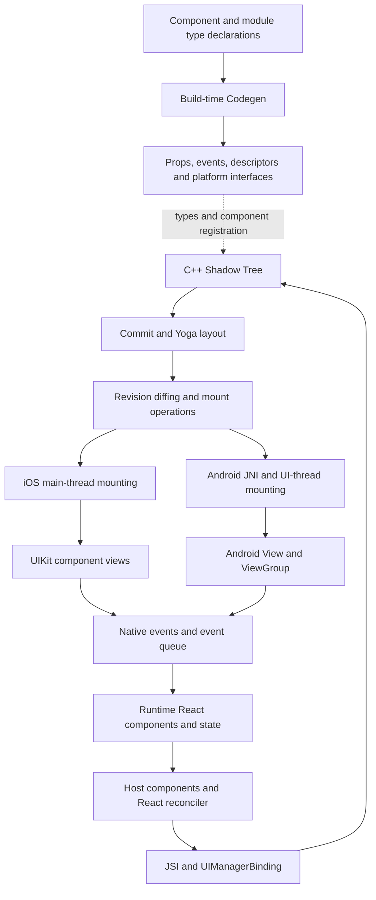

**English** · [简体中文](../zh-CN/Research/ReactNative.md)

# React Native's native UI implementation and lessons for Bern's architecture

- Document version: v0.1
- Research date: 2026-10-09
- Source repository: [Official React Native repository](https://github.com/react/react-native)
- Pinned commit: [`1449daad5e133c80fd643caccf9633201cb4c4f9`](https://github.com/react/react-native/commit/1449daad5e133c80fd643caccf9633201cb4c4f9)
- Scope: Fabric's JavaScript, shared C++, iOS and Android implementations, plus Codegen, events and lifecycle boundaries
- Related: [Bern architecture design](../Design.md), [UI adaptation guidelines](../Adaptation/README.md)

The core mechanism of React Native is: **run React to get a description of the UI, compute updates in a shared rendering layer, then have platform adapters create and update native views.** Codegen generates types and glue code, while the app's UI is still reconciled by the runtime; it does not translate arbitrary JSX pages directly into SwiftUI or Kotlin pages.

What Bern can learn from are the typed boundaries, stable instance identity, staged commits and platform lifecycle management. Bern continues to use constrained Rust declarations, target code generation and a command engine; it does not bring in a JavaScript runtime because of this, and it does not force SwiftUI, GTK and WinUI 3 into Fabric-style control renderers. The suggestions for Bern below are for prototype design and do not automatically change the established constraints of the main design.

## Source baseline and reading scope

This study reads the complete commit named above from the official repository; its commit time is 2026-10-09T03:06:33-07:00. It is a snapshot of main development; the `1000.0.0` in `packages/react-native/package.json` is a development placeholder version and must not be written as a released version. All source links in this document are pinned to that commit, so that later updates to main do not invalidate the call chains and line numbers.

The research reads the source statically and covers the key mounting and event paths on both platforms; it did not compile React Native, run performance benchmarks or verify anything on real devices. Feature flag branches in the source are explained conditionally; the actual configuration of every host cannot be inferred from the default values. The official [Fabric overview](https://reactnative.dev/architecture/fabric-renderer) and [render pipeline description](https://reactnative.dev/architecture/render-pipeline) were used to understand the terminology; for the concrete implementation, the pinned source is authoritative.

## The full path from JavaScript to native views

There are three different trees here, and they must not be lumped together as one data structure:

| Layer | What it expresses | Who is responsible |
| --- | --- | --- |
| React elements and Fiber | Results of component execution, state and reconciliation work | React's JavaScript runtime |
| Shadow Tree | Host components' props, children, native state, layout and identity | Fabric's shared C++ layer |
| Host View Tree | The native views that actually take part in display, input and system integration | The iOS and Android platform implementations |

A business wrapper component does not necessarily produce a Shadow Node, and a pure layout node does not necessarily produce a native view. So "write one component and get one system control" is not a reliable model.

### From View to a C++ node

Take `<View style={{width: 120, height: 48, backgroundColor: 'red'}} />` as an example:

1. `View.js` handles accessibility and other props and returns `ViewNativeComponent`. [View wrapper][r-view]
2. `ViewNativeComponent.js` registers the host component with `NativeComponentRegistry.get('RCTView', …)`. The result here is a host component identity, not a `UIView` that has already been created. [Host component definition][r-view-native]
3. At runtime the React renderer allocates a tag, reads the ViewConfig, builds the props payload, calls `createNode(tag, componentName, surfaceId, props, instanceHandle)`, and then attaches the children. [ReactFabric node creation][r-fabric-create]
4. `UIManagerBinding::createAndInstallIfNeeded` installs a C++ HostObject as `global.nativeFabricUIManager`. Its `createNode` HostFunction reads the JSI arguments and calls the C++ UIManager. [JSI installation and call entry point][r-jsi]
5. `UIManager::createNode` looks up the ComponentDescriptor, creates a family with the tag and surfaceId, parses the props, and creates the initial state and the Shadow Node. What exists at this point is a node of the shared rendering layer. [UIManager][r-uimanager]

Between the JS name `RCTView` and the C++ component name `View` there is also a name normalization step; text components have other alias mappings. A new framework should unify component identity from the start, rather than relying on class names happening to match across languages. [Name mapping][r-names]

JSI provides the interface for calls and value access between JavaScript and C++; it is not responsible for layout, component registration or OS thread scheduling. `ReactInstance::loadScript` still has a path that executes the JS bundle through the runtime, and the main branch also has engine-specific loading branches, but none of these amounts to translation into SwiftUI page source. [Runtime loading][r-runtime]

### Commit and layout

After the React renderer finishes the root's subtree, it calls `completeRoot`. The JSI binding turns this into `UIManager::completeSurface`, which explicitly sets `mountSynchronously = false`; the return of one synchronous JS-to-C++ call does not mean the screen has been updated. [Root commit binding][r-complete]

`completeSurface` builds a new root from the old root and hands it to `ShadowTree::commit`. On the ordinary non-branching path, `tryCommit` reads the old revision, performs tree transformations and state reconciliation, computes layout, and then checks whether the revision was changed by another commit; a conflict returns failure and goes into a retry. This snapshot also has React branch commit and merge logic controlled by feature flags, so no single one of these paths can be described as a fixed thread pipeline. [Commit implementation][r-shadow]

This stage is designed around immutable snapshots and shared clones. `sealRecursive` in the source does not enforce the same debug constraints in release builds, which shows that the immutable semantics also depend on implementation discipline; they are not a memory isolation guarantee obtained automatically.

Yoga handles the common layout computation. `YogaLayoutableShadowNode::layoutTree` takes the actual layout constraints, scale and text environment and calls `YGNodeCalculateLayout`; nodes that need to measure their content provide sizes through the `measureContent` callback. A common layout algorithm still needs inputs such as platform text metrics; unified coordinates alone cannot remove platform differences. [Yoga layout and measurement][r-yoga]

### Diffing and mount operations

`MountingCoordinator::push` keeps the newer tree revision; `pullTransaction` calls `calculateShadowViewMutations` on the base tree and the tree to be committed, producing a mount batch that carries a surfaceId and a sequence number. Advancing the base revision is tied to pulling the transaction; it cannot be described as confirmation that the operating system has finished drawing. [Mounting coordinator][r-coordinator]

There are five basic kinds of mutation: [ShadowViewMutation][r-mutations].

| Operation | Semantics | Lifecycle distinction that must be kept |
| --- | --- | --- |
| Create | Allocates or obtains a native view instance | Not the same as having been added to the parent view |
| Insert | Attaches it at the given position in the parent view | The initial props, state and layout also need to be in place |
| Update | Applies changed props, layout, state or event connections | Should not rebuild the instance without reason |
| Remove | Removes it from the parent–child hierarchy | Not the same as the resources being destroyed |
| Delete | Releases the registration or recycles the instance | The native object may go into a reuse pool |

When red changes to blue, React/Fabric can reuse the identity and the unchanged subtree and produce a prop update, instead of recreating the whole page. [ReactFabric clone path][r-fabric-clone], [Diff entry point][r-diff]

The transaction here is an ordered batch of UI operations, not a database transaction that promises to roll back automatically on failure. A tree revision having been committed, the operations having been applied and the system having presented them are also different stages; Bern should not merge the three into one success state.

### View flattening

`ViewShadowNode::initialize` sets `FormsView` and `FormsStackingContext` according to the props. Background, border, opacity, events, accessibility, nativeId, clipping and other conditions all affect whether a node can be collapsed; the diffing process uses this to build the host view hierarchy that is actually needed. [View conditions][r-view-traits]

This optimization shows that the logical component tree can be richer than the native view tree. But "delete the node if it has no background" does not hold: a node may carry focus, input, test identity or accessibility. Bern's Feature Contract and the identity of command entry points must not disappear along with optimizations of presentation nodes either.

## How the platforms receive mount results

### UIKit mounting on iOS

The shared `Scheduler` sends render notifications, which go through `RCTScheduler`'s delegate to `RCTSurfacePresenter`, which in turn calls `RCTMountingManager::scheduleTransaction`. If it is already on the main queue it processes the transaction directly; otherwise it moves to the main queue. The manager uses an in-progress flag to avoid executing mount transactions recursively. [Shared scheduling][r-scheduler], [iOS presentation entry point][r-ios-presenter], [Main-queue mounting][r-ios-mount]

The platform does not interpret JSX statement by statement; it executes mutations that have already been computed:

| Mount step | iOS implementation |
| --- | --- |
| Obtain an instance | The Registry takes a reusable object by ComponentHandle, or hands off to the Factory, which looks up the class and executes `[viewClass new]` |
| Initialize and insert | Apply props, eventEmitter, state and layout, run `finalizeUpdates`, then add it to the parent view |
| Modify an existing instance | Update separately according to changes in props, event connections, state and layout |
| Apply position and size | Set UIKit properties such as `center` and `bounds` in the component protocol implementation |
| Remove and recycle | Break the parent–child relationship; remove the tag registration, clean up the object, then reuse or invalidate it by type |

`RCTViewComponentView` inherits from `UIView`, mounting a child calls `insertSubview`, and layout is not handed to SwiftUI to be solved again. The Factory, the Registry and the component protocol each have their own responsibility, so the adapter can be extended with new native components independently. [Component factory][r-ios-factory], [Component registration and reuse][r-ios-registry], [UIView type][r-ios-view-type], [UIKit layout application][r-ios-layout]

Current main uses a local SwiftUI wrapper behind a feature flag to implement some filters. This is an internal presentation detail of a UIKit component; it cannot be used to claim that RN compiles whole JS pages into SwiftUI, nor to claim absolutely that RN never uses SwiftUI. [Filter wrapper][r-ios-filters]

Two runtime details are especially worth borrowing for Bern: `RCTTextInputComponentView` uses an event count to keep stale state from overwriting newer state, and uses `_comingFromJS` to distinguish programmatic write-backs; `RCTViewComponentView` defers safe-area change notifications to the layout phase, to avoid synchronously re-entering React while mounting and updating props. State versions, source identifiers and re-entrancy control must be part of the adapter contract. [Text input state][r-ios-text-state], [Text input callback][r-ios-text-event], [Safe-area event timing][r-ios-safearea]

### JNI and View mounting on Android

Android's platform delegate is `FabricUIManagerBinding`. The regular path pulls transactions from the MountingCoordinator; `FabricMountingManager::executeMount` packs the mutations into integer and object buffers and passes them through JNI to the Java `FabricUIManager`, after which the MountItemDispatcher and `IntBufferBatchMountItem` dispatch them to the manager of each surface. [Android delegate][r-android-binding], [C++ mount batch][r-android-cpp], [Java mount entry point][r-android-ui], [Batch execution][r-android-batch]

`SurfaceMountingManager` looks up the ViewManager by component name, indexes ViewState by tag, and calls `createView` or `updateProperties`. For example, `ReactViewManager.createViewInstance` returns `ReactViewGroup(context)`, a class that inherits from Android's `ViewGroup`. This path uses the Android View system; it does not automatically generate Compose pages. [Surface management][r-android-surface], [ViewManager][r-android-manager], [ReactViewManager][r-android-view], [ViewGroup type][r-android-viewgroup]

Layout updates still involve native work: the ordinary path calls `measure` with exact sizes and then calls `view.layout`; the case where the parent container is declared to lay out its children itself is handled separately. Props need to be applied before layout, because the measurement of native controls may depend on them. Array allocation and copying explicitly happen at the JNI boundary as well, so this chain cannot be called zero-copy. [Android layout][r-android-layout], [JNI buffer passing][r-android-jni]

Pending mounts are usually consumed by a UI frame callback; a synchronous path that is already on the UI thread can also execute them immediately. The Dispatcher prevents re-entrancy and holds operations for roots that are not attached yet. Current main also has an `enableMountingCoordinatorPullModelAndroid` branch: when it is enabled, the UI thread pulls and executes transactions, instead of all batches being built ahead of time. Its default at this commit is false, but hosts can override it; the threading arrangement has to be confirmed against the actual configuration. [Java scheduling entry point][r-android-ui], [Mount dispatch][r-android-dispatch], [Pull model branch][r-android-pull], [Default configuration][r-android-pull-default]

The reverse path can be understood through a concrete example: a focusable ReactViewGroup's `OnClickListener` creates a `ViewGroupClickEvent`, which goes through Fabric event dispatch, the EventEmitterWrapper of the corresponding surface and JNI back to the shared C++ event queue. Touch, text and scrolling have their own entry points; they cannot all be summed up as click listeners. [Click entry point][r-android-click], [JNI event wrapper][r-android-event]

### The boundary shared by both platforms

Both platforms reuse the shared rendering semantics, but mount queues, switching to the main thread, event wiring and recycling are the platform's responsibility. That a C++ method can be called synchronously does not mean every native UI object can be accessed from any thread.

For example, iOS's FabricSurface separates attaching the root view from starting the SurfaceHandler, and rechecks the registration state before an asynchronous start; stopping a surface triggers unmounting by committing an empty tree. Bern likewise has to handle windows and components that were "still valid when queued, already closed when executed". [Surface lifecycle][r-ios-surface], [SurfaceHandler stop][r-surface-stop]

## How events and commands come back

Native input such as touch, editing and scrolling enters Fabric through platform components and the EventEmitter. The shared `EventDispatcher` puts events into the `EventQueue`, whose processing is driven by EventBeat, and they then go back through UIManagerBinding to the event handlers registered by React. In the end React still runs the listeners the app provides. [Event dispatch][r-event-dispatch], [Event queue][r-event-queue], [Events back to JS][r-event-js], [Listener execution][r-listener]

The queue does not drop intermediate events unconditionally: events marked unique are coalesced only when target, type and ordering conditions are met; ordinary events are kept. `EventQueueProcessor` is also responsible for retaining and releasing the target objects during callbacks, and has to complete the release even if a callback throws. [Queue lifecycle][r-event-processor]

RN's `codegenNativeCommands` wraps component operations such as `focus` and `blur` as `dispatchCommand(ref, name, args)`. It requires an existing view target and mainly addresses "calling a method of a native control". RN also has paths such as arbitrary event listeners and `setNativeProps`, and does not force all business operations into a unified command catalog. [Native command wrapper][r-command], [UIManagerBinding command and prop interfaces][r-command-binding]

For Bern, this has to be split into three semantics:

| What comes in | How Bern handles it | Examples |
| --- | --- | --- |
| An operation intent expressed by the user | A registered Engine Command or Session Command | Play, search, navigate, move focus |
| A fact that has already happened on the platform | A trusted adapter submits a typed Event | Window size changed, player paused |
| The renderer's internal updates | The UI binding and scheduling mechanism | Applying prop snapshots, layout, drawing, animation sampling |

Turning things into commands does not require turning every draw call into an app command, nor may an action that has already completed be renamed a "command issued beforehand". Semantic operations that Bern owns, such as edit drafts, must still go through commands; the pattern "the native control first modifies session state however it likes and only emits onChange afterwards" must not be copied. A target must provide an adaptation that can be intercepted or let Bern host the interaction, and report it as unsupported when it cannot meet the contract. The trusted-fact exception is limited to the external system changes and adapter state reports defined by the main design, and must not become a path by which interactions Bern owns bypass commands.

## What Codegen actually generates

At build time, the spec collector recognizes declarations such as `codegenNativeComponent` and `extends TurboModule`, and builds a schema through the Flow or TypeScript parser. It reads explicit interface descriptions; it does not analyze arbitrary app functions to derive complete pages. [Spec collection][r-schema]

| Description type | Main generated content | Parts that still have to be implemented |
| --- | --- | --- |
| Fabric component | Props, EventEmitters, ComponentDescriptors, ShadowNodes, State, Android ViewManager interface/delegate, iOS helper | The actual native component, measurement, system behavior and resource management |
| TurboModule | JNI/Java spec, ObjC++ or C++ JSI interface | Module methods and platform service logic |
| JS component configuration and commands | ViewConfig, dispatch wrappers for the supported commands | Running React, event semantics and scheduling |

The list of outputs can be seen directly in the generator registry in `RNCodegen.js`; the JS ViewConfig has a separate generator and Babel integration. [Native output generators][r-codegen], [JS ViewConfig generator][r-viewconfig]

Fabric handles UI rendering, TurboModules handle native module access, and JSI is the interface foundation both can use; none of the three can stand in for another. On the main branch, the Bridgeless and non-Bridgeless installation paths of TurboModules also differ; there is no rule that "all native functionality has to pass through the same old bridge queue". [TurboModule binding][r-turbomodule]

The old `MessageQueue` code kept in the repository organizes batches by module ID, method ID and argument array. This helps in understanding the bridge described in older articles, but it cannot replace the Fabric call chain in this document. Conversely, using JSI does not mean all data conversion and batching are gone; Android's JNI mount batches are a concrete example. [Old queue implementation][r-legacy]

## Architectural designs Bern should borrow

### Separate compile-time semantics from runtime instances

Bern's common IR expresses components, capabilities, themes, command bindings and layout relationships; it should not mix in live GTK objects, Swift references or Android Views. Target generators consume the IR and generate platform UI source and clients; the runtime then maintains the actual windows, component instances and subscriptions. This matches RN's experience of separating schema, Shadow Node and Host View, but does not require Bern to copy the three trees.

| Bern layer | Suggested responsibilities | Responsibilities to avoid |
| --- | --- | --- |
| Compile-time component and command schema | Types, capabilities, command coverage, theme recipes and source locations | Platform objects that are currently running |
| Rust engine and session | Command execution, queries, state versions and long-lived resource identity | Manipulating platform control hierarchies |
| UI binding runtime | Presentation subscriptions, update versions, event mapping and instance scope | Rewriting business handlers |
| Target generators and adapters | Platform code, UI thread, native components and lifecycle | Re-parsing arbitrary Rust business implementations |

A component description should derive types, event payloads, command bindings and adaptation skeletons from the same declaration. After generation succeeds, each target still has to be built and its props, events and lifecycle verified; type generation cannot prove that native behavior is correct.

### Let each target framework own the layout and reconciliation that suit it

React Native needs the shared C++ Shadow Tree and Yoga to drive its native control system. Bern's target plan includes SwiftUI, which already has a declarative runtime, as well as GTK, WinUI 3, Compose, Flutter and the Web; one approach to responsibilities cannot fit them all.

- SwiftUI, Compose and Flutter targets preferably generate that framework's declarations and state bindings, and let it reconcile its own views and layout.
- Targets such as GTK and the Web can use explicit property updates and keyed child operations inside the adapter, with the concrete implementation kept private to the target.
- The common layer unifies layout semantics, input environment, stable identity and state versions; it does not by default send absolute coordinates to every target frame by frame.
- Only when a target explicitly needs a shared layout algorithm is the corresponding module brought in, with defined rules for measurement, fonts, safe areas and invalidation.

This avoids Rust first computing a complete layout and SwiftUI computing it again, with two reconcilers fighting over control identity at the same time. Consistent semantics across platforms do not require pixel-for-pixel sameness either.

### Make presentation versions and command order explicit

RN can skip intermediate tree revisions under certain conditions; this is a presentation optimization. Bern should manage the execution order of commands and the consumption order of presentation snapshots separately: player progress can be coalesced according to the subscription policy, while requests such as play, delete and confirm close must not be dropped just because the next frame arrives.

The suggestion is to carry the following information in the existing UI binding contract; the field names are still to be confirmed by the prototype:

| Information | Purpose |
| --- | --- |
| session, window and surface identity | Make clear which session and presentation root an update belongs to |
| Stable component key and instance generation | Keep reused objects from receiving callbacks meant for old instances |
| base revision and target revision | Distinguish the precondition of an incremental update from its target version |
| Theme and environment version | Keep computations based on an old theme or old size from overwriting new state |
| Source and request correlation | Distinguish command results, external facts and presentation write-backs, avoiding loops |

A full snapshot can pick the newer version according to policy; an incremental patch must match the receiver's base version. When a gap appears, request a resync; never apply a patch blindly just because its sequence number is larger. Commands that have been dispatched are handled independently according to the command contract; unmounting a component only removes its presentation subscriptions.

Render evaluation, layout and retryable commit stages should have no app side effects. For example, a source change of `Video(source: …)` produces one load request based on the stable source identity and version, and must not load again because of a layout retry; remounting the presentation should not create a second player either.

### Manage native windows and presentation roots separately

RN's Surface is a rendering root and scheduling scope, not a general operating system window manager. Bern needs to keep the mapping among WindowSet, logical windows, presentation roots and platform windows, and cannot let one surfaceId stand in for all of the ownership.

The first version chooses native or virtual presentation at creation time and falls back according to the contract when capabilities are insufficient; it does not promise arbitrary hot migration of windows that are already open. Both presentations follow the same logical identity rules; when a virtual window switches layout because of a size change, the window, navigation, drafts and `player_id` are kept. If hot migration between native and virtual is added in the future, the preservation of these states must also be verified separately.

The release order has to cover stopping subscriptions, invalidating old generations, detaching native events, detaching media surfaces and recycling views; whether an app-level player ends is still decided by its owner.

### Put optimizations behind verifiable boundaries

First verify the semantics of creation, update, removal and release, then add view reuse, flattening, preallocation and event coalescing. Reuse must reset props, events, focus, accessibility and media attachment, not just replace the displayed text.

An icon button still has a hit area, an accessible name and focus feedback even without a visible container; a transparent view must not be treated as having no semantics. Automatic theming likewise needs Bern's semantic roles, color algorithm and versioned snapshots; RN's native view mounting mechanism does not by itself provide this guarantee for Bern.

## Prototype verification order

The following are verification items suggested for later implementation; these tests were not run in this round.

1. **Type contract.** The same component declaration generates presentation values, events and command bindings; unknown props, missing commands or incompatible schemas fail explicitly and point back to the Rust declaration.
2. **Minimal UI loop.** First complete one prop update and one button command on the Web, then verify the same engine on one default native target; record the correlation between command execution and UI updates.
3. **Identity and incremental updates.** Reordering a list keeps edits and focus; callbacks from old instances, out-of-order versions and missing patches are handled correctly.
4. **Input and loops.** Cover input method composition, continuous input, command write-backs, native fact notifications and delayed events after a component unmounts; one operation is never executed twice.
5. **Windows and video resources.** Verify native and virtual presentation separately, fallback when capabilities are insufficient at creation time, virtual layout switching and remounting of video surfaces; logical instances or players must not be created twice.
6. **Equivalence before and after optimization.** Use a simplified host model to verify that applying increments gives a result equivalent to constructing the target state directly, then add flattening or reuse one item at a time.

RN's `ShadowTreeLifeCycleTest` already shows a verification approach worth adopting: generate and mutate trees, apply the diff to a StubViewTree, then compare it with a host tree rebuilt directly. Bern can borrow this test criterion; it does not need to copy RN's complete differ up front. [Tree lifecycle test][r-lifecycle-test]

The prototype should also record the time spent in state evaluation, cross-language transfer, UI scheduling, platform application and layout, as well as the number of native views and subscriptions. Performance conclusions must come from actual measurements on Bern targets; they cannot be inferred from JSI, from Rust or from the word "native".

## Source navigation

All references below point to the pinned commit. Long files use specific entry line numbers; these are reading entry points and do not mean the function consists only of that line.

| Reading question | Key entry points |
| --- | --- |
| How JS reaches host components | [View.js][r-view], [ViewNativeComponent.js][r-view-native] |
| When React creates and updates nodes | [ReactFabric create][r-fabric-create], [ReactFabric clone][r-fabric-clone] |
| How JSI connects to the shared core | [UIManagerBinding.cpp][r-jsi], [UIManager.cpp][r-uimanager] |
| Layout, commit and diffing | [ShadowTree.cpp][r-shadow], [YogaLayoutableShadowNode.cpp][r-yoga], [Differentiator.cpp][r-diff] |
| How revisions waiting to be mounted are managed | [MountingCoordinator.cpp][r-coordinator], [Scheduler.cpp][r-scheduler] |
| How iOS creates real views | [RCTMountingManager.mm][r-ios-mount], [RCTComponentViewFactory.mm][r-ios-factory] |
| How Android mounts across JNI | [FabricMountingManager.cpp][r-android-cpp], [SurfaceMountingManager.kt][r-android-surface] |
| How events get back to React | [EventQueue.cpp][r-event-queue], [UIManagerBinding.cpp event entry point][r-event-js] |
| How edit write-back loops are avoided | [RCTTextInputComponentView.mm][r-ios-text-state] |
| What Codegen actually generates | [combine-js-to-schema.js][r-schema], [RNCodegen.js][r-codegen] |
| Scope of RN's command interface | [codegenNativeCommands.js][r-command], [UIManagerBinding command entry point][r-command-binding] |
| How to verify that diffing is equivalent to direct construction | [ShadowTreeLifeCycleTest.cpp][r-lifecycle-test] |

[r-view]: https://github.com/react/react-native/blob/1449daad5e133c80fd643caccf9633201cb4c4f9/packages/react-native/Libraries/Components/View/View.js#L135
[r-view-native]: https://github.com/react/react-native/blob/1449daad5e133c80fd643caccf9633201cb4c4f9/packages/react-native/Libraries/Components/View/ViewNativeComponent.js#L18
[r-fabric-create]: https://github.com/react/react-native/blob/1449daad5e133c80fd643caccf9633201cb4c4f9/packages/react-native/Libraries/Renderer/implementations/ReactFabric-dev.js#L10436
[r-fabric-clone]: https://github.com/react/react-native/blob/1449daad5e133c80fd643caccf9633201cb4c4f9/packages/react-native/Libraries/Renderer/implementations/ReactFabric-dev.js#L10395
[r-jsi]: https://github.com/react/react-native/blob/1449daad5e133c80fd643caccf9633201cb4c4f9/packages/react-native/ReactCommon/react/renderer/uimanager/UIManagerBinding.cpp#L26
[r-uimanager]: https://github.com/react/react-native/blob/1449daad5e133c80fd643caccf9633201cb4c4f9/packages/react-native/ReactCommon/react/renderer/uimanager/UIManager.cpp#L65
[r-names]: https://github.com/react/react-native/blob/1449daad5e133c80fd643caccf9633201cb4c4f9/packages/react-native/ReactCommon/react/renderer/componentregistry/componentNameByReactViewName.cpp#L13
[r-runtime]: https://github.com/react/react-native/blob/1449daad5e133c80fd643caccf9633201cb4c4f9/packages/react-native/ReactCommon/react/runtime/ReactInstance.cpp#L245
[r-complete]: https://github.com/react/react-native/blob/1449daad5e133c80fd643caccf9633201cb4c4f9/packages/react-native/ReactCommon/react/renderer/uimanager/UIManagerBinding.cpp#L470
[r-shadow]: https://github.com/react/react-native/blob/1449daad5e133c80fd643caccf9633201cb4c4f9/packages/react-native/ReactCommon/react/renderer/mounting/ShadowTree.cpp#L303
[r-yoga]: https://github.com/react/react-native/blob/1449daad5e133c80fd643caccf9633201cb4c4f9/packages/react-native/ReactCommon/react/renderer/components/view/YogaLayoutableShadowNode.cpp#L634
[r-coordinator]: https://github.com/react/react-native/blob/1449daad5e133c80fd643caccf9633201cb4c4f9/packages/react-native/ReactCommon/react/renderer/mounting/MountingCoordinator.cpp#L39
[r-mutations]: https://github.com/react/react-native/blob/1449daad5e133c80fd643caccf9633201cb4c4f9/packages/react-native/ReactCommon/react/renderer/mounting/ShadowViewMutation.h#L24
[r-diff]: https://github.com/react/react-native/blob/1449daad5e133c80fd643caccf9633201cb4c4f9/packages/react-native/ReactCommon/react/renderer/mounting/Differentiator.cpp#L1361
[r-view-traits]: https://github.com/react/react-native/blob/1449daad5e133c80fd643caccf9633201cb4c4f9/packages/react-native/ReactCommon/react/renderer/components/view/ViewShadowNode.cpp#L32
[r-scheduler]: https://github.com/react/react-native/blob/1449daad5e133c80fd643caccf9633201cb4c4f9/packages/react-native/ReactCommon/react/renderer/scheduler/Scheduler.cpp#L299
[r-ios-presenter]: https://github.com/react/react-native/blob/1449daad5e133c80fd643caccf9633201cb4c4f9/packages/react-native/React/Fabric/RCTSurfacePresenter.mm#L341
[r-ios-mount]: https://github.com/react/react-native/blob/1449daad5e133c80fd643caccf9633201cb4c4f9/packages/react-native/React/Fabric/Mounting/RCTMountingManager.mm#L43
[r-ios-factory]: https://github.com/react/react-native/blob/1449daad5e133c80fd643caccf9633201cb4c4f9/packages/react-native/React/Fabric/Mounting/RCTComponentViewFactory.mm#L188
[r-ios-registry]: https://github.com/react/react-native/blob/1449daad5e133c80fd643caccf9633201cb4c4f9/packages/react-native/React/Fabric/Mounting/RCTComponentViewRegistry.mm#L43
[r-ios-view-type]: https://github.com/react/react-native/blob/1449daad5e133c80fd643caccf9633201cb4c4f9/packages/react-native/React/Fabric/Mounting/ComponentViews/View/RCTViewComponentView.h#L25
[r-ios-layout]: https://github.com/react/react-native/blob/1449daad5e133c80fd643caccf9633201cb4c4f9/packages/react-native/React/Fabric/Mounting/UIView%2BComponentViewProtocol.mm#L84
[r-ios-filters]: https://github.com/react/react-native/blob/1449daad5e133c80fd643caccf9633201cb4c4f9/packages/react-native/React/Fabric/Mounting/ComponentViews/View/RCTViewComponentView.mm#L1051
[r-ios-text-state]: https://github.com/react/react-native/blob/1449daad5e133c80fd643caccf9633201cb4c4f9/packages/react-native/React/Fabric/Mounting/ComponentViews/TextInput/RCTTextInputComponentView.mm#L347
[r-ios-text-event]: https://github.com/react/react-native/blob/1449daad5e133c80fd643caccf9633201cb4c4f9/packages/react-native/React/Fabric/Mounting/ComponentViews/TextInput/RCTTextInputComponentView.mm#L496
[r-ios-safearea]: https://github.com/react/react-native/blob/1449daad5e133c80fd643caccf9633201cb4c4f9/packages/react-native/React/Fabric/Mounting/ComponentViews/View/RCTViewComponentView.mm#L748
[r-android-binding]: https://github.com/react/react-native/blob/1449daad5e133c80fd643caccf9633201cb4c4f9/packages/react-native/ReactAndroid/src/main/jni/react/fabric/FabricUIManagerBinding.cpp#L678
[r-android-cpp]: https://github.com/react/react-native/blob/1449daad5e133c80fd643caccf9633201cb4c4f9/packages/react-native/ReactAndroid/src/main/jni/react/fabric/FabricMountingManager.cpp#L586
[r-android-ui]: https://github.com/react/react-native/blob/1449daad5e133c80fd643caccf9633201cb4c4f9/packages/react-native/ReactAndroid/src/main/java/com/facebook/react/fabric/FabricUIManager.java#L945
[r-android-batch]: https://github.com/react/react-native/blob/1449daad5e133c80fd643caccf9633201cb4c4f9/packages/react-native/ReactAndroid/src/main/java/com/facebook/react/fabric/mounting/mountitems/IntBufferBatchMountItem.kt#L68
[r-android-surface]: https://github.com/react/react-native/blob/1449daad5e133c80fd643caccf9633201cb4c4f9/packages/react-native/ReactAndroid/src/main/java/com/facebook/react/fabric/mounting/SurfaceMountingManager.kt#L578
[r-android-manager]: https://github.com/react/react-native/blob/1449daad5e133c80fd643caccf9633201cb4c4f9/packages/react-native/ReactAndroid/src/main/java/com/facebook/react/uimanager/ViewManager.java#L141
[r-android-view]: https://github.com/react/react-native/blob/1449daad5e133c80fd643caccf9633201cb4c4f9/packages/react-native/ReactAndroid/src/main/java/com/facebook/react/views/view/ReactViewManager.kt#L468
[r-android-viewgroup]: https://github.com/react/react-native/blob/1449daad5e133c80fd643caccf9633201cb4c4f9/packages/react-native/ReactAndroid/src/main/java/com/facebook/react/views/view/ReactViewGroup.kt#L80
[r-android-layout]: https://github.com/react/react-native/blob/1449daad5e133c80fd643caccf9633201cb4c4f9/packages/react-native/ReactAndroid/src/main/java/com/facebook/react/fabric/mounting/SurfaceMountingManager.kt#L829
[r-android-jni]: https://github.com/react/react-native/blob/1449daad5e133c80fd643caccf9633201cb4c4f9/packages/react-native/ReactAndroid/src/main/jni/react/fabric/FabricMountingManager.cpp#L1018
[r-android-dispatch]: https://github.com/react/react-native/blob/1449daad5e133c80fd643caccf9633201cb4c4f9/packages/react-native/ReactAndroid/src/main/java/com/facebook/react/fabric/mounting/MountItemDispatcher.kt#L95
[r-android-pull]: https://github.com/react/react-native/blob/1449daad5e133c80fd643caccf9633201cb4c4f9/packages/react-native/ReactAndroid/src/main/jni/react/fabric/FabricUIManagerBinding.cpp#L710
[r-android-pull-default]: https://github.com/react/react-native/blob/1449daad5e133c80fd643caccf9633201cb4c4f9/packages/react-native/ReactCommon/react/featureflags/ReactNativeFeatureFlagsDefaults.h#L200
[r-android-click]: https://github.com/react/react-native/blob/1449daad5e133c80fd643caccf9633201cb4c4f9/packages/react-native/ReactAndroid/src/main/java/com/facebook/react/views/view/ReactViewManager.kt#L423
[r-android-event]: https://github.com/react/react-native/blob/1449daad5e133c80fd643caccf9633201cb4c4f9/packages/react-native/ReactAndroid/src/main/jni/react/fabric/EventEmitterWrapper.cpp#L31
[r-ios-surface]: https://github.com/react/react-native/blob/1449daad5e133c80fd643caccf9633201cb4c4f9/packages/react-native/React/Fabric/Surface/RCTFabricSurface.mm#L94
[r-surface-stop]: https://github.com/react/react-native/blob/1449daad5e133c80fd643caccf9633201cb4c4f9/packages/react-native/ReactCommon/react/renderer/scheduler/SurfaceHandler.cpp#L79
[r-event-dispatch]: https://github.com/react/react-native/blob/1449daad5e133c80fd643caccf9633201cb4c4f9/packages/react-native/ReactCommon/react/renderer/core/EventDispatcher.cpp#L26
[r-event-queue]: https://github.com/react/react-native/blob/1449daad5e133c80fd643caccf9633201cb4c4f9/packages/react-native/ReactCommon/react/renderer/core/EventQueue.cpp#L25
[r-event-js]: https://github.com/react/react-native/blob/1449daad5e133c80fd643caccf9633201cb4c4f9/packages/react-native/ReactCommon/react/renderer/uimanager/UIManagerBinding.cpp#L117
[r-listener]: https://github.com/react/react-native/blob/1449daad5e133c80fd643caccf9633201cb4c4f9/packages/react-native/Libraries/Renderer/implementations/ReactFabric-dev.js#L755
[r-event-processor]: https://github.com/react/react-native/blob/1449daad5e133c80fd643caccf9633201cb4c4f9/packages/react-native/ReactCommon/react/renderer/core/EventQueueProcessor.cpp#L29
[r-command]: https://github.com/react/react-native/blob/1449daad5e133c80fd643caccf9633201cb4c4f9/packages/react-native/Libraries/Utilities/codegenNativeCommands.js#L26
[r-command-binding]: https://github.com/react/react-native/blob/1449daad5e133c80fd643caccf9633201cb4c4f9/packages/react-native/ReactCommon/react/renderer/uimanager/UIManagerBinding.cpp#L550
[r-schema]: https://github.com/react/react-native/blob/1449daad5e133c80fd643caccf9633201cb4c4f9/packages/react-native-codegen/src/cli/combine/combine-js-to-schema.js#L24
[r-codegen]: https://github.com/react/react-native/blob/1449daad5e133c80fd643caccf9633201cb4c4f9/packages/react-native-codegen/src/generators/RNCodegen.js#L125
[r-viewconfig]: https://github.com/react/react-native/blob/1449daad5e133c80fd643caccf9633201cb4c4f9/packages/react-native-codegen/src/generators/components/GenerateViewConfigJs.js#L365
[r-turbomodule]: https://github.com/react/react-native/blob/1449daad5e133c80fd643caccf9633201cb4c4f9/packages/react-native/ReactCommon/react/nativemodule/core/ReactCommon/TurboModuleBinding.cpp#L117
[r-legacy]: https://github.com/react/react-native/blob/1449daad5e133c80fd643caccf9633201cb4c4f9/packages/react-native/Libraries/BatchedBridge/MessageQueue.js#L243
[r-lifecycle-test]: https://github.com/react/react-native/blob/1449daad5e133c80fd643caccf9633201cb4c4f9/packages/react-native/ReactCommon/react/renderer/mounting/tests/ShadowTreeLifeCycleTest.cpp#L93
