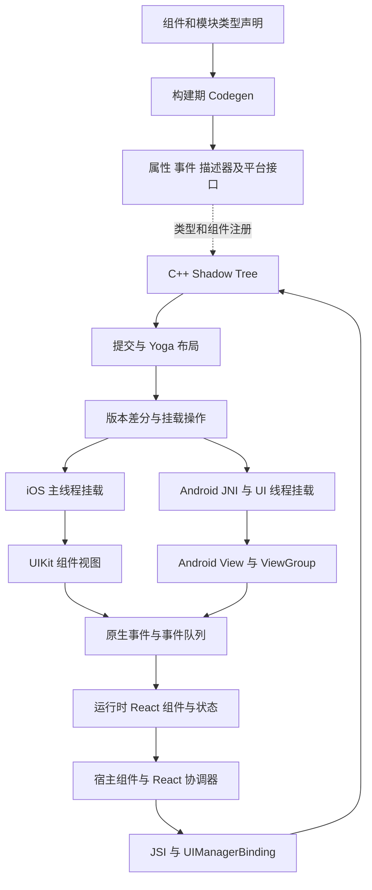

# React Native 原生 UI 实现与 Bern 架构借鉴

- 文档版本：v0.1
- 研究日期：2026-10-09
- 源码仓库：[React Native 官方仓库](https://github.com/react/react-native)
- 固定提交：[`1449daad5e133c80fd643caccf9633201cb4c4f9`](https://github.com/react/react-native/commit/1449daad5e133c80fd643caccf9633201cb4c4f9)
- 范围：Fabric 的 JavaScript、共享 C++、iOS 和 Android 实现，以及 Codegen、事件和生命周期边界
- 关联：[Bern 架构设计](../Design.md)、[UI 自适应适配规范](../Adaptation/README.md)

React Native 的核心机制是：**运行 React 得到界面描述，通过共享渲染层计算更新，再由平台适配器创建和更新原生视图。** Codegen 生成类型与连接代码，应用界面仍由运行时协调；它不会把任意 JSX 页面直接翻译成 SwiftUI 或 Kotlin 页面。

Bern 值得借鉴的是类型化边界、稳定实例身份、分阶段提交和平台生命周期管理。Bern 继续采用受约束 Rust 声明、目标代码生成和命令引擎；不因此引入 JavaScript 运行时，也不把 SwiftUI、GTK、WinUI 3 强制改造成 Fabric 式控件渲染器。下文的 Bern 建议用于原型设计，不自动改变主设计的既定约束。

## 源码基准与阅读范围

本次读取官方仓库的上述完整提交，提交时间为 2026-10-09T03:06:33-07:00。这是 main 开发快照；`packages/react-native/package.json` 中的 `1000.0.0` 是开发占位版本，不能写成已发布版本。本文源码链接均固定到该提交，避免后续 main 更新使调用链与行号失效。

研究采用源码静态阅读，覆盖两端挂载和事件的关键路径；没有编译 React Native、运行性能基准或执行真机验证。源码中的 feature flag 分支按条件解释，不能从默认值推断所有宿主的实际配置。官方 [Fabric 概述](https://reactnative.dev/architecture/fabric-renderer)和[渲染阶段说明](https://reactnative.dev/architecture/render-pipeline)用于理解术语，具体实现以固定源码为准。

## JavaScript 到原生视图的完整路径

这里存在三种不同的树，不能混为一个数据结构：

| 层次 | 表达什么 | 谁负责 |
| --- | --- | --- |
| React 元素与 Fiber | 组件执行结果、状态和协调工作 | React 的 JavaScript 运行时 |
| Shadow Tree | 宿主组件的属性、子节点、原生状态、布局与身份 | Fabric 共享 C++ 层 |
| Host View Tree | 实际参与显示、输入和系统集成的原生视图 | iOS、Android 平台实现 |

业务封装组件不一定产生 Shadow Node；纯布局节点也不一定产生原生视图。因此“写了一个组件，就创建一个系统控件”不是可靠模型。

### 从 View 到 C++ 节点

以 `<View style={{width: 120, height: 48, backgroundColor: 'red'}} />` 为例：

1. `View.js` 处理可访问性等属性，返回 `ViewNativeComponent`。[View 包装][r-view]
2. `ViewNativeComponent.js` 使用 `NativeComponentRegistry.get('RCTView', …)` 登记宿主组件。这里的结果是宿主组件身份，不是已经创建的 `UIView`。[宿主组件定义][r-view-native]
3. React renderer 在运行时分配 tag、读取 ViewConfig、生成属性载荷，调用 `createNode(tag, componentName, surfaceId, props, instanceHandle)`，随后连接子节点。[ReactFabric 节点创建][r-fabric-create]
4. `UIManagerBinding::createAndInstallIfNeeded` 把 C++ HostObject 安装为 `global.nativeFabricUIManager`。其 `createNode` HostFunction 读取 JSI 参数，调用 C++ UIManager。[JSI 安装与调用入口][r-jsi]
5. `UIManager::createNode` 查找 ComponentDescriptor，创建带 tag 与 surfaceId 的 family，解析 props，创建初始 state 和 Shadow Node。此时获得的是共享渲染层节点。[UIManager][r-uimanager]

JS 名称 `RCTView` 与 C++ 组件名 `View` 之间还有名称归一化；文本组件存在其他别名映射。新框架应从一开始统一组件身份，避免依赖各语言中的类名恰好相同。[名称映射][r-names]

JSI 提供 JavaScript 与 C++ 的调用及值访问接口，并不负责布局、组件注册或操作系统线程调度。`ReactInstance::loadScript` 中仍有通过运行时执行 JS bundle 的路径；主分支也有引擎专用加载分支，但这些都不构成向 SwiftUI 页面源码的翻译。[运行时加载][r-runtime]

### 提交与布局

React renderer 完成根的子树后调用 `completeRoot`。JSI 绑定将其转为 `UIManager::completeSurface`，此处明确设置 `mountSynchronously = false`；一次 JS 到 C++ 的同步调用返回，不代表屏幕已经更新。[根提交绑定][r-complete]

`completeSurface` 以旧根为基础构造新根，交给 `ShadowTree::commit`。在普通非分支路径中，`tryCommit` 读取旧版本、执行树变换与状态协调、计算布局，再检查版本是否被其他提交改变；冲突会返回失败并进入重试。该快照另有 feature flag 控制的 React 分支提交与合并逻辑，不能把其中某一种路径写成固定线程流水线。[提交实现][r-shadow]

这一阶段以不可变快照和克隆共享为设计基础。源码中的 `sealRecursive` 在 release 下不执行同样的调试约束，说明不可变语义还依赖实现纪律；它不是自动获得的内存隔离保障。

Yoga 负责公共布局计算。`YogaLayoutableShadowNode::layoutTree` 接收实际布局约束、比例和文字环境，调用 `YGNodeCalculateLayout`；需要测量内容的节点通过 `measureContent` 回调提供尺寸。公共布局算法仍需要平台文字度量等输入，不能仅靠统一坐标消除平台差异。[Yoga 布局与测量][r-yoga]

### 差分与挂载操作

`MountingCoordinator::push` 保留较新的树版本；`pullTransaction` 对基准树与待提交树调用 `calculateShadowViewMutations`，得到带 surfaceId 和序号的挂载批次。基准版本的推进与事务拉取关联，不能直接把它称作操作系统已经绘制完成的确认。[挂载协调器][r-coordinator]

共有五类基本变更：[ShadowViewMutation][r-mutations]。

| 操作 | 语义 | 必须区分的生命周期 |
| --- | --- | --- |
| Create | 分配或取得一个原生视图实例 | 不等于已经加入父视图 |
| Insert | 挂到父视图的指定位置 | 初始属性、状态和布局也需要到位 |
| Update | 应用变化的属性、布局、状态或事件连接 | 不应无故重建实例 |
| Remove | 从父子层级中移除 | 不等于资源已销毁 |
| Delete | 释放登记或回收实例 | 原生对象可能进入复用池 |

红色改为蓝色时，React/Fabric 可以复用身份和未变化的子树，生成属性更新，而不是重新创建整页。[ReactFabric 克隆路径][r-fabric-clone]、[差分入口][r-diff]

这里的 transaction 是有顺序的 UI 操作批次，不是承诺失败时自动回滚的数据库事务。树版本已提交、操作已应用、系统已呈现也属于不同阶段；Bern 不应把三者合并为一个成功状态。

### 视图扁平化

`ViewShadowNode::initialize` 根据属性设置 `FormsView` 和 `FormsStackingContext`。背景、边框、透明度、事件、可访问性、nativeId、裁剪等条件都会影响是否能折叠；差分过程据此建立真正需要的宿主视图层级。[视图条件][r-view-traits]

这项优化说明，逻辑组件树可以比原生视图树丰富。但“没有背景就删掉节点”不成立：节点可能承载焦点、输入、测试身份或辅助功能。Bern 的 Feature Contract 和命令入口身份也不能随呈现节点的优化一起消失。

## 平台如何接收挂载结果

### iOS 的 UIKit 挂载

共享 `Scheduler` 发出渲染通知，经 `RCTScheduler` 的代理转到 `RCTSurfacePresenter`，由后者调用 `RCTMountingManager::scheduleTransaction`。已经位于主队列时直接处理，否则转到主队列。管理器通过进行中标记避免递归执行挂载事务。[共享调度][r-scheduler]、[iOS 呈现入口][r-ios-presenter]、[主队列挂载][r-ios-mount]

平台并不是逐条解释 JSX，而是执行已经算出的变更：

| 挂载步骤 | iOS 实现 |
| --- | --- |
| 取得实例 | Registry 按 ComponentHandle 取复用对象，或交给 Factory 查类并执行 `[viewClass new]` |
| 初始化并插入 | 应用 props、eventEmitter、state、layout，执行 `finalizeUpdates`，再加入父视图 |
| 修改已有实例 | 按属性、事件连接、状态、布局的变化分别更新 |
| 应用位置与尺寸 | 在组件协议实现中设置 UIKit `center`、`bounds` 等属性 |
| 移除与回收 | 解除父子关系；移除 tag 登记，清理对象后按类型复用或失效 |

`RCTViewComponentView` 继承 `UIView`，子节点挂载调用 `insertSubview`，布局并非交给 SwiftUI 再求解。Factory、Registry 和组件协议各有职责，适配器因此可以独立扩充新的原生组件。[组件工厂][r-ios-factory]、[组件注册与复用][r-ios-registry]、[UIView 类型][r-ios-view-type]、[UIKit 布局应用][r-ios-layout]

当前 main 在 feature flag 下使用局部 SwiftUI wrapper 实现部分滤镜。这是 UIKit 组件的内部呈现实现，不能据此说 RN 将整页 JS 编译为 SwiftUI，也不能绝对声称 RN 完全不使用 SwiftUI。[滤镜包装][r-ios-filters]

两个运行时细节尤其适合 Bern 借鉴：`RCTTextInputComponentView` 用事件计数抵御旧状态覆盖，并用 `_comingFromJS` 区分程序写回；`RCTViewComponentView` 将安全区变化通知延后到布局阶段，避免在挂载和更新属性时同步重入 React。状态版本、来源标识和重入控制必须进入适配器契约。[文本输入状态][r-ios-text-state]、[文本输入回调][r-ios-text-event]、[安全区事件时机][r-ios-safearea]

### Android 的 JNI 与 View 挂载

Android 的平台 delegate 是 `FabricUIManagerBinding`。常规路径从 MountingCoordinator 拉取事务，`FabricMountingManager::executeMount` 将变更整理为整数和对象缓冲区，经 JNI 交给 Java `FabricUIManager`，再由 MountItemDispatcher 与 `IntBufferBatchMountItem` 分派到每个 surface 的管理器。[Android delegate][r-android-binding]、[C++ 挂载批次][r-android-cpp]、[Java 挂载入口][r-android-ui]、[批次执行][r-android-batch]

`SurfaceMountingManager` 根据组件名查找 ViewManager，以 tag 索引 ViewState，调用 `createView` 或 `updateProperties`。例如 `ReactViewManager.createViewInstance` 返回 `ReactViewGroup(context)`，该类继承 Android `ViewGroup`。这条路径使用 Android View 系统，不是自动生成 Compose 页面。[Surface 管理][r-android-surface]、[ViewManager][r-android-manager]、[ReactViewManager][r-android-view]、[ViewGroup 类型][r-android-viewgroup]

布局更新仍有原生工作：普通路径以精确尺寸调用 `measure`，再调用 `view.layout`；声明由父容器自行布局的情况另作处理。属性需要先于布局应用，因为原生控件的测量可能依赖它们。JNI 处也明确存在数组分配与复制，因此不能把这条链称为零拷贝。[Android 布局][r-android-layout]、[JNI 缓冲区传递][r-android-jni]

待处理挂载通常由 UI 帧回调消费；已在 UI 线程的同步路径也可以立即执行。Dispatcher 防止重入，对尚未附着的根暂存操作。当前 main 还有 `enableMountingCoordinatorPullModelAndroid` 分支：启用时由 UI 线程拉取并执行事务，而非提前构造全部批次。该提交的默认值为 false，但宿主能够覆盖；线程安排须按实际配置确认。[Java 调度入口][r-android-ui]、[挂载分派][r-android-dispatch]、[pull model 分支][r-android-pull]、[默认配置][r-android-pull-default]

反向路径可以用一个具体例子理解：可聚焦 ReactViewGroup 的 `OnClickListener` 创建 `ViewGroupClickEvent`，经 Fabric 事件分发、对应 surface 的 EventEmitterWrapper 和 JNI 返回共享 C++ 事件队列。触摸、文本和滚动有自己的入口，不能全部概括为点击监听器。[点击入口][r-android-click]、[JNI 事件封装][r-android-event]

### 两个平台的共同边界

两端复用共享渲染语义，但挂载队列、主线程切换、事件接线和回收方式由平台负责。C++ 中一个方法可同步调用，不表示所有原生 UI 对象可在任意线程访问。

例如 iOS 的 FabricSurface 将根视图附着与 SurfaceHandler 启动分开，并在异步启动前重新检查注册状态；停止 surface 通过空树提交触发卸载。Bern 同样需要处理“排队时还有效，执行时已经关闭”的窗口和组件。[Surface 生命周期][r-ios-surface]、[SurfaceHandler 停止][r-surface-stop]

## 事件与命令如何返回

原生触摸、编辑和滚动等输入经平台组件及 EventEmitter 进入 Fabric。共享 `EventDispatcher` 把事件送入 `EventQueue`，由 EventBeat 驱动处理，再经 UIManagerBinding 回到 React 注册的事件处理器。React 最终仍会执行应用提供的 listener。[事件分发][r-event-dispatch]、[事件队列][r-event-queue]、[事件回到 JS][r-event-js]、[listener 执行][r-listener]

队列并非无条件丢弃中间事件：标记为 unique 的事件只在满足目标、类型和顺序条件时合并；普通事件保留。`EventQueueProcessor` 还负责目标对象在回调期间的保留和释放，即使回调异常也要完成释放。[队列生命周期][r-event-processor]

RN 的 `codegenNativeCommands` 将 `focus`、`blur` 等组件操作包装为 `dispatchCommand(ref, name, args)`。它要求已有视图目标，主要解决“调用原生控件方法”。RN 同时存在任意事件 listener 和 `setNativeProps` 等路径，未强制所有业务操作进入统一命令目录。[原生命令包装][r-command]、[UIManagerBinding 命令及属性接口][r-command-binding]

对 Bern 来说，这需要拆为三种语义：

| 入口内容 | Bern 中的处理方式 | 示例 |
| --- | --- | --- |
| 用户表达的操作意图 | 已登记的 Engine Command 或 Session Command | 播放、搜索、导航、焦点移动 |
| 平台已经发生的事实 | 受信任适配器提交类型化 Event | 窗口尺寸改变、播放器已暂停 |
| 渲染器的内部更新 | UI 绑定和调度机制 | 应用属性快照、布局、绘制、动画采样 |

命令化不要求把每个绘制调用变成应用命令，也不能把已经完成的动作改名为“事前命令”。Bern 拥有的编辑草稿等语义操作仍必须经过命令；不能照搬“原生控件先任意修改会话状态，事后只发 onChange”的模式。目标必须提供可拦截适配或由 Bern 托管交互，无法满足契约时报告不支持。可信事实例外限于主设计定义的外部系统变化与适配器状态回报，不能成为自有交互绕过命令的路径。

## Codegen 实际生成什么

构建期的 spec 收集器识别 `codegenNativeComponent` 和 `extends TurboModule` 等声明，通过 Flow 或 TypeScript parser 建立 schema。它读取明确的接口描述，不分析任意应用函数来推导完整页面。[spec 收集][r-schema]

| 描述类型 | 生成的主要内容 | 仍需实现的部分 |
| --- | --- | --- |
| Fabric 组件 | Props、EventEmitters、ComponentDescriptors、ShadowNodes、State、Android ViewManager interface/delegate、iOS helper | 真正的原生组件、测量、系统行为与资源管理 |
| TurboModule | JNI/Java spec、ObjC++ 或 C++ JSI 接口 | 模块方法和平台服务逻辑 |
| JS 组件配置与命令 | ViewConfig、受支持命令的分派包装 | React 运行、事件语义和调度 |

产物清单可直接在 `RNCodegen.js` 的 generator 注册表看到；JS ViewConfig 另有生成器及 Babel 集成。[原生产物生成器][r-codegen]、[JS ViewConfig 生成器][r-viewconfig]

Fabric 负责 UI 渲染，TurboModules 负责原生模块访问，JSI 是可被两者使用的接口基础，三者不能互相替代。主分支中 TurboModule 的 Bridgeless 与非 Bridgeless 安装路径还不同；不存在“所有原生功能必经同一个旧桥接队列”的规则。[TurboModule 绑定][r-turbomodule]

仓库保留的旧 `MessageQueue` 代码使用 module ID、method ID 和参数数组组织批次。这有助于理解历史文章中的 bridge，但不能拿来替代本文的 Fabric 调用链。反过来，使用 JSI 也不意味着取消了一切数据转换和批处理，Android 的 JNI 挂载批次就是具体例子。[旧队列实现][r-legacy]

## Bern 应借鉴的架构设计

### 分开编译期语义与运行时实例

Bern 的公共 IR 表达组件、能力、主题、命令绑定和布局关系；它不应该混入活跃的 GTK 对象、Swift 引用或 Android View。目标生成器消费 IR，生成平台 UI 源码和客户端；运行时再维护实际窗口、组件实例与订阅。这与 RN 区分 schema、Shadow Node 和 Host View 的经验一致，但不要求 Bern 复制三棵树。

| Bern 层次 | 建议承担的职责 | 避免承担的职责 |
| --- | --- | --- |
| 编译期组件与命令 schema | 类型、能力、命令覆盖、主题配方和源码位置 | 当前运行中的平台对象 |
| Rust 引擎与会话 | 命令执行、查询、状态版本和长期资源身份 | 操作平台控件层级 |
| UI 绑定运行时 | 展示订阅、更新版本、事件映射和实例作用域 | 重写业务处理器 |
| 目标生成器与适配器 | 平台代码、UI 线程、原生组件及生命周期 | 重新解析任意 Rust 业务实现 |

组件描述应从同一声明派生类型、事件载荷、命令绑定和适配骨架。生成成功后仍要构建各目标，并验证属性、事件和生命周期；类型生成不能证明原生行为正确。

### 让目标框架拥有适合它的布局与协调

React Native 需要共享 C++ Shadow Tree 和 Yoga 来驱动其原生控件系统。Bern 的目标规划包含已有声明式运行时的 SwiftUI，以及 GTK、WinUI 3、Compose、Flutter、Web，职责不能一刀切。

- SwiftUI、Compose、Flutter 目标优先生成该框架的声明与状态绑定，由它们协调自己的视图和布局。
- GTK、Web 等目标可在适配器内采用显式属性更新与 keyed 子节点操作，具体实现保持目标私有。
- 公共层统一布局语义、输入环境、稳定身份和状态版本；不默认逐帧给每个目标下发绝对坐标。
- 只有目标明确需要共享布局算法时，才引入相应模块，并定义测量、字体、安全区域及失效规则。

这能避免 Rust 先算一套完整布局、SwiftUI 再算一遍，并且两套协调器同时争夺控件身份。跨平台语义一致也不要求逐像素相同。

### 明确展示版本与命令顺序

RN 可以在特定条件下跳过中间树版本，这属于展示优化。Bern 应分别管理命令的执行顺序和展示快照的消费顺序：播放器进度可按订阅策略合并，播放、删除、确认关闭等请求不能因为下一帧到来就被丢弃。

建议在现有 UI 绑定契约中落实以下信息，字段名称仍待原型确认：

| 信息 | 用途 |
| --- | --- |
| session、window、surface 身份 | 明确更新属于哪个会话与呈现根 |
| 组件稳定 key 与实例代次 | 防止复用对象接收旧实例的回调 |
| base revision 与 target revision | 区分增量更新的前置条件与目标版本 |
| 主题及环境版本 | 防止旧主题或旧尺寸计算覆盖新状态 |
| 来源及请求关联 | 区分命令结果、外部事实和展示写回，避免回环 |

完整快照可以按策略选择较新版本；增量补丁必须匹配接收端的基准版本。出现缺口时请求重同步，不能只因序号更大就盲目应用。已派发命令按命令契约独立处理，组件卸载仅解除其展示订阅。

渲染求值、布局和可重试的提交阶段应没有应用副作用。例如 `Video(source: …)` 的源变化依据稳定源身份与版本生成一次加载请求，不能因布局重试再次加载；呈现重挂载也不应创建第二个播放器。

### 原生窗口与呈现根分别管理

RN 的 Surface 是渲染根与调度范围，不是通用操作系统窗口管理器。Bern 需要保留 WindowSet、逻辑窗口、呈现根和平台窗口之间的映射，不能用一个 surfaceId 代替全部所有权。

首版在创建时选择原生或虚拟呈现，能力不足时按契约回退，不承诺已打开窗口任意热迁移。两种呈现使用同一逻辑身份规则；虚拟窗口因尺寸变化切换布局时，保留窗口、导航、草稿和 `player_id`。未来若增加原生与虚拟之间的热迁移，也必须单独验证这些状态的保留。

释放顺序要覆盖停止订阅、失效旧代次、解除原生事件、分离媒体表面和回收视图；应用级播放器是否结束仍由其所有者决定。

### 把优化放在可验证的边界后

先验证创建、更新、移除与释放的语义，再加入视图复用、扁平化、预分配和事件合并。复用必须重置属性、事件、焦点、辅助功能和媒体附着，不能仅替换显示文字。

图标按钮即使没有可见容器，也仍有命中区域、可访问名称和焦点反馈；不能把透明视图视作没有语义。自动主题同样需要 Bern 的语义角色、配色算法与版本化快照；RN 的原生视图挂载机制本身没有替 Bern 提供这项保证。

## 原型验证顺序

以下为建议加入后续实施的验证项，本轮没有执行这些测试。

1. **类型契约。** 同一组件声明生成展示值、事件和命令绑定；未知属性、缺少命令或不兼容 schema 明确失败，并定位回 Rust 声明。
2. **最小 UI 闭环。** 先在 Web 完成一个属性更新和一个按钮命令，再在一个默认原生目标验证同一引擎；记录命令执行与 UI 更新的关联。
3. **身份与增量更新。** 列表重排保留编辑与焦点；旧实例回调、版本乱序和缺失补丁被正确处理。
4. **输入与回环。** 覆盖输入法组合、连续输入、命令写回、原生事实通知和组件卸载后的延迟事件；一次操作不会重复执行。
5. **窗口与视频资源。** 分别验证原生和虚拟呈现、创建时能力不足的回退、虚拟布局切换和视频表面重挂载；不得重复创建逻辑实例或播放器。
6. **优化前后等价。** 用简化的宿主模型验证增量应用结果等价于直接构造目标状态，再逐项加入扁平化或复用。

RN 的 `ShadowTreeLifeCycleTest` 已展示一种值得采用的验证方式：生成并改变树，将差分应用到 StubViewTree，再与直接重建的宿主树比较。Bern 可借鉴这种测试判据；不必预先复制其完整差分器。[树生命周期测试][r-lifecycle-test]

原型还应记录状态求值、跨语言传递、UI 调度、平台应用和布局的耗时，以及原生视图与订阅数量。性能结论须来自 Bern 目标的实际测量，不能从 JSI、Rust 或“原生”名称推断。

## 源码导航

下列引用均指向固定提交。长文件使用具体入口行号；它们是阅读入口，不表示函数只有该行内容。

| 阅读问题 | 关键入口 |
| --- | --- |
| JS 如何进入宿主组件 | [View.js][r-view]、[ViewNativeComponent.js][r-view-native] |
| React 何时创建与更新节点 | [ReactFabric 创建][r-fabric-create]、[ReactFabric 克隆][r-fabric-clone] |
| JSI 如何连接共享核心 | [UIManagerBinding.cpp][r-jsi]、[UIManager.cpp][r-uimanager] |
| 布局、提交与差分 | [ShadowTree.cpp][r-shadow]、[YogaLayoutableShadowNode.cpp][r-yoga]、[Differentiator.cpp][r-diff] |
| 如何管理待挂载版本 | [MountingCoordinator.cpp][r-coordinator]、[Scheduler.cpp][r-scheduler] |
| iOS 怎样创建真实视图 | [RCTMountingManager.mm][r-ios-mount]、[RCTComponentViewFactory.mm][r-ios-factory] |
| Android 怎样跨 JNI 挂载 | [FabricMountingManager.cpp][r-android-cpp]、[SurfaceMountingManager.kt][r-android-surface] |
| 事件如何回到 React | [EventQueue.cpp][r-event-queue]、[UIManagerBinding.cpp 事件入口][r-event-js] |
| 如何避免编辑写回回环 | [RCTTextInputComponentView.mm][r-ios-text-state] |
| Codegen 到底生成什么 | [combine-js-to-schema.js][r-schema]、[RNCodegen.js][r-codegen] |
| RN 命令接口的范围 | [codegenNativeCommands.js][r-command]、[UIManagerBinding 命令入口][r-command-binding] |
| 如何验证差分与直接构造等价 | [ShadowTreeLifeCycleTest.cpp][r-lifecycle-test] |

[r-view]: https://github.com/react/react-native/blob/1449daad5e133c80fd643caccf9633201cb4c4f9/packages/react-native/Libraries/Components/View/View.js#L135
[r-view-native]: https://github.com/react/react-native/blob/1449daad5e133c80fd643caccf9633201cb4c4f9/packages/react-native/Libraries/Components/View/ViewNativeComponent.js#L18
[r-fabric-create]: https://github.com/react/react-native/blob/1449daad5e133c80fd643caccf9633201cb4c4f9/packages/react-native/Libraries/Renderer/implementations/ReactFabric-dev.js#L10436
[r-fabric-clone]: https://github.com/react/react-native/blob/1449daad5e133c80fd643caccf9633201cb4c4f9/packages/react-native/Libraries/Renderer/implementations/ReactFabric-dev.js#L10395
[r-jsi]: https://github.com/react/react-native/blob/1449daad5e133c80fd643caccf9633201cb4c4f9/packages/react-native/ReactCommon/react/renderer/uimanager/UIManagerBinding.cpp#L26
[r-uimanager]: https://github.com/react/react-native/blob/1449daad5e133c80fd643caccf9633201cb4c4f9/packages/react-native/ReactCommon/react/renderer/uimanager/UIManager.cpp#L65
[r-names]: https://github.com/react/react-native/blob/1449daad5e133c80fd643caccf9633201cb4c4f9/packages/react-native/ReactCommon/react/renderer/componentregistry/componentNameByReactViewName.cpp#L13
[r-runtime]: https://github.com/react/react-native/blob/1449daad5e133c80fd643caccf9633201cb4c4f9/packages/react-native/ReactCommon/react/runtime/ReactInstance.cpp#L245
[r-complete]: https://github.com/react/react-native/blob/1449daad5e133c80fd643caccf9633201cb4c4f9/packages/react-native/ReactCommon/react/renderer/uimanager/UIManagerBinding.cpp#L470
[r-shadow]: https://github.com/react/react-native/blob/1449daad5e133c80fd643caccf9633201cb4c4f9/packages/react-native/ReactCommon/react/renderer/mounting/ShadowTree.cpp#L303
[r-yoga]: https://github.com/react/react-native/blob/1449daad5e133c80fd643caccf9633201cb4c4f9/packages/react-native/ReactCommon/react/renderer/components/view/YogaLayoutableShadowNode.cpp#L634
[r-coordinator]: https://github.com/react/react-native/blob/1449daad5e133c80fd643caccf9633201cb4c4f9/packages/react-native/ReactCommon/react/renderer/mounting/MountingCoordinator.cpp#L39
[r-mutations]: https://github.com/react/react-native/blob/1449daad5e133c80fd643caccf9633201cb4c4f9/packages/react-native/ReactCommon/react/renderer/mounting/ShadowViewMutation.h#L24
[r-diff]: https://github.com/react/react-native/blob/1449daad5e133c80fd643caccf9633201cb4c4f9/packages/react-native/ReactCommon/react/renderer/mounting/Differentiator.cpp#L1361
[r-view-traits]: https://github.com/react/react-native/blob/1449daad5e133c80fd643caccf9633201cb4c4f9/packages/react-native/ReactCommon/react/renderer/components/view/ViewShadowNode.cpp#L32
[r-scheduler]: https://github.com/react/react-native/blob/1449daad5e133c80fd643caccf9633201cb4c4f9/packages/react-native/ReactCommon/react/renderer/scheduler/Scheduler.cpp#L299
[r-ios-presenter]: https://github.com/react/react-native/blob/1449daad5e133c80fd643caccf9633201cb4c4f9/packages/react-native/React/Fabric/RCTSurfacePresenter.mm#L341
[r-ios-mount]: https://github.com/react/react-native/blob/1449daad5e133c80fd643caccf9633201cb4c4f9/packages/react-native/React/Fabric/Mounting/RCTMountingManager.mm#L43
[r-ios-factory]: https://github.com/react/react-native/blob/1449daad5e133c80fd643caccf9633201cb4c4f9/packages/react-native/React/Fabric/Mounting/RCTComponentViewFactory.mm#L188
[r-ios-registry]: https://github.com/react/react-native/blob/1449daad5e133c80fd643caccf9633201cb4c4f9/packages/react-native/React/Fabric/Mounting/RCTComponentViewRegistry.mm#L43
[r-ios-view-type]: https://github.com/react/react-native/blob/1449daad5e133c80fd643caccf9633201cb4c4f9/packages/react-native/React/Fabric/Mounting/ComponentViews/View/RCTViewComponentView.h#L25
[r-ios-layout]: https://github.com/react/react-native/blob/1449daad5e133c80fd643caccf9633201cb4c4f9/packages/react-native/React/Fabric/Mounting/UIView%2BComponentViewProtocol.mm#L84
[r-ios-filters]: https://github.com/react/react-native/blob/1449daad5e133c80fd643caccf9633201cb4c4f9/packages/react-native/React/Fabric/Mounting/ComponentViews/View/RCTViewComponentView.mm#L1051
[r-ios-text-state]: https://github.com/react/react-native/blob/1449daad5e133c80fd643caccf9633201cb4c4f9/packages/react-native/React/Fabric/Mounting/ComponentViews/TextInput/RCTTextInputComponentView.mm#L347
[r-ios-text-event]: https://github.com/react/react-native/blob/1449daad5e133c80fd643caccf9633201cb4c4f9/packages/react-native/React/Fabric/Mounting/ComponentViews/TextInput/RCTTextInputComponentView.mm#L496
[r-ios-safearea]: https://github.com/react/react-native/blob/1449daad5e133c80fd643caccf9633201cb4c4f9/packages/react-native/React/Fabric/Mounting/ComponentViews/View/RCTViewComponentView.mm#L748
[r-android-binding]: https://github.com/react/react-native/blob/1449daad5e133c80fd643caccf9633201cb4c4f9/packages/react-native/ReactAndroid/src/main/jni/react/fabric/FabricUIManagerBinding.cpp#L678
[r-android-cpp]: https://github.com/react/react-native/blob/1449daad5e133c80fd643caccf9633201cb4c4f9/packages/react-native/ReactAndroid/src/main/jni/react/fabric/FabricMountingManager.cpp#L586
[r-android-ui]: https://github.com/react/react-native/blob/1449daad5e133c80fd643caccf9633201cb4c4f9/packages/react-native/ReactAndroid/src/main/java/com/facebook/react/fabric/FabricUIManager.java#L945
[r-android-batch]: https://github.com/react/react-native/blob/1449daad5e133c80fd643caccf9633201cb4c4f9/packages/react-native/ReactAndroid/src/main/java/com/facebook/react/fabric/mounting/mountitems/IntBufferBatchMountItem.kt#L68
[r-android-surface]: https://github.com/react/react-native/blob/1449daad5e133c80fd643caccf9633201cb4c4f9/packages/react-native/ReactAndroid/src/main/java/com/facebook/react/fabric/mounting/SurfaceMountingManager.kt#L578
[r-android-manager]: https://github.com/react/react-native/blob/1449daad5e133c80fd643caccf9633201cb4c4f9/packages/react-native/ReactAndroid/src/main/java/com/facebook/react/uimanager/ViewManager.java#L141
[r-android-view]: https://github.com/react/react-native/blob/1449daad5e133c80fd643caccf9633201cb4c4f9/packages/react-native/ReactAndroid/src/main/java/com/facebook/react/views/view/ReactViewManager.kt#L468
[r-android-viewgroup]: https://github.com/react/react-native/blob/1449daad5e133c80fd643caccf9633201cb4c4f9/packages/react-native/ReactAndroid/src/main/java/com/facebook/react/views/view/ReactViewGroup.kt#L80
[r-android-layout]: https://github.com/react/react-native/blob/1449daad5e133c80fd643caccf9633201cb4c4f9/packages/react-native/ReactAndroid/src/main/java/com/facebook/react/fabric/mounting/SurfaceMountingManager.kt#L829
[r-android-jni]: https://github.com/react/react-native/blob/1449daad5e133c80fd643caccf9633201cb4c4f9/packages/react-native/ReactAndroid/src/main/jni/react/fabric/FabricMountingManager.cpp#L1018
[r-android-dispatch]: https://github.com/react/react-native/blob/1449daad5e133c80fd643caccf9633201cb4c4f9/packages/react-native/ReactAndroid/src/main/java/com/facebook/react/fabric/mounting/MountItemDispatcher.kt#L95
[r-android-pull]: https://github.com/react/react-native/blob/1449daad5e133c80fd643caccf9633201cb4c4f9/packages/react-native/ReactAndroid/src/main/jni/react/fabric/FabricUIManagerBinding.cpp#L710
[r-android-pull-default]: https://github.com/react/react-native/blob/1449daad5e133c80fd643caccf9633201cb4c4f9/packages/react-native/ReactCommon/react/featureflags/ReactNativeFeatureFlagsDefaults.h#L200
[r-android-click]: https://github.com/react/react-native/blob/1449daad5e133c80fd643caccf9633201cb4c4f9/packages/react-native/ReactAndroid/src/main/java/com/facebook/react/views/view/ReactViewManager.kt#L423
[r-android-event]: https://github.com/react/react-native/blob/1449daad5e133c80fd643caccf9633201cb4c4f9/packages/react-native/ReactAndroid/src/main/jni/react/fabric/EventEmitterWrapper.cpp#L31
[r-ios-surface]: https://github.com/react/react-native/blob/1449daad5e133c80fd643caccf9633201cb4c4f9/packages/react-native/React/Fabric/Surface/RCTFabricSurface.mm#L94
[r-surface-stop]: https://github.com/react/react-native/blob/1449daad5e133c80fd643caccf9633201cb4c4f9/packages/react-native/ReactCommon/react/renderer/scheduler/SurfaceHandler.cpp#L79
[r-event-dispatch]: https://github.com/react/react-native/blob/1449daad5e133c80fd643caccf9633201cb4c4f9/packages/react-native/ReactCommon/react/renderer/core/EventDispatcher.cpp#L26
[r-event-queue]: https://github.com/react/react-native/blob/1449daad5e133c80fd643caccf9633201cb4c4f9/packages/react-native/ReactCommon/react/renderer/core/EventQueue.cpp#L25
[r-event-js]: https://github.com/react/react-native/blob/1449daad5e133c80fd643caccf9633201cb4c4f9/packages/react-native/ReactCommon/react/renderer/uimanager/UIManagerBinding.cpp#L117
[r-listener]: https://github.com/react/react-native/blob/1449daad5e133c80fd643caccf9633201cb4c4f9/packages/react-native/Libraries/Renderer/implementations/ReactFabric-dev.js#L755
[r-event-processor]: https://github.com/react/react-native/blob/1449daad5e133c80fd643caccf9633201cb4c4f9/packages/react-native/ReactCommon/react/renderer/core/EventQueueProcessor.cpp#L29
[r-command]: https://github.com/react/react-native/blob/1449daad5e133c80fd643caccf9633201cb4c4f9/packages/react-native/Libraries/Utilities/codegenNativeCommands.js#L26
[r-command-binding]: https://github.com/react/react-native/blob/1449daad5e133c80fd643caccf9633201cb4c4f9/packages/react-native/ReactCommon/react/renderer/uimanager/UIManagerBinding.cpp#L550
[r-schema]: https://github.com/react/react-native/blob/1449daad5e133c80fd643caccf9633201cb4c4f9/packages/react-native-codegen/src/cli/combine/combine-js-to-schema.js#L24
[r-codegen]: https://github.com/react/react-native/blob/1449daad5e133c80fd643caccf9633201cb4c4f9/packages/react-native-codegen/src/generators/RNCodegen.js#L125
[r-viewconfig]: https://github.com/react/react-native/blob/1449daad5e133c80fd643caccf9633201cb4c4f9/packages/react-native-codegen/src/generators/components/GenerateViewConfigJs.js#L365
[r-turbomodule]: https://github.com/react/react-native/blob/1449daad5e133c80fd643caccf9633201cb4c4f9/packages/react-native/ReactCommon/react/nativemodule/core/ReactCommon/TurboModuleBinding.cpp#L117
[r-legacy]: https://github.com/react/react-native/blob/1449daad5e133c80fd643caccf9633201cb4c4f9/packages/react-native/Libraries/BatchedBridge/MessageQueue.js#L243
[r-lifecycle-test]: https://github.com/react/react-native/blob/1449daad5e133c80fd643caccf9633201cb4c4f9/packages/react-native/ReactCommon/react/renderer/mounting/tests/ShadowTreeLifeCycleTest.cpp#L93
