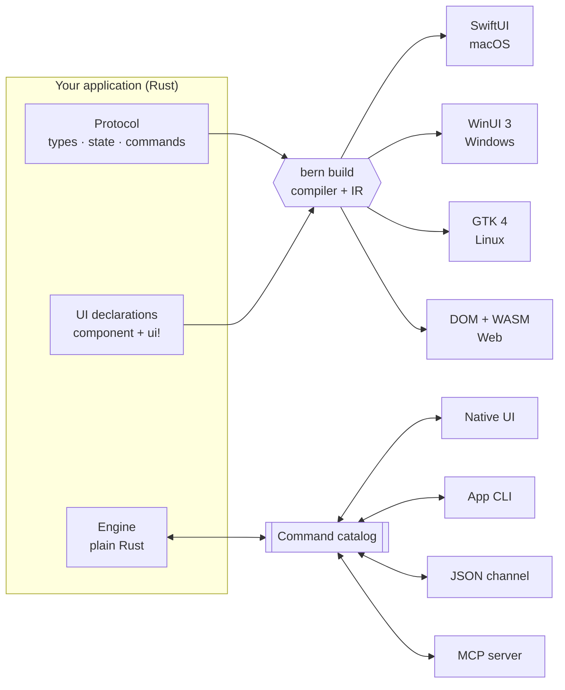
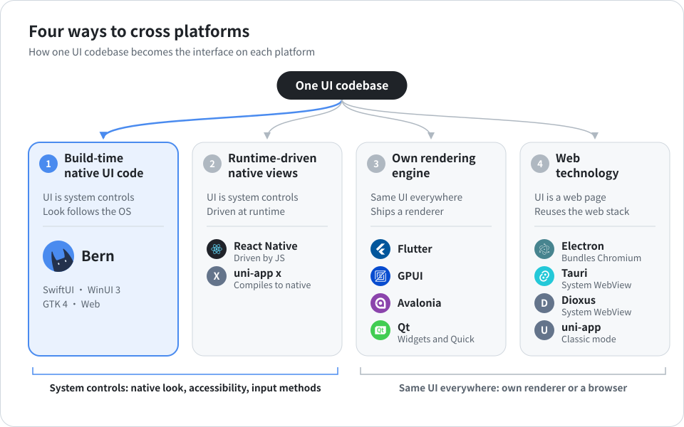
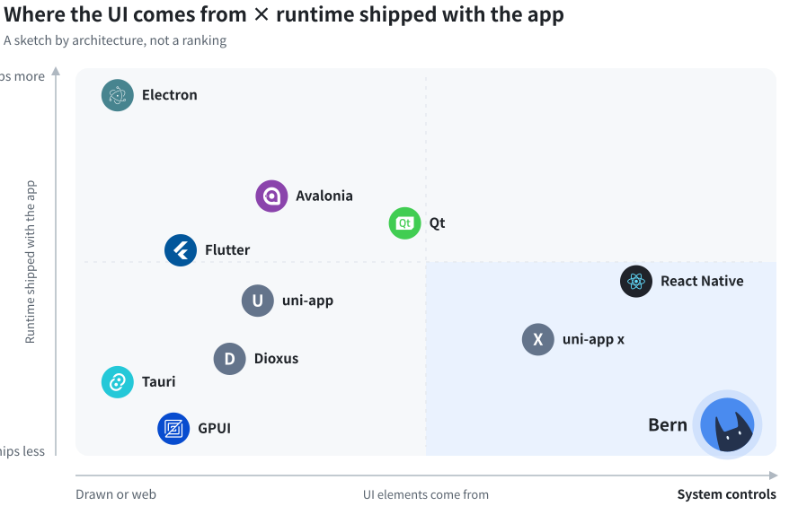
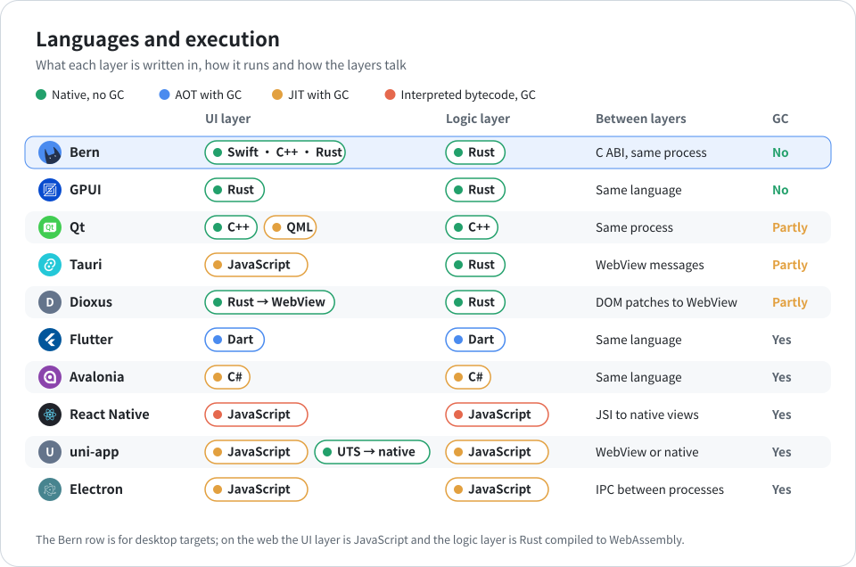
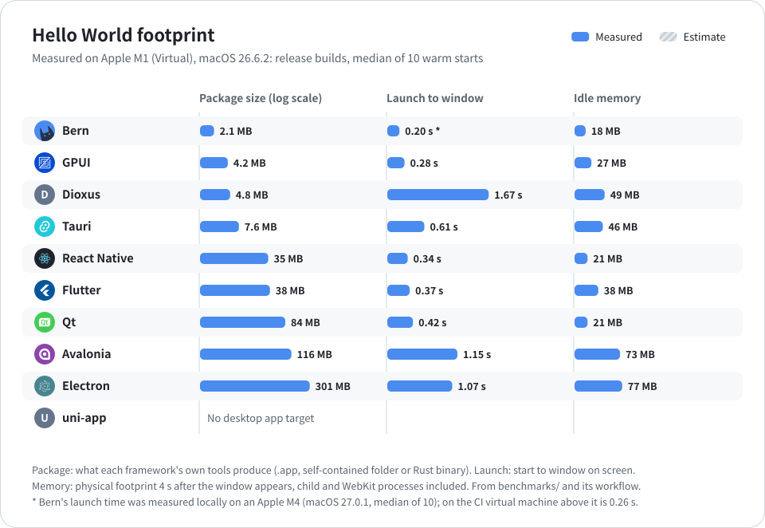

<div align="center">


<h1>Bern</h1>

<p><b>One Rust declaration, compiled into each platform's own native UI.</b></p>

<p>Born for the desktop, built for AI: SwiftUI, WinUI 3, GTK 4 and the Web.<br>
No JS engine and no embedded browser on the desktop; every button is an MCP tool an AI can call.</p>

<p>


</p>

<p>


<a href="LICENSE"></a>

</p>

<p>
<a href="README.md">简体中文</a> ·
<b>English</b> ·
<a href="README.zh-Hant.md">繁體中文</a> ·
<a href="README.ja.md">日本語</a>
</p>

<p>
<a href="#why-bern">Why Bern</a> ·
<a href="#built-for-ai">Built for AI</a> ·
<a href="#measured">Measured</a> ·
<a href="#compared-with-other-cross-platform-frameworks">Comparison</a> ·
<a href="#quick-start">Quick start</a> ·
<a href="Docs/Design.md">Design document</a>
</p>

</div>

<br>

<table>
<tr>
<td width="50%" align="center"><br><sub><b>macOS</b> · SwiftUI</sub></td>
<td width="50%" align="center"><br><sub><b>Windows</b> · WinUI 3</sub></td>
</tr>
<tr>
<td width="50%" align="center"><br><sub><b>Linux</b> · GTK 4 + libadwaita</sub></td>
<td width="50%" align="center"><br><sub><b>Web</b> · DOM + WebAssembly</sub></td>
</tr>
</table>

<p align="center"><sub>One <code>controls_page</code> declaration, four UI toolkits. On the desktop Bern draws no pixels of its own:<br>every switch, slider and sidebar is the platform's standard control, in the platform's own colors.</sub></p>

## Why Bern

<table>
<tr>
<td width="33%" valign="top">
<h3>Compiled into native UI</h3>
One Rust declaration compiles into SwiftUI, WinUI 3, GTK 4 and the Web.<br><br>
The goal is close to React Native's: one codebase, native controls on every platform. The approach differs: React Native coordinates native views from a JS engine at runtime; Bern generates each platform's own UI code at build time, so there is no JS engine and no virtual DOM at runtime, and the interface is the system's controls themselves.
</td>
<td width="33%" valign="top">
<h3>Built for AI: written right, ready to use</h3>
Translations, UI entry points, unregistered buttons and actions without a command that an AI forgets are compile errors, pointing at the file and line.<br><br>
When an AI uses the app, every button is an MCP tool: it reads what the controls mean and goes through the same code path as a mouse click, with no screenshots and no coordinates.
</td>
<td width="33%" valign="top">
<h3>Too light to feel cross-platform</h3>
No browser engine and no JS engine on the desktop; the business engine compiles to native code and runs in the app process.<br><br>
Measured on the release showcase: on macOS <b>39 MB</b> of memory and a window in <b>0.4 s</b>, with a <b>2.7 MB</b> app bundle; on Windows <b>35 MB</b> and <b>0.3 s</b>, <b>4.2 MB</b> for the whole app, no .NET; the whole web app with its Rust engine is <b>189 KB</b> gzipped.
</td>
</tr>
</table>

## Built for AI

### Writing code: what the AI forgets, the compiler remembers

AI rarely gets interface code wrong; it leaves things out. A feature is added without an entry in the compact layout, a new string is written in one language only, a callback sidesteps the commands. Elsewhere these wait for a user to find them; in Bern they do not compile. The stricter the rules, the harder it is for an AI to hand over half a job:

| What was missed | What Bern does |
| :-- | :-- |
| A string misses a language | Compile error B102. Every language sits in one `tr!` next to the UI, so a gap shows at a glance; hard-coded literals are B103 (strict mode, on by default) |
| A feature has no entry in some display mode | Compile error B201. A page declares the features it must offer in a feature contract, and the compiler proves an entry for each in every layout (`compact`, `expanded`); present on wide screens but missing on narrow ones fails too |
| An entry inside a contract is not registered to a feature | Compile error B202. The other way round fails as well: an entry that runs a command outside its feature is B204 |
| An entry appears only in a conditional branch and cannot be proven reachable | Compile error B203, unless a manual guarantee is written down |
| Hanging arbitrary code on a button | Cannot be written. Buttons bind only typed commands from the catalog, and controls cannot write engine state |

Errors are written for people and for agents alike: a code, a reason and a location, so an agent can fix them and build again on its own. Two real runs on the showcase: the first with an English translation deleted, the second, after restoring it, with the compact layout's "Change Clip" menu removed:

```text
$ bern check
error[B102]: Missing translation
Missing language: en
Required languages: zh-Hans, en
  --> showcase-ui/src/pages.rs:13:31

$ bern check
error[B201]: Feature missing in adaptive layout
Contract: MediaFeature
Feature: Clip
compact: missing
  --> showcase-ui/src/media.rs:14:5
```

Every build also writes a full feature coverage report per target (`features.json`) that lists what is covered, exempt or only manually guaranteed.

### Using the app: meaning, not pixels

In most frameworks, letting an AI operate a desktop app means screenshots, recognition, coordinates and synthetic clicks. A Bern app ships with an MCP server: every control has a stable name and role, the agent reads structure, its actions take the same code path as a user's click, and the app answers with what actually happened.

```sh
$ showcase ui inspect                 # the agent reads meaning, not pixels
[{ "target": "controls_page.sync", "role": "switch", "label": "Sync", "value": "false", "enabled": true, … }, …]

$ showcase ui set-bool --target controls_page.sync --value true

$ showcase window close --window settings#1
{ "outcome": "ConfirmationRequired", "message": "Do you want to save the display name?",
  "decisions": ["Save", "Discard", "Cancel"], "confirmation": "settings#1:c1", … }

$ showcase window confirm-close --window settings#1 --confirmation settings#1:c1 --decision Save
{ "outcome": "Rejected", "reason": "save_failed: invalid_name: a display name has 1 to 40 characters …" }
```

The same operations are MCP tools for agents (`ui_inspect`, `ui_activate`, `window_close`, …), and each business command is a tool too (for example `showcase_set_display_name`). When a button is disabled, blocked by a dialog or missing, the agent gets a clear error code rather than a click that does nothing.

## Measured

| | macOS · SwiftUI | Windows · WinUI 3 | Web · WebAssembly |
| :-- | :-- | :-- | :-- |
| Launch to visible window | 0.41 s | 0.32 s | – |
| Memory | 39 MB | 35 MB | – |
| Size | 2.7 MB app bundle (2.3 MB executable), no frameworks embedded | 4.2 MB app folder, engine inside the executable, UI framework from the system | 189 KB for all assets gzipped, Rust engine included |

<details>
<summary>How it was measured</summary>
<br>

- Subject: the release showcase (6 pages, a main and a settings window, a video player), measured on 2026-10-11, median of at least 3 runs.
- macOS: Apple M4, 16 GB, macOS 27.0.1. Memory is the physical footprint from `footprint`, the measure of Activity Monitor's Memory column.
- Windows: Intel Core i5-13490F, 32 GB, Windows 11 25H2. Memory is the private working set, the measure of Task Manager's Memory column.
- Launch time: from starting the process until the command line sees a visible native window, including engine start and the local control channel.
- The Windows numbers are the WinUI 3 front end (measured with Windows App Runtime 1.8; builds now use 2.x). Without the runtime, the same program falls back to the system XAML: 0.54 s, 19 MB. Neither needs .NET or the VC++ runtime; the app folder holds the executable and a 400 KB bootstrapper DLL.

</details>

## More

<table>
<tr>
<td width="33%" valign="top">
<h3>Every action is a command</h3>
A button cannot hold an arbitrary callback. It binds to a command in one typed catalog, with parameters, errors and retry policy shared by the UI, the command line, JSON and MCP.
</td>
<td width="33%" valign="top">
<h3>Checked at compile time</h3>
<code>rustc</code> type-checks every binding and command argument. Unbound buttons, callbacks, controls writing engine state and missing translations do not compile.
</td>
<td width="33%" valign="top">
<h3>Your logic stays in Rust</h3>
The engine is ordinary Rust with no UI dependency, tested without any window. It runs in the app process on the desktop and as WebAssembly in the browser.
</td>
</tr>
<tr>
<td width="33%" valign="top">
<h3>Localized from day one</h3>
<code>tr!</code> keeps every language next to the UI it belongs to. Strict builds reject missing translations, and the interface language switches at runtime without losing drafts.
</td>
<td width="33%" valign="top">
<h3>Dark mode, zero setup</h3>
Colors come from the platform theme: dark mode, accent colors and high contrast follow the system, and a declared brand color becomes the system accent. On the web Bern's theme kernel generates the whole palette.
</td>
<td width="33%" valign="top">
<h3>Declarative multi-window</h3>
Each window has its own drafts, close check and save command; minimize, maximize, move and resize are commands answered with the platform's actual state.
</td>
</tr>
</table>

<details>
<summary><b>And more:</b> video, async queries, adaptive layouts, typed navigation…</summary>
<br>

- **Video**: `Video` plays on AVFoundation, Windows Media Foundation, GStreamer or HTML media, with a command-driven control bar and players that outlive a page.
- **Async queries**: `Query` subscriptions with loading, empty, failure and refresh states; only the latest answer is shown.
- **Adaptive layouts**: `compact` and `expanded` layouts chosen by the space a view actually gets.
- **Typed navigation**: sidebars, push navigation with typed routes, tabs, toolbars and menus.
- **Feature contracts**: declare which features a component must cover in each layout; the compiler proves the coverage.
- **Bundled resources**: files declared in `Bern.toml`, checked at build time and located by name at runtime.
- **Images and layout**: `Image` shows bundled pictures, HDR ones (PQ and HLG PNGs, JPEGs with a gain map) in HDR where the display can, and an undeclared one fails to compile; `Grid` adds and drops columns with the width, `Stack` layers views with nine alignments, `Progress` shows a bar or indeterminate progress.

</details>

## How it works



1. **Protocol** – `#[bern::protocol]` declares value types, the read-only state and the command and query traits.
2. **Engine** – implements those traits in ordinary Rust; it never sees a window, a control or a transport.
3. **Interface** – `#[component]` functions whose body is a `ui!` declaration. The compiler reads them into a shared intermediate representation, and each target module generates native code from it. Adding a target never touches the parser, the IR or your business logic.

## A taste of Bern

<table>
<tr>
<td width="50%" valign="top">

**1 · Protocol**: types, state and commands

```rust
#[bern::protocol(namespace = "counter", version = 1)]
pub mod counter {
    use bern::prelude::*;

    #[state]
    pub struct State {
        pub count: i64,
    }

    #[commands]
    pub trait Commands {
        /// Add to the count.
        fn add(&mut self, by: i64) -> Result<(), CommandError>;
    }
}
```

**3 · Interface**: a `ui!` declaration

```rust
#[component]
pub fn counter_view(app: counter::Client) -> impl View {
    ui! {
        Form {
            Text(content: tr! {
                "zh-Hans" => "已计数 {n} 次",
                "en" => "Counted {n} times";
                n: app.count
            })
            Button(
                id: add,
                label: tr! { "zh-Hans" => "加一", "en" => "Add one" },
                prominence: prominent
            ) => app.add(1)
        }
    }
}
```

</td>
<td width="50%" valign="top">

**2 · Engine**: plain Rust, no UI

```rust
use bern::CommandError;

pub struct Counter {
    state: counter::State,
}

impl Default for Counter {
    fn default() -> Self {
        Self { state: counter::State { count: 0 } }
    }
}

impl counter::Commands for Counter {
    fn add(&mut self, by: i64) -> Result<(), CommandError> {
        self.state.count += by;
        Ok(())
    }
}

impl counter::Engine for Counter {
    fn state(&self) -> &counter::State {
        &self.state
    }
}
```

**4 · Everyone drives the same engine**

```sh
counter ui inspect
counter ui activate --target counter_view.add
counter counter add --by 5
counter-mcp   # the same catalog for AI agents
```

</td>
</tr>
</table>

`Bern.toml` declares languages, theme, sources, bundled resources and targets. See the full [showcase](examples/showcase): a sidebar app with text styles, buttons, switches, sliders, text fields, an engine-backed search, list-to-detail navigation, video, and a settings window with tabs and a close confirmation.

## Platforms

<table>
<tr>
<th align="left">Target</th>
<th align="left">UI toolkit</th>
<th align="left">Engine</th>
<th align="left">Status</th>
</tr>
<tr>
<td><b>macOS</b><br><code>swiftui + macos</code></td>
<td>SwiftUI, standard components and system styles · macOS 14+</td>
<td>In process</td>
<td> <a href="Docs/Implementation/macOS-SwiftUI.md">notes</a></td>
</tr>
<tr>
<td><b>Windows</b><br><code>winui3 + windows</code></td>
<td>C++/WinRT: WinUI 3 when a Windows App Runtime 2 is present (installed by another app or shipped with Windows 11), otherwise the system XAML; either can also be built alone · Windows 10 2004+</td>
<td>In process (statically linked)</td>
<td> <a href="Docs/Implementation/Windows-WinUI3.md">notes</a></td>
</tr>
<tr>
<td><b>Linux</b><br><code>gtk + linux</code></td>
<td>GTK 4.14 + libadwaita 1.5, following the GNOME HIG</td>
<td>In process</td>
<td> <a href="Docs/Implementation/Linux-GTK.md">notes</a></td>
</tr>
<tr>
<td><b>Web app</b><br><code>web</code> · <code>app</code></td>
<td>DOM with Bern's own visual spec and theme kernel</td>
<td>WebAssembly in the page</td>
<td> <a href="Docs/Implementation/Web.md">notes</a></td>
</tr>
<tr>
<td><b>WebUI</b><br><code>web</code> · <code>ui</code></td>
<td>The same page, as a UI for a separate engine</td>
<td>Engine host over WebSocket</td>
<td> <a href="Docs/Implementation/Web.md">notes</a></td>
</tr>
<tr>
<td><b>Next</b></td>
<td><code>flutter + macos</code> (backend replaceability), then iOS, Android and HarmonyOS</td>
<td>–</td>
<td> <a href="Docs/Adaptation/README.md">adaptation</a></td>
</tr>
</table>

Omitting the UI technology picks the platform default; an unavailable default fails loudly instead of silently switching to another stack.

## Compared with other cross-platform frameworks

<p align="center">
<a href="https://github.com/zed-industries/zed/tree/main/crates/gpui"></a>
<a href="https://dioxuslabs.com"></a>
<a href="https://flutter.dev"></a>
<a href="https://reactnative.dev"></a>
<a href="https://uniapp.dcloud.net.cn"></a>
<br>
<a href="https://www.electronjs.org"></a>
<a href="https://tauri.app"></a>
<a href="https://avaloniaui.net"></a>
<a href="https://www.qt.io"></a>
</p>

Every framework answers the same question: how does one codebase become the interface on each platform? The answers differ, and so do the trade-offs. What follows is based on each project's official documentation; size and memory vary a lot with versions and settings, so the comparison stays structural. Bern's own numbers are in [Measured](#measured).

<picture>
<source media="(prefers-color-scheme: dark)" srcset="Docs/Assets/compare/routes-en-dark.svg">

</picture>

The first two routes give you system controls: look, accessibility, input methods and dark mode come from the system, at the cost of controls that differ a little between platforms. The other two draw the same interface everywhere, at the cost of keeping up with each platform's design and behavior yourself, or of shipping a browser.

<picture>
<source media="(prefers-color-scheme: dark)" srcset="Docs/Assets/compare/landscape-en-dark.svg">

</picture>

The chart is a sketch by architecture, not a ranking: the horizontal axis is whether UI elements are the system's controls or drawn by the framework or a web page; the vertical axis is how much runtime the app carries (a browser engine, a JS engine, a rendering engine, a language runtime).

### Technology

| Framework | UI written in | Logic | How the UI is drawn | Ships with the app | License |
| :-- | :-- | :-- | :-- | :-- | :-- |
| **Bern** | Rust (`ui!` declarations) | Rust | Generates SwiftUI, WinUI 3, GTK 4 and Web code at build time; the UI is system controls | Nothing; WinUI 3 also comes from the system, with the system XAML as fallback | MIT |
| **GPUI** | Rust | Rust | Its own GPU renderer (Metal, Vulkan, DirectX) | No extra runtime | Apache-2.0 |
| **Dioxus** | Rust (RSX, React-like) | Rust | The system WebView on desktop and mobile, WebAssembly on the web; the native renderer Blitz is experimental | Relies on the system WebView | MIT / Apache-2.0 |
| **Flutter** | Dart | Dart | Its own engine (Impeller, Skia) draws Material and Cupertino-style widgets | The Flutter engine | BSD-3-Clause |
| **React Native** | JavaScript / TypeScript (React) | JavaScript / TypeScript | Native views, coordinated by JS at runtime | The Hermes JS engine | MIT |
| **uni-app** | Vue | JavaScript / TypeScript; UTS in uni-app x | A WebView in classic mode; uni-app x compiles to Kotlin, Swift and other native languages and renders native views | The framework runtime | Apache-2.0 |
| **Electron** | HTML / CSS / JavaScript | JavaScript / TypeScript (Node.js) | Embedded Chromium | Chromium and Node.js | MIT |
| **Tauri** | Any web front end | Rust | The system WebView (WebView2, WKWebView, WebKitGTK) | No browser engine; relies on the system WebView | MIT / Apache-2.0 |
| **Avalonia** | XAML and C# | C# / .NET | Its own Skia renderer | The .NET runtime (self-contained or Native AOT) | MIT |
| **Qt** | C++ and QML (Python too) | C++ | Qt Widgets imitate each platform's style; Qt Quick draws its own scene graph | The Qt libraries | LGPLv3 / GPLv3 / commercial |

### Platforms and capabilities

● supported　◐ partly, or through the community　— not supported

| Framework | macOS | Windows | Linux | Mobile | Web | Native look | Built-in MCP | Compile-time checks |
| :-- | :-: | :-: | :-: | :-: | :-: | :-: | :-: | :-: |
| **Bern** | ● | ● | ● | — | ● | ● | ● | ● |
| **GPUI** | ● | ● | ● | — | — | — | — | — |
| **Dioxus** | ● | ● | ● | ● | ● | — | — | — |
| **Flutter** | ● | ● | ● | ● | ● | — | — | — |
| **React Native** | ◐ | ◐ | — | ● | ◐ | ● | — | — |
| **uni-app** | — | — | — | ● | ● | ◐ | — | — |
| **Electron** | ● | ● | ● | — | — | — | — | — |
| **Tauri** | ● | ● | ● | ● | — | — | — | — |
| **Avalonia** | ● | ● | ● | ● | ● | — | — | — |
| **Qt** | ● | ● | ● | ● | ● | ◐ | — | — |

- **Mobile**: iOS and Android. React Native's desktop versions are maintained by Microsoft; uni-app also covers mini programs and HarmonyOS; Bern's mobile targets are planned.
- **Native look**: the controls are the platform's own, with look, accessibility and input methods from the system. Qt Widgets and uni-app x come close and count as partly.
- **Built-in MCP**: an MCP server and command line that come with the framework and act on the running interface. Other frameworks can be automated from outside through accessibility APIs or test tools such as Playwright and Flutter Driver.
- **Compile-time checks**: a missing translation, a feature without an entry in some layout, or an entry not registered to a feature is a compiler error (see [Built for AI](#built-for-ai)). Other frameworks mostly find these with linters, translation tools or tests.
- **Maturity**: Electron and Qt are very mature; Flutter, React Native, uni-app, Tauri and Avalonia are mature; Dioxus is developing quickly; GPUI powers the Zed editor while its general-purpose components are early; Bern is an early preview.

### Performance and footprint

The languages of the UI and logic layers, and how they run, set the ceiling of runtime overhead: natively compiled languages without garbage collection cost the least; JIT-run and interpreted languages ship an engine and use more memory.

<picture>
<source media="(prefers-color-scheme: dark)" srcset="Docs/Assets/compare/languages-en-dark.svg">

</picture>

For the same window showing one line of text, package size, launch time and memory differ widely. The chart is measured on one CI virtual machine (a GitHub-hosted Apple M1): each framework's own tools build a release package, and the apps take turns starting, ten times each, median shown. Bern's launch time is also measured on an M4, as the chart's footnote says. The scripts are in [benchmarks/](benchmarks/); the Benchmarks workflow reruns them from the Actions tab.

<picture>
<source media="(prefers-color-scheme: dark)" srcset="Docs/Assets/compare/resources-en-dark.svg">

</picture>

### Which one to choose

<table>
<tr>
<td width="50%" valign="top">
<br>
<b>Best for</b>: web teams that want the most mature ecosystem and the most consistent behavior across platforms.<br>
<b>Cost</b>: every app ships its own Chromium and Node.js, so size and memory run high.
</td>
<td width="50%" valign="top">
<br>
<b>Best for</b>: keeping a web front end while getting a small app and a Rust back end.<br>
<b>Cost</b>: the UI is still a web page, and the system WebViews differ, so each platform needs testing.
</td>
</tr>
<tr>
<td valign="top">
<br>
<b>Best for</b>: mobile-first apps that must look pixel-identical everywhere.<br>
<b>Cost</b>: the controls are drawn, so the desktop look and behavior are yours to keep up with; you write Dart.
</td>
<td valign="top">
<br>
<b>Best for</b>: React teams building mobile apps with native controls.<br>
<b>Cost</b>: mobile first; the desktop relies on Microsoft's versions and has no Linux; a JS engine and bridge at runtime.
</td>
</tr>
<tr>
<td valign="top">
<br>
<b>Best for</b>: .NET and XAML teams that want a consistent look across desktops.<br>
<b>Cost</b>: a drawn UI rather than system controls; needs the .NET runtime or AOT compilation.
</td>
<td valign="top">
<br>
<b>Best for</b>: C++ projects, industry and embedded, decades of stability.<br>
<b>Cost</b>: mind the license (LGPL or commercial); Qt Quick draws its own UI.
</td>
</tr>
<tr>
<td valign="top">
<br>
<b>Best for</b>: Rust desktop apps that chase raw performance, such as editors.<br>
<b>Cost</b>: a drawn UI; common controls and accessibility are up to you; desktop only.
</td>
<td valign="top">
<br>
<b>Best for</b>: Rust full-stack projects that like React's style, one codebase for web, desktop and mobile.<br>
<b>Cost</b>: desktop and mobile UIs are WebViews today; the native renderer is experimental.
</td>
</tr>
<tr>
<td valign="top">
<br>
<b>Best for</b>: one codebase for China's many targets (mini programs, apps, H5, HarmonyOS).<br>
<b>Cost</b>: no desktop app target; classic-mode apps render in a WebView.
</td>
<td valign="top">
<br>
<b>Best for</b>: desktop apps that want each platform's system look, business logic in Rust, and AI that can both write and use them.<br>
<b>Not yet for</b>: projects that need mobile today or rely on a mature third-party component ecosystem. Bern is an early preview.
</td>
</tr>
</table>

## Quick start

You need Rust 1.99 (`rustup` installs it from `rust-toolchain.toml`) plus the toolchain of the target you build. First install the build tool `bern` from source:

```sh
git clone https://github.com/AimesSoft/Bern
cd Bern
cargo install --path crates/bern-cli
```

### Create an app

In any directory:

```sh
bern new my_app
cd my_app
bern run
```

The new app is a window with a counter, with one crate each for the protocol, the engine and the interface, and all four targets declared in `Bern.toml`. `bern run` builds the target for this computer and starts it: SwiftUI on macOS, WinUI 3 on Windows, GTK on Linux; `bern run --target web_app` opens it in the browser. Every build also produces the application CLI and MCP server in `target/bern/<target>/bin/`.

`bern doctor` lists what this computer still needs for each target, and how to install it:

```text
$ bern doctor
bern 0.1.0 on macOS (aarch64)

[✓] Rust: rustc 1.99.0, cargo 1.99.0
[✓] macOS · SwiftUI: macOS SDK 26.5, Swift 6.3.2
[-] Windows · WinUI 3: builds on Windows
[-] Linux · GTK 4: builds on Linux
[✓] Web · WebAssembly: the wasm32-unknown-unknown target
```

<details>
<summary><b>What each platform needs</b></summary>
<br>

- **macOS**: Xcode 26 or later. After installing it from the App Store, run `sudo xcode-select --switch /Applications/Xcode.app`.
- **Windows**: Visual Studio 2022 or later with “Desktop development with C++” (the Build Tools are enough) and a Windows 11 SDK; Rust on the MSVC toolchain. The first build generates the C++/WinRT headers with the Windows SDK's `cppwinrt` and precompiles them with the runtime (about 2.4 GB per profile, under `target`); later builds compile only the app's own code, about 5 s for a new app and 9 s for the showcase. The app folder holds only the executable, a 400 KB bootstrapper DLL and the resources: no .NET, no bundled Windows App SDK.
- **Linux**: GTK 4.14 and libadwaita 1.5 development packages, for example `sudo apt install libgtk-4-dev libadwaita-1-dev gstreamer1.0-libav`.
- **Web**: `rustup target add wasm32-unknown-unknown`. A `web_app` build compiles the engine to WebAssembly and runs it in the page; a `web_ui` build makes the page the UI of a separate engine host, which `bern run` starts before opening its address.

</details>

### Ship an app

```sh
bern package
```

Builds every target this computer can in release and writes packages to `target/bern/dist/`: a `.dmg` for macOS, an installer (per user, no administrator rights) and a `.zip` for Windows, a `.deb` and a `.tar.gz` for Linux, and an archive of the static site for the Web. Every package carries the app's CLI and MCP server. Signing comes from the environment, so certificates stay out of the repository: `BERN_MACOS_SIGNING_IDENTITY` and `BERN_MACOS_NOTARY_PROFILE` (sign and notarize), `BERN_WINDOWS_CERTIFICATE` (a certificate thumbprint or a `.pfx`). Without them the packages are still made, with a note on what being unsigned means.

### Run the showcase

The showcase in the Bern repository uses every component, two windows and a video player. From the repository directory:

```sh
cd examples/showcase
bern run
```

### Drive the running app

```sh
showcase ui inspect                                          # every mounted control
showcase ui select --target main_window.pages --option Controls
showcase ui set-bool --target controls_page.sync --value true
showcase showcase search-library --text mo                   # an engine query
showcase window open --kind settings
showcase window list                                         # actual window state
showcase-mcp                                                 # MCP server over stdio
```

The control channel starts only when the target declares `channels = ["ipc"]`; without it the app listens on nothing.

## Roadmap

| Phase | Scope | Status |
| :-- | :-- | :-- |
| 1 · 2 | Compile-time boundary; macOS SwiftUI with UI, CLI, JSON and MCP on one engine |  |
| 3 | Web visual spec, theme kernel, WebAssembly app and WebUI builds |  |
| 4 | Adaptive layouts, menus, feature contracts, runtime language switching |  |
| 5 | Other native front ends: GTK 4 (done) · WinUI 3 (done) · `flutter + macos` (next) |  |
| 6 | Component library (first set done: `Image`, `Progress`, `Grid`, `Stack`), packaging, incremental builds, tooling (`bern new`, `run`, `doctor` and `package` done) |  |

## Repository

<details>
<summary>Crates and directories</summary>
<br>

| Path | What it is |
| :-- | :-- |
| `crates/bern` | The facade crate applications use: macros, values, media, resources |
| `crates/bern-macros` · `bern-syntax` | `#[component]`, `ui!`, `tr!` and the restricted declaration syntax |
| `crates/bern-compiler` · `bern-ir` | Reads declarations into the shared IR and runs the checks |
| `crates/bern-protocol` · `bern-command` · `bern-runtime` | Command catalog, engine host and UI session runtime |
| `crates/bern-ffi` | The in-process C interface native front ends call |
| `crates/bern-backend-swiftui` · `-winui3` · `-gtk` · `-web` | Target modules: generators and their runtimes |
| `crates/bern-gtk` | GTK runtime, compiled only inside generated Linux apps |
| `crates/bern-adapter-cli` · `-mcp` · `-json` | Entries derived from the command catalog |
| `crates/bern-transport-ipc` · `-ws` | Local control channel and WebSocket transport |
| `crates/bern-theme` | Bern's color algorithm for targets without a native theme |
| `crates/bern-cli` | The build tool `bern`: create, check, build, run and check the environment |
| `examples/showcase` | The control showcase used on every platform |
| `examples/hello` | The smallest app: one window, one line |
| `Docs/` | Design document, platform adaptation specs and implementation notes |

</details>

## Development

```sh
cargo fmt --all --check
cargo clippy --workspace --all-targets -- -D warnings
cargo test --workspace
```

Tests include declarations that must fail to compile, and type-check the generated apps where the toolkit is installed: Swift 6 with Xcode, GTK with its development packages, both generated front ends with MSVC on Windows.

## Documentation

- [Design document](Docs/Design.md) – goals, architecture, components, theming, commands, windows, media
- [Adaptation specs](Docs/Adaptation/README.md) – Apple, Windows and Linux, Web, Android, HarmonyOS
- Implementation notes – [macOS](Docs/Implementation/macOS-SwiftUI.md) · [Windows](Docs/Implementation/Windows-WinUI3.md) · [Linux](Docs/Implementation/Linux-GTK.md) · [Web](Docs/Implementation/Web.md)

The design and implementation documents are written in Chinese.

## License

[MIT](LICENSE) © 2026 MCDFSteve

<div align="center">
<br>
<sub>Bern is in early development. APIs and the declaration syntax may still change.</sub>
</div>
