<div align="center">


<h1>Bern</h1>

<p><b>One Rust declaration, compiled into each platform's own native UI.</b></p>

<p>From the desktop to the phone, built for AI: SwiftUI, WinUI 3, GTK 4, Jetpack Compose and the Web.<br>
No JS engine and no embedded browser on the desktop or the phone; every button is an MCP tool an AI can call.</p>

<p>


</p>

<p>


<a href="LICENSE"></a>

</p>

<p>
<a href="README.md">简体中文</a> ·
<b>English</b> ·
<a href="README.zh-Hant.md">繁體中文</a> ·
<a href="README.ja.md">日本語</a>
</p>

<p>
<a href="#why-bern">Why Bern</a> ·
<a href="#built-with-bern">Built with Bern</a> ·
<a href="#built-for-ai">Built for AI</a> ·
<a href="#measured">Measured</a> ·
<a href="#compared-with-other-cross-platform-frameworks">Comparison</a> ·
<a href="#quick-start">Quick start</a> ·
<a href="Docs/Design.md">Design document</a>
</p>

</div>

<br>

<table>
<tr>
<td width="50%" align="center"><br><sub><b>macOS</b> · SwiftUI</sub></td>
<td width="50%" align="center"><br><sub><b>Windows</b> · WinUI 3</sub></td>
</tr>
<tr>
<td width="50%" align="center"><br><sub><b>Linux</b> · GTK 4 + libadwaita</sub></td>
<td width="50%" align="center"><br><sub><b>Web</b> · DOM + WebAssembly</sub></td>
</tr>
</table>

<p align="center"><br><sub><b>Android</b> · Jetpack Compose (dark, following the system)</sub></p>

<p align="center"><sub>One <code>controls_page</code> declaration, five UI toolkits. On the desktop and on Android Bern draws no pixels of its own:<br>every switch, slider and sidebar is the platform's standard control, in the platform's own colors.</sub></p>

## Why Bern

<picture>
<source media="(prefers-color-scheme: dark)" srcset="Docs/Assets/tables/why-en-dark.svg">
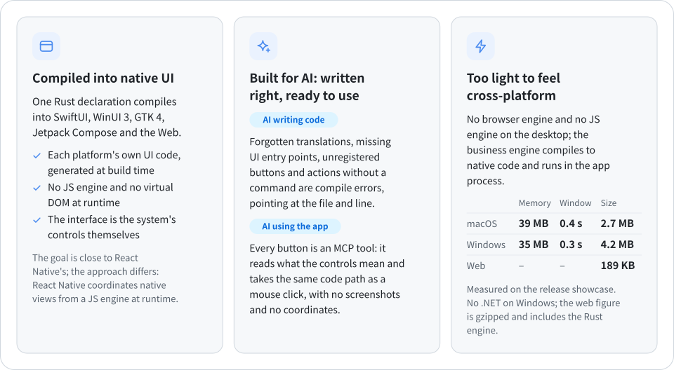
</picture>

## Built with Bern

### RustSend · Local file sharing

[RustSend](https://github.com/AimesSoft/RustSend) is an open-source local file sharing app built with Bern and compatible with LocalSend v2. Its UI declarations, state and transfer logic are written in Rust. Bern generates native SwiftUI interfaces for macOS and iOS, WinUI 3 for Windows, GTK 4 for Linux, and Jetpack Compose for Android.

It supports device discovery, file and text transfers, receive approval, and in-app completion notices, sharing the same application logic between compact desktop windows and phone layouts. In the local 1.0 macOS ARM64 Release build, the complete `.app` measures **8.09 MiB** and the download `.zip` **3.80 MiB**. See the [measurement record](https://github.com/AimesSoft/RustSend/blob/main/docs/measurements.md) for the build environment and methodology.

<table>
<tr>
<td width="50%" align="center"><a href="https://raw.githubusercontent.com/AimesSoft/RustSend/main/docs/screenshots/macos-receive.png"></a><br><sub><b>macOS</b> · SwiftUI</sub></td>
<td width="50%" align="center"><a href="https://raw.githubusercontent.com/AimesSoft/RustSend/main/docs/screenshots/android-receive.png"></a><br><sub><b>Android</b> · Jetpack Compose</sub></td>
</tr>
</table>

[Source code](https://github.com/AimesSoft/RustSend) · [Download RustSend](https://github.com/AimesSoft/RustSend/releases/latest) · [Screenshots and capture environments for all five platforms](https://github.com/AimesSoft/RustSend/blob/main/docs/screenshots/README.md)

## Built for AI

### Writing code: what the AI forgets, the compiler remembers

AI rarely gets interface code wrong; it leaves things out. A feature is added without an entry in the compact layout, a new string is written in one language only, a callback sidesteps the commands. Elsewhere these wait for a user to find them; in Bern they do not compile. The stricter the rules, the harder it is for an AI to hand over half a job:

<picture>
<source media="(prefers-color-scheme: dark)" srcset="Docs/Assets/tables/ai-en-dark.svg">
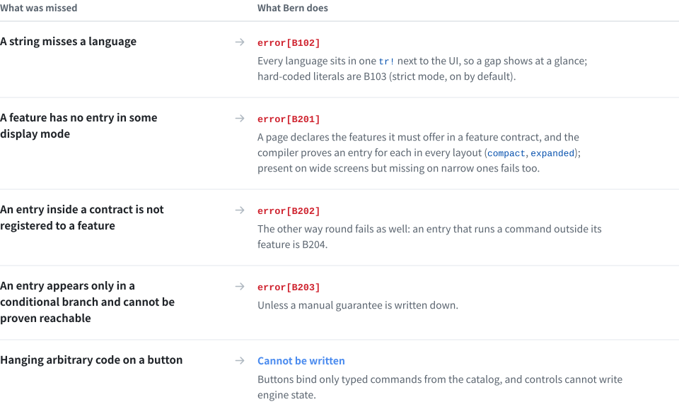
</picture>

Errors are written for people and for agents alike: a code, a reason and a location, so an agent can fix them and build again on its own. Two real runs on the showcase: the first with an English translation deleted, the second, after restoring it, with the compact layout's "Change Clip" menu removed:

```text
$ bern check
error[B102]: Missing translation
Missing language: en
Required languages: zh-Hans, en
  --> showcase-ui/src/pages.rs:13:31

$ bern check
error[B201]: Feature missing in adaptive layout
Contract: MediaFeature
Feature: Clip
compact: missing
  --> showcase-ui/src/media.rs:14:5
```

Every build also writes a full feature coverage report per target (`features.json`) that lists what is covered, exempt or only manually guaranteed.

### Using the app: meaning, not pixels

In most frameworks, letting an AI operate a desktop app means screenshots, recognition, coordinates and synthetic clicks. A Bern app ships with an MCP server: every control has a stable name and role, the agent reads structure, its actions take the same code path as a user's click, and the app answers with what actually happened.

```sh
$ showcase ui inspect                 # the agent reads meaning, not pixels
[{ "target": "controls_page.sync", "role": "switch", "label": "Sync", "value": "false", "enabled": true, … }, …]

$ showcase ui set-bool --target controls_page.sync --value true

$ showcase window close --window settings#1
{ "outcome": "ConfirmationRequired", "message": "Do you want to save the display name?",
  "decisions": ["Save", "Discard", "Cancel"], "confirmation": "settings#1:c1", … }

$ showcase window confirm-close --window settings#1 --confirmation settings#1:c1 --decision Save
{ "outcome": "Rejected", "reason": "save_failed: invalid_name: a display name has 1 to 40 characters …" }
```

The same operations are MCP tools for agents (`ui_inspect`, `ui_activate`, `window_close`, …), and each business command is a tool too (for example `showcase_set_display_name`). When a button is disabled, blocked by a dialog or missing, the agent gets a clear error code rather than a click that does nothing.

## Measured

<picture>
<source media="(prefers-color-scheme: dark)" srcset="Docs/Assets/tables/measured-en-dark.svg">
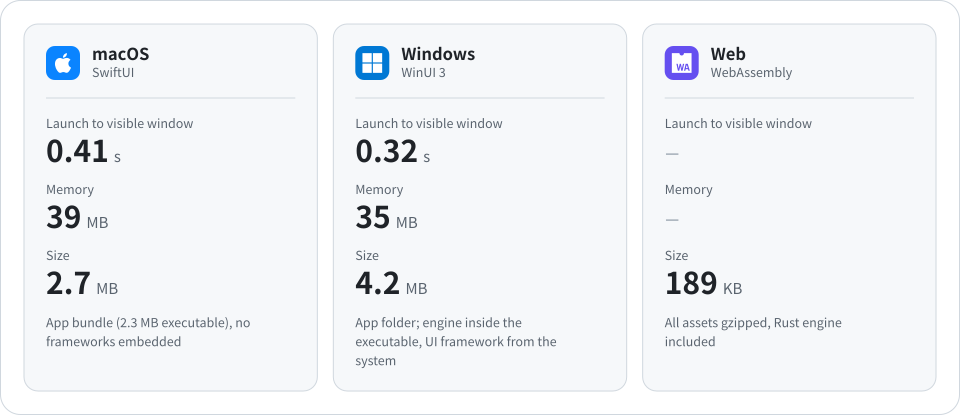
</picture>

<details>
<summary>How it was measured</summary>
<br>

- Subject: the release showcase (6 pages, a main and a settings window, a video player), measured on 2026-10-11, median of at least 3 runs.
- macOS: Apple M4, 16 GB, macOS 27.0.1. Memory is the physical footprint from `footprint`, the measure of Activity Monitor's Memory column.
- Windows: Intel Core i5-13490F, 32 GB, Windows 11 25H2. Memory is the private working set, the measure of Task Manager's Memory column.
- Launch time: from starting the process until the command line sees a visible native window, including engine start and the local control channel.
- The Windows numbers are the WinUI 3 front end (measured with Windows App Runtime 1.8; builds now use 2.x). Without the runtime, the same program falls back to the system XAML: 0.54 s, 19 MB. Neither needs .NET or the VC++ runtime; the app folder holds the executable and a 400 KB bootstrapper DLL.

</details>

## More

<picture>
<source media="(prefers-color-scheme: dark)" srcset="Docs/Assets/tables/more-en-dark.svg">
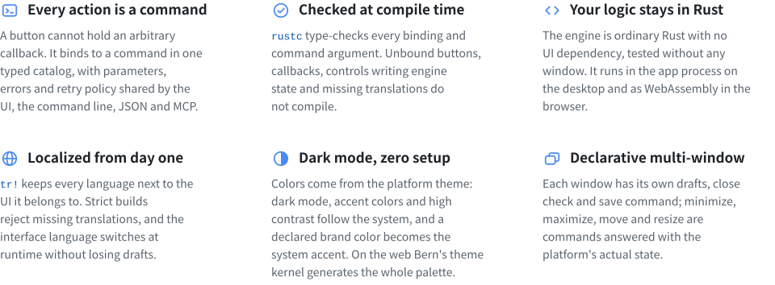
</picture>

<details>
<summary><b>And more:</b> video, async queries, styles and motion, drawing, media app components, reading the files users hand you, modular apps, adaptive layouts…</summary>
<br>

- **Video**: `Video` plays on AVFoundation, Windows Media Foundation, GStreamer, Media3 on Android or HTML media, with a command-driven control bar and players that outlive a page.
- **Async queries**: `Query` subscriptions with loading, empty, failure and refresh states; only the latest answer is shown.
- **Adaptive layouts**: layouts for `compact`, `medium`, `expanded` and `large`, chosen by the space a view actually gets; expressions read the window's size too, for margins that grow with it.
- **Typed navigation**: sidebars, push navigation with typed routes, tabs, toolbars and menus.
- **Feature contracts**: declare which features a component must cover in each layout; the compiler proves the coverage.
- **Bundled resources**: files declared in `Bern.toml`, checked at build time and located by name at runtime.
- **Images and layout**: `Image` shows bundled pictures, HDR ones (PQ and HLG PNGs, JPEGs with a gain map) in HDR where the display can, and an undeclared one fails to compile; `Grid` adds and drops columns with the width, `Stack` layers views with nine alignments, `Progress` shows a bar or indeterminate progress.
- **Style overrides and motion**: controls keep the platform look by default; for one design everywhere, `style!` declares app-wide overrides, spring motion, appear and disappear transitions, staggered entrances and shared elements, and an override a target cannot show fails the build (on all five front ends).
- **Drawing and placing by fraction**: `Canvas` draws shapes, data curves and check patterns in semantic colors, and `Text` can carry a highlight mark; `Rail` puts elements at fractions that come from state, for timelines, ticks on a progress bar or a fill that grows.
- **Media app components**: a sidebar footer, toolbar search with results, an inspector, toasts, split buttons and popover buttons holding any content, buttons with content that reveal more on hover, shortcuts, picking and dropping files, scroll snapping, pinch and drag to set a value, on all five front ends.
- **Reading the files users hand you**: for a file the user picked, dropped or opened with the app, the engine gets its name and bytes with `MediaSource::file_name()` and `open()`, the same for a local path, an Android `content://` document or a page's `blob:` file.
- **Modular apps**: an app is a shell and modules, each with its own protocol, engine, interface and translations, switchable at runtime; `bern new --module` adds one, so several people and AIs can work side by side (verified on macOS and Android).

</details>

## How it works

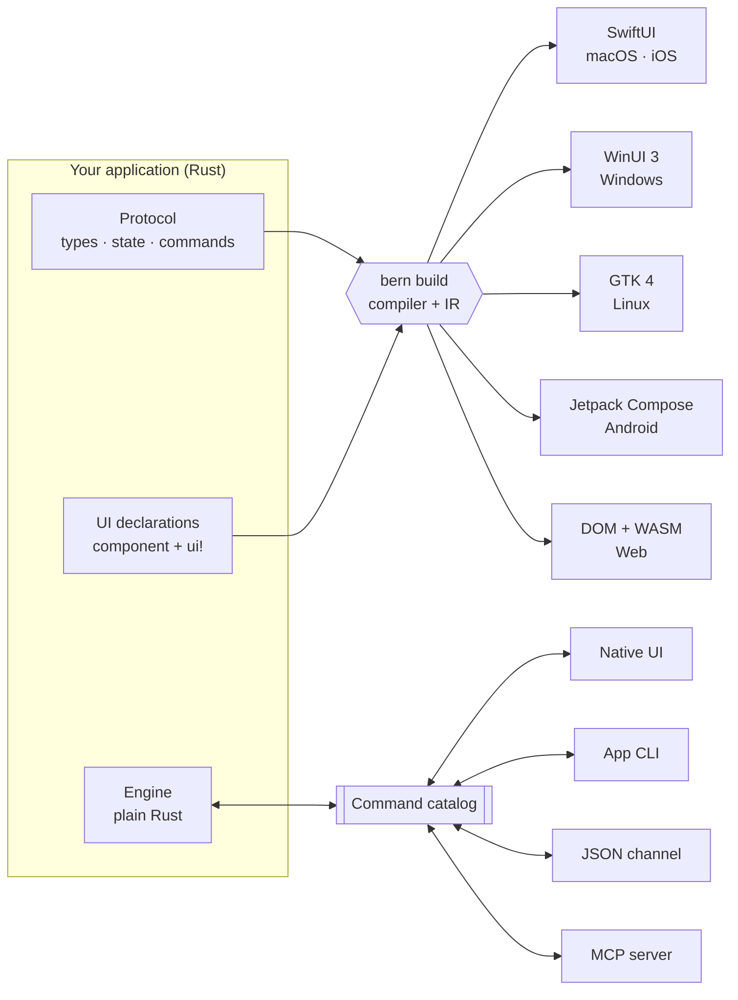

1. **Protocol** – `#[bern::protocol]` declares value types, the read-only state and the command and query traits.
2. **Engine** – implements those traits in ordinary Rust; it never sees a window, a control or a transport.
3. **Interface** – `#[component]` functions whose body is a `ui!` declaration. The compiler reads them into a shared intermediate representation, and each target module generates native code from it. Adding a target never touches the parser, the IR or your business logic.

## A taste of Bern

**1 · Protocol**: types, state and commands

```rust
#[bern::protocol(namespace = "counter", version = 1)]
pub mod counter {
    use bern::prelude::*;

    #[state]
    pub struct State {
        pub count: i64,
    }

    #[commands]
    pub trait Commands {
        /// Add to the count.
        fn add(&mut self, by: i64) -> Result<(), CommandError>;
    }
}
```

**2 · Engine**: plain Rust, no UI

```rust
use bern::CommandError;

pub struct Counter {
    state: counter::State,
}

impl Default for Counter {
    fn default() -> Self {
        Self { state: counter::State { count: 0 } }
    }
}

impl counter::Commands for Counter {
    fn add(&mut self, by: i64) -> Result<(), CommandError> {
        self.state.count += by;
        Ok(())
    }
}

impl counter::Engine for Counter {
    fn state(&self) -> &counter::State {
        &self.state
    }
}
```

**3 · Interface**: a `ui!` declaration

```rust
#[component]
pub fn counter_view(app: counter::Client) -> impl View {
    ui! {
        Form {
            Text(content: tr! {
                "zh-Hans" => "已计数 {n} 次",
                "en" => "Counted {n} times";
                n: app.count
            })
            Button(
                id: add,
                label: tr! { "zh-Hans" => "加一", "en" => "Add one" },
                prominence: prominent
            ) => app.add(1)
        }
    }
}
```

**4 · Everyone drives the same engine**

```sh
counter ui inspect
counter ui activate --target counter_view.add
counter counter add --by 5
counter-mcp   # the same catalog for AI agents
```

`Bern.toml` declares languages, theme, sources, bundled resources and targets. See the full [showcase](examples/showcase): a sidebar app with text styles, buttons, switches, sliders, text fields, an engine-backed search, list-to-detail navigation, video, and a settings window with tabs and a close confirmation. The [planner](examples/planner) is a modular app with style overrides, motion and `Canvas`. The [gallery](examples/gallery) shows the media app components: a poster wall that enters in turn, a timeline placed by fraction, a volume popover, margins and layouts that follow the four sizes, and a dropped video whose name, format and size the engine reads from the file.

## Platforms

<picture>
<source media="(prefers-color-scheme: dark)" srcset="Docs/Assets/tables/platforms-en-dark.svg">
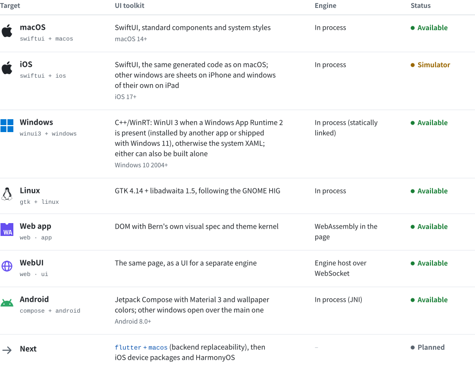
</picture>

Implementation notes: [macOS](Docs/Implementation/macOS-SwiftUI.md) · [iOS](Docs/Implementation/iOS-SwiftUI.md) · [tvOS](Docs/Implementation/tvOS-SwiftUI.md) · [Windows](Docs/Implementation/Windows-WinUI3.md) · [Linux](Docs/Implementation/Linux-GTK.md) · [Web and WebUI](Docs/Implementation/Web.md) · [Android](Docs/Implementation/Android-Compose.md); the next platforms are in the [adaptation specs](Docs/Adaptation/README.md).

Omitting the UI technology picks the platform default; an unavailable default fails loudly instead of silently switching to another stack.

## Compared with other cross-platform frameworks

<p align="center">
<a href="https://github.com/zed-industries/zed/tree/main/crates/gpui"></a>
<a href="https://dioxuslabs.com"></a>
<a href="https://flutter.dev"></a>
<a href="https://reactnative.dev"></a>
<a href="https://uniapp.dcloud.net.cn"></a>
<br>
<a href="https://www.electronjs.org"></a>
<a href="https://tauri.app"></a>
<a href="https://avaloniaui.net"></a>
<a href="https://www.qt.io"></a>
</p>

Every framework answers the same question: how does one codebase become the interface on each platform? The answers differ, and so do the trade-offs. What follows is based on each project's official documentation; size and memory vary a lot with versions and settings, so the comparison stays structural. Bern's own numbers are in [Measured](#measured).

<picture>
<source media="(prefers-color-scheme: dark)" srcset="Docs/Assets/compare/routes-en-dark.svg">

</picture>

The first two routes give you system controls: look, accessibility, input methods and dark mode come from the system, at the cost of controls that differ a little between platforms. The other two draw the same interface everywhere, at the cost of keeping up with each platform's design and behavior yourself, or of shipping a browser.

<picture>
<source media="(prefers-color-scheme: dark)" srcset="Docs/Assets/compare/landscape-en-dark.svg">

</picture>

The chart is a sketch by architecture, not a ranking: the horizontal axis is whether UI elements are the system's controls or drawn by the framework or a web page; the vertical axis is how much runtime the app carries (a browser engine, a JS engine, a rendering engine, a language runtime).

### Technology

<picture>
<source media="(prefers-color-scheme: dark)" srcset="Docs/Assets/tables/technology-en-dark.svg">
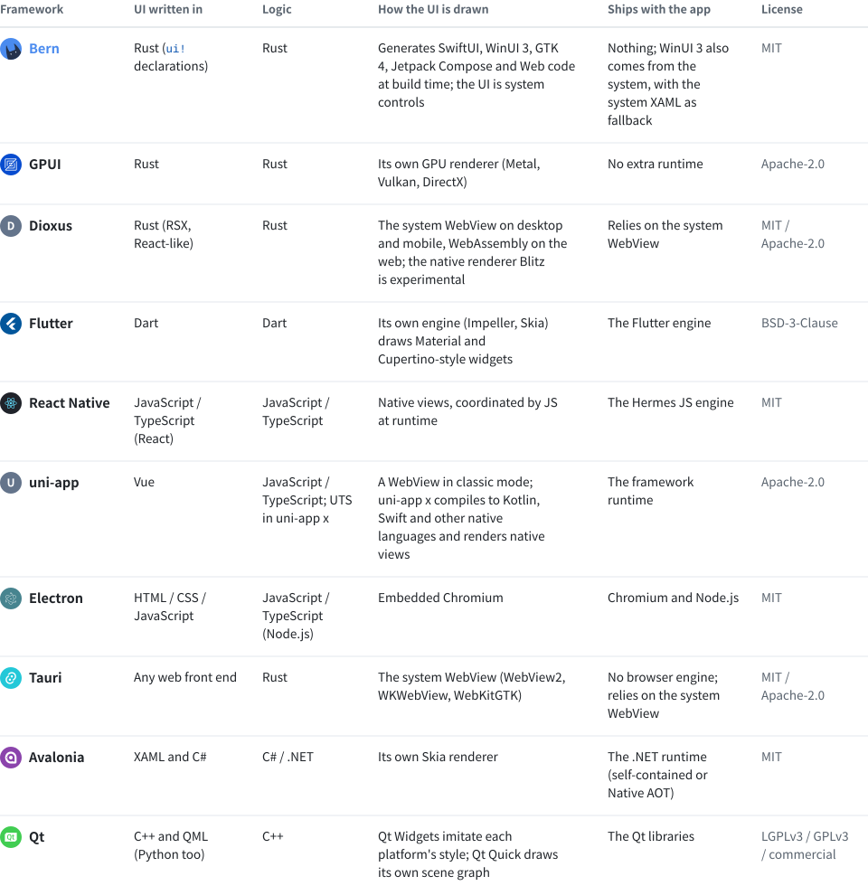
</picture>

### Platforms and capabilities

<picture>
<source media="(prefers-color-scheme: dark)" srcset="Docs/Assets/tables/capabilities-en-dark.svg">
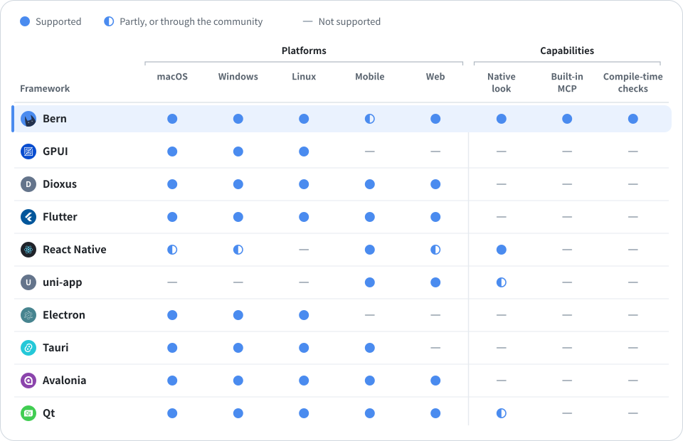
</picture>

- **Mobile**: iOS and Android. React Native's desktop versions are maintained by Microsoft; uni-app also covers mini programs and HarmonyOS; Bern's Android target runs on devices and makes packages, its iOS target builds simulator apps, and iOS device packages are planned.
- **Native look**: the controls are the platform's own, with look, accessibility and input methods from the system. Qt Widgets and uni-app x come close and count as partly.
- **Built-in MCP**: an MCP server and command line that come with the framework and act on the running interface. Other frameworks can be automated from outside through accessibility APIs or test tools such as Playwright and Flutter Driver.
- **Compile-time checks**: a missing translation, a feature without an entry in some layout, or an entry not registered to a feature is a compiler error (see [Built for AI](#built-for-ai)). Other frameworks mostly find these with linters, translation tools or tests.
- **Maturity**: Electron and Qt are very mature; Flutter, React Native, uni-app, Tauri and Avalonia are mature; Dioxus is developing quickly; GPUI powers the Zed editor while its general-purpose components are early; Bern is an early preview.

### Performance and footprint

The languages of the UI and logic layers, and how they run, set the ceiling of runtime overhead: natively compiled languages without garbage collection cost the least; JIT-run and interpreted languages ship an engine and use more memory.

<picture>
<source media="(prefers-color-scheme: dark)" srcset="Docs/Assets/compare/languages-en-dark.svg">

</picture>

For the same window showing one line of text, package size, launch time and memory differ widely. The chart is measured on one CI virtual machine (a GitHub-hosted Apple M1): each framework's own tools build a release package, and the apps take turns starting, ten times each, median shown. The scripts are in [benchmarks/](benchmarks/); the Benchmarks workflow reruns them from the Actions tab.

<picture>
<source media="(prefers-color-scheme: dark)" srcset="Docs/Assets/compare/resources-en-dark.svg">

</picture>

### Which one to choose

<picture>
<source media="(prefers-color-scheme: dark)" srcset="Docs/Assets/tables/choose-en-dark.svg">
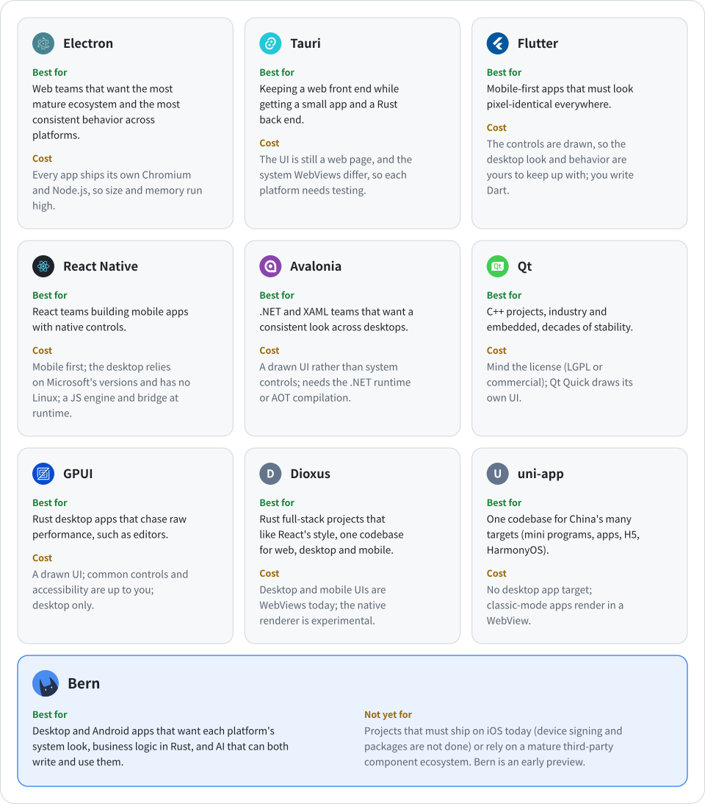
</picture>

## Quick start

You need Rust 1.99 (`rustup` installs it from `rust-toolchain.toml`) plus the toolchain of the target you build. First install the build tool `bern` from source:

```sh
git clone https://github.com/AimesSoft/Bern
cd Bern
cargo install --path crates/bern-cli
```

### Create an app

In any directory:

```sh
bern new my_app
cd my_app
bern run
```

The new app is a window with a counter, with one crate each for the protocol, the engine and the interface, and all six targets declared in `Bern.toml`. `bern run` builds the target for this computer and starts it: SwiftUI on macOS, WinUI 3 on Windows, GTK on Linux; `bern run --target web_app` opens it in the browser, `bern run --target ios` installs it in the running iOS simulator, and `bern run --target android` installs it on the Android phone connected with USB debugging (or an emulator) and starts it. Every build also produces the application CLI and MCP server in `target/bern/<target>/bin/`.

`bern doctor` lists what this computer still needs for each target, and how to install it:

```text
$ bern doctor
bern 0.1.0 on macOS (aarch64)

[✓] Rust: rustc 1.99.0, cargo 1.99.0
[✓] macOS · SwiftUI: macOS SDK 26.5, Swift 6.3.2
[✓] iOS · SwiftUI: iOS simulator SDK 26.5, the aarch64-apple-ios-sim target
[-] Windows · WinUI 3: builds on Windows
[-] Linux · GTK 4: builds on Linux
[✓] Android · Compose: Android SDK, NDK 29.0.14206865, gradle-9.5.1, the aarch64-linux-android target
[✓] Web · WebAssembly: the wasm32-unknown-unknown target
```

<details>
<summary><b>What each platform needs</b></summary>
<br>

- **macOS**: Xcode 26 or later. After installing it from the App Store, run `sudo xcode-select --switch /Applications/Xcode.app`.
- **iOS**: Xcode's iOS platform and an iOS simulator, plus `rustup target add aarch64-apple-ios-sim`. Builds are for the simulator for now; device signing and packages are not done yet.
- **Windows**: Visual Studio 2022 or later with “Desktop development with C++” (the Build Tools are enough) and a Windows 11 SDK; Rust on the MSVC toolchain. The first build generates the C++/WinRT headers with the Windows SDK's `cppwinrt` and precompiles them with the runtime (about 2.4 GB per profile, under `target`); later builds compile only the app's own code, about 5 s for a new app and 9 s for the showcase. The app folder holds only the executable, a 400 KB bootstrapper DLL and the resources: no .NET, no bundled Windows App SDK.
- **Linux**: GTK 4.14 and libadwaita 1.5 development packages, for example `sudo apt install libgtk-4-dev libadwaita-1-dev gstreamer1.0-libav`.
- **Android**: Android Studio with the SDK and the NDK (SDK Manager → SDK Tools → NDK), Gradle 9.4 or newer, and `rustup target add aarch64-linux-android`. The first build has Gradle download the Android plugin and the Compose libraries.
- **Web**: `rustup target add wasm32-unknown-unknown`. A `web_app` build compiles the engine to WebAssembly and runs it in the page; a `web_ui` build makes the page the UI of a separate engine host, which `bern run` starts before opening its address.

</details>

### Ship an app

```sh
bern package
```

Builds every target this computer can in release and writes packages to `target/bern/dist/`: a `.dmg` for macOS, an installer (per user, no administrator rights) and a `.zip` for Windows, a `.deb` and a `.tar.gz` for Linux, an `.apk` and an `.aab` for stores for Android, and an archive of the static site for the Web. Every package but Android's carries the app's CLI and MCP server. Signing comes from the environment, so certificates stay out of the repository: `BERN_MACOS_SIGNING_IDENTITY` and `BERN_MACOS_NOTARY_PROFILE` (sign and notarize), `BERN_WINDOWS_CERTIFICATE` (a certificate thumbprint or a `.pfx`), `BERN_ANDROID_KEYSTORE`, `BERN_ANDROID_KEYSTORE_PASSWORD` and `BERN_ANDROID_KEY_ALIAS` (the release key). Without them the packages are still made, with a note on what being unsigned means.

### Run the showcase

The showcase in the Bern repository uses every component, two windows and a video player. From the repository directory:

```sh
cd examples/showcase
bern run
```

### Drive the running app

```sh
showcase ui inspect                                          # every mounted control
showcase ui select --target main_window.pages --option Controls
showcase ui set-bool --target controls_page.sync --value true
showcase showcase search-library --text mo                   # an engine query
showcase window open --kind settings
showcase window list                                         # actual window state
showcase-mcp                                                 # MCP server over stdio
```

The control channel starts only when the target declares `channels = ["ipc"]`; without it the app listens on nothing. An Android app listens on the phone; `bern run` joins it to this computer with `adb forward`, so the CLI and MCP server work as usual.

## Roadmap

<picture>
<source media="(prefers-color-scheme: dark)" srcset="Docs/Assets/tables/roadmap-en-dark.svg">
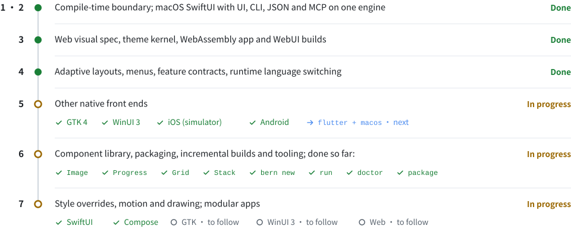
</picture>

## Repository

<details>
<summary>Crates and directories</summary>
<br>

<picture>
<source media="(prefers-color-scheme: dark)" srcset="Docs/Assets/tables/repository-en-dark.svg">
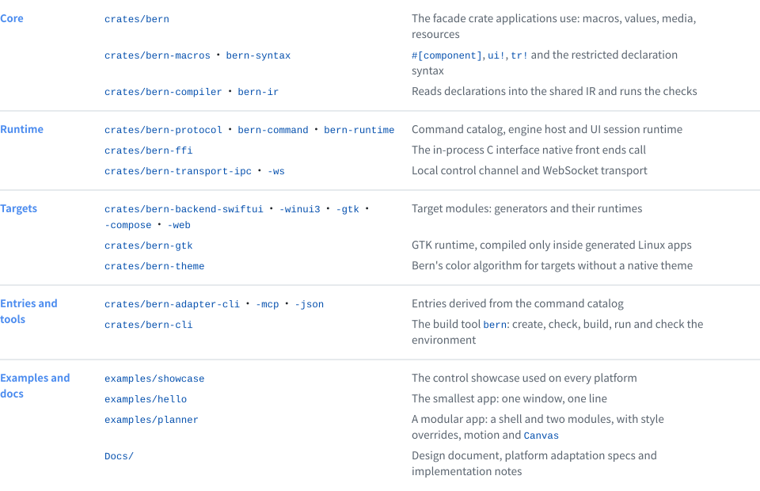
</picture>

</details>

## Development

```sh
cargo fmt --all --check
cargo clippy --workspace --all-targets -- -D warnings
cargo test --workspace
```

Tests include declarations that must fail to compile, and type-check the generated apps where the toolkit is installed: Swift 6 with Xcode, GTK with its development packages, both generated front ends with MSVC on Windows. Android's Kotlin is compiled by Gradle in `bern build --target android`.

## Documentation

- [Documentation index](Docs/README.md) · [Current component guide](Docs/Reference/UI.md) · [Property reference](Docs/Reference/Component-Properties.md) · [Platform capabilities and verification](Docs/Reference/Platforms.md) (Chinese)
- [Design document](Docs/Design.md) – goals, architecture, components, theming, commands, windows, media
- [Adaptation specs](Docs/Adaptation/README.md) – Apple, Windows and Linux, Web, Android, HarmonyOS
- Implementation notes – [macOS](Docs/Implementation/macOS-SwiftUI.md) · [iOS](Docs/Implementation/iOS-SwiftUI.md) · [tvOS](Docs/Implementation/tvOS-SwiftUI.md) · [Android](Docs/Implementation/Android-Compose.md) · [Windows](Docs/Implementation/Windows-WinUI3.md) · [Linux](Docs/Implementation/Linux-GTK.md) · [Web](Docs/Implementation/Web.md)

The design and implementation documents are written in Chinese.

## License

[MIT](LICENSE) © 2026 MCDFSteve

<div align="center">
<br>
<sub>Bern is in early development. APIs and the declaration syntax may still change.</sub>
</div>
