<div align="center">


<h1>Bern</h1>

<p><b>一つの Rust 宣言を、各プラットフォーム自身のネイティブ UI へコンパイル。</b></p>

<p>デスクトップからスマートフォンまで、AI のために作られた：SwiftUI、WinUI 3、GTK 4、Jetpack Compose、そして Web。<br>
デスクトップにもスマートフォンにも JS エンジンや組み込みブラウザーはありません。どのボタンも、生まれながらに AI が呼べる MCP ツールです。</p>

<p>


</p>

<p>


<a href="LICENSE"></a>

</p>

<p>
<a href="README.md">简体中文</a> ·
<a href="README.en.md">English</a> ·
<a href="README.zh-Hant.md">繁體中文</a> ·
<b>日本語</b>
</p>

<p>
<a href="#bern-を選ぶ理由">Bern を選ぶ理由</a> ·
<a href="#ai-のための設計">AI のための設計</a> ·
<a href="#実測値">実測値</a> ·
<a href="#他のフレームワークとの比較">比較</a> ·
<a href="#クイックスタート">クイックスタート</a> ·
<a href="Docs/Design.md">設計ドキュメント</a>
</p>

</div>

<br>

<table>
<tr>
<td width="50%" align="center"><br><sub><b>macOS</b> · SwiftUI</sub></td>
<td width="50%" align="center"><br><sub><b>Windows</b> · WinUI 3</sub></td>
</tr>
<tr>
<td width="50%" align="center"><br><sub><b>Linux</b> · GTK 4 + libadwaita</sub></td>
<td width="50%" align="center"><br><sub><b>Web</b> · DOM + WebAssembly</sub></td>
</tr>
</table>

<p align="center">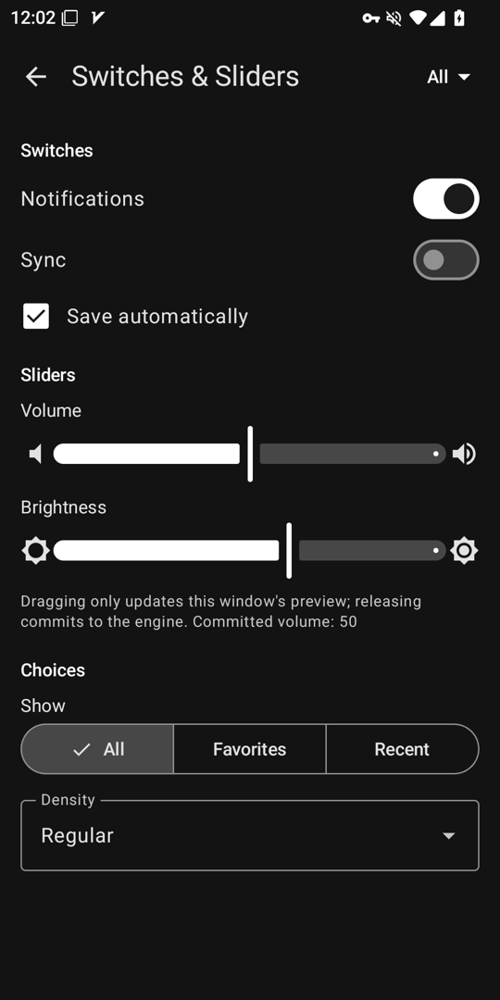<br><sub><b>Android</b> · Jetpack Compose（システムに合わせたダーク）</sub></p>

<p align="center"><sub>ひとつの <code>controls_page</code> 宣言から、5 つの UI ツールキットへ。デスクトップと Android では Bern は自前のピクセルを一切描きません。<br>スイッチもスライダーもサイドバーも、プラットフォーム標準のコントロールとプラットフォームの配色です。</sub></p>

## Bern を選ぶ理由

<picture>
<source media="(prefers-color-scheme: dark)" srcset="Docs/Assets/tables/why-ja-dark.svg">
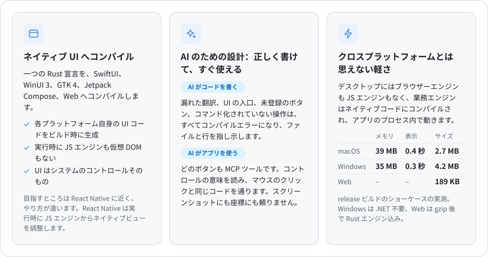
</picture>

## Bern で作られたアプリ

### RustSend · LAN ファイル転送

[RustSend](https://github.com/AimesSoft/RustSend) は Bern で開発したオープンソースの LAN ファイル転送ツールで、LocalSend v2 と互換性があります。UI の宣言、状態、転送処理はすべて Rust で書かれ、Bern が macOS と iOS には SwiftUI、Windows には WinUI 3、Linux には GTK 4、Android には Jetpack Compose のネイティブ UI を生成します。

デバイスの検出、ファイルとテキストの送受信、受信の確認、アプリ内の完了通知に対応し、デスクトップの小さなウインドウとスマートフォンのレイアウトが同じビジネスロジックを共有します。1.0 のローカル macOS ARM64 Release ビルドでは、`.app` 全体が **8.09 MiB**、ダウンロード用の `.zip` が **3.80 MiB** です。ビルド環境と計測方法は[計測記録](https://github.com/AimesSoft/RustSend/blob/main/docs/measurements.md)を参照してください。

<table>
<tr>
<td width="50%" align="center"><a href="https://raw.githubusercontent.com/AimesSoft/RustSend/main/docs/screenshots/macos-receive.png"></a><br><sub><b>macOS</b> · SwiftUI</sub></td>
<td width="50%" align="center"><a href="https://raw.githubusercontent.com/AimesSoft/RustSend/main/docs/screenshots/android-receive.png"></a><br><sub><b>Android</b> · Jetpack Compose</sub></td>
</tr>
</table>

[ソースコード](https://github.com/AimesSoft/RustSend) · [RustSend をダウンロード](https://github.com/AimesSoft/RustSend/releases/latest) · [5 つのプラットフォームのスクリーンショットと実行環境](https://github.com/AimesSoft/RustSend/blob/main/docs/screenshots/README.md)

## AI のための設計

### コードを書く：AI が忘れたことは、コンパイラーが覚えている

AI が UI を書くときに多い問題は、書き間違いより書き漏れです。機能を足したのに狭い画面のレイアウトに入口を置き忘れる、新しい文言を一つの言語でしか書かない、コマンドを迂回してコールバックをぶら下げる。ほかのフレームワークではユーザーが見つけるまで残りますが、Bern ではどれもコンパイルを通りません。制約が厳しいほど、AI は中途半端な仕事を渡しにくくなります。

<picture>
<source media="(prefers-color-scheme: dark)" srcset="Docs/Assets/tables/ai-ja-dark.svg">
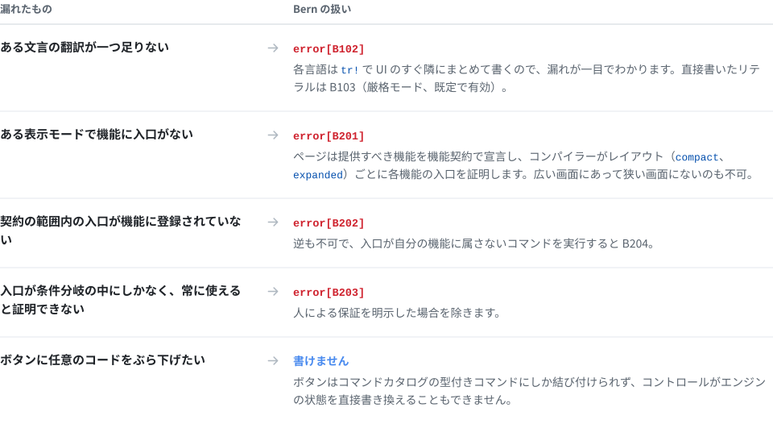
</picture>

エラーは人のためでもあり、エージェントのためでもあります。番号、理由、位置がはっきりしているので、エージェントは自分で直して再ビルドできます。以下はショーケースで実際に出た 2 回分の出力です。1 回目は英語の翻訳を一つ消し、それを戻してから、2 回目は狭いレイアウトの「Change Clip」メニューを消しました。

```text
$ bern check
error[B102]: Missing translation
Missing language: en
Required languages: zh-Hans, en
  --> showcase-ui/src/pages.rs:13:31

$ bern check
error[B201]: Feature missing in adaptive layout
Contract: MediaFeature
Feature: Clip
compact: missing
  --> showcase-ui/src/media.rs:14:5
```

ビルドのたびに、ターゲットごとの機能カバレッジの完全なレポート（`features.json`）も出力され、カバー済み、免除、人による保証のみが分けて記載されます。

### アプリを使う：ピクセルではなく意味を読む

多くのフレームワークでは、AI にデスクトップアプリを操作させるには、スクリーンショット、認識、座標計算、疑似クリックが必要です。Bern のアプリは MCP サーバーを備えています。UI のすべてのコントロールに安定した名前と役割があり、エージェントは構造を読み、ユーザーのクリックと同じコードで操作し、アプリは起きたことをそのまま答えます。

```sh
$ showcase ui inspect                 # エージェントが読むのはピクセルではなく意味
[{ "target": "controls_page.sync", "role": "switch", "label": "Sync", "value": "false", "enabled": true, … }, …]

$ showcase ui set-bool --target controls_page.sync --value true

$ showcase window close --window settings#1
{ "outcome": "ConfirmationRequired", "message": "Do you want to save the display name?",
  "decisions": ["Save", "Discard", "Cancel"], "confirmation": "settings#1:c1", … }

$ showcase window confirm-close --window settings#1 --confirmation settings#1:c1 --decision Save
{ "outcome": "Rejected", "reason": "save_failed: invalid_name: a display name has 1 to 40 characters …" }
```

同じ操作が MCP ツール（`ui_inspect`、`ui_activate`、`window_close`…）としてエージェントに提供され、業務コマンドもそれぞれツールになります（例：`showcase_set_display_name`）。ボタンが無効、ダイアログでふさがれている、対象が存在しないといった場合、エージェントが受け取るのは何も起きないクリックではなく、明確なエラーコードです。

## 実測値

<picture>
<source media="(prefers-color-scheme: dark)" srcset="Docs/Assets/tables/measured-ja-dark.svg">
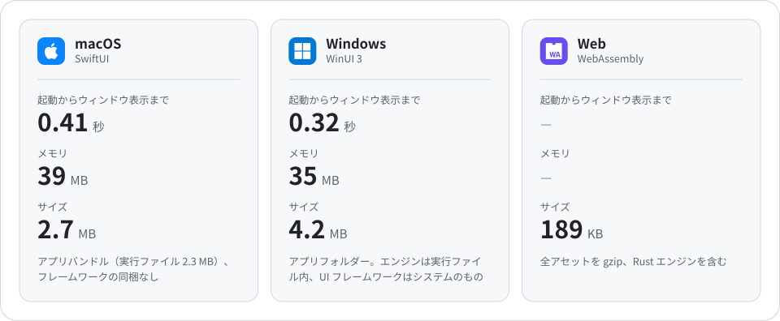
</picture>

<details>
<summary>測定方法</summary>
<br>

- 対象：release ビルドのショーケース（6 ページ、メインと設定のウィンドウ、ビデオプレーヤー）。2026-10-11 に測定し、各項目 3 回以上の中央値。
- macOS：Apple M4、メモリ 16 GB、macOS 27.0.1。メモリは `footprint` の物理フットプリントで、アクティビティモニタの「メモリ」列と同じ指標。
- Windows：Intel Core i5-13490F、メモリ 32 GB、Windows 11 25H2。メモリはプライベートワーキングセットで、タスクマネージャーの「メモリ」列と同じ指標。
- 起動時間：プロセスの起動から、コマンドラインが表示中のネイティブウィンドウを読めるまで。エンジンの起動とローカル制御チャネルの準備を含みます。
- Windows の値は WinUI 3 フロントエンド（測定時はシステムに Windows App Runtime 1.8。現在は 2.x でビルド）。ランタイムがないシステムでは、同じプログラムがシステムの XAML にフォールバックし、起動 0.54 秒、メモリ 19 MB です。どちらも .NET と VC++ ランタイムは不要で、アプリフォルダーには実行ファイルと 400 KB のブートストラップ DLL だけがあります。

</details>

## その他の機能

<picture>
<source media="(prefers-color-scheme: dark)" srcset="Docs/Assets/tables/more-ja-dark.svg">
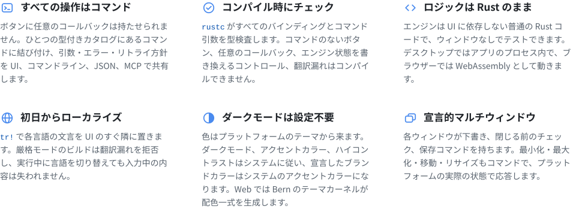
</picture>

<details>
<summary><b>さらに：</b>動画、非同期クエリ、スタイルとモーション、描画、メディアアプリ向けのコンポーネント、渡されたファイルの読み取り、モジュール化アプリ、アダプティブレイアウト…</summary>
<br>

- **動画**：`Video` は AVFoundation、Windows Media Foundation、GStreamer、Android の Media3、HTML メディアで再生され、コントロールバーはコマンド駆動、プレーヤーはページをまたいで再生を続けられます。
- **非同期クエリ**：`Query` の購読は読み込み中・空・失敗・更新中の状態を持ち、最新の応答だけを表示します。
- **アダプティブレイアウト**：ビューが実際に得た幅に応じて `compact`、`medium`、`expanded`、`large` の 4 段階からレイアウトを選びます。式からもウィンドウの段階を読めるので、余白を段階ごとに変えられます。
- **型付きナビゲーション**：サイドバー、型付きルートによるプッシュナビゲーション、タブ、ツールバー、メニュー。
- **機能契約**：各レイアウトでコンポーネントが満たすべき機能を宣言し、網羅をコンパイラーが証明します。
- **同梱リソース**：`Bern.toml` で宣言したファイルをビルド時に検査し、実行時は名前で参照します。
- **画像とレイアウト**：`Image` は同梱画像を表示し、HDR 画像（PQ・HLG の PNG、ゲインマップ付き JPEG）は HDR を表示できる画面で HDR のまま表示します。宣言されていないリソースはコンパイルエラーになります。`Grid` は幅に応じて列数を増減し、`Stack` は 9 方向の配置で重ね、`Progress` はプログレスバーか不確定の進捗を表示します。
- **スタイルの上書きとモーション**：コントロールは既定でプラットフォームの見た目です。一つのデザインにそろえたいときは、`style!` でアプリ全体の上書き、ばねのモーション、出現と消失のトランジション、時間差の登場、共有要素を宣言します。ターゲットが表示できない上書きはビルドエラーになります（5 つのフロントエンドすべてに実装）。
- **描画と比率での配置**：`Canvas` は意味的な色で図形、データの曲線、チェック柄を描き、`Text` にはハイライトの下地を付けられます。`Rail` は状態が示す比率の位置に要素を置き、タイムライン、プログレスバー上の目盛り、伸びていく背景に使えます。
- **メディアアプリ向けのコンポーネント**：サイドバー下部の領域、ツールバーの検索と結果、インスペクター、トースト、分割ボタンと任意の内容を出すポップオーバーボタン、内容を持つボタンとホバー時の表示、ショートカット、ファイルの選択とドロップ、スクロールのスナップ、ピンチとドラッグでの値の調整。5 つのフロントエンドすべてに実装しています。
- **渡されたファイルの読み取り**：ユーザーが選んだ、ドロップした、またはアプリで開いたファイルの名前と中身を、エンジンは `MediaSource::file_name()` と `open()` で読み取ります。ローカルのパス、Android の `content://` ドキュメント、Web ページの `blob:` ファイルを同じ書き方で扱えます。
- **モジュール化アプリ**：アプリはシェルと複数のモジュールで構成され、各モジュールが独自のプロトコル、エンジン、UI、翻訳を持ち、実行中に切り替えられます。`bern new --module` で追加でき、複数の人や AI が並行して開発できます（macOS と Android で検証済み）。

</details>

## しくみ

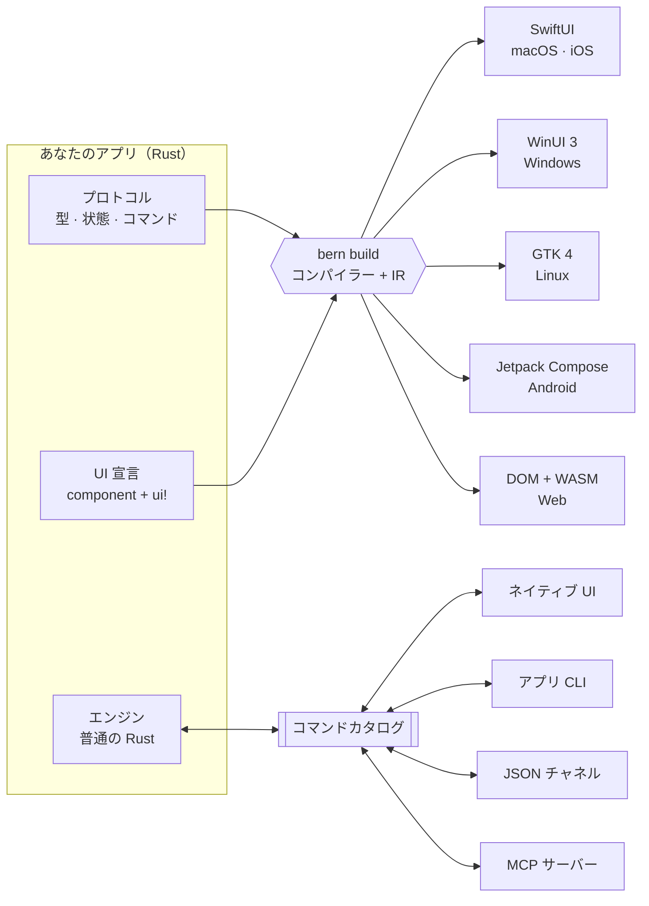

1. **プロトコル**：`#[bern::protocol]` で値の型、読み取り専用の状態、コマンドとクエリのトレイトを宣言します。
2. **エンジン**：それらのトレイトを普通の Rust で実装します。ウィンドウもコントロールも通信路も知りません。
3. **インターフェース**：本体が `ui!` 宣言である `#[component]` 関数。コンパイラーがこれを共通の中間表現（IR）に読み込み、各ターゲットモジュールがそこからネイティブコードを生成します。ターゲットを増やしてもパーサー、IR、ビジネスロジックには手を入れません。

## コードの雰囲気

**1 · プロトコル**：型、状態、コマンド

```rust
#[bern::protocol(namespace = "counter", version = 1)]
pub mod counter {
    use bern::prelude::*;

    #[state]
    pub struct State {
        pub count: i64,
    }

    #[commands]
    pub trait Commands {
        /// Add to the count.
        fn add(&mut self, by: i64) -> Result<(), CommandError>;
    }
}
```

**2 · エンジン**：UI に依存しない普通の Rust

```rust
use bern::CommandError;

pub struct Counter {
    state: counter::State,
}

impl Default for Counter {
    fn default() -> Self {
        Self { state: counter::State { count: 0 } }
    }
}

impl counter::Commands for Counter {
    fn add(&mut self, by: i64) -> Result<(), CommandError> {
        self.state.count += by;
        Ok(())
    }
}

impl counter::Engine for Counter {
    fn state(&self) -> &counter::State {
        &self.state
    }
}
```

**3 · インターフェース**：ひとつの `ui!` 宣言

```rust
#[component]
pub fn counter_view(app: counter::Client) -> impl View {
    ui! {
        Form {
            Text(content: tr! {
                "ja" => "{n} 回カウントしました",
                "en" => "Counted {n} times";
                n: app.count
            })
            Button(
                id: add,
                label: tr! { "ja" => "1 増やす", "en" => "Add one" },
                prominence: prominent
            ) => app.add(1)
        }
    }
}
```

**4 · すべての入口が同じエンジンを動かす**

```sh
counter ui inspect
counter ui activate --target counter_view.add
counter counter add --by 5
counter-mcp   # 同じカタログを AI エージェントへ
```

`Bern.toml` では言語、テーマ、ソース、同梱リソース、ビルドターゲットを宣言します。完全な例は[ショーケース](examples/showcase)をご覧ください。文字スタイル、ボタン、スイッチ、スライダー、テキストフィールド、エンジンのクエリによる検索、リストから詳細へのナビゲーション、動画、そしてタブと閉じる確認を持つ設定ウィンドウを備えたサイドバー型アプリです。[プランナー](examples/planner)は、スタイルの上書き、モーション、`Canvas` を使ったモジュール化アプリです。[パターン集](examples/gallery)はメディアアプリ向けのコンポーネントを示します。ポスターウォールの時間差の登場、タイムラインの比率での配置、音量のポップオーバーボタン、4 段階のサイズに応じて変わる余白とレイアウト、そしてドロップした動画のファイル名・形式・サイズをエンジンがファイルから読み取る例です。

## 対応プラットフォーム

<picture>
<source media="(prefers-color-scheme: dark)" srcset="Docs/Assets/tables/platforms-ja-dark.svg">
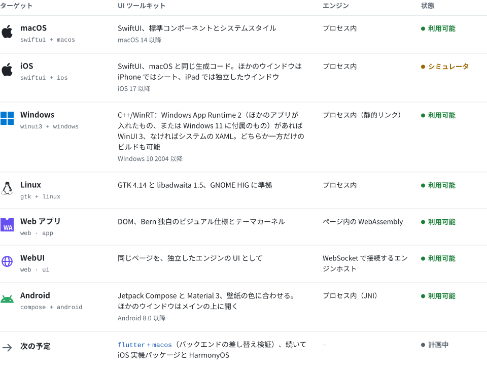
</picture>

実装記録：[macOS](Docs/Implementation/macOS-SwiftUI.md) · [iOS](Docs/Implementation/iOS-SwiftUI.md) · [tvOS](Docs/Implementation/tvOS-SwiftUI.md) · [Windows](Docs/Implementation/Windows-WinUI3.md) · [Linux](Docs/Implementation/Linux-GTK.md) · [Web と WebUI](Docs/Implementation/Web.md) · [Android](Docs/Implementation/Android-Compose.md)。次のプラットフォームは[適応仕様](Docs/Adaptation/README.md)にあります。

UI 技術を省略するとプラットフォームの既定が選ばれます。既定が使えないときは、別の技術へ黙って切り替えずにエラーになります。

## 他のフレームワークとの比較

<p align="center">
<a href="https://github.com/zed-industries/zed/tree/main/crates/gpui"></a>
<a href="https://dioxuslabs.com"></a>
<a href="https://flutter.dev"></a>
<a href="https://reactnative.dev"></a>
<a href="https://uniapp.dcloud.net.cn"></a>
<br>
<a href="https://www.electronjs.org"></a>
<a href="https://tauri.app"></a>
<a href="https://avaloniaui.net"></a>
<a href="https://www.qt.io"></a>
</p>

どのフレームワークも同じ問いに答えています。一つのコードが、各プラットフォームの UI にどうやってなるのか。答えが違えば、トレードオフも違います。以下は各プロジェクトの公式ドキュメントに基づきます。サイズやメモリはバージョンや設定で大きく変わるため、ここでは構造の違いだけを比べます。Bern 自身の数値は[実測値](#実測値)を参照してください。

<picture>
<source media="(prefers-color-scheme: dark)" srcset="Docs/Assets/compare/routes-ja-dark.svg">
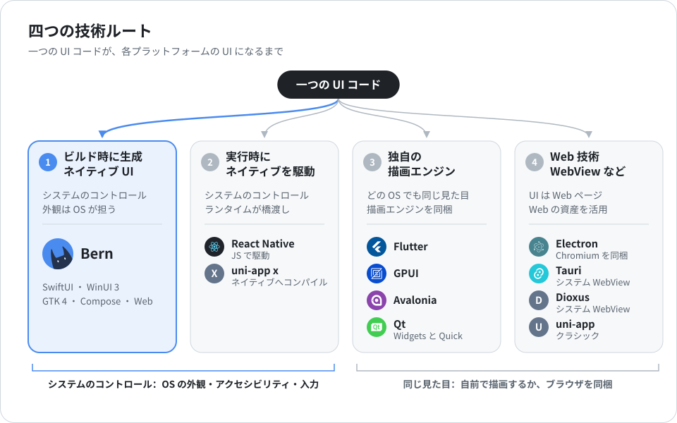
</picture>

前の二つのルートではシステムのコントロールが手に入ります。外観、アクセシビリティ、入力メソッド、ダークモードはシステムが受け持ち、代わりにコントロールはプラットフォームごとに少しずつ違います。後の二つはどこでも同じ UI を描き、代わりに各プラットフォームのデザインと振る舞いを自分で追いかけるか、ブラウザーを同梱します。

<picture>
<source media="(prefers-color-scheme: dark)" srcset="Docs/Assets/compare/landscape-ja-dark.svg">
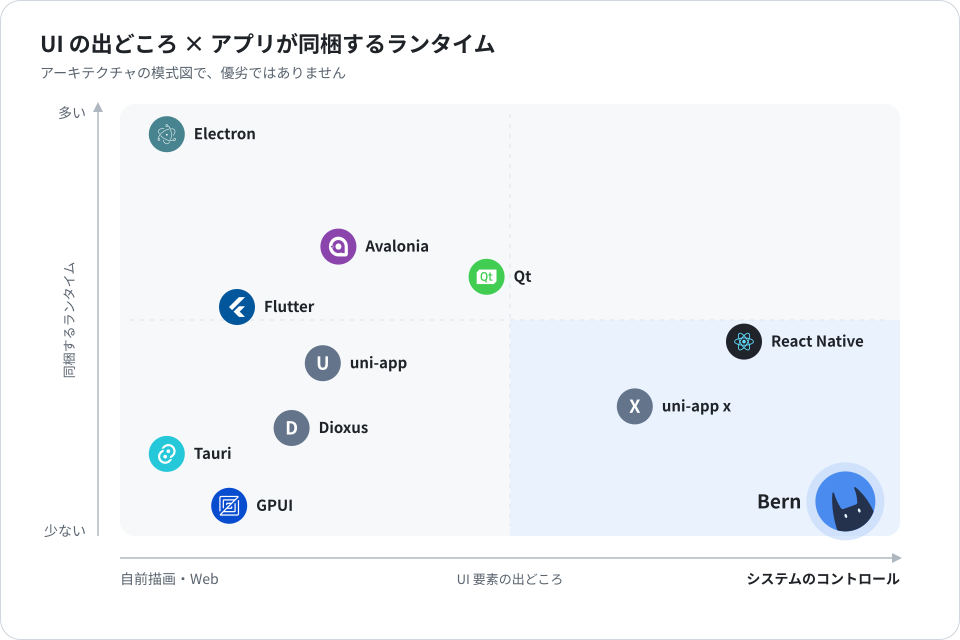
</picture>

この図はアーキテクチャの模式図で、優劣ではありません。横軸は UI 要素がシステムのコントロールか、フレームワークの自前描画や Web ページか。縦軸はアプリが同梱するランタイムの量（ブラウザーエンジン、JS エンジン、描画エンジン、言語ランタイム）です。

### 技術

<picture>
<source media="(prefers-color-scheme: dark)" srcset="Docs/Assets/tables/technology-ja-dark.svg">
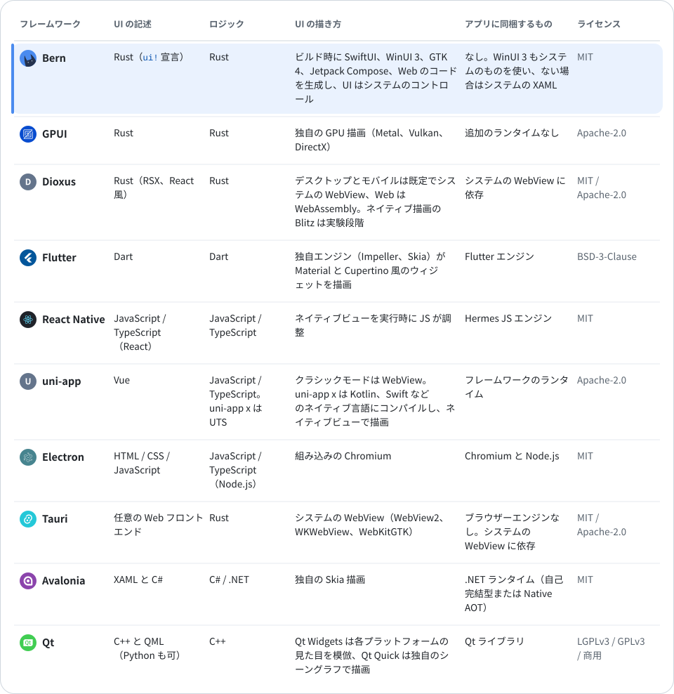
</picture>

### プラットフォームと機能

<picture>
<source media="(prefers-color-scheme: dark)" srcset="Docs/Assets/tables/capabilities-ja-dark.svg">
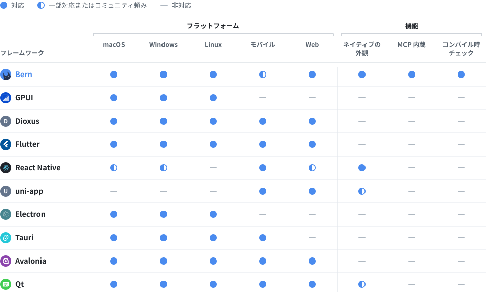
</picture>

- **モバイル**：iOS と Android。React Native のデスクトップ版は Microsoft が保守し、uni-app はミニプログラムと HarmonyOS にも対応します。Bern の Android ターゲットは実機で動作しパッケージも作れます。iOS ターゲットはシミュレータ用アプリをビルドし、実機パッケージは計画中です。
- **ネイティブの外観**：コントロールがプラットフォーム自身のもので、外観、アクセシビリティ、入力メソッドをシステムが提供します。Qt Widgets と uni-app x はそれに近いため一部対応としました。
- **MCP 内蔵**：フレームワークに付属し、動作中の UI を操作する MCP サーバーとコマンドライン。ほかのフレームワークは、アクセシビリティ API や Playwright、Flutter Driver などのテストツールで外から自動化できます。
- **コンパイル時チェック**：翻訳漏れ、あるレイアウトで機能に入口がない、入口が機能に登録されていない、といった問題をコンパイラーが直接エラーにします（[AI のための設計](#ai-のための設計)を参照）。ほかのフレームワークでは多くの場合、リンター、翻訳ツール、テストで見つけます。
- **成熟度**：Electron と Qt は非常に成熟しています。Flutter、React Native、uni-app、Tauri、Avalonia は成熟、Dioxus は発展中、GPUI は Zed エディターを支えていますが汎用コンポーネントはまだ初期段階、Bern は早期プレビューです。

### 性能とリソース

UI 層とロジック層がどの言語で、どう実行されるかが、実行時のオーバーヘッドの上限を決めます。ネイティブコンパイルで GC のない言語が最も軽く、JIT やバイトコード解釈の言語はエンジンを同梱し、メモリも多く使います。

<picture>
<source media="(prefers-color-scheme: dark)" srcset="Docs/Assets/compare/languages-ja-dark.svg">
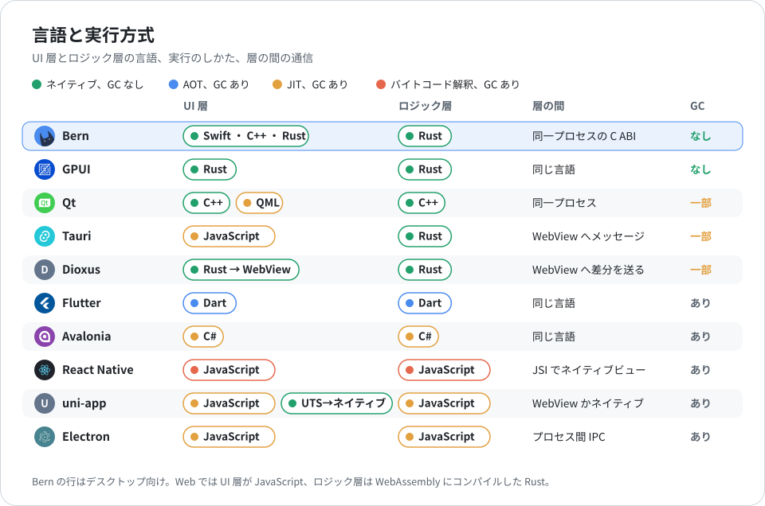
</picture>

一行の文字を表示するだけの同じウィンドウでも、パッケージサイズ、起動時間、メモリはフレームワークによって大きく違います。図は同じ CI 仮想マシン（GitHub ホストの Apple M1）での実測です。各フレームワーク自身のツールで release パッケージを作り、交互に 10 回ずつ起動した中央値を示します。スクリプトは [benchmarks/](benchmarks/) にあり、Actions の Benchmarks ワークフローで再実行できます。

<picture>
<source media="(prefers-color-scheme: dark)" srcset="Docs/Assets/compare/resources-ja-dark.svg">
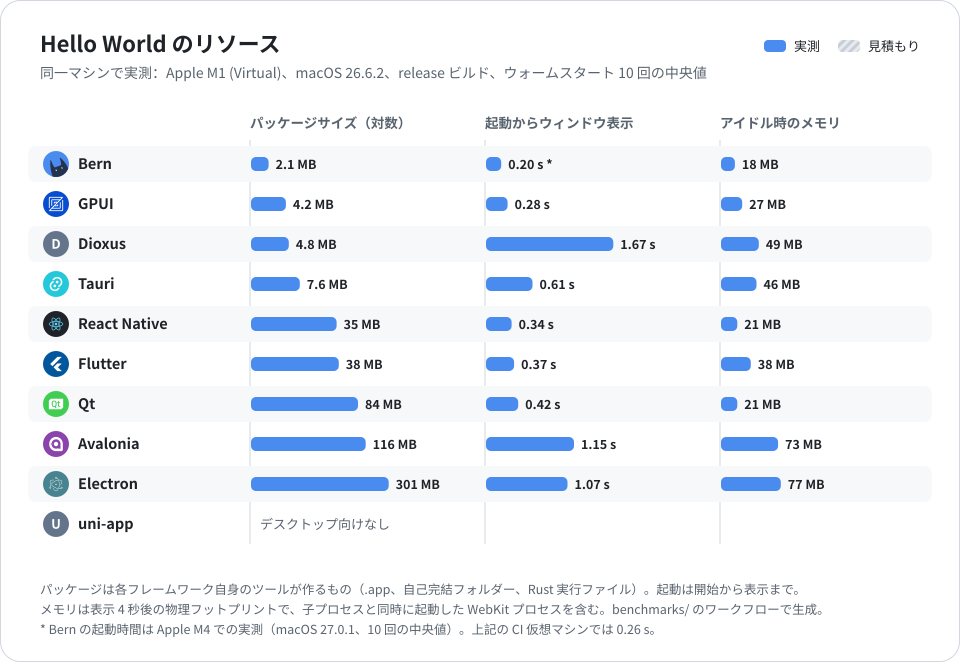
</picture>

### どれを選ぶか

<picture>
<source media="(prefers-color-scheme: dark)" srcset="Docs/Assets/tables/choose-ja-dark.svg">
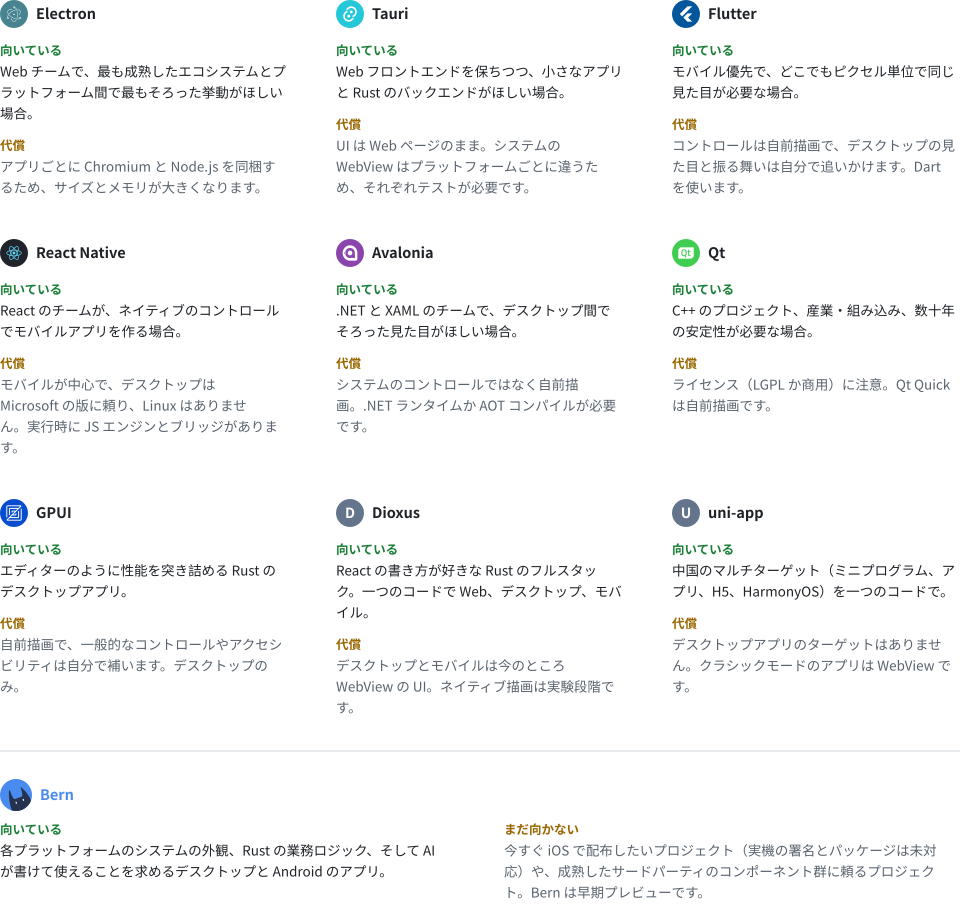
</picture>

## クイックスタート

Rust 1.99（`rustup` が `rust-toolchain.toml` に従って自動でインストール）と、ビルドするターゲットのツールチェーンが必要です。まずビルドツール `bern` をソースからインストールします。

```sh
git clone https://github.com/AimesSoft/Bern
cd Bern
cargo install --path crates/bern-cli
```

### アプリを作る

任意のディレクトリで：

```sh
bern new my_app
cd my_app
bern run
```

新しいアプリはカウンター付きのウィンドウで、プロトコル、エンジン、UI がそれぞれ一つの crate になり、6 つのターゲットすべてが `Bern.toml` に宣言されています。`bern run` はこのコンピューターのターゲットをビルドして起動します。macOS では SwiftUI、Windows では WinUI 3、Linux では GTK です。`bern run --target web_app` はブラウザーで開き、`bern run --target ios` は起動中の iOS シミュレータに、`bern run --target android` は USB デバッグで接続した Android スマートフォン（またはエミュレータ）にインストールして起動します。どのビルドでも `target/bern/<ターゲット>/bin/` にアプリの CLI と MCP サーバーが生成されます。

`bern doctor` は、このコンピューターで各ターゲットをビルドするのに足りないものと、そのインストール方法を示します。

```text
$ bern doctor
bern 0.1.0 on macOS (aarch64)

[✓] Rust: rustc 1.99.0, cargo 1.99.0
[✓] macOS · SwiftUI: macOS SDK 26.5, Swift 6.3.2
[✓] iOS · SwiftUI: iOS simulator SDK 26.5, the aarch64-apple-ios-sim target
[-] Windows · WinUI 3: builds on Windows
[-] Linux · GTK 4: builds on Linux
[✓] Android · Compose: Android SDK, NDK 29.0.14206865, gradle-9.5.1, the aarch64-linux-android target
[✓] Web · WebAssembly: the wasm32-unknown-unknown target
```

<details>
<summary><b>プラットフォームごとに必要なツール</b></summary>
<br>

- **macOS**：Xcode 26 以降。App Store からインストールしたあと `sudo xcode-select --switch /Applications/Xcode.app` を実行します。
- **iOS**：Xcode の iOS プラットフォームと iOS シミュレータ、および `rustup target add aarch64-apple-ios-sim`。現在はシミュレータ用アプリをビルドします。実機の署名とパッケージはまだです。
- **Windows**：Visual Studio 2022 以降の「C++ によるデスクトップ開発」（Build Tools だけでも可）と Windows 11 SDK。Rust は MSVC ツールチェーンを使います。初回のビルドで Windows SDK の `cppwinrt` が C++/WinRT ヘッダーを生成し、ランタイムと一緒にプリコンパイルします（構成ごとに約 2.4 GB、`target` 内）。以降のビルドはアプリ自身のコードだけをコンパイルし、新しいアプリで約 5 秒、ショーケースで約 9 秒です。アプリのフォルダーには実行ファイル、400 KB のブートストラップ DLL、リソースだけがあり、.NET は不要で、Windows App SDK も同梱しません。
- **Linux**：GTK 4.14 と libadwaita 1.5 の開発パッケージ。例：`sudo apt install libgtk-4-dev libadwaita-1-dev gstreamer1.0-libav`。
- **Android**：SDK と NDK を入れた Android Studio（SDK Manager → SDK Tools → NDK）、Gradle 9.4 以降、`rustup target add aarch64-linux-android`。初回のビルドで Gradle が Android プラグインと Compose ライブラリをダウンロードします。
- **Web**：`rustup target add wasm32-unknown-unknown`。`web_app` ビルドはエンジンを WebAssembly にコンパイルしてページ内で動かし、`web_ui` ビルドはページを独立したエンジンホストの UI にします。`bern run` はホストを起動してそのアドレスを開きます。

</details>

### アプリを配布する

```sh
bern package
```

このコンピューターでビルドできるターゲットを release でビルドし、`target/bern/dist/` にパッケージを書き出します。macOS は `.dmg`、Windows はインストーラー（ユーザーごと、管理者権限不要）と `.zip`、Linux は `.deb` と `.tar.gz`、Android は `.apk` とストア向けの `.aab`、Web は静的サイトのアーカイブです。Android 以外のパッケージにはアプリの CLI と MCP サーバーが入ります。署名は環境変数で設定し、証明書はリポジトリに入れません：`BERN_MACOS_SIGNING_IDENTITY` と `BERN_MACOS_NOTARY_PROFILE`（署名と公証）、`BERN_WINDOWS_CERTIFICATE`（証明書の拇印または `.pfx`）、`BERN_ANDROID_KEYSTORE`・`BERN_ANDROID_KEYSTORE_PASSWORD`・`BERN_ANDROID_KEY_ALIAS`（リリース鍵）。設定がなくてもパッケージは作られ、未署名の影響を知らせます。

### ショーケースを動かす

Bern リポジトリのショーケースは、すべてのコンポーネント、2 つのウィンドウ、ビデオプレーヤーを使います。リポジトリのディレクトリで：

```sh
cd examples/showcase
bern run
```

### 動いているアプリを外から操作する

```sh
showcase ui inspect                                          # マウントされたコントロールの一覧
showcase ui select --target main_window.pages --option Controls
showcase ui set-bool --target controls_page.sync --value true
showcase showcase search-library --text mo                   # エンジンへのクエリ
showcase window open --kind settings
showcase window list                                         # ウィンドウの実際の状態
showcase-mcp                                                 # stdio の MCP サーバー
```

制御チャネルはターゲットが `channels = ["ipc"]` を宣言したときだけ起動します。宣言しなければアプリはどのポートも待ち受けません。Android アプリはスマートフォン上で待ち受け、`bern run` が `adb forward` でこのコンピューターにつなぐので、CLI と MCP サーバーはそのまま使えます。

## ロードマップ

<picture>
<source media="(prefers-color-scheme: dark)" srcset="Docs/Assets/tables/roadmap-ja-dark.svg">
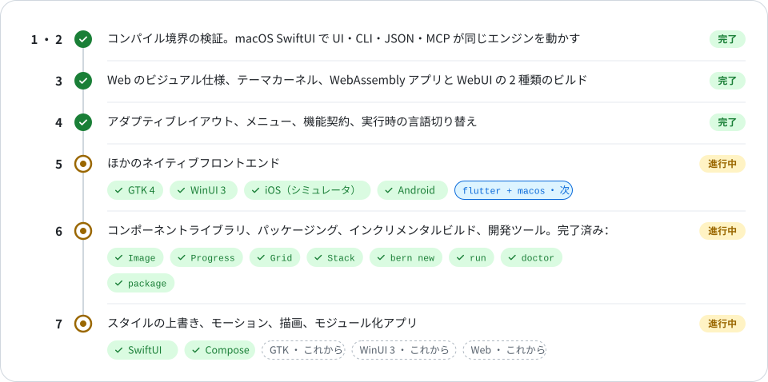
</picture>

## リポジトリ構成

<details>
<summary>クレートとディレクトリ</summary>
<br>

<picture>
<source media="(prefers-color-scheme: dark)" srcset="Docs/Assets/tables/repository-ja-dark.svg">
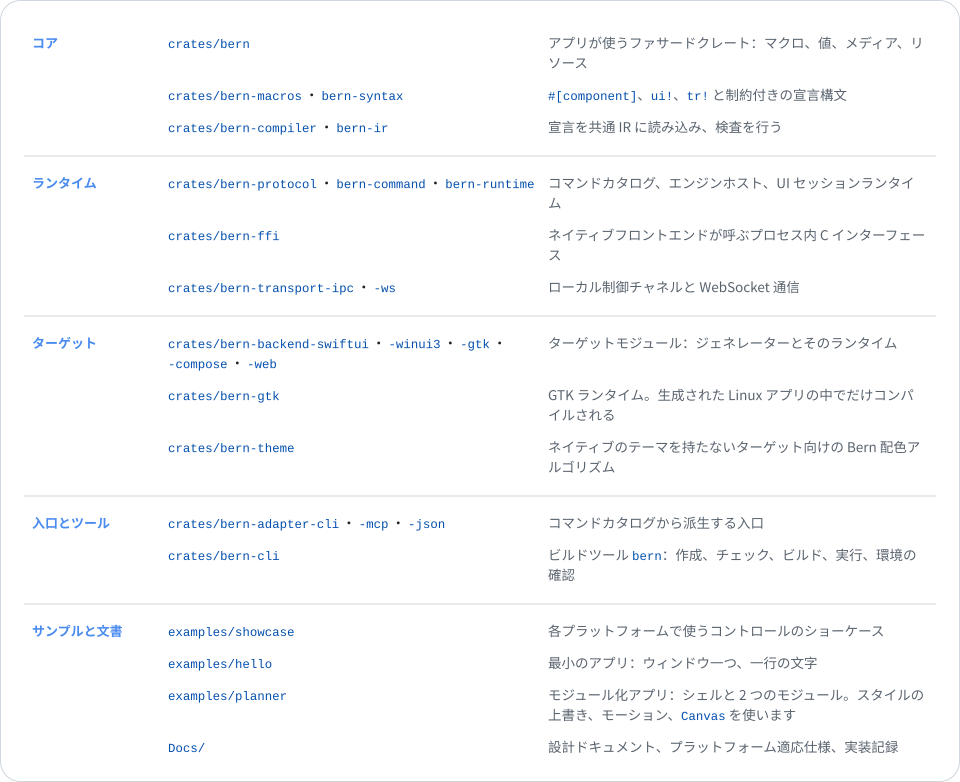
</picture>

</details>

## 開発

```sh
cargo fmt --all --check
cargo clippy --workspace --all-targets -- -D warnings
cargo test --workspace
```

テストには、コンパイルに失敗しなければならない宣言が含まれます。また、ツールキットがある環境では生成されたアプリを型検査します。Xcode で Swift 6、開発パッケージで GTK、Windows では生成された 2 つのフロントエンドを MSVC でコンパイルします。Android の Kotlin は `bern build --target android` の中で Gradle がコンパイルします。

## ドキュメント

- [ドキュメント索引](Docs/README.md) · [現在のコンポーネントガイド](Docs/Reference/UI.md) · [プロパティ一覧](Docs/Reference/Component-Properties.md) · [プラットフォーム対応と検証範囲](Docs/Reference/Platforms.md)（中国語）
- [設計ドキュメント](Docs/Design.md)：目標、アーキテクチャ、コンポーネント、テーマ、コマンド、ウィンドウ、メディア
- [適応仕様](Docs/Adaptation/README.md)：Apple、Windows と Linux、Web、Android、HarmonyOS
- 実装記録：[macOS](Docs/Implementation/macOS-SwiftUI.md) · [iOS](Docs/Implementation/iOS-SwiftUI.md) · [tvOS](Docs/Implementation/tvOS-SwiftUI.md) · [Android](Docs/Implementation/Android-Compose.md) · [Windows](Docs/Implementation/Windows-WinUI3.md) · [Linux](Docs/Implementation/Linux-GTK.md) · [Web](Docs/Implementation/Web.md)

設計ドキュメントと実装記録は中国語で書かれています。

## ライセンス

[MIT](LICENSE) © 2026 MCDFSteve

<div align="center">
<br>
<sub>Bern は開発の初期段階です。API と宣言構文はまだ変わる可能性があります。</sub>
</div>
