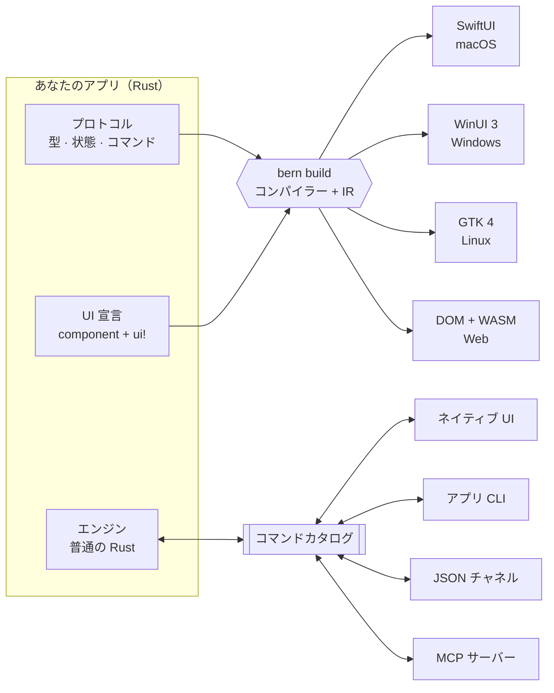

<div align="center">

<h1>Bern</h1>

<p><b>アプリは Rust で一度だけ宣言し、すべてのデスクトップに本物のネイティブ UI を届ける。</b><br>
すべてのコントロールは型付きコマンドであり、人もスクリプトも AI エージェントも同じものを使います。</p>

<p>


</p>

<p>


<a href="Cargo.toml"></a>


</p>

<p>
<a href="README.md">English</a> ·
<a href="README.zh-Hans.md">简体中文</a> ·
<a href="README.zh-Hant.md">繁體中文</a> ·
<b>日本語</b>
</p>

<p>
<a href="#-クイックスタート">クイックスタート</a> ·
<a href="#-しくみ">しくみ</a> ·
<a href="#-コードの雰囲気">コード</a> ·
<a href="#-対応プラットフォーム">プラットフォーム</a> ·
<a href="#-ロードマップ">ロードマップ</a> ·
<a href="Docs/Design.md">設計ドキュメント</a>
</p>

</div>

<br>

<table>
<tr>
<td width="50%" align="center"><br><sub><b>macOS</b> · SwiftUI</sub></td>
<td width="50%" align="center"><br><sub><b>Windows</b> · WinUI 3</sub></td>
</tr>
<tr>
<td width="50%" align="center"><br><sub><b>Linux</b> · GTK 4 + libadwaita</sub></td>
<td width="50%" align="center"><br><sub><b>Web</b> · DOM + WebAssembly</sub></td>
</tr>
</table>

<p align="center"><sub>ひとつの <code>controls_page</code> 宣言から、4 つの UI ツールキットへ。デスクトップでは Bern は自前のピクセルを一切描きません。<br>スイッチもスライダーもサイドバーも、プラットフォーム標準のコントロールとプラットフォームの配色です。</sub></p>

## ✨ Bern を選ぶ理由

Bern はコマンド中心の Rust アプリケーションフレームワークです。インターフェースは制約付きで静的解析できる Rust の宣言として書き、`bern build` が各プラットフォームのネイティブ UI ツールキットへコンパイルします。ビジネスロジックは普通の Rust エンジンに置き、インターフェース上で操作できるものはすべて型付きコマンドに結び付けられます。そのため UI、アプリの CLI、JSON チャネル、MCP サーバーは**同じエンジンインスタンス**を動かします。

<table>
<tr>
<td width="33%" valign="top">
<h3>🖥️ 見た目だけでなく本物のネイティブ</h3>
macOS では SwiftUI、Windows では WinUI 3、Linux では GTK 4 と libadwaita。標準コントロール、システムカラー、ダークモード、アクセントカラー、アクセシビリティは Bern のレンダラーではなくプラットフォームから来ます。
</td>
<td width="33%" valign="top">
<h3>⌘ すべての操作はコマンド</h3>
ボタンに任意のコールバックは持たせられません。ひとつの型付きカタログにあるコマンドに結び付け、引数・エラー・リトライ方針をすべての入口で共有します。
</td>
<td width="33%" valign="top">
<h3>🤖 最初からエージェント対応</h3>
同じカタログからアプリの CLI と MCP サーバーを生成します。エージェントは動作中の UI を読み取り（<code>ui.inspect</code>）、ウィンドウや閉じる確認も含めて実際のコントロールを通じて操作できます。
</td>
</tr>
<tr>
<td width="33%" valign="top">
<h3>🦀 ロジックは Rust のまま</h3>
エンジンは UI に依存しない普通の Rust コードで、ウィンドウなしでテストできます。デスクトップではアプリのプロセス内で、ブラウザーでは WebAssembly として動きます。
</td>
<td width="33%" valign="top">
<h3>🧭 コンパイル時にチェック</h3>
<code>rustc</code> がすべてのバインディングとコマンド引数を型検査します。コマンドのないボタン、任意のコールバック、エンジン状態を書き換えるコントロール、翻訳漏れはコンパイルできません。
</td>
<td width="33%" valign="top">
<h3>🌍 初日からローカライズ</h3>
<code>tr!</code> で各言語の文言を UI のすぐ隣に置きます。厳格モードのビルドは翻訳漏れを拒否し、実行中に言語を切り替えても入力中の内容は失われません。
</td>
</tr>
</table>

<details>
<summary><b>さらに：</b>マルチウィンドウ、メディア、非同期クエリ、アダプティブレイアウト…</summary>
<br>

- **宣言的マルチウィンドウ**：メインウィンドウと設定ウィンドウがそれぞれ下書き、閉じる前のチェック、保存コマンドを持ちます。最小化・最大化・移動・リサイズもコマンドで、プラットフォームの実際の状態で応答します。
- **動画**：`Video` は AVFoundation、Windows Media Foundation、GStreamer、HTML メディアで再生され、コントロールバーはコマンド駆動、プレーヤーはページをまたいで再生を続けられます。
- **非同期クエリ**：`Query` の購読は読み込み中・空・失敗・更新中の状態を持ち、最新の応答だけを表示します。
- **アダプティブレイアウト**：ビューが実際に得た幅に応じて `compact` と `expanded` を切り替えます。
- **型付きナビゲーション**：サイドバー、型付きルートによるプッシュナビゲーション、タブ、ツールバー、メニュー。
- **機能契約**：各レイアウトでコンポーネントが満たすべき機能を宣言し、網羅をコンパイラーが証明します。
- **同梱リソース**：`Bern.toml` で宣言したファイルをビルド時に検査し、実行時は名前で参照します。

</details>

## 🧩 しくみ



1. **プロトコル**：`#[bern::protocol]` で値の型、読み取り専用の状態、コマンドとクエリのトレイトを宣言します。
2. **エンジン**：それらのトレイトを普通の Rust で実装します。ウィンドウもコントロールも通信路も知りません。
3. **インターフェース**：本体が `ui!` 宣言である `#[component]` 関数。コンパイラーがこれを共通の中間表現（IR）に読み込み、各ターゲットモジュールがそこからネイティブコードを生成します。ターゲットを増やしてもパーサー、IR、ビジネスロジックには手を入れません。

## 🍃 コードの雰囲気

<table>
<tr>
<td width="50%" valign="top">

**1 · プロトコル**：型、状態、コマンド

```rust
#[bern::protocol(namespace = "counter", version = 1)]
pub mod counter {
    use bern::prelude::*;

    #[state]
    pub struct State {
        pub count: i64,
    }

    #[commands]
    pub trait Commands {
        /// Add to the count.
        fn add(&mut self, by: i64) -> Result<(), CommandError>;
    }
}
```

**3 · インターフェース**：ひとつの `ui!` 宣言

```rust
#[component]
pub fn counter_view(app: counter::Client) -> impl View {
    ui! {
        Form {
            Text(content: tr! {
                "ja" => "{n} 回カウントしました",
                "en" => "Counted {n} times";
                n: app.count
            })
            Button(
                id: add,
                label: tr! { "ja" => "1 増やす", "en" => "Add one" },
                prominence: prominent
            ) => app.add(1)
        }
    }
}
```

</td>
<td width="50%" valign="top">

**2 · エンジン**：UI に依存しない普通の Rust

```rust
use bern::CommandError;

pub struct Counter {
    state: counter::State,
}

impl Default for Counter {
    fn default() -> Self {
        Self { state: counter::State { count: 0 } }
    }
}

impl counter::Commands for Counter {
    fn add(&mut self, by: i64) -> Result<(), CommandError> {
        self.state.count += by;
        Ok(())
    }
}

impl counter::Engine for Counter {
    fn state(&self) -> &counter::State {
        &self.state
    }
}
```

**4 · すべての入口が同じエンジンを動かす**

```sh
counter ui inspect
counter ui activate --target counter_view.add
counter counter add --by 5
counter-mcp   # 同じカタログを AI エージェントへ
```

</td>
</tr>
</table>

`Bern.toml` では言語、テーマ、ソース、同梱リソース、ビルドターゲットを宣言します。完全な例は[ショーケース](examples/showcase)をご覧ください。文字スタイル、ボタン、スイッチ、スライダー、テキストフィールド、エンジンのクエリによる検索、リストから詳細へのナビゲーション、動画、そしてタブと閉じる確認を持つ設定ウィンドウを備えたサイドバー型アプリです。

## 🖥️ 対応プラットフォーム

<table>
<tr>
<th align="left">ターゲット</th>
<th align="left">UI ツールキット</th>
<th align="left">エンジン</th>
<th align="left">状態</th>
</tr>
<tr>
<td><b>macOS</b><br><code>swiftui + macos</code></td>
<td>SwiftUI、標準コンポーネントとシステムスタイル · macOS 14 以降</td>
<td>プロセス内</td>
<td> <a href="Docs/Implementation/macOS-SwiftUI.md">実装記録</a></td>
</tr>
<tr>
<td><b>Windows</b><br><code>winui3 + windows</code></td>
<td>Windows App SDK 1.8 上の WinUI 3、C# ホスト · Windows 10 2004 以降</td>
<td>プロセス内（<code>bern_app.dll</code>）</td>
<td> <a href="Docs/Implementation/Windows-WinUI3.md">実装記録</a></td>
</tr>
<tr>
<td><b>Linux</b><br><code>gtk + linux</code></td>
<td>GTK 4.14 と libadwaita 1.5、GNOME HIG に準拠</td>
<td>プロセス内</td>
<td> <a href="Docs/Implementation/Linux-GTK.md">実装記録</a></td>
</tr>
<tr>
<td><b>Web アプリ</b><br><code>web</code> · <code>app</code></td>
<td>DOM、Bern 独自のビジュアル仕様とテーマカーネル</td>
<td>ページ内の WebAssembly</td>
<td> <a href="Docs/Implementation/Web.md">実装記録</a></td>
</tr>
<tr>
<td><b>WebUI</b><br><code>web</code> · <code>ui</code></td>
<td>同じページを、独立したエンジンの UI として</td>
<td>WebSocket で接続するエンジンホスト</td>
<td> <a href="Docs/Implementation/Web.md">実装記録</a></td>
</tr>
<tr>
<td><b>次の予定</b></td>
<td><code>flutter + macos</code>（バックエンドの差し替え検証）、続いて iOS、Android、HarmonyOS</td>
<td>–</td>
<td> <a href="Docs/Adaptation/README.md">適応仕様</a></td>
</tr>
</table>

UI 技術を省略するとプラットフォームの既定が選ばれます。既定が使えないときは、別の技術へ黙って切り替えずにエラーになります。

## 🚀 クイックスタート

Rust 1.99（`rust-toolchain.toml` で固定）と、ビルドするターゲットのツールチェーンが必要です。どのビルドでも `target/bern/<ターゲット>/bin/` にアプリの CLI と MCP サーバーが生成されます。

<details open>
<summary><b>🍎 macOS</b> · Xcode 26 以降</summary>

```sh
cargo run -p bern-cli -- build --manifest examples/showcase/Bern.toml --target macos
open target/bern/macos/Showcase.app
```

</details>

<details>
<summary><b>🪟 Windows</b> · .NET SDK 10</summary>

```powershell
cargo run -p bern-cli -- build --manifest examples/showcase/Bern.toml --target windows
target\bern\windows\Showcase\showcase.exe
```

Windows App SDK は初回ビルド時に NuGet から復元され、実行ファイルと一緒に配置されます。

</details>

<details>
<summary><b>🐧 Linux</b> · GTK 4.14 と libadwaita 1.5 の開発パッケージ</summary>

```sh
sudo apt install libgtk-4-dev libadwaita-1-dev gstreamer1.0-libav
cargo run -p bern-cli -- build --manifest examples/showcase/Bern.toml --target linux
target/bern/linux/Showcase/showcase
```

</details>

<details>
<summary><b>🌐 Web</b> · <code>rustup target add wasm32-unknown-unknown</code></summary>

```sh
# エンジンを WebAssembly にコンパイルし、ページ内で動かす
cargo run -p bern-cli -- build --manifest examples/showcase/Bern.toml --target web_app
python3 -m http.server 8765 --bind 127.0.0.1 --directory target/bern/web_app

# あるいは、独立したエンジンホストの UI としてのページ
cargo run -p bern-cli -- build --manifest examples/showcase/Bern.toml --target web_ui
target/bern/web_ui/bin/showcase-host
```

</details>

### 動いているアプリを外から操作する

```sh
showcase ui inspect                                          # マウントされたコントロールの一覧
showcase ui select --target main_window.pages --option Controls
showcase ui set-bool --target controls_page.sync --value true
showcase showcase search-library --text mo                   # エンジンへのクエリ
showcase window open --kind settings
showcase window list                                         # ウィンドウの実際の状態
showcase-mcp                                                 # stdio の MCP サーバー
```

制御チャネルはターゲットが `channels = ["ipc"]` を宣言したときだけ起動します。宣言しなければアプリはどのポートも待ち受けません。

## 🗺️ ロードマップ

| フェーズ | 内容 | |
| :-- | :-- | :-: |
| 1 · 2 | コンパイル境界の検証。macOS SwiftUI で UI・CLI・JSON・MCP が同じエンジンを動かす | ✅ |
| 3 | Web のビジュアル仕様、テーマカーネル、WebAssembly アプリと WebUI の 2 種類のビルド | ✅ |
| 4 | アダプティブレイアウト、メニュー、機能契約、実行時の言語切り替え | ✅ |
| 5 | ほかのネイティブフロントエンド：GTK 4 ✅ · WinUI 3 ✅ · `flutter + macos` | 🚧 |
| 6 | コンポーネントライブラリ、パッケージング、インクリメンタルビルド、開発ツール、NipaPlay 3.0 への導入 | ⏳ |

## 📂 リポジトリ構成

<details>
<summary>クレートとディレクトリ</summary>
<br>

| パス | 内容 |
| :-- | :-- |
| `crates/bern` | アプリが使うファサードクレート：マクロ、値、メディア、リソース |
| `crates/bern-macros` · `bern-syntax` | `#[component]`、`ui!`、`tr!` と制約付きの宣言構文 |
| `crates/bern-compiler` · `bern-ir` | 宣言を共通 IR に読み込み、検査を行う |
| `crates/bern-protocol` · `bern-command` · `bern-runtime` | コマンドカタログ、エンジンホスト、UI セッションランタイム |
| `crates/bern-ffi` | ネイティブフロントエンドが呼ぶプロセス内 C インターフェース |
| `crates/bern-backend-swiftui` · `-winui3` · `-gtk` · `-web` | ターゲットモジュール：ジェネレーターとそのランタイム |
| `crates/bern-gtk` | GTK ランタイム。生成された Linux アプリの中でだけコンパイルされる |
| `crates/bern-adapter-cli` · `-mcp` · `-json` | コマンドカタログから派生する入口 |
| `crates/bern-transport-ipc` · `-ws` | ローカル制御チャネルと WebSocket 通信 |
| `crates/bern-theme` | ネイティブのテーマを持たないターゲット向けの Bern 配色アルゴリズム |
| `examples/showcase` | 各プラットフォームで使うコントロールのショーケース |
| `Docs/` | 設計ドキュメント、プラットフォーム適応仕様、実装記録 |

</details>

## 🛠️ 開発

```sh
cargo fmt --all --check
cargo clippy --workspace --all-targets -- -D warnings
cargo test --workspace
```

テストには、コンパイルに失敗しなければならない宣言が含まれます。また、ツールキットがある環境では生成されたアプリを型検査します。Xcode で Swift 6、開発パッケージで GTK、Windows では .NET で C# を検査します。

## 📖 ドキュメント

- [設計ドキュメント](Docs/Design.md)：目標、アーキテクチャ、コンポーネント、テーマ、コマンド、ウィンドウ、メディア
- [適応仕様](Docs/Adaptation/README.md)：Apple、Windows と Linux、Web、Android、HarmonyOS
- 実装記録：[macOS](Docs/Implementation/macOS-SwiftUI.md) · [Windows](Docs/Implementation/Windows-WinUI3.md) · [Linux](Docs/Implementation/Linux-GTK.md) · [Web](Docs/Implementation/Web.md)

設計ドキュメントと実装記録は中国語で書かれています。

## 📄 ライセンス

MIT（[`Cargo.toml`](Cargo.toml) で宣言）。

<div align="center">
<br>
<sub>Bern は開発の初期段階です。API と宣言構文はまだ変わる可能性があります。</sub>
</div>
