<div align="center">


<h1>Bern</h1>

<p><b>一つの Rust 宣言を、各プラットフォーム自身のネイティブ UI へコンパイル。</b></p>

<p>デスクトップ・スマートフォン・タブレット・ウォッチ・テレビ・Web を一つの <code>ui!</code> 宣言から：<br>
SwiftUI、WinUI 3、GTK 4、Jetpack Compose、GPUI、Web DOM/WASM。<br>
既定で JS エンジンやブラウザーを同梱せず、必要時のみプロセス内 JavaScript と <code>bern.cli</code> を有効化。<br>
<b>AI のための設計：</b>書き漏れはコンパイルエラーになり、エージェントは <code>SKILL.md</code> とアプリ CLI で名前指定の操作を行います。</p>

<p>


</p>

<p>
<a href="https://bern.aimes-soft.com"></a>


<a href="LICENSE"></a>

</p>

<p>
<a href="README.md">English</a> ·
<a href="README.zh-CN.md">简体中文</a> ·
<a href="README.zh-Hant.md">繁體中文</a> ·
<b>日本語</b>
</p>

<p>
<a href="https://bern.aimes-soft.com">公式サイト</a> ·
<a href="https://bern.aimes-soft.com/docs">オンライン文書</a> ·
<a href="#bern-を選ぶ理由">Bern を選ぶ理由</a> ·
<a href="#bern-を使っているアプリ">Bern を使っているアプリ</a> ·
<a href="#ai-のための設計">AI のための設計</a> ·
<a href="#実測値">実測値</a> ·
<a href="#他のフレームワークとの比較">比較</a> ·
<a href="#クイックスタート">クイックスタート</a>
</p>

</div>

<br>

<table>
<tr>
<td width="50%" align="center">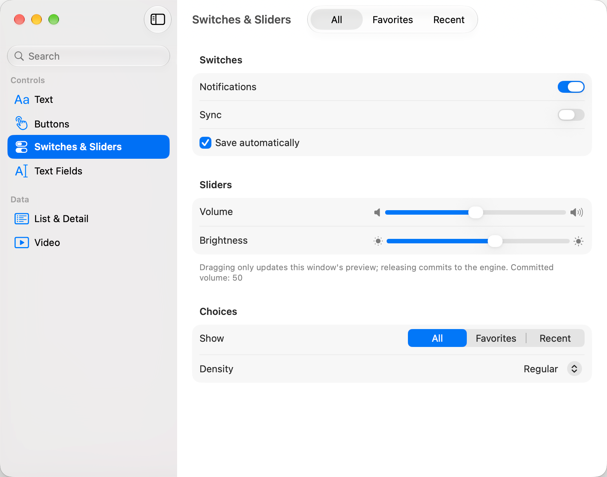<br><sub><b>macOS</b> · SwiftUI</sub></td>
<td width="50%" align="center">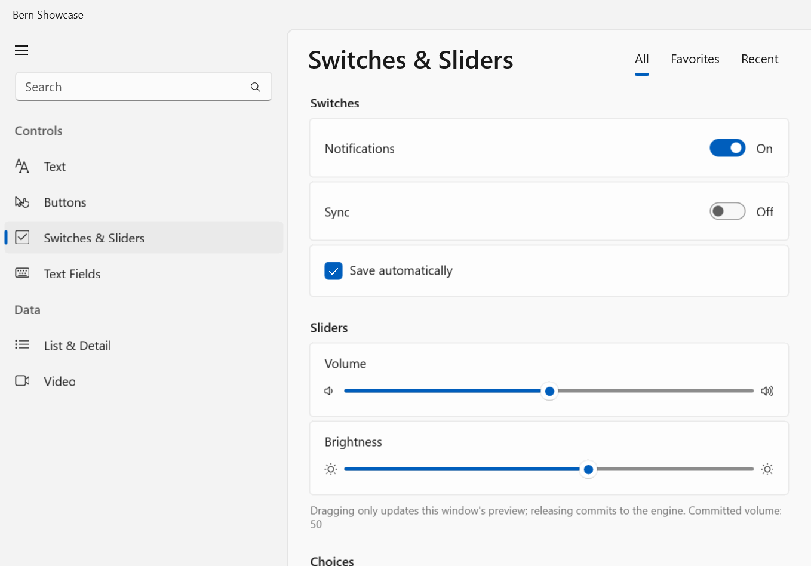<br><sub><b>Windows</b> · WinUI 3</sub></td>
</tr>
<tr>
<td width="50%" align="center">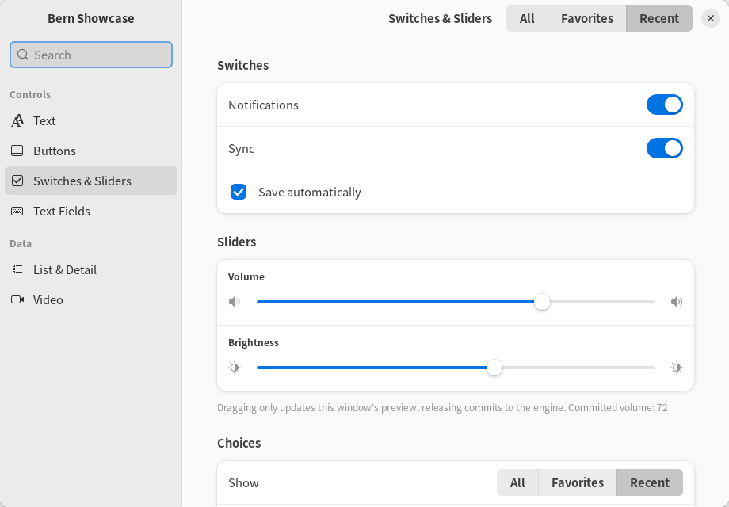<br><sub><b>Linux</b> · GTK 4 + libadwaita</sub></td>
<td width="50%" align="center">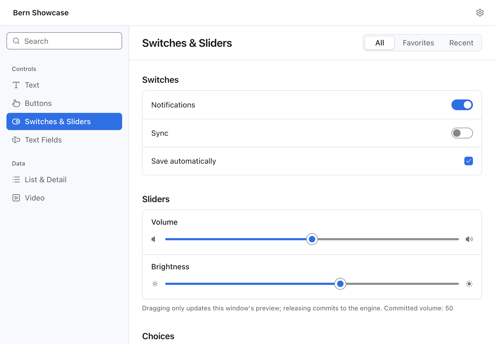<br><sub><b>Web</b> · DOM + WebAssembly</sub></td>
</tr>
<tr>
<td width="50%" align="center">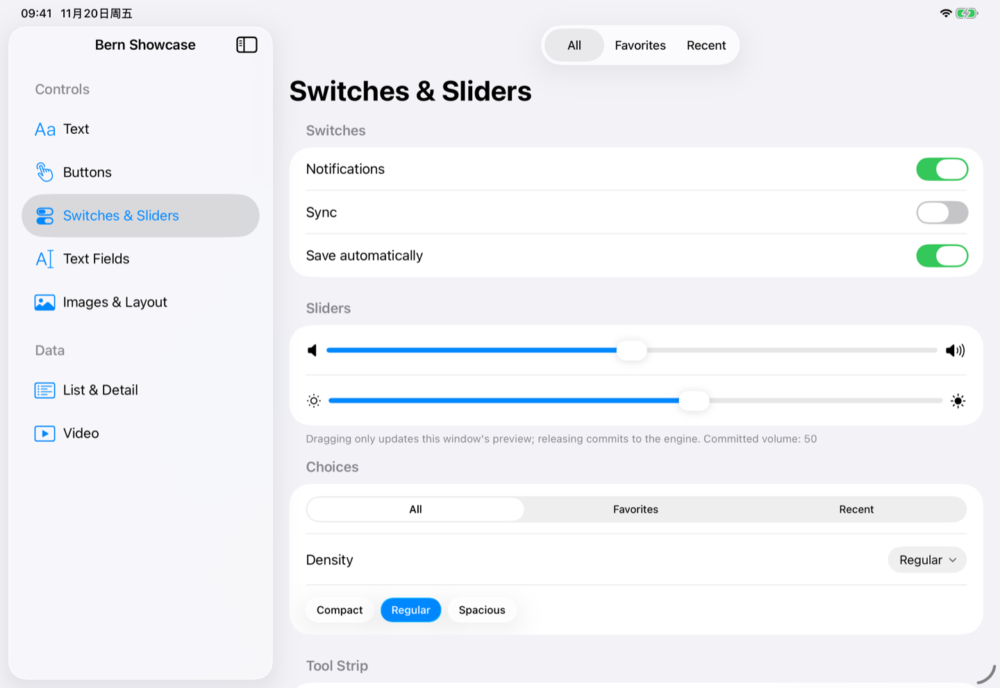<br><sub><b>iPad</b> · iPadOS SwiftUI</sub></td>
<td width="50%" align="center">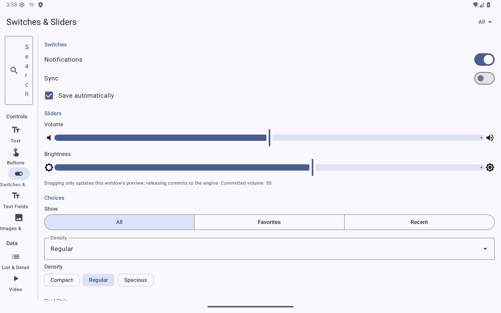<br><sub><b>Android タブレット</b> · Jetpack Compose</sub></td>
</tr>
<tr>
<td width="50%" align="center">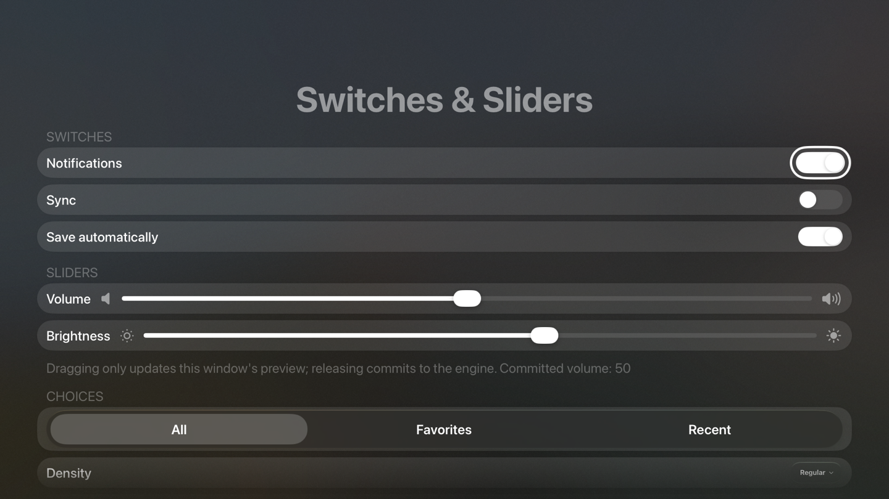<br><sub><b>Apple TV</b> · tvOS SwiftUI</sub></td>
<td width="50%" align="center">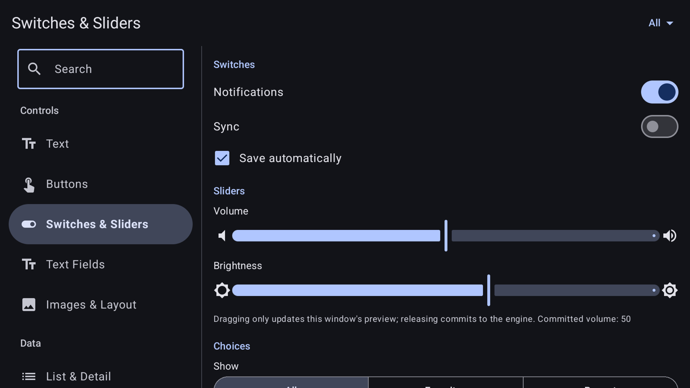<br><sub><b>Android TV</b> · Jetpack Compose</sub></td>
</tr>
</table>

<table>
<tr>
<td width="32%" align="center">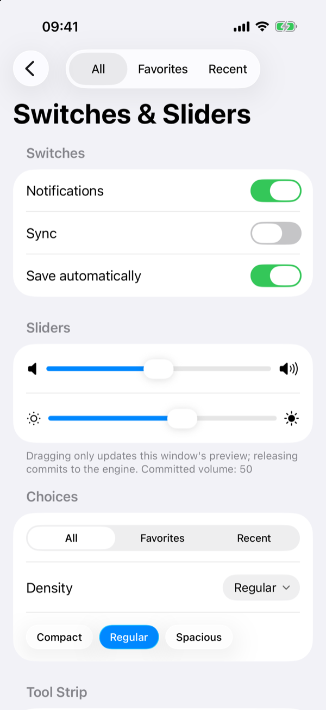<br><sub><b>iOS</b> · SwiftUI</sub></td>
<td width="36%" align="center">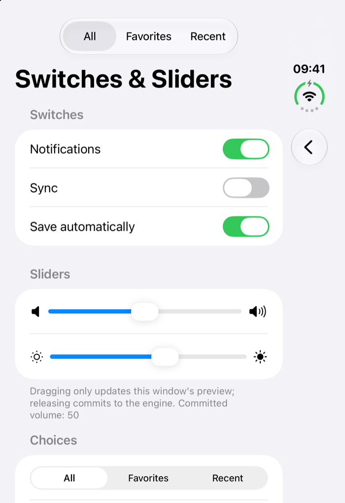<br><sub><b>iPhone Duo</b> · SwiftUI</sub></td>
<td width="32%" align="center">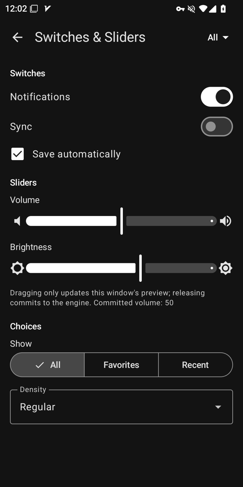<br><sub><b>Android</b> · Jetpack Compose</sub></td>
</tr>
</table>

<table>
<tr>
<td width="25%" align="center">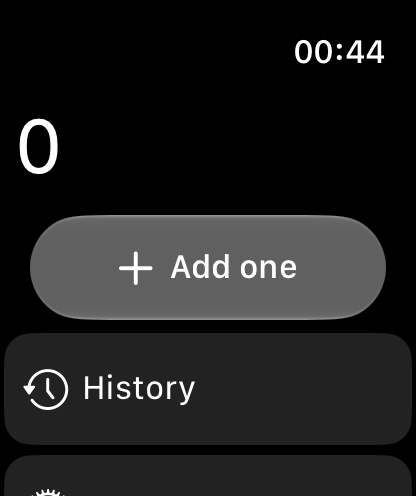<br><sub><b>watchOS</b> · SwiftUI</sub></td>
<td width="25%" align="center">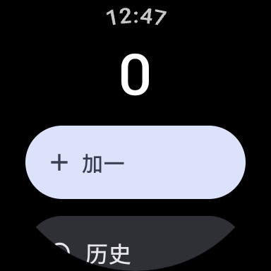<br><sub><b>Wear OS</b> · Compose Material 3</sub></td>
<td width="50%" align="center">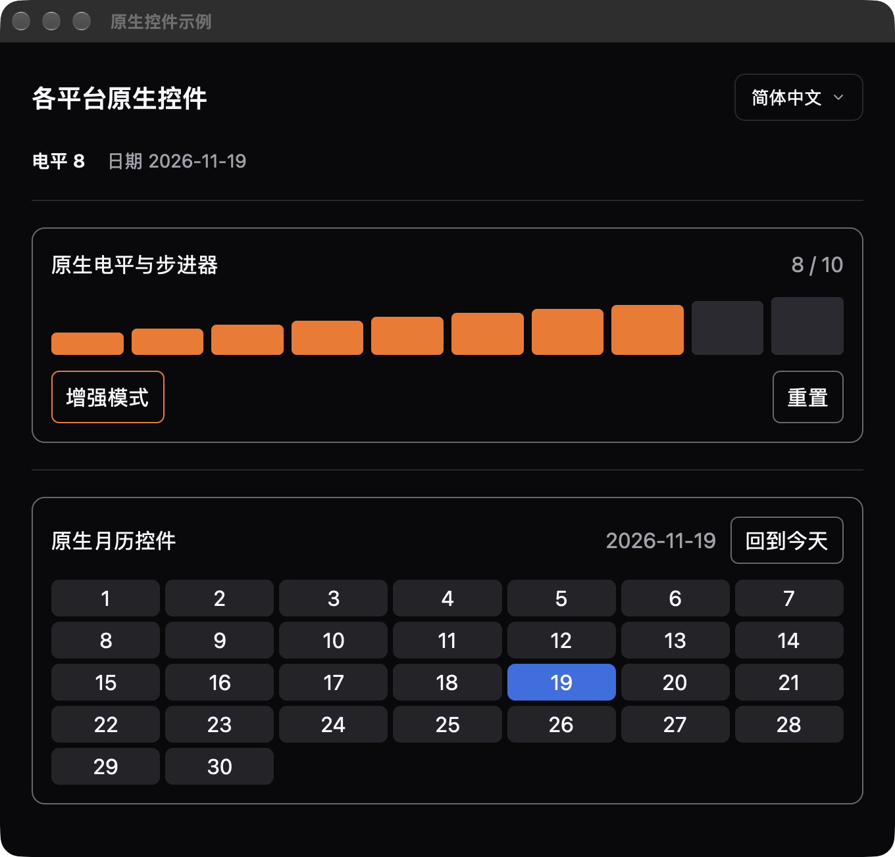<br><sub><b>デスクトップ · GPUI</b>（<code>ui = "gpui"</code> + 隣接 <code>NativeView</code>）</sub></td>
</tr>
</table>

<p align="center"><sub>ひとつの Rust 宣言でデスクトップ・タブレット・テレビ・スマートフォン・ウォッチ・Web へ。システム目標では自前のピクセルを一切描かず、<br>統一された GPU 描画が必要なときは <code>ui = "gpui"</code> で GPUI の宣言的 UI フレームワークとしてそのまま使えます。</sub></p>

## Bern を選ぶ理由

<picture>
<source media="(prefers-color-scheme: dark)" srcset="Docs/Assets/tables/why-ja-dark.svg">
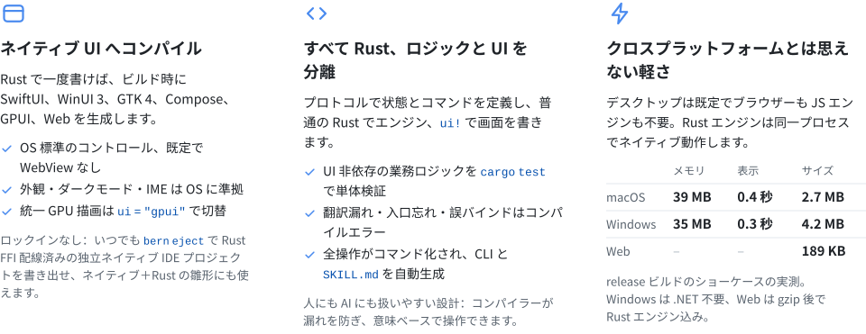
</picture>

## Bern を使っているアプリ

<table>
<tr>
<td width="33%" valign="top">
<a href="https://github.com/AimesSoft/RustSend"></a>
<h3><a href="https://github.com/AimesSoft/RustSend">RustSend</a></h3>
<p>LocalSend と互換性のある LAN ファイル転送ツール。ファイル、フォルダー、テキストをデバイス間で送受信できます。</p>
</td>
<td width="33%" valign="top">
<a href="https://github.com/zhaohuaxs/lambda"></a>
<h3><a href="https://github.com/zhaohuaxs/lambda">Lambda</a></h3>
<p>7-Zip を内蔵した Windows / Android 向けアーカイブマネージャー。暗号化圧縮、展開、内容のプレビューに対応。</p>
</td>
<td width="33%" valign="top">
<a href="https://github.com/MCDFsteve/Enji"></a>
<h3><a href="https://github.com/MCDFsteve/Enji">Enji Music</a></h3>
<p>NetEase Cloud Music の非公式クライアント。オンライン・ローカル再生、同期歌詞、プレイリスト管理に対応。</p>
</td>
</tr>
</table>

## AI のための設計

### コードを書く：AI が忘れたことは、コンパイラーが覚えている

AI が UI を書くときに多い問題は、書き間違いより書き漏れです。機能を足したのに狭い画面のレイアウトに入口を置き忘れる、新しい文言を一つの言語でしか書かない、コマンドを迂回してコールバックをぶら下げる。ほかのフレームワークではユーザーが見つけるまで残りますが、Bern ではどれもコンパイルを通りません。制約が厳しいほど、AI は中途半端な仕事を渡しにくくなります。

<picture>
<source media="(prefers-color-scheme: dark)" srcset="Docs/Assets/tables/ai-ja-dark.svg">
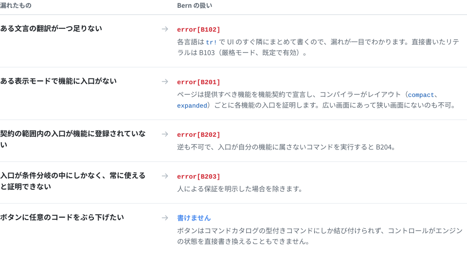
</picture>

エラーは人のためでもあり、エージェントのためでもあります。番号、理由、位置がはっきりしているので、エージェントは自分で直して再ビルドできます。以下はショーケースで実際に出た 2 回分の出力です。1 回目は英語の翻訳を一つ消し、それを戻してから、2 回目は狭いレイアウトの「Change Clip」メニューを消しました。

```text
$ bern check
error[B102]: Missing translation
Missing language: en
Required languages: zh-Hans, en
  --> showcase-ui/src/pages.rs:13:31

$ bern check
error[B201]: Feature missing in adaptive layout
Contract: MediaFeature
Feature: Clip
compact: missing
  --> showcase-ui/src/media.rs:14:5
```

ビルドのたびに、ターゲットごとの機能カバレッジの完全なレポート（`features.json`）も出力され、カバー済み、免除、人による保証のみが分けて記載されます。

### アプリを使う：ピクセルではなく意味を読む

制御チャネルを有効にすると、Bern はアプリのコマンドカタログから `SKILL.md` を生成します。たとえば下のスイッチを切り替えるには、エージェントは `skills/showcase/SKILL.md` で `ui set-bool` の引数を調べ、`showcase ui inspect` でウィンドウ内のスイッチの名前を取得します。その名前をアプリの CLI に渡すと、クリックしたときと同じコードが動きます。スクリーンショットや座標は不要です。

```sh
$ showcase ui inspect                 # エージェントが読むのはピクセルではなく意味
[{ "target": "controls_page.sync", "role": "switch", "label": "Sync", "value": "false", "enabled": true, … }, …]

$ showcase ui set-bool --target controls_page.sync --value true
$ showcase window screenshot --output shot.png

$ showcase window close --window settings#1
{ "outcome": "ConfirmationRequired", "message": "Do you want to save the display name?",
  "decisions": ["Save", "Discard", "Cancel"], "confirmation": "settings#1:c1", … }

$ showcase window confirm-close --window settings#1 --confirmation settings#1:c1 --decision Save
{ "outcome": "Rejected", "reason": "save_failed: invalid_name: a display name has 1 to 40 characters …" }
```

`showcase showcase set-display-name --name Demo` のようなアプリ固有のコマンドや、組み込みのウィンドウ撮影（`window screenshot`）も含め、人も同じコマンドを実行できます。CLI はアプリと同じビルドのものを使います。リモートからは制御チャネルのあるマシンに SSH で接続し、接続先を所有するアカウントで実行します。コントロールが無効、ダイアログで操作できない、対象が存在しないといった場合、CLI はエラーコードを返します。

### JavaScript で拡張する：プロセス内 `bern.cli`

スクリプトを有効にしないアプリには JS ランタイムが一切リンクされません。ターゲットに `javascript = true` を設定すると、すべての `bern::script::Context`（ネイティブではプロセス内 Boa、Web ではブラウザー Worker）に `globalThis.bern.cli(...)` が公開され、Rust 側の許可／拒否リスト（既定は `CliPolicy::allow_all()`）のもとでコマンドカタログへ直接アクセスできます。

```rust
let js = bern::script::Context::with_policy(
    bern::script::CliPolicy::allow_only(["media.*", "@queries", "state", "catalog"])
        .deny("media.bind")
        .with_label("example.plugin"),
)?;
js.eval(r#"await bern.cli("media seek --player-id main --position-ms 90000")"#).await?;
```

呼び出し形式、ポリシーパターン、動的フィルターの詳細は [JavaScript とターゲット機能](Docs/Implementation/JavaScript.md) を参照してください。

## 実測値

<picture>
<source media="(prefers-color-scheme: dark)" srcset="Docs/Assets/tables/measured-ja-dark.svg">
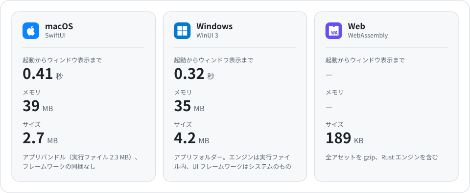
</picture>

<details>
<summary>測定方法</summary>
<br>

- 対象：release ビルドのショーケース（6 ページ、メインと設定のウィンドウ、ビデオプレーヤー）。2026-10-11 に測定し、各項目 3 回以上の中央値。
- macOS：Apple M4、メモリ 16 GB、macOS 27.0.1。メモリは `footprint` の物理フットプリントで、アクティビティモニタの「メモリ」列と同じ指標。
- Windows：Intel Core i5-13490F、メモリ 32 GB、Windows 11 25H2。メモリはプライベートワーキングセットで、タスクマネージャーの「メモリ」列と同じ指標。
- 起動時間：プロセスの起動から、コマンドラインが表示中のネイティブウィンドウを読めるまで。エンジンの起動とローカル制御チャネルの準備を含みます。
- Windows の値は WinUI 3 フロントエンド（測定時はシステムに Windows App Runtime 1.8。現在は 2.x でビルド）。ランタイムがないシステムでは、同じプログラムがシステムの XAML にフォールバックし、起動 0.54 秒、メモリ 19 MB です。どちらも .NET と VC++ ランタイムは不要で、アプリフォルダーには実行ファイルと 400 KB のブートストラップ DLL だけがあります。

</details>

## その他の機能

<picture>
<source media="(prefers-color-scheme: dark)" srcset="Docs/Assets/tables/more-ja-dark.svg">
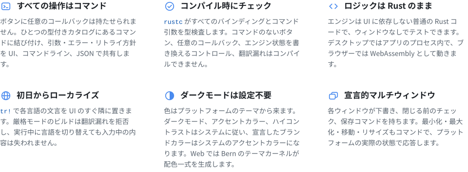
</picture>

<details>
<summary><b>さらに：</b>標準コントロール一式、自動スケルトン、スタイルとモーション、メディア、システム統合、モジュール化、<code>NativeView</code>、選択式 JS…</summary>
<br>

- **アダプティブレイアウトとナビゲーション**：`compact`・`medium`・`expanded`・`large` の 4 段階に加え `watch`・`tv` 向けレイアウト。型付きプッシュナビゲーション、`SplitView` サイドバー、`Tabs` と `TabAccessory`、ツールバー、メニュー、`Grid`（メイソンリー対応）、`Stack`、`SplitPane`、`Accordion`、コンパイル時機能契約。
- **充実したネイティブコントロール**：`Table`、`TreeView`、`Reorderable`、`BottomSheet`、`Refreshable`、`DatePicker`、`TimePicker`、`NumberInput`、`ColorPicker`、`ShortcutInput`、`Tooltip`、`Banner`、`Disclosure`、`Alert`、`EmptyState`、`Badge`、`Avatar`、`Text(selectable:)` とインライン Markdown、動的検索対応 `Picker(style: combobox)`、複数ファイル `pick:` とネイティブ `save:` ダイアログ。
- **自動スケルトン、スタイルとモーション**：`Query` や `skeleton: <bool>` コンテナーからコンパイル時に実際の UI 構造を投影する自動スケルトン（120 ms ちらつき防止、時間差入場、視差効果低減対応）。`style!` による全体上書き、ばねモーション、共有要素 Hero、純 Rust アニメーション `Svg`（WebView 不要）、HDR `Image`、`Canvas` 描画、比率配置の `Rail`。
- **メディア、非同期クエリ、ファイル**：各プラットフォームのメディアスタックや独自 `MediaKernel` で動く `Video`、`players.<id>.<field>` の直接参照、読み込み・空・失敗・更新を扱う `Query`、`Bern.toml` の同梱リソース、ローカルパス / Android `content://` / Web `blob:` を統一する `MediaSource`、関連付け起動 `[[app.opens]]`、メモリ配信 `bern::files::serve`。
- **デスクトップとシステム統合**：トレイ常駐 `StatusItem`（単色 SVG アイコンとログイン時起動）、macOS `MenuBar`、アンカー付きフローティングウィンドウ、組み込み `window.screenshot`、ポインターイベント（`DoubleTap`、`ContextMenu`、`WheelUp`/`WheelDown`）、`Slider(hover:)`、埋め込み `WebPage`。
- **拡張性**：モジュール化アプリ（`bern new --module`）、Rust ファイルの隣に各プラットフォーム実装を並べる `NativeView`（型付き props、`tr!` 検査、必須 CLI エントリ、`Fallback` 付き。[Native Views](Docs/Implementation/Native-Views.md)）、必要に応じて有効化するプロセス内 JavaScript と `bern.cli` の許可／拒否ポリシー（[JavaScript](Docs/Implementation/JavaScript.md)）。

</details>

## しくみ

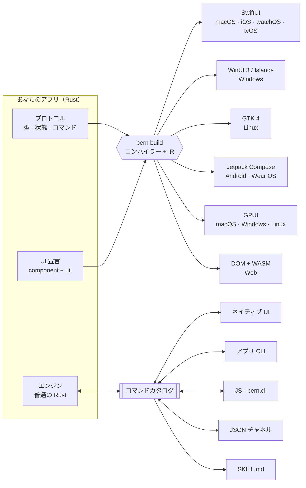

1. **プロトコル**：`#[bern::protocol]` で値の型、読み取り専用の状態、コマンドとクエリのトレイトを宣言します。
2. **エンジン**：それらのトレイトを普通の Rust で実装します。ウィンドウもコントロールも通信路も知りません。
3. **インターフェース**：本体が `ui!` 宣言である `#[component]` 関数。コンパイラーがこれを共通の中間表現（IR）に読み込み、各ターゲットモジュールがそこからネイティブコードを生成します。ターゲットを増やしてもパーサー、IR、ビジネスロジックには手を入れません。

## コードの雰囲気

**1 · プロトコル**：型、状態、コマンド

```rust
#[bern::protocol(namespace = "counter", version = 1)]
pub mod counter {
    use bern::prelude::*;

    #[state]
    pub struct State {
        pub count: i64,
    }

    #[commands]
    pub trait Commands {
        /// Add to the count.
        fn add(&mut self, by: i64) -> Result<(), CommandError>;
    }
}
```

**2 · エンジン**：UI に依存しない普通の Rust

```rust
use bern::CommandError;

pub struct Counter {
    state: counter::State,
}

impl Default for Counter {
    fn default() -> Self {
        Self { state: counter::State { count: 0 } }
    }
}

impl counter::Commands for Counter {
    fn add(&mut self, by: i64) -> Result<(), CommandError> {
        self.state.count += by;
        Ok(())
    }
}

impl counter::Engine for Counter {
    fn state(&self) -> &counter::State {
        &self.state
    }
}
```

**3 · インターフェース**：ひとつの `ui!` 宣言

```rust
#[component]
pub fn counter_view(app: counter::Client) -> impl View {
    ui! {
        Form {
            Text(content: tr! {
                "ja" => "{n} 回カウントしました",
                "en" => "Counted {n} times";
                n: app.count
            })
            Button(
                id: add,
                label: tr! { "ja" => "1 増やす", "en" => "Add one" },
                prominence: prominent
            ) => app.add(1)
        }
    }
}
```

**4 · すべての入口が同じエンジンを動かす**

```sh
counter ui inspect
counter ui activate --target counter_view.add
counter counter add --by 5
counter catalog
```

`Bern.toml` では言語、テーマ、ソース、同梱リソース、ビルドターゲットを宣言します。完全な例は[ショーケース](examples/showcase)をご覧ください。文字スタイル、ボタン、スイッチ、スライダー、テキストフィールド、エンジンのクエリによる検索、リストから詳細へのナビゲーション、動画、そしてタブと閉じる確認を持つ設定ウィンドウを備えたサイドバー型アプリです。[プランナー](examples/planner)は、スタイルの上書き、モーション、`Canvas` を使ったモジュール化アプリです。[パターン集](examples/gallery)はメディアアプリ向けのコンポーネントを示します。ポスターウォールの時間差の登場、タイムラインの比率での配置、音量のポップオーバーボタン、4 段階のサイズに応じて変わる余白とレイアウト、そしてドロップした動画のファイル名・形式・サイズをエンジンがファイルから読み取る例です。[ネイティブコントロール](examples/native-controls)は `NativeView` で 6 バックエンドにネイティブ UI を隣接配置する例、[ウォッチデモ](examples/wearos)はウォッチターゲット、[アニメーション SVG](examples/svg-animation)は純 Rust ベクターアニメーションの例です。

## 対応プラットフォーム

<picture>
<source media="(prefers-color-scheme: dark)" srcset="Docs/Assets/tables/platforms-ja-dark.svg">
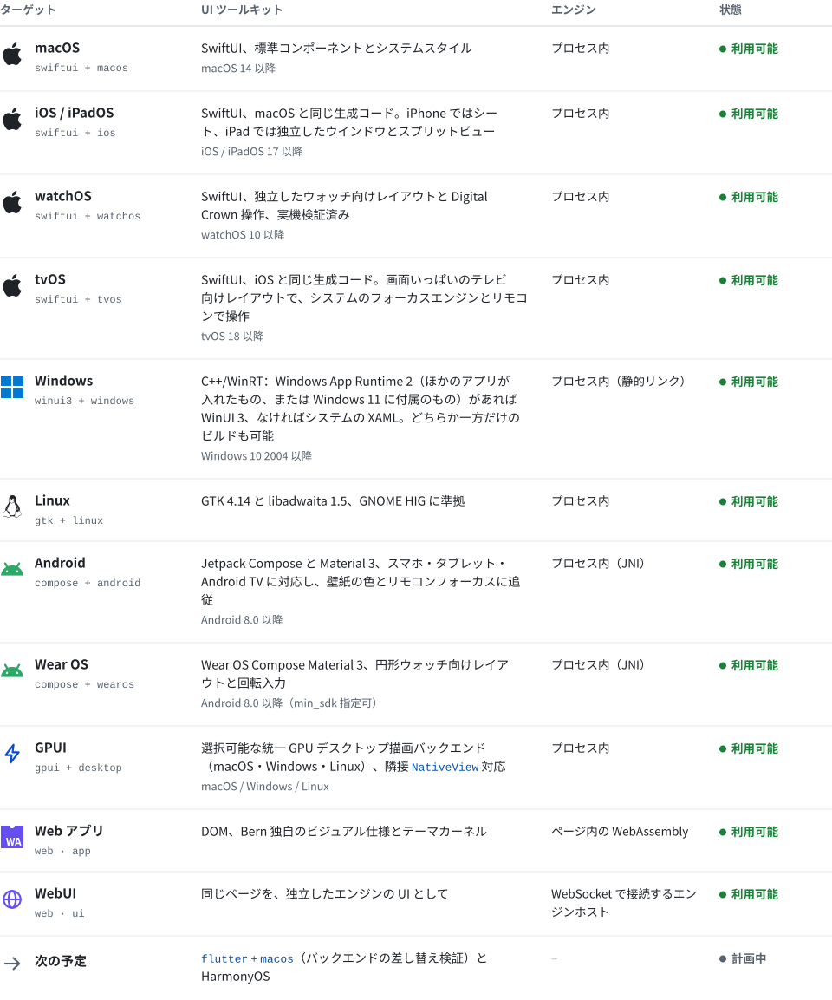
</picture>

実装記録：[macOS](Docs/Implementation/macOS-SwiftUI.md) · [iOS](Docs/Implementation/iOS-SwiftUI.md) · [watchOS](Docs/Implementation/watchOS-SwiftUI.md) · [tvOS](Docs/Implementation/tvOS-SwiftUI.md) · [Windows](Docs/Implementation/Windows-WinUI3.md) · [Linux](Docs/Implementation/Linux-GTK.md) · [Android と Wear OS](Docs/Implementation/Android-Compose.md) · [GPUI](Docs/Implementation/GPUI.md) · [Web と WebUI](Docs/Implementation/Web.md)。次のプラットフォームは[適応仕様](Docs/Adaptation/README.md)にあります。

UI 技術を省略するとプラットフォームの既定が選ばれます。既定が使えないときは、別の技術へ黙って切り替えずにエラーになります。

### Bern を GPUI の UI フレームワークとして使う

GPUI は高速な GPU 描画をもたらしますが、標準のコントロールライブラリは付属しません。macOS・Windows・Linux で `ui = "gpui"` を指定すると、Bern をそのまま GPUI 上の宣言的 UI フレームワークとして使えます。ひとつの `ui!` 宣言にデスクトップ標準コントロール、ライト／ダークのセマンティックテーマ、ばねモーション、コンパイル時チェック、Skills + CLI がすべて揃います。独自の GPU 描画が必要な箇所は `NativeView(gpui: "...")` でネイティブ GPUI コードを隣接配置でき、ロジックを書き換えずにシステムネイティブ UI やモバイル・ウォッチ・Web へ広げることもできます。

### Windows と iOS にはフロントエンドが 2 つある

この 2 つのプラットフォームは対応するシステムの幅が広く、1 つの UI フレームワークでは覆いきれないため、同じ宣言からフロントエンドを 2 つ生成します。既定では両方を同じパッケージに含め、アプリの起動時にシステムに応じて自動で選びます。利用者もアプリのコードも意識する必要はありません。

| プラットフォーム | フロントエンド | `frontends` での名前 | 動作環境 |
| --- | --- | --- | --- |
| Windows | WinUI 3 | `winui3` | Windows App Runtime 2 があるシステム。Mica 背景と Windows 11 の外観 |
| Windows | システムの XAML（XAML Islands 経由） | `xaml-islands` | それ以外の Windows 10 と 11。ランタイムのインストールは不要 |
| iOS | SwiftUI | `swiftui` | iOS 17 以降。すべての Apple ターゲットで共通のフロントエンド |
| iOS | SwiftUI の iOS 16 版 | `swiftui-16` | iOS 16。同じ生成コードを書き換えたもの |

1 つだけ使うときは明記します。

```toml
[targets.windows]
frontends = ["winui3"]   # ランタイムのないシステムではインストールを促す

[targets.ios]
frontends = ["swiftui"]  # iOS 17 以降
```

iOS で両方を残したまま `packages = "separate"` と書くと、`.ipa` を 2 つに分けられます。選択の規則は [Windows](Docs/Implementation/Windows-WinUI3.md) と [iOS](Docs/Implementation/iOS-SwiftUI.md) の実装記録にあり、iOS 16 で機能が制限される項目もそこに書いてあります。

## 他のフレームワークとの比較

<p align="center">
<a href="https://github.com/zed-industries/zed/tree/main/crates/gpui"></a>
<a href="https://dioxuslabs.com"></a>
<a href="https://flutter.dev"></a>
<a href="https://reactnative.dev"></a>
<a href="https://uniapp.dcloud.net.cn"></a>
<br>
<a href="https://www.electronjs.org"></a>
<a href="https://tauri.app"></a>
<a href="https://avaloniaui.net"></a>
<a href="https://www.qt.io"></a>
</p>

どのフレームワークも同じ問いに答えています。一つのコードが、各プラットフォームの UI にどうやってなるのか。答えが違えば、トレードオフも違います。以下は各プロジェクトの公式ドキュメントに基づきます。サイズやメモリはバージョンや設定で大きく変わるため、ここでは構造の違いだけを比べます。Bern 自身の数値は[実測値](#実測値)を参照してください。

<picture>
<source media="(prefers-color-scheme: dark)" srcset="Docs/Assets/compare/routes-ja-dark.svg">
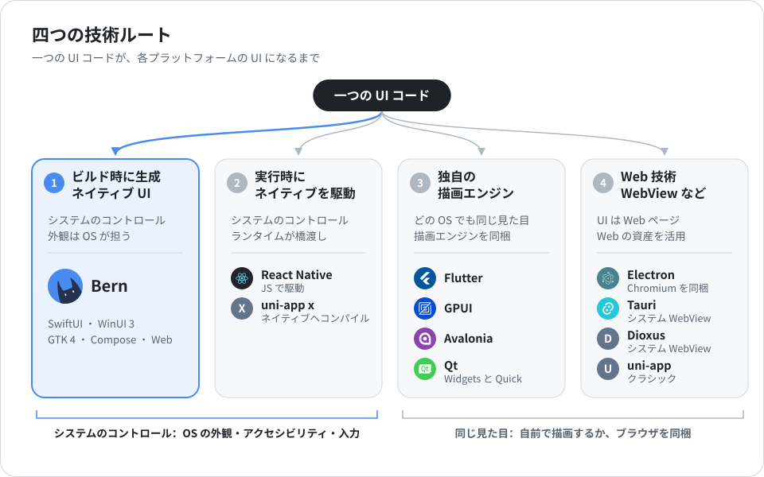
</picture>

前の二つのルートではシステムのコントロールが手に入ります。外観、アクセシビリティ、入力メソッド、ダークモードはシステムが受け持ち、代わりにコントロールはプラットフォームごとに少しずつ違います。後の二つはどこでも同じ UI を描き、代わりに各プラットフォームのデザインと振る舞いを自分で追いかけるか、ブラウザーを同梱します。

<picture>
<source media="(prefers-color-scheme: dark)" srcset="Docs/Assets/compare/landscape-ja-dark.svg">
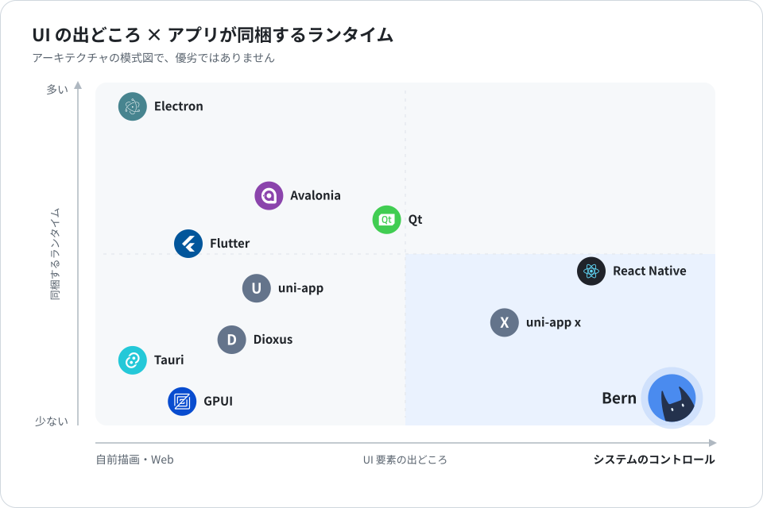
</picture>

この図はアーキテクチャの模式図で、優劣ではありません。横軸は UI 要素がシステムのコントロールか、フレームワークの自前描画や Web ページか。縦軸はアプリが同梱するランタイムの量（ブラウザーエンジン、JS エンジン、描画エンジン、言語ランタイム）です。

### 技術

<picture>
<source media="(prefers-color-scheme: dark)" srcset="Docs/Assets/tables/technology-ja-dark.svg">
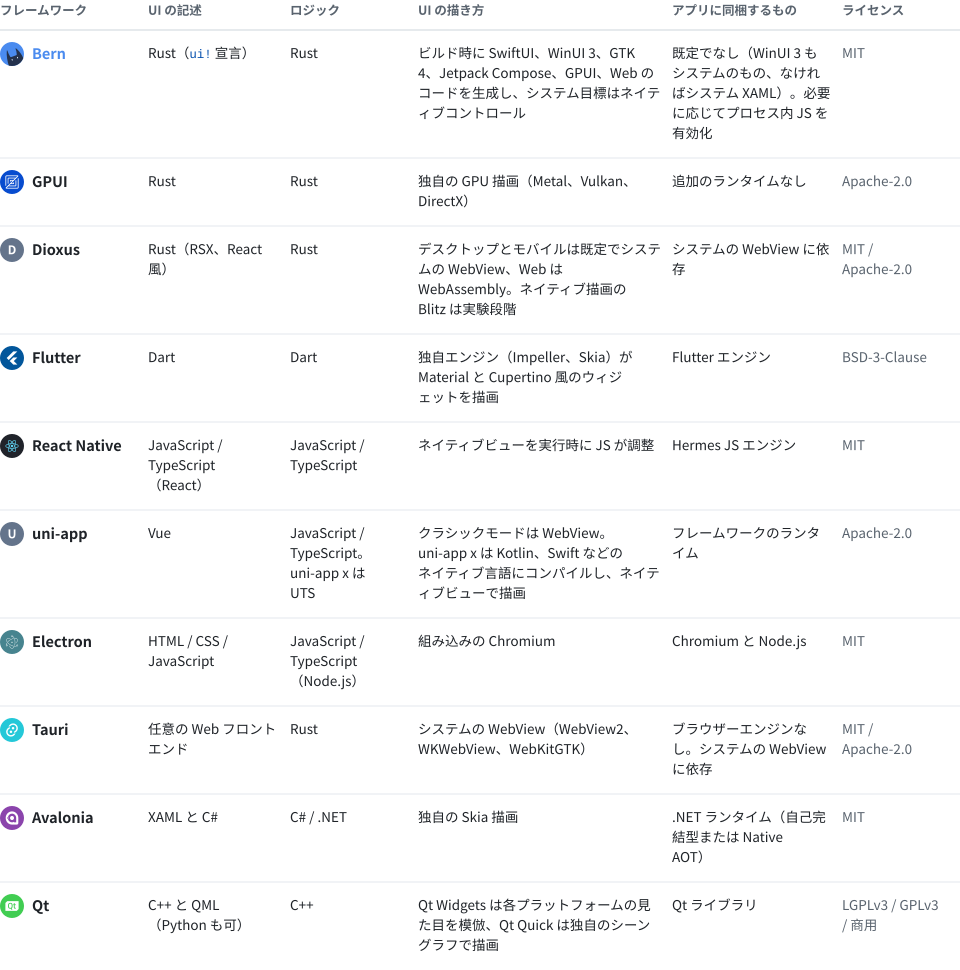
</picture>

### プラットフォームと機能

<picture>
<source media="(prefers-color-scheme: dark)" srcset="Docs/Assets/tables/capabilities-ja-dark.svg">
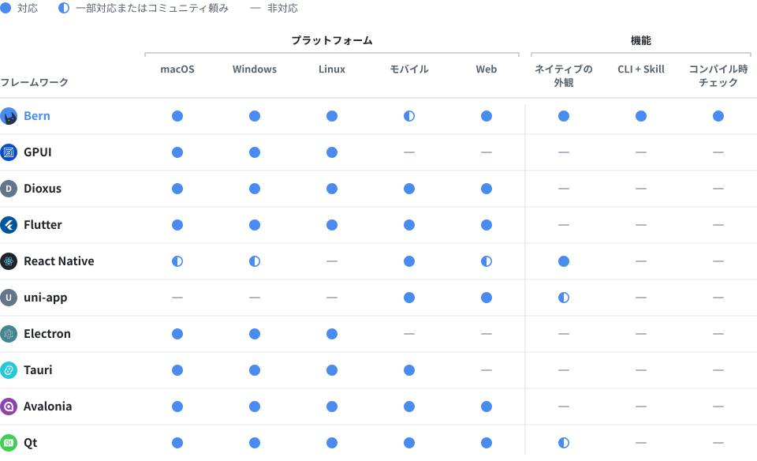
</picture>

- **モバイル**：iOS / iPadOS と Android（さらに watchOS、Wear OS、tvOS、Android TV にも対応）。React Native のデスクトップ版は Microsoft が保守し、uni-app はミニプログラムと HarmonyOS にも対応します。Bern はデスクトップ・スマートフォン・タブレット・ウォッチ・テレビの全ターゲットで実機検証済みで、`.ipa` と `.apk` パッケージを生成できます。
- **ネイティブの外観**：コントロールがプラットフォーム自身のもので、外観、アクセシビリティ、入力メソッドをシステムが提供します。Qt Widgets と uni-app x はそれに近いため一部対応としました。
- **Skills + CLI**：Bern はひとつのコマンドカタログからアプリの CLI と `SKILL.md` を生成します。人もエージェントも同じコマンドを使います。ほかのフレームワークは、アクセシビリティ API や Playwright、Flutter Driver などのテストツールで外から自動化できます。
- **コンパイル時チェック**：翻訳漏れ、あるレイアウトで機能に入口がない、入口が機能に登録されていない、といった問題をコンパイラーが直接エラーにします（[AI のための設計](#ai-のための設計)を参照）。ほかのフレームワークでは多くの場合、リンター、翻訳ツール、テストで見つけます。
- **成熟度**：Electron と Qt は非常に成熟しています。Flutter、React Native、uni-app、Tauri、Avalonia は成熟、Dioxus は発展中、GPUI は Zed エディターを支えていますが汎用コンポーネントはまだ初期段階、Bern は早期プレビューです。

### 性能とリソース

UI 層とロジック層がどの言語で、どう実行されるかが、実行時のオーバーヘッドの上限を決めます。ネイティブコンパイルで GC のない言語が最も軽く、JIT やバイトコード解釈の言語はエンジンを同梱し、メモリも多く使います。

<picture>
<source media="(prefers-color-scheme: dark)" srcset="Docs/Assets/compare/languages-ja-dark.svg">
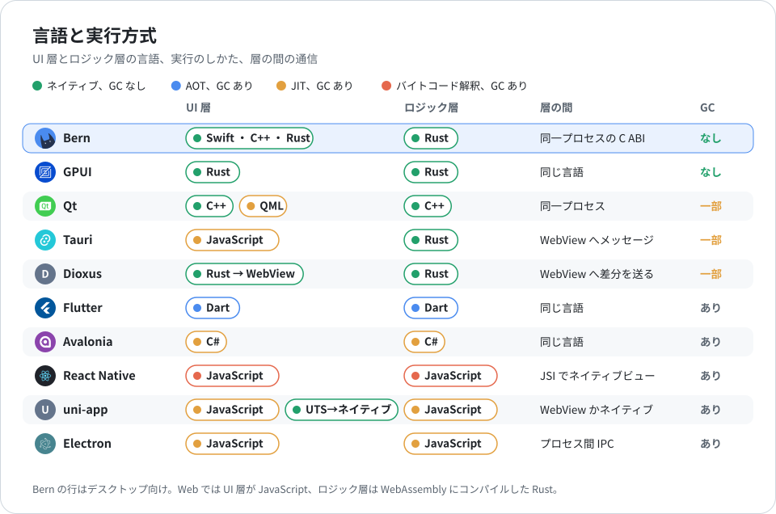
</picture>

一行の文字を表示するだけの同じウィンドウでも、パッケージサイズ、起動時間、メモリはフレームワークによって大きく違います。図は同じ CI 仮想マシン（GitHub ホストの Apple M1）での実測です。各フレームワーク自身のツールで release パッケージを作り、交互に 10 回ずつ起動した中央値を示します。スクリプトは [benchmarks/](benchmarks/) にあり、Actions の Benchmarks ワークフローで再実行できます。

<picture>
<source media="(prefers-color-scheme: dark)" srcset="Docs/Assets/compare/resources-ja-dark.svg">
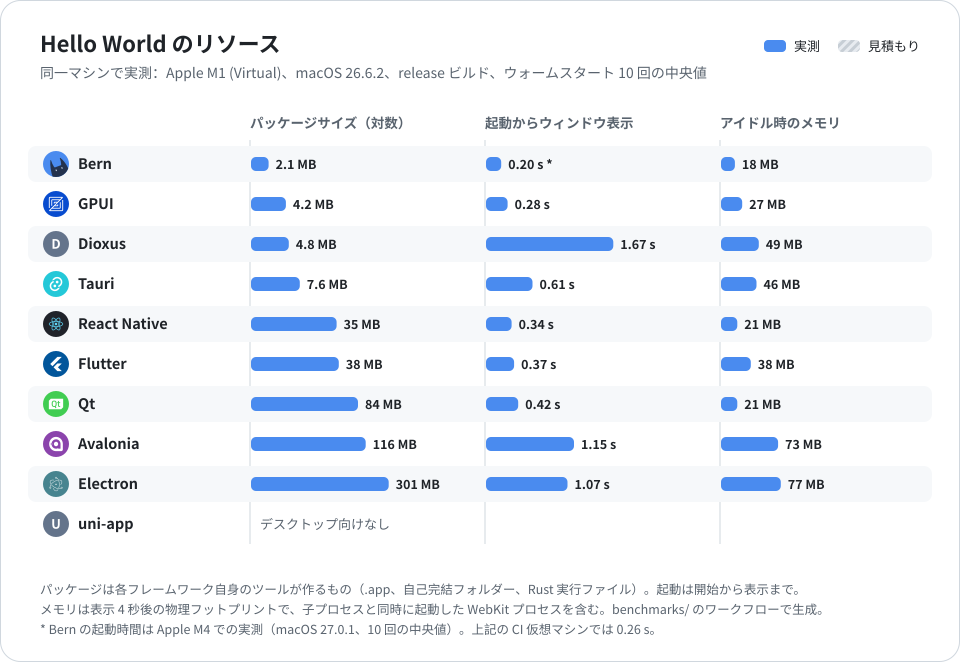
</picture>

### どれを選ぶか

<picture>
<source media="(prefers-color-scheme: dark)" srcset="Docs/Assets/tables/choose-ja-dark.svg">
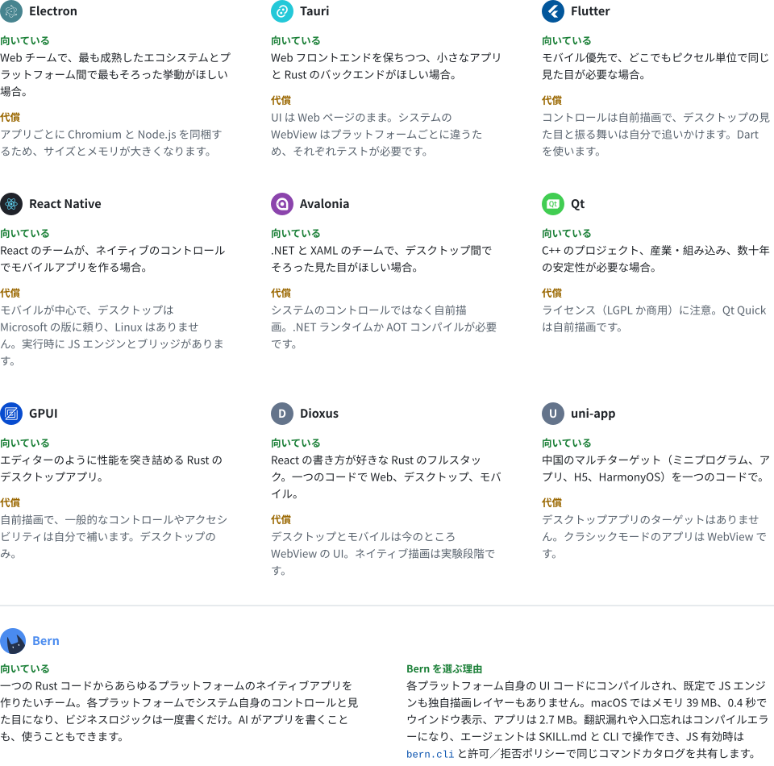
</picture>

## クイックスタート

Rust 1.99（`rustup` が `rust-toolchain.toml` に従って自動でインストール）と、ビルドするターゲットのツールチェーンが必要です。まずビルドツール `bern` をインストールします。

```sh
cargo binstall bern-cli
```

[cargo-binstall](https://github.com/cargo-bins/cargo-binstall) は [Releases](https://github.com/AimesSoft/Bern/releases) からビルド済みの `bern` をダウンロードします。Releases から直接ダウンロードしてもよく、`cargo install bern-cli` ならソースからコンパイルします。こうして入れた `bern` で作ったアプリは、crates.io から同じバージョンの Bern を使います。Bern 自体を変更するときは、クローンしたリポジトリで `cargo install --path crates/bern-cli` を実行して `bern` をインストールします。それで作ったアプリはそのクローンの Bern を使います。

### アプリを作る

任意のディレクトリで：

```sh
bern new my_app
cd my_app
bern run
```

新しいアプリはカウンター付きのウィンドウで、プロトコル、エンジン、UI がそれぞれ一つの crate になり、6 つのターゲットすべてが `Bern.toml` に宣言されています。`bern run` はこのコンピューターのターゲットをビルドして起動します。macOS では SwiftUI、Windows では WinUI 3、Linux では GTK です。`bern run --target web_app` はブラウザーで開き、`bern run --target ios` は起動中の iOS シミュレータに、`bern run --target android` は USB デバッグで接続した Android スマートフォン（またはエミュレータ）にインストールして起動します。ターゲットに `channels = ["ipc"]` がある場合、アプリの CLI は `target/bern/<ターゲット>/bin/` に、`SKILL.md` は隣の `skills/` ディレクトリに生成されます。

`bern doctor` は、このコンピューターで各ターゲットをビルドするのに足りないものと、そのインストール方法を示します。

```text
$ bern doctor
bern 0.2.1 on macOS (aarch64)

[✓] Rust: rustc 1.99.0, cargo 1.99.0
[✓] macOS · SwiftUI: macOS SDK 26.5, Swift 6.3.2
[✓] iOS · SwiftUI: iOS simulator SDK 26.5, the aarch64-apple-ios-sim target
[-] Windows · WinUI 3: builds on Windows
[-] Linux · GTK 4: builds on Linux
[✓] Android · Compose: Android SDK, NDK 29.0.14206865, gradle-9.5.1, the aarch64-linux-android target
[✓] Web · WebAssembly: the wasm32-unknown-unknown target
```

<details>
<summary><b>プラットフォームごとに必要なツール</b></summary>
<br>

- **macOS**：Xcode 26 以降。App Store からインストールしたあと `sudo xcode-select --switch /Applications/Xcode.app` を実行します。
- **iOS / iPadOS / tvOS / watchOS**：Xcode の各 Apple プラットフォーム SDK と対応する Rust ターゲット（`aarch64-apple-ios` / `aarch64-apple-ios-sim`、`aarch64-apple-tvos` / `aarch64-apple-tvos-sim`、`aarch64-apple-watchos` / `aarch64-apple-watchos-sim`）。`bern run` でシミュレータ起動、`bern package` で実機向け `.ipa` を作成できます。
- **Windows**：Visual Studio 2022 以降の「C++ によるデスクトップ開発」（Build Tools だけでも可）と Windows 11 SDK。Rust は MSVC ツールチェーンを使います。初回のビルドで Windows SDK の `cppwinrt` が C++/WinRT ヘッダーを生成し、ランタイムと一緒にプリコンパイルします（構成ごとに約 2.4 GB、`target` 内）。以降のビルドはアプリ自身のコードだけをコンパイルし、新しいアプリで約 5 秒、ショーケースで約 9 秒です。アプリのフォルダーには実行ファイル、400 KB のブートストラップ DLL、リソースだけがあり、.NET は不要で、Windows App SDK も同梱しません。
- **Linux**：GTK 4.14 と libadwaita 1.5 の開発パッケージ。例：`sudo apt install libgtk-4-dev libadwaita-1-dev libsoup-3.0-dev gstreamer1.0-libav`。
- **Android**：SDK と NDK を入れた Android Studio（SDK Manager → SDK Tools → NDK）、Gradle 9.4 以降、`rustup target add aarch64-linux-android`。初回のビルドで Gradle が Android プラグインと Compose ライブラリをダウンロードします。
- **Web**：`rustup target add wasm32-unknown-unknown`。`web_app` ビルドはエンジンを WebAssembly にコンパイルしてページ内で動かし、`web_ui` ビルドはページを独立したエンジンホストの UI にします。`bern run` はホストを起動してそのアドレスを開きます。

</details>

### アプリを配布する

```sh
bern package
```

このコンピューターでビルドできるターゲットを release でビルドし、`target/bern/dist/` にパッケージを書き出します。macOS は `.dmg`、Windows はインストーラー（ユーザーごと、管理者権限不要）と `.zip`、Linux は `.deb` と `.tar.gz`、Android は `.apk` とストア向けの `.aab`、Web は静的サイトのアーカイブです。デスクトップと WebUI のパッケージにはアプリの CLI が入り、IPC が有効ならスキルも入ります。静的 Web パッケージにはサイトのファイルだけが入り、Android の CLI は APK の中ではなく開発用コンピューターで動作します。署名は環境変数で設定し、証明書はリポジトリに入れません：`BERN_MACOS_SIGNING_IDENTITY` と `BERN_MACOS_NOTARY_PROFILE`（署名と公証）、`BERN_WINDOWS_CERTIFICATE`（証明書の拇印または `.pfx`）、`BERN_ANDROID_KEYSTORE`・`BERN_ANDROID_KEYSTORE_PASSWORD`・`BERN_ANDROID_KEY_ALIAS`（リリース鍵）。設定がなくてもパッケージは作られ、未署名の影響を知らせます。

### 独立した純ネイティブプロジェクトへ書き出す（ロックインなし）

```sh
bern eject --target macos --out ./native-macos                   # オフライン Rust ソース + Xcode プロジェクト
bern eject --target ios --engine prebuilt --release --out ./ios  # ビルド済み XCFramework（Rust 不要）
```

`bern eject` は元の Bern プロジェクトを変更せず、コンポーネントやウィンドウ単位に分割された標準のネイティブ IDE プロジェクト（`.xcodeproj`、Gradle、Visual Studio `.sln` + `.vcxproj`、独立 Cargo、バンドラー不要の ES モジュール）を書き出します。既定の `--engine source` は完全オフラインで自己完結した Rust ワークスペースを同梱してネイティブ IDE のビルドに組み込み、`--engine prebuilt` はコンパイル済みエンジンバイナリを埋め込むため、Rust や Bern を入れていない環境でもそのまま開いてビルドできます。詳しくは [Ejecting to standalone native projects](Docs/Implementation/Eject.md) を参照してください。

### ショーケースを動かす

Bern リポジトリのショーケースは、すべてのコンポーネント、2 つのウィンドウ、ビデオプレーヤーを使います。リポジトリのディレクトリで：

```sh
cd examples/showcase
bern run
```

### 動いているアプリを外から操作する

```sh
showcase ui inspect                                          # マウントされたコントロールの一覧
showcase ui select --target main_window.pages --option Controls
showcase ui set-bool --target controls_page.sync --value true
showcase showcase search-library --text mo                   # エンジンへのクエリ
showcase window open --kind settings
showcase window list                                         # ウィンドウの実際の状態
showcase window screenshot --output shot.png                 # ウィンドウを PNG 撮影
ssh HOST /path/to/showcase state
```

ターゲットの `channels = ["ipc"]` で外部からの操作が有効になります。Android の CLI は端末上ではなく、`bern run` が `adb forward` を設定した開発用コンピューターで実行します。スタンドアロンの Web `app` で IPC を有効にすると、`bern run` がローカルのブリッジを起動し、開いているブラウザーのタブに接続します。配布用の静的サイトのアーカイブには、この CLI も `SKILL.md` も含まれません。

## ロードマップ

<picture>
<source media="(prefers-color-scheme: dark)" srcset="Docs/Assets/tables/roadmap-ja-dark.svg">
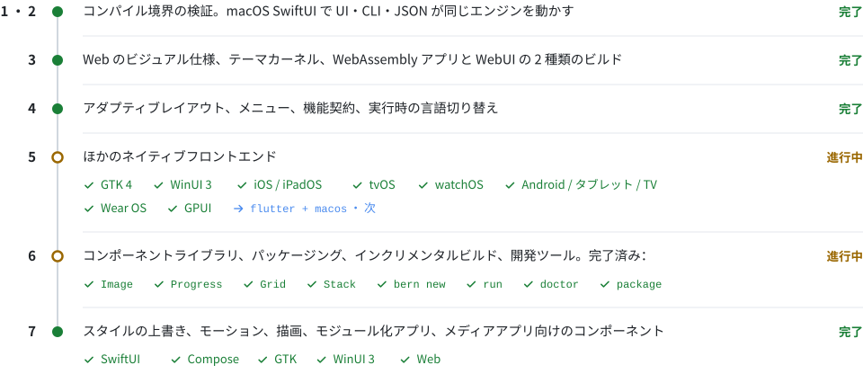
</picture>

## リポジトリ構成

<details>
<summary>クレートとディレクトリ</summary>
<br>

<picture>
<source media="(prefers-color-scheme: dark)" srcset="Docs/Assets/tables/repository-ja-dark.svg">
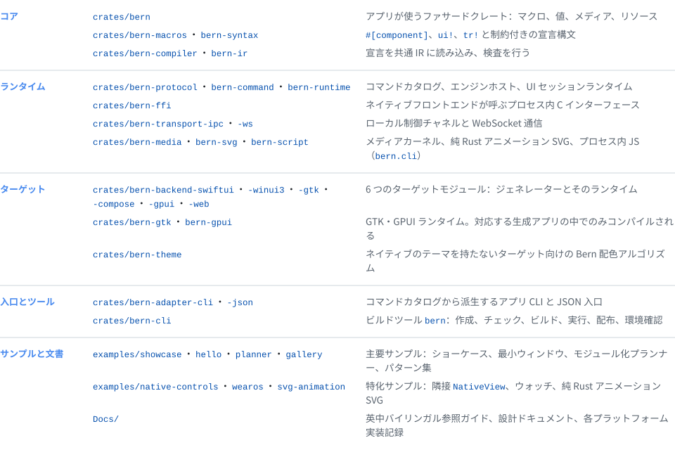
</picture>

</details>

## 開発

```sh
cargo fmt --all --check
cargo clippy --workspace --all-targets -- -D warnings
cargo test --workspace
```

テストには、コンパイルに失敗しなければならない宣言が含まれます。また、ツールキットがある環境では生成されたアプリを型検査します。Xcode で Swift 6、開発パッケージで GTK、Windows では生成された 2 つのフロントエンドを MSVC でコンパイルします。Android の Kotlin は `bern build --target android` の中で Gradle がコンパイルします。

## ドキュメント

検索可能なオンラインドキュメントは **[bern.aimes-soft.com/docs](https://bern.aimes-soft.com/docs)**、またはこのリポジトリから閲覧できます：

- **リファレンス**：[ドキュメント索引](Docs/README.md) · [現在のコンポーネントガイド](Docs/Reference/UI.md) · [プロパティ一覧](Docs/Reference/Component-Properties.md) · [プラットフォーム対応と検証範囲](Docs/Reference/Platforms.md) · [パフォーマンストレース](Docs/Reference/Tracing.md)
- **設計**：[設計ドキュメント](Docs/Design.md) · [適応仕様](Docs/Adaptation/README.md) · [React Native 調査](Docs/Research/ReactNative.md)
- **トピック**：[独立ネイティブプロジェクト書き出し](Docs/Implementation/Eject.md) · [隣接ネイティブビュー](Docs/Implementation/Native-Views.md) · [JavaScript と `bern.cli`](Docs/Implementation/JavaScript.md) · [アニメーション SVG](Docs/Implementation/Animated-SVG.md) · [モジュール別ビルド](Docs/Implementation/Module-Builds.md) · [ブラウザー拡張](Docs/Implementation/Web-Extensions.md)
- **バックエンド**：[macOS](Docs/Implementation/macOS-SwiftUI.md) · [iOS](Docs/Implementation/iOS-SwiftUI.md) · [watchOS](Docs/Implementation/watchOS-SwiftUI.md) · [tvOS](Docs/Implementation/tvOS-SwiftUI.md) · [Windows](Docs/Implementation/Windows-WinUI3.md) · [Linux](Docs/Implementation/Linux-GTK.md) · [Android と Wear OS](Docs/Implementation/Android-Compose.md) · [GPUI](Docs/Implementation/GPUI.md) · [Web と WebUI](Docs/Implementation/Web.md)

ドキュメントは英語で書かれています。[簡体字中国語版](Docs/zh-CN/README.md)（[オンライン](https://bern.aimes-soft.com/docs/zh-CN)）もあります。

## ライセンス

[MIT](LICENSE) © 2026 MCDFSteve

<div align="center">
<br>
<sub>Bern は開発の初期段階です。API と宣言構文はまだ変わる可能性があります。</sub>
</div>
