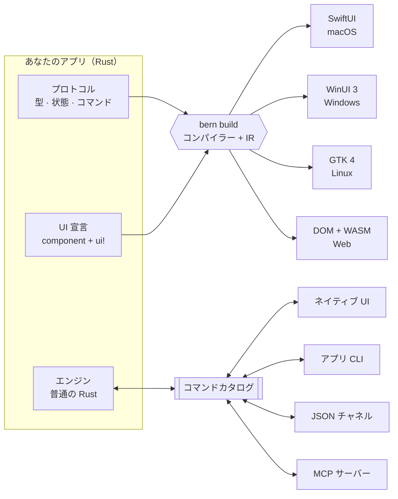

<div align="center">


<h1>Bern</h1>

<p><b>一つの Rust 宣言を、各プラットフォーム自身のネイティブ UI へコンパイル。</b></p>

<p>デスクトップのために生まれ、AI のために作られた：SwiftUI、WinUI 3、GTK 4、そして Web。<br>
デスクトップには JS エンジンも組み込みブラウザーもありません。どのボタンも、生まれながらに AI が呼べる MCP ツールです。</p>

<p>


</p>

<p>


<a href="LICENSE"></a>

</p>

<p>
<a href="README.md">简体中文</a> ·
<a href="README.en.md">English</a> ·
<a href="README.zh-Hant.md">繁體中文</a> ·
<b>日本語</b>
</p>

<p>
<a href="#bern-を選ぶ理由">Bern を選ぶ理由</a> ·
<a href="#ai-のための設計">AI のための設計</a> ·
<a href="#実測値">実測値</a> ·
<a href="#他のフレームワークとの比較">比較</a> ·
<a href="#クイックスタート">クイックスタート</a> ·
<a href="Docs/Design.md">設計ドキュメント</a>
</p>

</div>

<br>

<table>
<tr>
<td width="50%" align="center"><br><sub><b>macOS</b> · SwiftUI</sub></td>
<td width="50%" align="center"><br><sub><b>Windows</b> · WinUI 3</sub></td>
</tr>
<tr>
<td width="50%" align="center"><br><sub><b>Linux</b> · GTK 4 + libadwaita</sub></td>
<td width="50%" align="center"><br><sub><b>Web</b> · DOM + WebAssembly</sub></td>
</tr>
</table>

<p align="center"><sub>ひとつの <code>controls_page</code> 宣言から、4 つの UI ツールキットへ。デスクトップでは Bern は自前のピクセルを一切描きません。<br>スイッチもスライダーもサイドバーも、プラットフォーム標準のコントロールとプラットフォームの配色です。</sub></p>

## Bern を選ぶ理由

<table>
<tr>
<td width="33%" valign="top">
<h3>ネイティブ UI へコンパイル</h3>
一つの Rust 宣言を、SwiftUI、WinUI 3、GTK 4、Web へコンパイルします。<br><br>
目指すところは React Native に近く、一つのコードでどのプラットフォームでもネイティブのコントロールになります。やり方は違います。React Native は実行時に JS エンジンからネイティブビューを調整し、Bern はビルド時に各プラットフォーム自身の UI コードを生成します。実行時には JS エンジンも仮想 DOM もなく、UI はシステムのコントロールそのものです。
</td>
<td width="33%" valign="top">
<h3>AI のための設計：正しく書けて、すぐ使える</h3>
AI がコードを書くときに漏らした翻訳、UI の入口、未登録のボタン、コマンド化されていない操作は、すべてコンパイルエラーになり、ファイルと行を指し示します。<br><br>
AI がアプリを使うときは、どのボタンも MCP ツールです。コントロールの意味を読み、マウスのクリックと同じコードを通ります。スクリーンショットにも座標にも頼りません。
</td>
<td width="33%" valign="top">
<h3>クロスプラットフォームとは思えない軽さ</h3>
デスクトップにはブラウザーエンジンも JS エンジンもなく、業務エンジンはネイティブコードにコンパイルされ、アプリのプロセス内で動きます。<br><br>
release ビルドのショーケースの実測：macOS でメモリ <b>39 MB</b>、<b>0.4 秒</b>でウィンドウ表示、アプリバンドル全体で <b>2.7 MB</b>。Windows でメモリ <b>35 MB</b>、<b>0.3 秒</b>、アプリ全体で <b>4.2 MB</b>、.NET 不要。Web アプリ全体は Rust エンジン込みで gzip 後 <b>189 KB</b>。
</td>
</tr>
</table>

## AI のための設計

### コードを書く：AI が忘れたことは、コンパイラーが覚えている

AI が UI を書くときに多い問題は、書き間違いより書き漏れです。機能を足したのに狭い画面のレイアウトに入口を置き忘れる、新しい文言を一つの言語でしか書かない、コマンドを迂回してコールバックをぶら下げる。ほかのフレームワークではユーザーが見つけるまで残りますが、Bern ではどれもコンパイルを通りません。制約が厳しいほど、AI は中途半端な仕事を渡しにくくなります。

| 漏れたもの | Bern の扱い |
| :-- | :-- |
| ある文言の翻訳が一つ足りない | コンパイルエラー B102。各言語は `tr!` で UI のすぐ隣にまとめて書くので、漏れが一目でわかります。直接書いたリテラルは B103（厳格モード、既定で有効） |
| ある表示モードで機能に入口がない | コンパイルエラー B201。ページは提供すべき機能を機能契約で宣言し、コンパイラーがレイアウト（`compact`、`expanded`）ごとに各機能の入口を証明します。広い画面にあって狭い画面にないのも不可 |
| 契約の範囲内の入口が機能に登録されていない | コンパイルエラー B202。逆も不可で、入口が自分の機能に属さないコマンドを実行すると B204 |
| 入口が条件分岐の中にしかなく、常に使えると証明できない | コンパイルエラー B203。人による保証を明示した場合を除く |
| ボタンに任意のコードをぶら下げたい | 書けません。ボタンはコマンドカタログの型付きコマンドにしか結び付けられず、コントロールがエンジンの状態を直接書き換えることもできません |

エラーは人のためでもあり、エージェントのためでもあります。番号、理由、位置がはっきりしているので、エージェントは自分で直して再ビルドできます。以下はショーケースで実際に出た 2 回分の出力です。1 回目は英語の翻訳を一つ消し、それを戻してから、2 回目は狭いレイアウトの「Change Clip」メニューを消しました。

```text
$ bern check
error[B102]: Missing translation
Missing language: en
Required languages: zh-Hans, en
  --> showcase-ui/src/pages.rs:13:31

$ bern check
error[B201]: Feature missing in adaptive layout
Contract: MediaFeature
Feature: Clip
compact: missing
  --> showcase-ui/src/media.rs:14:5
```

ビルドのたびに、ターゲットごとの機能カバレッジの完全なレポート（`features.json`）も出力され、カバー済み、免除、人による保証のみが分けて記載されます。

### アプリを使う：ピクセルではなく意味を読む

多くのフレームワークでは、AI にデスクトップアプリを操作させるには、スクリーンショット、認識、座標計算、疑似クリックが必要です。Bern のアプリは MCP サーバーを備えています。UI のすべてのコントロールに安定した名前と役割があり、エージェントは構造を読み、ユーザーのクリックと同じコードで操作し、アプリは起きたことをそのまま答えます。

```sh
$ showcase ui inspect                 # エージェントが読むのはピクセルではなく意味
[{ "target": "controls_page.sync", "role": "switch", "label": "Sync", "value": "false", "enabled": true, … }, …]

$ showcase ui set-bool --target controls_page.sync --value true

$ showcase window close --window settings#1
{ "outcome": "ConfirmationRequired", "message": "Do you want to save the display name?",
  "decisions": ["Save", "Discard", "Cancel"], "confirmation": "settings#1:c1", … }

$ showcase window confirm-close --window settings#1 --confirmation settings#1:c1 --decision Save
{ "outcome": "Rejected", "reason": "save_failed: invalid_name: a display name has 1 to 40 characters …" }
```

同じ操作が MCP ツール（`ui_inspect`、`ui_activate`、`window_close`…）としてエージェントに提供され、業務コマンドもそれぞれツールになります（例：`showcase_set_display_name`）。ボタンが無効、ダイアログでふさがれている、対象が存在しないといった場合、エージェントが受け取るのは何も起きないクリックではなく、明確なエラーコードです。

## 実測値

| | macOS · SwiftUI | Windows · WinUI 3 | Web · WebAssembly |
| :-- | :-- | :-- | :-- |
| 起動からウィンドウ表示まで | 0.41 秒 | 0.32 秒 | – |
| メモリ | 39 MB | 35 MB | – |
| サイズ | アプリバンドル 2.7 MB（実行ファイル 2.3 MB）、フレームワークの同梱なし | アプリフォルダー 4.2 MB、エンジンは実行ファイル内、UI フレームワークはシステムのもの | 全アセットを gzip して 189 KB、Rust エンジンを含む |

<details>
<summary>測定方法</summary>
<br>

- 対象：release ビルドのショーケース（6 ページ、メインと設定のウィンドウ、ビデオプレーヤー）。2026-10-11 に測定し、各項目 3 回以上の中央値。
- macOS：Apple M4、メモリ 16 GB、macOS 27.0.1。メモリは `footprint` の物理フットプリントで、アクティビティモニタの「メモリ」列と同じ指標。
- Windows：Intel Core i5-13490F、メモリ 32 GB、Windows 11 25H2。メモリはプライベートワーキングセットで、タスクマネージャーの「メモリ」列と同じ指標。
- 起動時間：プロセスの起動から、コマンドラインが表示中のネイティブウィンドウを読めるまで。エンジンの起動とローカル制御チャネルの準備を含みます。
- Windows の値は WinUI 3 フロントエンド（測定時はシステムに Windows App Runtime 1.8。現在は 2.x でビルド）。ランタイムがないシステムでは、同じプログラムがシステムの XAML にフォールバックし、起動 0.54 秒、メモリ 19 MB です。どちらも .NET と VC++ ランタイムは不要で、アプリフォルダーには実行ファイルと 400 KB のブートストラップ DLL だけがあります。

</details>

## その他の機能

<table>
<tr>
<td width="33%" valign="top">
<h3>すべての操作はコマンド</h3>
ボタンに任意のコールバックは持たせられません。ひとつの型付きカタログにあるコマンドに結び付け、引数・エラー・リトライ方針を UI、コマンドライン、JSON、MCP で共有します。
</td>
<td width="33%" valign="top">
<h3>コンパイル時にチェック</h3>
<code>rustc</code> がすべてのバインディングとコマンド引数を型検査します。コマンドのないボタン、任意のコールバック、エンジン状態を書き換えるコントロール、翻訳漏れはコンパイルできません。
</td>
<td width="33%" valign="top">
<h3>ロジックは Rust のまま</h3>
エンジンは UI に依存しない普通の Rust コードで、ウィンドウなしでテストできます。デスクトップではアプリのプロセス内で、ブラウザーでは WebAssembly として動きます。
</td>
</tr>
<tr>
<td width="33%" valign="top">
<h3>初日からローカライズ</h3>
<code>tr!</code> で各言語の文言を UI のすぐ隣に置きます。厳格モードのビルドは翻訳漏れを拒否し、実行中に言語を切り替えても入力中の内容は失われません。
</td>
<td width="33%" valign="top">
<h3>ダークモードは設定不要</h3>
色はプラットフォームのテーマから来ます。ダークモード、アクセントカラー、ハイコントラストはシステムに従い、宣言したブランドカラーはシステムのアクセントカラーになります。Web では Bern のテーマカーネルが配色一式を生成します。
</td>
<td width="33%" valign="top">
<h3>宣言的マルチウィンドウ</h3>
各ウィンドウが下書き、閉じる前のチェック、保存コマンドを持ちます。最小化・最大化・移動・リサイズもコマンドで、プラットフォームの実際の状態で応答します。
</td>
</tr>
</table>

<details>
<summary><b>さらに：</b>動画、非同期クエリ、アダプティブレイアウト、型付きナビゲーション…</summary>
<br>

- **動画**：`Video` は AVFoundation、Windows Media Foundation、GStreamer、HTML メディアで再生され、コントロールバーはコマンド駆動、プレーヤーはページをまたいで再生を続けられます。
- **非同期クエリ**：`Query` の購読は読み込み中・空・失敗・更新中の状態を持ち、最新の応答だけを表示します。
- **アダプティブレイアウト**：ビューが実際に得た幅に応じて `compact` と `expanded` を切り替えます。
- **型付きナビゲーション**：サイドバー、型付きルートによるプッシュナビゲーション、タブ、ツールバー、メニュー。
- **機能契約**：各レイアウトでコンポーネントが満たすべき機能を宣言し、網羅をコンパイラーが証明します。
- **同梱リソース**：`Bern.toml` で宣言したファイルをビルド時に検査し、実行時は名前で参照します。
- **画像とレイアウト**：`Image` は同梱画像を表示し、HDR 画像（PQ・HLG の PNG、ゲインマップ付き JPEG）は HDR を表示できる画面で HDR のまま表示します。宣言されていないリソースはコンパイルエラーになります。`Grid` は幅に応じて列数を増減し、`Stack` は 9 方向の配置で重ね、`Progress` はプログレスバーか不確定の進捗を表示します。

</details>

## しくみ



1. **プロトコル**：`#[bern::protocol]` で値の型、読み取り専用の状態、コマンドとクエリのトレイトを宣言します。
2. **エンジン**：それらのトレイトを普通の Rust で実装します。ウィンドウもコントロールも通信路も知りません。
3. **インターフェース**：本体が `ui!` 宣言である `#[component]` 関数。コンパイラーがこれを共通の中間表現（IR）に読み込み、各ターゲットモジュールがそこからネイティブコードを生成します。ターゲットを増やしてもパーサー、IR、ビジネスロジックには手を入れません。

## コードの雰囲気

<table>
<tr>
<td width="50%" valign="top">

**1 · プロトコル**：型、状態、コマンド

```rust
#[bern::protocol(namespace = "counter", version = 1)]
pub mod counter {
    use bern::prelude::*;

    #[state]
    pub struct State {
        pub count: i64,
    }

    #[commands]
    pub trait Commands {
        /// Add to the count.
        fn add(&mut self, by: i64) -> Result<(), CommandError>;
    }
}
```

**3 · インターフェース**：ひとつの `ui!` 宣言

```rust
#[component]
pub fn counter_view(app: counter::Client) -> impl View {
    ui! {
        Form {
            Text(content: tr! {
                "ja" => "{n} 回カウントしました",
                "en" => "Counted {n} times";
                n: app.count
            })
            Button(
                id: add,
                label: tr! { "ja" => "1 増やす", "en" => "Add one" },
                prominence: prominent
            ) => app.add(1)
        }
    }
}
```

</td>
<td width="50%" valign="top">

**2 · エンジン**：UI に依存しない普通の Rust

```rust
use bern::CommandError;

pub struct Counter {
    state: counter::State,
}

impl Default for Counter {
    fn default() -> Self {
        Self { state: counter::State { count: 0 } }
    }
}

impl counter::Commands for Counter {
    fn add(&mut self, by: i64) -> Result<(), CommandError> {
        self.state.count += by;
        Ok(())
    }
}

impl counter::Engine for Counter {
    fn state(&self) -> &counter::State {
        &self.state
    }
}
```

**4 · すべての入口が同じエンジンを動かす**

```sh
counter ui inspect
counter ui activate --target counter_view.add
counter counter add --by 5
counter-mcp   # 同じカタログを AI エージェントへ
```

</td>
</tr>
</table>

`Bern.toml` では言語、テーマ、ソース、同梱リソース、ビルドターゲットを宣言します。完全な例は[ショーケース](examples/showcase)をご覧ください。文字スタイル、ボタン、スイッチ、スライダー、テキストフィールド、エンジンのクエリによる検索、リストから詳細へのナビゲーション、動画、そしてタブと閉じる確認を持つ設定ウィンドウを備えたサイドバー型アプリです。

## 対応プラットフォーム

<table>
<tr>
<th align="left">ターゲット</th>
<th align="left">UI ツールキット</th>
<th align="left">エンジン</th>
<th align="left">状態</th>
</tr>
<tr>
<td><b>macOS</b><br><code>swiftui + macos</code></td>
<td>SwiftUI、標準コンポーネントとシステムスタイル · macOS 14 以降</td>
<td>プロセス内</td>
<td> <a href="Docs/Implementation/macOS-SwiftUI.md">実装記録</a></td>
</tr>
<tr>
<td><b>iOS</b><br><code>swiftui + ios</code></td>
<td>SwiftUI、macOS と同じ生成コード。シーンは一つで、ほかのウインドウはシート · iOS 17 以降</td>
<td>プロセス内</td>
<td> <a href="Docs/Implementation/iOS-SwiftUI.md">実装記録</a></td>
</tr>
<tr>
<td><b>Windows</b><br><code>winui3 + windows</code></td>
<td>C++/WinRT：Windows App Runtime 2（ほかのアプリが入れたもの、または Windows 11 に付属のもの）があれば WinUI 3、なければシステムの XAML。どちらか一方だけのビルドも可能 · Windows 10 2004 以降</td>
<td>プロセス内（静的リンク）</td>
<td> <a href="Docs/Implementation/Windows-WinUI3.md">実装記録</a></td>
</tr>
<tr>
<td><b>Linux</b><br><code>gtk + linux</code></td>
<td>GTK 4.14 と libadwaita 1.5、GNOME HIG に準拠</td>
<td>プロセス内</td>
<td> <a href="Docs/Implementation/Linux-GTK.md">実装記録</a></td>
</tr>
<tr>
<td><b>Web アプリ</b><br><code>web</code> · <code>app</code></td>
<td>DOM、Bern 独自のビジュアル仕様とテーマカーネル</td>
<td>ページ内の WebAssembly</td>
<td> <a href="Docs/Implementation/Web.md">実装記録</a></td>
</tr>
<tr>
<td><b>WebUI</b><br><code>web</code> · <code>ui</code></td>
<td>同じページを、独立したエンジンの UI として</td>
<td>WebSocket で接続するエンジンホスト</td>
<td> <a href="Docs/Implementation/Web.md">実装記録</a></td>
</tr>
<tr>
<td><b>次の予定</b></td>
<td><code>flutter + macos</code>（バックエンドの差し替え検証）、続いて iOS 実機パッケージ、Android、HarmonyOS</td>
<td>–</td>
<td> <a href="Docs/Adaptation/README.md">適応仕様</a></td>
</tr>
</table>

UI 技術を省略するとプラットフォームの既定が選ばれます。既定が使えないときは、別の技術へ黙って切り替えずにエラーになります。

## 他のフレームワークとの比較

<p align="center">
<a href="https://github.com/zed-industries/zed/tree/main/crates/gpui"></a>
<a href="https://dioxuslabs.com"></a>
<a href="https://flutter.dev"></a>
<a href="https://reactnative.dev"></a>
<a href="https://uniapp.dcloud.net.cn"></a>
<br>
<a href="https://www.electronjs.org"></a>
<a href="https://tauri.app"></a>
<a href="https://avaloniaui.net"></a>
<a href="https://www.qt.io"></a>
</p>

どのフレームワークも同じ問いに答えています。一つのコードが、各プラットフォームの UI にどうやってなるのか。答えが違えば、トレードオフも違います。以下は各プロジェクトの公式ドキュメントに基づきます。サイズやメモリはバージョンや設定で大きく変わるため、ここでは構造の違いだけを比べます。Bern 自身の数値は[実測値](#実測値)を参照してください。

<picture>
<source media="(prefers-color-scheme: dark)" srcset="Docs/Assets/compare/routes-ja-dark.svg">

</picture>

前の二つのルートではシステムのコントロールが手に入ります。外観、アクセシビリティ、入力メソッド、ダークモードはシステムが受け持ち、代わりにコントロールはプラットフォームごとに少しずつ違います。後の二つはどこでも同じ UI を描き、代わりに各プラットフォームのデザインと振る舞いを自分で追いかけるか、ブラウザーを同梱します。

<picture>
<source media="(prefers-color-scheme: dark)" srcset="Docs/Assets/compare/landscape-ja-dark.svg">

</picture>

この図はアーキテクチャの模式図で、優劣ではありません。横軸は UI 要素がシステムのコントロールか、フレームワークの自前描画や Web ページか。縦軸はアプリが同梱するランタイムの量（ブラウザーエンジン、JS エンジン、描画エンジン、言語ランタイム）です。

### 技術

| フレームワーク | UI の記述 | ロジック | UI の描き方 | アプリに同梱するもの | ライセンス |
| :-- | :-- | :-- | :-- | :-- | :-- |
| **Bern** | Rust（`ui!` 宣言） | Rust | ビルド時に SwiftUI、WinUI 3、GTK 4、Web のコードを生成し、UI はシステムのコントロール | なし。WinUI 3 もシステムのものを使い、ない場合はシステムの XAML | MIT |
| **GPUI** | Rust | Rust | 独自の GPU 描画（Metal、Vulkan、DirectX） | 追加のランタイムなし | Apache-2.0 |
| **Dioxus** | Rust（RSX、React 風） | Rust | デスクトップとモバイルは既定でシステムの WebView、Web は WebAssembly。ネイティブ描画の Blitz は実験段階 | システムの WebView に依存 | MIT / Apache-2.0 |
| **Flutter** | Dart | Dart | 独自エンジン（Impeller、Skia）が Material と Cupertino 風のウィジェットを描画 | Flutter エンジン | BSD-3-Clause |
| **React Native** | JavaScript / TypeScript（React） | JavaScript / TypeScript | ネイティブビューを実行時に JS が調整 | Hermes JS エンジン | MIT |
| **uni-app** | Vue | JavaScript / TypeScript。uni-app x は UTS | クラシックモードは WebView。uni-app x は Kotlin、Swift などのネイティブ言語にコンパイルし、ネイティブビューで描画 | フレームワークのランタイム | Apache-2.0 |
| **Electron** | HTML / CSS / JavaScript | JavaScript / TypeScript（Node.js） | 組み込みの Chromium | Chromium と Node.js | MIT |
| **Tauri** | 任意の Web フロントエンド | Rust | システムの WebView（WebView2、WKWebView、WebKitGTK） | ブラウザーエンジンなし。システムの WebView に依存 | MIT / Apache-2.0 |
| **Avalonia** | XAML と C# | C# / .NET | 独自の Skia 描画 | .NET ランタイム（自己完結型または Native AOT） | MIT |
| **Qt** | C++ と QML（Python も可） | C++ | Qt Widgets は各プラットフォームの見た目を模倣、Qt Quick は独自のシーングラフで描画 | Qt ライブラリ | LGPLv3 / GPLv3 / 商用 |

### プラットフォームと機能

● 対応　◐ 一部対応またはコミュニティ頼み　— 非対応

| フレームワーク | macOS | Windows | Linux | モバイル | Web | ネイティブの外観 | MCP 内蔵 | コンパイル時チェック |
| :-- | :-: | :-: | :-: | :-: | :-: | :-: | :-: | :-: |
| **Bern** | ● | ● | ● | ◐ | ● | ● | ● | ● |
| **GPUI** | ● | ● | ● | — | — | — | — | — |
| **Dioxus** | ● | ● | ● | ● | ● | — | — | — |
| **Flutter** | ● | ● | ● | ● | ● | — | — | — |
| **React Native** | ◐ | ◐ | — | ● | ◐ | ● | — | — |
| **uni-app** | — | — | — | ● | ● | ◐ | — | — |
| **Electron** | ● | ● | ● | — | — | — | — | — |
| **Tauri** | ● | ● | ● | ● | — | — | — | — |
| **Avalonia** | ● | ● | ● | ● | ● | — | — | — |
| **Qt** | ● | ● | ● | ● | ● | ◐ | — | — |

- **モバイル**：iOS と Android。React Native のデスクトップ版は Microsoft が保守し、uni-app はミニプログラムと HarmonyOS にも対応します。Bern の iOS ターゲットはシミュレータ用アプリをビルドできます。実機パッケージと Android は計画中です。
- **ネイティブの外観**：コントロールがプラットフォーム自身のもので、外観、アクセシビリティ、入力メソッドをシステムが提供します。Qt Widgets と uni-app x はそれに近いため一部対応としました。
- **MCP 内蔵**：フレームワークに付属し、動作中の UI を操作する MCP サーバーとコマンドライン。ほかのフレームワークは、アクセシビリティ API や Playwright、Flutter Driver などのテストツールで外から自動化できます。
- **コンパイル時チェック**：翻訳漏れ、あるレイアウトで機能に入口がない、入口が機能に登録されていない、といった問題をコンパイラーが直接エラーにします（[AI のための設計](#ai-のための設計)を参照）。ほかのフレームワークでは多くの場合、リンター、翻訳ツール、テストで見つけます。
- **成熟度**：Electron と Qt は非常に成熟しています。Flutter、React Native、uni-app、Tauri、Avalonia は成熟、Dioxus は発展中、GPUI は Zed エディターを支えていますが汎用コンポーネントはまだ初期段階、Bern は早期プレビューです。

### 性能とリソース

UI 層とロジック層がどの言語で、どう実行されるかが、実行時のオーバーヘッドの上限を決めます。ネイティブコンパイルで GC のない言語が最も軽く、JIT やバイトコード解釈の言語はエンジンを同梱し、メモリも多く使います。

<picture>
<source media="(prefers-color-scheme: dark)" srcset="Docs/Assets/compare/languages-ja-dark.svg">

</picture>

一行の文字を表示するだけの同じウィンドウでも、パッケージサイズ、起動時間、メモリはフレームワークによって大きく違います。図は同じ CI 仮想マシン（GitHub ホストの Apple M1）での実測です。各フレームワーク自身のツールで release パッケージを作り、交互に 10 回ずつ起動した中央値を示します。Bern の起動時間は M4 でも実測しており、図の注記のとおりです。スクリプトは [benchmarks/](benchmarks/) にあり、Actions の Benchmarks ワークフローで再実行できます。

<picture>
<source media="(prefers-color-scheme: dark)" srcset="Docs/Assets/compare/resources-ja-dark.svg">

</picture>

### どれを選ぶか

<table>
<tr>
<td width="50%" valign="top">
<br>
<b>向いている</b>：Web チームで、最も成熟したエコシステムとプラットフォーム間で最もそろった挙動がほしい場合。<br>
<b>代償</b>：アプリごとに Chromium と Node.js を同梱するため、サイズとメモリが大きくなります。
</td>
<td width="50%" valign="top">
<br>
<b>向いている</b>：Web フロントエンドを保ちつつ、小さなアプリと Rust のバックエンドがほしい場合。<br>
<b>代償</b>：UI は Web ページのまま。システムの WebView はプラットフォームごとに違うため、それぞれテストが必要です。
</td>
</tr>
<tr>
<td valign="top">
<br>
<b>向いている</b>：モバイル優先で、どこでもピクセル単位で同じ見た目が必要な場合。<br>
<b>代償</b>：コントロールは自前描画で、デスクトップの見た目と振る舞いは自分で追いかけます。Dart を使います。
</td>
<td valign="top">
<br>
<b>向いている</b>：React のチームが、ネイティブのコントロールでモバイルアプリを作る場合。<br>
<b>代償</b>：モバイルが中心で、デスクトップは Microsoft の版に頼り、Linux はありません。実行時に JS エンジンとブリッジがあります。
</td>
</tr>
<tr>
<td valign="top">
<br>
<b>向いている</b>：.NET と XAML のチームで、デスクトップ間でそろった見た目がほしい場合。<br>
<b>代償</b>：システムのコントロールではなく自前描画。.NET ランタイムか AOT コンパイルが必要です。
</td>
<td valign="top">
<br>
<b>向いている</b>：C++ のプロジェクト、産業・組み込み、数十年の安定性が必要な場合。<br>
<b>代償</b>：ライセンス（LGPL か商用）に注意。Qt Quick は自前描画です。
</td>
</tr>
<tr>
<td valign="top">
<br>
<b>向いている</b>：エディターのように性能を突き詰める Rust のデスクトップアプリ。<br>
<b>代償</b>：自前描画で、一般的なコントロールやアクセシビリティは自分で補います。デスクトップのみ。
</td>
<td valign="top">
<br>
<b>向いている</b>：React の書き方が好きな Rust のフルスタック。一つのコードで Web、デスクトップ、モバイル。<br>
<b>代償</b>：デスクトップとモバイルは今のところ WebView の UI。ネイティブ描画は実験段階です。
</td>
</tr>
<tr>
<td valign="top">
<br>
<b>向いている</b>：中国のマルチターゲット（ミニプログラム、アプリ、H5、HarmonyOS）を一つのコードで。<br>
<b>代償</b>：デスクトップアプリのターゲットはありません。クラシックモードのアプリは WebView です。
</td>
<td valign="top">
<br>
<b>向いている</b>：各プラットフォームのシステムの外観、Rust の業務ロジック、そして AI が書けて使えることを求めるデスクトップアプリ。<br>
<b>まだ向かない</b>：今すぐモバイルが必要なプロジェクトや、成熟したサードパーティのコンポーネント群に頼るプロジェクト。Bern は早期プレビューです。
</td>
</tr>
</table>

## クイックスタート

Rust 1.99（`rustup` が `rust-toolchain.toml` に従って自動でインストール）と、ビルドするターゲットのツールチェーンが必要です。まずビルドツール `bern` をソースからインストールします。

```sh
git clone https://github.com/AimesSoft/Bern
cd Bern
cargo install --path crates/bern-cli
```

### アプリを作る

任意のディレクトリで：

```sh
bern new my_app
cd my_app
bern run
```

新しいアプリはカウンター付きのウィンドウで、プロトコル、エンジン、UI がそれぞれ一つの crate になり、5 つのターゲットすべてが `Bern.toml` に宣言されています。`bern run` はこのコンピューターのターゲットをビルドして起動します。macOS では SwiftUI、Windows では WinUI 3、Linux では GTK です。`bern run --target web_app` はブラウザーで開き、`bern run --target ios` は起動中の iOS シミュレータにインストールします。どのビルドでも `target/bern/<ターゲット>/bin/` にアプリの CLI と MCP サーバーが生成されます。

`bern doctor` は、このコンピューターで各ターゲットをビルドするのに足りないものと、そのインストール方法を示します。

```text
$ bern doctor
bern 0.1.0 on macOS (aarch64)

[✓] Rust: rustc 1.99.0, cargo 1.99.0
[✓] macOS · SwiftUI: macOS SDK 26.5, Swift 6.3.2
[✓] iOS · SwiftUI: iOS simulator SDK 26.5, the aarch64-apple-ios-sim target
[-] Windows · WinUI 3: builds on Windows
[-] Linux · GTK 4: builds on Linux
[✓] Web · WebAssembly: the wasm32-unknown-unknown target
```

<details>
<summary><b>プラットフォームごとに必要なツール</b></summary>
<br>

- **macOS**：Xcode 26 以降。App Store からインストールしたあと `sudo xcode-select --switch /Applications/Xcode.app` を実行します。
- **iOS**：Xcode の iOS プラットフォームと iOS シミュレータ、および `rustup target add aarch64-apple-ios-sim`。現在はシミュレータ用アプリをビルドします。実機の署名とパッケージはまだです。
- **Windows**：Visual Studio 2022 以降の「C++ によるデスクトップ開発」（Build Tools だけでも可）と Windows 11 SDK。Rust は MSVC ツールチェーンを使います。初回のビルドで Windows SDK の `cppwinrt` が C++/WinRT ヘッダーを生成し、ランタイムと一緒にプリコンパイルします（構成ごとに約 2.4 GB、`target` 内）。以降のビルドはアプリ自身のコードだけをコンパイルし、新しいアプリで約 5 秒、ショーケースで約 9 秒です。アプリのフォルダーには実行ファイル、400 KB のブートストラップ DLL、リソースだけがあり、.NET は不要で、Windows App SDK も同梱しません。
- **Linux**：GTK 4.14 と libadwaita 1.5 の開発パッケージ。例：`sudo apt install libgtk-4-dev libadwaita-1-dev gstreamer1.0-libav`。
- **Web**：`rustup target add wasm32-unknown-unknown`。`web_app` ビルドはエンジンを WebAssembly にコンパイルしてページ内で動かし、`web_ui` ビルドはページを独立したエンジンホストの UI にします。`bern run` はホストを起動してそのアドレスを開きます。

</details>

### アプリを配布する

```sh
bern package
```

このコンピューターでビルドできるターゲットを release でビルドし、`target/bern/dist/` にパッケージを書き出します。macOS は `.dmg`、Windows はインストーラー（ユーザーごと、管理者権限不要）と `.zip`、Linux は `.deb` と `.tar.gz`、Web は静的サイトのアーカイブです。どのパッケージにもアプリの CLI と MCP サーバーが入ります。署名は環境変数で設定し、証明書はリポジトリに入れません：`BERN_MACOS_SIGNING_IDENTITY` と `BERN_MACOS_NOTARY_PROFILE`（署名と公証）、`BERN_WINDOWS_CERTIFICATE`（証明書の拇印または `.pfx`）。設定がなくてもパッケージは作られ、未署名の影響を知らせます。

### ショーケースを動かす

Bern リポジトリのショーケースは、すべてのコンポーネント、2 つのウィンドウ、ビデオプレーヤーを使います。リポジトリのディレクトリで：

```sh
cd examples/showcase
bern run
```

### 動いているアプリを外から操作する

```sh
showcase ui inspect                                          # マウントされたコントロールの一覧
showcase ui select --target main_window.pages --option Controls
showcase ui set-bool --target controls_page.sync --value true
showcase showcase search-library --text mo                   # エンジンへのクエリ
showcase window open --kind settings
showcase window list                                         # ウィンドウの実際の状態
showcase-mcp                                                 # stdio の MCP サーバー
```

制御チャネルはターゲットが `channels = ["ipc"]` を宣言したときだけ起動します。宣言しなければアプリはどのポートも待ち受けません。

## ロードマップ

| フェーズ | 内容 | 状態 |
| :-- | :-- | :-- |
| 1 · 2 | コンパイル境界の検証。macOS SwiftUI で UI・CLI・JSON・MCP が同じエンジンを動かす |  |
| 3 | Web のビジュアル仕様、テーマカーネル、WebAssembly アプリと WebUI の 2 種類のビルド |  |
| 4 | アダプティブレイアウト、メニュー、機能契約、実行時の言語切り替え |  |
| 5 | ほかのネイティブフロントエンド：GTK 4（完了）· WinUI 3（完了）· iOS（シミュレータ、完了）· `flutter + macos`（次） |  |
| 6 | コンポーネントライブラリ（第 1 弾の `Image`・`Progress`・`Grid`・`Stack` は完了）、パッケージング、インクリメンタルビルド、開発ツール（`bern new`・`run`・`doctor`・`package` は完了） |  |

## リポジトリ構成

<details>
<summary>クレートとディレクトリ</summary>
<br>

| パス | 内容 |
| :-- | :-- |
| `crates/bern` | アプリが使うファサードクレート：マクロ、値、メディア、リソース |
| `crates/bern-macros` · `bern-syntax` | `#[component]`、`ui!`、`tr!` と制約付きの宣言構文 |
| `crates/bern-compiler` · `bern-ir` | 宣言を共通 IR に読み込み、検査を行う |
| `crates/bern-protocol` · `bern-command` · `bern-runtime` | コマンドカタログ、エンジンホスト、UI セッションランタイム |
| `crates/bern-ffi` | ネイティブフロントエンドが呼ぶプロセス内 C インターフェース |
| `crates/bern-backend-swiftui` · `-winui3` · `-gtk` · `-web` | ターゲットモジュール：ジェネレーターとそのランタイム |
| `crates/bern-gtk` | GTK ランタイム。生成された Linux アプリの中でだけコンパイルされる |
| `crates/bern-adapter-cli` · `-mcp` · `-json` | コマンドカタログから派生する入口 |
| `crates/bern-transport-ipc` · `-ws` | ローカル制御チャネルと WebSocket 通信 |
| `crates/bern-theme` | ネイティブのテーマを持たないターゲット向けの Bern 配色アルゴリズム |
| `crates/bern-cli` | ビルドツール `bern`：作成、チェック、ビルド、実行、環境の確認 |
| `examples/showcase` | 各プラットフォームで使うコントロールのショーケース |
| `examples/hello` | 最小のアプリ：ウィンドウ一つ、一行の文字 |
| `Docs/` | 設計ドキュメント、プラットフォーム適応仕様、実装記録 |

</details>

## 開発

```sh
cargo fmt --all --check
cargo clippy --workspace --all-targets -- -D warnings
cargo test --workspace
```

テストには、コンパイルに失敗しなければならない宣言が含まれます。また、ツールキットがある環境では生成されたアプリを型検査します。Xcode で Swift 6、開発パッケージで GTK、Windows では生成された 2 つのフロントエンドを MSVC でコンパイルします。

## ドキュメント

- [設計ドキュメント](Docs/Design.md)：目標、アーキテクチャ、コンポーネント、テーマ、コマンド、ウィンドウ、メディア
- [適応仕様](Docs/Adaptation/README.md)：Apple、Windows と Linux、Web、Android、HarmonyOS
- 実装記録：[macOS](Docs/Implementation/macOS-SwiftUI.md) · [iOS](Docs/Implementation/iOS-SwiftUI.md) · [Windows](Docs/Implementation/Windows-WinUI3.md) · [Linux](Docs/Implementation/Linux-GTK.md) · [Web](Docs/Implementation/Web.md)

設計ドキュメントと実装記録は中国語で書かれています。

## ライセンス

[MIT](LICENSE) © 2026 MCDFSteve

<div align="center">
<br>
<sub>Bern は開発の初期段階です。API と宣言構文はまだ変わる可能性があります。</sub>
</div>
