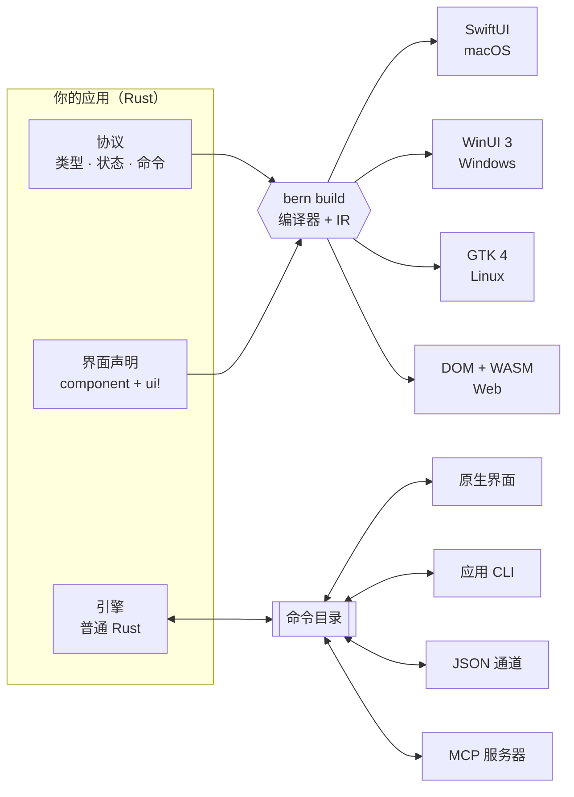

<div align="center">


<h1>Bern</h1>

<p><b>一份 Rust 声明，编译成每个平台自己的原生界面。</b></p>

<p>为桌面而生，为 AI 而建：SwiftUI、WinUI 3、GTK 4 与 Web。<br>
桌面上没有 JS 引擎，没有内嵌浏览器；每个按钮，天生就是 AI 能调用的 MCP 工具。</p>

<p>


</p>

<p>


<a href="LICENSE"></a>

</p>

<p>
<b>简体中文</b> ·
<a href="README.en.md">English</a> ·
<a href="README.zh-Hant.md">繁體中文</a> ·
<a href="README.ja.md">日本語</a>
</p>

<p>
<a href="#为什么是-bern">为什么是 Bern</a> ·
<a href="#为-ai-而建">为 AI 而建</a> ·
<a href="#实测数据">实测数据</a> ·
<a href="#与其他跨平台框架对比">对比</a> ·
<a href="#快速开始">快速开始</a> ·
<a href="Docs/Design.md">设计文档</a>
</p>

</div>

<br>

<table>
<tr>
<td width="50%" align="center"><br><sub><b>macOS</b> · SwiftUI</sub></td>
<td width="50%" align="center"><br><sub><b>Windows</b> · WinUI 3</sub></td>
</tr>
<tr>
<td width="50%" align="center"><br><sub><b>Linux</b> · GTK 4 + libadwaita</sub></td>
<td width="50%" align="center"><br><sub><b>Web</b> · DOM + WebAssembly</sub></td>
</tr>
</table>

<p align="center"><sub>同一份 <code>controls_page</code> 声明，四套 UI 技术。桌面上 Bern 不自己画任何一个像素：<br>每个开关、滑块和侧边栏都是平台自己的标准控件，用的是平台自己的配色。</sub></p>

## 为什么是 Bern

<table>
<tr>
<td width="33%" valign="top">
<h3>编译成原生界面</h3>
一份 Rust 声明，编译成 SwiftUI、WinUI 3、GTK 4 与 Web。<br><br>
目标和 React Native 相近：一份代码，各平台都是原生控件。做法不同：React Native 在运行时用 JS 引擎协调原生视图；Bern 在构建时直接生成各平台自己的 UI 代码，运行时没有 JS 引擎、没有虚拟 DOM，界面就是系统控件本身。
</td>
<td width="33%" valign="top">
<h3>为 AI 而建：写得对，用得上</h3>
AI 写代码时漏掉的翻译、漏掉的界面入口、没登记的按钮、没命令化的操作，都是编译错误，并指到具体的文件和行。<br><br>
AI 用应用时，每个按钮都是 MCP 工具：读的是控件的语义，走和鼠标点击相同的代码路径，不靠截图，不靠坐标。
</td>
<td width="33%" valign="top">
<h3>轻到不像跨平台</h3>
桌面上不带浏览器内核和 JS 引擎，业务引擎编译成原生代码，运行在应用进程内。<br><br>
实测 release 版展示应用：macOS 内存 <b>39 MB</b>、<b>0.4 秒</b>出窗口，整个应用包 <b>2.6 MB</b>；Windows 内存 <b>35 MB</b>、<b>0.3 秒</b>出窗口，整个应用 <b>4.2 MB</b>，不需要 .NET；整个 Web 应用连同 Rust 引擎 gzip 后 <b>187 KB</b>。
</td>
</tr>
</table>

## 为 AI 而建

### AI 写代码：漏掉的，编译器替它记着

AI 写界面最常见的问题不是写错，而是写漏：加了一个功能却忘了在窄屏布局放入口，新增一段文案只写了中文，随手挂一个回调绕过了命令。这些在别的框架里要等到用户发现，在 Bern 里都过不了编译。约束越严，AI 越不容易交出半成品：

| 漏掉了什么 | Bern 怎么处理 |
| :-- | :-- |
| 某段文案少写了一种语言 | 编译错误 B102。各语言用 `tr!` 写在同一处、紧挨着界面，漏写一眼可见；直接写死的字面量报 B103（严格模式，默认开启） |
| 功能在某个显示模式下没有界面入口 | 编译错误 B201。页面用功能契约声明它必须提供哪些功能，编译器逐个布局（`compact`、`expanded`）证明每个功能都有入口，宽屏有、窄屏漏也不行 |
| 契约范围内的界面入口没有登记到功能 | 编译错误 B202。反过来同样不行：入口执行的命令不属于它绑定的功能报 B204 |
| 入口只出现在条件分支里，证明不了总能用到 | 编译错误 B203，除非显式写明人工保证 |
| 想给按钮挂一段任意代码 | 写不出来。按钮只能绑定命令目录里的类型化命令，控件也不能直接改引擎状态 |

报错是给人看的，也是给 Agent 看的：编号、原因、位置都很明确，Agent 能自己改完再编译。下面是展示应用的两次真实输出，第一次故意删掉一个英文翻译，补上之后，第二次删掉窄屏布局里的“换片”菜单：

```text
$ bern check
error[B102]: Missing translation
Missing language: en
Required languages: zh-Hans, en
  --> showcase-ui/src/pages.rs:13:31

$ bern check
error[B201]: Feature missing in adaptive layout
Contract: MediaFeature
Feature: Clip
compact: missing
  --> showcase-ui/src/media.rs:14:5
```

每次构建还会为每个目标输出完整的功能覆盖报告（`features.json`），哪些已覆盖、哪些豁免、哪些只有人工保证，都分开列出。

### AI 用应用：读语义，不读像素

在大多数框架里，让 AI 操作一个桌面应用意味着截图、识别、算坐标、模拟点击。Bern 的应用自带一个 MCP 服务器：界面上每个控件都有稳定的名字和角色，Agent 读到的是结构，做的事情和用户点击走同一段代码，结果由应用如实答复。

```sh
$ showcase ui inspect                 # Agent 读到的是语义，不是像素
[{ "target": "controls_page.sync", "role": "switch", "label": "同步", "value": "false", "enabled": true, … }, …]

$ showcase ui set-bool --target controls_page.sync --value true

$ showcase window close --window settings#1
{ "outcome": "ConfirmationRequired", "message": "要存储对显示名称的更改吗？",
  "decisions": ["Save", "Discard", "Cancel"], "confirmation": "settings#1:c1", … }

$ showcase window confirm-close --window settings#1 --confirmation settings#1:c1 --decision Save
{ "outcome": "Rejected", "reason": "save_failed: invalid_name: a display name has 1 to 40 characters …" }
```

同样的操作以 MCP 工具（`ui_inspect`、`ui_activate`、`window_close`……）提供给 Agent，业务命令也各自是一个工具（例如 `showcase_set_display_name`）。按钮被禁用、被对话框挡住、目标不存在时，Agent 收到的是明确的错误码，而不是一次没有效果的点击。

## 实测数据

| | macOS · SwiftUI | Windows · WinUI 3 | Web · WebAssembly |
| :-- | :-- | :-- | :-- |
| 启动到窗口可见 | 0.41 秒 | 0.32 秒 | – |
| 内存占用 | 39 MB | 35 MB | – |
| 体积 | 应用包 2.6 MB（可执行文件 2.3 MB），不内嵌任何框架 | 应用目录 4.2 MB，引擎在可执行文件内，界面框架用系统的 | 全部资源 gzip 后 187 KB，含 Rust 引擎 |

<details>
<summary>测量方法</summary>
<br>

- 对象：release 构建的展示应用（6 个页面、主窗口与设置窗口、视频播放器），2026-10-11 测量，每项至少 3 次取中位数。
- macOS：Apple M4、16 GB 内存、macOS 27.0.1。内存为 `footprint` 的物理占用，即活动监视器“内存”一栏的口径。
- Windows：Intel Core i5-13490F、32 GB 内存、Windows 11 25H2。内存为私有工作集，即任务管理器“内存”一栏的口径。
- 启动时间：从启动进程到命令行读到可见的原生窗口为止，包含引擎启动与本地控制通道就绪。
- Windows 表中为 WinUI 3 前端（系统中有 Windows App Runtime 1.8）。没有运行时的系统上，同一个程序回退到系统 XAML：启动 0.54 秒，内存 19 MB。两种情况都不需要 .NET 与 VC++ 运行库，应用目录只有可执行文件和 400 KB 的引导 DLL。

</details>

## 更多能力

<table>
<tr>
<td width="33%" valign="top">
<h3>每个操作都是命令</h3>
按钮不能挂任意回调，只能绑定命令目录中的一条类型化命令；参数、错误与重试策略由界面、命令行、JSON 与 MCP 共用。
</td>
<td width="33%" valign="top">
<h3>编译期就做检查</h3>
<code>rustc</code> 检查每个绑定与命令参数的类型。没有绑定命令的按钮、任意回调、让控件直接写引擎状态、缺少翻译，都无法通过编译。
</td>
<td width="33%" valign="top">
<h3>业务逻辑留在 Rust</h3>
引擎是不依赖任何 UI 的普通 Rust 代码，不开窗口也能测试。在桌面上运行在应用进程内，在浏览器中编译为 WebAssembly。
</td>
</tr>
<tr>
<td width="33%" valign="top">
<h3>从第一天起就本地化</h3>
<code>tr!</code> 让各语言文案紧挨着它所属的界面。严格模式的构建会拒绝缺失的翻译；运行中切换界面语言不会丢失草稿。
</td>
<td width="33%" valign="top">
<h3>深浅色零配置</h3>
颜色来自平台主题：深浅色、强调色、高对比跟随系统，声明的品牌色映射为系统强调色。Web 由 Bern 的主题内核生成整套配色。
</td>
<td width="33%" valign="top">
<h3>声明式多窗口</h3>
每个窗口有自己的草稿、关闭检查与保存命令；最小化、最大化、移动、调整尺寸也是命令，以平台的实际状态答复。
</td>
</tr>
</table>

<details>
<summary><b>还有：</b>视频、异步查询、自适应布局、类型化导航…</summary>
<br>

- **视频**：`Video` 分别运行在 AVFoundation、Windows Media Foundation、GStreamer 与 HTML 媒体上，控制条由命令驱动，播放器可以跨页面继续播放。
- **异步查询**：`Query` 订阅带有加载、空结果、失败与刷新状态，只显示最新的答复。
- **自适应布局**：按视图实际获得的空间选择 `compact` 或 `expanded` 布局。
- **类型化导航**：侧边栏、带类型化路由的推入导航、页签、工具栏与菜单。
- **功能契约**：声明组件在每种布局中必须覆盖的功能，由编译器证明覆盖完整。
- **随包资源**：在 `Bern.toml` 中声明文件，构建时检查，运行时按名称定位。

</details>

## 工作原理



1. **协议**：`#[bern::protocol]` 声明值类型、只读状态，以及命令与查询 trait。
2. **引擎**：用普通 Rust 实现这些 trait；它看不到窗口、控件和传输层。
3. **界面**：`#[component]` 函数，主体是一个 `ui!` 声明。编译器把它们读入共享的中间表示（IR），各目标模块从 IR 生成原生代码。增加新目标不需要改动解析器、IR 或你的业务逻辑。

## 代码一览

<table>
<tr>
<td width="50%" valign="top">

**1 · 协议**：类型、状态与命令

```rust
#[bern::protocol(namespace = "counter", version = 1)]
pub mod counter {
    use bern::prelude::*;

    #[state]
    pub struct State {
        pub count: i64,
    }

    #[commands]
    pub trait Commands {
        /// Add to the count.
        fn add(&mut self, by: i64) -> Result<(), CommandError>;
    }
}
```

**3 · 界面**：一个 `ui!` 声明

```rust
#[component]
pub fn counter_view(app: counter::Client) -> impl View {
    ui! {
        Form {
            Text(content: tr! {
                "zh-Hans" => "已计数 {n} 次",
                "en" => "Counted {n} times";
                n: app.count
            })
            Button(
                id: add,
                label: tr! { "zh-Hans" => "加一", "en" => "Add one" },
                prominence: prominent
            ) => app.add(1)
        }
    }
}
```

</td>
<td width="50%" valign="top">

**2 · 引擎**：普通 Rust，不依赖 UI

```rust
use bern::CommandError;

pub struct Counter {
    state: counter::State,
}

impl Default for Counter {
    fn default() -> Self {
        Self { state: counter::State { count: 0 } }
    }
}

impl counter::Commands for Counter {
    fn add(&mut self, by: i64) -> Result<(), CommandError> {
        self.state.count += by;
        Ok(())
    }
}

impl counter::Engine for Counter {
    fn state(&self) -> &counter::State {
        &self.state
    }
}
```

**4 · 所有入口驱动同一个引擎**

```sh
counter ui inspect
counter ui activate --target counter_view.add
counter counter add --by 5
counter-mcp   # 同一份命令目录，提供给 AI Agent
```

</td>
</tr>
</table>

`Bern.toml` 声明语言、主题、源码、随包资源与构建目标。完整示例见[控件展示应用](examples/showcase)：侧边栏应用，包含文字层级、按钮、开关、滑块、输入框、由引擎查询驱动的搜索、列表到详情的导航、视频，以及带页签和关闭确认的设置窗口。

## 支持的平台

<table>
<tr>
<th align="left">目标</th>
<th align="left">UI 技术</th>
<th align="left">引擎</th>
<th align="left">状态</th>
</tr>
<tr>
<td><b>macOS</b><br><code>swiftui + macos</code></td>
<td>SwiftUI，标准组件与系统样式 · macOS 14 及以上</td>
<td>应用进程内</td>
<td> <a href="Docs/Implementation/macOS-SwiftUI.md">实现记录</a></td>
</tr>
<tr>
<td><b>Windows</b><br><code>winui3 + windows</code></td>
<td>C++/WinRT：有 Windows App Runtime 1.8 时用 WinUI 3，没有时回退到系统 XAML · Windows 10 2004 及以上</td>
<td>应用进程内（静态链接）</td>
<td> <a href="Docs/Implementation/Windows-WinUI3.md">实现记录</a></td>
</tr>
<tr>
<td><b>Linux</b><br><code>gtk + linux</code></td>
<td>GTK 4.14 与 libadwaita 1.5，遵循 GNOME HIG</td>
<td>应用进程内</td>
<td> <a href="Docs/Implementation/Linux-GTK.md">实现记录</a></td>
</tr>
<tr>
<td><b>Web 应用</b><br><code>web</code> · <code>app</code></td>
<td>DOM，使用 Bern 自定的视觉规范与主题内核</td>
<td>页面内的 WebAssembly</td>
<td> <a href="Docs/Implementation/Web.md">实现记录</a></td>
</tr>
<tr>
<td><b>WebUI</b><br><code>web</code> · <code>ui</code></td>
<td>同一个页面，作为独立引擎的界面</td>
<td>经 WebSocket 连接的引擎宿主</td>
<td> <a href="Docs/Implementation/Web.md">实现记录</a></td>
</tr>
<tr>
<td><b>下一步</b></td>
<td><code>flutter + macos</code>（验证后端可替换），之后是 iOS、Android 与 HarmonyOS</td>
<td>–</td>
<td> <a href="Docs/Adaptation/README.md">适配规范</a></td>
</tr>
</table>

不指定 UI 技术时使用平台的默认技术；默认技术不可用时直接报错，不会悄悄换成另一套技术。

## 与其他跨平台框架对比

<p align="center">
<a href="https://github.com/zed-industries/zed/tree/main/crates/gpui"></a>
<a href="https://dioxuslabs.com"></a>
<a href="https://flutter.dev"></a>
<a href="https://reactnative.dev"></a>
<a href="https://uniapp.dcloud.net.cn"></a>
<br>
<a href="https://www.electronjs.org"></a>
<a href="https://tauri.app"></a>
<a href="https://avaloniaui.net"></a>
<a href="https://www.qt.io"></a>
</p>

每个框架都在回答同一个问题：一份代码，怎样变成各平台上的界面。回答不同，取舍也不同。下面依据各项目的官方文档整理；体积和内存随版本与配置变化很大，这里只比较结构上的差别，Bern 自己的数字见[实测数据](#实测数据)。

<picture>
<source media="(prefers-color-scheme: dark)" srcset="Docs/Assets/compare/routes-dark.svg">

</picture>

前两条路线得到的是系统控件：外观、无障碍、输入法、深浅色都由系统负责，代价是各平台控件不完全相同。后两条路线在每个平台上画出一样的界面，代价是要自己追随各平台的设计与行为，或者携带一个浏览器。

<picture>
<source media="(prefers-color-scheme: dark)" srcset="Docs/Assets/compare/landscape-dark.svg">

</picture>

上图按架构示意，不代表优劣：横轴是界面元素来自系统控件还是框架自绘、网页；纵轴是应用要随身携带多少运行时（浏览器内核、JS 引擎、渲染引擎、语言运行时）。

### 技术路线

| 框架 | 写界面 | 业务逻辑 | 界面怎么画 | 随应用携带 | 许可证 |
| :-- | :-- | :-- | :-- | :-- | :-- |
| **Bern** | Rust（`ui!` 声明） | Rust | 构建时生成 SwiftUI、WinUI 3、GTK 4 与 Web 代码，界面是系统控件 | 无；WinUI 3 也取自系统，没有时回退到系统 XAML | MIT |
| **GPUI** | Rust | Rust | 自带 GPU 渲染（Metal、Vulkan、DirectX） | 无额外运行时 | Apache-2.0 |
| **Dioxus** | Rust（RSX，类 React） | Rust | 桌面与移动端默认用系统 WebView，Web 为 WebAssembly；原生渲染器 Blitz 仍在实验 | 依赖系统 WebView | MIT / Apache-2.0 |
| **Flutter** | Dart | Dart | 自带引擎（Impeller、Skia）绘制 Material 与 Cupertino 风格控件 | Flutter 引擎 | BSD-3-Clause |
| **React Native** | JavaScript / TypeScript（React） | JavaScript / TypeScript | 原生视图，运行时由 JS 协调 | Hermes JS 引擎 | MIT |
| **uni-app** | Vue | JavaScript / TypeScript；uni-app x 用 UTS | 经典模式为 WebView；uni-app x 编译为 Kotlin、Swift 等原生语言，用原生视图渲染 | 框架运行时 | Apache-2.0 |
| **Electron** | HTML / CSS / JavaScript | JavaScript / TypeScript（Node.js） | 内嵌 Chromium | Chromium 与 Node.js | MIT |
| **Tauri** | 任意网页前端 | Rust | 系统 WebView（WebView2、WKWebView、WebKitGTK） | 不带浏览器内核，依赖系统 WebView | MIT / Apache-2.0 |
| **Avalonia** | XAML 与 C# | C# / .NET | 自带 Skia 渲染 | .NET 运行时（可自包含或 Native AOT） | MIT |
| **Qt** | C++ 与 QML（也可用 Python） | C++ | Qt Widgets 模拟各平台风格；Qt Quick 自绘场景图 | Qt 库 | LGPLv3 / GPLv3 / 商业许可 |

### 平台与能力

● 支持　◐ 部分支持或依赖社区　— 不支持

| 框架 | macOS | Windows | Linux | 移动端 | Web | 原生外观 | 内置 MCP | 编译期检查 |
| :-- | :-: | :-: | :-: | :-: | :-: | :-: | :-: | :-: |
| **Bern** | ● | ● | ● | — | ● | ● | ● | ● |
| **GPUI** | ● | ● | ● | — | — | — | — | — |
| **Dioxus** | ● | ● | ● | ● | ● | — | — | — |
| **Flutter** | ● | ● | ● | ● | ● | — | — | — |
| **React Native** | ◐ | ◐ | — | ● | ◐ | ● | — | — |
| **uni-app** | — | — | — | ● | ● | ◐ | — | — |
| **Electron** | ● | ● | ● | — | — | — | — | — |
| **Tauri** | ● | ● | ● | ● | — | — | — | — |
| **Avalonia** | ● | ● | ● | ● | ● | — | — | — |
| **Qt** | ● | ● | ● | ● | ● | ◐ | — | — |

- **移动端**：iOS 与 Android。React Native 的桌面版本由微软维护，uni-app 另覆盖小程序与鸿蒙，Bern 的移动端在规划中。
- **原生外观**：控件就是平台自己的控件，外观、无障碍与输入法由系统提供。Qt Widgets 与 uni-app x 接近原生，记为部分。
- **内置 MCP**：框架自带、面向运行中界面的 MCP 服务器与命令行。其他框架可以借助无障碍接口或 Playwright、Flutter Driver 等测试工具从外部自动化。
- **编译期检查**：翻译缺失、功能在某个布局没有入口、入口没有登记功能，都由编译器直接报错（见[为 AI 而建](#为-ai-而建)）。其他框架多借助 lint、翻译工具或测试发现这类问题。
- **成熟度**：Electron 与 Qt 非常成熟；Flutter、React Native、uni-app、Tauri 与 Avalonia 成熟；Dioxus 发展中；GPUI 支撑着 Zed 编辑器，通用组件仍在早期；Bern 是早期预览。

### 性能与资源

界面层和逻辑层用什么语言、怎样执行，决定了运行时的开销上限：原生编译且没有垃圾回收的语言最省，JIT 与字节码解释的语言需要携带引擎、占用更多内存。

<picture>
<source media="(prefers-color-scheme: dark)" srcset="Docs/Assets/compare/languages-dark.svg">

</picture>

同样一个只显示一行字的窗口，各框架的包体、启动时间与内存差别很大。Bern 一栏是实测；其他框架目前是纸面估算，以后会在 M4 上用 CI 统一实测后替换。

<picture>
<source media="(prefers-color-scheme: dark)" srcset="Docs/Assets/compare/resources-dark.svg">

</picture>

### 怎么选

<table>
<tr>
<td width="50%" valign="top">
<br>
<b>适合</b>：Web 团队、需要最成熟的生态与最一致的跨平台表现。<br>
<b>代价</b>：每个应用带一份 Chromium 与 Node.js，体积与内存都偏大。
</td>
<td width="50%" valign="top">
<br>
<b>适合</b>：想保留网页前端、又要小体积和 Rust 后端。<br>
<b>代价</b>：界面仍是网页；各平台系统 WebView 的引擎不同，需要分别测试。
</td>
</tr>
<tr>
<td valign="top">
<br>
<b>适合</b>：移动优先、要求各平台像素级一致。<br>
<b>代价</b>：控件是自绘的，桌面上的系统观感与行为要自己追随；需要使用 Dart。
</td>
<td valign="top">
<br>
<b>适合</b>：React 团队做移动应用，要原生控件。<br>
<b>代价</b>：以移动端为主，桌面依赖微软维护的分支，没有 Linux；运行时有 JS 引擎与桥接。
</td>
</tr>
<tr>
<td valign="top">
<br>
<b>适合</b>：.NET 与 XAML 团队，需要跨桌面一致的外观。<br>
<b>代价</b>：自绘界面，不是系统控件；需要 .NET 运行时或 AOT 编译。
</td>
<td valign="top">
<br>
<b>适合</b>：C++ 项目、工业与嵌入式、需要几十年的稳定积累。<br>
<b>代价</b>：许可证需要留意（LGPL 或商业）；Qt Quick 是自绘界面。
</td>
</tr>
<tr>
<td valign="top">
<br>
<b>适合</b>：追求极致性能的 Rust 桌面应用，例如编辑器。<br>
<b>代价</b>：自绘界面，常用控件与无障碍要自己补；只支持桌面。
</td>
<td valign="top">
<br>
<b>适合</b>：喜欢 React 写法的 Rust 全栈项目，一套代码覆盖 Web、桌面与移动。<br>
<b>代价</b>：桌面与移动端目前是 WebView 界面；原生渲染器仍在实验。
</td>
</tr>
<tr>
<td valign="top">
<br>
<b>适合</b>：国内多端（小程序、App、H5、鸿蒙）一套代码。<br>
<b>代价</b>：没有桌面应用目标；经典模式的 App 界面是 WebView。
</td>
<td valign="top">
<br>
<b>适合</b>：桌面应用要每个平台的系统外观，业务写在 Rust 里，并希望 AI 既能写它、也能用它。<br>
<b>暂不适合</b>：现在就需要移动端，或依赖成熟的第三方组件生态。Bern 仍是早期预览。
</td>
</tr>
</table>

## 快速开始

需要 Rust 1.99（由 `rust-toolchain.toml` 固定），以及所构建目标的工具链。每次构建还会在 `target/bern/<目标>/bin/` 中生成应用 CLI 与 MCP 服务器。

<details open>
<summary><b>macOS</b> · Xcode 26 或更新版本</summary>

```sh
cargo run -p bern-cli -- build --manifest examples/showcase/Bern.toml --target macos
open target/bern/macos/Showcase.app
```

</details>

<details>
<summary><b>Windows</b> · Visual Studio 的“使用 C++ 的桌面开发”</summary>

```powershell
cargo run -p bern-cli -- build --manifest examples/showcase/Bern.toml --target windows
target\bern\windows\Showcase\showcase.exe
```

首次构建时用 Windows SDK 的 `cppwinrt` 生成 C++/WinRT 头文件并缓存。应用目录只有可执行文件、400 KB 的引导 DLL 和资源，不需要 .NET，也不随附 Windows App SDK。

</details>

<details>
<summary><b>Linux</b> · GTK 4.14 与 libadwaita 1.5 的开发包</summary>

```sh
sudo apt install libgtk-4-dev libadwaita-1-dev gstreamer1.0-libav
cargo run -p bern-cli -- build --manifest examples/showcase/Bern.toml --target linux
target/bern/linux/Showcase/showcase
```

</details>

<details>
<summary><b>Web</b> · <code>rustup target add wasm32-unknown-unknown</code></summary>

```sh
# 引擎编译为 WebAssembly，在页面内运行
cargo run -p bern-cli -- build --manifest examples/showcase/Bern.toml --target web_app
python3 -m http.server 8765 --bind 127.0.0.1 --directory target/bern/web_app

# 或者页面作为独立引擎宿主的界面
cargo run -p bern-cli -- build --manifest examples/showcase/Bern.toml --target web_ui
target/bern/web_ui/bin/showcase-host
```

</details>

### 从外部驱动运行中的应用

```sh
showcase ui inspect                                          # 列出已挂载的控件
showcase ui select --target main_window.pages --option Controls
showcase ui set-bool --target controls_page.sync --value true
showcase showcase search-library --text mo                   # 引擎查询
showcase window open --kind settings
showcase window list                                         # 窗口的实际状态
showcase-mcp                                                 # 经 stdio 的 MCP 服务器
```

只有目标声明了 `channels = ["ipc"]` 时才会启动控制通道；不声明则应用不监听任何端口。

## 路线图

| 阶段 | 内容 | 状态 |
| :-- | :-- | :-- |
| 1 · 2 | 编译边界验证；macOS SwiftUI，界面、CLI、JSON 与 MCP 驱动同一引擎 |  |
| 3 | Web 视觉规范、主题内核、WebAssembly 应用与 WebUI 两种构建 |  |
| 4 | 自适应布局、菜单、功能契约、运行时切换语言 |  |
| 5 | 其他原生前端：GTK 4（已完成）· WinUI 3（已完成）· `flutter + macos`（下一步） |  |
| 6 | 组件库、打包、增量构建、开发工具，接入 NipaPlay 3.0 |  |

## 仓库结构

<details>
<summary>crate 与目录</summary>
<br>

| 路径 | 说明 |
| :-- | :-- |
| `crates/bern` | 应用使用的门面 crate：宏、值、媒体、资源 |
| `crates/bern-macros` · `bern-syntax` | `#[component]`、`ui!`、`tr!` 与受约束的声明语法 |
| `crates/bern-compiler` · `bern-ir` | 把声明读入共享 IR 并执行检查 |
| `crates/bern-protocol` · `bern-command` · `bern-runtime` | 命令目录、引擎宿主与 UI 会话运行时 |
| `crates/bern-ffi` | 原生前端调用的进程内 C 接口 |
| `crates/bern-backend-swiftui` · `-winui3` · `-gtk` · `-web` | 目标模块：生成器及其运行时 |
| `crates/bern-gtk` | GTK 运行时，只在生成的 Linux 应用中编译 |
| `crates/bern-adapter-cli` · `-mcp` · `-json` | 从命令目录派生的入口 |
| `crates/bern-transport-ipc` · `-ws` | 本地控制通道与 WebSocket 传输 |
| `crates/bern-theme` | 为没有原生主题的目标提供的 Bern 色彩算法 |
| `examples/showcase` | 在各平台上使用的控件展示应用 |
| `Docs/` | 设计文档、平台适配规范与实现记录 |

</details>

## 开发

```sh
cargo fmt --all --check
cargo clippy --workspace --all-targets -- -D warnings
cargo test --workspace
```

测试中包含必须编译失败的声明，并在装有相应工具包的环境中对生成的应用做类型检查：用 Xcode 检查 Swift 6，用开发包检查 GTK，在 Windows 上用 MSVC 编译生成的两套前端。

## 文档

- [设计文档](Docs/Design.md)：目标、架构、组件、主题、命令、窗口与媒体
- [适配规范](Docs/Adaptation/README.md)：Apple、Windows 与 Linux、Web、Android、HarmonyOS
- 实现记录：[macOS](Docs/Implementation/macOS-SwiftUI.md) · [Windows](Docs/Implementation/Windows-WinUI3.md) · [Linux](Docs/Implementation/Linux-GTK.md) · [Web](Docs/Implementation/Web.md)

## 许可证

[MIT](LICENSE) © 2026 MCDFSteve

<div align="center">
<br>
<sub>Bern 仍处于早期开发阶段，API 与声明语法可能还会变化。</sub>
</div>
