<div align="center">


<h1>Bern</h1>

<p><b>一份 Rust 声明，编译成每个平台自己的原生界面。</b></p>

<p>从桌面到手机，为 AI 而建：SwiftUI、WinUI 3、GTK 4、Jetpack Compose 与 Web。<br>
桌面和手机上没有 JS 引擎，没有内嵌浏览器；每个按钮，天生就是 AI 能调用的 MCP 工具。</p>

<p>


</p>

<p>


<a href="LICENSE"></a>

</p>

<p>
<b>简体中文</b> ·
<a href="README.en.md">English</a> ·
<a href="README.zh-Hant.md">繁體中文</a> ·
<a href="README.ja.md">日本語</a>
</p>

<p>
<a href="#为什么是-bern">为什么是 Bern</a> ·
<a href="#为-ai-而建">为 AI 而建</a> ·
<a href="#实测数据">实测数据</a> ·
<a href="#与其他跨平台框架对比">对比</a> ·
<a href="#快速开始">快速开始</a> ·
<a href="Docs/Design.md">设计文档</a>
</p>

</div>

<br>

<table>
<tr>
<td width="50%" align="center">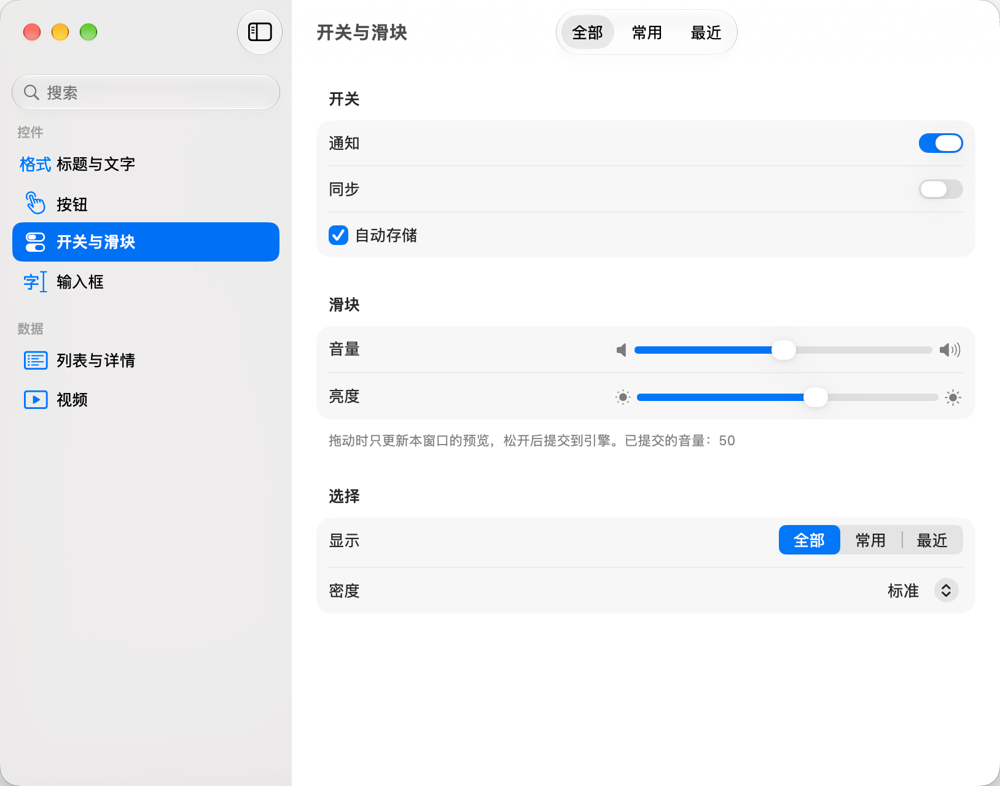<br><sub><b>macOS</b> · SwiftUI</sub></td>
<td width="50%" align="center">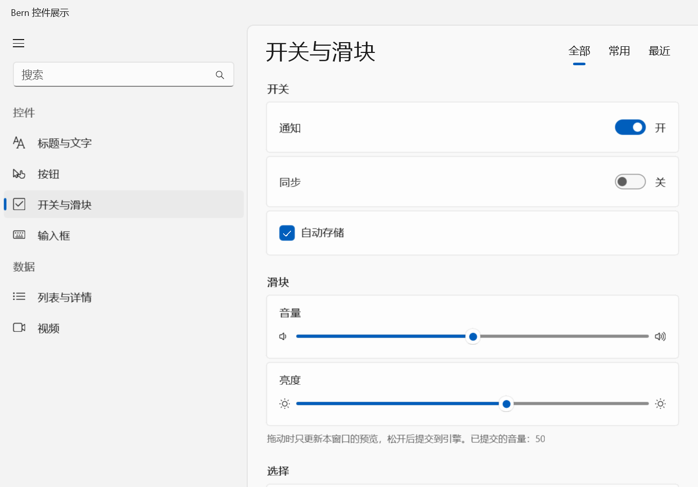<br><sub><b>Windows</b> · WinUI 3</sub></td>
</tr>
<tr>
<td width="50%" align="center"><br><sub><b>Linux</b> · GTK 4 + libadwaita</sub></td>
<td width="50%" align="center">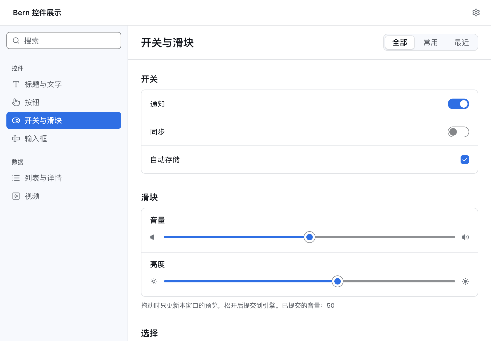<br><sub><b>Web</b> · DOM + WebAssembly</sub></td>
</tr>
</table>

<p align="center">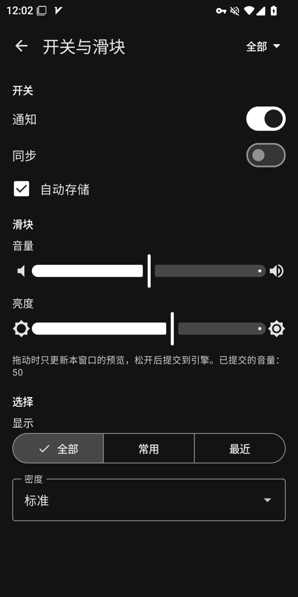<br><sub><b>Android</b> · Jetpack Compose（跟随系统深色）</sub></p>

<p align="center"><sub>同一份 <code>controls_page</code> 声明，五套 UI 技术。在桌面和 Android 上 Bern 不自己画任何一个像素：<br>每个开关、滑块和侧边栏都是平台自己的标准控件，用的是平台自己的配色。</sub></p>

## 为什么是 Bern

<picture>
<source media="(prefers-color-scheme: dark)" srcset="Docs/Assets/tables/why-dark.svg">
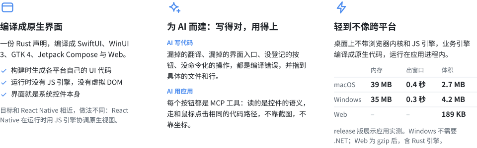
</picture>

## 为 AI 而建

### AI 写代码：漏掉的，编译器替它记着

AI 写界面最常见的问题不是写错，而是写漏：加了一个功能却忘了在窄屏布局放入口，新增一段文案只写了中文，随手挂一个回调绕过了命令。这些在别的框架里要等到用户发现，在 Bern 里都过不了编译。约束越严，AI 越不容易交出半成品：

<picture>
<source media="(prefers-color-scheme: dark)" srcset="Docs/Assets/tables/ai-dark.svg">
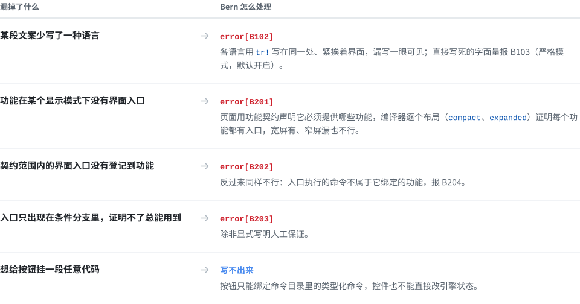
</picture>

报错是给人看的，也是给 Agent 看的：编号、原因、位置都很明确，Agent 能自己改完再编译。下面是展示应用的两次真实输出，第一次故意删掉一个英文翻译，补上之后，第二次删掉窄屏布局里的“换片”菜单：

```text
$ bern check
error[B102]: Missing translation
Missing language: en
Required languages: zh-Hans, en
  --> showcase-ui/src/pages.rs:13:31

$ bern check
error[B201]: Feature missing in adaptive layout
Contract: MediaFeature
Feature: Clip
compact: missing
  --> showcase-ui/src/media.rs:14:5
```

每次构建还会为每个目标输出完整的功能覆盖报告（`features.json`），哪些已覆盖、哪些豁免、哪些只有人工保证，都分开列出。

### AI 用应用：读语义，不读像素

在大多数框架里，让 AI 操作一个桌面应用意味着截图、识别、算坐标、模拟点击。Bern 的应用自带一个 MCP 服务器：界面上每个控件都有稳定的名字和角色，Agent 读到的是结构，做的事情和用户点击走同一段代码，结果由应用如实答复。

```sh
$ showcase ui inspect                 # Agent 读到的是语义，不是像素
[{ "target": "controls_page.sync", "role": "switch", "label": "同步", "value": "false", "enabled": true, … }, …]

$ showcase ui set-bool --target controls_page.sync --value true

$ showcase window close --window settings#1
{ "outcome": "ConfirmationRequired", "message": "要存储对显示名称的更改吗？",
  "decisions": ["Save", "Discard", "Cancel"], "confirmation": "settings#1:c1", … }

$ showcase window confirm-close --window settings#1 --confirmation settings#1:c1 --decision Save
{ "outcome": "Rejected", "reason": "save_failed: invalid_name: a display name has 1 to 40 characters …" }
```

同样的操作以 MCP 工具（`ui_inspect`、`ui_activate`、`window_close`……）提供给 Agent，业务命令也各自是一个工具（例如 `showcase_set_display_name`）。按钮被禁用、被对话框挡住、目标不存在时，Agent 收到的是明确的错误码，而不是一次没有效果的点击。

## 实测数据

<picture>
<source media="(prefers-color-scheme: dark)" srcset="Docs/Assets/tables/measured-dark.svg">
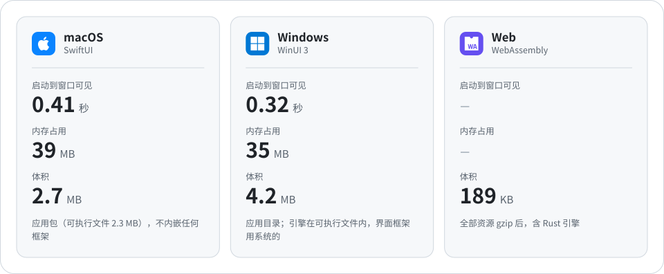
</picture>

<details>
<summary>测量方法</summary>
<br>

- 对象：release 构建的展示应用（6 个页面、主窗口与设置窗口、视频播放器），2026-10-11 测量，每项至少 3 次取中位数。
- macOS：Apple M4、16 GB 内存、macOS 27.0.1。内存为 `footprint` 的物理占用，即活动监视器“内存”一栏的口径。
- Windows：Intel Core i5-13490F、32 GB 内存、Windows 11 25H2。内存为私有工作集，即任务管理器“内存”一栏的口径。
- 启动时间：从启动进程到命令行读到可见的原生窗口为止，包含引擎启动与本地控制通道就绪。
- Windows 表中为 WinUI 3 前端（测量时系统中有 Windows App Runtime 1.8，现在按 2.x 构建）。没有运行时的系统上，同一个程序回退到系统 XAML：启动 0.54 秒，内存 19 MB。两种情况都不需要 .NET 与 VC++ 运行库，应用目录只有可执行文件和 400 KB 的引导 DLL。

</details>

## 更多能力

<picture>
<source media="(prefers-color-scheme: dark)" srcset="Docs/Assets/tables/more-dark.svg">
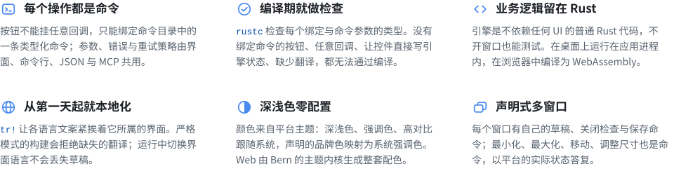
</picture>

<details>
<summary><b>还有：</b>视频、异步查询、样式与动效、自绘、媒体类应用的组件、读取交来的文件、模块化应用、自适应布局…</summary>
<br>

- **视频**：`Video` 分别运行在 AVFoundation、Windows Media Foundation、GStreamer、Android 的 Media3 与 HTML 媒体上，控制条由命令驱动，播放器可以跨页面继续播放。
- **异步查询**：`Query` 订阅带有加载、空结果、失败与刷新状态，只显示最新的答复。
- **自适应布局**：按视图实际获得的空间在 `compact`、`medium`、`expanded`、`large` 四档中选择布局；表达式也能读窗口所在的档，例如按档位设置页边距。
- **类型化导航**：侧边栏、带类型化路由的推入导航、页签、工具栏与菜单。
- **功能契约**：声明组件在每种布局中必须覆盖的功能，由编译器证明覆盖完整。
- **随包资源**：在 `Bern.toml` 中声明文件，构建时检查，运行时按名称定位。
- **图片与布局**：`Image` 显示随包图片，未声明的资源在编译时报错，HDR 图片（PQ、HLG 的 PNG 与带增益图的 JPEG）在能显示 HDR 的屏幕上按 HDR 显示；`Grid` 按可用宽度自动增减列数，`Stack` 叠放并按九个方位对齐，`Progress` 显示进度条或不确定进度。
- **样式覆盖与动效**：控件默认是平台外观；需要统一设计时，用 `style!` 为全应用声明覆盖、弹簧动效、出现与消失过渡、错开入场和共享元素，目标做不到的覆盖在构建时报错（五个前端都已实现）。
- **自绘与按比例摆放**：`Canvas` 用语义颜色画形状、数据曲线与格纹图案，`Text` 可以加标注底纹；`Rail` 把元素放在状态给出的比例处，例如时间轴、进度条上的刻度与涨满的底色。
- **媒体类应用的组件**：侧边栏底部区域、工具栏搜索与结果、侧面板、轻提示、分体按钮与弹出任意内容的浮层按钮、带内容的按钮与悬停显示、快捷键、文件选择与拖入、滚动停靠、双指缩放与拖动调值，五个前端都已实现。
- **读取交来的文件**：用户选中、拖入或用应用打开的文件，引擎用 `MediaSource::file_name()` 与 `open()` 读取名字与内容；本地路径、Android 的 `content://` 文档与网页的 `blob:` 文件写法相同。
- **模块化应用**：应用由外壳和多个模块组成，每个模块有自己的协议、引擎、界面与翻译，可以在运行时开关；`bern new --module` 新建模块，适合多人和多个 AI 分头开发（已在 macOS 与 Android 上验证）。

</details>

## 工作原理

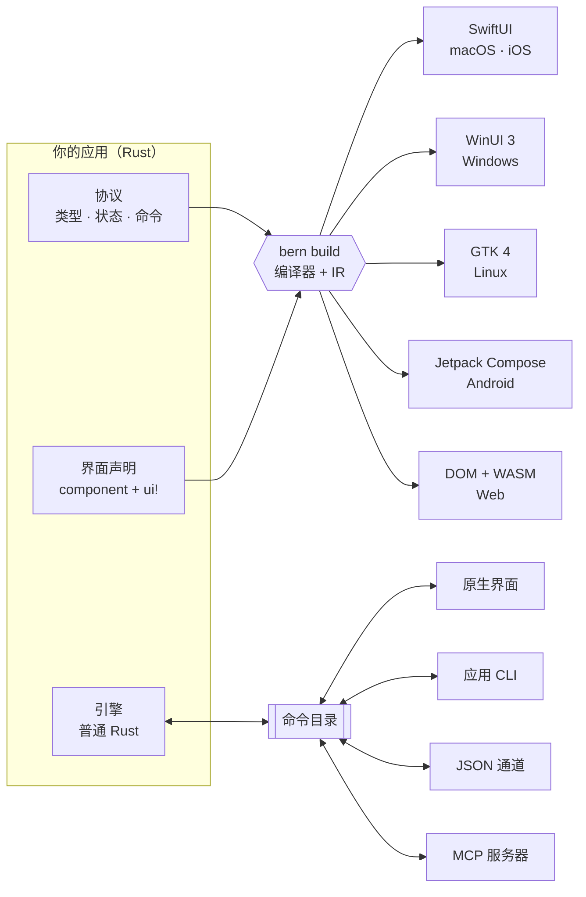

1. **协议**：`#[bern::protocol]` 声明值类型、只读状态，以及命令与查询 trait。
2. **引擎**：用普通 Rust 实现这些 trait；它看不到窗口、控件和传输层。
3. **界面**：`#[component]` 函数，主体是一个 `ui!` 声明。编译器把它们读入共享的中间表示（IR），各目标模块从 IR 生成原生代码。增加新目标不需要改动解析器、IR 或你的业务逻辑。

## 代码一览

**1 · 协议**：类型、状态与命令

```rust
#[bern::protocol(namespace = "counter", version = 1)]
pub mod counter {
    use bern::prelude::*;

    #[state]
    pub struct State {
        pub count: i64,
    }

    #[commands]
    pub trait Commands {
        /// Add to the count.
        fn add(&mut self, by: i64) -> Result<(), CommandError>;
    }
}
```

**2 · 引擎**：普通 Rust，不依赖 UI

```rust
use bern::CommandError;

pub struct Counter {
    state: counter::State,
}

impl Default for Counter {
    fn default() -> Self {
        Self { state: counter::State { count: 0 } }
    }
}

impl counter::Commands for Counter {
    fn add(&mut self, by: i64) -> Result<(), CommandError> {
        self.state.count += by;
        Ok(())
    }
}

impl counter::Engine for Counter {
    fn state(&self) -> &counter::State {
        &self.state
    }
}
```

**3 · 界面**：一个 `ui!` 声明

```rust
#[component]
pub fn counter_view(app: counter::Client) -> impl View {
    ui! {
        Form {
            Text(content: tr! {
                "zh-Hans" => "已计数 {n} 次",
                "en" => "Counted {n} times";
                n: app.count
            })
            Button(
                id: add,
                label: tr! { "zh-Hans" => "加一", "en" => "Add one" },
                prominence: prominent
            ) => app.add(1)
        }
    }
}
```

**4 · 所有入口驱动同一个引擎**

```sh
counter ui inspect
counter ui activate --target counter_view.add
counter counter add --by 5
counter-mcp   # 同一份命令目录，提供给 AI Agent
```

`Bern.toml` 声明语言、主题、源码、随包资源与构建目标。完整示例见[控件展示应用](examples/showcase)：侧边栏应用，包含文字层级、按钮、开关、滑块、输入框、由引擎查询驱动的搜索、列表到详情的导航、视频，以及带页签和关闭确认的设置窗口。[计划应用](examples/planner)演示模块化应用、样式覆盖、动效与 `Canvas`。[图案集](examples/gallery)演示媒体类应用的组件：海报墙的错开入场、时间轴的按比例摆放、音量浮层按钮、随四档尺寸变化的页边距与布局，以及拖入视频后由引擎读出文件名、格式与大小。

## 支持的平台

<picture>
<source media="(prefers-color-scheme: dark)" srcset="Docs/Assets/tables/platforms-dark.svg">
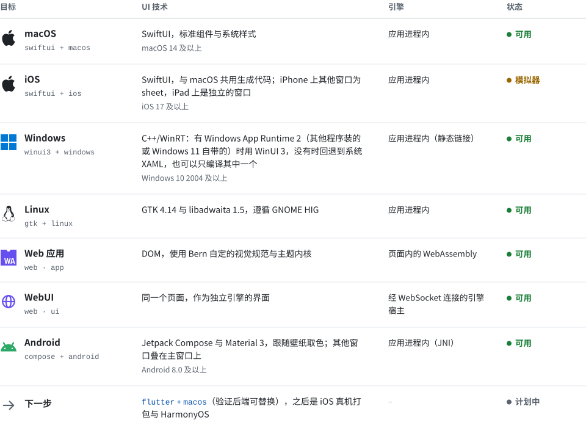
</picture>

实现记录：[macOS](Docs/Implementation/macOS-SwiftUI.md) · [iOS](Docs/Implementation/iOS-SwiftUI.md) · [Windows](Docs/Implementation/Windows-WinUI3.md) · [Linux](Docs/Implementation/Linux-GTK.md) · [Web 与 WebUI](Docs/Implementation/Web.md) · [Android](Docs/Implementation/Android-Compose.md)；下一步的平台见[适配规范](Docs/Adaptation/README.md)。

不指定 UI 技术时使用平台的默认技术；默认技术不可用时直接报错，不会悄悄换成另一套技术。

## 与其他跨平台框架对比

<p align="center">
<a href="https://github.com/zed-industries/zed/tree/main/crates/gpui"></a>
<a href="https://dioxuslabs.com"></a>
<a href="https://flutter.dev"></a>
<a href="https://reactnative.dev"></a>
<a href="https://uniapp.dcloud.net.cn"></a>
<br>
<a href="https://www.electronjs.org"></a>
<a href="https://tauri.app"></a>
<a href="https://avaloniaui.net"></a>
<a href="https://www.qt.io"></a>
</p>

每个框架都在回答同一个问题：一份代码，怎样变成各平台上的界面。回答不同，取舍也不同。下面依据各项目的官方文档整理；体积和内存随版本与配置变化很大，这里只比较结构上的差别，Bern 自己的数字见[实测数据](#实测数据)。

<picture>
<source media="(prefers-color-scheme: dark)" srcset="Docs/Assets/compare/routes-dark.svg">
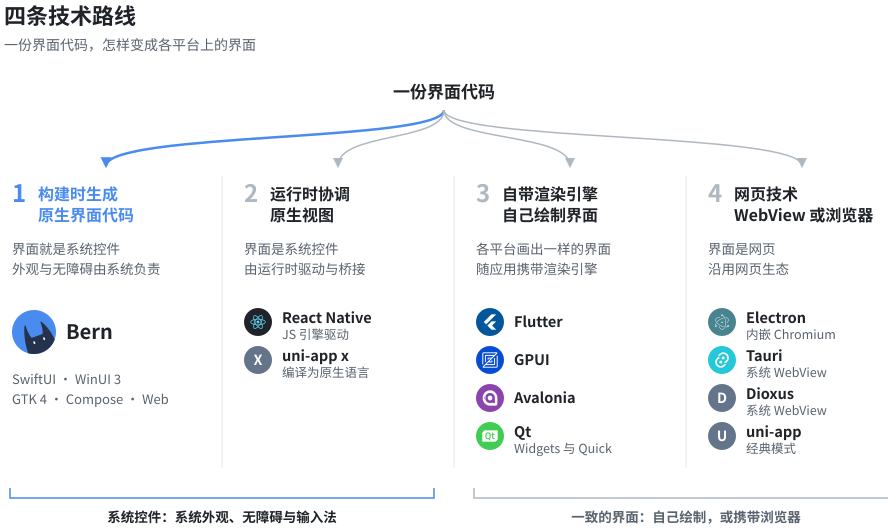
</picture>

前两条路线得到的是系统控件：外观、无障碍、输入法、深浅色都由系统负责，代价是各平台控件不完全相同。后两条路线在每个平台上画出一样的界面，代价是要自己追随各平台的设计与行为，或者携带一个浏览器。

<picture>
<source media="(prefers-color-scheme: dark)" srcset="Docs/Assets/compare/landscape-dark.svg">
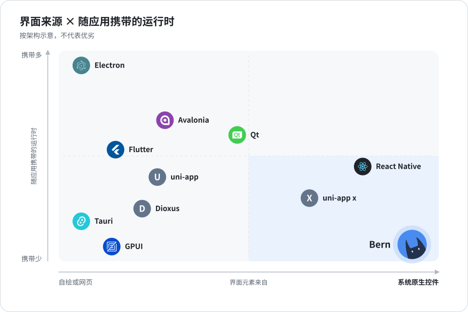
</picture>

上图按架构示意，不代表优劣：横轴是界面元素来自系统控件还是框架自绘、网页；纵轴是应用要随身携带多少运行时（浏览器内核、JS 引擎、渲染引擎、语言运行时）。

### 技术路线

<picture>
<source media="(prefers-color-scheme: dark)" srcset="Docs/Assets/tables/technology-dark.svg">
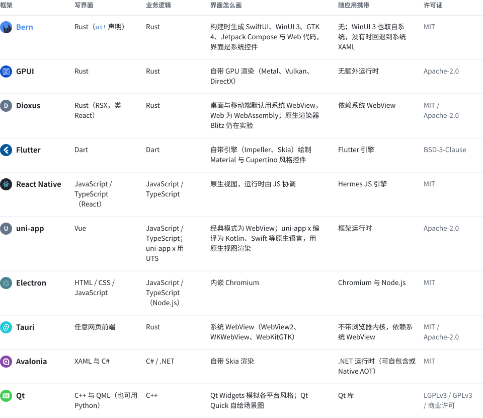
</picture>

### 平台与能力

<picture>
<source media="(prefers-color-scheme: dark)" srcset="Docs/Assets/tables/capabilities-dark.svg">
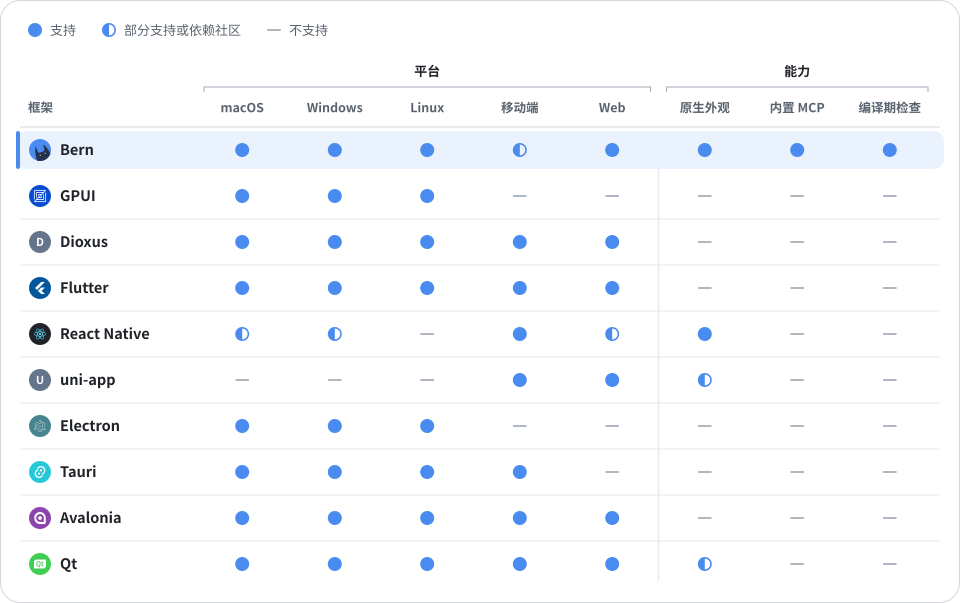
</picture>

- **移动端**：iOS 与 Android。React Native 的桌面版本由微软维护，uni-app 另覆盖小程序与鸿蒙；Bern 的 Android 目标已能在真机运行并打包，iOS 目标目前构建模拟器应用，真机打包在规划中。
- **原生外观**：控件就是平台自己的控件，外观、无障碍与输入法由系统提供。Qt Widgets 与 uni-app x 接近原生，记为部分。
- **内置 MCP**：框架自带、面向运行中界面的 MCP 服务器与命令行。其他框架可以借助无障碍接口或 Playwright、Flutter Driver 等测试工具从外部自动化。
- **编译期检查**：翻译缺失、功能在某个布局没有入口、入口没有登记功能，都由编译器直接报错（见[为 AI 而建](#为-ai-而建)）。其他框架多借助 lint、翻译工具或测试发现这类问题。
- **成熟度**：Electron 与 Qt 非常成熟；Flutter、React Native、uni-app、Tauri 与 Avalonia 成熟；Dioxus 发展中；GPUI 支撑着 Zed 编辑器，通用组件仍在早期；Bern 是早期预览。

### 性能与资源

界面层和逻辑层用什么语言、怎样执行，决定了运行时的开销上限：原生编译且没有垃圾回收的语言最省，JIT 与字节码解释的语言需要携带引擎、占用更多内存。

<picture>
<source media="(prefers-color-scheme: dark)" srcset="Docs/Assets/compare/languages-dark.svg">
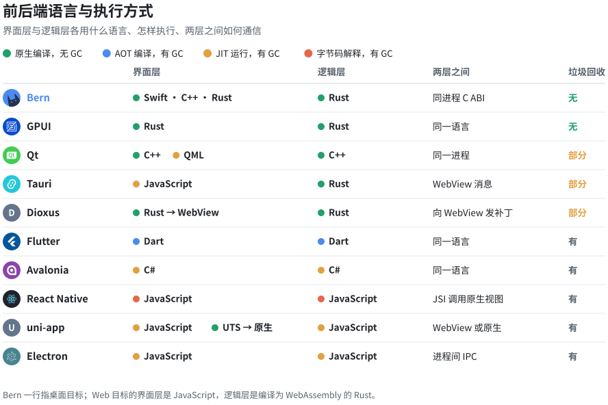
</picture>

同样一个只显示一行字的窗口，各框架的包体、启动时间与内存差别很大。下图在同一台 CI 虚拟机（GitHub 托管的 Apple M1）上实测：各框架用自己的工具打 release 包，测量时轮流启动，每个 10 次取中位数。脚本在 [benchmarks/](benchmarks/) 中，可以在 Actions 里重新运行 Benchmarks 工作流。

<picture>
<source media="(prefers-color-scheme: dark)" srcset="Docs/Assets/compare/resources-dark.svg">
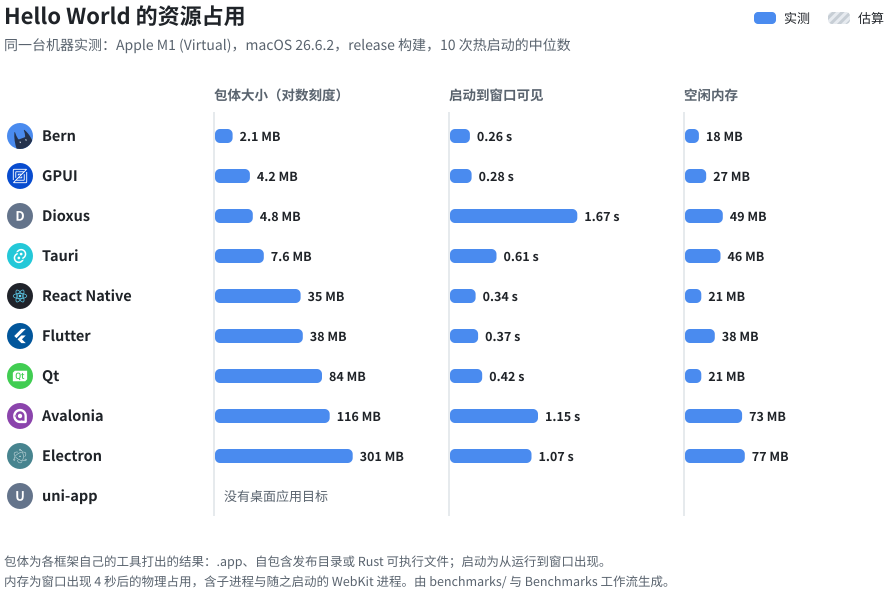
</picture>

### 怎么选

<picture>
<source media="(prefers-color-scheme: dark)" srcset="Docs/Assets/tables/choose-dark.svg">
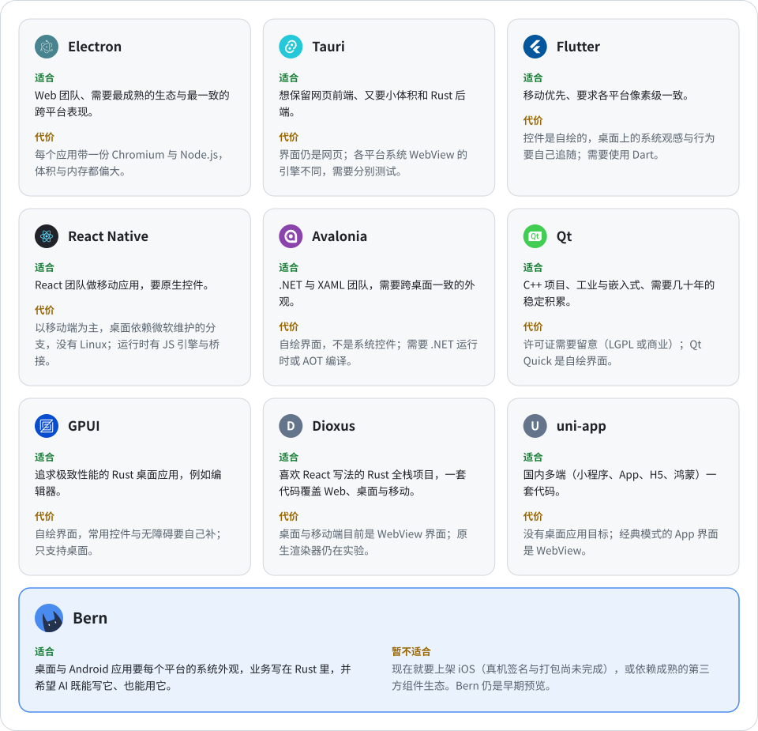
</picture>

## 快速开始

需要 Rust 1.99（`rustup` 按 `rust-toolchain.toml` 自动安装），以及所构建目标的工具链。先从源码安装构建工具 `bern`：

```sh
git clone https://github.com/AimesSoft/Bern
cd Bern
cargo install --path crates/bern-cli
```

### 创建应用

在任意目录中：

```sh
bern new my_app
cd my_app
bern run
```

新应用是一个带计数的窗口，协议、引擎与界面各一个 crate，六个目标都已在 `Bern.toml` 中声明。`bern run` 构建本机的目标并启动它：macOS 上是 SwiftUI，Windows 上是 WinUI 3，Linux 上是 GTK；`bern run --target web_app` 在浏览器中打开，`bern run --target ios` 装进正在运行的 iOS 模拟器，`bern run --target android` 装到用 USB 调试连接的 Android 手机（或模拟器）上并启动。每次构建还会在 `target/bern/<目标>/bin/` 中生成应用 CLI 与 MCP 服务器。

`bern doctor` 列出本机构建每个目标还缺什么、怎么装：

```text
$ bern doctor
bern 0.1.0 on macOS (aarch64)

[✓] Rust: rustc 1.99.0, cargo 1.99.0
[✓] macOS · SwiftUI: macOS SDK 26.5, Swift 6.3.2
[✓] iOS · SwiftUI: iOS simulator SDK 26.5, the aarch64-apple-ios-sim target
[-] Windows · WinUI 3: builds on Windows
[-] Linux · GTK 4: builds on Linux
[✓] Android · Compose: Android SDK, NDK 29.0.14206865, gradle-9.5.1, the aarch64-linux-android target
[✓] Web · WebAssembly: the wasm32-unknown-unknown target
```

<details>
<summary><b>各平台需要的工具</b></summary>
<br>

- **macOS**：Xcode 26 或更新版本。从 App Store 安装后运行 `sudo xcode-select --switch /Applications/Xcode.app`。
- **iOS**：Xcode 的 iOS 平台与一个 iOS 模拟器，以及 `rustup target add aarch64-apple-ios-sim`。目前构建模拟器应用，真机的签名与打包还没有做。
- **Windows**：Visual Studio 2022 或更新版本的“使用 C++ 的桌面开发”（只装生成工具也可以），含 Windows 11 SDK；Rust 使用 MSVC 工具链。首次构建时用 Windows SDK 的 `cppwinrt` 生成 C++/WinRT 头文件，并把它们与运行时预编译（每个配置约 2.4 GB，放在 `target` 中）；之后的构建只编译应用自己的代码，新项目约 5 秒，展示应用约 9 秒。应用目录只有可执行文件、400 KB 的引导 DLL 和资源，不需要 .NET，也不随附 Windows App SDK。
- **Linux**：GTK 4.14 与 libadwaita 1.5 的开发包，例如 `sudo apt install libgtk-4-dev libadwaita-1-dev gstreamer1.0-libav`。
- **Android**：Android Studio（带 SDK 与 NDK，在 SDK Manager 的 SDK Tools 里勾选 NDK）、Gradle 9.4 或更新版本，以及 `rustup target add aarch64-linux-android`。第一次构建时 Gradle 下载 Android 插件与 Compose 库。
- **Web**：`rustup target add wasm32-unknown-unknown`。`web_app` 构建把引擎编译为 WebAssembly 在页面内运行；`web_ui` 构建让页面作为独立引擎宿主的界面，`bern run` 启动宿主并打开它的地址。

</details>

### 发布应用

```sh
bern package
```

按 release 构建本机能构建的目标，在 `target/bern/dist/` 中生成安装包：macOS 的 `.dmg`，Windows 的安装程序（按当前用户安装，不需要管理员权限）与免安装的 `.zip`，Linux 的 `.deb` 与 `.tar.gz`，Android 的 `.apk` 与上架用的 `.aab`，Web 的静态站点压缩包。除 Android 外，每个包都带应用 CLI 与 MCP 服务器。签名用环境变量配置，证书不进仓库：`BERN_MACOS_SIGNING_IDENTITY` 与 `BERN_MACOS_NOTARY_PROFILE`（签名并公证），`BERN_WINDOWS_CERTIFICATE`（证书指纹或 `.pfx`），`BERN_ANDROID_KEYSTORE`、`BERN_ANDROID_KEYSTORE_PASSWORD` 与 `BERN_ANDROID_KEY_ALIAS`（发布密钥）。没有配置时照样生成，并提示未签名的后果。

### 运行展示应用

Bern 仓库中的展示应用用到全部组件、两个窗口和视频播放器。在仓库目录中：

```sh
cd examples/showcase
bern run
```

### 从外部驱动运行中的应用

```sh
showcase ui inspect                                          # 列出已挂载的控件
showcase ui select --target main_window.pages --option Controls
showcase ui set-bool --target controls_page.sync --value true
showcase showcase search-library --text mo                   # 引擎查询
showcase window open --kind settings
showcase window list                                         # 窗口的实际状态
showcase-mcp                                                 # 经 stdio 的 MCP 服务器
```

只有目标声明了 `channels = ["ipc"]` 时才会启动控制通道；不声明则应用不监听任何端口。Android 应用在手机上监听，`bern run` 用 `adb forward` 把它接到这台电脑，命令行与 MCP 服务器照常使用。

## 路线图

<picture>
<source media="(prefers-color-scheme: dark)" srcset="Docs/Assets/tables/roadmap-dark.svg">
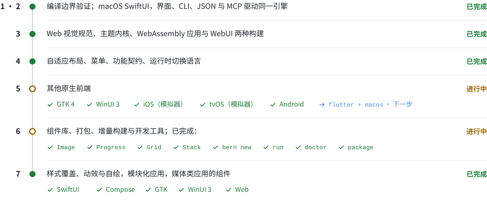
</picture>

## 仓库结构

<details>
<summary>crate 与目录</summary>
<br>

<picture>
<source media="(prefers-color-scheme: dark)" srcset="Docs/Assets/tables/repository-dark.svg">
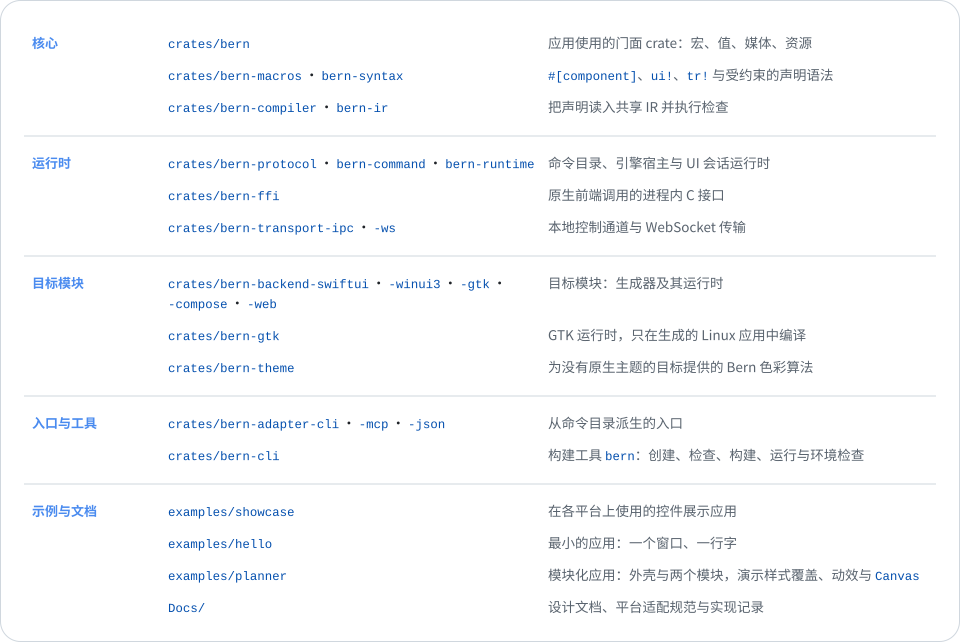
</picture>

</details>

## 开发

```sh
cargo fmt --all --check
cargo clippy --workspace --all-targets -- -D warnings
cargo test --workspace
```

测试中包含必须编译失败的声明，并在装有相应工具包的环境中对生成的应用做类型检查：用 Xcode 检查 Swift 6，用开发包检查 GTK，在 Windows 上用 MSVC 编译生成的两套前端。Android 的 Kotlin 由 `bern build --target android` 经 Gradle 编译。

## 文档

- [文档目录](Docs/README.md) · [当前组件用法](Docs/Reference/UI.md) · [完整属性表](Docs/Reference/Component-Properties.md) · [平台能力与验证范围](Docs/Reference/Platforms.md)
- [设计文档](Docs/Design.md)：目标、架构、组件、主题、命令、窗口与媒体
- [适配规范](Docs/Adaptation/README.md)：Apple、Windows 与 Linux、Web、Android、HarmonyOS
- 实现记录：[macOS](Docs/Implementation/macOS-SwiftUI.md) · [iOS](Docs/Implementation/iOS-SwiftUI.md) · [Android](Docs/Implementation/Android-Compose.md) · [Windows](Docs/Implementation/Windows-WinUI3.md) · [Linux](Docs/Implementation/Linux-GTK.md) · [Web](Docs/Implementation/Web.md)

## 许可证

[MIT](LICENSE) © 2026 MCDFSteve

<div align="center">
<br>
<sub>Bern 仍处于早期开发阶段，API 与声明语法可能还会变化。</sub>
</div>
