<div align="center">


<h1>Bern</h1>

<p><b>A cross-platform native UI framework for Rust.</b></p>

<p>Write both your app logic and declarative <code>ui!</code> views in Rust — no embedded browser, no hand-written platform glue.<br>
At build time, Bern compiles one Rust codebase into SwiftUI, WinUI 3, GTK 4, Jetpack Compose, GPUI and Web DOM/WASM<br>
across desktop, mobile, tablet, watch, TV and the Web.<br>
A typed protocol and command architecture keeps business logic in plain Rust, catches omissions at compile time, ships an app CLI + <code>SKILL.md</code> out of the box, and lets you <code>bern eject</code> into standalone FFI-wired native IDE projects anytime.</p>

<p>


</p>

<p>
<a href="https://bern.aimes-soft.com"></a>

<a href="#eject-to-standalone-native-projects-no-lock-in-and-rust-ffi-starter"></a>


<a href="LICENSE"></a>

</p>

<p>
<b>English</b> ·
<a href="README.zh-CN.md">简体中文</a> ·
<a href="README.zh-Hant.md">繁體中文</a> ·
<a href="README.ja.md">日本語</a>
</p>

<p>
<a href="https://bern.aimes-soft.com">Website</a> ·
<a href="https://bern.aimes-soft.com/docs">Online docs</a> ·
<a href="#why-bern">Why Bern</a> ·
<a href="#how-to-build-software-in-rust">How to build in Rust</a> ·
<a href="#built-for-ai">Built for AI</a> ·
<a href="#eject-to-standalone-native-projects-no-lock-in-and-rust-ffi-starter">Eject &amp; FFI</a> ·
<a href="#measured">Measured</a> ·
<a href="#compared-with-other-cross-platform-frameworks">Comparison</a> ·
<a href="#quick-start">Quick start</a>
</p>

</div>

<br>

<table>
<tr>
<td width="50%" align="center">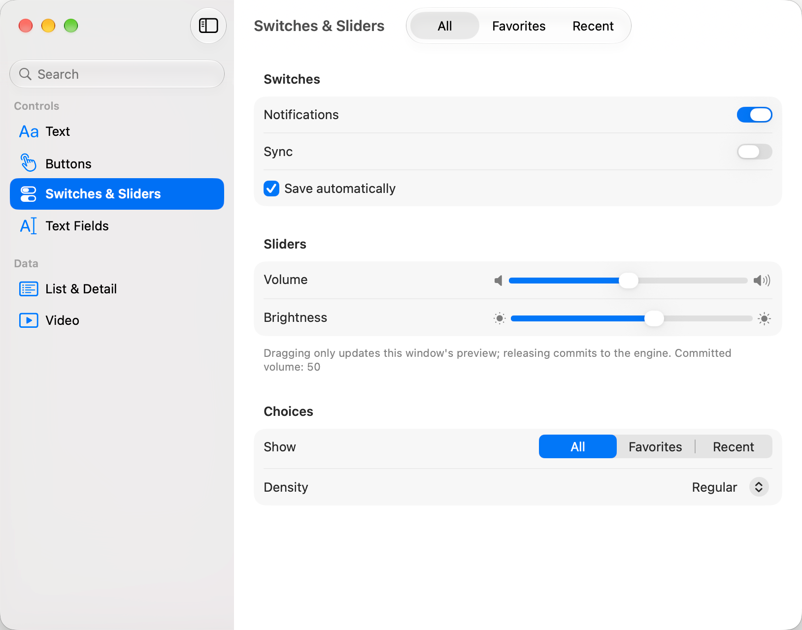<br><sub><b>macOS</b> · SwiftUI</sub></td>
<td width="50%" align="center">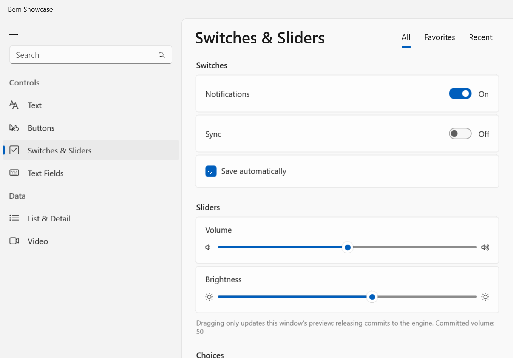<br><sub><b>Windows</b> · WinUI 3</sub></td>
</tr>
<tr>
<td width="50%" align="center">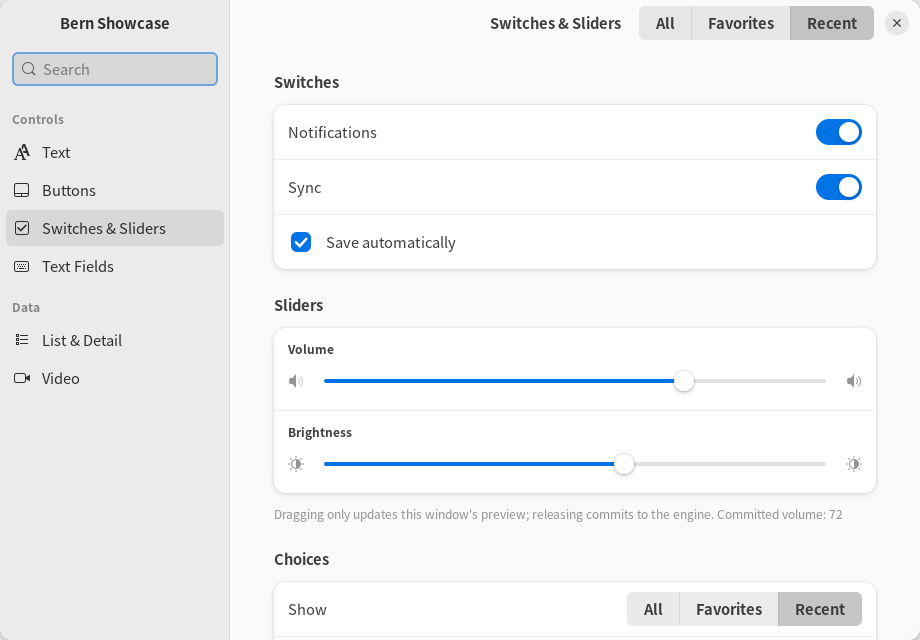<br><sub><b>Linux</b> · GTK 4 + libadwaita</sub></td>
<td width="50%" align="center">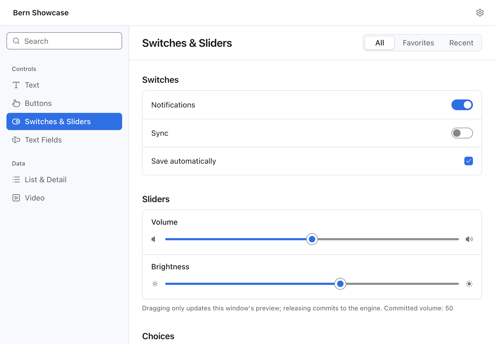<br><sub><b>Web</b> · DOM + WebAssembly</sub></td>
</tr>
</table>

<table>
<tr>
<td width="25%" align="center">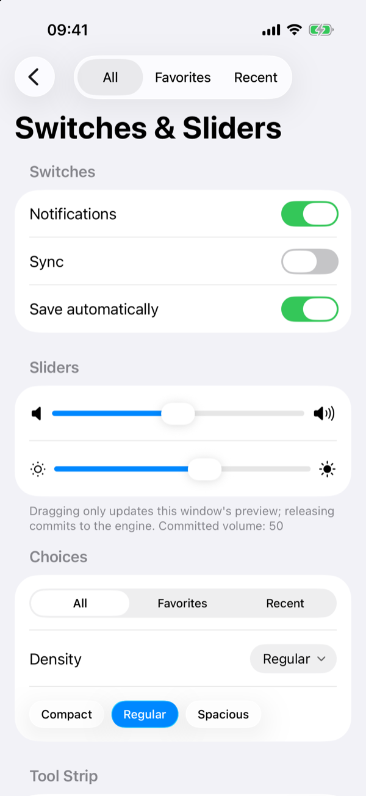<br><sub><b>iOS</b> · SwiftUI</sub></td>
<td width="25%" align="center">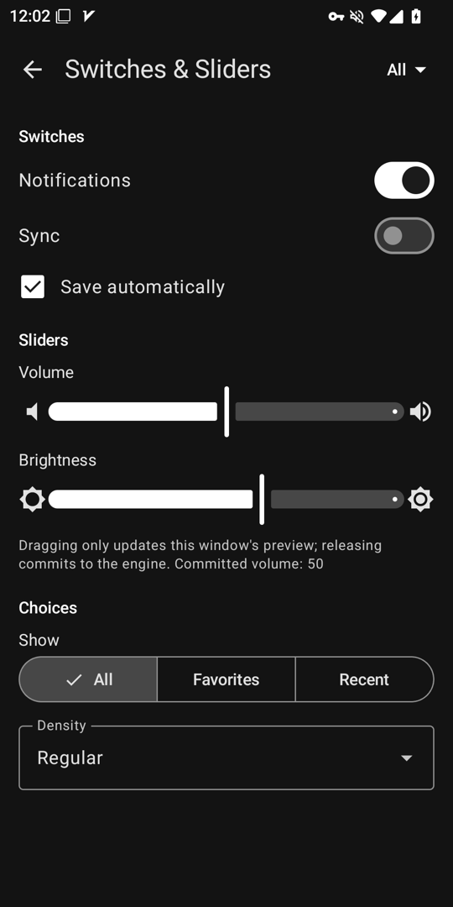<br><sub><b>Android</b> · Jetpack Compose</sub></td>
<td width="50%" align="center">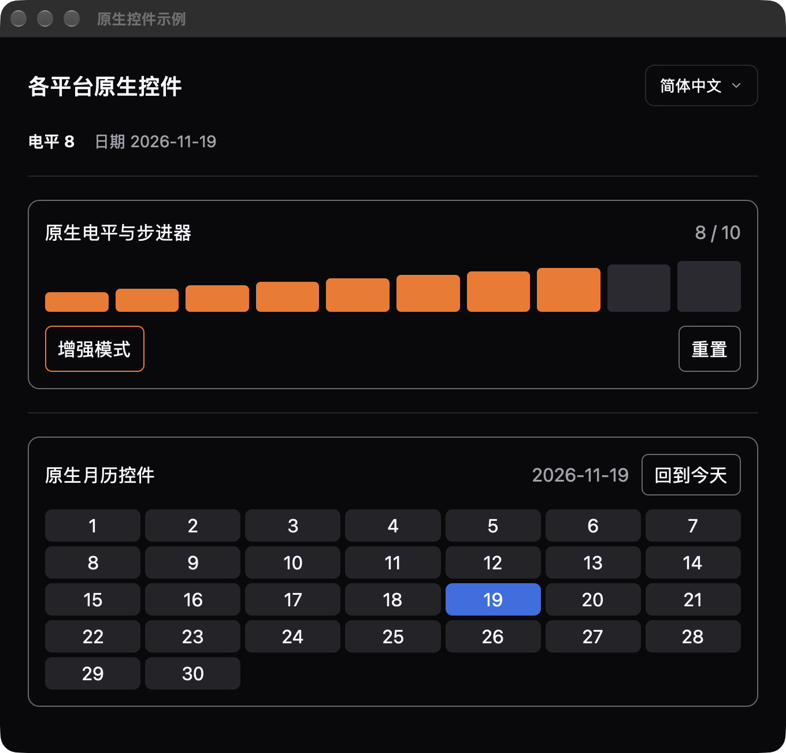<br><sub><b>Desktop · GPUI</b> (<code>ui = "gpui"</code> with co-located <code>NativeView</code>)</sub></td>
</tr>
</table>

<details>
<summary><b>More form factors:</b> iPad, Android Tablet, Apple TV, Android TV, iPhone Duo, watchOS &amp; Wear OS</summary>
<br>

<table>
<tr>
<td width="50%" align="center">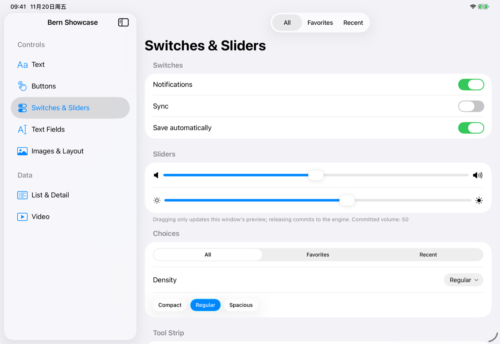<br><sub><b>iPad</b> · iPadOS SwiftUI</sub></td>
<td width="50%" align="center">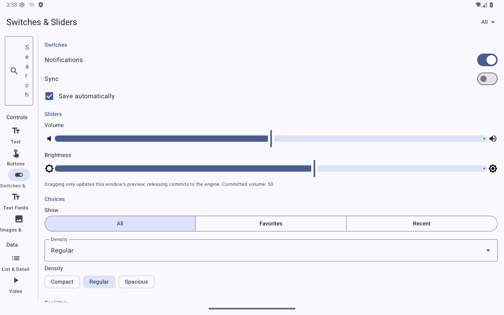<br><sub><b>Android Tablet</b> · Jetpack Compose</sub></td>
</tr>
<tr>
<td width="50%" align="center">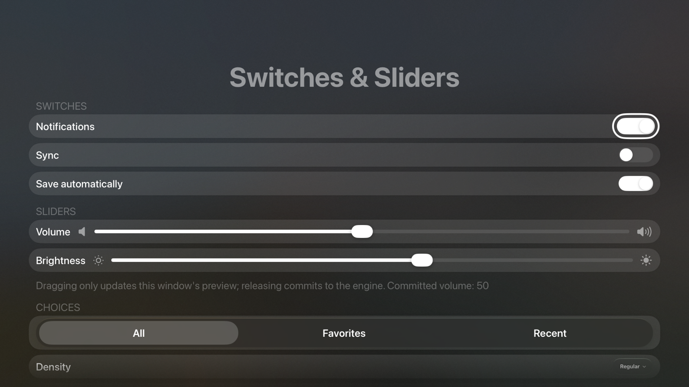<br><sub><b>Apple TV</b> · tvOS SwiftUI</sub></td>
<td width="50%" align="center">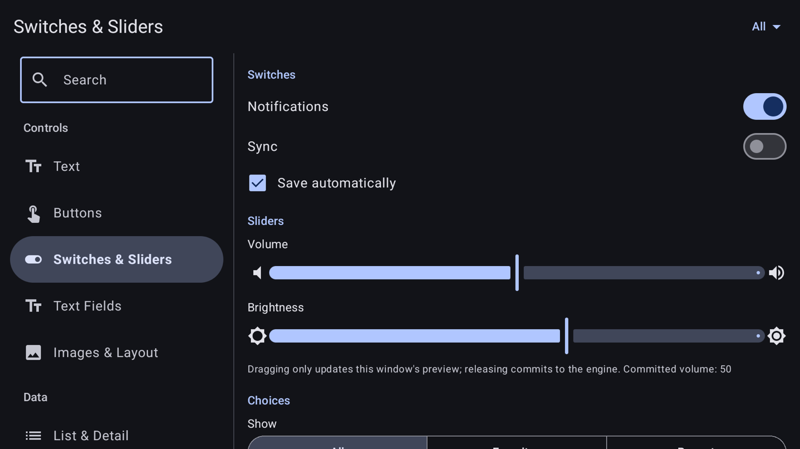<br><sub><b>Android TV</b> · Jetpack Compose</sub></td>
</tr>
</table>

<table>
<tr>
<td width="40%" align="center">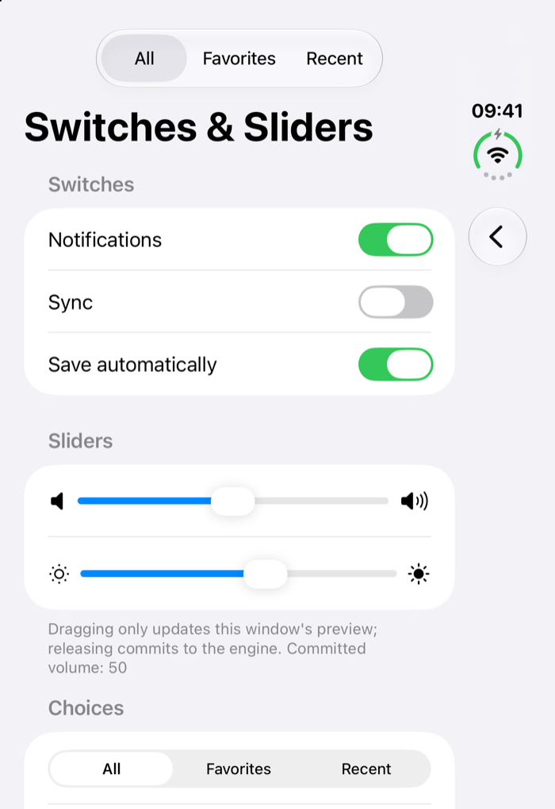<br><sub><b>iPhone Duo</b> · SwiftUI</sub></td>
<td width="30%" align="center">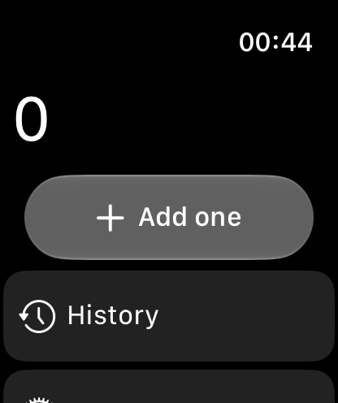<br><sub><b>watchOS</b> · SwiftUI</sub></td>
<td width="30%" align="center">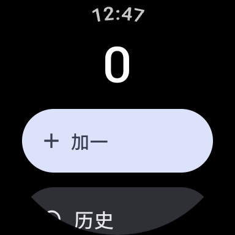<br><sub><b>Wear OS</b> · Compose Material 3</sub></td>
</tr>
</table>

</details>

<p align="center"><sub>One Rust codebase across desktop, mobile, tablet, TV, watch and Web. On system targets Bern draws no pixels of its own;<br>when you want unified GPU rendering, switch to <code>ui = "gpui"</code> without rewriting your app.</sub></p>

## Why Bern

<picture>
<source media="(prefers-color-scheme: dark)" srcset="Docs/Assets/tables/why-en-dark.svg">
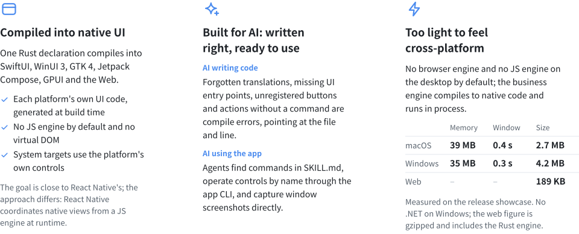
</picture>

## How to build software in Rust

With Bern, you stay in Rust from data model to native release bundle — no hand-written Swift, C++, or Kotlin glue unless you explicitly drop into a platform-specific `NativeView`. To avoid the classic Rust GUI headaches (callbacks fighting the borrow checker, UI threads tangled with async I/O, per-platform build plumbing), every Bern app is cleanly split into three layers:

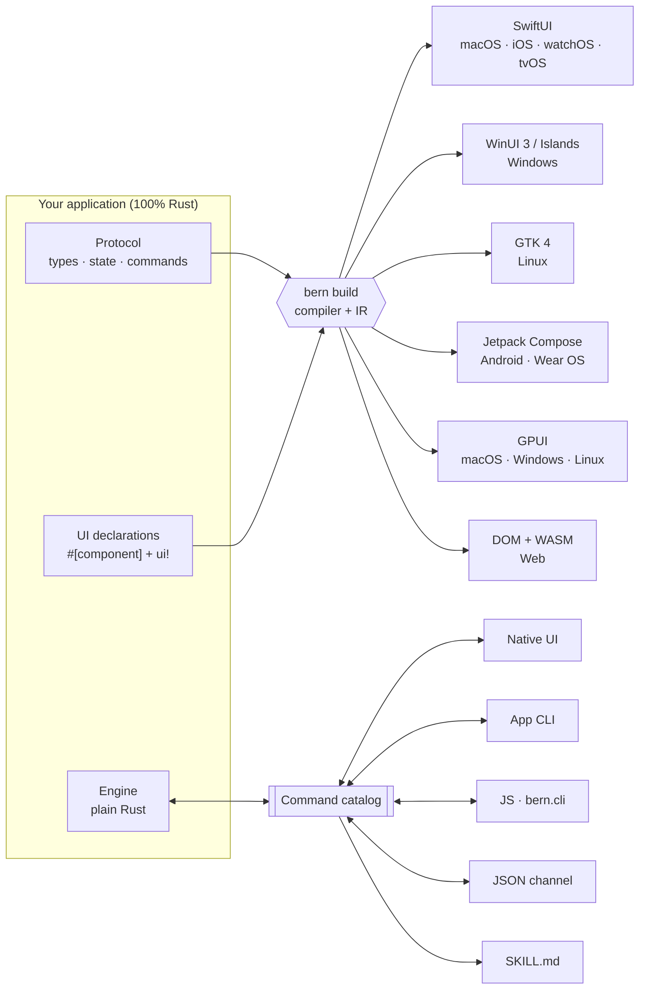

1. **Protocol** — `#[bern::protocol]` declares value types, the read-only state snapshot, and the command and query traits.
2. **Engine** — ordinary Rust that implements those traits. It never sees a window, widget, or transport, so you freely use `tokio`, `reqwest`, `rusqlite`, or any Rust crate and unit-test it with plain `cargo test`.
3. **Interface** — `#[component]` functions written with `ui!` right inside `.rs` files. Views read state and dispatch typed commands; the compiler lowers them into a shared IR and generates each platform's own native UI code, linked directly to your Rust engine.

### Project structure

Running `bern new tasks` scaffolds a standard Cargo workspace with `Bern.toml` declaring languages, theme, bundled resources, and target platforms:

```text
tasks/
├── Bern.toml           # App metadata, languages, resources & targets
├── tasks-protocol/     # 1. Shared contract: values, read-only state & commands
├── tasks-core/         # 2. Business engine: plain Rust, zero UI dependency
└── tasks-ui/           # 3. Declarative UI: #[component] + ui! + tr!
```

### A complete mini app: Tasks

**1 · Protocol (`tasks-protocol/src/lib.rs`)**: value types, read-only state, and typed commands

```rust
#[bern::protocol(namespace = "tasks", version = 1)]
pub mod tasks {
    use bern::prelude::*;

    #[value]
    pub struct Task {
        pub id: i64,
        #[content]
        pub title: String,
        pub done: bool,
    }

    #[state]
    pub struct State {
        pub items: Vec<Task>,
        pub remaining: i64,
    }

    #[commands]
    pub trait Commands {
        /// Add a task and return its id.
        #[errors("empty_title")]
        fn add(&mut self, title: String) -> Result<i64, CommandError>;

        /// Toggle a task's completion state.
        fn toggle(&mut self, id: i64) -> Result<(), CommandError>;
    }
}
```

**2 · Engine (`tasks-core/src/lib.rs`)**: plain Rust business logic, zero UI coupling

```rust
use bern::CommandError;
use tasks_protocol::tasks::{self, State, Task};

pub struct TasksEngine {
    state: State,
    next_id: i64,
}

impl Default for TasksEngine {
    fn default() -> Self {
        Self { state: State { items: Vec::new(), remaining: 0 }, next_id: 0 }
    }
}

impl tasks::Commands for TasksEngine {
    fn add(&mut self, title: String) -> Result<i64, CommandError> {
        if title.trim().is_empty() {
            return Err(CommandError::new("empty_title", "title cannot be empty"));
        }
        self.next_id += 1;
        self.state.items.push(Task { id: self.next_id, title, done: false });
        self.state.remaining += 1;
        Ok(self.next_id)
    }

    fn toggle(&mut self, id: i64) -> Result<(), CommandError> {
        if let Some(task) = self.state.items.iter_mut().find(|t| t.id == id) {
            task.done = !task.done;
            self.state.remaining += if task.done { -1 } else { 1 };
        }
        Ok(())
    }
}

impl tasks::Engine for TasksEngine {
    fn state(&self) -> &State { &self.state }
}
```

**3 · Interface (`tasks-ui/src/lib.rs`)**: declarative `ui!` in Rust with local drafts and inline localization

```rust
#[bern::session]
pub struct Draft {
    pub title: String,
    pub only_open: bool,
}

#[component]
pub fn tasks_view(app: tasks::Client, #[session] draft: Draft) -> impl View {
    ui! {
        Form {
            Section(title: tr! {
                "zh-Hans" => "待办（剩余 {n} 项）",
                "en" => "Tasks ({n} left)";
                n: app.remaining
            }) {
                Row(gap: 8) {
                    TextInput(
                        id: new_task,
                        label: tr! { "zh-Hans" => "新任务", "en" => "New task" },
                        value: draft.title,
                        prompt: tr! { "zh-Hans" => "写点要做的事…", "en" => "Add a task…" },
                        submit: clear
                    ) => app.add(draft.title)
                    Button(
                        id: add,
                        label: tr! { "zh-Hans" => "添加", "en" => "Add" },
                        prominence: prominent,
                        clears: draft.title
                    ) => app.add(draft.title)
                }
                Switch(
                    id: only_open,
                    label: tr! { "zh-Hans" => "只看未完成", "en" => "Only open" },
                    value: draft.only_open
                )
                ForEach(items: app.items, key: id) |task| {
                    if !draft.only_open || !task.done {
                        Switch(
                            id: done,
                            label: task.title,
                            checked: task.done,
                            style: checkbox
                        ) => app.toggle(task.id)
                    }
                }
            }
        }
    }
}
```

### Check, run and ship

One `bern` tool drives the entire lifecycle — compile-time verification, native execution across devices, release packaging, and the generated app CLI:

```sh
bern check                          # verify types, translations and layout coverage
bern run                            # run native UI on this OS (SwiftUI / WinUI 3 / GTK 4)
bern run --target web_app           # or Android, iOS, GPUI, Web from the same Rust code
bern package                        # build release .dmg / installer / .deb / .apk / .ipa / Web
bern eject --target macos           # export standalone native IDE project with Rust FFI wired up

# Because every UI action is a protocol command, the built app also ships its own CLI:
tasks ui inspect
tasks tasks add --title "Ship v1.0"
```

For full multi-page apps in this repository, see [showcase](examples/showcase) (all controls, engine-backed async search, list-to-detail navigation, video, and a settings window with close confirmation), [planner](examples/planner) (modular app, style overrides, spring motion and `Canvas`), [gallery](examples/gallery) (poster wall, proportional timeline, four-tier adaptive layouts and file drop), [native-controls](examples/native-controls) (co-located per-platform `NativeView`), [wearos](examples/wearos) (watch targets), and [svg-animation](examples/svg-animation) (pure-Rust animated SVG).

## Built for AI

Because every UI view is statically checked at compile time and every interaction flows through the command catalog, Bern naturally makes AI coding and AI automation reliable instead of guesswork.

### Writing code: what the AI forgets, the compiler remembers

AI rarely gets interface code wrong; it leaves things out. A feature is added without an entry in the compact layout, a new string is written in one language only, a callback sidesteps the commands. Elsewhere these wait for a user to find them; in Bern they do not compile. The stricter the rules, the harder it is for an AI to hand over half a job:

<picture>
<source media="(prefers-color-scheme: dark)" srcset="Docs/Assets/tables/ai-en-dark.svg">
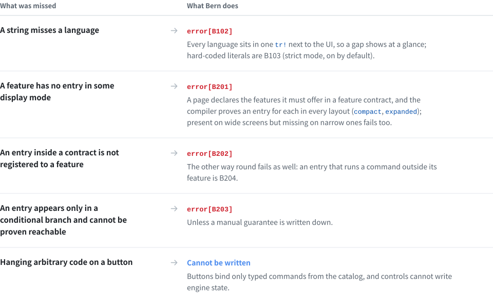
</picture>

Errors are written for people and for agents alike: a code, a reason and a location, so an agent can fix them and build again on its own. Two real runs on the showcase: the first with an English translation deleted, the second, after restoring it, with the compact layout's "Change Clip" menu removed:

```text
$ bern check
error[B102]: Missing translation
Missing language: en
Required languages: zh-Hans, en
  --> showcase-ui/src/pages.rs:13:31

$ bern check
error[B201]: Feature missing in adaptive layout
Contract: MediaFeature
Feature: Clip
compact: missing
  --> showcase-ui/src/media.rs:14:5
```

Every build also writes a full feature coverage report per target (`features.json`) that lists what is covered, exempt or only manually guaranteed.

### Using the app: meaning, not pixels

With the control channel enabled, Bern generates `SKILL.md` from the app’s command catalog. In the example below, the agent looks up `ui set-bool` and its arguments in `skills/showcase/SKILL.md`, then runs `showcase ui inspect` to find the switch’s target. It operates the switch by that name through the CLI, using the same code as a click, without a screenshot or coordinates.

```sh
$ showcase ui inspect                 # the agent reads meaning, not pixels
[{ "target": "controls_page.sync", "role": "switch", "label": "Sync", "value": "false", "enabled": true, … }, …]

$ showcase ui set-bool --target controls_page.sync --value true
$ showcase window screenshot --output shot.png

$ showcase window close --window settings#1
{ "outcome": "ConfirmationRequired", "message": "Do you want to save the display name?",
  "decisions": ["Save", "Discard", "Cancel"], "confirmation": "settings#1:c1", … }

$ showcase window confirm-close --window settings#1 --confirmation settings#1:c1 --decision Save
{ "outcome": "Rejected", "reason": "save_failed: invalid_name: a display name has 1 to 40 characters …" }
```

You can run the same commands yourself, including app-specific ones such as `showcase showcase set-display-name --name Demo` or built-in window screenshots (`window screenshot`). Use the CLI from the same build as the app. Over SSH, run it on the machine hosting the control channel, under the account that owns the endpoint. If a control is disabled, blocked by a dialog or missing, the CLI returns an error code.

## Measured

<picture>
<source media="(prefers-color-scheme: dark)" srcset="Docs/Assets/tables/measured-en-dark.svg">
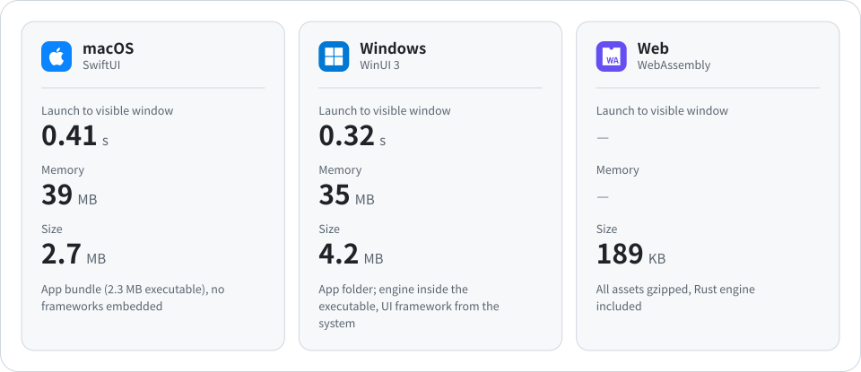
</picture>

<details>
<summary>How it was measured</summary>
<br>

- Subject: the release showcase (6 pages, a main and a settings window, a video player), measured on 2026-10-11, median of at least 3 runs.
- macOS: Apple M4, 16 GB, macOS 27.0.1. Memory is the physical footprint from `footprint`, the measure of Activity Monitor's Memory column.
- Windows: Intel Core i5-13490F, 32 GB, Windows 11 25H2. Memory is the private working set, the measure of Task Manager's Memory column.
- Launch time: from starting the process until the command line sees a visible native window, including engine start and the local control channel.
- The Windows numbers are the WinUI 3 front end (measured with Windows App Runtime 1.8; builds now use 2.x). Without the runtime, the same program falls back to the system XAML: 0.54 s, 19 MB. Neither needs .NET or the VC++ runtime; the app folder holds the executable and a 400 KB bootstrapper DLL.

</details>

## Who uses Bern

<table>
<tr>
<td width="33%" valign="top">
<a href="https://github.com/AimesSoft/RustSend"></a>
<h3><a href="https://github.com/AimesSoft/RustSend">RustSend</a></h3>
<p>Local file sharing compatible with LocalSend. Send files, folders and text across devices.</p>
</td>
<td width="33%" valign="top">
<a href="https://github.com/zhaohuaxs/lambda"></a>
<h3><a href="https://github.com/zhaohuaxs/lambda">Lambda</a></h3>
<p>A Windows and Android archive manager powered by 7-Zip. Create encrypted archives, extract files and preview their contents.</p>
</td>
<td width="33%" valign="top">
<a href="https://github.com/MCDFsteve/Enji"></a>
<h3><a href="https://github.com/MCDFsteve/Enji">Enji Music</a></h3>
<p>A third-party NetEase Cloud Music client with online and local playback, synced lyrics and playlist management.</p>
</td>
</tr>
</table>

## More capabilities & extensions

<picture>
<source media="(prefers-color-scheme: dark)" srcset="Docs/Assets/tables/more-en-dark.svg">
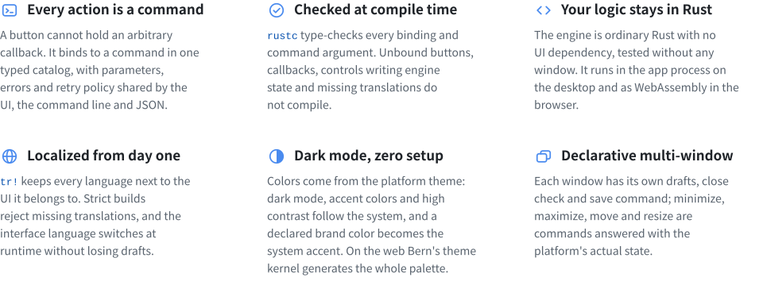
</picture>

<details>
<summary><b>And more:</b> full standard controls, automatic skeletons, style and motion, media, system integration, modular apps, <code>NativeView</code> and opt-in JS…</summary>
<br>

- **Adaptive layouts & navigation**: four-tier size classes (`compact`, `medium`, `expanded`, `large`) plus `watch` and `tv`; typed push navigation, `SplitView` sidebars, `Tabs` with `TabAccessory`, toolbars, menus, `Grid` (including masonry), `Stack`, `SplitPane`, `Accordion` and compile-time feature contracts.
- **Full standard controls**: `Table`, `TreeView`, `Reorderable`, `BottomSheet`, `Refreshable`, `DatePicker`, `TimePicker`, `NumberInput`, `ColorPicker`, `ShortcutInput`, `Tooltip`, `Banner`, `Disclosure`, `Alert`, `EmptyState`, `Badge`, `Avatar`, `Text(selectable:)` / inline Markdown, dynamic searchable `Picker(style: combobox)`, multi-file `pick:` and native `save:` dialogs.
- **Automatic skeletons, style & motion**: compile-time projected skeletons on `Query` and `skeleton: <bool>` containers (120 ms anti-flicker, staggered entrance, reduced-motion aware); `style!` app-wide overrides, spring motion, shared-element Hero transitions, pure-Rust animated `Svg` (zero WebView), HDR `Image`, `Canvas` drawing and proportional `Rail`s.
- **Media, async queries & files**: `Video` on native media stacks or a custom `MediaKernel`, direct `players.<id>.<field>` bindings, `Query` subscriptions (loading, empty, failure, refresh), bundled resources in `Bern.toml`, unified `MediaSource` across local paths / Android `content://` / Web `blob:`, system file open handlers (`[[app.opens]]`) and in-memory `bern::files::serve`.
- **Desktop & system integration**: system tray `StatusItem` (monochrome SVG icons + launch at login), macOS `MenuBar`, floating overlay utility windows, built-in `window.screenshot`, pointer events (`DoubleTap`, `ContextMenu`, `WheelUp`/`WheelDown`), `Slider(hover:)` and embedded `WebPage`.
- **Extensibility**: modular apps (`bern new --module`), co-located per-platform native views (`NativeView` with typed props, `tr!` linting, mandatory CLI entries and `Fallback`, see [Native Views](Docs/Topics/Native-Views.md)), and opt-in in-process JavaScript with `bern.cli` and allowlist/denylist policies ([JavaScript](Docs/Topics/JavaScript.md)).

</details>

### Eject to standalone native projects: no lock-in and Rust FFI starter

Because Bern compiles your `ui!` declarations into each platform's own UI code, you are never locked into the framework. Run `bern eject` at any time to export standard, self-contained native IDE projects with UI sources split cleanly per component and window (`Do not edit` banners removed), leaving the original Bern project untouched.

It also works as an **instant native-to-Rust FFI project generator**: even if you plan to hand-write SwiftUI, Kotlin Compose, WinUI 3 C++, GTK, or Web UI from day one, `bern new` + `bern eject` gives you a ready-to-build project across every platform with the Rust engine, C ABI / FFI bridge, state snapshot bindings, and native IDE build hooks already wired up — no manual Xcode Run Script, NDK/JNI, MSBuild, or WASM plumbing.

```sh
bern eject --target macos --out ./native-macos                   # offline Rust source + Xcode project
bern eject --target ios --engine prebuilt --release --out ./ios  # prebuilt XCFramework, no Rust required

# Example ejected macOS layout (similarly Gradle / Visual Studio .sln / Cargo / Web ES modules):
# native-macos/
# ├── MyApp.xcodeproj/           # wired with Build Rust Engine phase (or XCFramework)
# ├── Sources/{App,Models,Styles,Views,Windows,Native,Runtime}/
# └── rust/                      # offline self-contained Rust workspace + C FFI bridge
```

| Platform | Standalone native project | Pre-wired Rust FFI (`--engine source` / `--engine prebuilt`) |
| --- | --- | --- |
| **macOS / iOS / tvOS / watchOS** | `<Product>.xcodeproj` + `.xcscheme` | `rust/` + Xcode `build-rust.sh` / `BernEngine.xcframework` |
| **Android / Wear OS** | Gradle project (`app/build.gradle.kts`) | `rust/` + Gradle NDK task / `jniLibs/<abi>/libbern_app.so` |
| **Windows (WinUI 3 / Islands)** | Visual Studio `.sln` + `.vcxproj` | `rust/` + MSBuild `build-rust.cmd` / `lib\<arch>\bern_app.lib` |
| **Linux (GTK 4)** | Standalone Cargo workspace | Self-contained `Cargo.toml` (`--engine source`) |
| **Desktop (GPUI)** | Standalone Cargo workspace | Self-contained `Cargo.toml` (`--engine source`) |
| **Web (DOM + WASM)** | Zero-bundler `index.html` + ES modules | `rust/` + `build-wasm.{sh,cmd}` / prebuilt `app.wasm` |

Choose `--engine source` (default; works cross-host for every target) to keep editing Rust alongside native UI, or `--engine prebuilt` to embed compiled engine binaries so native developers can open and build with **no Rust or Bern installed**. See [Ejecting to standalone native projects](Docs/Topics/Eject.md).

### Extending with JavaScript: in-process `bern.cli`

Apps that do not enable scripting link zero JS runtime. When a target sets `javascript = true`, every `bern::script::Context` (in-process Boa on native targets, Web Worker on the Web) exposes `globalThis.bern.cli(...)` directly against the app's command catalog, with host-side allowlist/denylist control (`CliPolicy::allow_all()` by default):

```rust
let js = bern::script::Context::with_policy(
    bern::script::CliPolicy::allow_only(["media.*", "@queries", "state", "catalog"])
        .deny("media.bind")
        .with_label("example.plugin"),
)?;
js.eval(r#"await bern.cli("media seek --player-id main --position-ms 90000")"#).await?;
```

See [JavaScript and target capabilities](Docs/Topics/JavaScript.md) for the full call forms, policy patterns and dynamic filters.

## Platforms

<picture>
<source media="(prefers-color-scheme: dark)" srcset="Docs/Assets/tables/platforms-en-dark.svg">
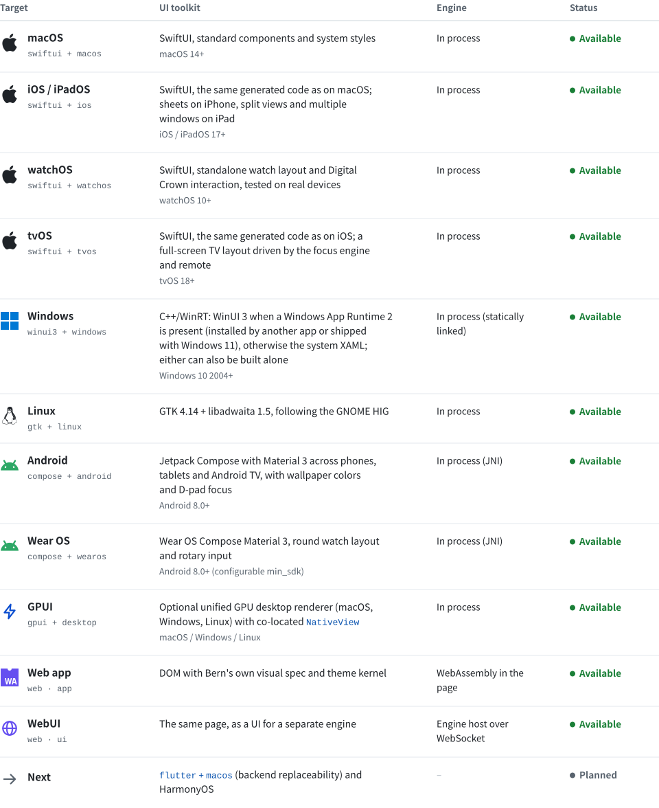
</picture>

Platform guides: [macOS](Docs/Platforms/macOS.md) · [iOS](Docs/Platforms/iOS.md) · [watchOS](Docs/Platforms/watchOS.md) · [tvOS](Docs/Platforms/tvOS.md) · [Windows](Docs/Platforms/Windows.md) · [Linux](Docs/Platforms/Linux.md) · [Android & Wear OS](Docs/Platforms/Android.md) · [GPUI](Docs/Platforms/GPUI.md) · [Web & WebUI](Docs/Platforms/Web.md).

Omitting the UI technology picks the platform default; an unavailable default fails loudly instead of silently switching to another stack.

### Using Bern as a GPUI UI framework

GPUI gives Rust apps fast GPU rendering, but ships without a standard control library. Setting `ui = "gpui"` on macOS, Windows or Linux lets you use Bern directly as a declarative UI framework on top of GPUI: your `ui!` declarations get full desktop controls, semantic light/dark theming, spring motion, compile-time i18n and feature checks, and Skills + CLI out of the box. When a view needs bespoke GPU rendering, embed native GPUI code beside the declaration with `NativeView(gpui: "...")`—and switch back to native system controls or expand to iOS, Android, watchOS, Wear OS and the Web without rewriting your app logic.

### Windows and iOS each have two front ends

These two platforms span more system versions than one UI framework reaches, so the same declaration generates two front ends for each. By default both go into one package and the app chooses as it starts, by the system it finds. Neither the user nor the app's code has to do anything.

| Platform | Front end | Name in `frontends` | Runs on |
| --- | --- | --- | --- |
| Windows | WinUI 3 | `winui3` | Systems with Windows App Runtime 2, with Mica and the Windows 11 look |
| Windows | The system XAML, through XAML Islands | `xaml-islands` | Every other Windows 10 and 11, with no runtime to install |
| iOS | SwiftUI | `swiftui` | iOS 17 and later; every Apple target shares this front end |
| iOS | SwiftUI for iOS 16 | `swiftui-16` | iOS 16, rewritten from the same generated code |

To keep only one, name it:

```toml
[targets.windows]
frontends = ["winui3"]   # asks to install the runtime on a system without it

[targets.ios]
frontends = ["swiftui"]  # iOS 17 and later
```

With both iOS front ends, `packages = "separate"` makes one `.ipa` of each. The [Windows](Docs/Platforms/Windows.md) and [iOS](Docs/Platforms/iOS.md) platform guides cover the selection rules and what is reduced on iOS 16.

## Compared with other cross-platform frameworks

<p align="center">
<a href="https://github.com/zed-industries/zed/tree/main/crates/gpui"></a>
<a href="https://dioxuslabs.com"></a>
<a href="https://flutter.dev"></a>
<a href="https://reactnative.dev"></a>
<a href="https://uniapp.dcloud.net.cn"></a>
<br>
<a href="https://www.electronjs.org"></a>
<a href="https://tauri.app"></a>
<a href="https://avaloniaui.net"></a>
<a href="https://www.qt.io"></a>
</p>

Every framework answers the same question: how does one codebase become the interface on each platform? The answers differ, and so do the trade-offs. What follows is based on each project's official documentation; size and memory vary a lot with versions and settings, so the comparison stays structural. Bern's own numbers are in [Measured](#measured).

<picture>
<source media="(prefers-color-scheme: dark)" srcset="Docs/Assets/compare/routes-en-dark.svg">
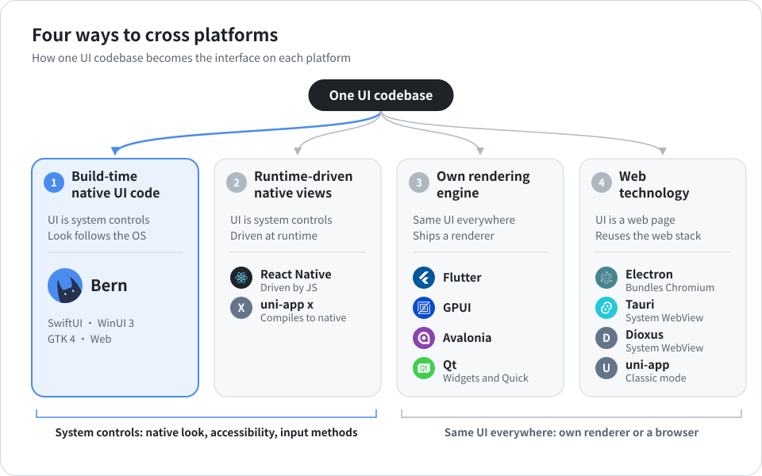
</picture>

The first two routes give you system controls: look, accessibility, input methods and dark mode come from the system, at the cost of controls that differ a little between platforms. The other two draw the same interface everywhere, at the cost of keeping up with each platform's design and behavior yourself, or of shipping a browser.

<picture>
<source media="(prefers-color-scheme: dark)" srcset="Docs/Assets/compare/landscape-en-dark.svg">
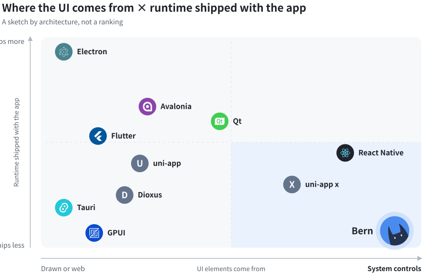
</picture>

The chart is a sketch by architecture, not a ranking: the horizontal axis is whether UI elements are the system's controls or drawn by the framework or a web page; the vertical axis is how much runtime the app carries (a browser engine, a JS engine, a rendering engine, a language runtime).

### Technology

<picture>
<source media="(prefers-color-scheme: dark)" srcset="Docs/Assets/tables/technology-en-dark.svg">
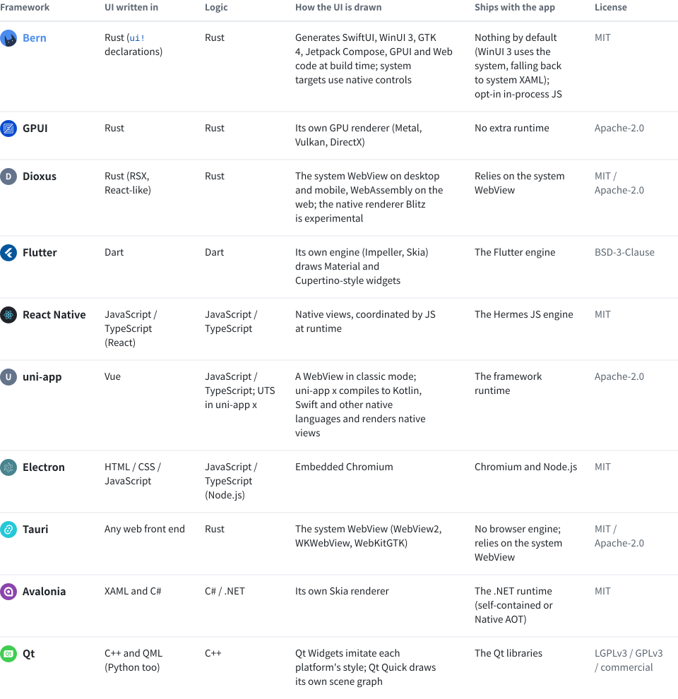
</picture>

### Platforms and capabilities

<picture>
<source media="(prefers-color-scheme: dark)" srcset="Docs/Assets/tables/capabilities-en-dark.svg">
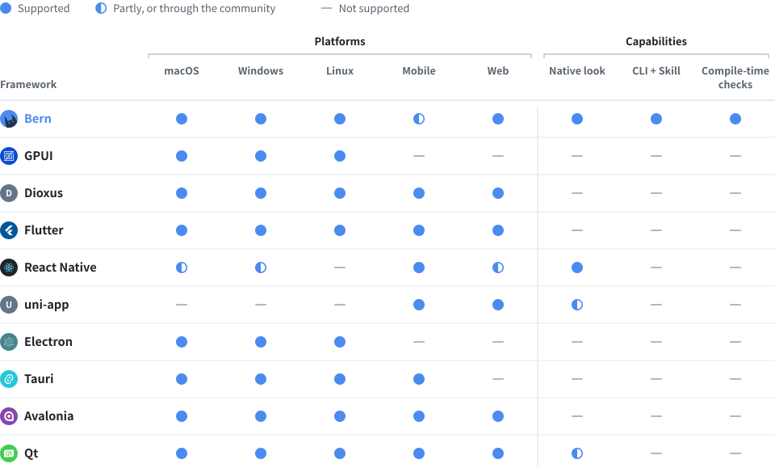
</picture>

- **Mobile**: iOS / iPadOS and Android (plus watchOS, Wear OS, tvOS and Android TV). React Native's desktop versions are maintained by Microsoft; uni-app also covers mini programs and HarmonyOS; Bern has been tested on real hardware across all of its desktop, mobile, tablet, watch and TV targets and packages `.ipa` and `.apk` bundles.
- **Native look**: the controls are the platform's own, with look, accessibility and input methods from the system. Qt Widgets and uni-app x come close and count as partly.
- **Skills + CLI**: Bern generates the app CLI and its `SKILL.md` from one command catalog. People and agents use the same commands. Other frameworks can be automated from outside through accessibility APIs or test tools such as Playwright and Flutter Driver.
- **Compile-time checks**: a missing translation, a feature without an entry in some layout, or an entry not registered to a feature is a compiler error (see [Built for AI](#built-for-ai)). Other frameworks mostly find these with linters, translation tools or tests.
- **Maturity**: Electron and Qt are very mature; Flutter, React Native, uni-app, Tauri and Avalonia are mature; Dioxus is developing quickly; GPUI powers the Zed editor while its general-purpose components are early; Bern is an early preview.

### Performance and footprint

The languages of the UI and logic layers, and how they run, set the ceiling of runtime overhead: natively compiled languages without garbage collection cost the least; JIT-run and interpreted languages ship an engine and use more memory.

<picture>
<source media="(prefers-color-scheme: dark)" srcset="Docs/Assets/compare/languages-en-dark.svg">
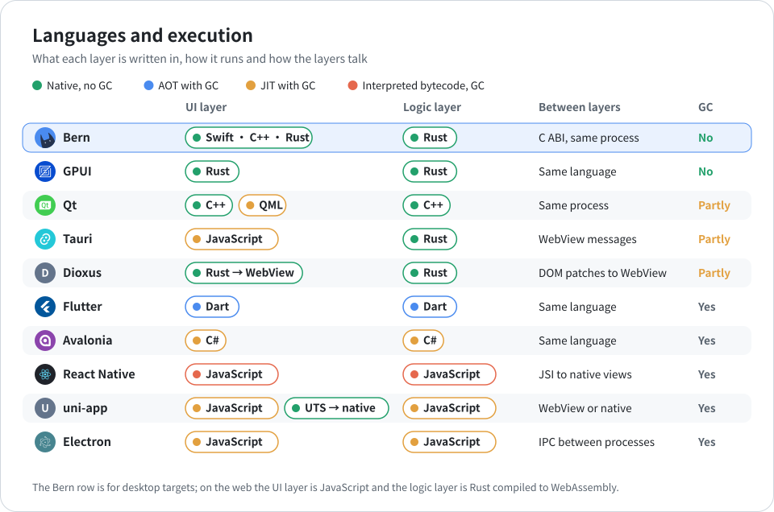
</picture>

For the same window showing one line of text, package size, launch time and memory differ widely. The chart is measured on one CI virtual machine (a GitHub-hosted Apple M1): each framework's own tools build a release package, and the apps take turns starting, ten times each, median shown. The scripts are in [benchmarks/](benchmarks/); the Benchmarks workflow reruns them from the Actions tab.

<picture>
<source media="(prefers-color-scheme: dark)" srcset="Docs/Assets/compare/resources-en-dark.svg">
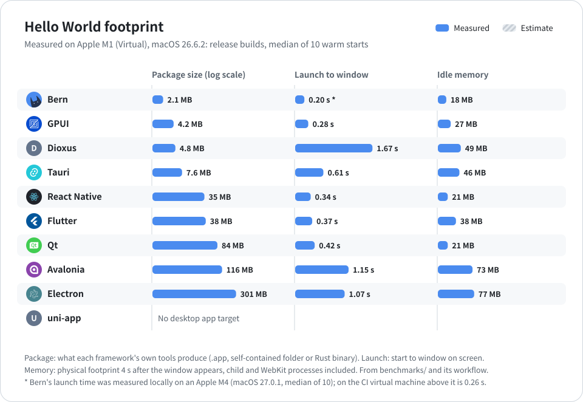
</picture>

### Which one to choose

<picture>
<source media="(prefers-color-scheme: dark)" srcset="Docs/Assets/tables/choose-en-dark.svg">
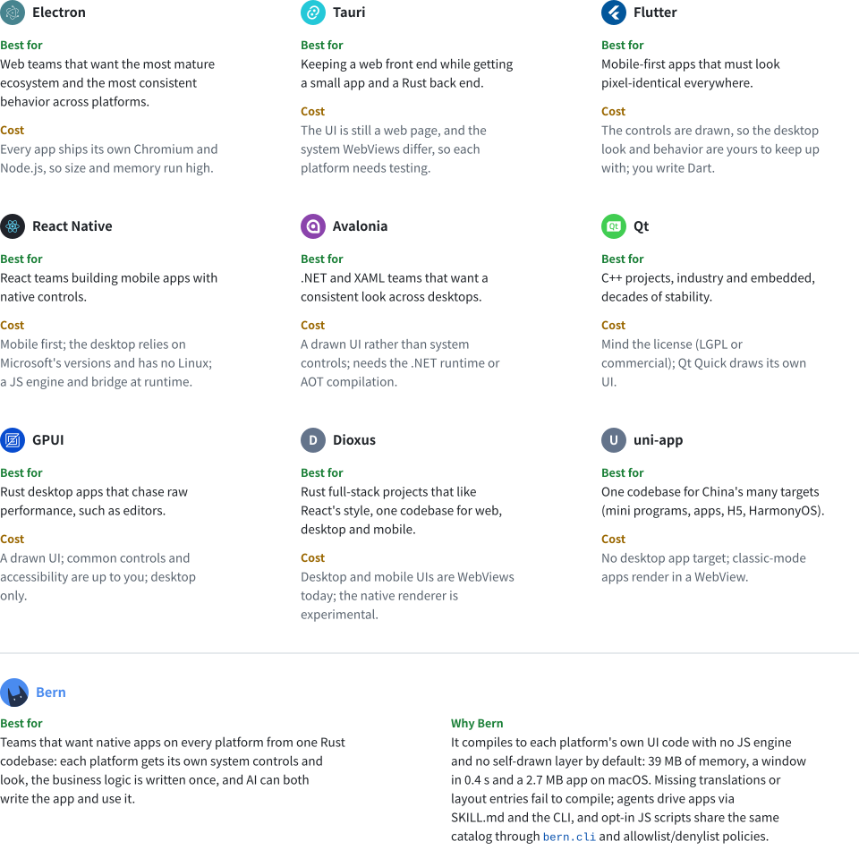
</picture>

## Quick start

You need Rust 1.99 (`rustup` installs it from `rust-toolchain.toml`) plus the toolchain of the target you build. First install the build tool `bern`:

```sh
cargo binstall bern-cli
```

[cargo-binstall](https://github.com/cargo-bins/cargo-binstall) downloads `bern` ready-built from the [releases](https://github.com/AimesSoft/Bern/releases), where you can also download it yourself; `cargo install bern-cli` compiles it instead. The apps this `bern` creates take Bern of the same version from crates.io. To work on Bern itself, install `bern` from a clone of this repository with `cargo install --path crates/bern-cli`; the apps it creates take Bern from that clone.

### Create an app

In any directory:

```sh
bern new my_app
cd my_app
bern run
```

The new app is a window with a counter, with one crate each for the protocol, the engine and the interface, and all six targets declared in `Bern.toml`. `bern run` builds the target for this computer and starts it: SwiftUI on macOS, WinUI 3 on Windows, GTK on Linux; `bern run --target web_app` opens it in the browser, `bern run --target ios` installs it in the running iOS simulator, and `bern run --target android` installs it on the Android phone connected with USB debugging (or an emulator) and starts it. For a target with `channels = ["ipc"]`, look for the app CLI in `target/bern/<target>/bin/` and its `SKILL.md` under the adjacent `skills/` directory.

`bern doctor` lists what this computer still needs for each target, and how to install it:

```text
$ bern doctor
bern 0.2.2 on macOS (aarch64)

[✓] Rust: rustc 1.99.0, cargo 1.99.0
[✓] macOS · SwiftUI: macOS SDK 26.5, Swift 6.3.2
[✓] iOS · SwiftUI: iOS simulator SDK 26.5, the aarch64-apple-ios-sim target
[-] Windows · WinUI 3: builds on Windows
[-] Linux · GTK 4: builds on Linux
[✓] Android · Compose: Android SDK, NDK 29.0.14206865, gradle-9.5.1, the aarch64-linux-android target
[✓] Web · WebAssembly: the wasm32-unknown-unknown target
```

<details>
<summary><b>What each platform needs</b></summary>
<br>

- **macOS**: Xcode 26 or later. After installing it from the App Store, run `sudo xcode-select --switch /Applications/Xcode.app`.
- **iOS / iPadOS / tvOS / watchOS**: Xcode's Apple platform SDKs, plus the corresponding Rust targets (`aarch64-apple-ios` / `aarch64-apple-ios-sim`, `aarch64-apple-tvos` / `aarch64-apple-tvos-sim`, `aarch64-apple-watchos` / `aarch64-apple-watchos-sim`). `bern run` launches in the simulator and `bern package` builds `.ipa` bundles for real devices.
- **Windows**: Visual Studio 2022 or later with “Desktop development with C++” (the Build Tools are enough) and a Windows 11 SDK; Rust on the MSVC toolchain. The first build generates the C++/WinRT headers with the Windows SDK's `cppwinrt` and precompiles them with the runtime (about 2.4 GB per profile, under `target`); later builds compile only the app's own code, about 5 s for a new app and 9 s for the showcase. The app folder holds only the executable, a 400 KB bootstrapper DLL and the resources: no .NET, no bundled Windows App SDK.
- **Linux**: GTK 4.14 and libadwaita 1.5 development packages, for example `sudo apt install libgtk-4-dev libadwaita-1-dev libsoup-3.0-dev gstreamer1.0-libav`.
- **Android**: Android Studio with the SDK and the NDK (SDK Manager → SDK Tools → NDK), Gradle 9.4 or newer, and `rustup target add aarch64-linux-android`. The first build has Gradle download the Android plugin and the Compose libraries.
- **Web**: `rustup target add wasm32-unknown-unknown`. A `web_app` build compiles the engine to WebAssembly and runs it in the page; a `web_ui` build makes the page the UI of a separate engine host, which `bern run` starts before opening its address.

</details>

### Ship an app

```sh
bern package
```

Builds every target this computer can in release and writes packages to `target/bern/dist/`: a `.dmg` for macOS, an installer (per user, no administrator rights) and a `.zip` for Windows, a `.deb` and a `.tar.gz` for Linux, an `.apk` and an `.aab` for stores for Android, and an archive of the static site for the Web. Desktop and WebUI packages carry the app CLI and, when IPC is enabled, its skill. A static Web package contains only the site; the Android CLI runs on the development computer, not inside the APK. Signing comes from the environment, so certificates stay out of the repository: `BERN_MACOS_SIGNING_IDENTITY` and `BERN_MACOS_NOTARY_PROFILE` (sign and notarize), `BERN_WINDOWS_CERTIFICATE` (a certificate thumbprint or a `.pfx`), `BERN_ANDROID_KEYSTORE`, `BERN_ANDROID_KEYSTORE_PASSWORD` and `BERN_ANDROID_KEY_ALIAS` (the release key). Without them the packages are still made, with a note on what being unsigned means. To export standalone native IDE projects with Rust FFI wired up instead, run `bern eject` (see [Eject to standalone native projects](#eject-to-standalone-native-projects-no-lock-in-and-rust-ffi-starter)).

### Run the showcase

The showcase in the Bern repository uses every component, two windows and a video player. From the repository directory:

```sh
cd examples/showcase
bern run
```

### Drive the running app

```sh
showcase ui inspect                                          # every mounted control
showcase ui select --target main_window.pages --option Controls
showcase ui set-bool --target controls_page.sync --value true
showcase showcase search-library --text mo                   # an engine query
showcase window open --kind settings
showcase window list                                         # actual window state
showcase window screenshot --output shot.png                 # capture window PNG
ssh HOST /path/to/showcase state
```

The target setting `channels = ["ipc"]` enables external control. On Android, run the CLI on the development computer where `bern run` set up `adb forward`, not on the phone. For a standalone Web `app` with IPC enabled, `bern run` starts a local bridge to the open browser tab; the static site archive does not include the local CLI or its `SKILL.md`.

## Roadmap

<picture>
<source media="(prefers-color-scheme: dark)" srcset="Docs/Assets/tables/roadmap-en-dark.svg">
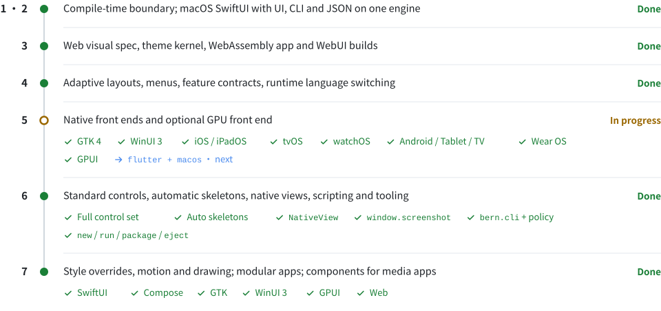
</picture>

## Repository

<details>
<summary>Crates and directories</summary>
<br>

<picture>
<source media="(prefers-color-scheme: dark)" srcset="Docs/Assets/tables/repository-en-dark.svg">
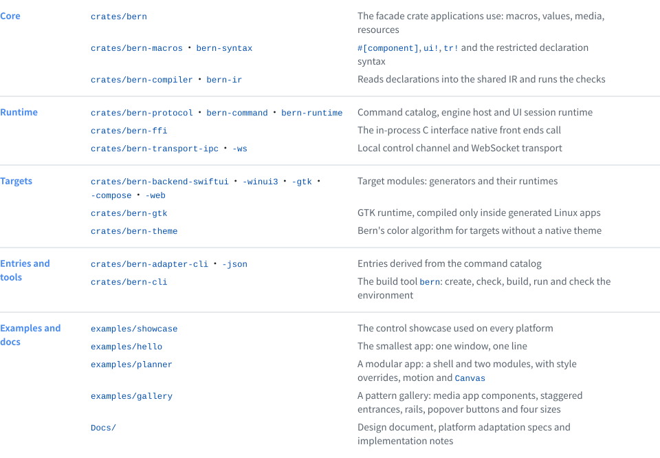
</picture>

</details>

## Development

```sh
cargo fmt --all --check
cargo clippy --workspace --all-targets -- -D warnings
cargo test --workspace
```

Tests include declarations that must fail to compile, and type-check the generated apps where the toolkit is installed: Swift 6 with Xcode, GTK with its development packages, both generated front ends with MSVC on Windows. Android's Kotlin is compiled by Gradle in `bern build --target android`.

## Documentation

Browse the searchable docs online at **[bern.aimes-soft.com/docs](https://bern.aimes-soft.com/docs)**, or read them in this repository:

- **Guides**: [Quick start](Docs/Guides/Quick-Start.md) · [Protocol & engine](Docs/Guides/Protocol-and-Engine.md) · [Layouts & navigation](Docs/Guides/Layouts-and-Navigation.md) · [Localization & styling](Docs/Guides/Localization-and-Styling.md) · [Windows, resources & files](Docs/Guides/Windows-Resources-and-Files.md) · [App CLI & Skills](Docs/Guides/App-CLI-and-Skills.md)
- **Platforms**: [macOS](Docs/Platforms/macOS.md) · [iOS](Docs/Platforms/iOS.md) · [watchOS](Docs/Platforms/watchOS.md) · [tvOS](Docs/Platforms/tvOS.md) · [Windows](Docs/Platforms/Windows.md) · [Linux](Docs/Platforms/Linux.md) · [Android & Wear OS](Docs/Platforms/Android.md) · [GPUI](Docs/Platforms/GPUI.md) · [Web & WebUI](Docs/Platforms/Web.md)
- **Topics**: [Ejecting to native projects](Docs/Topics/Eject.md) · [Co-located native views](Docs/Topics/Native-Views.md) · [JavaScript & `bern.cli`](Docs/Topics/JavaScript.md) · [Animated SVG](Docs/Topics/Animated-SVG.md) · [Module builds](Docs/Topics/Module-Builds.md) · [Web extensions](Docs/Topics/Web-Extensions.md)
- **Reference & Architecture**: [Documentation index](Docs/README.md) · [Architecture overview](Docs/Architecture.md) · [Component guide](Docs/Reference/UI.md) · [Property table](Docs/Reference/Component-Properties.md) · [Platform capabilities](Docs/Reference/Platforms.md) · [Performance tracing](Docs/Reference/Tracing.md)

The documentation is also available in [Simplified Chinese](Docs/zh-CN/README.md) ([online](https://bern.aimes-soft.com/docs/zh-CN)).

## License

[MIT](LICENSE) © 2026 MCDFSteve

<div align="center">
<br>
<sub>Bern is in early development. APIs and the declaration syntax may still change.</sub>
</div>
