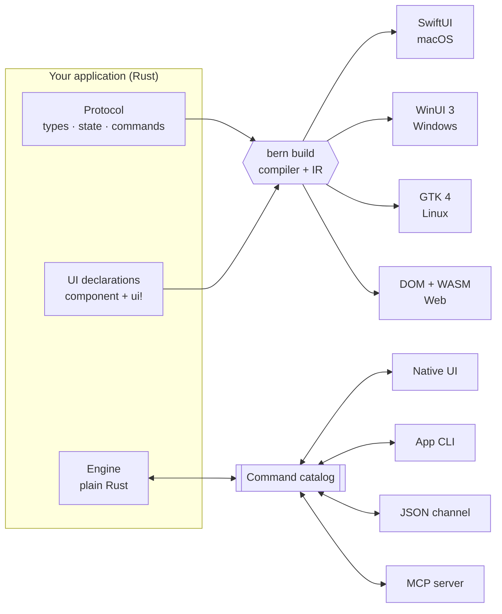

<div align="center">

<h1>Bern</h1>

<p><b>Declare your app once in Rust. Ship truly native UI on every desktop.</b><br>
Every control is a typed command that people, scripts and AI agents share.</p>

<p>


</p>

<p>


<a href="Cargo.toml"></a>


</p>

<p>
<b>English</b> ·
<a href="README.zh-Hans.md">简体中文</a> ·
<a href="README.zh-Hant.md">繁體中文</a> ·
<a href="README.ja.md">日本語</a>
</p>

<p>
<a href="#-quick-start">Quick start</a> ·
<a href="#-how-it-works">How it works</a> ·
<a href="#-a-taste-of-bern">Code</a> ·
<a href="#-platforms">Platforms</a> ·
<a href="#-roadmap">Roadmap</a> ·
<a href="Docs/Design.md">Design document</a>
</p>

</div>

<br>

<table>
<tr>
<td width="50%" align="center"><br><sub><b>macOS</b> · SwiftUI</sub></td>
<td width="50%" align="center"><br><sub><b>Windows</b> · WinUI 3</sub></td>
</tr>
<tr>
<td width="50%" align="center"><br><sub><b>Linux</b> · GTK 4 + libadwaita</sub></td>
<td width="50%" align="center"><br><sub><b>Web</b> · DOM + WebAssembly</sub></td>
</tr>
</table>

<p align="center"><sub>One <code>controls_page</code> declaration, four UI toolkits. On the desktop Bern draws no pixels of its own:<br>every switch, slider and sidebar is the platform's standard control, in the platform's own colors.</sub></p>

## ✨ Why Bern

Bern is a command-centric application framework for Rust. You write the interface as restricted, statically analyzable Rust declarations; `bern build` compiles them into the native UI toolkit of each platform. Business logic stays in a plain Rust engine, and every operable thing in the interface is bound to a typed command, so the UI, an application CLI, a JSON channel and an MCP server all drive **the same engine instance**.

<table>
<tr>
<td width="33%" valign="top">
<h3>🖥️ Native, not lookalike</h3>
SwiftUI on macOS, WinUI 3 on Windows, GTK 4 with libadwaita on Linux. Standard controls, system colors, dark mode, accent colors and accessibility come from the platform, not from a Bern renderer.
</td>
<td width="33%" valign="top">
<h3>⌘ Every action is a command</h3>
A button cannot hold an arbitrary callback. It binds to a command in one typed catalog, with parameters, errors and retry policy that every entry point shares.
</td>
<td width="33%" valign="top">
<h3>🤖 Agent-ready by construction</h3>
The same catalog generates an app CLI and an MCP server. Agents read the live UI (<code>ui.inspect</code>) and operate it through the real controls, including windows and close confirmations.
</td>
</tr>
<tr>
<td width="33%" valign="top">
<h3>🦀 Your logic stays in Rust</h3>
The engine is ordinary Rust with no UI dependency, tested without any window. It runs in the app process on the desktop and as WebAssembly in the browser.
</td>
<td width="33%" valign="top">
<h3>🧭 Checked at compile time</h3>
<code>rustc</code> type-checks every binding and command argument. Unbound buttons, callbacks, controls writing engine state and missing translations do not compile.
</td>
<td width="33%" valign="top">
<h3>🌍 Localized from day one</h3>
<code>tr!</code> keeps every language next to the UI it belongs to. Strict builds reject missing translations, and the interface language switches at runtime without losing drafts.
</td>
</tr>
</table>

<details>
<summary><b>And more:</b> multi-window, media, async queries, adaptive layouts…</summary>
<br>

- **Declarative multi-window** – a main window and a settings window, each with its own drafts, a close check and a save command; minimize, maximize, move and resize are commands answered with the platform's actual state.
- **Video** – `Video` plays on AVFoundation, Windows Media Foundation, GStreamer or HTML media, with a command-driven control bar and players that outlive a page.
- **Async queries** – `Query` subscriptions with loading, empty, failure and refresh states; only the latest answer is shown.
- **Adaptive layouts** – `compact` and `expanded` layouts chosen by the space a view actually gets.
- **Typed navigation** – sidebars, push navigation with typed routes, tabs, toolbars and menus.
- **Feature contracts** – declare which features a component must cover in each layout; the compiler proves the coverage.
- **Bundled resources** – files declared in `Bern.toml`, checked at build time and located by name at runtime.

</details>

## 🧩 How it works



1. **Protocol** – `#[bern::protocol]` declares value types, the read-only state and the command and query traits.
2. **Engine** – implements those traits in ordinary Rust; it never sees a window, a control or a transport.
3. **Interface** – `#[component]` functions whose body is a `ui!` declaration. The compiler reads them into a shared intermediate representation, and each target module generates native code from it. Adding a target never touches the parser, the IR or your business logic.

## 🍃 A taste of Bern

<table>
<tr>
<td width="50%" valign="top">

**1 · Protocol**: types, state and commands

```rust
#[bern::protocol(namespace = "counter", version = 1)]
pub mod counter {
    use bern::prelude::*;

    #[state]
    pub struct State {
        pub count: i64,
    }

    #[commands]
    pub trait Commands {
        /// Add to the count.
        fn add(&mut self, by: i64) -> Result<(), CommandError>;
    }
}
```

**3 · Interface**: a `ui!` declaration

```rust
#[component]
pub fn counter_view(app: counter::Client) -> impl View {
    ui! {
        Form {
            Text(content: tr! {
                "zh-Hans" => "已计数 {n} 次",
                "en" => "Counted {n} times";
                n: app.count
            })
            Button(
                id: add,
                label: tr! { "zh-Hans" => "加一", "en" => "Add one" },
                prominence: prominent
            ) => app.add(1)
        }
    }
}
```

</td>
<td width="50%" valign="top">

**2 · Engine**: plain Rust, no UI

```rust
use bern::CommandError;

pub struct Counter {
    state: counter::State,
}

impl Default for Counter {
    fn default() -> Self {
        Self { state: counter::State { count: 0 } }
    }
}

impl counter::Commands for Counter {
    fn add(&mut self, by: i64) -> Result<(), CommandError> {
        self.state.count += by;
        Ok(())
    }
}

impl counter::Engine for Counter {
    fn state(&self) -> &counter::State {
        &self.state
    }
}
```

**4 · Everyone drives the same engine**

```sh
counter ui inspect
counter ui activate --target counter_view.add
counter counter add --by 5
counter-mcp   # the same catalog for AI agents
```

</td>
</tr>
</table>

`Bern.toml` declares languages, theme, sources, bundled resources and targets. See the full [showcase](examples/showcase): a sidebar app with text styles, buttons, switches, sliders, text fields, an engine-backed search, list-to-detail navigation, video, and a settings window with tabs and a close confirmation.

## 🖥️ Platforms

<table>
<tr>
<th align="left">Target</th>
<th align="left">UI toolkit</th>
<th align="left">Engine</th>
<th align="left">Status</th>
</tr>
<tr>
<td><b>macOS</b><br><code>swiftui + macos</code></td>
<td>SwiftUI, standard components and system styles · macOS 14+</td>
<td>In process</td>
<td> <a href="Docs/Implementation/macOS-SwiftUI.md">notes</a></td>
</tr>
<tr>
<td><b>Windows</b><br><code>winui3 + windows</code></td>
<td>WinUI 3 on Windows App SDK 1.8, C# host · Windows 10 2004+</td>
<td>In process (<code>bern_app.dll</code>)</td>
<td> <a href="Docs/Implementation/Windows-WinUI3.md">notes</a></td>
</tr>
<tr>
<td><b>Linux</b><br><code>gtk + linux</code></td>
<td>GTK 4.14 + libadwaita 1.5, following the GNOME HIG</td>
<td>In process</td>
<td> <a href="Docs/Implementation/Linux-GTK.md">notes</a></td>
</tr>
<tr>
<td><b>Web app</b><br><code>web</code> · <code>app</code></td>
<td>DOM with Bern's own visual spec and theme kernel</td>
<td>WebAssembly in the page</td>
<td> <a href="Docs/Implementation/Web.md">notes</a></td>
</tr>
<tr>
<td><b>WebUI</b><br><code>web</code> · <code>ui</code></td>
<td>The same page, as a UI for a separate engine</td>
<td>Engine host over WebSocket</td>
<td> <a href="Docs/Implementation/Web.md">notes</a></td>
</tr>
<tr>
<td><b>Next</b></td>
<td><code>flutter + macos</code> (backend replaceability), then iOS, Android and HarmonyOS</td>
<td>–</td>
<td> <a href="Docs/Adaptation/README.md">adaptation</a></td>
</tr>
</table>

Omitting the UI technology picks the platform default; an unavailable default fails loudly instead of silently switching to another stack.

## 🚀 Quick start

You need Rust 1.99 (pinned by `rust-toolchain.toml`) plus the toolchain of the target you build. Every build also produces the application CLI and MCP server in `target/bern/<target>/bin/`.

<details open>
<summary><b>🍎 macOS</b> · Xcode 26 or later</summary>

```sh
cargo run -p bern-cli -- build --manifest examples/showcase/Bern.toml --target macos
open target/bern/macos/Showcase.app
```

</details>

<details>
<summary><b>🪟 Windows</b> · .NET SDK 10</summary>

```powershell
cargo run -p bern-cli -- build --manifest examples/showcase/Bern.toml --target windows
target\bern\windows\Showcase\showcase.exe
```

The Windows App SDK is restored from NuGet on the first build and ships next to the executable.

</details>

<details>
<summary><b>🐧 Linux</b> · GTK 4.14 and libadwaita 1.5 development packages</summary>

```sh
sudo apt install libgtk-4-dev libadwaita-1-dev gstreamer1.0-libav
cargo run -p bern-cli -- build --manifest examples/showcase/Bern.toml --target linux
target/bern/linux/Showcase/showcase
```

</details>

<details>
<summary><b>🌐 Web</b> · <code>rustup target add wasm32-unknown-unknown</code></summary>

```sh
# The engine compiled to WebAssembly, running in the page
cargo run -p bern-cli -- build --manifest examples/showcase/Bern.toml --target web_app
python3 -m http.server 8765 --bind 127.0.0.1 --directory target/bern/web_app

# Or the page as a UI for a separate engine host
cargo run -p bern-cli -- build --manifest examples/showcase/Bern.toml --target web_ui
target/bern/web_ui/bin/showcase-host
```

</details>

### Drive the running app

```sh
showcase ui inspect                                          # every mounted control
showcase ui select --target main_window.pages --option Controls
showcase ui set-bool --target controls_page.sync --value true
showcase showcase search-library --text mo                   # an engine query
showcase window open --kind settings
showcase window list                                         # actual window state
showcase-mcp                                                 # MCP server over stdio
```

The control channel starts only when the target declares `channels = ["ipc"]`; without it the app listens on nothing.

## 🗺️ Roadmap

| Phase | Scope | |
| :-- | :-- | :-: |
| 1 · 2 | Compile-time boundary; macOS SwiftUI with UI, CLI, JSON and MCP on one engine | ✅ |
| 3 | Web visual spec, theme kernel, WebAssembly app and WebUI builds | ✅ |
| 4 | Adaptive layouts, menus, feature contracts, runtime language switching | ✅ |
| 5 | Other native front ends: GTK 4 ✅ · WinUI 3 ✅ · `flutter + macos` | 🚧 |
| 6 | Component library, packaging, incremental builds, tooling, NipaPlay 3.0 | ⏳ |

## 📂 Repository

<details>
<summary>Crates and directories</summary>
<br>

| Path | What it is |
| :-- | :-- |
| `crates/bern` | The facade crate applications use: macros, values, media, resources |
| `crates/bern-macros` · `bern-syntax` | `#[component]`, `ui!`, `tr!` and the restricted declaration syntax |
| `crates/bern-compiler` · `bern-ir` | Reads declarations into the shared IR and runs the checks |
| `crates/bern-protocol` · `bern-command` · `bern-runtime` | Command catalog, engine host and UI session runtime |
| `crates/bern-ffi` | The in-process C interface native front ends call |
| `crates/bern-backend-swiftui` · `-winui3` · `-gtk` · `-web` | Target modules: generators and their runtimes |
| `crates/bern-gtk` | GTK runtime, compiled only inside generated Linux apps |
| `crates/bern-adapter-cli` · `-mcp` · `-json` | Entries derived from the command catalog |
| `crates/bern-transport-ipc` · `-ws` | Local control channel and WebSocket transport |
| `crates/bern-theme` | Bern's color algorithm for targets without a native theme |
| `examples/showcase` | The control showcase used on every platform |
| `Docs/` | Design document, platform adaptation specs and implementation notes |

</details>

## 🛠️ Development

```sh
cargo fmt --all --check
cargo clippy --workspace --all-targets -- -D warnings
cargo test --workspace
```

Tests include declarations that must fail to compile, and type-check the generated apps where the toolkit is installed: Swift 6 with Xcode, GTK with its development packages, C# with .NET on Windows.

## 📖 Documentation

- [Design document](Docs/Design.md) – goals, architecture, components, theming, commands, windows, media
- [Adaptation specs](Docs/Adaptation/README.md) – Apple, Windows and Linux, Web, Android, HarmonyOS
- Implementation notes – [macOS](Docs/Implementation/macOS-SwiftUI.md) · [Windows](Docs/Implementation/Windows-WinUI3.md) · [Linux](Docs/Implementation/Linux-GTK.md) · [Web](Docs/Implementation/Web.md)

The design and implementation documents are written in Chinese.

## 📄 License

MIT, as declared in [`Cargo.toml`](Cargo.toml).

<div align="center">
<br>
<sub>Bern is in early development. APIs and the declaration syntax may still change.</sub>
</div>
