<div align="center">


<h1>Bern</h1>

<p><b>一份 Rust 声明，编译成每个平台自己的原生界面。</b></p>

<p>桌面、手机、平板、手表、电视与 Web，出自同一份 <code>ui!</code> 声明：<br>
SwiftUI、WinUI 3、GTK 4、Jetpack Compose、GPUI 与 Web DOM/WASM。<br>
默认不捆绑 JS 引擎或浏览器，按需启用进程内 JavaScript 与 <code>bern.cli</code>。<br>
<b>为 AI 而建：</b>写漏的内容在编译期直接报错，Agent 读 <code>SKILL.md</code> 并通过应用 CLI 按名称操作控件。</p>

<p>


</p>

<p>
<a href="https://bern.aimes-soft.com"></a>


<a href="LICENSE"></a>

</p>

<p>
<a href="README.md">English</a> ·
<b>简体中文</b> ·
<a href="README.zh-Hant.md">繁體中文</a> ·
<a href="README.ja.md">日本語</a>
</p>

<p>
<a href="https://bern.aimes-soft.com">官网</a> ·
<a href="https://bern.aimes-soft.com/docs/zh-CN">在线文档</a> ·
<a href="#为什么是-bern">为什么是 Bern</a> ·
<a href="#谁使用了-bern">谁使用了 Bern</a> ·
<a href="#为-ai-而建">为 AI 而建</a> ·
<a href="#实测数据">实测数据</a> ·
<a href="#与其他跨平台框架对比">对比</a> ·
<a href="#快速开始">快速开始</a>
</p>

</div>

<br>

<table>
<tr>
<td width="50%" align="center">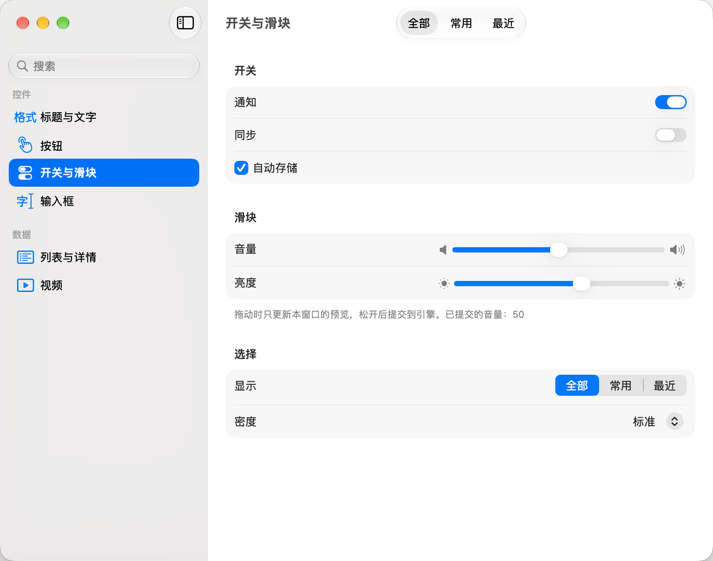<br><sub><b>macOS</b> · SwiftUI</sub></td>
<td width="50%" align="center">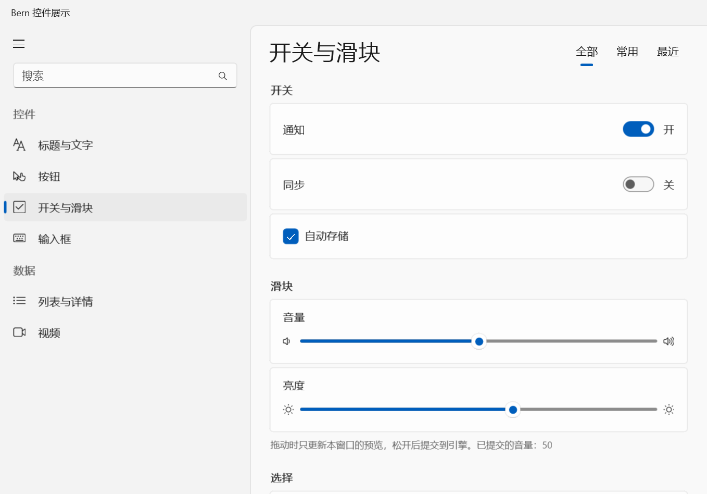<br><sub><b>Windows</b> · WinUI 3</sub></td>
</tr>
<tr>
<td width="50%" align="center">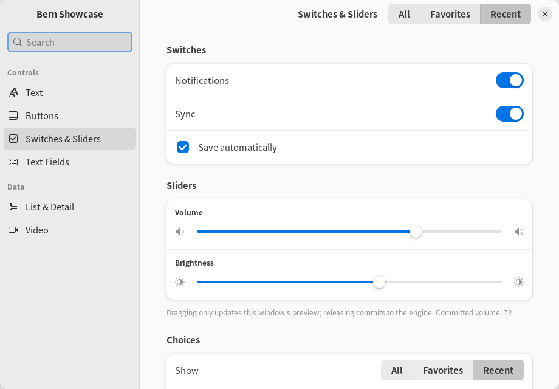<br><sub><b>Linux</b> · GTK 4 + libadwaita</sub></td>
<td width="50%" align="center">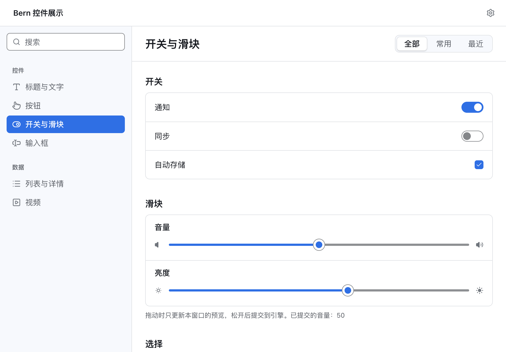<br><sub><b>Web</b> · DOM + WebAssembly</sub></td>
</tr>
<tr>
<td width="50%" align="center">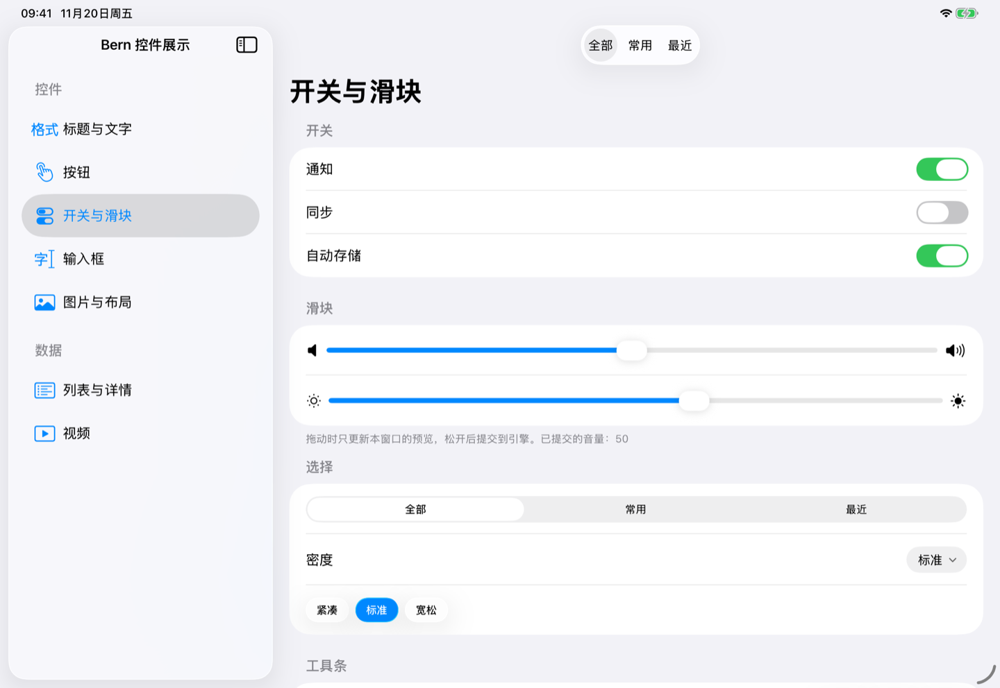<br><sub><b>iPad</b> · iPadOS SwiftUI</sub></td>
<td width="50%" align="center">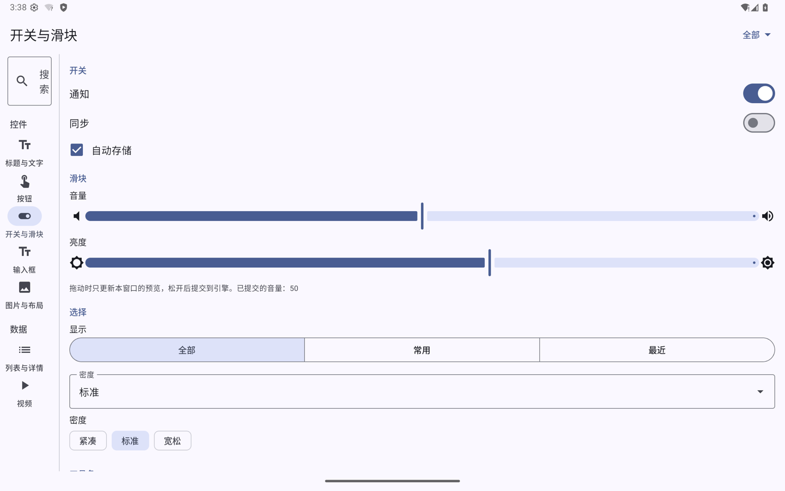<br><sub><b>Android 平板</b> · Jetpack Compose</sub></td>
</tr>
<tr>
<td width="50%" align="center">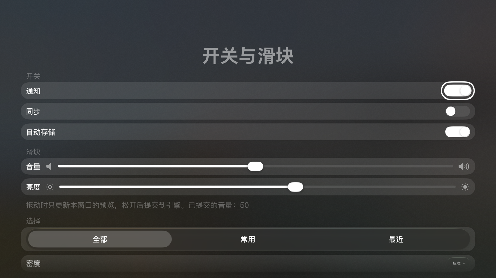<br><sub><b>Apple TV</b> · tvOS SwiftUI</sub></td>
<td width="50%" align="center">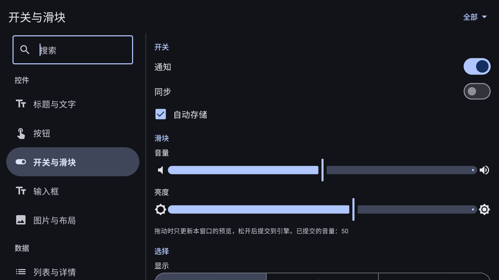<br><sub><b>Android 电视</b> · Jetpack Compose</sub></td>
</tr>
</table>

<table>
<tr>
<td width="32%" align="center">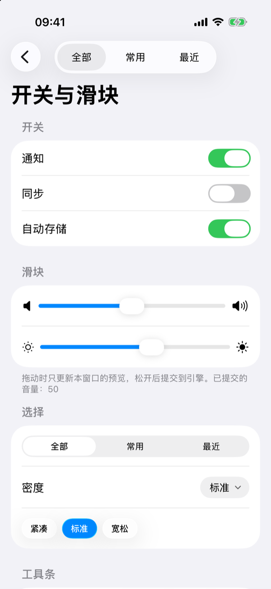<br><sub><b>iOS</b> · SwiftUI</sub></td>
<td width="36%" align="center">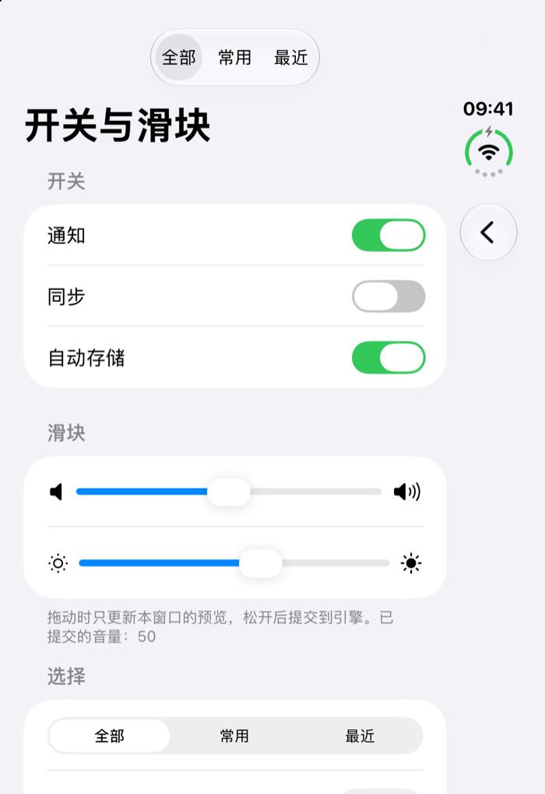<br><sub><b>iPhone Duo</b> · SwiftUI</sub></td>
<td width="32%" align="center">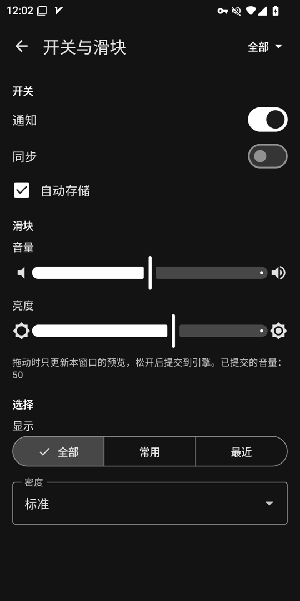<br><sub><b>Android</b> · Jetpack Compose</sub></td>
</tr>
</table>

<table>
<tr>
<td width="25%" align="center">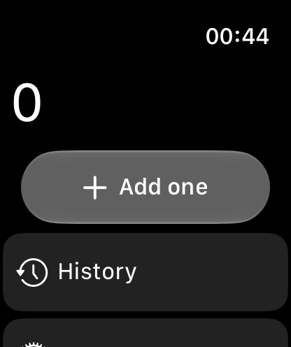<br><sub><b>watchOS</b> · SwiftUI</sub></td>
<td width="25%" align="center">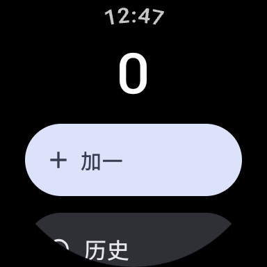<br><sub><b>Wear OS</b> · Compose Material 3</sub></td>
<td width="50%" align="center">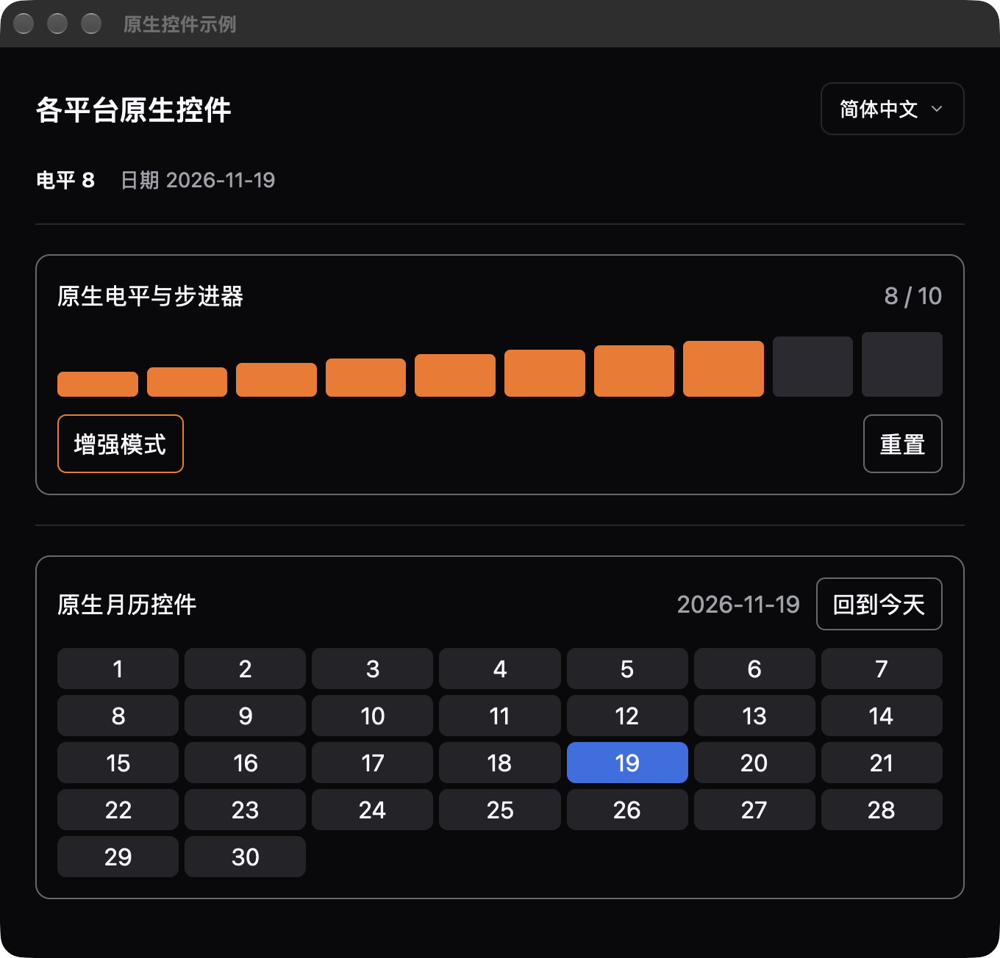<br><sub><b>桌面端 · GPUI</b>（<code>ui = "gpui"</code>，搭配紧邻 <code>NativeView</code>）</sub></td>
</tr>
</table>

<p align="center"><sub>同一份 Rust 声明覆盖桌面、平板、电视、手机、手表与网页。在系统原生目标上 Bern 不自己画任何一个像素；<br>需要统一 GPU 渲染时，切换到 <code>ui = "gpui"</code> 即可直接把 Bern 当作 GPUI 的声明式 UI 框架。</sub></p>

## 为什么是 Bern

<picture>
<source media="(prefers-color-scheme: dark)" srcset="Docs/Assets/tables/why-dark.svg">
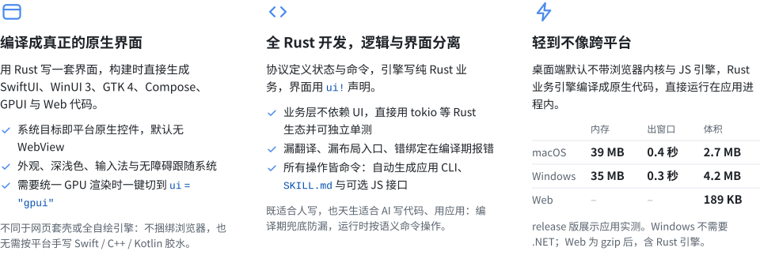
</picture>

## 谁使用了 Bern

<table>
<tr>
<td width="33%" valign="top">
<a href="https://github.com/AimesSoft/RustSend"></a>
<h3><a href="https://github.com/AimesSoft/RustSend">RustSend</a></h3>
<p>兼容 LocalSend 的局域网文件传输工具，支持文件、文件夹与文字互传。</p>
</td>
<td width="33%" valign="top">
<a href="https://github.com/zhaohuaxs/lambda"></a>
<h3><a href="https://github.com/zhaohuaxs/lambda">Lambda</a></h3>
<p>内置 7-Zip 的 Windows / Android 压缩包管理器，支持加密压缩、解压与内容预览。</p>
</td>
<td width="33%" valign="top">
<a href="https://github.com/MCDFsteve/Enji"></a>
<h3><a href="https://github.com/MCDFsteve/Enji">Enji Music</a></h3>
<p>网易云音乐第三方客户端，支持在线与本地音乐、同步歌词和歌单管理。</p>
</td>
</tr>
</table>

## 为 AI 而建

### AI 写代码：漏掉的，编译器替它记着

AI 写界面最常见的问题不是写错，而是写漏：加了一个功能却忘了在窄屏布局放入口，新增一段文案只写了中文，随手挂一个回调绕过了命令。这些在别的框架里要等到用户发现，在 Bern 里都过不了编译。约束越严，AI 越不容易交出半成品：

<picture>
<source media="(prefers-color-scheme: dark)" srcset="Docs/Assets/tables/ai-dark.svg">
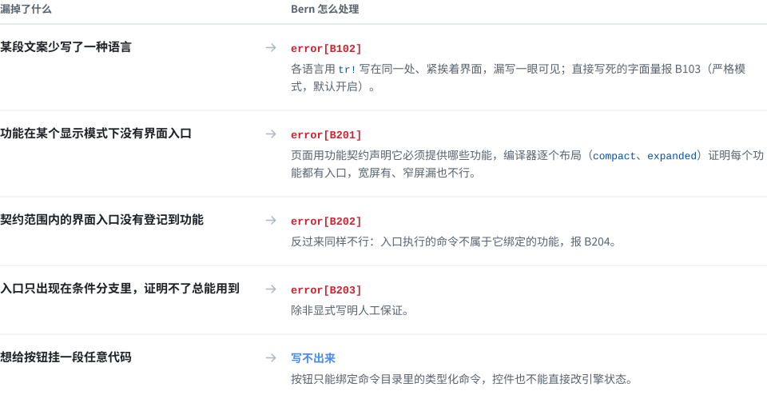
</picture>

报错是给人看的，也是给 Agent 看的：编号、原因、位置都很明确，Agent 能自己改完再编译。下面是展示应用的两次真实输出，第一次故意删掉一个英文翻译，补上之后，第二次删掉窄屏布局里的“换片”菜单：

```text
$ bern check
error[B102]: Missing translation
Missing language: en
Required languages: zh-Hans, en
  --> showcase-ui/src/pages.rs:13:31

$ bern check
error[B201]: Feature missing in adaptive layout
Contract: MediaFeature
Feature: Clip
compact: missing
  --> showcase-ui/src/media.rs:14:5
```

每次构建还会为每个目标输出完整的功能覆盖报告（`features.json`），哪些已覆盖、哪些豁免、哪些只有人工保证，都分开列出。

### AI 用应用：读语义，不读像素

开启控制通道后，Bern 从应用的命令目录生成 `SKILL.md`。以下面的开关为例：Agent 在 `skills/showcase/SKILL.md` 中查到 `ui set-bool` 的用法，再运行 `showcase ui inspect` 找到当前窗口里开关的名称。把这个名称传给应用 CLI，就能像用户点击一样切换开关，不需要截图或坐标。

```sh
$ showcase ui inspect                 # Agent 读到的是语义，不是像素
[{ "target": "controls_page.sync", "role": "switch", "label": "同步", "value": "false", "enabled": true, … }, …]

$ showcase ui set-bool --target controls_page.sync --value true
$ showcase window screenshot --output shot.png

$ showcase window close --window settings#1
{ "outcome": "ConfirmationRequired", "message": "要存储对显示名称的更改吗？",
  "decisions": ["Save", "Discard", "Cancel"], "confirmation": "settings#1:c1", … }

$ showcase window confirm-close --window settings#1 --confirmation settings#1:c1 --decision Save
{ "outcome": "Rejected", "reason": "save_failed: invalid_name: a display name has 1 to 40 characters …" }
```

你也可以运行同样的命令，包括 `showcase showcase set-display-name --name Demo` 这样的业务命令，或用内置的 `window screenshot` 直接截取窗口画面。请使用与应用同一次构建生成的 CLI；远端操作时，用 SSH 登录控制通道所在的机器，以拥有该端点的账户运行。控件被禁用、被对话框挡住或不存在时，CLI 会返回明确的错误码。

### 用 JavaScript 扩展：进程内 `bern.cli`

未启用脚本的应用不链接任何 JS 运行时。当目标配置 `javascript = true` 后，每个 `bern::script::Context`（原生目标统一进程内 Boa，Web 目标为浏览器 Worker）都会默认注入 `globalThis.bern.cli(...)`，直通应用命令目录，并由 Rust 侧黑白名单控制权限（默认 `CliPolicy::allow_all()`）：

```rust
let js = bern::script::Context::with_policy(
    bern::script::CliPolicy::allow_only(["media.*", "@queries", "state", "catalog"])
        .deny("media.bind")
        .with_label("example.plugin"),
)?;
js.eval(r#"await bern.cli("media seek --player-id main --position-ms 90000")"#).await?;
```

完整的调用形式、规则模式与动态拦截器见[JavaScript 与目标能力](Docs/zh-CN/Implementation/JavaScript.md)。

## 实测数据

<picture>
<source media="(prefers-color-scheme: dark)" srcset="Docs/Assets/tables/measured-dark.svg">
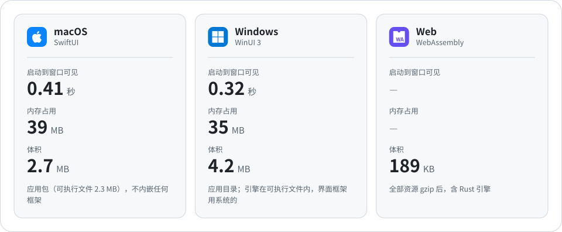
</picture>

<details>
<summary>测量方法</summary>
<br>

- 对象：release 构建的展示应用（6 个页面、主窗口与设置窗口、视频播放器），2026-10-11 测量，每项至少 3 次取中位数。
- macOS：Apple M4、16 GB 内存、macOS 27.0.1。内存为 `footprint` 的物理占用，即活动监视器“内存”一栏的口径。
- Windows：Intel Core i5-13490F、32 GB 内存、Windows 11 25H2。内存为私有工作集，即任务管理器“内存”一栏的口径。
- 启动时间：从启动进程到命令行读到可见的原生窗口为止，包含引擎启动与本地控制通道就绪。
- Windows 表中为 WinUI 3 前端（测量时系统中有 Windows App Runtime 1.8，现在按 2.x 构建）。没有运行时的系统上，同一个程序回退到系统 XAML：启动 0.54 秒，内存 19 MB。两种情况都不需要 .NET 与 VC++ 运行库，应用目录只有可执行文件和 400 KB 的引导 DLL。

</details>

## 更多能力

<picture>
<source media="(prefers-color-scheme: dark)" srcset="Docs/Assets/tables/more-dark.svg">
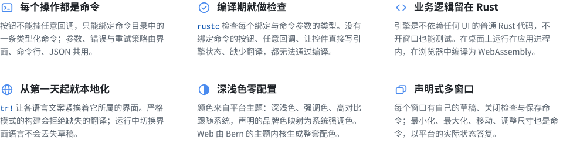
</picture>

<details>
<summary><b>还有：</b>完整标准控件、默认骨架图、样式与动效、媒体与文件、系统集成、模块化应用、<code>NativeView</code> 与可选 JS…</summary>
<br>

- **自适应布局与导航**：`compact`、`medium`、`expanded`、`large` 四档尺寸与 `watch`、`tv` 布局；类型化推入导航、`SplitView` 侧边栏、`Tabs` 与 `TabAccessory`、工具栏、菜单、`Grid`（含瀑布流）、`Stack`、`SplitPane`、`Accordion` 与编译期功能契约。
- **完整原生控件体系**：`Table`、`TreeView`、`Reorderable`、`BottomSheet`、`Refreshable`、`DatePicker`、`TimePicker`、`NumberInput`、`ColorPicker`、`ShortcutInput`、`Tooltip`、`Banner`、`Disclosure`、`Alert`、`EmptyState`、`Badge`、`Avatar`、`Text(selectable:)` 与行内 Markdown、动态可搜索 `Picker(style: combobox)`、多文件 `pick:` 与原生 `save:` 对话框。
- **默认骨架图、样式与动效**：`Query` 与 `skeleton: <bool>` 容器在编译期直接从真实界面树投影骨架图（120 ms 防闪烁、错峰轻浮入场、自动遵循减少动态效果）；`style!` 全局覆盖、弹簧动效与共享元素 Hero、纯 Rust 动画 `Svg`（零 WebView）、HDR `Image`、`Canvas` 自绘与比例轨道 `Rail`。
- **媒体、异步查询与文件**：`Video` 接入各平台原生媒体栈或应用自带 `MediaKernel`，支持直读 `players.<id>.<field>`；`Query` 订阅管理加载、空态、失败与刷新；`Bern.toml` 随包资源；跨本地路径 / Android `content://` / Web `blob:` 统一的 `MediaSource`、系统打开方式 `[[app.opens]]` 与内存供图 `bern::files::serve`。
- **桌面与系统集成**：系统托盘 `StatusItem`（单色 SVG 图标与登录时启动）、macOS `MenuBar`、浮层锚定工具窗、内置 `window.screenshot`、指针事件（`DoubleTap`、`ContextMenu`、`WheelUp`/`WheelDown`）、`Slider(hover:)` 与内嵌 `WebPage`。
- **扩展能力**：模块化应用（`bern new --module`）、紧邻嵌入各平台原生代码的 `NativeView`（含强类型 props、`tr!` 检查、强制 CLI 入口与 `Fallback`，见[紧邻原生视图](Docs/zh-CN/Implementation/Native-Views.md)），以及按需启用的进程内 JavaScript 与 `bern.cli` 黑白名单（见[JavaScript 与目标能力](Docs/zh-CN/Implementation/JavaScript.md)）。

</details>

## 工作原理

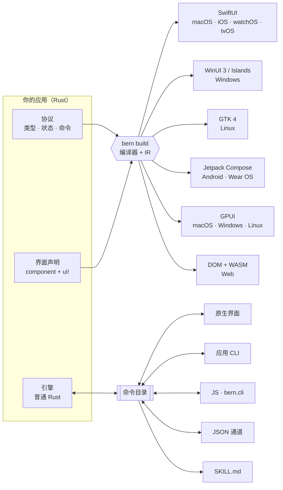

1. **协议**：`#[bern::protocol]` 声明值类型、只读状态，以及命令与查询 trait。
2. **引擎**：用普通 Rust 实现这些 trait；它看不到窗口、控件和传输层。
3. **界面**：`#[component]` 函数，主体是一个 `ui!` 声明。编译器把它们读入共享的中间表示（IR），各目标模块从 IR 生成原生代码。增加新目标不需要改动解析器、IR 或你的业务逻辑。

## 代码一览

**1 · 协议**：类型、状态与命令

```rust
#[bern::protocol(namespace = "counter", version = 1)]
pub mod counter {
    use bern::prelude::*;

    #[state]
    pub struct State {
        pub count: i64,
    }

    #[commands]
    pub trait Commands {
        /// Add to the count.
        fn add(&mut self, by: i64) -> Result<(), CommandError>;
    }
}
```

**2 · 引擎**：普通 Rust，不依赖 UI

```rust
use bern::CommandError;

pub struct Counter {
    state: counter::State,
}

impl Default for Counter {
    fn default() -> Self {
        Self { state: counter::State { count: 0 } }
    }
}

impl counter::Commands for Counter {
    fn add(&mut self, by: i64) -> Result<(), CommandError> {
        self.state.count += by;
        Ok(())
    }
}

impl counter::Engine for Counter {
    fn state(&self) -> &counter::State {
        &self.state
    }
}
```

**3 · 界面**：一个 `ui!` 声明

```rust
#[component]
pub fn counter_view(app: counter::Client) -> impl View {
    ui! {
        Form {
            Text(content: tr! {
                "zh-Hans" => "已计数 {n} 次",
                "en" => "Counted {n} times";
                n: app.count
            })
            Button(
                id: add,
                label: tr! { "zh-Hans" => "加一", "en" => "Add one" },
                prominence: prominent
            ) => app.add(1)
        }
    }
}
```

**4 · 所有入口驱动同一个引擎**

```sh
counter ui inspect
counter ui activate --target counter_view.add
counter counter add --by 5
counter catalog
```

`Bern.toml` 声明语言、主题、源码、随包资源与构建目标。完整示例见[控件展示应用](examples/showcase)：侧边栏应用，包含文字层级、按钮、开关、滑块、输入框、由引擎查询驱动的搜索、列表到详情的导航、视频，以及带页签和关闭确认的设置窗口。[计划应用](examples/planner)演示模块化应用、样式覆盖、动效与 `Canvas`。[图案集](examples/gallery)演示媒体类应用的组件：海报墙的错开入场、时间轴的按比例摆放、音量浮层按钮、随四档尺寸变化的页边距与布局，以及拖入视频后由引擎读出文件名、格式与大小。[原生控件示例](examples/native-controls)演示通过 `NativeView` 在六个后端紧邻嵌入平台原生控件，[手表端示例](examples/wearos)演示手表目标，[动画 SVG](examples/svg-animation)演示纯 Rust 矢量动画。

## 支持的平台

<picture>
<source media="(prefers-color-scheme: dark)" srcset="Docs/Assets/tables/platforms-dark.svg">
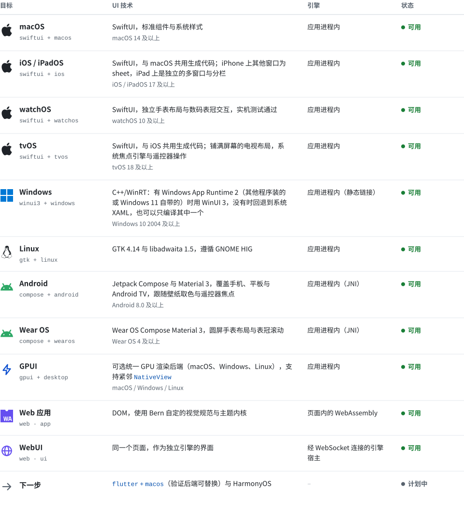
</picture>

实现记录：[macOS](Docs/zh-CN/Implementation/macOS-SwiftUI.md) · [iOS](Docs/zh-CN/Implementation/iOS-SwiftUI.md) · [watchOS](Docs/zh-CN/Implementation/watchOS-SwiftUI.md) · [tvOS](Docs/zh-CN/Implementation/tvOS-SwiftUI.md) · [Windows](Docs/zh-CN/Implementation/Windows-WinUI3.md) · [Linux](Docs/zh-CN/Implementation/Linux-GTK.md) · [Android 与 Wear OS](Docs/zh-CN/Implementation/Android-Compose.md) · [GPUI](Docs/zh-CN/Implementation/GPUI.md) · [Web 与 WebUI](Docs/zh-CN/Implementation/Web.md)；下一步的平台见[适配规范](Docs/zh-CN/Adaptation/README.md)。

不指定 UI 技术时使用平台的默认技术；默认技术不可用时直接报错，不会悄悄换成另一套技术。

### 把 Bern 当作 GPUI 的 UI 框架

GPUI 提供了高性能 GPU 渲染，但本身不带标准控件库。在 macOS、Windows 或 Linux 目标里写上 `ui = "gpui"`，就可以直接把 Bern 当作 GPUI 的声明式 UI 框架使用：一份 `ui!` 开箱自带全套桌面控件、语义深浅色主题、弹簧动效、编译期多语言与功能契约检查，以及 Skills + CLI。需要自定义 GPU 绘制的地方，用 `NativeView(gpui: "...")` 紧邻嵌入原生 GPUI 代码即可；未来想切回系统原生控件，或扩展到 iOS、Android、watchOS、Wear OS 与 Web，业务与声明都无需重写。

### Windows 与 iOS 各有两个前端

这两个平台的系统跨度大，一个 UI 框架覆盖不全，所以同一份声明各生成两个前端。默认两个都编译进同一个包，应用启动时按系统自动选择，用户和应用代码都不用管。

| 平台 | 前端 | `frontends` 里的名字 | 运行在 |
| --- | --- | --- | --- |
| Windows | WinUI 3 | `winui3` | 有 Windows App Runtime 2 的系统，Mica 背景与 Windows 11 外观 |
| Windows | 系统 XAML，经 XAML Islands | `xaml-islands` | 其余的 Windows 10 与 11，不需要安装运行时 |
| iOS | SwiftUI | `swiftui` | iOS 17 起，所有 Apple 目标共用这个前端 |
| iOS | SwiftUI 的 iOS 16 版 | `swiftui-16` | iOS 16，由同一份生成代码改写而成 |

只要一个前端时写明：

```toml
[targets.windows]
frontends = ["winui3"]   # 没有运行时的系统上会提示安装

[targets.ios]
frontends = ["swiftui"]  # 最低 iOS 17
```

iOS 两个前端都留着时，写 `packages = "separate"` 可以打成两个 `.ipa`。选择规则见 [Windows](Docs/zh-CN/Implementation/Windows-WinUI3.md) 与 [iOS](Docs/zh-CN/Implementation/iOS-SwiftUI.md) 的实现记录，iOS 16 上有几项功能会降级，也写在那里。

## 与其他跨平台框架对比

<p align="center">
<a href="https://github.com/zed-industries/zed/tree/main/crates/gpui"></a>
<a href="https://dioxuslabs.com"></a>
<a href="https://flutter.dev"></a>
<a href="https://reactnative.dev"></a>
<a href="https://uniapp.dcloud.net.cn"></a>
<br>
<a href="https://www.electronjs.org"></a>
<a href="https://tauri.app"></a>
<a href="https://avaloniaui.net"></a>
<a href="https://www.qt.io"></a>
</p>

每个框架都在回答同一个问题：一份代码，怎样变成各平台上的界面。回答不同，取舍也不同。下面依据各项目的官方文档整理；体积和内存随版本与配置变化很大，这里只比较结构上的差别，Bern 自己的数字见[实测数据](#实测数据)。

<picture>
<source media="(prefers-color-scheme: dark)" srcset="Docs/Assets/compare/routes-dark.svg">
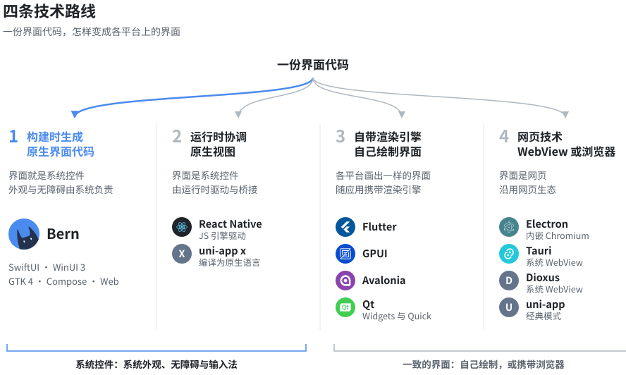
</picture>

前两条路线得到的是系统控件：外观、无障碍、输入法、深浅色都由系统负责，代价是各平台控件不完全相同。后两条路线在每个平台上画出一样的界面，代价是要自己追随各平台的设计与行为，或者携带一个浏览器。

<picture>
<source media="(prefers-color-scheme: dark)" srcset="Docs/Assets/compare/landscape-dark.svg">
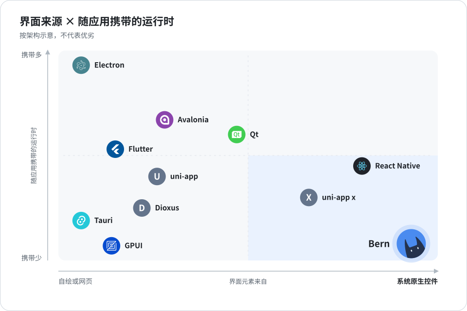
</picture>

上图按架构示意，不代表优劣：横轴是界面元素来自系统控件还是框架自绘、网页；纵轴是应用要随身携带多少运行时（浏览器内核、JS 引擎、渲染引擎、语言运行时）。

### 技术路线

<picture>
<source media="(prefers-color-scheme: dark)" srcset="Docs/Assets/tables/technology-dark.svg">
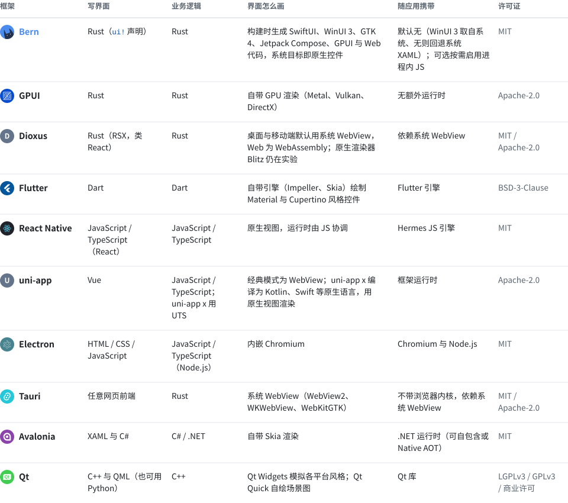
</picture>

### 平台与能力

<picture>
<source media="(prefers-color-scheme: dark)" srcset="Docs/Assets/tables/capabilities-dark.svg">
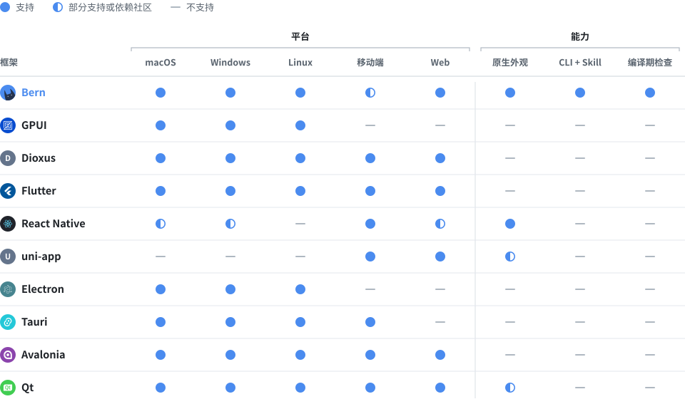
</picture>

- **移动端**：iOS / iPadOS 与 Android（并覆盖 watchOS、Wear OS、tvOS 与 Android 电视）。React Native 的桌面版本由微软维护，uni-app 另覆盖小程序与鸿蒙；Bern 覆盖的桌面、手机、平板、手表与电视目标均已在真机实际测试通过，并支持打包 `.ipa` 与 `.apk`。
- **原生外观**：控件就是平台自己的控件，外观、无障碍与输入法由系统提供。Qt Widgets 与 uni-app x 接近原生，记为部分。
- **Skills + CLI**：Bern 从同一份命令目录生成应用 CLI 和 `SKILL.md`，人和 Agent 使用相同的命令。其他框架可以借助无障碍接口或 Playwright、Flutter Driver 等测试工具从外部自动化。
- **编译期检查**：翻译缺失、功能在某个布局没有入口、入口没有登记功能，都由编译器直接报错（见[为 AI 而建](#为-ai-而建)）。其他框架多借助 lint、翻译工具或测试发现这类问题。
- **成熟度**：Electron 与 Qt 非常成熟；Flutter、React Native、uni-app、Tauri 与 Avalonia 成熟；Dioxus 发展中；GPUI 支撑着 Zed 编辑器，通用组件仍在早期；Bern 是早期预览。

### 性能与资源

界面层和逻辑层用什么语言、怎样执行，决定了运行时的开销上限：原生编译且没有垃圾回收的语言最省，JIT 与字节码解释的语言需要携带引擎、占用更多内存。

<picture>
<source media="(prefers-color-scheme: dark)" srcset="Docs/Assets/compare/languages-dark.svg">
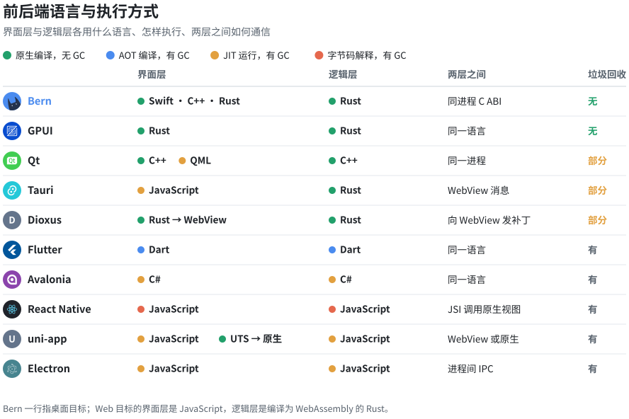
</picture>

同样一个只显示一行字的窗口，各框架的包体、启动时间与内存差别很大。下图在同一台 CI 虚拟机（GitHub 托管的 Apple M1）上实测：各框架用自己的工具打 release 包，测量时轮流启动，每个 10 次取中位数。脚本在 [benchmarks/](benchmarks/) 中，可以在 Actions 里重新运行 Benchmarks 工作流。

<picture>
<source media="(prefers-color-scheme: dark)" srcset="Docs/Assets/compare/resources-dark.svg">
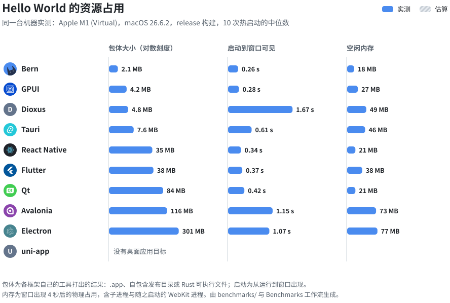
</picture>

### 怎么选

<picture>
<source media="(prefers-color-scheme: dark)" srcset="Docs/Assets/tables/choose-dark.svg">
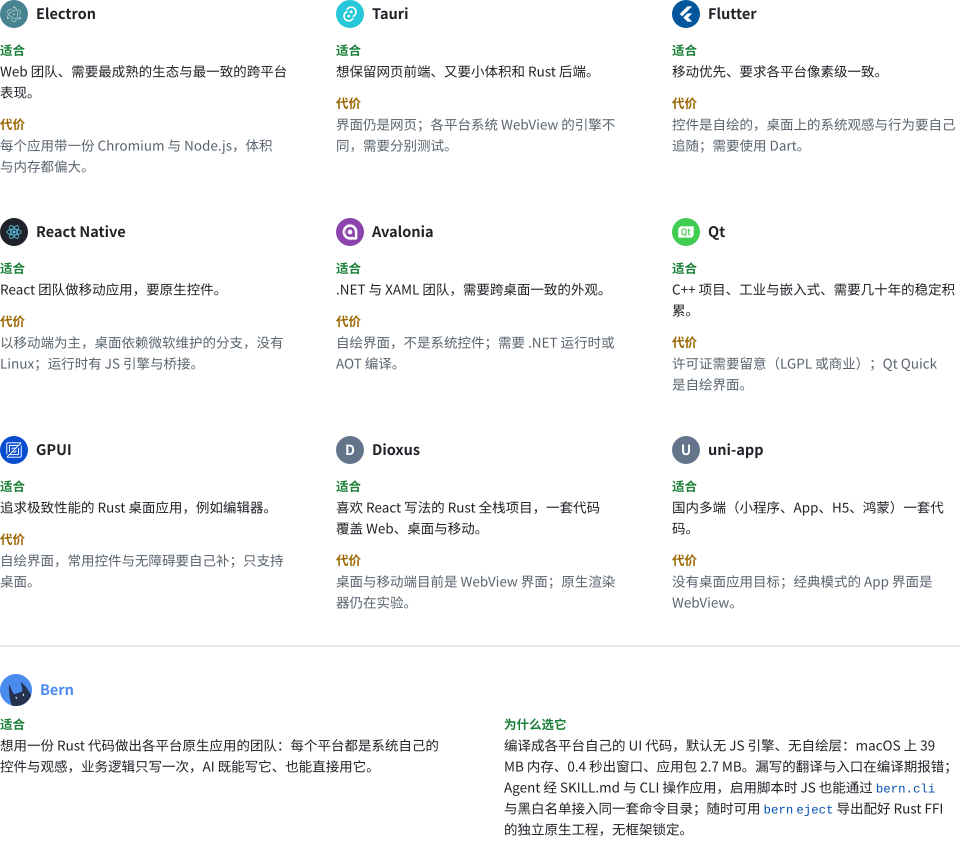
</picture>

## 快速开始

需要 Rust 1.99（`rustup` 按 `rust-toolchain.toml` 自动安装），以及所构建目标的工具链。先安装构建工具 `bern`：

```sh
cargo binstall bern-cli
```

[cargo-binstall](https://github.com/cargo-bins/cargo-binstall) 从 [Releases](https://github.com/AimesSoft/Bern/releases) 下载编译好的 `bern`，也可以自己去那里下载；`cargo install bern-cli` 则从源码编译。这样装的 `bern` 创建的应用从 crates.io 取同一版本的 Bern。要修改 Bern 本身，在克隆下来的仓库里用 `cargo install --path crates/bern-cli` 安装 `bern`，它创建的应用从这个克隆取 Bern。

### 创建应用

在任意目录中：

```sh
bern new my_app
cd my_app
bern run
```

新应用是一个带计数的窗口，协议、引擎与界面各一个 crate，六个目标都已在 `Bern.toml` 中声明。`bern run` 构建本机的目标并启动它：macOS 上是 SwiftUI，Windows 上是 WinUI 3，Linux 上是 GTK；`bern run --target web_app` 在浏览器中打开，`bern run --target ios` 装进正在运行的 iOS 模拟器，`bern run --target android` 装到用 USB 调试连接的 Android 手机（或模拟器）上并启动。目标声明 `channels = ["ipc"]` 时，可在 `target/bern/<目标>/bin/` 找到应用 CLI，在同级的 `skills/` 目录找到 `SKILL.md`。

`bern doctor` 列出本机构建每个目标还缺什么、怎么装：

```text
$ bern doctor
bern 0.2.1 on macOS (aarch64)

[✓] Rust: rustc 1.99.0, cargo 1.99.0
[✓] macOS · SwiftUI: macOS SDK 26.5, Swift 6.3.2
[✓] iOS · SwiftUI: iOS simulator SDK 26.5, the aarch64-apple-ios-sim target
[-] Windows · WinUI 3: builds on Windows
[-] Linux · GTK 4: builds on Linux
[✓] Android · Compose: Android SDK, NDK 29.0.14206865, gradle-9.5.1, the aarch64-linux-android target
[✓] Web · WebAssembly: the wasm32-unknown-unknown target
```

<details>
<summary><b>各平台需要的工具</b></summary>
<br>

- **macOS**：Xcode 26 或更新版本。从 App Store 安装后运行 `sudo xcode-select --switch /Applications/Xcode.app`。
- **iOS / iPadOS / tvOS / watchOS**：Xcode 对应的 Apple 平台 SDK 与 Rust 目标（`aarch64-apple-ios` / `aarch64-apple-ios-sim`、`aarch64-apple-tvos` / `aarch64-apple-tvos-sim`、`aarch64-apple-watchos` / `aarch64-apple-watchos-sim`）。`bern run` 可在模拟器调试，`bern package` 生成可供真机安装运行的 `.ipa`。
- **Windows**：Visual Studio 2022 或更新版本的“使用 C++ 的桌面开发”（只装生成工具也可以），含 Windows 11 SDK；Rust 使用 MSVC 工具链。首次构建时用 Windows SDK 的 `cppwinrt` 生成 C++/WinRT 头文件，并把它们与运行时预编译（每个配置约 2.4 GB，放在 `target` 中）；之后的构建只编译应用自己的代码，新项目约 5 秒，展示应用约 9 秒。应用目录只有可执行文件、400 KB 的引导 DLL 和资源，不需要 .NET，也不随附 Windows App SDK。
- **Linux**：GTK 4.14 与 libadwaita 1.5 的开发包，例如 `sudo apt install libgtk-4-dev libadwaita-1-dev libsoup-3.0-dev gstreamer1.0-libav`。
- **Android**：Android Studio（带 SDK 与 NDK，在 SDK Manager 的 SDK Tools 里勾选 NDK）、Gradle 9.4 或更新版本，以及 `rustup target add aarch64-linux-android`。第一次构建时 Gradle 下载 Android 插件与 Compose 库。
- **Web**：`rustup target add wasm32-unknown-unknown`。`web_app` 构建把引擎编译为 WebAssembly 在页面内运行；`web_ui` 构建让页面作为独立引擎宿主的界面，`bern run` 启动宿主并打开它的地址。

</details>

### 发布应用

```sh
bern package
```

按 release 构建本机能构建的目标，在 `target/bern/dist/` 中生成安装包：macOS 的 `.dmg`，Windows 的安装程序（按当前用户安装，不需要管理员权限）与免安装的 `.zip`，Linux 的 `.deb` 与 `.tar.gz`，Android 的 `.apk` 与上架用的 `.aab`，Web 的静态站点压缩包。桌面和 WebUI 安装包带有应用 CLI，开启 IPC 时还带有 Skill。静态 Web 包只含站点文件；Android CLI 在开发电脑上运行，不打进 APK。签名用环境变量配置，证书不进仓库：`BERN_MACOS_SIGNING_IDENTITY` 与 `BERN_MACOS_NOTARY_PROFILE`（签名并公证），`BERN_WINDOWS_CERTIFICATE`（证书指纹或 `.pfx`），`BERN_ANDROID_KEYSTORE`、`BERN_ANDROID_KEYSTORE_PASSWORD` 与 `BERN_ANDROID_KEY_ALIAS`（发布密钥）。没有配置时照样生成，并提示未签名的后果。

### 运行展示应用

Bern 仓库中的展示应用用到全部组件、两个窗口和视频播放器。在仓库目录中：

```sh
cd examples/showcase
bern run
```

### 从外部驱动运行中的应用

```sh
showcase ui inspect                                          # 列出已挂载的控件
showcase ui select --target main_window.pages --option Controls
showcase ui set-bool --target controls_page.sync --value true
showcase showcase search-library --text mo                   # 引擎查询
showcase window open --kind settings
showcase window list                                         # 窗口的实际状态
showcase window screenshot --output shot.png                 # 截取窗口 PNG
ssh HOST /path/to/showcase state
```

目标的 `channels = ["ipc"]` 用于开启外部控制。Android 的 CLI 在开发电脑上运行，连接 `bern run` 通过 `adb forward` 转发的端点，不在手机上执行。独立 Web `app` 开启 IPC 后，`bern run` 会启动本地桥，连接已打开的浏览器标签页；发布的静态站点包不含本机 CLI 和 `SKILL.md`。

## 路线图

<picture>
<source media="(prefers-color-scheme: dark)" srcset="Docs/Assets/tables/roadmap-dark.svg">
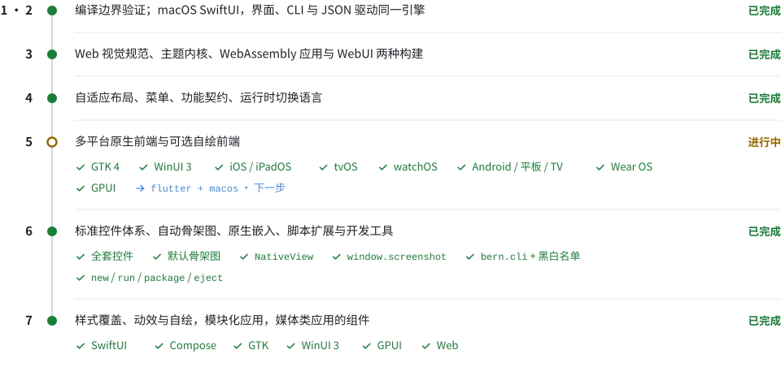
</picture>

## 仓库结构

<details>
<summary>crate 与目录</summary>
<br>

<picture>
<source media="(prefers-color-scheme: dark)" srcset="Docs/Assets/tables/repository-dark.svg">
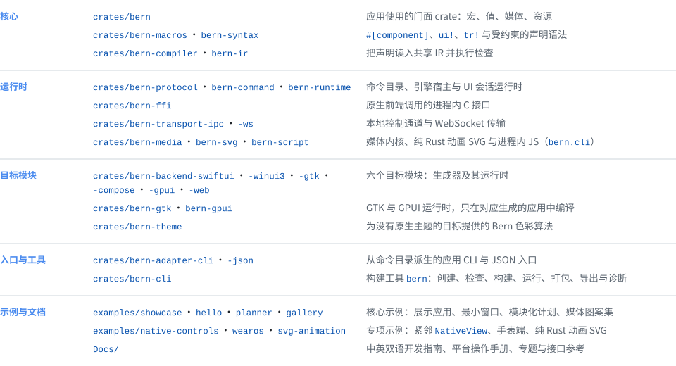
</picture>

</details>

## 开发

```sh
cargo fmt --all --check
cargo clippy --workspace --all-targets -- -D warnings
cargo test --workspace
```

测试中包含必须编译失败的声明，并在装有相应工具包的环境中对生成的应用做类型检查：用 Xcode 检查 Swift 6，用开发包检查 GTK，在 Windows 上用 MSVC 编译生成的两套前端。Android 的 Kotlin 由 `bern build --target android` 经 Gradle 编译。

## 文档

在线浏览可检索文档：**[bern.aimes-soft.com/docs/zh-CN](https://bern.aimes-soft.com/docs/zh-CN)**，或在仓库中直接阅读：

- **接口参考**：[文档目录](Docs/zh-CN/README.md) · [当前组件用法](Docs/zh-CN/Reference/UI.md) · [完整属性表](Docs/zh-CN/Reference/Component-Properties.md) · [平台能力与验证范围](Docs/zh-CN/Reference/Platforms.md) · [性能追踪](Docs/zh-CN/Reference/Tracing.md)
- **架构与设计**：[设计文档](Docs/zh-CN/Design.md) · [适配规范](Docs/zh-CN/Adaptation/README.md) · [React Native 研究](Docs/zh-CN/Research/ReactNative.md)
- **专题文档**：[紧邻原生视图](Docs/zh-CN/Implementation/Native-Views.md) · [JavaScript 与 `bern.cli`](Docs/zh-CN/Implementation/JavaScript.md) · [动画 SVG](Docs/zh-CN/Implementation/Animated-SVG.md) · [按模块编译](Docs/zh-CN/Implementation/Module-Builds.md) · [应用浏览器扩展](Docs/zh-CN/Implementation/Web-Extensions.md)
- **平台实现**：[macOS](Docs/zh-CN/Implementation/macOS-SwiftUI.md) · [iOS](Docs/zh-CN/Implementation/iOS-SwiftUI.md) · [watchOS](Docs/zh-CN/Implementation/watchOS-SwiftUI.md) · [tvOS](Docs/zh-CN/Implementation/tvOS-SwiftUI.md) · [Windows](Docs/zh-CN/Implementation/Windows-WinUI3.md) · [Linux](Docs/zh-CN/Implementation/Linux-GTK.md) · [Android 与 Wear OS](Docs/zh-CN/Implementation/Android-Compose.md) · [GPUI](Docs/zh-CN/Implementation/GPUI.md) · [Web 与 WebUI](Docs/zh-CN/Implementation/Web.md)

文档另有[英文版](Docs/README.md)（[在线版](https://bern.aimes-soft.com/docs)）。

## 许可证

[MIT](LICENSE) © 2026 MCDFSteve

<div align="center">
<br>
<sub>Bern 仍处于早期开发阶段，API 与声明语法可能还会变化。</sub>
</div>
