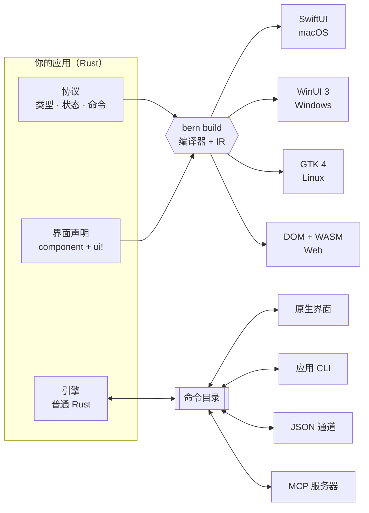

<div align="center">

<h1>Bern</h1>

<p><b>用 Rust 声明一次应用，在每个桌面平台上交付真正的原生界面。</b><br>
每个控件都是一条类型化命令，由用户、脚本和 AI Agent 共同使用。</p>

<p>


</p>

<p>


<a href="Cargo.toml"></a>


</p>

<p>
<a href="README.md">English</a> ·
<b>简体中文</b> ·
<a href="README.zh-Hant.md">繁體中文</a> ·
<a href="README.ja.md">日本語</a>
</p>

<p>
<a href="#-快速开始">快速开始</a> ·
<a href="#-工作原理">工作原理</a> ·
<a href="#-代码一览">代码</a> ·
<a href="#-支持的平台">平台</a> ·
<a href="#-路线图">路线图</a> ·
<a href="Docs/Design.md">设计文档</a>
</p>

</div>

<br>

<table>
<tr>
<td width="50%" align="center"><br><sub><b>macOS</b> · SwiftUI</sub></td>
<td width="50%" align="center"><br><sub><b>Windows</b> · WinUI 3</sub></td>
</tr>
<tr>
<td width="50%" align="center"><br><sub><b>Linux</b> · GTK 4 + libadwaita</sub></td>
<td width="50%" align="center"><br><sub><b>Web</b> · DOM + WebAssembly</sub></td>
</tr>
</table>

<p align="center"><sub>同一份 <code>controls_page</code> 声明，生成四套 UI 技术。在桌面上 Bern 不自己绘制任何像素：<br>每个开关、滑块和侧边栏都是平台自己的标准控件，使用平台自己的配色。</sub></p>

## ✨ 为什么选择 Bern

Bern 是以命令为中心的 Rust 应用框架。界面用受约束、可静态分析的 Rust 声明编写，`bern build` 把它编译成各平台的原生 UI 技术。业务逻辑留在普通的 Rust 引擎中；界面里每个可操作的东西都绑定一条类型化命令，因此界面、应用 CLI、JSON 通道和 MCP 服务器驱动的是**同一个引擎实例**。

<table>
<tr>
<td width="33%" valign="top">
<h3>🖥️ 真原生，不是仿原生</h3>
macOS 上是 SwiftUI，Windows 上是 WinUI 3，Linux 上是 GTK 4 与 libadwaita。标准控件、系统配色、深色模式、强调色与无障碍都来自平台本身，而不是 Bern 的渲染器。
</td>
<td width="33%" valign="top">
<h3>⌘ 每个操作都是命令</h3>
按钮不能挂任意回调，只能绑定命令目录中的一条类型化命令；参数、错误与重试策略由所有入口共用。
</td>
<td width="33%" valign="top">
<h3>🤖 天生支持 AI Agent</h3>
同一份命令目录生成应用 CLI 与 MCP 服务器。Agent 可以读取运行中的界面（<code>ui.inspect</code>），并通过真实控件操作它，包括窗口与关闭确认。
</td>
</tr>
<tr>
<td width="33%" valign="top">
<h3>🦀 业务逻辑留在 Rust</h3>
引擎是不依赖任何 UI 的普通 Rust 代码，不开窗口也能测试。在桌面上它运行在应用进程内，在浏览器中编译为 WebAssembly。
</td>
<td width="33%" valign="top">
<h3>🧭 编译期就做检查</h3>
<code>rustc</code> 检查每个绑定与命令参数的类型。没有绑定命令的按钮、任意回调、让控件直接写引擎状态、缺少翻译，都无法通过编译。
</td>
<td width="33%" valign="top">
<h3>🌍 从第一天起就本地化</h3>
<code>tr!</code> 让各语言文案紧挨着它所属的界面。严格模式的构建会拒绝缺失的翻译；运行中切换界面语言不会丢失草稿。
</td>
</tr>
</table>

<details>
<summary><b>还有更多：</b>多窗口、媒体、异步查询、自适应布局…</summary>
<br>

- **声明式多窗口**：主窗口与设置窗口各有自己的草稿、关闭检查与保存命令；最小化、最大化、移动、调整尺寸都是命令，以平台的实际状态答复。
- **视频**：`Video` 分别运行在 AVFoundation、Windows Media Foundation、GStreamer 与 HTML 媒体上，控制条由命令驱动，播放器可以跨页面继续播放。
- **异步查询**：`Query` 订阅带有加载、空结果、失败与刷新状态，只显示最新的答复。
- **自适应布局**：按视图实际获得的空间选择 `compact` 或 `expanded` 布局。
- **类型化导航**：侧边栏、带类型化路由的推入导航、页签、工具栏与菜单。
- **功能契约**：声明组件在每种布局中必须覆盖的功能，由编译器证明覆盖完整。
- **随包资源**：在 `Bern.toml` 中声明文件，构建时检查，运行时按名称定位。

</details>

## 🧩 工作原理



1. **协议**：`#[bern::protocol]` 声明值类型、只读状态，以及命令与查询 trait。
2. **引擎**：用普通 Rust 实现这些 trait；它看不到窗口、控件和传输层。
3. **界面**：`#[component]` 函数，主体是一个 `ui!` 声明。编译器把它们读入共享的中间表示（IR），各目标模块从 IR 生成原生代码。增加新目标不需要改动解析器、IR 或你的业务逻辑。

## 🍃 代码一览

<table>
<tr>
<td width="50%" valign="top">

**1 · 协议**：类型、状态与命令

```rust
#[bern::protocol(namespace = "counter", version = 1)]
pub mod counter {
    use bern::prelude::*;

    #[state]
    pub struct State {
        pub count: i64,
    }

    #[commands]
    pub trait Commands {
        /// Add to the count.
        fn add(&mut self, by: i64) -> Result<(), CommandError>;
    }
}
```

**3 · 界面**：一个 `ui!` 声明

```rust
#[component]
pub fn counter_view(app: counter::Client) -> impl View {
    ui! {
        Form {
            Text(content: tr! {
                "zh-Hans" => "已计数 {n} 次",
                "en" => "Counted {n} times";
                n: app.count
            })
            Button(
                id: add,
                label: tr! { "zh-Hans" => "加一", "en" => "Add one" },
                prominence: prominent
            ) => app.add(1)
        }
    }
}
```

</td>
<td width="50%" valign="top">

**2 · 引擎**：普通 Rust，不依赖 UI

```rust
use bern::CommandError;

pub struct Counter {
    state: counter::State,
}

impl Default for Counter {
    fn default() -> Self {
        Self { state: counter::State { count: 0 } }
    }
}

impl counter::Commands for Counter {
    fn add(&mut self, by: i64) -> Result<(), CommandError> {
        self.state.count += by;
        Ok(())
    }
}

impl counter::Engine for Counter {
    fn state(&self) -> &counter::State {
        &self.state
    }
}
```

**4 · 所有入口驱动同一个引擎**

```sh
counter ui inspect
counter ui activate --target counter_view.add
counter counter add --by 5
counter-mcp   # 同一份命令目录，提供给 AI Agent
```

</td>
</tr>
</table>

`Bern.toml` 声明语言、主题、源码、随包资源与构建目标。完整示例见[控件展示应用](examples/showcase)：侧边栏应用，包含文字层级、按钮、开关、滑块、输入框、由引擎查询驱动的搜索、列表到详情的导航、视频，以及带页签和关闭确认的设置窗口。

## 🖥️ 支持的平台

<table>
<tr>
<th align="left">目标</th>
<th align="left">UI 技术</th>
<th align="left">引擎</th>
<th align="left">状态</th>
</tr>
<tr>
<td><b>macOS</b><br><code>swiftui + macos</code></td>
<td>SwiftUI，标准组件与系统样式 · macOS 14 及以上</td>
<td>应用进程内</td>
<td> <a href="Docs/Implementation/macOS-SwiftUI.md">实现记录</a></td>
</tr>
<tr>
<td><b>Windows</b><br><code>winui3 + windows</code></td>
<td>Windows App SDK 1.8 上的 WinUI 3，C# 宿主 · Windows 10 2004 及以上</td>
<td>应用进程内（<code>bern_app.dll</code>）</td>
<td> <a href="Docs/Implementation/Windows-WinUI3.md">实现记录</a></td>
</tr>
<tr>
<td><b>Linux</b><br><code>gtk + linux</code></td>
<td>GTK 4.14 与 libadwaita 1.5，遵循 GNOME HIG</td>
<td>应用进程内</td>
<td> <a href="Docs/Implementation/Linux-GTK.md">实现记录</a></td>
</tr>
<tr>
<td><b>Web 应用</b><br><code>web</code> · <code>app</code></td>
<td>DOM，使用 Bern 自定的视觉规范与主题内核</td>
<td>页面内的 WebAssembly</td>
<td> <a href="Docs/Implementation/Web.md">实现记录</a></td>
</tr>
<tr>
<td><b>WebUI</b><br><code>web</code> · <code>ui</code></td>
<td>同一个页面，作为独立引擎的界面</td>
<td>经 WebSocket 连接的引擎宿主</td>
<td> <a href="Docs/Implementation/Web.md">实现记录</a></td>
</tr>
<tr>
<td><b>下一步</b></td>
<td><code>flutter + macos</code>（验证后端可替换），之后是 iOS、Android 与 HarmonyOS</td>
<td>–</td>
<td> <a href="Docs/Adaptation/README.md">适配规范</a></td>
</tr>
</table>

不指定 UI 技术时使用平台的默认技术；默认技术不可用时直接报错，不会悄悄换成另一套技术。

## 🚀 快速开始

需要 Rust 1.99（由 `rust-toolchain.toml` 固定），以及所构建目标的工具链。每次构建还会在 `target/bern/<目标>/bin/` 中生成应用 CLI 与 MCP 服务器。

<details open>
<summary><b>🍎 macOS</b> · Xcode 26 或更新版本</summary>

```sh
cargo run -p bern-cli -- build --manifest examples/showcase/Bern.toml --target macos
open target/bern/macos/Showcase.app
```

</details>

<details>
<summary><b>🪟 Windows</b> · .NET SDK 10</summary>

```powershell
cargo run -p bern-cli -- build --manifest examples/showcase/Bern.toml --target windows
target\bern\windows\Showcase\showcase.exe
```

首次构建时从 NuGet 还原 Windows App SDK，它随可执行文件一起发布。

</details>

<details>
<summary><b>🐧 Linux</b> · GTK 4.14 与 libadwaita 1.5 的开发包</summary>

```sh
sudo apt install libgtk-4-dev libadwaita-1-dev gstreamer1.0-libav
cargo run -p bern-cli -- build --manifest examples/showcase/Bern.toml --target linux
target/bern/linux/Showcase/showcase
```

</details>

<details>
<summary><b>🌐 Web</b> · <code>rustup target add wasm32-unknown-unknown</code></summary>

```sh
# 引擎编译为 WebAssembly，在页面内运行
cargo run -p bern-cli -- build --manifest examples/showcase/Bern.toml --target web_app
python3 -m http.server 8765 --bind 127.0.0.1 --directory target/bern/web_app

# 或者页面作为独立引擎宿主的界面
cargo run -p bern-cli -- build --manifest examples/showcase/Bern.toml --target web_ui
target/bern/web_ui/bin/showcase-host
```

</details>

### 从外部驱动运行中的应用

```sh
showcase ui inspect                                          # 列出已挂载的控件
showcase ui select --target main_window.pages --option Controls
showcase ui set-bool --target controls_page.sync --value true
showcase showcase search-library --text mo                   # 引擎查询
showcase window open --kind settings
showcase window list                                         # 窗口的实际状态
showcase-mcp                                                 # 经 stdio 的 MCP 服务器
```

只有目标声明了 `channels = ["ipc"]` 时才会启动控制通道；不声明则应用不监听任何端口。

## 🗺️ 路线图

| 阶段 | 内容 | |
| :-- | :-- | :-: |
| 1 · 2 | 编译边界验证；macOS SwiftUI，界面、CLI、JSON 与 MCP 驱动同一引擎 | ✅ |
| 3 | Web 视觉规范、主题内核、WebAssembly 应用与 WebUI 两种构建 | ✅ |
| 4 | 自适应布局、菜单、功能契约、运行时切换语言 | ✅ |
| 5 | 其他原生前端：GTK 4 ✅ · WinUI 3 ✅ · `flutter + macos` | 🚧 |
| 6 | 组件库、打包、增量构建、开发工具，接入 NipaPlay 3.0 | ⏳ |

## 📂 仓库结构

<details>
<summary>crate 与目录</summary>
<br>

| 路径 | 说明 |
| :-- | :-- |
| `crates/bern` | 应用使用的门面 crate：宏、值、媒体、资源 |
| `crates/bern-macros` · `bern-syntax` | `#[component]`、`ui!`、`tr!` 与受约束的声明语法 |
| `crates/bern-compiler` · `bern-ir` | 把声明读入共享 IR 并执行检查 |
| `crates/bern-protocol` · `bern-command` · `bern-runtime` | 命令目录、引擎宿主与 UI 会话运行时 |
| `crates/bern-ffi` | 原生前端调用的进程内 C 接口 |
| `crates/bern-backend-swiftui` · `-winui3` · `-gtk` · `-web` | 目标模块：生成器及其运行时 |
| `crates/bern-gtk` | GTK 运行时，只在生成的 Linux 应用中编译 |
| `crates/bern-adapter-cli` · `-mcp` · `-json` | 从命令目录派生的入口 |
| `crates/bern-transport-ipc` · `-ws` | 本地控制通道与 WebSocket 传输 |
| `crates/bern-theme` | 为没有原生主题的目标提供的 Bern 色彩算法 |
| `examples/showcase` | 在各平台上使用的控件展示应用 |
| `Docs/` | 设计文档、平台适配规范与实现记录 |

</details>

## 🛠️ 开发

```sh
cargo fmt --all --check
cargo clippy --workspace --all-targets -- -D warnings
cargo test --workspace
```

测试中包含必须编译失败的声明，并在装有相应工具包的环境中对生成的应用做类型检查：用 Xcode 检查 Swift 6，用开发包检查 GTK，在 Windows 上用 .NET 检查 C#。

## 📖 文档

- [设计文档](Docs/Design.md)：目标、架构、组件、主题、命令、窗口与媒体
- [适配规范](Docs/Adaptation/README.md)：Apple、Windows 与 Linux、Web、Android、HarmonyOS
- 实现记录：[macOS](Docs/Implementation/macOS-SwiftUI.md) · [Windows](Docs/Implementation/Windows-WinUI3.md) · [Linux](Docs/Implementation/Linux-GTK.md) · [Web](Docs/Implementation/Web.md)

## 📄 许可证

MIT，见 [`Cargo.toml`](Cargo.toml) 中的声明。

<div align="center">
<br>
<sub>Bern 仍处于早期开发阶段，API 与声明语法可能还会变化。</sub>
</div>
