<div align="center">


<h1>Bern</h1>

<p><b>一份 Rust 宣告，編譯成每個平台自己的原生介面。</b></p>

<p>從桌面到手機，為 AI 而建：SwiftUI、WinUI 3、GTK 4、Jetpack Compose 與 Web。<br>
桌面和手機上沒有 JS 引擎，沒有內嵌瀏覽器；每個按鈕，天生就是 AI 能呼叫的 MCP 工具。</p>

<p>


</p>

<p>


<a href="LICENSE"></a>

</p>

<p>
<a href="README.md">简体中文</a> ·
<a href="README.en.md">English</a> ·
<b>繁體中文</b> ·
<a href="README.ja.md">日本語</a>
</p>

<p>
<a href="#為什麼選擇-bern">為什麼選擇 Bern</a> ·
<a href="#為-ai-而建">為 AI 而建</a> ·
<a href="#實測數據">實測數據</a> ·
<a href="#與其他跨平台框架比較">比較</a> ·
<a href="#快速開始">快速開始</a> ·
<a href="Docs/Design.md">設計文件</a>
</p>

</div>

<br>

<table>
<tr>
<td width="50%" align="center"><br><sub><b>macOS</b> · SwiftUI</sub></td>
<td width="50%" align="center"><br><sub><b>Windows</b> · WinUI 3</sub></td>
</tr>
<tr>
<td width="50%" align="center"><br><sub><b>Linux</b> · GTK 4 + libadwaita</sub></td>
<td width="50%" align="center"><br><sub><b>Web</b> · DOM + WebAssembly</sub></td>
</tr>
</table>

<p align="center"><br><sub><b>Android</b> · Jetpack Compose（跟隨系統深色）</sub></p>

<p align="center"><sub>同一份 <code>controls_page</code> 宣告，產生五套 UI 技術。在桌面和 Android 上 Bern 不自行繪製任何像素：<br>每個開關、滑桿與側邊欄都是平台自己的標準控制項，使用平台自己的配色。</sub></p>

## 為什麼選擇 Bern

<picture>
<source media="(prefers-color-scheme: dark)" srcset="Docs/Assets/tables/why-zh-Hant-dark.svg">
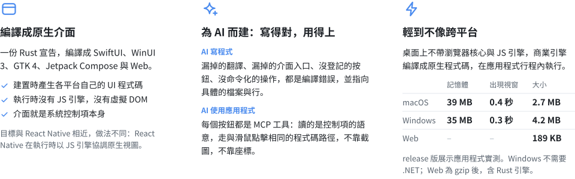
</picture>

## 應用案例

### RustSend · 區域網路檔案傳輸

[RustSend](https://github.com/AimesSoft/RustSend) 是使用 Bern 開發的開源區域網路檔案傳輸工具，相容 LocalSend v2。介面宣告、狀態與傳輸業務統一使用 Rust；Bern 為 macOS 和 iOS 產生 SwiftUI、為 Windows 產生 WinUI 3、為 Linux 產生 GTK 4、為 Android 產生 Jetpack Compose 原生介面。

它支援裝置探索、檔案與文字互傳、接收確認和應用程式內完成提示，桌面小視窗與手機版面共用一套業務邏輯。1.0 的本機 macOS ARM64 Release 建置中，完整 `.app` 為 **8.09 MiB**，下載 `.zip` 為 **3.80 MiB**；建置環境和統計口徑見[測量紀錄](https://github.com/AimesSoft/RustSend/blob/main/docs/measurements.md)。

<table>
<tr>
<td width="50%" align="center"><a href="https://raw.githubusercontent.com/AimesSoft/RustSend/main/docs/screenshots/macos-receive.png"></a><br><sub><b>macOS</b> · SwiftUI</sub></td>
<td width="50%" align="center"><a href="https://raw.githubusercontent.com/AimesSoft/RustSend/main/docs/screenshots/android-receive.png"></a><br><sub><b>Android</b> · Jetpack Compose</sub></td>
</tr>
</table>

[原始碼儲存庫](https://github.com/AimesSoft/RustSend) · [下載 RustSend](https://github.com/AimesSoft/RustSend/releases/latest) · [五個平台的截圖與執行環境](https://github.com/AimesSoft/RustSend/blob/main/docs/screenshots/README.md)

## 為 AI 而建

### AI 寫程式：漏掉的，編譯器替它記著

AI 寫介面最常見的問題不是寫錯，而是寫漏：加了一個功能卻忘了在窄螢幕版面放入口，新增一段文案只寫了中文，順手掛一個回呼繞過命令。這些在別的框架裡要等到使用者發現，在 Bern 裡都過不了編譯。約束越嚴，AI 越不容易交出半成品：

<picture>
<source media="(prefers-color-scheme: dark)" srcset="Docs/Assets/tables/ai-zh-Hant-dark.svg">
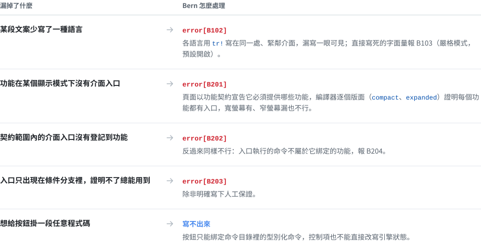
</picture>

錯誤訊息是給人看的，也是給 Agent 看的：編號、原因、位置都很明確，Agent 能自己改完再編譯。下面是展示應用程式的兩次真實輸出，第一次刻意刪掉一個英文翻譯，補上之後，第二次刪掉窄螢幕版面裡的「換片」選單：

```text
$ bern check
error[B102]: Missing translation
Missing language: en
Required languages: zh-Hans, en
  --> showcase-ui/src/pages.rs:13:31

$ bern check
error[B201]: Feature missing in adaptive layout
Contract: MediaFeature
Feature: Clip
compact: missing
  --> showcase-ui/src/media.rs:14:5
```

每次建置還會為每個目標輸出完整的功能涵蓋報告（`features.json`），哪些已涵蓋、哪些豁免、哪些只有人工保證，都分開列出。

### AI 使用應用程式：讀語意，不讀像素

在大多數框架裡，讓 AI 操作一個桌面應用程式意味著截圖、辨識、算座標、模擬點擊。Bern 的應用程式自帶一個 MCP 伺服器：介面上每個控制項都有穩定的名稱與角色，Agent 讀到的是結構，做的事情與使用者點擊走同一段程式碼，結果由應用程式如實回覆。

```sh
$ showcase ui inspect                 # Agent 讀到的是語意，不是像素
[{ "target": "controls_page.sync", "role": "switch", "label": "同步", "value": "false", "enabled": true, … }, …]

$ showcase ui set-bool --target controls_page.sync --value true

$ showcase window close --window settings#1
{ "outcome": "ConfirmationRequired", "message": "要存储对显示名称的更改吗？",
  "decisions": ["Save", "Discard", "Cancel"], "confirmation": "settings#1:c1", … }

$ showcase window confirm-close --window settings#1 --confirmation settings#1:c1 --decision Save
{ "outcome": "Rejected", "reason": "save_failed: invalid_name: a display name has 1 to 40 characters …" }
```

同樣的操作以 MCP 工具（`ui_inspect`、`ui_activate`、`window_close`……）提供給 Agent，商業命令也各自是一個工具（例如 `showcase_set_display_name`）。按鈕被停用、被對話框擋住、目標不存在時，Agent 收到的是明確的錯誤碼，而不是一次沒有效果的點擊。

## 實測數據

<picture>
<source media="(prefers-color-scheme: dark)" srcset="Docs/Assets/tables/measured-zh-Hant-dark.svg">
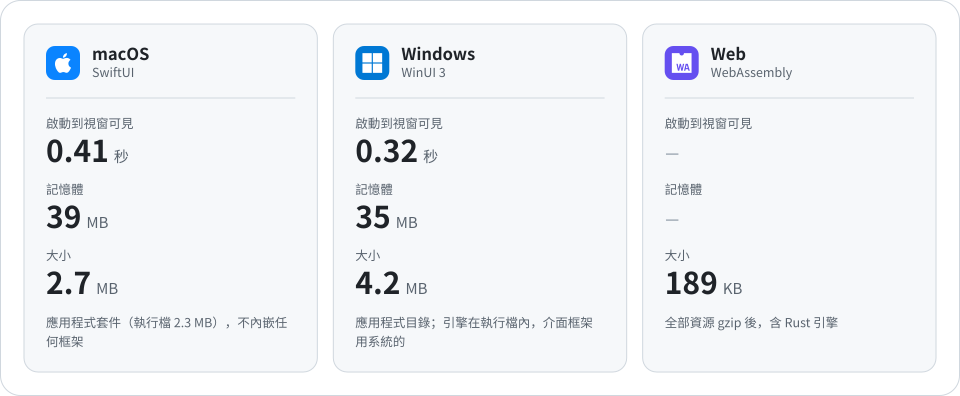
</picture>

<details>
<summary>測量方法</summary>
<br>

- 對象：release 建置的展示應用程式（6 個頁面、主視窗與設定視窗、影片播放器），2026-10-11 測量，每項至少 3 次取中位數。
- macOS：Apple M4、16 GB 記憶體、macOS 27.0.1。記憶體為 `footprint` 的實體占用，即活動監視器「記憶體」欄位的口徑。
- Windows：Intel Core i5-13490F、32 GB 記憶體、Windows 11 25H2。記憶體為私人工作集，即工作管理員「記憶體」欄位的口徑。
- 啟動時間：從啟動行程到命令列讀到可見的原生視窗為止，包含引擎啟動與本機控制通道就緒。
- Windows 表中為 WinUI 3 前端（測量時系統中有 Windows App Runtime 1.8，現在按 2.x 建置）。沒有執行環境的系統上，同一個程式退回系統 XAML：啟動 0.54 秒，記憶體 19 MB。兩種情況都不需要 .NET 與 VC++ 執行環境，應用程式目錄只有執行檔與 400 KB 的啟動程式 DLL。

</details>

## 更多能力

<picture>
<source media="(prefers-color-scheme: dark)" srcset="Docs/Assets/tables/more-zh-Hant-dark.svg">
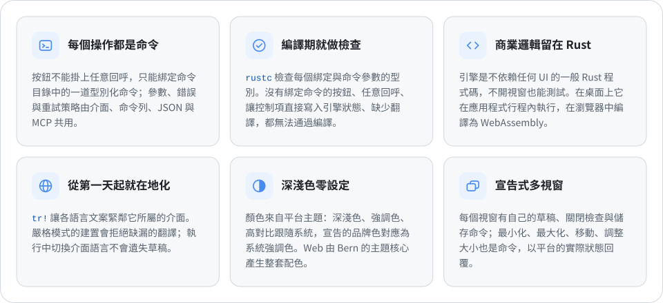
</picture>

<details>
<summary><b>還有：</b>影片、非同步查詢、樣式與動效、自繪、媒體類應用程式的元件、讀取交來的檔案、模組化應用程式、自適應版面…</summary>
<br>

- **影片**：`Video` 分別執行於 AVFoundation、Windows Media Foundation、GStreamer、Android 的 Media3 與 HTML 媒體，控制列由命令驅動，播放器可以跨頁面持續播放。
- **非同步查詢**：`Query` 訂閱具備載入、空結果、失敗與重新整理狀態，只顯示最新的回覆。
- **自適應版面**：依視圖實際取得的空間在 `compact`、`medium`、`expanded`、`large` 四檔中選擇版面；運算式也能讀取視窗所在的檔位，例如依檔位設定頁邊距。
- **型別化導覽**：側邊欄、帶型別化路由的推入式導覽、分頁、工具列與選單。
- **功能契約**：宣告元件在每種版面中必須涵蓋的功能，由編譯器證明涵蓋完整。
- **隨附資源**：在 `Bern.toml` 中宣告檔案，建置時檢查，執行時依名稱定位。
- **圖片與版面**：`Image` 顯示隨附圖片，未宣告的資源在編譯時報錯，HDR 圖片（PQ、HLG 的 PNG 與帶增益圖的 JPEG）在能顯示 HDR 的螢幕上以 HDR 顯示；`Grid` 依可用寬度自動增減欄數，`Stack` 疊放並依九個方位對齊，`Progress` 顯示進度列或不確定進度。
- **樣式覆寫與動效**：控制項預設是平台外觀；需要統一設計時，用 `style!` 為整個應用程式宣告覆寫、彈簧動效、出現與消失轉場、錯開進場和共享元素，目標做不到的覆寫在建置時報錯（五個前端都已實作）。
- **自繪與按比例擺放**：`Canvas` 用語義色彩繪製形狀、資料曲線與格紋圖案，`Text` 可以加標註底紋；`Rail` 把元素放在狀態給出的比例處，例如時間軸、進度列上的刻度與漲滿的底色。
- **媒體類應用程式的元件**：側邊欄底部區域、工具列搜尋與結果、側面板、輕提示、分體按鈕與彈出任意內容的浮層按鈕、帶內容的按鈕與懸停顯示、快速鍵、檔案選取與拖入、捲動停靠、雙指縮放與拖曳調值，五個前端都已實作。
- **讀取交來的檔案**：使用者選取、拖入或用應用程式開啟的檔案，引擎用 `MediaSource::file_name()` 與 `open()` 讀取名稱與內容；本機路徑、Android 的 `content://` 文件與網頁的 `blob:` 檔案寫法相同。
- **模組化應用程式**：應用程式由外殼與多個模組組成，每個模組有自己的協定、引擎、介面與翻譯，可以在執行時開關；`bern new --module` 新增模組，適合多人與多個 AI 分頭開發（已在 macOS 與 Android 上驗證）。

</details>

## 運作方式

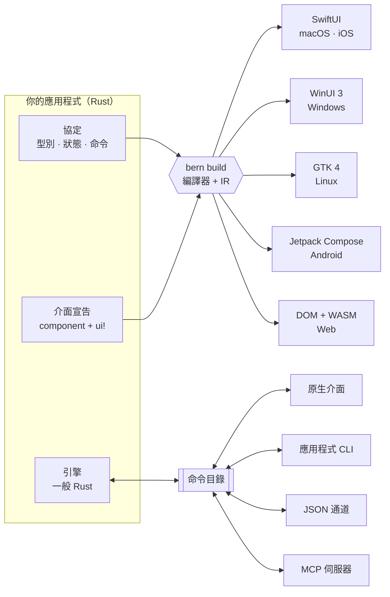

1. **協定**：`#[bern::protocol]` 宣告值型別、唯讀狀態，以及命令與查詢 trait。
2. **引擎**：以一般 Rust 實作這些 trait；它看不到視窗、控制項與傳輸層。
3. **介面**：`#[component]` 函式，主體是一個 `ui!` 宣告。編譯器將它們讀入共用的中介表示（IR），各目標模組從 IR 產生原生程式碼。新增目標不需要改動剖析器、IR 或你的商業邏輯。

## 程式碼一覽

**1 · 協定**：型別、狀態與命令

```rust
#[bern::protocol(namespace = "counter", version = 1)]
pub mod counter {
    use bern::prelude::*;

    #[state]
    pub struct State {
        pub count: i64,
    }

    #[commands]
    pub trait Commands {
        /// Add to the count.
        fn add(&mut self, by: i64) -> Result<(), CommandError>;
    }
}
```

**2 · 引擎**：一般 Rust，不依賴 UI

```rust
use bern::CommandError;

pub struct Counter {
    state: counter::State,
}

impl Default for Counter {
    fn default() -> Self {
        Self { state: counter::State { count: 0 } }
    }
}

impl counter::Commands for Counter {
    fn add(&mut self, by: i64) -> Result<(), CommandError> {
        self.state.count += by;
        Ok(())
    }
}

impl counter::Engine for Counter {
    fn state(&self) -> &counter::State {
        &self.state
    }
}
```

**3 · 介面**：一個 `ui!` 宣告

```rust
#[component]
pub fn counter_view(app: counter::Client) -> impl View {
    ui! {
        Form {
            Text(content: tr! {
                "zh-Hant" => "已計數 {n} 次",
                "en" => "Counted {n} times";
                n: app.count
            })
            Button(
                id: add,
                label: tr! { "zh-Hant" => "加一", "en" => "Add one" },
                prominence: prominent
            ) => app.add(1)
        }
    }
}
```

**4 · 所有入口驅動同一個引擎**

```sh
counter ui inspect
counter ui activate --target counter_view.add
counter counter add --by 5
counter-mcp   # 同一份命令目錄，提供給 AI Agent
```

`Bern.toml` 宣告語言、主題、原始碼、隨附資源與建置目標。完整範例請見[控制項展示應用程式](examples/showcase)：側邊欄應用程式，包含文字層級、按鈕、開關、滑桿、輸入框、由引擎查詢驅動的搜尋、清單到詳細資料的導覽、影片，以及具備分頁與關閉確認的設定視窗。[計畫應用程式](examples/planner)示範模組化應用程式、樣式覆寫、動效與 `Canvas`。[圖案集](examples/gallery)示範媒體類應用程式的元件：海報牆的錯開進場、時間軸的按比例擺放、音量浮層按鈕、隨四檔尺寸變化的頁邊距與版面，以及拖入影片後由引擎讀出檔名、格式與大小。

## 支援的平台

<picture>
<source media="(prefers-color-scheme: dark)" srcset="Docs/Assets/tables/platforms-zh-Hant-dark.svg">
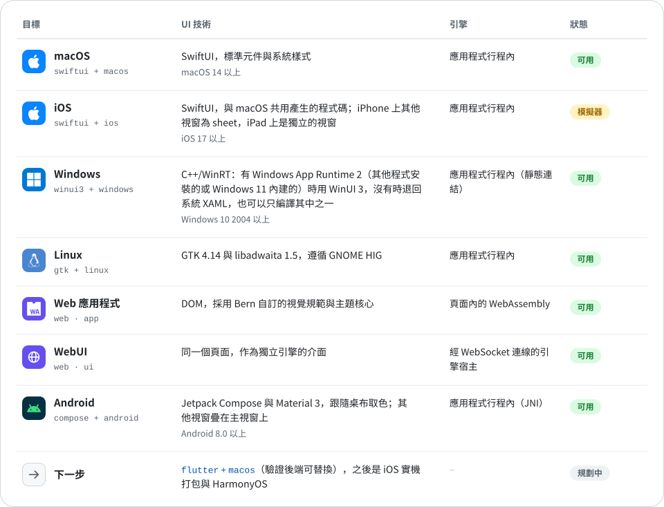
</picture>

實作紀錄：[macOS](Docs/Implementation/macOS-SwiftUI.md) · [iOS](Docs/Implementation/iOS-SwiftUI.md) · [tvOS](Docs/Implementation/tvOS-SwiftUI.md) · [Windows](Docs/Implementation/Windows-WinUI3.md) · [Linux](Docs/Implementation/Linux-GTK.md) · [Web 與 WebUI](Docs/Implementation/Web.md) · [Android](Docs/Implementation/Android-Compose.md)；下一步的平台見[適配規範](Docs/Adaptation/README.md)。

未指定 UI 技術時採用平台的預設技術；預設技術無法使用時直接回報錯誤，不會悄悄換成另一套技術。

## 與其他跨平台框架比較

<p align="center">
<a href="https://github.com/zed-industries/zed/tree/main/crates/gpui"></a>
<a href="https://dioxuslabs.com"></a>
<a href="https://flutter.dev"></a>
<a href="https://reactnative.dev"></a>
<a href="https://uniapp.dcloud.net.cn"></a>
<br>
<a href="https://www.electronjs.org"></a>
<a href="https://tauri.app"></a>
<a href="https://avaloniaui.net"></a>
<a href="https://www.qt.io"></a>
</p>

每個框架都在回答同一個問題：一份程式碼，怎樣變成各平台上的介面。回答不同，取捨也不同。以下依據各專案的官方文件整理；大小與記憶體隨版本與設定變化很大，這裡只比較結構上的差別，Bern 自己的數字見[實測數據](#實測數據)。

<picture>
<source media="(prefers-color-scheme: dark)" srcset="Docs/Assets/compare/routes-zh-Hant-dark.svg">

</picture>

前兩條路線得到的是系統控制項：外觀、無障礙、輸入法、深淺色都由系統負責，代價是各平台控制項不完全相同。後兩條路線在每個平台上畫出一樣的介面，代價是要自己追隨各平台的設計與行為，或者攜帶一個瀏覽器。

<picture>
<source media="(prefers-color-scheme: dark)" srcset="Docs/Assets/compare/landscape-zh-Hant-dark.svg">

</picture>

上圖依架構示意，不代表優劣：橫軸是介面元素來自系統控制項，還是框架自繪或網頁；縱軸是應用程式要隨身攜帶多少執行環境（瀏覽器核心、JS 引擎、繪製引擎、語言執行環境）。

### 技術路線

<picture>
<source media="(prefers-color-scheme: dark)" srcset="Docs/Assets/tables/technology-zh-Hant-dark.svg">
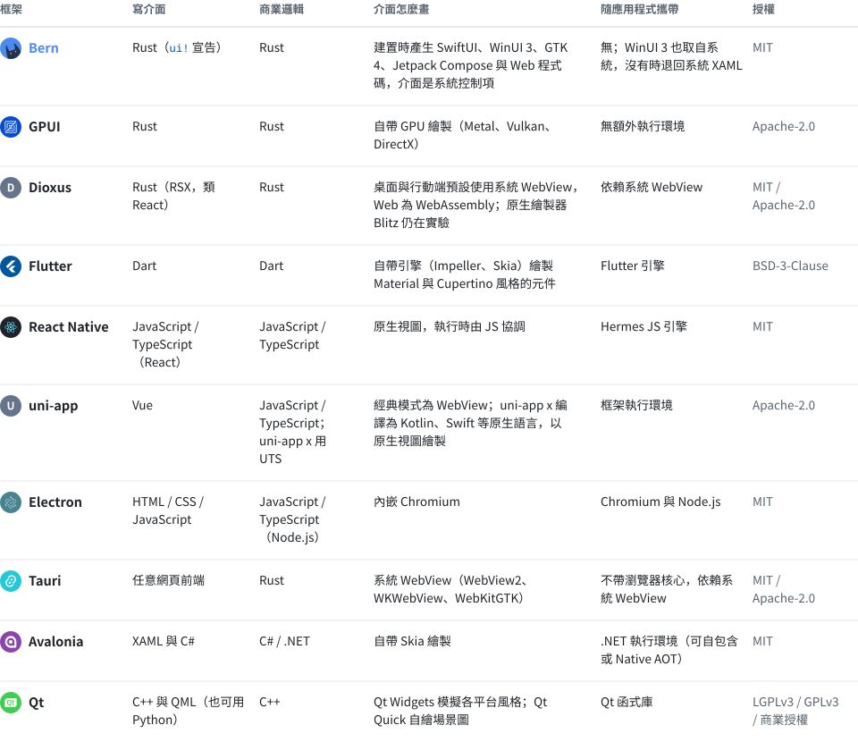
</picture>

### 平台與能力

<picture>
<source media="(prefers-color-scheme: dark)" srcset="Docs/Assets/tables/capabilities-zh-Hant-dark.svg">
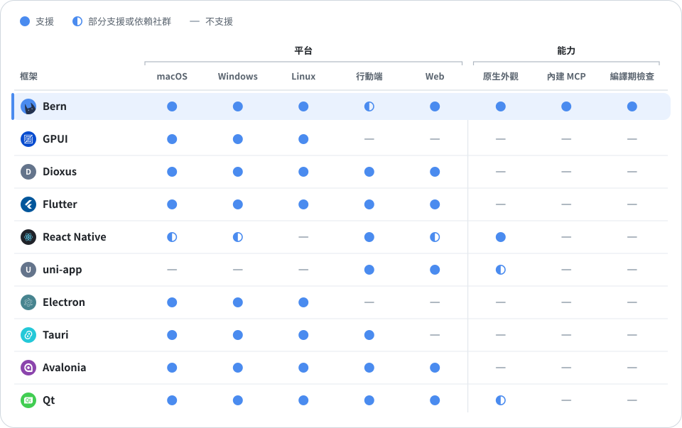
</picture>

- **行動端**：iOS 與 Android。React Native 的桌面版本由微軟維護，uni-app 另涵蓋小程式與鴻蒙；Bern 的 Android 目標已能在實機執行並打包，iOS 目標目前建置模擬器應用程式，實機打包在規劃中。
- **原生外觀**：控制項就是平台自己的控制項，外觀、無障礙與輸入法由系統提供。Qt Widgets 與 uni-app x 接近原生，記為部分。
- **內建 MCP**：框架自帶、面向執行中介面的 MCP 伺服器與命令列。其他框架可以藉助無障礙介面，或 Playwright、Flutter Driver 等測試工具從外部自動化。
- **編譯期檢查**：翻譯缺漏、功能在某個版面沒有入口、入口沒有登記功能，都由編譯器直接報錯（見[為 AI 而建](#為-ai-而建)）。其他框架多藉助 lint、翻譯工具或測試發現這類問題。
- **成熟度**：Electron 與 Qt 非常成熟；Flutter、React Native、uni-app、Tauri 與 Avalonia 成熟；Dioxus 發展中；GPUI 支撐著 Zed 編輯器，通用元件仍在早期；Bern 是早期預覽。

### 效能與資源

介面層與邏輯層用什麼語言、怎樣執行，決定了執行時開銷的上限：原生編譯且沒有垃圾回收的語言最省，JIT 與位元組碼直譯的語言需要攜帶引擎、占用更多記憶體。

<picture>
<source media="(prefers-color-scheme: dark)" srcset="Docs/Assets/compare/languages-zh-Hant-dark.svg">

</picture>

同樣一個只顯示一行字的視窗，各框架的套件大小、啟動時間與記憶體差別很大。下圖在同一台 CI 虛擬機（GitHub 託管的 Apple M1）上實測：各框架用自己的工具建置 release 套件，測量時輪流啟動，每個 10 次取中位數。腳本在 [benchmarks/](benchmarks/) 中，可以在 Actions 裡重新執行 Benchmarks 工作流程。

<picture>
<source media="(prefers-color-scheme: dark)" srcset="Docs/Assets/compare/resources-zh-Hant-dark.svg">

</picture>

### 怎麼選

<picture>
<source media="(prefers-color-scheme: dark)" srcset="Docs/Assets/tables/choose-zh-Hant-dark.svg">
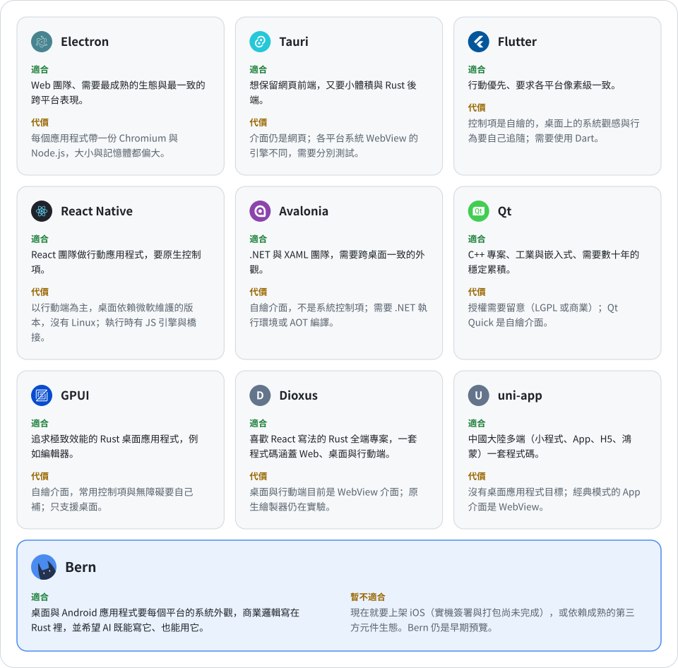
</picture>

## 快速開始

需要 Rust 1.99（`rustup` 依 `rust-toolchain.toml` 自動安裝），以及所建置目標的工具鏈。先從原始碼安裝建置工具 `bern`：

```sh
git clone https://github.com/AimesSoft/Bern
cd Bern
cargo install --path crates/bern-cli
```

### 建立應用程式

在任意目錄中：

```sh
bern new my_app
cd my_app
bern run
```

新的應用程式是一個帶計數的視窗，協定、引擎與介面各一個 crate，六個目標都已在 `Bern.toml` 中宣告。`bern run` 建置本機的目標並啟動它：macOS 上是 SwiftUI，Windows 上是 WinUI 3，Linux 上是 GTK；`bern run --target web_app` 在瀏覽器中開啟，`bern run --target ios` 安裝到正在執行的 iOS 模擬器，`bern run --target android` 安裝到以 USB 偵錯連接的 Android 手機（或模擬器）並啟動。每次建置也會在 `target/bern/<目標>/bin/` 中產生應用程式 CLI 與 MCP 伺服器。

`bern doctor` 列出本機建置每個目標還缺什麼、怎麼安裝：

```text
$ bern doctor
bern 0.1.0 on macOS (aarch64)

[✓] Rust: rustc 1.99.0, cargo 1.99.0
[✓] macOS · SwiftUI: macOS SDK 26.5, Swift 6.3.2
[✓] iOS · SwiftUI: iOS simulator SDK 26.5, the aarch64-apple-ios-sim target
[-] Windows · WinUI 3: builds on Windows
[-] Linux · GTK 4: builds on Linux
[✓] Android · Compose: Android SDK, NDK 29.0.14206865, gradle-9.5.1, the aarch64-linux-android target
[✓] Web · WebAssembly: the wasm32-unknown-unknown target
```

<details>
<summary><b>各平台需要的工具</b></summary>
<br>

- **macOS**：Xcode 26 或更新版本。從 App Store 安裝後執行 `sudo xcode-select --switch /Applications/Xcode.app`。
- **iOS**：Xcode 的 iOS 平台與一個 iOS 模擬器，以及 `rustup target add aarch64-apple-ios-sim`。目前建置模擬器應用程式，實機的簽署與打包還沒有做。
- **Windows**：Visual Studio 2022 或更新版本的「使用 C++ 的桌面開發」（只裝建置工具也可以），含 Windows 11 SDK；Rust 使用 MSVC 工具鏈。首次建置時以 Windows SDK 的 `cppwinrt` 產生 C++/WinRT 標頭檔，並把它們與執行階段預先編譯（每個設定約 2.4 GB，放在 `target` 中）；之後的建置只編譯應用程式自己的程式碼，新專案約 5 秒，展示應用程式約 9 秒。應用程式目錄只有執行檔、400 KB 的啟動程式 DLL 與資源，不需要 .NET，也不隨附 Windows App SDK。
- **Linux**：GTK 4.14 與 libadwaita 1.5 的開發套件，例如 `sudo apt install libgtk-4-dev libadwaita-1-dev gstreamer1.0-libav`。
- **Android**：Android Studio（帶 SDK 與 NDK，在 SDK Manager 的 SDK Tools 中勾選 NDK）、Gradle 9.4 或更新版本，以及 `rustup target add aarch64-linux-android`。第一次建置時 Gradle 會下載 Android 外掛與 Compose 程式庫。
- **Web**：`rustup target add wasm32-unknown-unknown`。`web_app` 建置把引擎編譯為 WebAssembly 在頁面內執行；`web_ui` 建置讓頁面作為獨立引擎宿主的介面，`bern run` 啟動宿主並開啟它的位址。

</details>

### 發佈應用程式

```sh
bern package
```

以 release 建置本機能建置的目標，在 `target/bern/dist/` 中產生安裝套件：macOS 的 `.dmg`，Windows 的安裝程式（依目前使用者安裝，不需要系統管理員權限）與免安裝的 `.zip`，Linux 的 `.deb` 與 `.tar.gz`，Android 的 `.apk` 與上架用的 `.aab`，Web 的靜態網站壓縮檔。除 Android 外，每個套件都帶有應用程式 CLI 與 MCP 伺服器。簽署以環境變數設定，憑證不進儲存庫：`BERN_MACOS_SIGNING_IDENTITY` 與 `BERN_MACOS_NOTARY_PROFILE`（簽署並公證），`BERN_WINDOWS_CERTIFICATE`（憑證指紋或 `.pfx`），`BERN_ANDROID_KEYSTORE`、`BERN_ANDROID_KEYSTORE_PASSWORD` 與 `BERN_ANDROID_KEY_ALIAS`（發布金鑰）。沒有設定時照樣產生，並提示未簽署的後果。

### 執行展示應用程式

Bern 儲存庫中的展示應用程式用到全部元件、兩個視窗與影片播放器。在儲存庫目錄中：

```sh
cd examples/showcase
bern run
```

### 從外部驅動執行中的應用程式

```sh
showcase ui inspect                                          # 列出已掛載的控制項
showcase ui select --target main_window.pages --option Controls
showcase ui set-bool --target controls_page.sync --value true
showcase showcase search-library --text mo                   # 引擎查詢
showcase window open --kind settings
showcase window list                                         # 視窗的實際狀態
showcase-mcp                                                 # 經 stdio 的 MCP 伺服器
```

只有目標宣告了 `channels = ["ipc"]` 時才會啟動控制通道；未宣告則應用程式不監聽任何連接埠。Android 應用程式在手機上監聽，`bern run` 以 `adb forward` 把它接到這台電腦，命令列與 MCP 伺服器照常使用。

## 路線圖

<picture>
<source media="(prefers-color-scheme: dark)" srcset="Docs/Assets/tables/roadmap-zh-Hant-dark.svg">
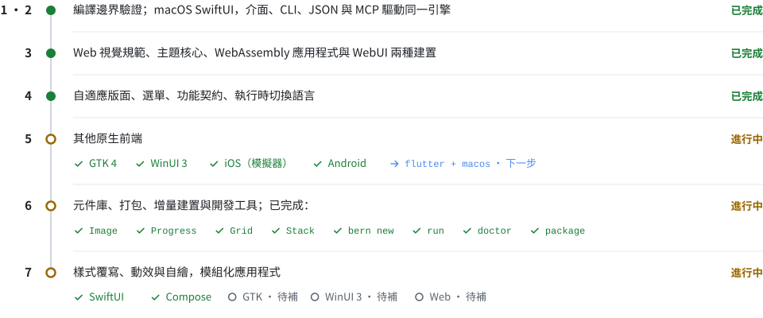
</picture>

## 儲存庫結構

<details>
<summary>crate 與目錄</summary>
<br>

<picture>
<source media="(prefers-color-scheme: dark)" srcset="Docs/Assets/tables/repository-zh-Hant-dark.svg">
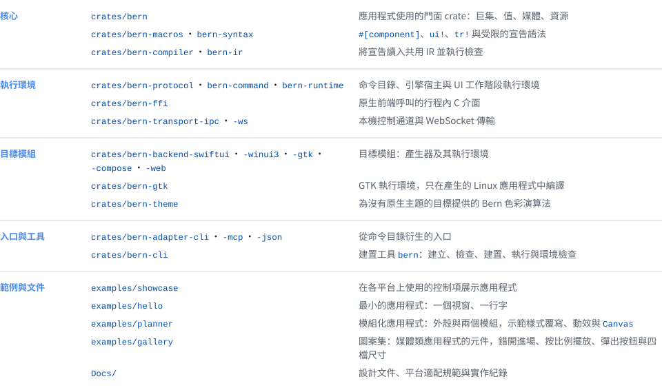
</picture>

</details>

## 開發

```sh
cargo fmt --all --check
cargo clippy --workspace --all-targets -- -D warnings
cargo test --workspace
```

測試包含必須編譯失敗的宣告，並在安裝了相應工具包的環境中對產生的應用程式做型別檢查：以 Xcode 檢查 Swift 6，以開發套件檢查 GTK，在 Windows 上以 MSVC 編譯產生的兩套前端。Android 的 Kotlin 由 `bern build --target android` 經 Gradle 編譯。

## 文件

- [文件目錄](Docs/README.md) · [目前元件用法](Docs/Reference/UI.md) · [完整屬性表](Docs/Reference/Component-Properties.md) · [平台能力與驗證範圍](Docs/Reference/Platforms.md)（簡體中文）
- [設計文件](Docs/Design.md)：目標、架構、元件、主題、命令、視窗與媒體
- [適配規範](Docs/Adaptation/README.md)：Apple、Windows 與 Linux、Web、Android、HarmonyOS
- 實作紀錄：[macOS](Docs/Implementation/macOS-SwiftUI.md) · [iOS](Docs/Implementation/iOS-SwiftUI.md) · [tvOS](Docs/Implementation/tvOS-SwiftUI.md) · [Android](Docs/Implementation/Android-Compose.md) · [Windows](Docs/Implementation/Windows-WinUI3.md) · [Linux](Docs/Implementation/Linux-GTK.md) · [Web](Docs/Implementation/Web.md)

設計與實作文件以簡體中文撰寫。

## 授權

[MIT](LICENSE) © 2026 MCDFSteve

<div align="center">
<br>
<sub>Bern 仍處於早期開發階段，API 與宣告語法可能還會變動。</sub>
</div>
