<div align="center">


<h1>Bern</h1>

<p><b>一份 Rust 宣告，編譯成每個平台自己的原生介面。</b></p>

<p>桌面、手機、平板、手錶、電視與 Web，出自同一份 <code>ui!</code> 宣告：<br>
SwiftUI、WinUI 3、GTK 4、Jetpack Compose、GPUI 與 Web DOM/WASM。<br>
預設不隨附 JS 引擎或瀏覽器，按需啟用行程內 JavaScript 與 <code>bern.cli</code>。<br>
<b>為 AI 而建：</b>寫漏的內容在編譯期直接報錯，Agent 讀 <code>SKILL.md</code> 並透過應用程式 CLI 依名稱操作控制項。</p>

<p>


</p>

<p>
<a href="https://bern.aimes-soft.com"></a>


<a href="LICENSE"></a>

</p>

<p>
<a href="README.md">English</a> ·
<a href="README.zh-CN.md">简体中文</a> ·
<b>繁體中文</b> ·
<a href="README.ja.md">日本語</a>
</p>

<p>
<a href="https://bern.aimes-soft.com">官網</a> ·
<a href="https://bern.aimes-soft.com/docs/zh-CN">線上文件</a> ·
<a href="#為什麼選擇-bern">為什麼選擇 Bern</a> ·
<a href="#誰使用了-bern">誰使用了 Bern</a> ·
<a href="#為-ai-而建">為 AI 而建</a> ·
<a href="#實測數據">實測數據</a> ·
<a href="#與其他跨平台框架比較">比較</a> ·
<a href="#快速開始">快速開始</a>
</p>

</div>

<br>

<table>
<tr>
<td width="50%" align="center">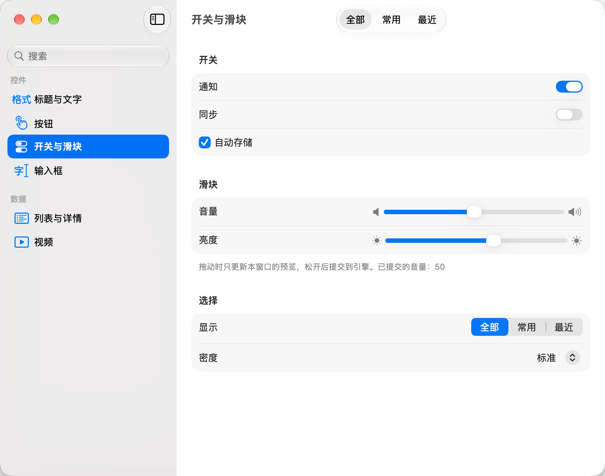<br><sub><b>macOS</b> · SwiftUI</sub></td>
<td width="50%" align="center">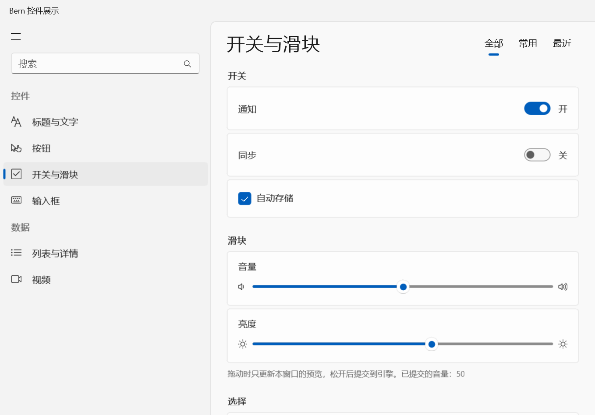<br><sub><b>Windows</b> · WinUI 3</sub></td>
</tr>
<tr>
<td width="50%" align="center">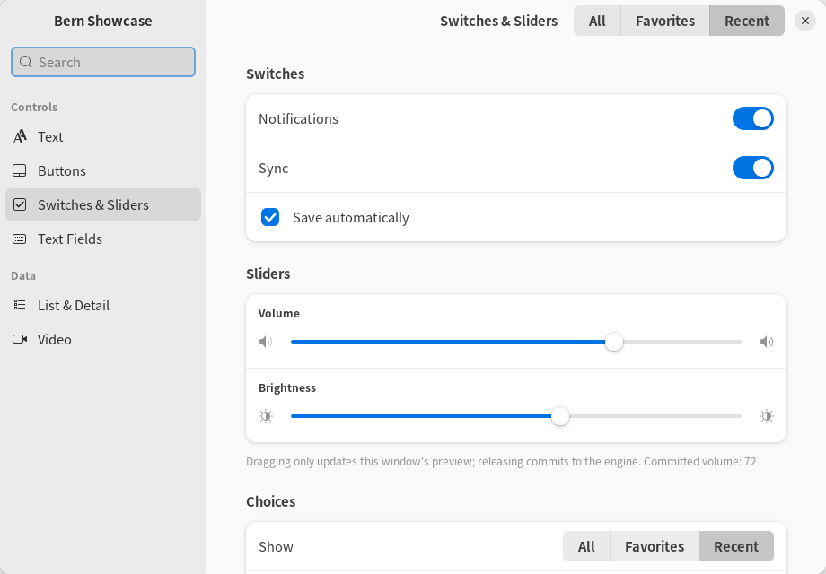<br><sub><b>Linux</b> · GTK 4 + libadwaita</sub></td>
<td width="50%" align="center">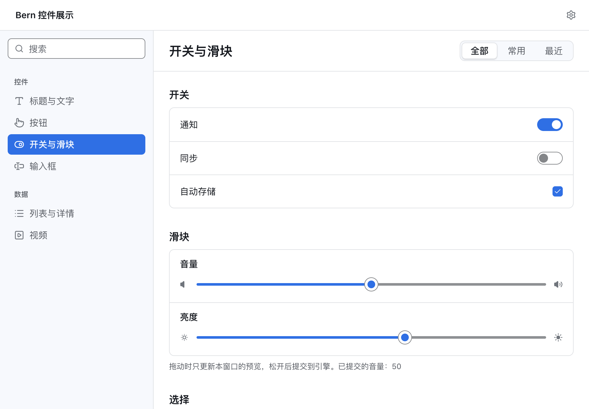<br><sub><b>Web</b> · DOM + WebAssembly</sub></td>
</tr>
<tr>
<td width="50%" align="center">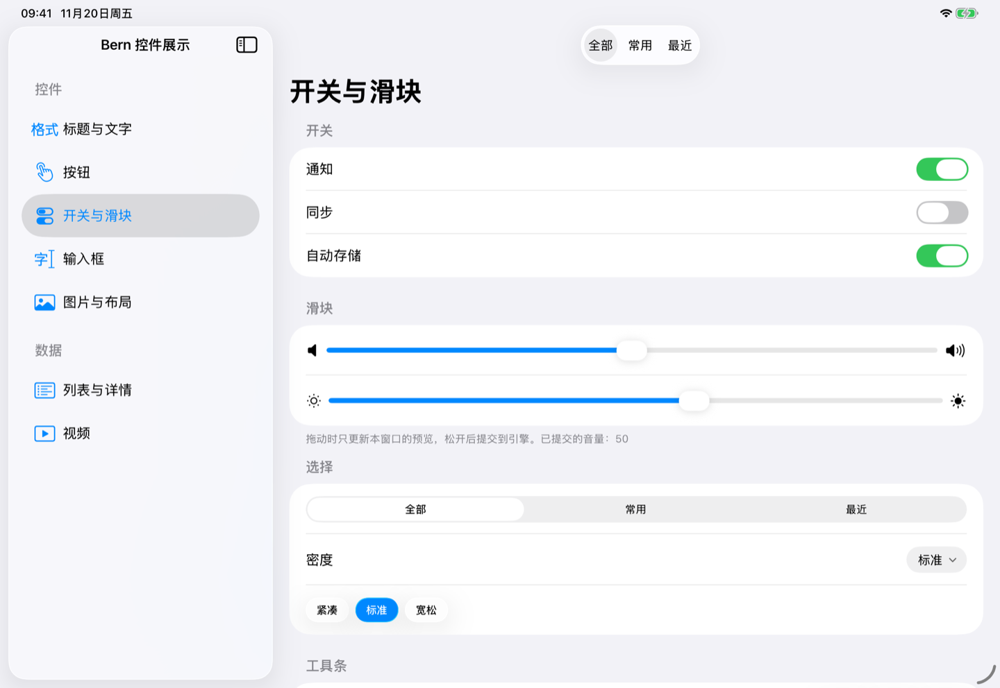<br><sub><b>iPad</b> · iPadOS SwiftUI</sub></td>
<td width="50%" align="center">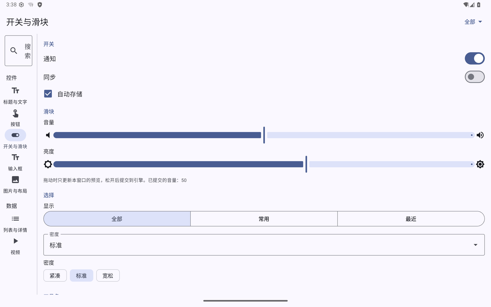<br><sub><b>Android 平板</b> · Jetpack Compose</sub></td>
</tr>
<tr>
<td width="50%" align="center">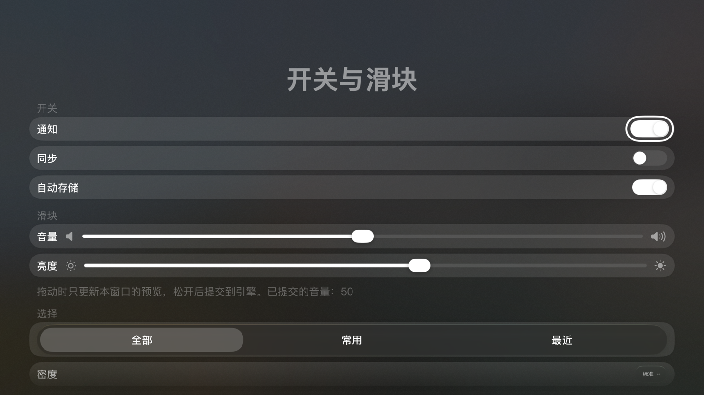<br><sub><b>Apple TV</b> · tvOS SwiftUI</sub></td>
<td width="50%" align="center">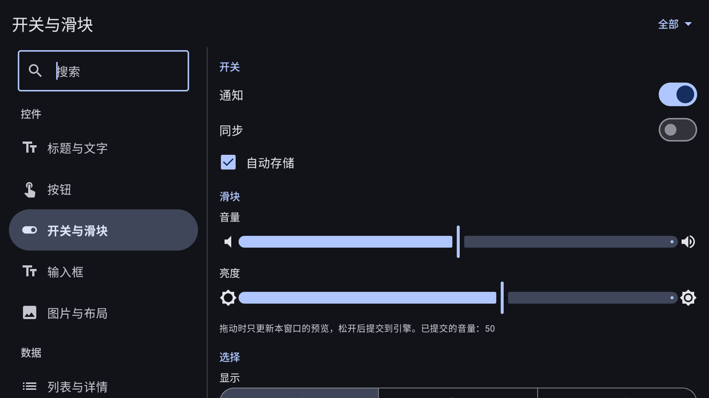<br><sub><b>Android 電視</b> · Jetpack Compose</sub></td>
</tr>
</table>

<table>
<tr>
<td width="32%" align="center">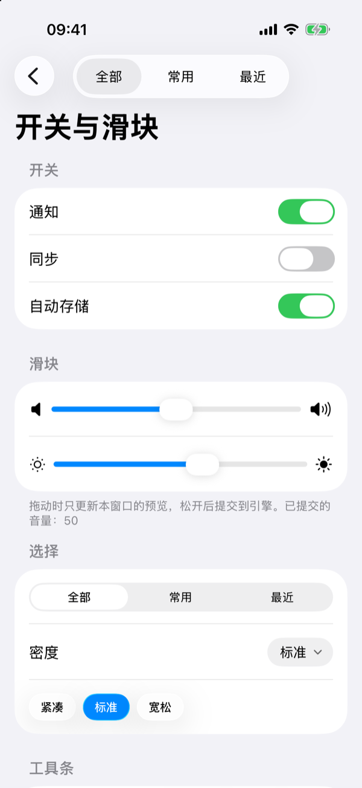<br><sub><b>iOS</b> · SwiftUI</sub></td>
<td width="36%" align="center">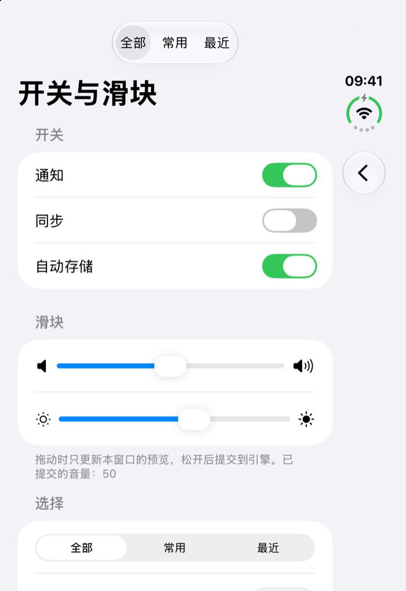<br><sub><b>iPhone Duo</b> · SwiftUI</sub></td>
<td width="32%" align="center">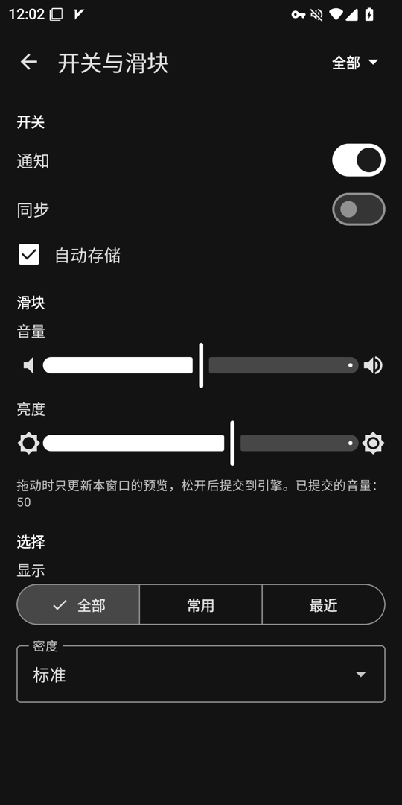<br><sub><b>Android</b> · Jetpack Compose</sub></td>
</tr>
</table>

<table>
<tr>
<td width="25%" align="center">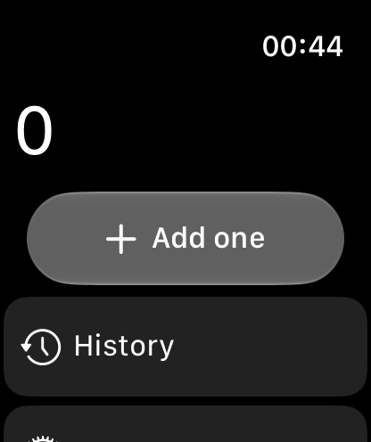<br><sub><b>watchOS</b> · SwiftUI</sub></td>
<td width="25%" align="center">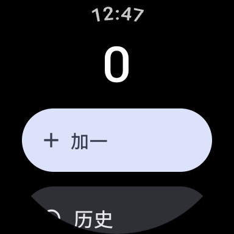<br><sub><b>Wear OS</b> · Compose Material 3</sub></td>
<td width="50%" align="center">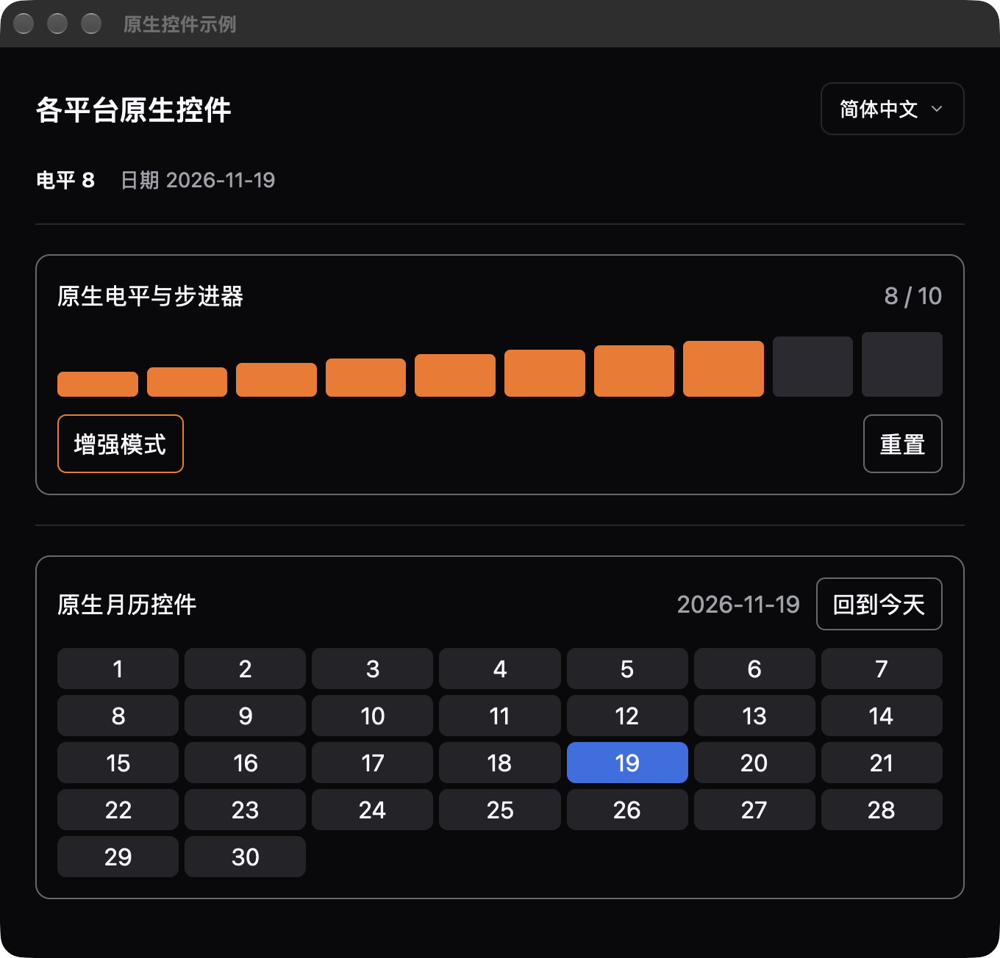<br><sub><b>桌面端 · GPUI</b>（<code>ui = "gpui"</code>，搭配緊鄰 <code>NativeView</code>）</sub></td>
</tr>
</table>

<p align="center"><sub>同一份 Rust 宣告涵蓋桌面、平板、電視、手機、手錶與網頁。在系統原生目標上 Bern 不自行繪製任何像素；<br>需要統一 GPU 渲染時，切換到 <code>ui = "gpui"</code> 即可直接將 Bern 作為 GPUI 的宣告式 UI 框架。</sub></p>

## 為什麼選擇 Bern

<picture>
<source media="(prefers-color-scheme: dark)" srcset="Docs/Assets/tables/why-zh-Hant-dark.svg">
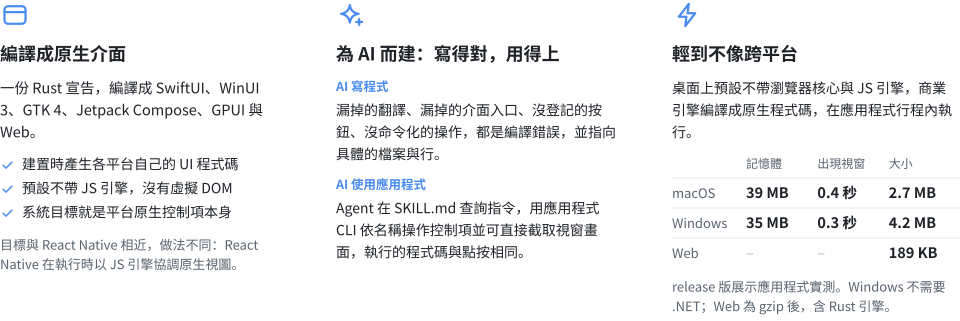
</picture>

## 誰使用了 Bern

<table>
<tr>
<td width="33%" valign="top">
<a href="https://github.com/AimesSoft/RustSend"></a>
<h3><a href="https://github.com/AimesSoft/RustSend">RustSend</a></h3>
<p>相容 LocalSend 的區域網路檔案傳輸工具，支援檔案、資料夾與文字互傳。</p>
</td>
<td width="33%" valign="top">
<a href="https://github.com/zhaohuaxs/lambda"></a>
<h3><a href="https://github.com/zhaohuaxs/lambda">Lambda</a></h3>
<p>內建 7-Zip 的 Windows / Android 壓縮檔管理器，支援加密壓縮、解壓縮與內容預覽。</p>
</td>
<td width="33%" valign="top">
<a href="https://github.com/MCDFsteve/Enji"></a>
<h3><a href="https://github.com/MCDFsteve/Enji">Enji Music</a></h3>
<p>網易雲音樂第三方用戶端，支援線上與本機音樂、同步歌詞及歌單管理。</p>
</td>
</tr>
</table>

## 為 AI 而建

### AI 寫程式：漏掉的，編譯器替它記著

AI 寫介面最常見的問題不是寫錯，而是寫漏：加了一個功能卻忘了在窄螢幕版面放入口，新增一段文案只寫了中文，順手掛一個回呼繞過命令。這些在別的框架裡要等到使用者發現，在 Bern 裡都過不了編譯。約束越嚴，AI 越不容易交出半成品：

<picture>
<source media="(prefers-color-scheme: dark)" srcset="Docs/Assets/tables/ai-zh-Hant-dark.svg">
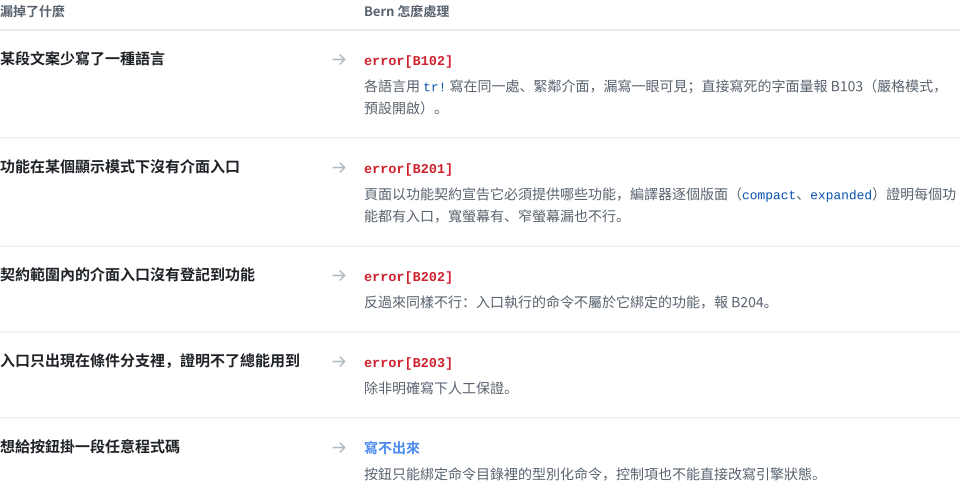
</picture>

錯誤訊息是給人看的，也是給 Agent 看的：編號、原因、位置都很明確，Agent 能自己改完再編譯。下面是展示應用程式的兩次真實輸出，第一次刻意刪掉一個英文翻譯，補上之後，第二次刪掉窄螢幕版面裡的「換片」選單：

```text
$ bern check
error[B102]: Missing translation
Missing language: en
Required languages: zh-Hans, en
  --> showcase-ui/src/pages.rs:13:31

$ bern check
error[B201]: Feature missing in adaptive layout
Contract: MediaFeature
Feature: Clip
compact: missing
  --> showcase-ui/src/media.rs:14:5
```

每次建置還會為每個目標輸出完整的功能涵蓋報告（`features.json`），哪些已涵蓋、哪些豁免、哪些只有人工保證，都分開列出。

### AI 使用應用程式：讀語意，不讀像素

啟用控制通道後，Bern 會從應用程式的命令目錄產生 `SKILL.md`。以下面的開關為例：Agent 在 `skills/showcase/SKILL.md` 查到 `ui set-bool` 的用法，再執行 `showcase ui inspect`，找出目前視窗中開關的名稱。把這個名稱傳給應用程式的 CLI，就能像使用者點按一樣切換開關，不需要截圖或座標。

```sh
$ showcase ui inspect                 # Agent 讀到的是語意，不是像素
[{ "target": "controls_page.sync", "role": "switch", "label": "同步", "value": "false", "enabled": true, … }, …]

$ showcase ui set-bool --target controls_page.sync --value true
$ showcase window screenshot --output shot.png

$ showcase window close --window settings#1
{ "outcome": "ConfirmationRequired", "message": "要儲存對顯示名稱的變更嗎？",
  "decisions": ["Save", "Discard", "Cancel"], "confirmation": "settings#1:c1", … }

$ showcase window confirm-close --window settings#1 --confirmation settings#1:c1 --decision Save
{ "outcome": "Rejected", "reason": "save_failed: invalid_name: a display name has 1 to 40 characters …" }
```

你也可以執行相同的指令，包括 `showcase showcase set-display-name --name Demo` 這類應用程式自訂的命令，或透過內建的 `window screenshot` 直接截取視窗畫面。請使用與應用程式一同建置的 CLI；從遠端操作時，透過 SSH 登入控制通道所在的主機，以擁有該端點的帳號執行。控制項遭停用、被對話框擋住或不存在時，CLI 會傳回明確的錯誤碼。

### 以 JavaScript 擴充：行程內 `bern.cli`

未啟用腳本的應用程式不會連結任何 JS 執行環境。當目標設定 `javascript = true` 後，每個 `bern::script::Context`（原生目標統一採行程內 Boa，Web 目標為瀏覽器 Worker）預設注入 `globalThis.bern.cli(...)`，直通應用程式命令目錄，並由 Rust 側黑白名單把關權限（預設 `CliPolicy::allow_all()`）：

```rust
let js = bern::script::Context::with_policy(
    bern::script::CliPolicy::allow_only(["media.*", "@queries", "state", "catalog"])
        .deny("media.bind")
        .with_label("example.plugin"),
)?;
js.eval(r#"await bern.cli("media seek --player-id main --position-ms 90000")"#).await?;
```

完整的呼叫形式、規則模式與動態攔截器見[JavaScript 與目標能力](Docs/zh-CN/Implementation/JavaScript.md)。

## 實測數據

<picture>
<source media="(prefers-color-scheme: dark)" srcset="Docs/Assets/tables/measured-zh-Hant-dark.svg">
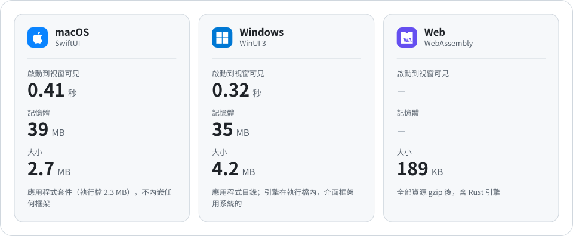
</picture>

<details>
<summary>測量方法</summary>
<br>

- 對象：release 建置的展示應用程式（6 個頁面、主視窗與設定視窗、影片播放器），2026-10-11 測量，每項至少 3 次取中位數。
- macOS：Apple M4、16 GB 記憶體、macOS 27.0.1。記憶體為 `footprint` 的實體占用，即活動監視器「記憶體」欄位的口徑。
- Windows：Intel Core i5-13490F、32 GB 記憶體、Windows 11 25H2。記憶體為私人工作集，即工作管理員「記憶體」欄位的口徑。
- 啟動時間：從啟動行程到命令列讀到可見的原生視窗為止，包含引擎啟動與本機控制通道就緒。
- Windows 表中為 WinUI 3 前端（測量時系統中有 Windows App Runtime 1.8，現在按 2.x 建置）。沒有執行環境的系統上，同一個程式退回系統 XAML：啟動 0.54 秒，記憶體 19 MB。兩種情況都不需要 .NET 與 VC++ 執行環境，應用程式目錄只有執行檔與 400 KB 的啟動程式 DLL。

</details>

## 更多能力

<picture>
<source media="(prefers-color-scheme: dark)" srcset="Docs/Assets/tables/more-zh-Hant-dark.svg">
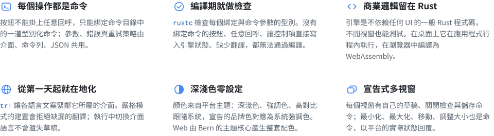
</picture>

<details>
<summary><b>還有：</b>完整標準控制項、預設骨架圖、樣式與動效、媒體與檔案、系統整合、模組化應用程式、<code>NativeView</code> 與可選 JS…</summary>
<br>

- **自適應版面與導覽**：`compact`、`medium`、`expanded`、`large` 四檔尺寸與 `watch`、`tv` 版面；型別化推入式導覽、`SplitView` 側邊欄、`Tabs` 與 `TabAccessory`、工具列、選單、`Grid`（含瀑布流）、`Stack`、`SplitPane`、`Accordion` 與編譯期功能契約。
- **完整原生控制項體系**：`Table`、`TreeView`、`Reorderable`、`BottomSheet`、`Refreshable`、`DatePicker`、`TimePicker`、`NumberInput`、`ColorPicker`、`ShortcutInput`、`Tooltip`、`Banner`、`Disclosure`、`Alert`、`EmptyState`、`Badge`、`Avatar`、`Text(selectable:)` 與行內 Markdown、動態可搜尋 `Picker(style: combobox)`、多檔案 `pick:` 與原生 `save:` 對話框。
- **預設骨架圖、樣式與動效**：`Query` 與 `skeleton: <bool>` 容器於編譯期直接從真實介面樹投影骨架圖（120 ms 防閃爍、錯峰輕浮進場、自動遵循減少動態效果）；`style!` 全域覆寫、彈簧動效與共享元素 Hero、純 Rust 動畫 `Svg`（零 WebView）、HDR `Image`、`Canvas` 自繪與比例軌道 `Rail`。
- **媒體、非同步查詢與檔案**：`Video` 串接各平台原生媒體堆疊或應用自備 `MediaKernel`，支援直讀 `players.<id>.<field>`；`Query` 訂閱管理載入、空狀態、失敗與重新整理；`Bern.toml` 隨附資源；跨本機路徑 / Android `content://` / Web `blob:` 統一的 `MediaSource`、系統開啟方式 `[[app.opens]]` 與記憶體供圖 `bern::files::serve`。
- **桌面與系統整合**：系統匣 `StatusItem`（單色 SVG 圖示與登入時啟動）、macOS `MenuBar`、浮層錨定工具窗、內建 `window.screenshot`、指標事件（`DoubleTap`、`ContextMenu`、`WheelUp`/`WheelDown`）、`Slider(hover:)` 與內嵌 `WebPage`。
- **擴充能力**：模組化應用程式（`bern new --module`）、緊鄰嵌入各平台原生程式碼的 `NativeView`（含強型別 props、`tr!` 檢查、強制 CLI 入口與 `Fallback`，見[緊鄰原生視圖](Docs/zh-CN/Implementation/Native-Views.md)），以及按需啟用的行程內 JavaScript 與 `bern.cli` 黑白名單（見[JavaScript 與目標能力](Docs/zh-CN/Implementation/JavaScript.md)）。

</details>

## 運作方式

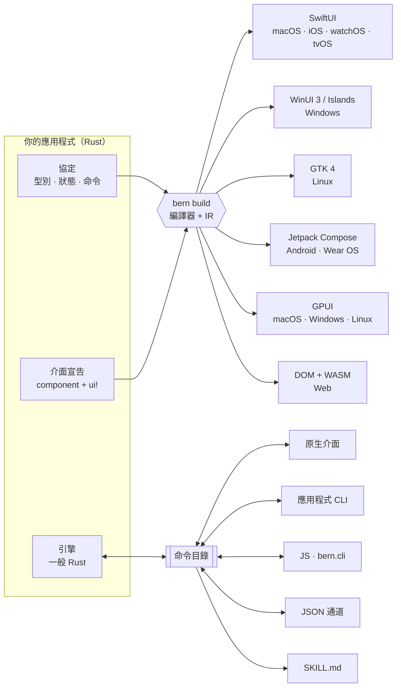

1. **協定**：`#[bern::protocol]` 宣告值型別、唯讀狀態，以及命令與查詢 trait。
2. **引擎**：以一般 Rust 實作這些 trait；它看不到視窗、控制項與傳輸層。
3. **介面**：`#[component]` 函式，主體是一個 `ui!` 宣告。編譯器將它們讀入共用的中介表示（IR），各目標模組從 IR 產生原生程式碼。新增目標不需要改動剖析器、IR 或你的商業邏輯。

## 程式碼一覽

**1 · 協定**：型別、狀態與命令

```rust
#[bern::protocol(namespace = "counter", version = 1)]
pub mod counter {
    use bern::prelude::*;

    #[state]
    pub struct State {
        pub count: i64,
    }

    #[commands]
    pub trait Commands {
        /// Add to the count.
        fn add(&mut self, by: i64) -> Result<(), CommandError>;
    }
}
```

**2 · 引擎**：一般 Rust，不依賴 UI

```rust
use bern::CommandError;

pub struct Counter {
    state: counter::State,
}

impl Default for Counter {
    fn default() -> Self {
        Self { state: counter::State { count: 0 } }
    }
}

impl counter::Commands for Counter {
    fn add(&mut self, by: i64) -> Result<(), CommandError> {
        self.state.count += by;
        Ok(())
    }
}

impl counter::Engine for Counter {
    fn state(&self) -> &counter::State {
        &self.state
    }
}
```

**3 · 介面**：一個 `ui!` 宣告

```rust
#[component]
pub fn counter_view(app: counter::Client) -> impl View {
    ui! {
        Form {
            Text(content: tr! {
                "zh-Hant" => "已計數 {n} 次",
                "en" => "Counted {n} times";
                n: app.count
            })
            Button(
                id: add,
                label: tr! { "zh-Hant" => "加一", "en" => "Add one" },
                prominence: prominent
            ) => app.add(1)
        }
    }
}
```

**4 · 所有入口驅動同一個引擎**

```sh
counter ui inspect
counter ui activate --target counter_view.add
counter counter add --by 5
counter catalog
```

`Bern.toml` 宣告語言、主題、原始碼、隨附資源與建置目標。完整範例請見[控制項展示應用程式](examples/showcase)：側邊欄應用程式，包含文字層級、按鈕、開關、滑桿、輸入框、由引擎查詢驅動的搜尋、清單到詳細資料的導覽、影片，以及具備分頁與關閉確認的設定視窗。[計畫應用程式](examples/planner)示範模組化應用程式、樣式覆寫、動效與 `Canvas`。[圖案集](examples/gallery)示範媒體類應用程式的元件：海報牆的錯開進場、時間軸的按比例擺放、音量浮層按鈕、隨四檔尺寸變化的頁邊距與版面，以及拖入影片後由引擎讀出檔名、格式與大小。[原生控制項範例](examples/native-controls)示範透過 `NativeView` 在六個後端緊鄰嵌入平台原生控制項，[手錶端範例](examples/wearos)示範手錶目標，[動畫 SVG](examples/svg-animation)示範純 Rust 向量動畫。

## 支援的平台

<picture>
<source media="(prefers-color-scheme: dark)" srcset="Docs/Assets/tables/platforms-zh-Hant-dark.svg">
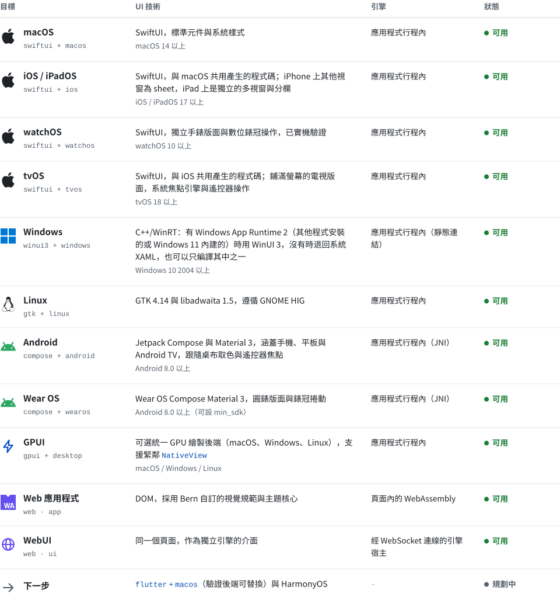
</picture>

實作紀錄：[macOS](Docs/zh-CN/Implementation/macOS-SwiftUI.md) · [iOS](Docs/zh-CN/Implementation/iOS-SwiftUI.md) · [watchOS](Docs/zh-CN/Implementation/watchOS-SwiftUI.md) · [tvOS](Docs/zh-CN/Implementation/tvOS-SwiftUI.md) · [Windows](Docs/zh-CN/Implementation/Windows-WinUI3.md) · [Linux](Docs/zh-CN/Implementation/Linux-GTK.md) · [Android 與 Wear OS](Docs/zh-CN/Implementation/Android-Compose.md) · [GPUI](Docs/zh-CN/Implementation/GPUI.md) · [Web 與 WebUI](Docs/zh-CN/Implementation/Web.md)；下一步的平台見[適配規範](Docs/zh-CN/Adaptation/README.md)。

未指定 UI 技術時採用平台的預設技術；預設技術無法使用時直接回報錯誤，不會悄悄換成另一套技術。

### 把 Bern 當作 GPUI 的 UI 框架

GPUI 提供高效能 GPU 繪製，但本身不帶標準控制項函式庫。在 macOS、Windows 或 Linux 目標裡加上 `ui = "gpui"`，就能直接把 Bern 當作 GPUI 的宣告式 UI 框架使用：一份 `ui!` 開箱自帶全套桌面控制項、語意深淺色主題、彈簧動效、編譯期多語言與功能契約檢查，以及 Skills + CLI。需要自訂 GPU 繪製的地方，以 `NativeView(gpui: "...")` 緊鄰嵌入原生 GPUI 程式碼即可；未來想切回系統原生控制項，或擴展到 iOS、Android、watchOS、Wear OS 與 Web，商業邏輯與宣告都不必重寫。

### Windows 與 iOS 各有兩個前端

這兩個平台的系統跨度大，一個 UI 框架涵蓋不全，所以同一份宣告各產生兩個前端。預設兩個都編譯進同一個套件，應用啟動時依系統自動選擇，使用者和應用程式碼都不用管。

| 平台 | 前端 | `frontends` 裡的名稱 | 執行於 |
| --- | --- | --- | --- |
| Windows | WinUI 3 | `winui3` | 有 Windows App Runtime 2 的系統，Mica 背景與 Windows 11 外觀 |
| Windows | 系統 XAML，經 XAML Islands | `xaml-islands` | 其餘的 Windows 10 與 11，不需要安裝執行階段 |
| iOS | SwiftUI | `swiftui` | iOS 17 起，所有 Apple 目標共用這個前端 |
| iOS | SwiftUI 的 iOS 16 版 | `swiftui-16` | iOS 16，由同一份產生的程式碼改寫而成 |

只要一個前端時寫明：

```toml
[targets.windows]
frontends = ["winui3"]   # 沒有執行階段的系統上會提示安裝

[targets.ios]
frontends = ["swiftui"]  # 最低 iOS 17
```

iOS 兩個前端都保留時，寫 `packages = "separate"` 可以打成兩個 `.ipa`。選擇規則見 [Windows](Docs/zh-CN/Implementation/Windows-WinUI3.md) 與 [iOS](Docs/zh-CN/Implementation/iOS-SwiftUI.md) 的實作紀錄，iOS 16 上有幾項功能會降級，也寫在那裡。

## 與其他跨平台框架比較

<p align="center">
<a href="https://github.com/zed-industries/zed/tree/main/crates/gpui"></a>
<a href="https://dioxuslabs.com"></a>
<a href="https://flutter.dev"></a>
<a href="https://reactnative.dev"></a>
<a href="https://uniapp.dcloud.net.cn"></a>
<br>
<a href="https://www.electronjs.org"></a>
<a href="https://tauri.app"></a>
<a href="https://avaloniaui.net"></a>
<a href="https://www.qt.io"></a>
</p>

每個框架都在回答同一個問題：一份程式碼，怎樣變成各平台上的介面。回答不同，取捨也不同。以下依據各專案的官方文件整理；大小與記憶體隨版本與設定變化很大，這裡只比較結構上的差別，Bern 自己的數字見[實測數據](#實測數據)。

<picture>
<source media="(prefers-color-scheme: dark)" srcset="Docs/Assets/compare/routes-zh-Hant-dark.svg">
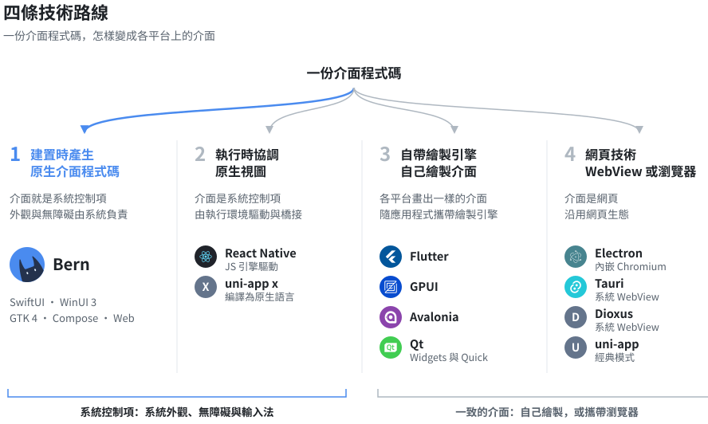
</picture>

前兩條路線得到的是系統控制項：外觀、無障礙、輸入法、深淺色都由系統負責，代價是各平台控制項不完全相同。後兩條路線在每個平台上畫出一樣的介面，代價是要自己追隨各平台的設計與行為，或者攜帶一個瀏覽器。

<picture>
<source media="(prefers-color-scheme: dark)" srcset="Docs/Assets/compare/landscape-zh-Hant-dark.svg">
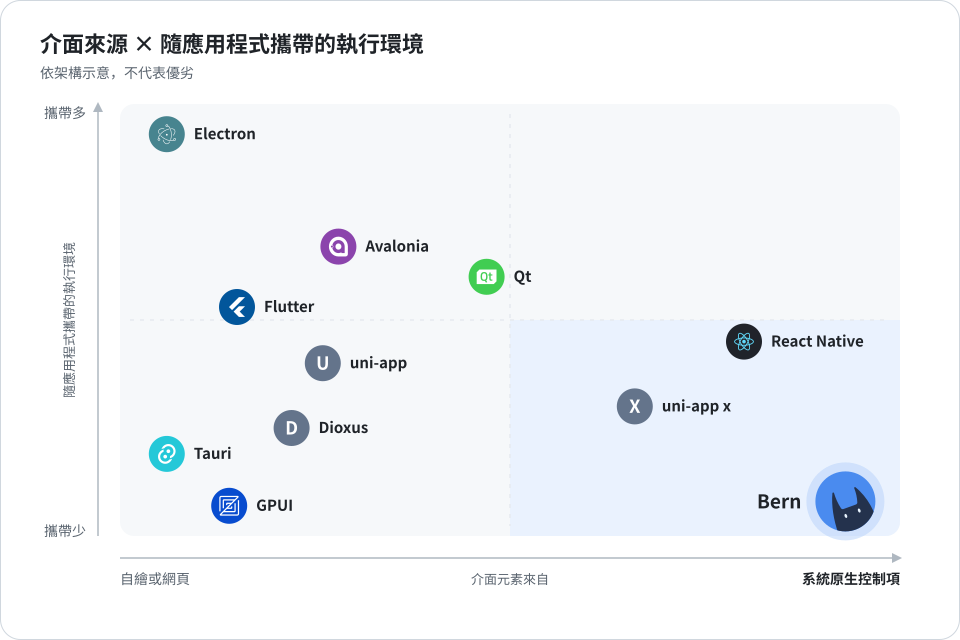
</picture>

上圖依架構示意，不代表優劣：橫軸是介面元素來自系統控制項，還是框架自繪或網頁；縱軸是應用程式要隨身攜帶多少執行環境（瀏覽器核心、JS 引擎、繪製引擎、語言執行環境）。

### 技術路線

<picture>
<source media="(prefers-color-scheme: dark)" srcset="Docs/Assets/tables/technology-zh-Hant-dark.svg">
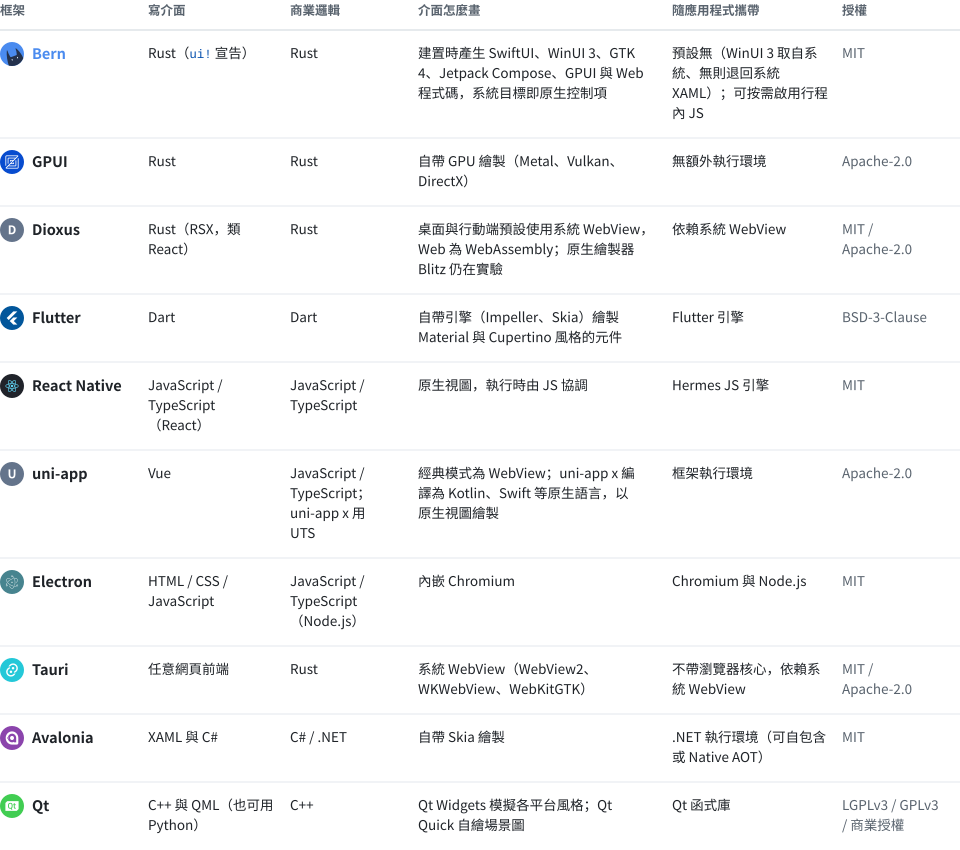
</picture>

### 平台與能力

<picture>
<source media="(prefers-color-scheme: dark)" srcset="Docs/Assets/tables/capabilities-zh-Hant-dark.svg">
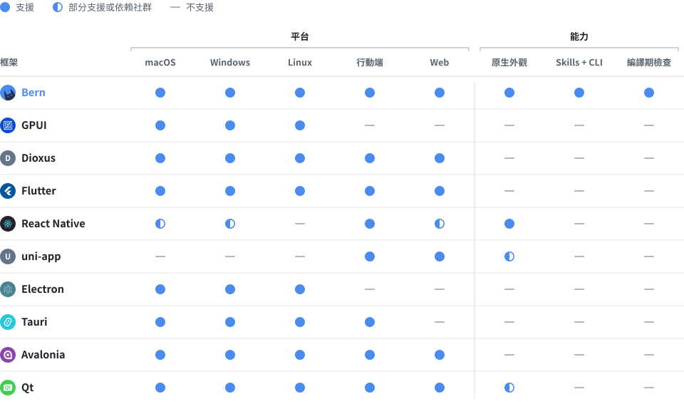
</picture>

- **行動端**：iOS / iPadOS 與 Android（並涵蓋 watchOS、Wear OS、tvOS 與 Android 電視）。React Native 的桌面版本由微軟維護，uni-app 另涵蓋小程式與鴻蒙；Bern 涵蓋的桌面、手機、平板、手錶與電視目標均已通過實機測試，並支援打包 `.ipa` 與 `.apk`。
- **原生外觀**：控制項就是平台自己的控制項，外觀、無障礙與輸入法由系統提供。Qt Widgets 與 uni-app x 接近原生，記為部分。
- **Skills + CLI**：Bern 從同一份命令目錄產生應用程式的 CLI 和 `SKILL.md`，使用者與 Agent 使用相同的指令。其他框架可以透過無障礙介面，或 Playwright、Flutter Driver 等測試工具從外部自動化。
- **編譯期檢查**：翻譯缺漏、功能在某個版面沒有入口、入口沒有登記功能，都由編譯器直接報錯（見[為 AI 而建](#為-ai-而建)）。其他框架多藉助 lint、翻譯工具或測試發現這類問題。
- **成熟度**：Electron 與 Qt 非常成熟；Flutter、React Native、uni-app、Tauri 與 Avalonia 成熟；Dioxus 發展中；GPUI 支撐著 Zed 編輯器，通用元件仍在早期；Bern 是早期預覽。

### 效能與資源

介面層與邏輯層用什麼語言、怎樣執行，決定了執行時開銷的上限：原生編譯且沒有垃圾回收的語言最省，JIT 與位元組碼直譯的語言需要攜帶引擎、占用更多記憶體。

<picture>
<source media="(prefers-color-scheme: dark)" srcset="Docs/Assets/compare/languages-zh-Hant-dark.svg">
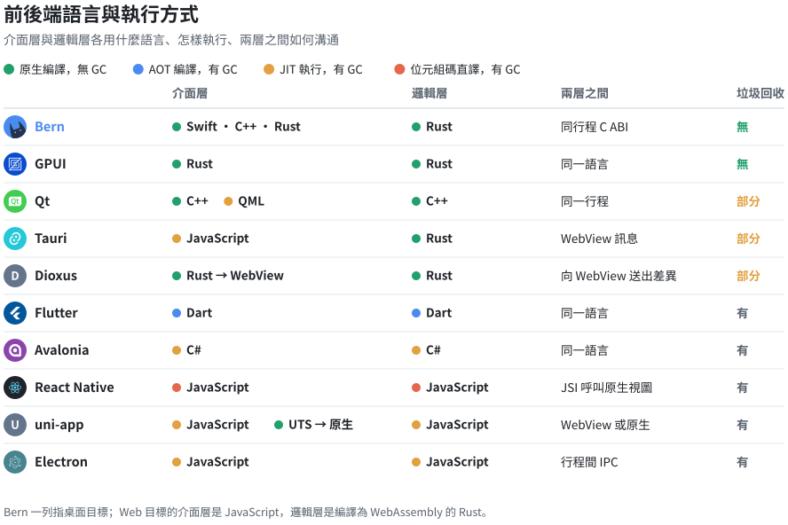
</picture>

同樣一個只顯示一行字的視窗，各框架的套件大小、啟動時間與記憶體差別很大。下圖在同一台 CI 虛擬機（GitHub 託管的 Apple M1）上實測：各框架用自己的工具建置 release 套件，測量時輪流啟動，每個 10 次取中位數。腳本在 [benchmarks/](benchmarks/) 中，可以在 Actions 裡重新執行 Benchmarks 工作流程。

<picture>
<source media="(prefers-color-scheme: dark)" srcset="Docs/Assets/compare/resources-zh-Hant-dark.svg">
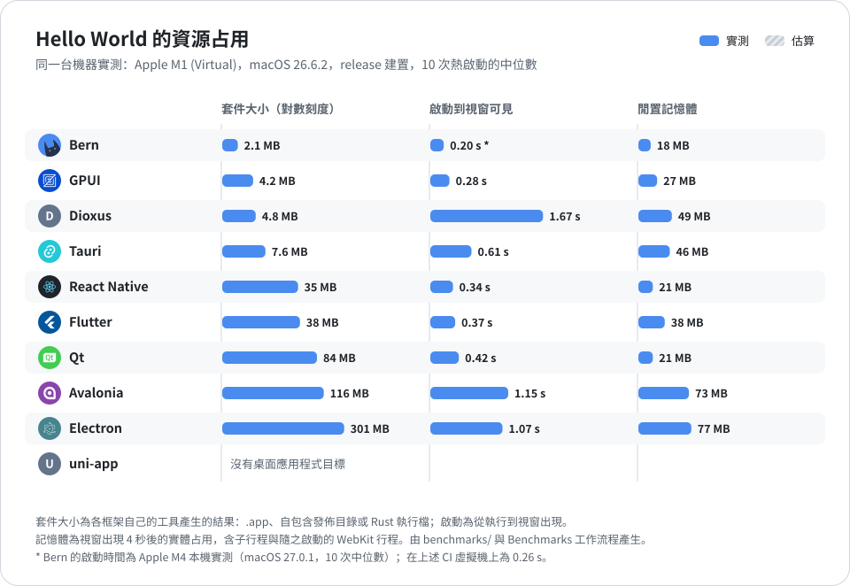
</picture>

### 怎麼選

<picture>
<source media="(prefers-color-scheme: dark)" srcset="Docs/Assets/tables/choose-zh-Hant-dark.svg">
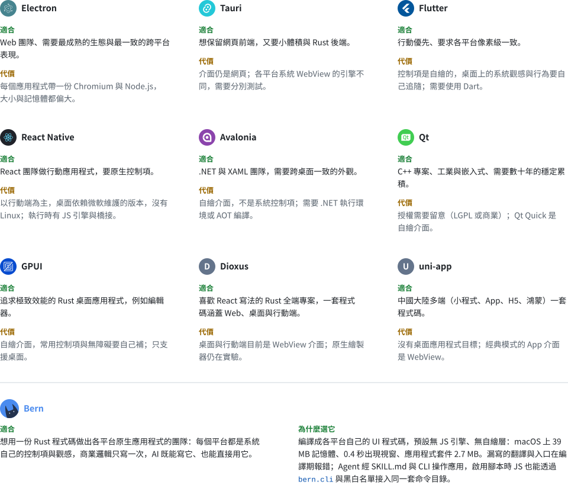
</picture>

## 快速開始

需要 Rust 1.99（`rustup` 依 `rust-toolchain.toml` 自動安裝），以及所建置目標的工具鏈。先安裝建置工具 `bern`：

```sh
cargo binstall bern-cli
```

[cargo-binstall](https://github.com/cargo-bins/cargo-binstall) 從 [Releases](https://github.com/AimesSoft/Bern/releases) 下載編譯好的 `bern`，也可以自己到那裡下載；`cargo install bern-cli` 則從原始碼編譯。這樣安裝的 `bern` 建立的應用程式從 crates.io 取得同一版本的 Bern。要修改 Bern 本身，在複製下來的儲存庫裡用 `cargo install --path crates/bern-cli` 安裝 `bern`，它建立的應用程式從這份複製取得 Bern。

### 建立應用程式

在任意目錄中：

```sh
bern new my_app
cd my_app
bern run
```

新的應用程式是一個帶計數的視窗，協定、引擎與介面各一個 crate，六個目標都已在 `Bern.toml` 中宣告。`bern run` 建置本機的目標並啟動它：macOS 上是 SwiftUI，Windows 上是 WinUI 3，Linux 上是 GTK；`bern run --target web_app` 在瀏覽器中開啟，`bern run --target ios` 安裝到正在執行的 iOS 模擬器，`bern run --target android` 安裝到以 USB 偵錯連接的 Android 手機（或模擬器）並啟動。目標宣告 `channels = ["ipc"]` 時，可在 `target/bern/<目標>/bin/` 找到應用程式 CLI，並在同層的 `skills/` 目錄找到 `SKILL.md`。

`bern doctor` 列出本機建置每個目標還缺什麼、怎麼安裝：

```text
$ bern doctor
bern 0.2.1 on macOS (aarch64)

[✓] Rust: rustc 1.99.0, cargo 1.99.0
[✓] macOS · SwiftUI: macOS SDK 26.5, Swift 6.3.2
[✓] iOS · SwiftUI: iOS simulator SDK 26.5, the aarch64-apple-ios-sim target
[-] Windows · WinUI 3: builds on Windows
[-] Linux · GTK 4: builds on Linux
[✓] Android · Compose: Android SDK, NDK 29.0.14206865, gradle-9.5.1, the aarch64-linux-android target
[✓] Web · WebAssembly: the wasm32-unknown-unknown target
```

<details>
<summary><b>各平台需要的工具</b></summary>
<br>

- **macOS**：Xcode 26 或更新版本。從 App Store 安裝後執行 `sudo xcode-select --switch /Applications/Xcode.app`。
- **iOS / iPadOS / tvOS / watchOS**：Xcode 對應的 Apple 平台 SDK 與 Rust 目標（`aarch64-apple-ios` / `aarch64-apple-ios-sim`、`aarch64-apple-tvos` / `aarch64-apple-tvos-sim`、`aarch64-apple-watchos` / `aarch64-apple-watchos-sim`）。`bern run` 可在模擬器除錯，`bern package` 產生可供實機安裝執行的 `.ipa`。
- **Windows**：Visual Studio 2022 或更新版本的「使用 C++ 的桌面開發」（只裝建置工具也可以），含 Windows 11 SDK；Rust 使用 MSVC 工具鏈。首次建置時以 Windows SDK 的 `cppwinrt` 產生 C++/WinRT 標頭檔，並把它們與執行階段預先編譯（每個設定約 2.4 GB，放在 `target` 中）；之後的建置只編譯應用程式自己的程式碼，新專案約 5 秒，展示應用程式約 9 秒。應用程式目錄只有執行檔、400 KB 的啟動程式 DLL 與資源，不需要 .NET，也不隨附 Windows App SDK。
- **Linux**：GTK 4.14 與 libadwaita 1.5 的開發套件，例如 `sudo apt install libgtk-4-dev libadwaita-1-dev libsoup-3.0-dev gstreamer1.0-libav`。
- **Android**：Android Studio（帶 SDK 與 NDK，在 SDK Manager 的 SDK Tools 中勾選 NDK）、Gradle 9.4 或更新版本，以及 `rustup target add aarch64-linux-android`。第一次建置時 Gradle 會下載 Android 外掛與 Compose 程式庫。
- **Web**：`rustup target add wasm32-unknown-unknown`。`web_app` 建置把引擎編譯為 WebAssembly 在頁面內執行；`web_ui` 建置讓頁面作為獨立引擎宿主的介面，`bern run` 啟動宿主並開啟它的位址。

</details>

### 發佈應用程式

```sh
bern package
```

以 release 建置本機能建置的目標，在 `target/bern/dist/` 中產生安裝套件：macOS 的 `.dmg`，Windows 的安裝程式（依目前使用者安裝，不需要系統管理員權限）與免安裝的 `.zip`，Linux 的 `.deb` 與 `.tar.gz`，Android 的 `.apk` 與上架用的 `.aab`，Web 的靜態網站壓縮檔。桌面和 WebUI 套件含有應用程式 CLI，啟用 IPC 時也包含 Skill。靜態 Web 套件只含網站檔案；Android CLI 在開發電腦上執行，不會包進 APK。簽署以環境變數設定，憑證不進儲存庫：`BERN_MACOS_SIGNING_IDENTITY` 與 `BERN_MACOS_NOTARY_PROFILE`（簽署並公證），`BERN_WINDOWS_CERTIFICATE`（憑證指紋或 `.pfx`），`BERN_ANDROID_KEYSTORE`、`BERN_ANDROID_KEYSTORE_PASSWORD` 與 `BERN_ANDROID_KEY_ALIAS`（發布金鑰）。沒有設定時照樣產生，並提示未簽署的後果。

### 匯出獨立純原生專案（無框架鎖定）

```sh
bern eject --target macos --out ./native-macos                   # 離線 Rust 後端原始碼 + Xcode 專案
bern eject --target ios --engine prebuilt --release --out ./ios  # 預編譯 XCFramework，無需安裝 Rust
```

`bern eject` 可隨時匯出標準原生 IDE 專案（`.xcodeproj`、Gradle、Visual Studio `.sln` + `.vcxproj`、獨立 Cargo 或零打包器 ES 模組），依元件與視窗拆分成清晰檔案，且不改動原 Bern 專案。預設 `--engine source` 會離線打包完整自包含的 Rust 工作區並與原生 IDE 建置聯動；`--engine prebuilt` 會預編譯並嵌入引擎二進位，讓原生開發者無需安裝 Rust 或 Bern 即可直接開啟建置。詳見[匯出為獨立純原生專案](Docs/zh-CN/Implementation/Eject.md)。

### 執行展示應用程式

Bern 儲存庫中的展示應用程式用到全部元件、兩個視窗與影片播放器。在儲存庫目錄中：

```sh
cd examples/showcase
bern run
```

### 從外部驅動執行中的應用程式

```sh
showcase ui inspect                                          # 列出已掛載的控制項
showcase ui select --target main_window.pages --option Controls
showcase ui set-bool --target controls_page.sync --value true
showcase showcase search-library --text mo                   # 引擎查詢
showcase window open --kind settings
showcase window list                                         # 視窗的實際狀態
showcase window screenshot --output shot.png                 # 截取視窗 PNG
ssh HOST /path/to/showcase state
```

目標的 `channels = ["ipc"]` 會啟用外部控制。Android 的 CLI 在開發電腦上執行，連線至 `bern run` 透過 `adb forward` 轉送的端點，而非在手機上執行。獨立 Web `app` 啟用 IPC 後，`bern run` 會啟動本機橋接程式，連線至已開啟的瀏覽器分頁；發佈的靜態網站套件不含本機 CLI 或 `SKILL.md`。

## 路線圖

<picture>
<source media="(prefers-color-scheme: dark)" srcset="Docs/Assets/tables/roadmap-zh-Hant-dark.svg">
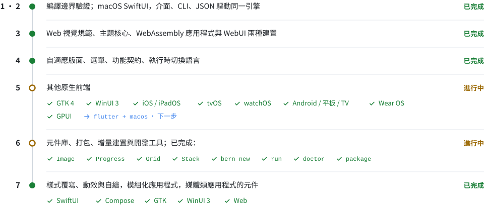
</picture>

## 儲存庫結構

<details>
<summary>crate 與目錄</summary>
<br>

<picture>
<source media="(prefers-color-scheme: dark)" srcset="Docs/Assets/tables/repository-zh-Hant-dark.svg">
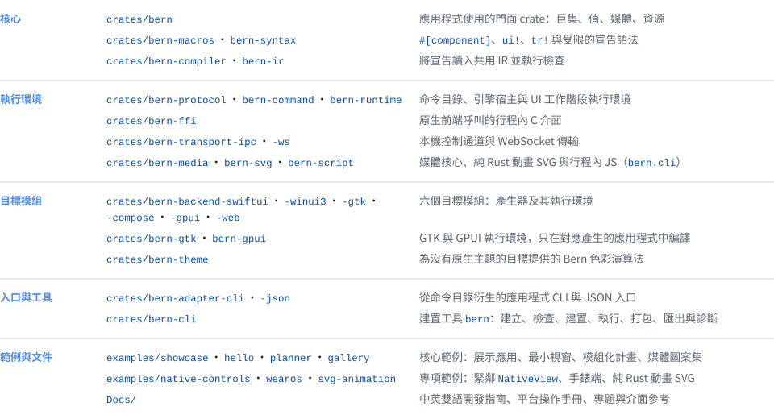
</picture>

</details>

## 開發

```sh
cargo fmt --all --check
cargo clippy --workspace --all-targets -- -D warnings
cargo test --workspace
```

測試包含必須編譯失敗的宣告，並在安裝了相應工具包的環境中對產生的應用程式做型別檢查：以 Xcode 檢查 Swift 6，以開發套件檢查 GTK，在 Windows 上以 MSVC 編譯產生的兩套前端。Android 的 Kotlin 由 `bern build --target android` 經 Gradle 編譯。

## 文件

線上瀏覽可檢索文件：**[bern.aimes-soft.com/docs/zh-CN](https://bern.aimes-soft.com/docs/zh-CN)**，或在儲存庫中直接閱讀：

- **介面參考**：[文件目錄](Docs/zh-CN/README.md) · [目前元件用法](Docs/zh-CN/Reference/UI.md) · [完整屬性表](Docs/zh-CN/Reference/Component-Properties.md) · [平台能力與驗證範圍](Docs/zh-CN/Reference/Platforms.md) · [效能追蹤](Docs/zh-CN/Reference/Tracing.md)（簡體中文）
- **架構與設計**：[設計文件](Docs/zh-CN/Design.md) · [適配規範](Docs/zh-CN/Adaptation/README.md) · [React Native 研究](Docs/zh-CN/Research/ReactNative.md)
- **專題文件**：[匯出獨立純原生專案](Docs/zh-CN/Implementation/Eject.md) · [緊鄰原生視圖](Docs/zh-CN/Implementation/Native-Views.md) · [JavaScript 與 `bern.cli`](Docs/zh-CN/Implementation/JavaScript.md) · [動畫 SVG](Docs/zh-CN/Implementation/Animated-SVG.md) · [依模組編譯](Docs/zh-CN/Implementation/Module-Builds.md) · [應用瀏覽器擴充](Docs/zh-CN/Implementation/Web-Extensions.md)
- **平台實作**：[macOS](Docs/zh-CN/Implementation/macOS-SwiftUI.md) · [iOS](Docs/zh-CN/Implementation/iOS-SwiftUI.md) · [watchOS](Docs/zh-CN/Implementation/watchOS-SwiftUI.md) · [tvOS](Docs/zh-CN/Implementation/tvOS-SwiftUI.md) · [Windows](Docs/zh-CN/Implementation/Windows-WinUI3.md) · [Linux](Docs/zh-CN/Implementation/Linux-GTK.md) · [Android 與 Wear OS](Docs/zh-CN/Implementation/Android-Compose.md) · [GPUI](Docs/zh-CN/Implementation/GPUI.md) · [Web 與 WebUI](Docs/zh-CN/Implementation/Web.md)

設計與實作文件以簡體中文撰寫，另有[英文版](Docs/README.md)（[線上版](https://bern.aimes-soft.com/docs)）。

## 授權

[MIT](LICENSE) © 2026 MCDFSteve

<div align="center">
<br>
<sub>Bern 仍處於早期開發階段，API 與宣告語法可能還會變動。</sub>
</div>
