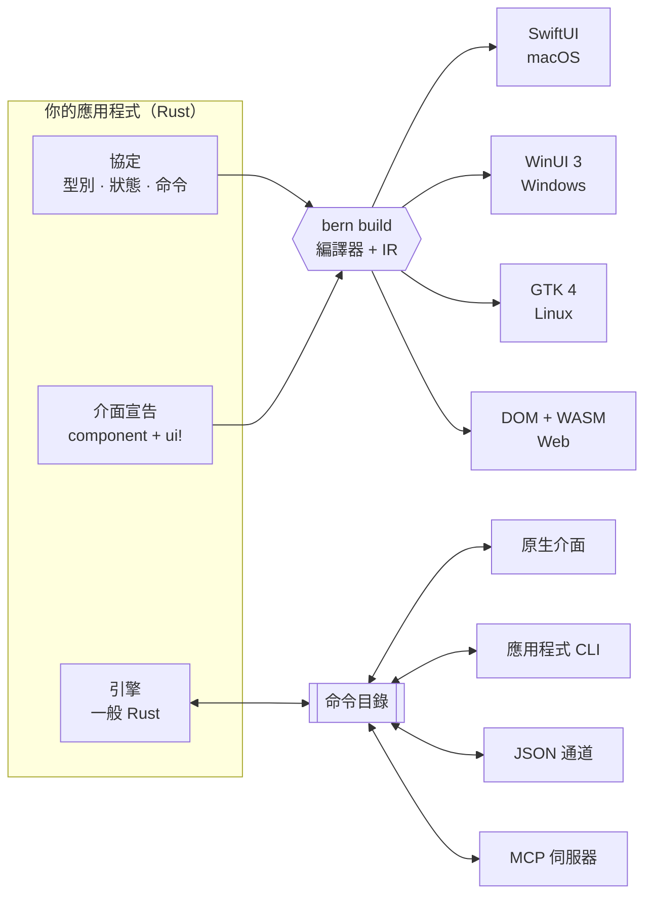

<div align="center">

<h1>Bern</h1>

<p><b>用 Rust 宣告一次應用程式，在每個桌面平台上交付真正的原生介面。</b><br>
每個控制項都是一道型別化命令，由使用者、腳本與 AI Agent 共同使用。</p>

<p>


</p>

<p>


<a href="Cargo.toml"></a>


</p>

<p>
<a href="README.md">English</a> ·
<a href="README.zh-Hans.md">简体中文</a> ·
<b>繁體中文</b> ·
<a href="README.ja.md">日本語</a>
</p>

<p>
<a href="#-快速開始">快速開始</a> ·
<a href="#-運作方式">運作方式</a> ·
<a href="#-程式碼一覽">程式碼</a> ·
<a href="#-支援的平台">平台</a> ·
<a href="#-路線圖">路線圖</a> ·
<a href="Docs/Design.md">設計文件</a>
</p>

</div>

<br>

<table>
<tr>
<td width="50%" align="center"><br><sub><b>macOS</b> · SwiftUI</sub></td>
<td width="50%" align="center"><br><sub><b>Windows</b> · WinUI 3</sub></td>
</tr>
<tr>
<td width="50%" align="center"><br><sub><b>Linux</b> · GTK 4 + libadwaita</sub></td>
<td width="50%" align="center"><br><sub><b>Web</b> · DOM + WebAssembly</sub></td>
</tr>
</table>

<p align="center"><sub>同一份 <code>controls_page</code> 宣告，產生四套 UI 技術。在桌面上 Bern 不自行繪製任何像素：<br>每個開關、滑桿與側邊欄都是平台自己的標準控制項，使用平台自己的配色。</sub></p>

## ✨ 為什麼選擇 Bern

Bern 是以命令為中心的 Rust 應用程式框架。介面以受限、可靜態分析的 Rust 宣告撰寫，`bern build` 將其編譯為各平台的原生 UI 技術。商業邏輯留在一般的 Rust 引擎中；介面裡每個可操作的元素都綁定一道型別化命令，因此介面、應用程式 CLI、JSON 通道與 MCP 伺服器驅動的是**同一個引擎實例**。

<table>
<tr>
<td width="33%" valign="top">
<h3>🖥️ 真原生，不是仿原生</h3>
macOS 上是 SwiftUI，Windows 上是 WinUI 3，Linux 上是 GTK 4 與 libadwaita。標準控制項、系統配色、深色模式、強調色與無障礙功能都來自平台本身，而不是 Bern 的算繪器。
</td>
<td width="33%" valign="top">
<h3>⌘ 每個操作都是命令</h3>
按鈕不能掛上任意回呼，只能綁定命令目錄中的一道型別化命令；參數、錯誤與重試策略由所有入口共用。
</td>
<td width="33%" valign="top">
<h3>🤖 天生支援 AI Agent</h3>
同一份命令目錄產生應用程式 CLI 與 MCP 伺服器。Agent 可以讀取執行中的介面（<code>ui.inspect</code>），並透過真實的控制項操作它，包括視窗與關閉確認。
</td>
</tr>
<tr>
<td width="33%" valign="top">
<h3>🦀 商業邏輯留在 Rust</h3>
引擎是不依賴任何 UI 的一般 Rust 程式碼，不開視窗也能測試。在桌面上它在應用程式行程內執行，在瀏覽器中編譯為 WebAssembly。
</td>
<td width="33%" valign="top">
<h3>🧭 編譯期就做檢查</h3>
<code>rustc</code> 檢查每個綁定與命令參數的型別。沒有綁定命令的按鈕、任意回呼、讓控制項直接寫入引擎狀態、缺少翻譯，都無法通過編譯。
</td>
<td width="33%" valign="top">
<h3>🌍 從第一天起就在地化</h3>
<code>tr!</code> 讓各語言文案緊鄰它所屬的介面。嚴格模式的建置會拒絕缺漏的翻譯；執行中切換介面語言不會遺失草稿。
</td>
</tr>
</table>

<details>
<summary><b>還有更多：</b>多視窗、媒體、非同步查詢、自適應版面…</summary>
<br>

- **宣告式多視窗**：主視窗與設定視窗各有自己的草稿、關閉檢查與儲存命令；最小化、最大化、移動、調整大小都是命令，以平台的實際狀態回覆。
- **影片**：`Video` 分別執行於 AVFoundation、Windows Media Foundation、GStreamer 與 HTML 媒體，控制列由命令驅動，播放器可以跨頁面持續播放。
- **非同步查詢**：`Query` 訂閱具備載入、空結果、失敗與重新整理狀態，只顯示最新的回覆。
- **自適應版面**：依視圖實際取得的空間選擇 `compact` 或 `expanded` 版面。
- **型別化導覽**：側邊欄、帶型別化路由的推入式導覽、分頁、工具列與選單。
- **功能契約**：宣告元件在每種版面中必須涵蓋的功能，由編譯器證明涵蓋完整。
- **隨附資源**：在 `Bern.toml` 中宣告檔案，建置時檢查，執行時依名稱定位。

</details>

## 🧩 運作方式



1. **協定**：`#[bern::protocol]` 宣告值型別、唯讀狀態，以及命令與查詢 trait。
2. **引擎**：以一般 Rust 實作這些 trait；它看不到視窗、控制項與傳輸層。
3. **介面**：`#[component]` 函式，主體是一個 `ui!` 宣告。編譯器將它們讀入共用的中介表示（IR），各目標模組從 IR 產生原生程式碼。新增目標不需要改動剖析器、IR 或你的商業邏輯。

## 🍃 程式碼一覽

<table>
<tr>
<td width="50%" valign="top">

**1 · 協定**：型別、狀態與命令

```rust
#[bern::protocol(namespace = "counter", version = 1)]
pub mod counter {
    use bern::prelude::*;

    #[state]
    pub struct State {
        pub count: i64,
    }

    #[commands]
    pub trait Commands {
        /// Add to the count.
        fn add(&mut self, by: i64) -> Result<(), CommandError>;
    }
}
```

**3 · 介面**：一個 `ui!` 宣告

```rust
#[component]
pub fn counter_view(app: counter::Client) -> impl View {
    ui! {
        Form {
            Text(content: tr! {
                "zh-Hant" => "已計數 {n} 次",
                "en" => "Counted {n} times";
                n: app.count
            })
            Button(
                id: add,
                label: tr! { "zh-Hant" => "加一", "en" => "Add one" },
                prominence: prominent
            ) => app.add(1)
        }
    }
}
```

</td>
<td width="50%" valign="top">

**2 · 引擎**：一般 Rust，不依賴 UI

```rust
use bern::CommandError;

pub struct Counter {
    state: counter::State,
}

impl Default for Counter {
    fn default() -> Self {
        Self { state: counter::State { count: 0 } }
    }
}

impl counter::Commands for Counter {
    fn add(&mut self, by: i64) -> Result<(), CommandError> {
        self.state.count += by;
        Ok(())
    }
}

impl counter::Engine for Counter {
    fn state(&self) -> &counter::State {
        &self.state
    }
}
```

**4 · 所有入口驅動同一個引擎**

```sh
counter ui inspect
counter ui activate --target counter_view.add
counter counter add --by 5
counter-mcp   # 同一份命令目錄，提供給 AI Agent
```

</td>
</tr>
</table>

`Bern.toml` 宣告語言、主題、原始碼、隨附資源與建置目標。完整範例請見[控制項展示應用程式](examples/showcase)：側邊欄應用程式，包含文字層級、按鈕、開關、滑桿、輸入框、由引擎查詢驅動的搜尋、清單到詳細資料的導覽、影片，以及具備分頁與關閉確認的設定視窗。

## 🖥️ 支援的平台

<table>
<tr>
<th align="left">目標</th>
<th align="left">UI 技術</th>
<th align="left">引擎</th>
<th align="left">狀態</th>
</tr>
<tr>
<td><b>macOS</b><br><code>swiftui + macos</code></td>
<td>SwiftUI，標準元件與系統樣式 · macOS 14 以上</td>
<td>應用程式行程內</td>
<td> <a href="Docs/Implementation/macOS-SwiftUI.md">實作紀錄</a></td>
</tr>
<tr>
<td><b>Windows</b><br><code>winui3 + windows</code></td>
<td>Windows App SDK 1.8 上的 WinUI 3，C# 宿主 · Windows 10 2004 以上</td>
<td>應用程式行程內（<code>bern_app.dll</code>）</td>
<td> <a href="Docs/Implementation/Windows-WinUI3.md">實作紀錄</a></td>
</tr>
<tr>
<td><b>Linux</b><br><code>gtk + linux</code></td>
<td>GTK 4.14 與 libadwaita 1.5，遵循 GNOME HIG</td>
<td>應用程式行程內</td>
<td> <a href="Docs/Implementation/Linux-GTK.md">實作紀錄</a></td>
</tr>
<tr>
<td><b>Web 應用程式</b><br><code>web</code> · <code>app</code></td>
<td>DOM，採用 Bern 自訂的視覺規範與主題核心</td>
<td>頁面內的 WebAssembly</td>
<td> <a href="Docs/Implementation/Web.md">實作紀錄</a></td>
</tr>
<tr>
<td><b>WebUI</b><br><code>web</code> · <code>ui</code></td>
<td>同一個頁面，作為獨立引擎的介面</td>
<td>經 WebSocket 連線的引擎宿主</td>
<td> <a href="Docs/Implementation/Web.md">實作紀錄</a></td>
</tr>
<tr>
<td><b>下一步</b></td>
<td><code>flutter + macos</code>（驗證後端可替換），之後是 iOS、Android 與 HarmonyOS</td>
<td>–</td>
<td> <a href="Docs/Adaptation/README.md">適配規範</a></td>
</tr>
</table>

未指定 UI 技術時採用平台的預設技術；預設技術無法使用時直接回報錯誤，不會悄悄換成另一套技術。

## 🚀 快速開始

需要 Rust 1.99（由 `rust-toolchain.toml` 固定），以及所建置目標的工具鏈。每次建置也會在 `target/bern/<目標>/bin/` 中產生應用程式 CLI 與 MCP 伺服器。

<details open>
<summary><b>🍎 macOS</b> · Xcode 26 或更新版本</summary>

```sh
cargo run -p bern-cli -- build --manifest examples/showcase/Bern.toml --target macos
open target/bern/macos/Showcase.app
```

</details>

<details>
<summary><b>🪟 Windows</b> · .NET SDK 10</summary>

```powershell
cargo run -p bern-cli -- build --manifest examples/showcase/Bern.toml --target windows
target\bern\windows\Showcase\showcase.exe
```

首次建置時會從 NuGet 還原 Windows App SDK，它與執行檔一起發佈。

</details>

<details>
<summary><b>🐧 Linux</b> · GTK 4.14 與 libadwaita 1.5 的開發套件</summary>

```sh
sudo apt install libgtk-4-dev libadwaita-1-dev gstreamer1.0-libav
cargo run -p bern-cli -- build --manifest examples/showcase/Bern.toml --target linux
target/bern/linux/Showcase/showcase
```

</details>

<details>
<summary><b>🌐 Web</b> · <code>rustup target add wasm32-unknown-unknown</code></summary>

```sh
# 引擎編譯為 WebAssembly，在頁面內執行
cargo run -p bern-cli -- build --manifest examples/showcase/Bern.toml --target web_app
python3 -m http.server 8765 --bind 127.0.0.1 --directory target/bern/web_app

# 或者頁面作為獨立引擎宿主的介面
cargo run -p bern-cli -- build --manifest examples/showcase/Bern.toml --target web_ui
target/bern/web_ui/bin/showcase-host
```

</details>

### 從外部驅動執行中的應用程式

```sh
showcase ui inspect                                          # 列出已掛載的控制項
showcase ui select --target main_window.pages --option Controls
showcase ui set-bool --target controls_page.sync --value true
showcase showcase search-library --text mo                   # 引擎查詢
showcase window open --kind settings
showcase window list                                         # 視窗的實際狀態
showcase-mcp                                                 # 經 stdio 的 MCP 伺服器
```

只有目標宣告了 `channels = ["ipc"]` 時才會啟動控制通道；未宣告則應用程式不監聽任何連接埠。

## 🗺️ 路線圖

| 階段 | 內容 | |
| :-- | :-- | :-: |
| 1 · 2 | 編譯邊界驗證；macOS SwiftUI，介面、CLI、JSON 與 MCP 驅動同一引擎 | ✅ |
| 3 | Web 視覺規範、主題核心、WebAssembly 應用程式與 WebUI 兩種建置 | ✅ |
| 4 | 自適應版面、選單、功能契約、執行時切換語言 | ✅ |
| 5 | 其他原生前端：GTK 4 ✅ · WinUI 3 ✅ · `flutter + macos` | 🚧 |
| 6 | 元件庫、打包、增量建置、開發工具，接入 NipaPlay 3.0 | ⏳ |

## 📂 儲存庫結構

<details>
<summary>crate 與目錄</summary>
<br>

| 路徑 | 說明 |
| :-- | :-- |
| `crates/bern` | 應用程式使用的門面 crate：巨集、值、媒體、資源 |
| `crates/bern-macros` · `bern-syntax` | `#[component]`、`ui!`、`tr!` 與受限的宣告語法 |
| `crates/bern-compiler` · `bern-ir` | 將宣告讀入共用 IR 並執行檢查 |
| `crates/bern-protocol` · `bern-command` · `bern-runtime` | 命令目錄、引擎宿主與 UI 工作階段執行環境 |
| `crates/bern-ffi` | 原生前端呼叫的行程內 C 介面 |
| `crates/bern-backend-swiftui` · `-winui3` · `-gtk` · `-web` | 目標模組：產生器及其執行環境 |
| `crates/bern-gtk` | GTK 執行環境，只在產生的 Linux 應用程式中編譯 |
| `crates/bern-adapter-cli` · `-mcp` · `-json` | 從命令目錄衍生的入口 |
| `crates/bern-transport-ipc` · `-ws` | 本機控制通道與 WebSocket 傳輸 |
| `crates/bern-theme` | 為沒有原生主題的目標提供的 Bern 色彩演算法 |
| `examples/showcase` | 在各平台上使用的控制項展示應用程式 |
| `Docs/` | 設計文件、平台適配規範與實作紀錄 |

</details>

## 🛠️ 開發

```sh
cargo fmt --all --check
cargo clippy --workspace --all-targets -- -D warnings
cargo test --workspace
```

測試包含必須編譯失敗的宣告，並在安裝了相應工具包的環境中對產生的應用程式做型別檢查：以 Xcode 檢查 Swift 6，以開發套件檢查 GTK，在 Windows 上以 .NET 檢查 C#。

## 📖 文件

- [設計文件](Docs/Design.md)：目標、架構、元件、主題、命令、視窗與媒體
- [適配規範](Docs/Adaptation/README.md)：Apple、Windows 與 Linux、Web、Android、HarmonyOS
- 實作紀錄：[macOS](Docs/Implementation/macOS-SwiftUI.md) · [Windows](Docs/Implementation/Windows-WinUI3.md) · [Linux](Docs/Implementation/Linux-GTK.md) · [Web](Docs/Implementation/Web.md)

設計與實作文件以簡體中文撰寫。

## 📄 授權

MIT，見 [`Cargo.toml`](Cargo.toml) 中的宣告。

<div align="center">
<br>
<sub>Bern 仍處於早期開發階段，API 與宣告語法可能還會變動。</sub>
</div>
