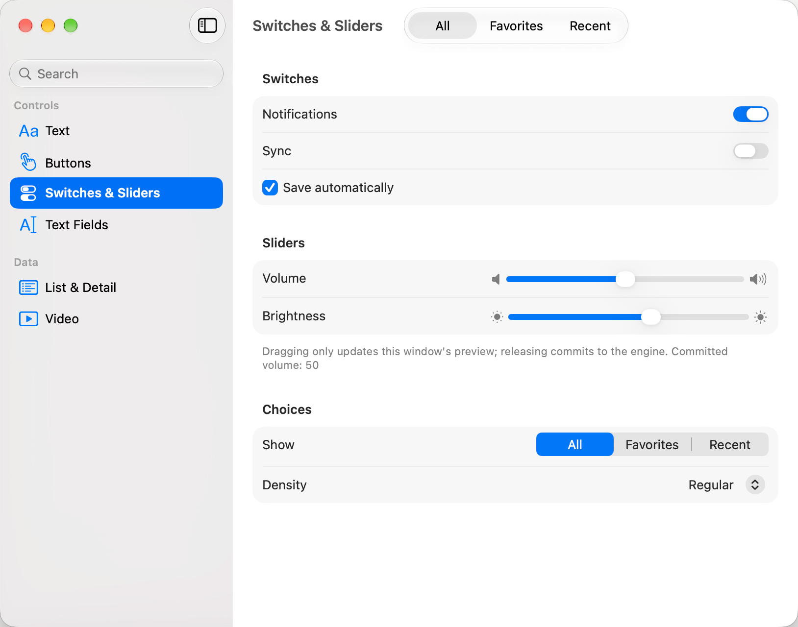
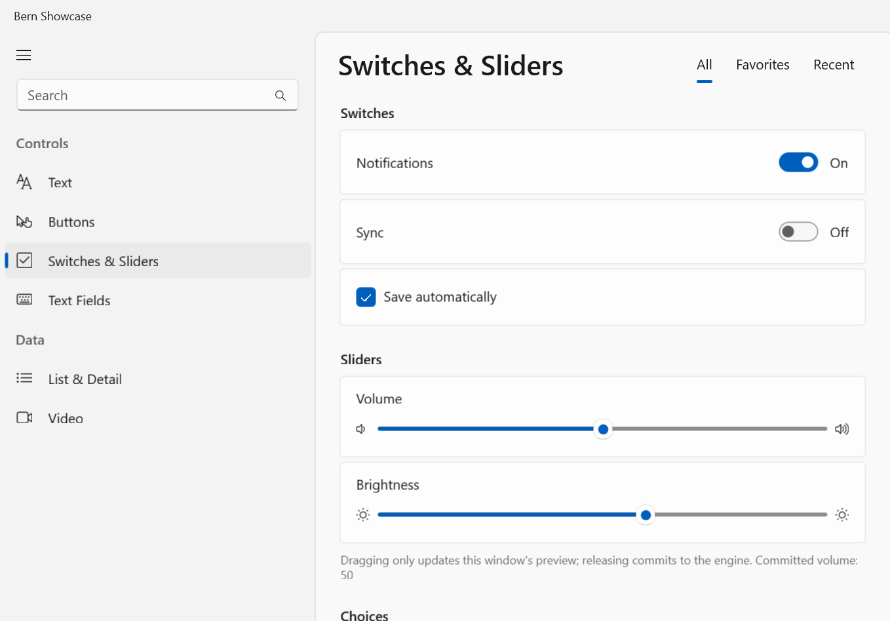
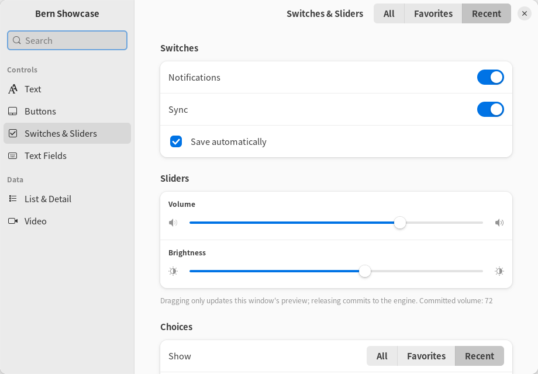
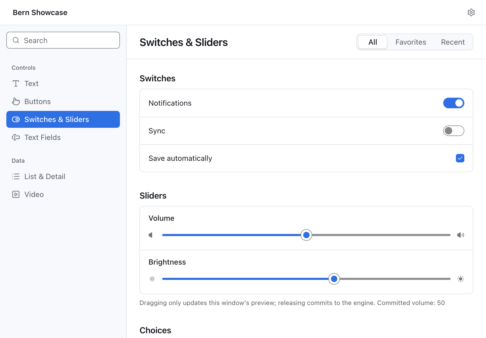
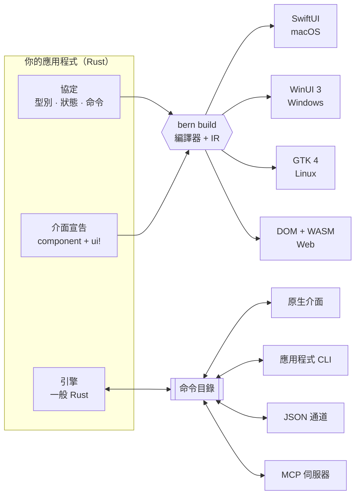
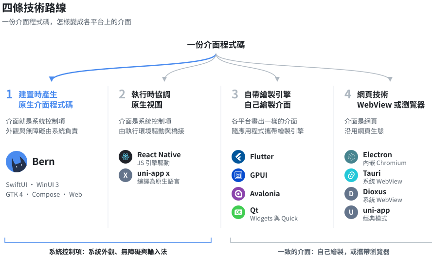
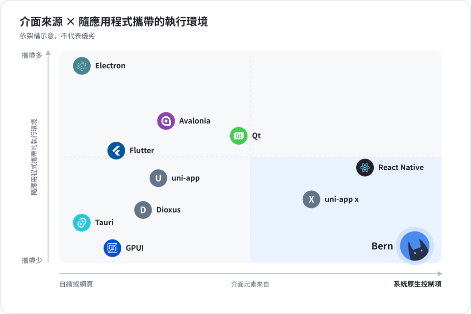
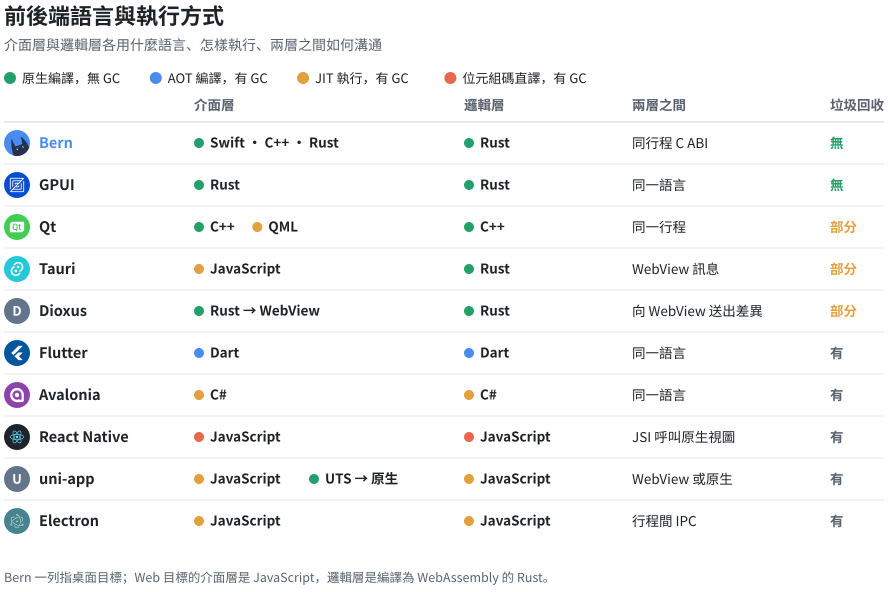
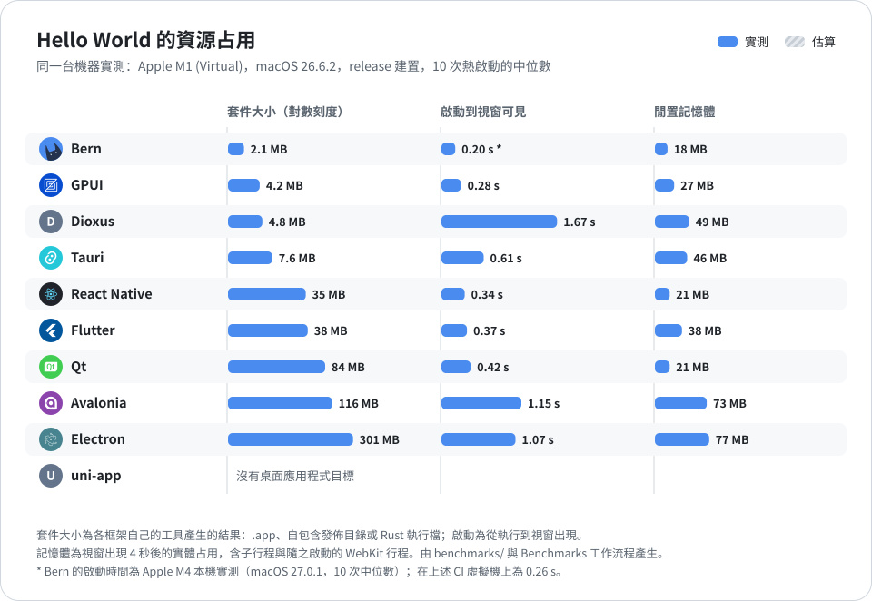

<div align="center">


<h1>Bern</h1>

<p><b>一份 Rust 宣告，編譯成每個平台自己的原生介面。</b></p>

<p>為桌面而生，為 AI 而建：SwiftUI、WinUI 3、GTK 4 與 Web。<br>
桌面上沒有 JS 引擎，沒有內嵌瀏覽器；每個按鈕，天生就是 AI 能呼叫的 MCP 工具。</p>

<p>


</p>

<p>


<a href="LICENSE"></a>

</p>

<p>
<a href="README.md">简体中文</a> ·
<a href="README.en.md">English</a> ·
<b>繁體中文</b> ·
<a href="README.ja.md">日本語</a>
</p>

<p>
<a href="#為什麼選擇-bern">為什麼選擇 Bern</a> ·
<a href="#為-ai-而建">為 AI 而建</a> ·
<a href="#實測數據">實測數據</a> ·
<a href="#與其他跨平台框架比較">比較</a> ·
<a href="#快速開始">快速開始</a> ·
<a href="Docs/Design.md">設計文件</a>
</p>

</div>

<br>

<table>
<tr>
<td width="50%" align="center"><br><sub><b>macOS</b> · SwiftUI</sub></td>
<td width="50%" align="center"><br><sub><b>Windows</b> · WinUI 3</sub></td>
</tr>
<tr>
<td width="50%" align="center"><br><sub><b>Linux</b> · GTK 4 + libadwaita</sub></td>
<td width="50%" align="center"><br><sub><b>Web</b> · DOM + WebAssembly</sub></td>
</tr>
</table>

<p align="center"><sub>同一份 <code>controls_page</code> 宣告，產生四套 UI 技術。在桌面上 Bern 不自行繪製任何像素：<br>每個開關、滑桿與側邊欄都是平台自己的標準控制項，使用平台自己的配色。</sub></p>

## 為什麼選擇 Bern

<table>
<tr>
<td width="33%" valign="top">
<h3>編譯成原生介面</h3>
一份 Rust 宣告，編譯成 SwiftUI、WinUI 3、GTK 4 與 Web。<br><br>
目標與 React Native 相近：一份程式碼，各平台都是原生控制項。做法不同：React Native 在執行時以 JS 引擎協調原生視圖；Bern 在建置時直接產生各平台自己的 UI 程式碼，執行時沒有 JS 引擎、沒有虛擬 DOM，介面就是系統控制項本身。
</td>
<td width="33%" valign="top">
<h3>為 AI 而建：寫得對，用得上</h3>
AI 寫程式時漏掉的翻譯、漏掉的介面入口、沒登記的按鈕、沒命令化的操作，都是編譯錯誤，並指向具體的檔案與行。<br><br>
AI 使用應用程式時，每個按鈕都是 MCP 工具：讀的是控制項的語意，走與滑鼠點擊相同的程式碼路徑，不靠截圖，不靠座標。
</td>
<td width="33%" valign="top">
<h3>輕到不像跨平台</h3>
桌面上不帶瀏覽器核心與 JS 引擎，商業引擎編譯成原生程式碼，在應用程式行程內執行。<br><br>
實測 release 版展示應用程式：macOS 記憶體 <b>39 MB</b>、<b>0.4 秒</b>出現視窗，整個應用程式套件 <b>2.6 MB</b>；Windows 記憶體 <b>35 MB</b>、<b>0.3 秒</b>出現視窗，整個應用程式 <b>4.2 MB</b>，不需要 .NET；整個 Web 應用程式連同 Rust 引擎 gzip 後 <b>187 KB</b>。
</td>
</tr>
</table>

## 為 AI 而建

### AI 寫程式：漏掉的，編譯器替它記著

AI 寫介面最常見的問題不是寫錯，而是寫漏：加了一個功能卻忘了在窄螢幕版面放入口，新增一段文案只寫了中文，順手掛一個回呼繞過命令。這些在別的框架裡要等到使用者發現，在 Bern 裡都過不了編譯。約束越嚴，AI 越不容易交出半成品：

| 漏掉了什麼 | Bern 怎麼處理 |
| :-- | :-- |
| 某段文案少寫了一種語言 | 編譯錯誤 B102。各語言用 `tr!` 寫在同一處、緊鄰介面，漏寫一眼可見；直接寫死的字面量報 B103（嚴格模式，預設開啟） |
| 功能在某個顯示模式下沒有介面入口 | 編譯錯誤 B201。頁面以功能契約宣告它必須提供哪些功能，編譯器逐個版面（`compact`、`expanded`）證明每個功能都有入口，寬螢幕有、窄螢幕漏也不行 |
| 契約範圍內的介面入口沒有登記到功能 | 編譯錯誤 B202。反過來同樣不行：入口執行的命令不屬於它綁定的功能報 B204 |
| 入口只出現在條件分支裡，證明不了總能用到 | 編譯錯誤 B203，除非明確寫下人工保證 |
| 想給按鈕掛一段任意程式碼 | 寫不出來。按鈕只能綁定命令目錄裡的型別化命令，控制項也不能直接改寫引擎狀態 |

錯誤訊息是給人看的，也是給 Agent 看的：編號、原因、位置都很明確，Agent 能自己改完再編譯。下面是展示應用程式的兩次真實輸出，第一次刻意刪掉一個英文翻譯，補上之後，第二次刪掉窄螢幕版面裡的「換片」選單：

```text
$ bern check
error[B102]: Missing translation
Missing language: en
Required languages: zh-Hans, en
  --> showcase-ui/src/pages.rs:13:31

$ bern check
error[B201]: Feature missing in adaptive layout
Contract: MediaFeature
Feature: Clip
compact: missing
  --> showcase-ui/src/media.rs:14:5
```

每次建置還會為每個目標輸出完整的功能涵蓋報告（`features.json`），哪些已涵蓋、哪些豁免、哪些只有人工保證，都分開列出。

### AI 使用應用程式：讀語意，不讀像素

在大多數框架裡，讓 AI 操作一個桌面應用程式意味著截圖、辨識、算座標、模擬點擊。Bern 的應用程式自帶一個 MCP 伺服器：介面上每個控制項都有穩定的名稱與角色，Agent 讀到的是結構，做的事情與使用者點擊走同一段程式碼，結果由應用程式如實回覆。

```sh
$ showcase ui inspect                 # Agent 讀到的是語意，不是像素
[{ "target": "controls_page.sync", "role": "switch", "label": "同步", "value": "false", "enabled": true, … }, …]

$ showcase ui set-bool --target controls_page.sync --value true

$ showcase window close --window settings#1
{ "outcome": "ConfirmationRequired", "message": "要存储对显示名称的更改吗？",
  "decisions": ["Save", "Discard", "Cancel"], "confirmation": "settings#1:c1", … }

$ showcase window confirm-close --window settings#1 --confirmation settings#1:c1 --decision Save
{ "outcome": "Rejected", "reason": "save_failed: invalid_name: a display name has 1 to 40 characters …" }
```

同樣的操作以 MCP 工具（`ui_inspect`、`ui_activate`、`window_close`……）提供給 Agent，商業命令也各自是一個工具（例如 `showcase_set_display_name`）。按鈕被停用、被對話框擋住、目標不存在時，Agent 收到的是明確的錯誤碼，而不是一次沒有效果的點擊。

## 實測數據

| | macOS · SwiftUI | Windows · WinUI 3 | Web · WebAssembly |
| :-- | :-- | :-- | :-- |
| 啟動到視窗可見 | 0.41 秒 | 0.32 秒 | – |
| 記憶體 | 39 MB | 35 MB | – |
| 大小 | 應用程式套件 2.6 MB（執行檔 2.3 MB），不內嵌任何框架 | 應用程式目錄 4.2 MB，引擎在執行檔內，介面框架用系統的 | 全部資源 gzip 後 187 KB，含 Rust 引擎 |

<details>
<summary>測量方法</summary>
<br>

- 對象：release 建置的展示應用程式（6 個頁面、主視窗與設定視窗、影片播放器），2026-10-11 測量，每項至少 3 次取中位數。
- macOS：Apple M4、16 GB 記憶體、macOS 27.0.1。記憶體為 `footprint` 的實體占用，即活動監視器「記憶體」欄位的口徑。
- Windows：Intel Core i5-13490F、32 GB 記憶體、Windows 11 25H2。記憶體為私人工作集，即工作管理員「記憶體」欄位的口徑。
- 啟動時間：從啟動行程到命令列讀到可見的原生視窗為止，包含引擎啟動與本機控制通道就緒。
- Windows 表中為 WinUI 3 前端（系統中有 Windows App Runtime 1.8）。沒有執行環境的系統上，同一個程式退回系統 XAML：啟動 0.54 秒，記憶體 19 MB。兩種情況都不需要 .NET 與 VC++ 執行環境，應用程式目錄只有執行檔與 400 KB 的啟動程式 DLL。

</details>

## 更多能力

<table>
<tr>
<td width="33%" valign="top">
<h3>每個操作都是命令</h3>
按鈕不能掛上任意回呼，只能綁定命令目錄中的一道型別化命令；參數、錯誤與重試策略由介面、命令列、JSON 與 MCP 共用。
</td>
<td width="33%" valign="top">
<h3>編譯期就做檢查</h3>
<code>rustc</code> 檢查每個綁定與命令參數的型別。沒有綁定命令的按鈕、任意回呼、讓控制項直接寫入引擎狀態、缺少翻譯，都無法通過編譯。
</td>
<td width="33%" valign="top">
<h3>商業邏輯留在 Rust</h3>
引擎是不依賴任何 UI 的一般 Rust 程式碼，不開視窗也能測試。在桌面上它在應用程式行程內執行，在瀏覽器中編譯為 WebAssembly。
</td>
</tr>
<tr>
<td width="33%" valign="top">
<h3>從第一天起就在地化</h3>
<code>tr!</code> 讓各語言文案緊鄰它所屬的介面。嚴格模式的建置會拒絕缺漏的翻譯；執行中切換介面語言不會遺失草稿。
</td>
<td width="33%" valign="top">
<h3>深淺色零設定</h3>
顏色來自平台主題：深淺色、強調色、高對比跟隨系統，宣告的品牌色對應為系統強調色。Web 由 Bern 的主題核心產生整套配色。
</td>
<td width="33%" valign="top">
<h3>宣告式多視窗</h3>
每個視窗有自己的草稿、關閉檢查與儲存命令；最小化、最大化、移動、調整大小也是命令，以平台的實際狀態回覆。
</td>
</tr>
</table>

<details>
<summary><b>還有：</b>影片、非同步查詢、自適應版面、型別化導覽…</summary>
<br>

- **影片**：`Video` 分別執行於 AVFoundation、Windows Media Foundation、GStreamer 與 HTML 媒體，控制列由命令驅動，播放器可以跨頁面持續播放。
- **非同步查詢**：`Query` 訂閱具備載入、空結果、失敗與重新整理狀態，只顯示最新的回覆。
- **自適應版面**：依視圖實際取得的空間選擇 `compact` 或 `expanded` 版面。
- **型別化導覽**：側邊欄、帶型別化路由的推入式導覽、分頁、工具列與選單。
- **功能契約**：宣告元件在每種版面中必須涵蓋的功能，由編譯器證明涵蓋完整。
- **隨附資源**：在 `Bern.toml` 中宣告檔案，建置時檢查，執行時依名稱定位。

</details>

## 運作方式



1. **協定**：`#[bern::protocol]` 宣告值型別、唯讀狀態，以及命令與查詢 trait。
2. **引擎**：以一般 Rust 實作這些 trait；它看不到視窗、控制項與傳輸層。
3. **介面**：`#[component]` 函式，主體是一個 `ui!` 宣告。編譯器將它們讀入共用的中介表示（IR），各目標模組從 IR 產生原生程式碼。新增目標不需要改動剖析器、IR 或你的商業邏輯。

## 程式碼一覽

<table>
<tr>
<td width="50%" valign="top">

**1 · 協定**：型別、狀態與命令

```rust
#[bern::protocol(namespace = "counter", version = 1)]
pub mod counter {
    use bern::prelude::*;

    #[state]
    pub struct State {
        pub count: i64,
    }

    #[commands]
    pub trait Commands {
        /// Add to the count.
        fn add(&mut self, by: i64) -> Result<(), CommandError>;
    }
}
```

**3 · 介面**：一個 `ui!` 宣告

```rust
#[component]
pub fn counter_view(app: counter::Client) -> impl View {
    ui! {
        Form {
            Text(content: tr! {
                "zh-Hant" => "已計數 {n} 次",
                "en" => "Counted {n} times";
                n: app.count
            })
            Button(
                id: add,
                label: tr! { "zh-Hant" => "加一", "en" => "Add one" },
                prominence: prominent
            ) => app.add(1)
        }
    }
}
```

</td>
<td width="50%" valign="top">

**2 · 引擎**：一般 Rust，不依賴 UI

```rust
use bern::CommandError;

pub struct Counter {
    state: counter::State,
}

impl Default for Counter {
    fn default() -> Self {
        Self { state: counter::State { count: 0 } }
    }
}

impl counter::Commands for Counter {
    fn add(&mut self, by: i64) -> Result<(), CommandError> {
        self.state.count += by;
        Ok(())
    }
}

impl counter::Engine for Counter {
    fn state(&self) -> &counter::State {
        &self.state
    }
}
```

**4 · 所有入口驅動同一個引擎**

```sh
counter ui inspect
counter ui activate --target counter_view.add
counter counter add --by 5
counter-mcp   # 同一份命令目錄，提供給 AI Agent
```

</td>
</tr>
</table>

`Bern.toml` 宣告語言、主題、原始碼、隨附資源與建置目標。完整範例請見[控制項展示應用程式](examples/showcase)：側邊欄應用程式，包含文字層級、按鈕、開關、滑桿、輸入框、由引擎查詢驅動的搜尋、清單到詳細資料的導覽、影片，以及具備分頁與關閉確認的設定視窗。

## 支援的平台

<table>
<tr>
<th align="left">目標</th>
<th align="left">UI 技術</th>
<th align="left">引擎</th>
<th align="left">狀態</th>
</tr>
<tr>
<td><b>macOS</b><br><code>swiftui + macos</code></td>
<td>SwiftUI，標準元件與系統樣式 · macOS 14 以上</td>
<td>應用程式行程內</td>
<td> <a href="Docs/Implementation/macOS-SwiftUI.md">實作紀錄</a></td>
</tr>
<tr>
<td><b>Windows</b><br><code>winui3 + windows</code></td>
<td>C++/WinRT：有 Windows App Runtime 1.8 時用 WinUI 3，沒有時退回系統 XAML · Windows 10 2004 以上</td>
<td>應用程式行程內（靜態連結）</td>
<td> <a href="Docs/Implementation/Windows-WinUI3.md">實作紀錄</a></td>
</tr>
<tr>
<td><b>Linux</b><br><code>gtk + linux</code></td>
<td>GTK 4.14 與 libadwaita 1.5，遵循 GNOME HIG</td>
<td>應用程式行程內</td>
<td> <a href="Docs/Implementation/Linux-GTK.md">實作紀錄</a></td>
</tr>
<tr>
<td><b>Web 應用程式</b><br><code>web</code> · <code>app</code></td>
<td>DOM，採用 Bern 自訂的視覺規範與主題核心</td>
<td>頁面內的 WebAssembly</td>
<td> <a href="Docs/Implementation/Web.md">實作紀錄</a></td>
</tr>
<tr>
<td><b>WebUI</b><br><code>web</code> · <code>ui</code></td>
<td>同一個頁面，作為獨立引擎的介面</td>
<td>經 WebSocket 連線的引擎宿主</td>
<td> <a href="Docs/Implementation/Web.md">實作紀錄</a></td>
</tr>
<tr>
<td><b>下一步</b></td>
<td><code>flutter + macos</code>（驗證後端可替換），之後是 iOS、Android 與 HarmonyOS</td>
<td>–</td>
<td> <a href="Docs/Adaptation/README.md">適配規範</a></td>
</tr>
</table>

未指定 UI 技術時採用平台的預設技術；預設技術無法使用時直接回報錯誤，不會悄悄換成另一套技術。

## 與其他跨平台框架比較

<p align="center">
<a href="https://github.com/zed-industries/zed/tree/main/crates/gpui"></a>
<a href="https://dioxuslabs.com"></a>
<a href="https://flutter.dev"></a>
<a href="https://reactnative.dev"></a>
<a href="https://uniapp.dcloud.net.cn"></a>
<br>
<a href="https://www.electronjs.org"></a>
<a href="https://tauri.app"></a>
<a href="https://avaloniaui.net"></a>
<a href="https://www.qt.io"></a>
</p>

每個框架都在回答同一個問題：一份程式碼，怎樣變成各平台上的介面。回答不同，取捨也不同。以下依據各專案的官方文件整理；大小與記憶體隨版本與設定變化很大，這裡只比較結構上的差別，Bern 自己的數字見[實測數據](#實測數據)。

<picture>
<source media="(prefers-color-scheme: dark)" srcset="Docs/Assets/compare/routes-zh-Hant-dark.svg">

</picture>

前兩條路線得到的是系統控制項：外觀、無障礙、輸入法、深淺色都由系統負責，代價是各平台控制項不完全相同。後兩條路線在每個平台上畫出一樣的介面，代價是要自己追隨各平台的設計與行為，或者攜帶一個瀏覽器。

<picture>
<source media="(prefers-color-scheme: dark)" srcset="Docs/Assets/compare/landscape-zh-Hant-dark.svg">

</picture>

上圖依架構示意，不代表優劣：橫軸是介面元素來自系統控制項，還是框架自繪或網頁；縱軸是應用程式要隨身攜帶多少執行環境（瀏覽器核心、JS 引擎、繪製引擎、語言執行環境）。

### 技術路線

| 框架 | 寫介面 | 商業邏輯 | 介面怎麼畫 | 隨應用程式攜帶 | 授權 |
| :-- | :-- | :-- | :-- | :-- | :-- |
| **Bern** | Rust（`ui!` 宣告） | Rust | 建置時產生 SwiftUI、WinUI 3、GTK 4 與 Web 程式碼，介面是系統控制項 | 無；WinUI 3 也取自系統，沒有時退回系統 XAML | MIT |
| **GPUI** | Rust | Rust | 自帶 GPU 繪製（Metal、Vulkan、DirectX） | 無額外執行環境 | Apache-2.0 |
| **Dioxus** | Rust（RSX，類 React） | Rust | 桌面與行動端預設使用系統 WebView，Web 為 WebAssembly；原生繪製器 Blitz 仍在實驗 | 依賴系統 WebView | MIT / Apache-2.0 |
| **Flutter** | Dart | Dart | 自帶引擎（Impeller、Skia）繪製 Material 與 Cupertino 風格的元件 | Flutter 引擎 | BSD-3-Clause |
| **React Native** | JavaScript / TypeScript（React） | JavaScript / TypeScript | 原生視圖，執行時由 JS 協調 | Hermes JS 引擎 | MIT |
| **uni-app** | Vue | JavaScript / TypeScript；uni-app x 用 UTS | 經典模式為 WebView；uni-app x 編譯為 Kotlin、Swift 等原生語言，以原生視圖繪製 | 框架執行環境 | Apache-2.0 |
| **Electron** | HTML / CSS / JavaScript | JavaScript / TypeScript（Node.js） | 內嵌 Chromium | Chromium 與 Node.js | MIT |
| **Tauri** | 任意網頁前端 | Rust | 系統 WebView（WebView2、WKWebView、WebKitGTK） | 不帶瀏覽器核心，依賴系統 WebView | MIT / Apache-2.0 |
| **Avalonia** | XAML 與 C# | C# / .NET | 自帶 Skia 繪製 | .NET 執行環境（可自包含或 Native AOT） | MIT |
| **Qt** | C++ 與 QML（也可用 Python） | C++ | Qt Widgets 模擬各平台風格；Qt Quick 自繪場景圖 | Qt 函式庫 | LGPLv3 / GPLv3 / 商業授權 |

### 平台與能力

● 支援　◐ 部分支援或依賴社群　— 不支援

| 框架 | macOS | Windows | Linux | 行動端 | Web | 原生外觀 | 內建 MCP | 編譯期檢查 |
| :-- | :-: | :-: | :-: | :-: | :-: | :-: | :-: | :-: |
| **Bern** | ● | ● | ● | — | ● | ● | ● | ● |
| **GPUI** | ● | ● | ● | — | — | — | — | — |
| **Dioxus** | ● | ● | ● | ● | ● | — | — | — |
| **Flutter** | ● | ● | ● | ● | ● | — | — | — |
| **React Native** | ◐ | ◐ | — | ● | ◐ | ● | — | — |
| **uni-app** | — | — | — | ● | ● | ◐ | — | — |
| **Electron** | ● | ● | ● | — | — | — | — | — |
| **Tauri** | ● | ● | ● | ● | — | — | — | — |
| **Avalonia** | ● | ● | ● | ● | ● | — | — | — |
| **Qt** | ● | ● | ● | ● | ● | ◐ | — | — |

- **行動端**：iOS 與 Android。React Native 的桌面版本由微軟維護，uni-app 另涵蓋小程式與鴻蒙，Bern 的行動端在規劃中。
- **原生外觀**：控制項就是平台自己的控制項，外觀、無障礙與輸入法由系統提供。Qt Widgets 與 uni-app x 接近原生，記為部分。
- **內建 MCP**：框架自帶、面向執行中介面的 MCP 伺服器與命令列。其他框架可以藉助無障礙介面，或 Playwright、Flutter Driver 等測試工具從外部自動化。
- **編譯期檢查**：翻譯缺漏、功能在某個版面沒有入口、入口沒有登記功能，都由編譯器直接報錯（見[為 AI 而建](#為-ai-而建)）。其他框架多藉助 lint、翻譯工具或測試發現這類問題。
- **成熟度**：Electron 與 Qt 非常成熟；Flutter、React Native、uni-app、Tauri 與 Avalonia 成熟；Dioxus 發展中；GPUI 支撐著 Zed 編輯器，通用元件仍在早期；Bern 是早期預覽。

### 效能與資源

介面層與邏輯層用什麼語言、怎樣執行，決定了執行時開銷的上限：原生編譯且沒有垃圾回收的語言最省，JIT 與位元組碼直譯的語言需要攜帶引擎、占用更多記憶體。

<picture>
<source media="(prefers-color-scheme: dark)" srcset="Docs/Assets/compare/languages-zh-Hant-dark.svg">

</picture>

同樣一個只顯示一行字的視窗，各框架的套件大小、啟動時間與記憶體差別很大。Bern 一列是實測；其他框架目前是紙面估算，之後會在 M4 上以 CI 統一實測後取代。

<picture>
<source media="(prefers-color-scheme: dark)" srcset="Docs/Assets/compare/resources-zh-Hant-dark.svg">

</picture>

### 怎麼選

<table>
<tr>
<td width="50%" valign="top">
<br>
<b>適合</b>：Web 團隊、需要最成熟的生態與最一致的跨平台表現。<br>
<b>代價</b>：每個應用程式帶一份 Chromium 與 Node.js，大小與記憶體都偏大。
</td>
<td width="50%" valign="top">
<br>
<b>適合</b>：想保留網頁前端，又要小體積與 Rust 後端。<br>
<b>代價</b>：介面仍是網頁；各平台系統 WebView 的引擎不同，需要分別測試。
</td>
</tr>
<tr>
<td valign="top">
<br>
<b>適合</b>：行動優先、要求各平台像素級一致。<br>
<b>代價</b>：控制項是自繪的，桌面上的系統觀感與行為要自己追隨；需要使用 Dart。
</td>
<td valign="top">
<br>
<b>適合</b>：React 團隊做行動應用程式，要原生控制項。<br>
<b>代價</b>：以行動端為主，桌面依賴微軟維護的版本，沒有 Linux；執行時有 JS 引擎與橋接。
</td>
</tr>
<tr>
<td valign="top">
<br>
<b>適合</b>：.NET 與 XAML 團隊，需要跨桌面一致的外觀。<br>
<b>代價</b>：自繪介面，不是系統控制項；需要 .NET 執行環境或 AOT 編譯。
</td>
<td valign="top">
<br>
<b>適合</b>：C++ 專案、工業與嵌入式、需要數十年的穩定累積。<br>
<b>代價</b>：授權需要留意（LGPL 或商業）；Qt Quick 是自繪介面。
</td>
</tr>
<tr>
<td valign="top">
<br>
<b>適合</b>：追求極致效能的 Rust 桌面應用程式，例如編輯器。<br>
<b>代價</b>：自繪介面，常用控制項與無障礙要自己補；只支援桌面。
</td>
<td valign="top">
<br>
<b>適合</b>：喜歡 React 寫法的 Rust 全端專案，一套程式碼涵蓋 Web、桌面與行動端。<br>
<b>代價</b>：桌面與行動端目前是 WebView 介面；原生繪製器仍在實驗。
</td>
</tr>
<tr>
<td valign="top">
<br>
<b>適合</b>：中國大陸多端（小程式、App、H5、鴻蒙）一套程式碼。<br>
<b>代價</b>：沒有桌面應用程式目標；經典模式的 App 介面是 WebView。
</td>
<td valign="top">
<br>
<b>適合</b>：桌面應用程式要每個平台的系統外觀，商業邏輯寫在 Rust 裡，並希望 AI 既能寫它、也能用它。<br>
<b>暫不適合</b>：現在就需要行動端，或依賴成熟的第三方元件生態。Bern 仍是早期預覽。
</td>
</tr>
</table>

## 快速開始

需要 Rust 1.99（由 `rust-toolchain.toml` 固定），以及所建置目標的工具鏈。每次建置也會在 `target/bern/<目標>/bin/` 中產生應用程式 CLI 與 MCP 伺服器。

<details open>
<summary><b>macOS</b> · Xcode 26 或更新版本</summary>

```sh
cargo run -p bern-cli -- build --manifest examples/showcase/Bern.toml --target macos
open target/bern/macos/Showcase.app
```

</details>

<details>
<summary><b>Windows</b> · Visual Studio 的「使用 C++ 的桌面開發」</summary>

```powershell
cargo run -p bern-cli -- build --manifest examples/showcase/Bern.toml --target windows
target\bern\windows\Showcase\showcase.exe
```

首次建置時以 Windows SDK 的 `cppwinrt` 產生 C++/WinRT 標頭檔並快取。應用程式目錄只有執行檔、400 KB 的啟動程式 DLL 與資源，不需要 .NET，也不隨附 Windows App SDK。

</details>

<details>
<summary><b>Linux</b> · GTK 4.14 與 libadwaita 1.5 的開發套件</summary>

```sh
sudo apt install libgtk-4-dev libadwaita-1-dev gstreamer1.0-libav
cargo run -p bern-cli -- build --manifest examples/showcase/Bern.toml --target linux
target/bern/linux/Showcase/showcase
```

</details>

<details>
<summary><b>Web</b> · <code>rustup target add wasm32-unknown-unknown</code></summary>

```sh
# 引擎編譯為 WebAssembly，在頁面內執行
cargo run -p bern-cli -- build --manifest examples/showcase/Bern.toml --target web_app
python3 -m http.server 8765 --bind 127.0.0.1 --directory target/bern/web_app

# 或者頁面作為獨立引擎宿主的介面
cargo run -p bern-cli -- build --manifest examples/showcase/Bern.toml --target web_ui
target/bern/web_ui/bin/showcase-host
```

</details>

### 從外部驅動執行中的應用程式

```sh
showcase ui inspect                                          # 列出已掛載的控制項
showcase ui select --target main_window.pages --option Controls
showcase ui set-bool --target controls_page.sync --value true
showcase showcase search-library --text mo                   # 引擎查詢
showcase window open --kind settings
showcase window list                                         # 視窗的實際狀態
showcase-mcp                                                 # 經 stdio 的 MCP 伺服器
```

只有目標宣告了 `channels = ["ipc"]` 時才會啟動控制通道；未宣告則應用程式不監聽任何連接埠。

## 路線圖

| 階段 | 內容 | 狀態 |
| :-- | :-- | :-- |
| 1 · 2 | 編譯邊界驗證；macOS SwiftUI，介面、CLI、JSON 與 MCP 驅動同一引擎 |  |
| 3 | Web 視覺規範、主題核心、WebAssembly 應用程式與 WebUI 兩種建置 |  |
| 4 | 自適應版面、選單、功能契約、執行時切換語言 |  |
| 5 | 其他原生前端：GTK 4（已完成）· WinUI 3（已完成）· `flutter + macos`（下一步） |  |
| 6 | 元件庫、打包、增量建置、開發工具，接入 NipaPlay 3.0 |  |

## 儲存庫結構

<details>
<summary>crate 與目錄</summary>
<br>

| 路徑 | 說明 |
| :-- | :-- |
| `crates/bern` | 應用程式使用的門面 crate：巨集、值、媒體、資源 |
| `crates/bern-macros` · `bern-syntax` | `#[component]`、`ui!`、`tr!` 與受限的宣告語法 |
| `crates/bern-compiler` · `bern-ir` | 將宣告讀入共用 IR 並執行檢查 |
| `crates/bern-protocol` · `bern-command` · `bern-runtime` | 命令目錄、引擎宿主與 UI 工作階段執行環境 |
| `crates/bern-ffi` | 原生前端呼叫的行程內 C 介面 |
| `crates/bern-backend-swiftui` · `-winui3` · `-gtk` · `-web` | 目標模組：產生器及其執行環境 |
| `crates/bern-gtk` | GTK 執行環境，只在產生的 Linux 應用程式中編譯 |
| `crates/bern-adapter-cli` · `-mcp` · `-json` | 從命令目錄衍生的入口 |
| `crates/bern-transport-ipc` · `-ws` | 本機控制通道與 WebSocket 傳輸 |
| `crates/bern-theme` | 為沒有原生主題的目標提供的 Bern 色彩演算法 |
| `examples/showcase` | 在各平台上使用的控制項展示應用程式 |
| `Docs/` | 設計文件、平台適配規範與實作紀錄 |

</details>

## 開發

```sh
cargo fmt --all --check
cargo clippy --workspace --all-targets -- -D warnings
cargo test --workspace
```

測試包含必須編譯失敗的宣告，並在安裝了相應工具包的環境中對產生的應用程式做型別檢查：以 Xcode 檢查 Swift 6，以開發套件檢查 GTK，在 Windows 上以 MSVC 編譯產生的兩套前端。

## 文件

- [設計文件](Docs/Design.md)：目標、架構、元件、主題、命令、視窗與媒體
- [適配規範](Docs/Adaptation/README.md)：Apple、Windows 與 Linux、Web、Android、HarmonyOS
- 實作紀錄：[macOS](Docs/Implementation/macOS-SwiftUI.md) · [Windows](Docs/Implementation/Windows-WinUI3.md) · [Linux](Docs/Implementation/Linux-GTK.md) · [Web](Docs/Implementation/Web.md)

設計與實作文件以簡體中文撰寫。

## 授權

[MIT](LICENSE) © 2026 MCDFSteve

<div align="center">
<br>
<sub>Bern 仍處於早期開發階段，API 與宣告語法可能還會變動。</sub>
</div>
